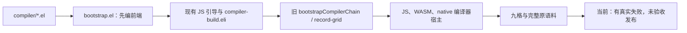
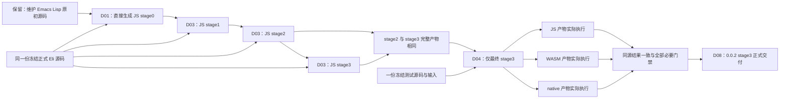
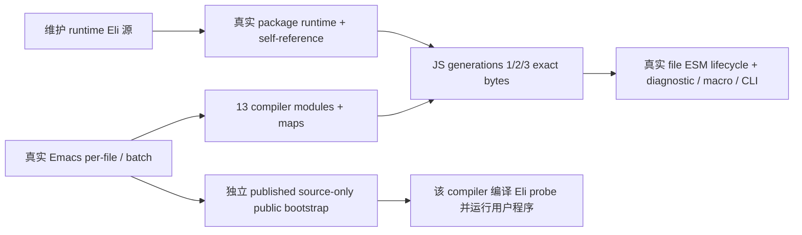

# Eliscript 0.0.2：JavaScript 三段式自举与三种输出

> 更新：2026-10-19。
> 本文件是本次交付的唯一有效施工计划，替代旧 3×3 计划。
> 用户已明确启动本 Goal。A/B/C 已写齐，当前 D：统一整合与实际验收。

## 1. 最终目标和边界

交付以 JavaScript 运行的 Eliscript 正式编译器。它由维护中的 Emacs Lisp
原初编译器引导，依次生成 stage0、stage1、stage2、stage3；stage2 和 stage3
的编译器产物逐字节相同。只使用最终 stage3，对同一套 Eliscript 测试源码
生成 JavaScript、WASM、native 产物，并实际执行、验证结果一致。

**取消本次编译器的 WASM/native 运行形式，取消九格、三条宿主自举链，以及
由此产生的完整编译器二进制初始化和性能验收。** 这不取消 WASM/native
代码生成器，也不取消这两种用户程序产物的运行时、语义和执行验收。
既有取消项的源码和真实证据保留，不为清理旧设计重新开发，不计当前工作量。
`native-wasm-feasibility.md` 此后仅保留历史分析和证据，不再驱动施工。

### 1.1 用户要求逐项落实

| ID | 要求及本计划的确定含义 | 验收 |
| --- | --- | --- |
| R01 | 一份 Emacs Lisp 原初编译器源码，只要求将 Eliscript 编译到 JavaScript | A02 |
| R02 | 一份 Eliscript 正式编译器源码，可输出 JS/WASM/native；编译器自身只要求以 JS 运行 | A03、A05 |
| R03 | bootstrap 由 Emacs 驱动，生成 JavaScript stage0，称原初编译器产物 | A02 |
| R04 | stage0 编译正式编译器的 Eliscript 源码，生成 JS stage1 | A03 |
| R05 | stage1 编译同一份正式源码，生成 JS stage2 | A03 |
| R06 | stage2 编译同一份正式源码，生成 JS stage3；最终发布的是 0.0.2 stage3 | A03、A08 |
| R07 | 严格比较 stage2 与 stage3，编译器产物不得有区别，完成三段式自举 | A04 |
| R08 | 只使用最终 stage3，生成并实际执行三种目标产物，验证输出一致 | A05 |
| R09 | stage1、stage2 与 stage3 使用同一份正式源码；不对 stage1/2 增加 WASM/native 输出验收 | A03、A05 |
| R10 | 采用常见三段式 bootstrap 的原理：原初引导，随后两次自编译并检查固定点 | A02–A04 |
| R11 | 两份维护实现：Emacs Lisp 原初编译器、Eliscript 正式编译器；不增加第三套手写编译器 | A02、A07 |
| R12 | 三个输出目标使用同一份测试代码和输入，不分别维护简化版或替代算法 | A05、A06 |
| R13 | 自举产物对比由程序完整执行，并提供人工可独立运行的只读复核入口；缺失、额外或篡改产品不能通过 | A04、A08 |

这里的 stage0 是 Emacs Lisp 编译器**编译正式编译器的 Eliscript 源码后得到的
JavaScript 产物**。不要求把 Emacs Lisp 编译器自身转译成 JavaScript，也不
引入 Emacs Lisp 解释器。stage0 可能包含随正式源码生成的后端模块，但只承担
JS 引导；不把它的 WASM/native 输出能力列为验收条件。

### 1.2 语义决定：优先保证 Eliscript 统一性

Eliscript 的已定义行为优先于各 JS 宿主的偶然差异；该决定同样适用于
数学方法缺失或实现错误、Unicode 数据版本及其他同类问题。编译器和运行时
应通过自身兼容实现与转换保持 JS/WASM/native 同源程序结果一致，不能以
“宿主原生行为”为由放行 Eliscript 的差异、跳过断言或更改独立黄金。
适配须保留用户显式覆盖及原求值、转换、异常、副作用和身份合同。

这项决定替代旧九格记录中尚待选择“保留原生还是统一”的悬而未决事项；
不恢复旧编译器宿主或九格工作。现有 Math/Unicode 的 Eli 兼容实现继续复用，
仅修复最终三种产物验收所需的缺口，不重做已通过的无关能力。
需要直接暴露 JS 宿主特有行为时，可增加明确命名和文档说明的 JS 专用互操作
接口，并与可移植 Eliscript 接口分开；本次不为可选接口扩大工作范围。

- [x] 决策已纳入唯一计划及 Agent 规则。
- [ ] A05/A06：最终 stage3 实际三输出的原 Math/Unicode 及其他受影响语料一致；兼容 helper 的单独通过不能替代。

### 1.3 阶段定义

| 阶段 | 生成者 | 输入 | 编译器产物的运行形式 | 本次必须证明的行为 |
| --- | --- | --- | --- | --- |
| 原初源码 | 维护中的 Emacs Lisp | 正式编译器 `.eli` | Emacs 内运行 | 能从源码生成 stage0 JS |
| stage0 | Emacs Lisp 原初编译器 | 冻结的正式 `.eli` | JavaScript | 真实生成 stage1 JS |
| stage1 | stage0 | 同一份正式 `.eli` | JavaScript | 真实生成 stage2 JS |
| stage2 | stage1 | 同一份正式 `.eli` | JavaScript | 真实生成 stage3 JS；参与固定点比较 |
| stage3 | stage2 | 同一份正式 `.eli` | JavaScript | 与 stage2 产物相同；最终三输出与发布验收 |

stage1/2 不运行各自的一整套三目标语料，也不生成 WASM/native 编译器。
它们的必要执行就是参与自举链。固定点不额外要求 stage0==stage1 或
stage1==stage2；不能因此给本次目标增加一条不必要的失败门槛。

## 2. 当前基线与真实缺口

基线分支为 `feat/managed-project-linking`，HEAD 为
`678a52c79bc133d09a0c973b97b9b1b0141ef4a7`。本计划建立时有 316 个
未提交路径，包含既有源码、测试、生成物迁移和其他未交付内容；这只是
工作区快照，不能拿文件数计算完成率。提交本计划不能顺带提交这些代码。

已有成果可以复用，不能从头重写：

- Emacs Lisp 原初前端、Eliscript 正式前端、优化层、JS/WASM/native 发射器、
  托管运行时、项目/宏/诊断/源码映射和大量测试已有实现。
- 旧源码曾实际通过 JS 三代固定点；这是路线可行性的历史证据，不能替代
  当前源码和新 stage0–stage3 定义的正式验收。
- 当前正式源码图基线为 27 个模块；已有 53 份 literal 依赖声明和 794 条
  原始语料。数量来自当前清单，新增必要源码和用例后必须重新冻结，不能把
  这些数字写成阻止正常新增的常量。
- 当前已有完整 JS 项目生成、IR 保存、认证载入和单 producer/单 target
  语料执行器；可以复用，不能再用旧九格入口包装新流程。
- 已取消并回收本对话的 WASM/native 编译器宿主进程，保留原始成功、失败
  和取消证据；取消不能改写为编译成功。

仍会影响新范围的已知缺口：

| 缺口 | 当前证据 | 本次如何处理 |
| --- | --- | --- |
| stage0 还不是新定义的完整正式源码引导 | `bootstrap.el` 目前只由 Emacs 直接编前端，再借后续工具编其他模块 | D01、D02：Emacs 直接生成完整 stage0，移除该新链对旧产物的依赖 |
| 旧自举调度含三个宿主及额外固定点条件 | 旧 `bootstrapCompilerChain` 接受旧 seed，要求每相邻代相同；旧 grid 会构建二进制编译器 | D03、D04：新增薄层纯 Eli JS 自举及最终三输出调度 |
| 完整目标程序仍有容量/初始化失败 | 最新六文件集中结果中，raw runtime 16/16、native adapter 11/11、原初始化 4 项通过；完整 sequence 仍未通过；新增低槽压力也失败 | D05：保留原输入和预算，一次定位并修复真正阻塞三输出的缺陷，不能把此前 slab 代码写成已解决 |
| Math/Unicode 一致性仍有真实失败 | 原整轮中四个相关记录未通过，不能修改模型或结果 hash 冒充通过 | D05：按 1.2 已确定的 Eliscript 统一语义，通过自身兼容实现解决，保原同源语料和预期；最终三输出仍须实际验收 |
| 最终门禁和发布尚未闭合 | 当前源码无新定义的 stage2==stage3、stage3 三输出、全门禁及签名发布证据 | D06–D08：统一最后验收和交付 |

历史数值性能通过报告保留；困难性能和新的吞吐优化不阻塞本次功能交付，
也不改写为已通过。取消编译器二进制宿主后，不再为其初始化、GC 或吞吐
另开优化任务。新语法、0.1.0、外部代码生成后端不属于本次目标。

### 2.1 本次读到的源文件快照

下面是本计划的行号基线；实际施工后更新新位置，不能照旧行号盲改。

| 文件 | 基线锚点 | SHA-256 |
| --- | --- | --- |
| `tools/backends/bootstrap.el` | L10 `eliscript-backend-bootstrap`，L98 前端直接编译循环 | `2d764e113a0b89bacef1258b8d7cf0a46625632766b126501d7c9a1c43d7da6a` |
| `tools/backends/compiler-build.eli` | L117 `loadCompilerSources`，`buildIndependentCompiler` | `080f6b1ef8afc2999d459788fdb80c69030d57dbea30c9a48d9c0185c7a0763d` |
| `tools/backends/eliscript/compiler-matrix.eli` | L321 `archiveProduct`，L708 `runCompilerMatrixCell` | `e179c88cee4ada08177f12a2e1eed489d26980e0d30f9d264cfac6b08b567666` |
| `bootstrap/runtime/memory.eli` | `value-module-begin`、`heap-module-cell-read`、namespace reader | `5c8ae63f9af2f4b5dcb8e1ccab47df60a3c0aba445a6c8a5e89446c1c80aa56b` |

### 2.2 当前源码树和调用流程

```text
compiler/*.el                              原初读入/展开/分析/降低/JS 发射
compiler/eliscript.el                      编译及 Source Map 入口
bootstrap/compiler/*.eli                   正式编译器前端
bootstrap/backends/*.eli                   共享层、JS 所需支持、WASM/native 发射
bootstrap/host/compiler-session.eli        正式编译器请求协议
bootstrap/host/compiler-tools.eli          结构化工具协议
bootstrap/runtime/memory.eli               目标程序的共同运行时
stdlib/*.eli                              标准库与托管 literal 源码
tools/backends/bootstrap.el                现有引导入口
tools/backends/compiler-build.eli           源图、编译、IR/产物保存
tools/backends/compiler-bootstrap.mjs       现有认证/归档及旧三宿主调度
tools/backends/eliscript/compiler-matrix.eli 单 producer/target 执行器及旧矩阵
tools/backends/eliscript/compiler-corpus*.eli 原语料、执行/宿主适配
tests/eliscript/*.eli                      维护中的工具及运行时测试
tests/*.el                                原初编译器和 Emacs 测试
Makefile                                  当前统一门禁
.github/workflows/*.yml                    已有平台、浏览器 CI
```

生成 JS、编译阶段目录、依赖缓存未列为源码；均不得作为编译器维护源。



## 3. 确定的目标结构与接口

### 3.1 固定输入和产物边界

1. `bootstrap.el` 从当前维护中的 `.el` 启动，枚举正式 Eli 源图并生成 stage0；
   不允许拿发行版、旧 JS artifact、Bun 打包结果或 wasm/native 编译器代替。
2. stage0 的正式源码清单与 `loadCompilerSources` 一致。JS 驱动开始时只捕获
   一次完整图、runtime/literal 源和构建配置，核对 stage0 已编模块的源码身份，
   调用既有归档能力冻结输入；stage1/2/3 不再各自读一遍可变工作区。
3. 全链 `host=target="javascript"`，固定 JS 引擎、编译选项、模块 ID 和诊断
   文件名。WASM/native 只出现在最终用户程序的 `outputTargets` 中。
4. JS 及 Source Map 的逻辑文件名固定为 canonical module ID / 原相对源码名。
   不把 `stage2`/`stage3` 的物理目录名写入代码或 map；不能事后删除路径、
   时间或差异字段来获得“相同”。
5. 固定点比较所有编译器可执行模块、maps、宏来源、必需运行数据及声明资产的
   完整文件集合和原始字节；另外核对正式源图、保留的 IR/canonicalIR。
   同 SHA 只作索引，仍核对完整路径集合、长度和实际文件。
6. 控制收据中的阶段号、生成者、存放目录和日志是构建过程信息，与编译器
   产物分开存储，事先定义边界；它们可以不同，但不能用这个例外排除编译器
   模块、Source Map 或运行所需数据。
7. 最终三输出比较实际行为，不比较 JS 文本、WASM 字节与机器码是否相同。
   Number 使用精确约定，保留 NaN、正负零、无穷和次正规数；错误类型、
   位置、求值/副作用次序、集合、Unicode、宏、项目及资源恢复按原合同检查。

### 3.2 新接口及记录结构

所有新增实现仅为 `.el` / `.eli`。下面名称、字段和默认值是施工合同，
新增文件尚不存在，不得将计划接口当作已有 API 使用。

| 位置 / 新接口 | 参数与返回 | 责任、状态和错误 |
| --- | --- | --- |
| `bootstrap.el`：`eliscript-backend-bootstrap-stage0` | `output-root`；返回 stage0 manifest 相对路径 | Emacs 直接编正式源码图；写 JS/map 和源码/产物 SHA；任一失败使 stage0 非成功，不调用旧 seed artifact |
| 新 `bootstrap-js-stages.eli`：`bootstrapJsStages` | `{stage0ManifestPath, sourceRoot, outputRoot, signal}` → `{manifestPath, stage3MetadataPath}` | 认证 stage0，捕获/冻结输入，顺序生成三代；每代只开一个 JS producer，保存后关闭；错误原值保留、当代标 failed |
| 同文件：`compareJsFixedPoint` | `{stage2, stage3, sourceIdentity}` → 固定点收据 | 预先定义的全部产品文件及 IR 逐项精确比较；缺文件、额外文件、篡改、输入变化均失败 |
| 新 `stage3-targets.eli`：`runStage3Targets` | `{stage3MetadataPath, bootstrapManifestPath, corpusRecordsPath, outputRoot, nativeTarget, signal}` → 三目标汇总路径 | 先认证固定点与 stage3；固定 `host="javascript"`，只对三 target 调既有 `runCompilerMatrixCell`；独立 session、同一语料，完整收集可独立得到的失败 |

局部状态不得隐藏在全局变量中：`sources` 是本批唯一冻结图；`previousArtifact`
初值为认证 stage0；`stageIndex` 顺序为 1/2/3；`stages` 只保小记录/路径；
`producer` 打开后在 finally 关闭，关闭失败另记且不得覆盖 false/undefined
等原始异常。每代完成后不保留上一代的大型 IR/debug 对象图。

引导收据格式为 `eliscript-js-bootstrap` v1，包含：

```text
status: created | building | failed | cancelled | accepted
seedSourceIdentity: 原初 .el 与引导源的 SHA 清单
formalSourceIdentity: 冻结正式源码、runtime/literal 与配置身份
stages[]:
  stage: 0 | 1 | 2 | 3
  host: javascript
  target: javascript
  producer: emacs-lisp | stage0 | stage1 | stage2
  status: pending | building | built | failed | cancelled
  metadataPath, inputIdentity, productIdentity, error
fixedPoint:
  from: 2
  to: 3
  status: pending | identical | different | failed
  comparisonPath
finalAcceptance:
  status: pending | running | passed | failed
  targets: javascript, wasm, native
  reportPath
```

路径存仓库/批目录相对路径，身份来自真实文件和实际 producer，不能手填。
已有 IR 检查点和归档能力继续使用；失败只记录事实，不修改测量、源码 SHA、
产物 SHA、golden 或原错误。有效的已完成阶段可在同一冻结输入内复用，
源码/选项/必需文件身份改变即判失效，不盲目重新运行未变失败。

stage0 每个模块的发射调用固定为以下形态；变量来自已冻结的模块记录，
不从输出目录拼出逻辑文件名：

```elisp
(eliscript-compile-string-with-source-map
 source relative-filename module-id relative-filename)
```

### 3.3 目标源码树和数据流

```text
compiler/*.el                                   保留：原初源码，只要求 JS
bootstrap/compiler/*.eli                        保留：唯一正式前端源码
bootstrap/backends/*.eli                        保留：正式三目标后端
bootstrap/host/*.eli                            保留/必要迁移：正式协议与 CLI
bootstrap/runtime/memory.eli                     D05：只修真实目标程序阻塞
tools/backends/bootstrap.el                     D01：直接 stage0 与新入口
tools/backends/eliscript/bootstrap-js-stages.eli  D02/D03：新增 JS 三段自举
tools/backends/eliscript/stage3-targets.eli       D04：新增最终三输出薄调度
tools/backends/eliscript/compiler-matrix.eli      复用 runCompilerMatrixCell
tests/eliscript/bootstrap-js-stages.eli          D02/D03：完整引导/固定点 B
tests/eliscript/stage3-targets.eli                D04：同源三输出 B
tests/eliscript/managed-*.eli                    D05：保留/补齐必要运行时 B
tests/eliscript/compiler-*.eli                   D05：保留原语言/项目/工具 B
AGENTS.md                                       D00：当前目标与唯一入口
Makefile、现有 CI 配置、契约与发布配置             D06–D08：统一接线
dist/bootstrap-release/                         生成/忽略，不提交 Git
  stage0/ stage1/ stage2/ stage3/
  sources/ bootstrap.json fixed-point.json targets/
```



## 4. 精确施工差异与接线

| ID | 文件与基线锚点 | 具体变化 | 依赖 / 验收 |
| --- | --- | --- | --- |
| D00 | `AGENTS.md`；本文件新建 | 把当前目标改成 JS stage0–3 + 最终三输出；旧九格只作历史，不能被旧 Goal 自动恢复 | R01–R12 / A01 |
| D01 | `tools/backends/bootstrap.el` L10、L98；`compiler/eliscript.el` L60 | 增加直接 stage0 入口；枚举与 `loadCompilerSources` 相同的 compiler/backends/host `.eli`。按 `(source, relativeFilename, moduleId, relativeFilename)` 调 `eliscript-compile-string-with-source-map`，保存原 emission；不用输出目录相关的 compile-file map 路径。生成 stage0 manifest；不调用旧 seed-product 替代 Emacs | D00 / A02 |
| D02 | 新 `tools/backends/eliscript/bootstrap-js-stages.eli`；`bootstrap.el` 现有 tools 映射 | 定义上述输入、manifest 和认证；捕获同一源码图；先写完全部 B；工具由现有语言系统引导，不新增手写 JS launcher。将生成 CLI 映射到 `tools/backends/dist/bootstrap-js-stages.mjs` 并忽略 | D01 / A02–A04 |
| D03 | 同新文件；`compiler-build.eli` 的 `buildIndependentCompiler`；旧 `compiler-bootstrap.mjs` L202/238/453/504/694/827 仅作能力定位 | 调既有认证/归档能力及真实 JS session 三次，输出 stage1/2/3；本轮不走旧 `bootstrapCompilerChain` 或任意旧 seedArtifact 分支。只检查 stage2==stage3 必要固定点；输入/产物错立即记失败，无 seed fallback。若必须改旧外语言能力，把被改能力迁到 Eli，不扩写旧 JS | D02 / A03、A04 |
| D04 | 新 `tools/backends/eliscript/stage3-targets.eli`；`compiler-matrix.eli` L708；`compiler-corpus.eli` L311 | 固定 JS stage3 metadata，冻结一份 corpus，三个 target 直接调用 `runCompilerMatrixCell`；汇总原执行/IR/诊断/map/来源证据。不得调用会先构建二进制编译器的 `record-grid --cell` 或默认九格 `buildCompilerMatrix` | D03 / A05 |
| D05 | `bootstrap/runtime/memory.eli` module/namespace helpers；对应 `managed-project-*`、`wasm-managed-sequence-data`、literal、Math/Unicode 测试及相关 `.eli`/`.el` | 以现存真实失败为输入，成批解决 stage3 三目标实际阻塞。已有初始化拆帧、slab 和源码身份修复仅是实现，不默认验收；保原低槽、首错、GC、完整标准库/项目/宏和随机差分。不得因新范围缩小而把仍失败的目标程序语义丢掉 | D04 / A05、A06 |
| D06 | `Makefile` L8/10/359/391；`bootstrap.el` tests 映射；`.gitignore`；现有 compatibility/browser CI 与其生成源 | 增加 `bootstrap-release` 和 `check-stage3-targets` 入口，接新 Eli 测试。默认验收编译器宿主只有 JS。旧宿主专用测试列明取消，不跳过同文件里的产品语义；YAML 若为生成物，改其维护源，不手改生成结果。需要改外语言工作流生成器时迁移受影响能力到 Eli/El | D02–D05 / A06、A07 |
| D07 | 现有 CLI、Worker、虚拟项目/浏览器入口及包内入口，正式 compiler graph 的 host 模块 | 正式使用和测试都明确指向 stage3。保原 CLI/Worker/虚拟项目协议；涉及手写 `bootstrap/host/eliscript-cli.mjs` 等入口修改时迁对应 `.eli`，旧实现只作字节不变历史兼容，不新增 JS。浏览器仍加载 JS stage3，能生成和执行 JS/WASM，不需要 WASM 编译器 | D03、D06 / A06、A07 |
| D08 | `package.json`、版本维护源、现有打包/发布入口；本文件交付清单 | 功能候选闭合后更新 0.0.2；重新冻结受版本改动影响的正式输入，重建 stage0–3 并验证最终固定点/包/安装。stage3 为正式产物；npm 包可包含生成 JS，Git 不可提交中间产物。签名提交、签名标签、推送、CI、发布和读回逐项完成 | A02–A07 真实成立 / A08 |

D05 本轮 Unicode 显式 JS 运行档位（不增加原语料分母）：

- [x] A：原 JS 15.1/16 profile 调用宿主 17 数据，实际全 scalar hash 不同；保持原 fixture、版本、hash 与 sigma 预期。默认 JS 全局互操作不改。
- [x] B：`tests/eliscript/unicode-case.eli` 写齐默认不安装、真实 String identity/name/length/不可构造/descriptor、generic receiver 与 Symbol 拒绝、ToString 首错、UTF16/三码点展开/FinalSigma、真实用户覆盖/delete、三版本全 scalar 原 hash，以及错误 selected 程序必须拒绝。尚未运行。
- [x] C：公开 `runtime/unicode-case.eli` 的 `installUnicodeCaseProfile(version, realm)`；纯 Eli host 在独立进程显式安装后加载实际 selected JS 用户程序。数据由维护中的 `.el` 生成器从 `memory.eli` 唯一 Unicode 区抽出 24 个纯版本函数，忽略的 `.eli/.mjs` 数据不是另一份维护表；binary Unicode 路线不变。
- [ ] D：统一生成后验证上述 B，再以最终 stage3 原同源三目标语料执行实际 profile 记录；独立进程的成功必须来自选定产物调用 String 方法，不能用 helper 输出代替。原 full-scalar 与 sigma hash 任一不同仍失败，未经实际执行不得填写 A05/A06 通过。

以上新入口的最终命令约定为：

```text
make bootstrap-release
make check-stage3-targets
make byte-compile
ELISCRIPT_SEQUENCE_FUNCTIONAL_RUNTIME_PROFILE=small ELISCRIPT_DEFER_PERFORMANCE_ACCEPTANCE=1 make --assume-old=bootstrap-backends test
make check-browsers
```

这些入口已实现；D 阶段按当前冻结批次统一执行。`--assume-old` 仅复用
首条命令已完成的工具生成，不跳过测试。独立 `make test` 仍保留原构建步骤。
Emacs/Node/Bun 的位置由现有变量和环境确定，文档和代码不硬编码本机绝对路径。
CLI 配置只接受 JS compiler host；三目标的 target 参数仍保持原来三种取值。

## 5. 大开大合的施工顺序、并行和工作量

严格 A→B→C→D：全部精确设计完成；全部测试和 BDD 用例写齐但不运行；
全部生产实现及接线完成；最后才统一构建、测试、审核、验收。
不能把“每切片 TDD”解释成中途 Red/Green 试跑，也不能在每完成一个文件后
重复局部验收。最终收集完整可独立得到的失败，再合成修复批次；仅实际改变
或受影响的内容复验，不重跑已通过且未受影响的能力。

### 5.1 完整工作量表

此表覆盖新目标全部工作；旧 1220 分母和九格百分比不再适用。
这是本次收尾目标的清单，不是把整个语言项目过去的成果归零。

| 项目 | 权重 | 施工内容 | 当前起点 | 验收 |
| --- | ---: | --- | --- | --- |
| P01 | 5 | D00：最终规格、施工手册、Goal 和当前入口 | 本次编写；不启动新 Goal | A01 |
| P02 | 15 | D01/D02：Emacs 直接 stage0、来源身份与入口 | 原初编译器已存在，新 stage0 接线待做 | A02 |
| P03 | 15 | D03：JS stage1/2/3、完整固定点与失败恢复 | 可复用旧 JS 固定点能力，新阶段调度待做 | A03、A04 |
| P04 | 10 | 全范围 B：引导/调度/篡改/取消/资源/BDD 用例一次写齐 | 大量语义测试已存在；新阶段用例待补 | A02–A06 |
| P05 | 20 | D04/D05：仅 stage3 的同源三输出及真实阻塞修复 | 三后端/语料/执行器已有；当前仍有真实失败 | A05 |
| P06 | 10 | D06/D07：默认入口、CLI/浏览器/包与生成物接线 | 已有功能复用，最终 stage3 身份接线待做 | A06、A07 |
| P07 | 10 | 最后集中本地、严格字节编译、浏览器和对应提交 CI | 现有门禁保留，不能用历史绿代替本轮 | A06、A07 |
| P08 | 15 | D08：0.0.2 正式 stage3、签名交付、发布和善后 | 未完成，不提前升级/打标签/发布 | A08 |
| 合计 | 100 | 所有本次必要工作 | 取消的编译器二进制宿主不在分母内 | |

汇报各项的实现 I、用例写齐 B、正式验收 A、交付 D 四个独立状态。

#### P05 / A05 / A06：显式功能资源档与原容量证据

candidate4 的完整 WASM 采样进一步确认正常 original-program/stdlib
项目未声明 runtime budget 时，host 原默认是 1024 槽、65536 initialBytes、
16777216 maxBytes、auto=0；不能把这一隐式档的容量失败当成功。本合批仅在
显式 `functionalRuntimeProfile=small` 下，对绑定 stable-compatibility 的
正常 seed-program/oracleRequired 项目补现有 small 功能档，逐条保存原默认、
effectiveRuntimeOptions 与 deferred。已有 sequence 的显式延期边界保留；
其它显式低槽、负向/OOM/越界/恢复和 compiler-runtime 档不覆盖。
原始 records/源码/期望/独立 oracle 不变，strict baseline 仍可原命令复现。
二进制发射时同步采用已存在 small 的 memory 声明，避免加载后才扩大预算。

同批 source-map companion 先以原完整认证 sourceAssets/虚拟布局向同一
selected session 请求原 `project-plan`，仅把真实 reachable 源传给原 map
归档流程；不把所有输入标准库强行作为 root，不根据输出倒推期望。
原 module/map SHA、独立原 suite 地图断言和完整 raw source archive 均保留。
本批 B/C 写齐，统一生成/行为验收尚未执行。

同源三输出 Math 兼容能力：原 Node 记录在 `method_description` 读取
不存在的 `f16round`/`sumPrecise` descriptor；Bun 原记录在精确求和
golden 的 `Object.is` 比较失败。原测试的可选 host oracle 有 typeof
guard，完整 corpus 仍要求这两项标准能力，不跳过或改变 golden。
维护源 `runtime/math.eli` 用直接 binary64→binary16 ties-even 和独立
base-2^16 正/负 superaccumulator 实现；后者 135 limbs 覆盖规范最多
2^53−1 个 Number 的完整指数域，最后相减并舍入一次，保留 -0、NaN、
无穷和 IteratorStepValue/IteratorClose 的首错规则。首次模块初始化只在
原 Math 对象定义两个标准 named、length=1、非构造函数，之后真实
getter/赋值/delete 不自动重装，其他 Math 方法不替换。

- [x] B：纯 Eli 数学运行时测试保留独立 BigInt 精确模型、binary16
  边界/双舍入、固定与种子 f64 抵消、30 个 iterator 模式，以及两方法
  getter/receiver/参数次序/删除/重复导入；相同测试也由独立 Bun 执行。
- [x] C：维护 Emacs 两发射器与正式 Eli emitter 同步生成生产 Math
  初始化 import；bootstrap 先直接生成无自依赖的 runtime；其 Eli 源
  作为 `runtime/math.mjs` 正式模块纳入 stage0→3 源/产物完整身份，发布
  runtime 使用认证 stage3 实际模块，原53 literal 闭包不扩大。
- [ ] D：统一生成、固定点、新运行时回归和原完整 Math 记录待验收。

P05 三目标调度接线：正式 `runStage3Targets` 认证并冻结同一 stage3/
完整语料后，在同一父进程中立即启动 JavaScript、WASM、native 三个原
cell，使用 `Promise.all` 等待全部独立结果，不等 JavaScript 全部记录完成
才启动另两目标。父级 `controlled-run` 保持整树 24 GiB 硬限额，不为调度
创建额外 worker/进程；各 cell 原有实际执行、证据和取消能力不变。
`targets` 汇总始终按 JavaScript/WASM/native 排序，原始首错按实际发生
顺序保存（包括 `false`/`undefined`），全部独立结果保存后才抛出首错。
私有、未认证的调度测试接缝可选 `parallelTargets`，缺省串行；正式入口
不接受 caller 替换调度或 cell，固定启用三目标并行。每次从 observer
返回后再次检查取消，尚未实际进入的 cell 不启动，observer 错误不覆盖
执行错误。原 `functionalRuntimeProfile` 透传及 deferred 汇总不变。

- [x] B：新增同时启动/逆序完成仍固定结果顺序、同进程无新增 worker/
  process、全部独立错误与首个 false/undefined、开始前/observer/首 cell
  取消以及 observer 抛错隔离的完整 Eli 回归；原串行与资源回归保留。
- [x] C：提取单目标私有执行函数，正式入口固定并行三个实际 cell。
- [ ] D：统一生成及全部受影响门禁、正式三输出实际验收待执行。

P05 candidate4 checkpoint 的 managed 输入作用域修复：请求中的显式
`entries` 必须传到真实二进制链接器；为 host ESM 保留的其他源模块仍
经过原编译、缓存和 JavaScript 输出流程，但不因此成为 managed 执行根。
`managed-literal-user-import` 在真实 `module-declaration` 容器内递归，
把 canonical runtime 导入连到既有私有 literal 图；普通外部 HTTP provider
与真实 host 能力不删除，原 core/sorted 的 `zeroImports` 断言不变。
HTTP 源的 `instance?` 使用现有 Eli Get/Reflect.apply/Boolean 操作，保留
右值对象/可调用拒绝、`@@hasInstance` 一次读取和结果布尔转换；不增加
任意 raw JavaScript 支持。语言 equality/type 正例的 NaN、负零及 frozen
观察改用已有 Eli 字面量/调用；protocol fixture 的 Box 只迁移该用例实际
构造数据的方式，保持命名、原 prototype 可见描述符及协议身份/分派，
不声明新增 JS class、非 new 调用或 subclass 语义。

- [x] B：补真实完整 compiler session 的 entries/显式不可达拒绝/恢复及
  原 JavaScript 模块输出保留；补 wrapped/unwrapped canonical 导入的
  真实 literal 图、不变 IR 和零 host 声明；直接使用实际 HTTP 私有函数
  节点对照独立 JS、WASM/native、auto1/零根与原型异常的回归。
- [x] C：entries 透传、module 容器递归、HTTP 实现及三个正例源迁移。
- [ ] D：尚未生成或运行；原 checkpoint 失败证据不改判。

P08 本轮独立包/浏览器运输补全：`transport/` 自己声明私有 `eliscript`
scope 与真实 Math/maps，保外层自定义包名。既有 Bun browser bundler 从
真实运输入口和已经校验复制的 JS 编译器入口生成单独 browser bundle/maps；
`browserArtifact` 的实际文件 SHA 与原 source/artifact/product provenance
分开记录，原认证 stage3 目录、源码、maps 和原 artifactIdentity 不改。
纯 Eli 浏览器入口仅在省略 manifestURL 时选同目录 derived metadata，显式
URL/取消/原 Worker 操作仍交原 API；Pages 发布的工具 Worker/Browser 也由
同一既有 bundler 形成无 document import map 依赖的运输闭包。

- [x] B/C：原包测试保留全部字节/身份/CLI/原错误，增加 transport scope、
  derived 真 SHA/provenance 与自定义包的真实 Chromium module Worker
  （纯 Eli probe、无 import map、取消 false、坏显式 manifest 拒绝）。
- [ ] D：统一生成与包/Pages/原浏览器门禁待执行；打包派生物不计作
  stage2==stage3 原字节固定点证据。

同批原生互操作修复：`original-program:core-project-{core,utility,
persistent-values,value-text,public}` 的 JavaScript 原 host 从 canonical
sourceRoot 创建原生集合；所选 stdlib 仍须使用同一 provider URL 的协议
Symbol。原测试以 runtime symlink 达到此身份，运输后的完整 hostSources
不应复制出第二份注册表。`prepareCompilerCorpusNativeProviders` 仅对此五项
验证完整 runtime 声明与 sourceRoot 实际文件的逐文件字节/SHA，一旦产物
已经发射 runtime 模块、存在非 canonical runtime 目录或同名本地 package
则拒绝；验证后只过滤执行私有副本的 runtime sidecars，原记录、归档、
23 模块、host 和 expected 不变。既有 aliases/package 路由复用 canonical
provider，execution/outcome 保存真实 provider 来源和逐文件哈希。

- [x] B：原 core-project corpus 回归追加真实 selected transient 与 canonical
  PersistentVector 互操作、原声明不变、provider 真 SHA、篡改/缺项/重复/
  emitted-provider 冲突拒绝、非该五项及非 JS 路径不改变。
- [x] C：execution 私有路由和 matrix 成功/失败 outcome 证据接线；不改
  legacy 运输实现或生产库算法。
- [ ] D：统一生成并运行受影响回归与完整原记录，尚未验收。

同轮 sequence 运输阻塞：relational-set 的两个 host 在独立参考中将原生
literal vector 交给另一份 portable protocol；standard-identities 的 Node
host 在 data URL 中导入绝对文件路径；project-entry 的 Bun host 未向
namespace loader 第二参数提供已加载的真实 namespace。仅四条明确
sequence native-interop 记录沿原 suite 的 Reader import span 将真实
canonical runtime 相对引用运输为 `eliscript/runtime/*`，其 runtime 源由
原 literal graph 提供，不再作为第二份项目模块发射。raw records/fixtures
和哈希不变，request/outcome 保存源码与运输源码 SHA 及真实 import 边。
JS 复用已认证 canonical provider；独立 Seed 仍编译同一运输图。

- [x] B：真实 namespace 第二参/身份回归、四条原 sequence source/SHA/
  导入边/原始记录不变回归；原所有协议 Symbol 方向与 relational-set
  完整 host 观察断言保留。
- [x] C：project-entry 真实 namespace + Map；standard-identities 的原完整
  断言迁入已绑定 Eli host，选中模块与 native providers 均通过真实
  namespace 取值；sequence 请求/私有执行图按原 import 路由，保原门槛。
- [ ] D：尚未统一生成/运行，不把旧四个真实失败记为修复通过。

literal nth 的 small 档真实功能失败继续 OPEN：现有原日志已证明失败在
`runtime.project.prepare()`，尚未执行 nth，live 5364/131072，不是原
1024 容量失败。`value-module-abort` 会清除 active slab 根；仅凭返回的
ELI3/TypeError 不足以认定 nth 或 GC 语义错误。本批不猜改该生产语义。

- [x] B：existing allocator detail helper 的可选 descriptor 回归覆盖无 slab、
  唯一真实七字段 refs slab、多个匹配不归因、坏 descriptor/访问器拒绝、
  默认输出形状和原快照/GC/managed 状态不变。
- [x] C：`readManagedAllocatorValueCounts(runtime, descriptor)` 在已有扫描中
  检查 live kind8 的完整声明标志；仅唯一匹配时给出有界 first-uninitialized
  prepared binding index/name。原 nth helper 仅在实际 TypeError 后、原诊断
  collect 前读取，诊断失败不替换原首错。默认 snapshot/counts API 不变。
- [ ] D：统一生成后以现有 `ELISCRIPT_PROJECT_ALLOCATOR_DIAGNOSTIC=1` 的
  原 small 输入一次取得 initializer；nth 功能尚未通过，不冒称已修复。

原完整 sequence 用户程序的 1024 槽记录、预算、源字节、ID、独立 Seed
oracle 及失败收据全部保留，不把它们改写成容量通过。按功能优先决定，
最终 stage3 调度可显式传 `functionalRuntimeProfile: "small"`（CLI 为
`targets --functional-runtime-profile small`）。只有精确绑定原 sequence
suite/fixture、`original-managed:sequence-data*` 的正常完整程序使用已有
`independentCompilerResources({profile:"small"})` 预算；缺省仍运行严格基线。
诊断、负例、OOM、容量恢复和其他程序不覆盖预算。JS/WASM/native 使用
同一显式策略，保原 auto、内存声明、源码、输入、断言及 oracle。
原正向 suite 的功能专用命令显式设置
`ELISCRIPT_SEQUENCE_FUNCTIONAL_RUNTIME_PROFILE=small`；不设置时原
1024 baseline 不变，独立负例/OOM/恢复测试不消费此开关。每次正常
执行的私有 `run.json` 保存两组资源和延期状态，不改 fixture 或原 corpus。

流程为冻结原 corpus 字节 → 按原 record 归档/编译 → 仅私有执行副本选择
功能预算 → 原真实执行及独立 oracle 比较 → 分别保存功能与资源状态。
执行 observation、每条 outcome 和 stage3 汇总记录
`originalRuntimeOptions` / `effectiveRuntimeOptions`，容量状态明确为
`resourceAcceptance: "deferred"`，原 1024 容量仍未验收；功能等价不代表
容量或性能通过。不得修改原 corpus records 文件或它的 SHA。

- [x] B：纯 Eli 回归覆盖显式/缺省配置、三目标同档、原字节/IEEE/ID不变、
  非正常程序不覆盖、未知档拒绝及报告中功能/容量分离。
- [x] C：execution 私有资源包装、matrix outcome、stage3 调度/汇总及 CLI
  接线完整；不改 legacy 实现、原输入或模型。
- [ ] D：先保留严格基线终态，再用显式 small 跑原完整功能；只按实际
  功能结果填写 A05/A06，1024 容量仍标 DEFERRED / NOT ACCEPTED。
每个状态只按对应清单的完成项比例计，不按文件数、代码行数或隐藏计算量计。
收尾完成度统一计算为 `Σ 权重 × (0.5I + 0.2B + 0.2A + 0.1D)`；同时展示
stage0–3 的实际状态和 stage3 三目标通过数。启动施工时根据当前证据登记
初始值，不把“已有实现”冒充“已验收”，也不把旧 0/9 当新目标的全部进度。
列不进本表的工作不得擅自开展；真实新增主线缺口必须先补原表及验收映射。

### 5.2 施工清单：代码写完才勾，不能当作验收通过

本次执行接线补充（沿 D06/D07，不增加交付范围）：

包命令分发入口也使用 Eli：`tools/backends/eliscript/package-cli-entry.eli`
生成 `bootstrap/host/eliscript-cli.mjs`，原入口原样保存在 legacy 文件。
保留全部七个命令、基于入口位置定位包、调用名称、现有环境变量优先级、
参数及异步错误退出；新 `eliscript-compiler` 路由仍使用认证 stage3。
Emacs 引导器只为这个可执行产物添加 shebang、相应 Source Map 行偏移和
可执行权限。生成入口 ignored/untracked，不作为第三份维护实现。
现有 package-surface 七命令实际执行和 package-install 三输出用例作为 B；
本条 C 完成后与全批统一 D，不单独启动包构建或测试。

同一 Emacs 前置步骤从维护中的 `stdlib/core/{protocol,text,object}.eli`
生成 `runtime/core/*-impl.mjs` 及 maps，替代对 Git 中生成物的依赖；
源与输出显式配对，并在首次启动 JS 工具前全部生成。这三项生成物
ignored/untracked，原 runtime 手写外壳和未受影响的 legacy 实现保留。
B 复用现有 source-only 引导及严格逐字节、逐 map 的生成一致性用例，
不得靠保留编译生成物于 Git 中满足干净 checkout。

统一功能门禁复用本轮已经真实执行并通过引导的生成批次：完成
`bootstrap-release`、发布准备及三输出后，执行原 `make test` 的全部测试
与契约，仅以 `--assume-old=bootstrap-backends` 禁止重复生成前置工具。
这不跳过任何测试或改动默认独立 `make test`；避免再次用早期 Emacs
产物覆盖刚安装的 stage3 runtime，以及在验收中混合两个生成批次。
门禁前后保留相同 source/product 身份；源码改变时不能使用旧冻结批次。

同批 Math 运行时引入真实 package import 后，原 numeric reference helper
须保留实际发射文件的 URL。`wasm-managed-numeric-shared.eli:loadReference`
先写原字节，再以 canonical path 取得真实 namespace，作为 loader 第二参
Map 提供；不再把这份程序改为无法解析 package 的 data URL。B 增加真实
Math import、namespace identity、原文件字节及两项精确运算结果回归。
此 B/C 已写，随全批统一 D，原独立参考程序及算法断言不变。

同批原 sequence 在公开 small 档的 `ELI-RT0001` 已定位为 host 解码 ABI
错配：`decodeLiteralProtocol` 对已确认 kind18 的协议方法读取真实 `slot`，
却调用仅接收 kind13 的 raw `value-object-get`。这不是句柄已失效的证据。
新增 `managed-host.eli` 生成原 host 入口，原字节实现保留为
`managed-host-legacy.mjs`。只向 legacy host 传入私有 exports descriptors
副本：kind18 的该读取调用既有 `value-property-get(heap, value, key, 0)`，
其他 kind 仍调用原 Object ABI；真实 WASM/native exports 与其拒绝合同不变。
三个未改导出保持原函数 identity，factory 用三个 required 参数及 rest
逐项转发，保省略、显式 undefined 与 null 的原默认/拒绝行为。

- [x] B：真实发射函数的 Symbol slot、独立 JS 参考、WASM/native 读取、
  GC 身份、getter 抛 false、caller frame 和完全释放回归已写；raw Object
  Get 对真实函数仍拒绝，原完整 sequence 继续检验实际协议初始化。
- [x] C：纯 Eli bridge、原字节 legacy、生成映射/ignore，以及 sequence 和
  project-entry 的 bridge 源/生成入口/legacy 三份真实 SHA sourceAssets 已写。
  包与页面运输沿原清单携带 legacy，不另造 ABI 或错误放行规则。
- [ ] D：统一生成后执行上述新回归及原完整 sequence；当前不宣称功能已过。

Math 支持作为正式普通模块 `{id:"runtime/math.mjs",
filename:"runtime/math.eli"}` 纳入 Emacs stage0 与 `loadCompilerSources`
同一源码清单；沿现有 modules 产品归档、maps/IR 及固定点比较，不扩展
原 53 项 literal 图。准备发布包时，既复制到公开 `dist/runtime` 视图，也
将真实 stage3 math 模块复制到 package runtime 路径，不能继续发布 Emacs
早期引导产物。`check-stage3-targets` 先完成包准备，再启动新的 Node 验收
进程并捕获完整资产；CLI 执行入口检查该运行时确为选定 stage3 的原字节。
干净包安装共享程序增加直接 binary16 舍入、精确抵消和三目标相同模型；
准备阶段逐字节检查真实 runtime 与 stage3 产品。B/C 已写，D 尚未运行。

- 新 `tools/backends/eliscript/release-cli.eli` 生成
  `tools/backends/dist/release-cli.mjs`，导出
  `runReleaseCLI(args, io)`、`resolveReleaseCompiler(options)`、
  `renderReleaseCLIError(error, options)`；最终编译器认证复用
  `authenticateStage3Targets`，不为 CLI 加载整份语料。
- 新 `compiler-cli-entry.eli` 生成原公共 CLI 路径，转发上述入口；旧 CLI
  未改能力保留原字节在 `compiler-cli-legacy.mjs`，只用于既有编译/项目/包传输。
  新默认入口认证 JS stage3，旧九格及二进制宿主命令明确拒绝。
- 新 `tools/ci/release-workflow.eli` 生成
  `tools/ci/dist/compiler-release.mjs`，导出 `renderCompilerReleaseWorkflow(matrix)`；
  新工作流 `.github/workflows/compiler-release.yml` 在声明的两个 ARM64 平台
  执行本次 JS 自举和最终三输出，保留现有通用/浏览器工作流及其原门禁。
- 新 `tests/eliscript/bootstrap-release-integration.eli` 覆盖上述 CLI、CI 和包接线。
  这些测试已编写，尚未执行；B 全部写齐后才统一转 C。

- [x] C00：本文件明确 R01–R12、新旧范围与 A/B/C/D，建立唯一入口。
- [x] C01：D01 的 Emacs 直接 stage0、manifest 和固定逻辑路径全部写完。
- [x] C02：D02/D03 引导、认证、stage1–3、固定点和错误清理代码全部写完。
- [x] C03：T01–T09 及 BDD/阴性/真实执行用例写齐，未运行。
- [x] C04：D04 的 stage3 三目标同源调度与汇总全部写完。
- [x] C05：D05 当前最窄运行时方案已落盘，原语义及资源测试均保留；实际容量失败是否解除待 D 验证，不能宣称已修复。
- [x] C06：D06/D07 的 Make/CI/契约/CLI/浏览器/包/ignore 接线全部完成。
- [ ] C07：A/B/C 全部完成后统一验收；完整收集失败，按根因成批修正。
- [ ] C08：A02–A07 成立后完成版本冻结、最终重建、A08 发布和善后。

新阶段 A 的源码定位已完成；本文档的交付不表示 C01–C08 已实施或验收。
并行只分独立所有权：一组负责 stage0/JS 链，一组负责最终三输出调度，一组
负责共用测试和必要 runtime 缺陷；主协调负责入口/计划/最后统一整合。
阶段有依赖时前向推进，禁止任一协作者提前跑局部测试或旧宿主任务。

#### P06 / A06 / A07：deterministic 生成物的真实 Git 存储合同

本轮 D 发现 `tools/integrity/check.mjs:checkGeneratedMarkerCoverage`
只从 tracked MJS 搜集 marker，再与四个 deterministic 输出精确比较；
这会强迫生成物进入 Git，与本次只维护 Eli/El 源码的交付规则冲突。
原始 dependency、benchmark source/history、derived workflow/API 与逐字节
再生校验仍全部保留，不能用虚构 tracked 列表绕过。

本批源码树与调用差异：

```text
tools/integrity/eliscript/check.eli -> tools/integrity/check.mjs (ignored)
  -> check-legacy.mjs (原实现字节不变：依赖/benchmark/错误类型)
tests/eliscript/repository-integrity.eli -> tests/repository-integrity.test.mjs (ignored)
  -> repository-integrity-test-legacy.mjs (原八个用例字节不变并实际注册)
```

原流程 `tracked MJS -> marker inventory -> deterministic bytes/maps`
改为 `真实 tracked 集合 + runtime/core、tests/snapshots 的直接文件 inventory
-> marker 与 registry 精确比较 -> source tracked / output+map ignored 且 untracked
-> 同原编译器逐字节再生 JS/maps -> 原 derived / benchmark 校验`。
不扫描 dist，不把 bootstrap 工具生成物混入原四项 deterministic registry。
公开错误类、依赖和历史校验函数仍是原函数身份；仅迁移 generated-artifact
编排、必要私有校验和 CLI，避免旧模块词法调用绕过新 marker 规则。

- [x] A：限定上述函数及原 registry 的两个输出目录；保真实 tracked 集合和原错误。
- [x] B：原八例仍运行；新增四例涵盖真实 Git ignored/untracked 输出、漏登记或缺 marker、
  tracked output/map、未跟踪源码、缺失 ignore，以及 stale JS/map 和缺文件精确拒绝。
- [x] C：纯 Eli facade/CLI 与同名测试入口完成；原两份 MJS 仅按字节改名，
  snapshot 由维护中的 Eli fixture 生成，映射/ignore 由根代理统一接线。
- [ ] D：统一生成与受影响完整测试待执行；源码完成不等于这些门禁已通过。

#### P06 / A06：混合测试套件的精确最终功能 scope

原 `tools/testing/file-workers.mjs` 只按文件分片/运行，不能在两个混合文件
保留用户程序测试的同时排除已取消的编译器二进制宿主任务。原文件及其所有
测试正文保持原字节，增加纯 Eli `tools/testing/final-functional-scope.eli`
生成同目录 MJS，作为 Make 的统一 Bun 测试驱动：

```text
原 CLI 文件参数 -> parseTestFileArgs / partitionTestFiles
  -> 两个 mixed suite 的完整真实 SHA 与精确 title 展开绑定
  -> 普通连续文件组：原 runTestFiles（原 monitor 与并发）
  -> mixed suite：原 supervisor + Bun --smol test + 精确负向 title pattern
  -> 完整 sequence：独立 Bun --smol test（外层受控 build 24GiB，原用例时限）
  -> 实际退出/未启动文件 + 逐条 cancelled 证据归档
```

取消名单固定为 28 项：`compiler-package-session` 的 `packagedWasm` 五项，
`encodedCompiler` 中仅 wasm/native 两宿主的 `2 + 4 + 16` 个精确展开 title，
以及 `compiler-session-tools` 的完整 managed compiler AggregateError 一项。
每条保存原文件 SHA、title、原展开参数、宿主、取消理由与 `status=cancelled`；
不记录 passed。文件任意字节变化均在启动子进程前拒绝，不能按宽泛名字扩大取消。
JS 编译器组、小型 sourceObserverPackage WASM/native、实际用户程序发射与
所有正常功能仍执行。driver 继承现有正式 stage3 package/session 环境参数，
不新增 JS fixture，也不更改原 setup、输入、断言或用例时限。

- [x] A：上述 exact 28 项、原 SHA/展开组、原 runner/supervisor 接口与独立
  sequence 的外层资源边界已列清；不移植资源监控框架。
- [x] B：新增五项纯 Eli 回归，覆盖精确取消及 small WASM 不匹配、同名篡改拒绝、
  原分片/顺序/环境/失败与 cancelled 分离，以及真实小 Eli 子进程输出/退出。
  其中延迟 supervisor ready 的取消回归保留原 SIGINT/SIGTERM 退出码，断言
  suite 未启动、仅关闭所属 guard，并将该文件如实保留在 unstarted。
- [x] C：新 driver/test 源已写齐；两份原混合 MJS 无字节修改，根代理接
  Bootstrap/ignore/Make。信号只转发当前子进程或原 supervisor，整树回收归
  原受控执行器，不新建 detached 任务或全局杀进程操作。
- [ ] D：本批统一生成与回归尚未执行；仍须实际完整功能门禁和原始 scope 归档。

## 6. 测试、BDD 和最后逐条验收

### 6.1 B 阶段先写齐的用例

| ID | 给定 / 当 / 则（含拒绝和边界） |
| --- | --- |
| T01 原初来源 | 给定只含 `.el` / `.eli` 源码和声明依赖的检出，执行 Emacs 引导，则真实生成 stage0；没有旧 compiler artifact 仍可引导；替换 seed 来源、缺模块、源/产物 SHA 变化均明确失败 |
| T02 三次自编译 | 给定同一冻结图，stage0→1→2→3 每一条边均使用真实上一 JS 编译器；篡改 stage 编号/producer/输入、伪称成功或缺产物不能被接受；不调用二进制 compiler host |
| T03 固定点 | stage2/3 原始产品文件集、JS/map/宏来源/IR/必需数据全部相等；单字节、额外/缺失文件、负零、孤立代理码元、不同逻辑路径和源身份变化均可被发现；不靠过滤差异通过 |
| T04 失败和资源 | 编译抛对象/false/undefined、取消、文件写失败、坏 manifest、关闭异常时保首错与已完成阶段；取消后无本任务遗留进程；不把取消/未运行写为成功 |
| T05 同源三输出 | 同一个 stage3、同一个语料清单/SHA、同一源码/输入逐 target 生成真实产物并执行；拒绝替换某个 target 的算法/fixture、旧 JS 对照或预计算结果；源码、目标及执行证据完整绑定 |
| T06 语义和运行时 | 完整既有语言/标准库/宏/项目/异常/async/诊断语料，IEEE 精确值、Unicode/非法编码、别名/求值次序、递归/ABI、随机差分、GC/越界/寿命/原容量失败恢复；保留当前真实失败样本 |
| T07 唯一正式入口 | CLI/Worker/浏览器和发布包加载的确是 stage3；Node/Bun 和声明平台运行；浏览器实际编译和执行 JS/WASM；不把下载/加载 WASM 编译器作为前提 |
| T08 共用测试与门禁 | 三目标消费同一份代码；目标特有部分只为真实执行/IO/ABI适配，不复制语言算法。原初 `.el` 的 JS 回归保留；stage1/2 不增加三目标重复验收；仅取消宿主专用项，不删除仍有效的语言/产物用例 |
| T09 发布 | 从最终 0.0.2 冻结源引导得到 stage3，stage2==3；包文件/运行依赖/摘要/平台标记和干净目录安装正确；不可把 stage0/1/2 或旧产物发布为正式 stage3 |

语料只维护一套。当前 794 条作为清单盘点起点，新的必要回归并入同一份
有效清单；只因用户明确取消的 compiler host 专用条目可记“取消”，须列出
ID 和理由，不能因为某个目标失败就减少正向语义覆盖。冻结后的三个目标
必须使用相同有效用例 ID 集及源字节；独立 oracle 保留实际原实现/模型。
跨目标错误的比较使用原语义/结构化诊断合同，不比较引擎自己的 stack 文本。

#### D06 旧编译器宿主门禁取消映射

本批精确修正 A05 的一项重复执行范围：
`original-program:compiler-cli-bootstrap-generations` 原 recipe 声明
`execution.compilerGenerations`，构建三个完整 selected-target successor，
再打开其实际编译器宿主。原分类已在 WASM/native 输出目标排除此能力；
遗漏的是 JavaScript 输出目标仍重复执行旧完整三代。现将同一完整 recipe
在三个输出目标中一致移往 `make test` 保留的
`tests/bootstrap-compiler.test.mjs` 原 JS 功能门禁，不作为 stage3 用户程序
输出验收的一条。新正式 stage0→1→2→3 与 stage2==stage3 门槛保持不变。

移动只匹配该 exact ID、原 suite/fixture/host、十三模块、原覆盖声明、
setup 来源与全部原 generation 合同（count/producer/target/sourceMaps/
manifest/companions/fixedPoint）。原记录、源码、coverage 和 corpus hash
不改；selection 保留 raw ID、来源 SHA、原 coverage、原 gate 文件及
`gateVerification: pending`，不把移动记为通过。仅撞名、改合同或普通
用户程序不匹配；其他原 binary-host cancellation 规则不变。

- [x] B：真实原 recipe 三目标分类、原 JS gate 仍在、来源/coverage 不变，
  各合同字段伪造与同名普通用户程序不误迁的 Eli 用例已写，尚未运行。
- [x] C：`compiler-matrix.eli:stage3-original-js-generations-p`、
  `stage3-compiler-host-reason`、`classifyStage3Corpus` 精确接线已完成。
- [ ] D：统一生成与原 stage3-targets 文件验收待执行；原完整输出 run 的
  中断与已保存前缀证据保持原状，本条不恢复或改写旧 outcome。

仅下表的宿主专用文件从 `Makefile test-core` 的执行清单移除。原文件、
全部断言、原超时与历史证据保留；取消不是通过。用户程序的 WASM/native
发射、执行、运行时、ABI 和恢复门禁继续保留。

| 取消 ID / 原文件或标题 | 精确原因 |
| --- | --- |
| `tests/wasm-compiler-modules.test.mjs` 全文件（完整 symbol/syntax 编为 WASM 的三项） | 验证正式编译器模块作为 WASM 宿主运行 |
| `tests/wasm-compiler-candidate-smoke.test.mjs`：`candidate whole 13-module zero-import WASM compiler compiles and executes one small add program within its fixed budget` | 完整 WASM 编译器初始化及其输出候选 |
| `tests/wasm-compiler-backends.test.mjs` 全文件（WASM output backend、optimizer、native output backend 三项） | 将编译器后端本身编为 WASM，并由该二进制后端发射产品 |
| `tests/wasm-managed-compiler.test.mjs` 全文件（完整 managed backend/linker 两项） | managed 编译器后端及链接器本身在 WASM 内执行 |
| `tests/compiler-producer-stages.test.mjs` 全文件（五项阶段根/错误/observer 及 native 子进程） | beforeAll 仅接受 WASM/native producer；操作其托管 Reader/expand/analyze/lower/IR 根 |
| `tests/wasm-compiler-ir-json-errors.test.mjs`：`malformed canonical IR JSON has a stable outer diagnostic and preserves the actual parse error as a non-enumerable cause` | 调用 WASM 宿主内完整 IR 编译器的 deserialize API；JS IR/JSON 诊断与用户程序异常门禁保留 |
| `tests/native-compiler-modules.test.mjs` 全文件 | 完整 Reader/formatter/symbol/syntax 模块的 native 宿主及对应 WASM 对照 |
| `tests/native-compiler-ir-lower-source-map.test.mjs` 全文件 | 完整 IR/lower/SourceMap 模块的 native 宿主、容量、陷阱及二进制固定点 |
| `tests/native-compiler-runtime.test.mjs` 全文件 | 整个编译器以 native/WASM 运行，包括最后一项同时比较两种编译器二进制的代际对照 |

下列是混合文件。旧文件和原 locator 保留，旧入口从 Make 清单移除；原有效
能力迁入 `tests/eliscript/compiler-host-scope.eli`，生成的 Node 门禁为
`tests/compiler-host-scope-selfhosted.test.mjs`。这是真实源码迁移，尚待集中
生成和行为验收，不是旧用例已经通过。新 before 仅加载 JS 前端及目标程序
运行时；不通过标题筛选去触发原来的二进制编译器 beforeAll。

| 混合文件 | 必须保留的具体非宿主能力 |
| --- | --- |
| `tests/independent-compiler-producers.test.mjs` | `producer IR wire preserves negative zero and the original JSON object omissions array holes and source property order`、`producer profiles keep the original default budget distinct from the explicit full-runtime candidate`、`compiler teardown closes a native adapter on success and every cleanup failure`；其余 numeric/managed/runtime-ir/runtime-stages 候选仅为二进制编译器宿主 |
| `tests/wasm-compiler-reader.test.mjs` | `reader diagnostics preserve original template ToString hint and ordered reads independently of mutable Array.join`、`reader diagnostics capture the live Error constructor before converting message fields and preserve thrown identity`，以及公共 Seed/JS 代际 JS/maps 原断言 |
| `tests/wasm-compiler-analyzer.test.mjs` | 三项原 JS diagnostic helper 的 getter/转换顺序、arrow/constructor/原值身份；公共 Seed/JS 代际中不依赖二进制宿主的原断言 |
| `tests/wasm-compiler-formatter.test.mjs`、`wasm-compiler-expander.test.mjs`、`wasm-compiler-project.test.mjs`、`wasm-compiler-entry.test.mjs` | 真实 JS portable diagnostic helper、Error 捕获/转换/原异常、原请求/源码位置及 Seed/JS 对照；只取消完整模块作为 WASM 宿主的部分 |
| `tests/wasm-compiler-source-map.test.mjs` | 原 JS cursor 的 iterator/getter/close/强制转换、无额外可变 global lookup，以及公共 Seed/JS 的原 maps/源码对照 |
| `tests/wasm-compiler-emitter.test.mjs` | `generic array prefix spread primitive accepts arbitrary head identity and iterable tail without imports` 及所有 `prefix ...` 用户程序的 UTF16/求值次序/冻结原型/OOM/陷阱/raw ABI 断言；portable locate/boolean helper 和 Seed JS 输出对照 |
| `tests/wasm-compiler-ir-lower.test.mjs` | portable IR schema/JSON/constructor/proxy/IEEE 规则；独立用户程序 Object/Array reflection、realm roots、原型/holes/callbacks、raw ABI/陷阱与 caller 根恢复；只取消整个 IR/lower 作为二进制编译器模块的部分 |
| `tests/wasm-compiler-runtime.test.mjs` | 最后一项 `Seed and three JavaScript compiler-entry generations retain the added small corpus IR maps and diagnostics` 中原 JS/Seed 对照；其余完整 WASM 编译器 API/初始化部分取消 |

迁移保留原用户程序的 prefix 六项与 Object/Array/realm/reflection 八项，
仍使用原零 imports、64/128/256 等容量输入、负零 caller 根、真实 raw ABI、
陷阱和恢复断言。fixture 来自原文件的确切 Eli 输入；独立 Node 执行同一真实
JS 发射文件，冻结原型用独立 VM，未写 JS 模板或替换算法。纯 JS helper
保留 getter、ToPrimitive/Symbol、Error/constructor/setter、arrow、源错误、
JSON/schema、IEEE、Proxy、cursor iterator/close 和可变 global 的原边界。
原混合测试中的二进制编译器字节比较取消；其额外相邻代全相等条件不加入
新链。完整正式源图的 Emacs 引导、JS/maps/IR 和 stage2==stage3 由新 T01–T03
门禁验证，原小程序 Seed JS/map 对照及其余独立 JS 前端回归继续执行。

现有 `compiler-portable-*`、`compiler-source-map-cursor`、
`compiler-fragment-combine`、全部 `wasm-managed-*` 用户程序与 native runtime
门禁未因文件名含 compiler 或 WASM 而删除。新 stage0–stage3 和 stage3 三目标
门禁仍按 T01–T09/A02–A08 完整验收。

### 6.2 D 阶段最终验收清单

下面全部初始为待验；只有逐项实际通过才能勾选。

| ID | 通过 | 输入与操作 | 预期与必须保留的证据 |
| --- | --- | --- | --- |
| A01 | [x] | 读取本文件、AGENTS 和现有入口，核对 R01–R12/任务/用例映射 | 当前 CLI/调度测试实际拒绝旧宿主和九格命令，按唯一新目标执行；旧证据保留 |
| A02 | [x] | D 阶段执行 `make bootstrap-release` 的 stage0 部分 | 当前候选真实通过，见 `dist/bootstrap-candidate7/bootstrap.json`；0.0.2 最终版本冻结仍按 A08 重建 |
| A03 | [x] | 同一次冻结输入依次实际生成 stage1/2/3 | 当前候选三代 JS 全部通过，producer 分别 stage0/1/2，来源与完整产物在同批收据 |
| A04 | [x] | 执行 `compareJsFixedPoint` 及 T03 阴性案例 | 候选 7 的 302 个产品文件逐字节相同；候选 4 完整引导/篡改/失败恢复测试 7/7 已通过；后续源码修复和最终版本冻结仍须重建 |
| A05 | [ ] | 最终 stage3 执行 `make check-stage3-targets STAGE3_FUNCTIONAL_RUNTIME_PROFILE=small`，消费同一冻结有效语料；原预算基线另存 | JS/WASM/native 三项目功能均 actual passed；所有有效用例完整覆盖、执行结果按原模型一致；原 sequence 容量按 P05 明确 deferred，不冒称通过；不能以编译成功/库加载成功代替执行 |
| A06 | [ ] | 同批引导和发布准备完成后，显式 `ELISCRIPT_SEQUENCE_FUNCTIONAL_RUNTIME_PROFILE=small ELISCRIPT_DEFER_PERFORMANCE_ACCEPTANCE=1 make --assume-old=bootstrap-backends test`、严格 `make byte-compile` 及新增 Elisp 工具字节编译，按 T06/T08 检查全部主线用例 | 本轮有效功能全通过，原负向容量/越界/恢复断言和历史报告防伪仍保留；只复用已完成生成，不跳测试；困难性能/完整 sequence 原容量延期明确为 DEFERRED/NOT ACCEPTED，不伪造性能通过 |
| A07 | [ ] | 实际浏览器与声明原生平台 CI，核验 CLI/Worker/包入口和生成物规则 | Chromium/Firefox/WebKit 使用 JS stage3；ARM64 macOS/Linux 声明产物分别在对应执行环境验证。不能在 x64 跳过 native 后汇总成通过；仅发射未执行须标明未验收 |
| A08 | [ ] | 版本更新后最终冻结/固定点/包安装，签名提交、推送和对应 SHA CI 验证 | 正式 stage3 0.0.2；可发布包、摘要、远端提交签名和安装身份正确；无中间产物进 Git；实际 npm 发布或 release tag 不作为新增的隐含前置 |

所有三目标验证由 stage3 执行；先前用其他 producer 得到的局部结果仅用于
定位和避免重复开发，不计 A05。既有独立语义测试继续复用，不能只新增一个
“三目标成功”空壳或小数值样例替代完整有效覆盖。

### 6.3 native 和浏览器的明确范围

native 输出沿已有后端声明的 ARM64 macOS / ARM64 Linux 目标及 ABI 验收。
可以由 JS stage3 交叉生成，但对应平台的实际运行证据不可缺。native 库
经既有 ABI/FFI 调用时必须执行真正生成的机器码，不能用 Bun 打包 JS 冒充。
本次不新增 x86/Windows 后端。浏览器无需执行 native 机器码，也无需加载
WASM 形式的 compiler；已有在线 Worker/虚拟项目协议由 JS stage3 保持。

## 7. 资源、交付和恢复约束

### 当前 D 证据

- 候选 8 隔离源整合本批 29 份维护文件，保候选 7 在途输入不变。
  首次工具生成 run `e78f322bc5cb4feb8078c0f15b8cd736` 因 Pages 新测试
  EOF 失败；修正真实闭合后，全工具生成 run
  `396789f063dd4c488b588c82e7d1759b` exit 0、cleanup complete。
  原 stable/parity generator 分别 run `261066b276fc40a0a62ae818bf57ec7c`
  / `81237f73ee4445a3a6a47e306e4e87b9` exit 0，均从真实源生成身份。
  四阶段 run `fda02f5dc93b4b7baa9ca8f77a497883` exit 2、cleanup complete：
  Emacs stage0 成功，但正式 analyzer 拒绝新增恢复函数的保留前缀。
  保留此严格拒绝；函数改为合法的 raw ABI 名 value-error-restore，下一
  次使用全新输出根，不覆盖失败收据，不放宽 binding-name 规则。

- 候选 7 四阶段引导 run `2126652f0491468b82d66359335b808b`，
  exit 0、cleanup complete，峰值 3767189504 字节；stage0–3 实际完成，
  stage2/3 全部 302 文件原字节相同，产品 SHA 均为
  `0b818729442bd4731e66a79c62b744b9c5069765515af05e8226dc4738fcbbfd`。
  发布视图准备 run `c0cf63a58afb4f3dbe1d918f72675b67` exit 0。
  本轮完整工具生成 run `3230c3badfef40bb8eb939ae766574bf` exit 0。
- 原完整 Emacs ERT run `6038ef0706444de0ae6b231db6459fa4`：
  245/245 passed，exit 0、cleanup complete，峰值 461422592 字节；
  保留独立临时目录、自举 Math 包及所有数字拼写的原精确比较。
  原严格字节编译 run `886b9238fb3b4c52874c6482f8db3acb`，新增五个
  Elisp 工具严格编译 run `bc538c047737498693d2873240961683` 均 exit 0。
- 候选 7 Node 统一批次 run `e80dc398c2e947e382408b161503115a`：
  197 项，190 passed、6 failed、1 skipped，exit 1、cleanup complete。
  失败为独立 compiler-build 产品缺少自身 Math 包解析、包 Worker 新测试
  server 的异步返回接线、外来值读取的普通对象和 Symbol 身份、真实 WASM
  lifecycle 新测试 imports 字段、source-view false 首错用例漏显式启用。
  新增资源认证、产品本地 literal provider、完整包前置三例、原 Math/Unicode、
  20,000 节点镜像及循环与 undefined 首错重试已通过。
- 候选 7 Bun 其他统一批次 run `75d2b339345945809c9ac738a04b29ce`：
  41 项，35 passed、6 failed，exit 1、cleanup complete。保留具体失败：
  foreign nth 与 wire 调用 ELI3、foreignEntry opcode 32 未接入真实运行桥、
  10,000/10,001 深递归 ELI2、Pages Worker IR 字节不一致、新 fuzz 回归的
  Bun 默认 5 秒用例时限。不能把测试适配故障当作语义通过。
- 候选 7 Chromium 实际 stage3 run `287be922e87c4936b0c8128273b017a6`：
  12 passed、19 个已取消 compiler-host 项 skipped、3 failed；其中三目标
  describe 的 beforeAll 失败，后续八个有效目标测试未执行，不能计通过。
  峰值 7231094784 字节，exit 1、cleanup complete。独立 Node 参考产物
  已真实发射，读取回归使用动态 keyword 访问普通对象导致丢失属性；另两个
  competition 回归因 Eli cond 的括号位置把默认分支放入成功分支而抛错。
  维护源修复先写入下一候选，不手改生成页面；同一缺陷不重复启动其它引擎。
- 候选 7 原完整 sequence run `b7cdf4506c7e4d7a8bf50f2ecd36380e`：
  56 项，4 passed、52 failed，exit 1、cleanup complete，峰值
  21876588544 字节，241.52 秒。仍有实际 prepare 的 ELI1，不能将已通过
  的通知队列假对象用例替代真实 WASM/native 准备期执行；进入同批根因修复。
  完整三输出尚在执行，保留冻结输入；后续修复先写独立候选目录，待终态合入。
  A05–A08 仍未通过，版本保持 0.0.1，不宣称正式交付。

- 候选 5 四阶段引导 run `9a6adbf76d5a40fca5cd46be9656c4f2`，
  exit 0/cleanup complete，峰值 3544940544 字节；stage2/3 完整 302 文件
  原字节相同，产品 SHA 均为
  `a0939ef834e54a2b0edeed2200435972dbcd6a2c86e6c6f9a1232f6642e1c47d`。
  stage3 发布视图准备 run `468bd026c2f742cc9bd4ceda5ccd7497` exit 0。
  工具总生成此前因 browser page 源码闭合与 helper 命名停止，不能将
  该总生成写成通过；修正后 page 实际单文件生成 run
  `29b9411343f448f8b918053c49ae979b` exit 0，未替换前端或固定点产物。
- 候选 5 Node 统一批次 run `32821a42729a4320a59fcf6184e66061`：
  179 项，167 passed、11 failed、1 skipped。原有本批 Math、Unicode、
  模块接线、JS stage3 调度及新增精确取消范围用例已通过；失败集中于
  Bun bundle 外置 map 参数、新测试漏 entry/Math 模块清单、provenance
  精确期望未同步，以及 Bun-only fuzz 测试误入 Node 组。
  正确显式路径 Bun 四文件 run `d0365ab8026145c1a6d0726065be34f9`：
  28 项，25 passed、3 failed（同一 bundle 参数、nth prepare ELI1、wire
  新测试未携带 descriptor section）。此前无 `./` 的两次 Bun 调用误作
  名称过滤扫描历史构建目录，只保留失败日志，不算有效语义验收。
- 候选 5 原完整 sequence run `b8f514df1b754b03a45bce0fb782e3ad`：
  56 项，4 passed、52 failed，exit 1/cleanup complete，峰值
  20484407296 字节。WASM/native 均在真实 prepare 中报 ELI1；不是内存
  上限终止，也未到 graph 成功后通知重放。继续定位准备期通知的提前
  解码/重入；不能将错误笼统归因环境或再次原样重试。
  同候选完整三输出随后因 Node 默认约 4 GiB 的 V8 heap limit 终止；
  run `12e91f6a7b824aedbb58394c56125a93`，exit 125，reason
  `descendants_left`、cleanup complete，进程树峰值 17251008512 字节，
  未触及外层 24 GiB 上限。已回收所有所属子进程；不是环境波动或
  主动取消。终态前缀 native 363/363 equivalent；JS 共 607 条中
  604 equivalent、1 different、1 cancelled、1 unverified；WASM 共
  587 条中 528 equivalent、35 different、24 cancelled。
  三项均未完成，不计 A05 通过；完整失败与未执行范围保留。
  下一轮须先合入已确认缺陷，再显式配置受外层硬限额约束的 Node
  堆空间，不能原参数盲重跑或无限追加进程预算。
- 候选 5 原严格 `make byte-compile` run
  `3e833fdf8bd54cd28388f3627df7ba6c` exit 0/cleanup complete，
  峰值 128876544 字节；A06 仍待完整功能门禁。
  两个新增 Elisp 工具严格编译 run `774846bac5c14fcf82366dd691acab75`
  同样 exit 0/cleanup complete，峰值 42663936 字节。
- 候选 5 原完整 ERT run `f9034ee8375f4e55a6f81df5ba8208a2`：
  245 项中 244 passed，唯一失败为独立临时目录的数字拼写自举测试；
  exit 1/cleanup complete，峰值 492224512 字节。原公共 bootstrap 只
  生成前端，临时目录缺少前端实际导入的 Math 包作用域与产物。不能
  通过改到仓库目录执行或删掉数字/生成 JS 的精确比较来掩盖。

#### 本轮 D 的合批修复清单（P05/P06/P07）

本轮下一候选的修复先保存为独立 overlay；当前三输出执行的源/工具保持冻结，
只有整合后正常生成的新产物才能计入下一轮验收。已确认修复范围如下：

- B/C：真实 runtime 增加私有 `value-error-restore(code)` 包装原 fail，
  两适配层 required/restore 使用该真实导出，保留 class→code 恢复顺序。
  上一候选要求未导出的 fail，导致真实桥静默退回旧路径；假对象通过不能
  证明启用。真实 WASM/native 回归明确产生 source-operation 通知并检查启用。
- B/C：独立 JS compiler-build 产品自带实际 Math 模块的私有 package scope，
  连同 scope 的原字节和 SHA 进入产品身份；不借仓库依赖补空缺。
  包浏览器测试真实调用 async 闭包；完整浏览器迁移回归修正动态 key 与 cond。
- B/C：Pages 保留全部原 published bytes，另发布有真实源/产物/map 身份的
  browser bundle；playground 消费新派生路径，不冒充 compiler 固定点产物。
- B/C：Git ignored 校验改真实 `--stdin -z` 与 NUL 终止输入，拒绝内含 NUL
  路径；新增真实特殊文件名/缺 ignore 回归。原 integrity 测试独立执行一次，
  新测试只保新增覆盖；conformance locator 指向真实执行文件而不是注释。
- B/C：AC-24 绑定维护中的 Eli 工具源，真实 generated CLI 仍由原 Make 执行。
  原初入口改为调用维护中的 Emacs 执行函数，内部 Emacs 参数不列为公开选项。
  stable/parity 身份只能在整合完成后由原 generator 按真实源生成。
- 新增 nth 外来输入回归显式使用 foreignEntry；原五例和原 foreign 对象保留。
  深递归新回归按既有资源档真实调用 auto，不只声明未启用的配置；预算不改。
  fuzz 长任务取消新增 Bun 默认 5 秒限制，不减原输入，不另设总截止时间。
  source-view false 首错用例显式启用故障，保留 false 原值和重试断言。
- 原完整合同检查首项 conformance 失败；后续 16 项独立收集为 8 passed /
  8 failed，全部 cleanup complete。失败根因已合并，不按单个门禁反复重跑；
  matrix 的历史合同 mismatch 保留，正式功能门禁沿原计划显式 deferred 且
  仍由既有 historicalMatrixContract 严格验证，禁止手改旧收据或测量哈希。


- [x] B/C：包 bundle 参数改为 `--outdir` 与固定 `--entry-naming`；
  28 个正式模块 ID 的完整有序断言、真实 completion entry、wire
  descriptor custom section、新 fuzz 的 Bun runner 与 page map ignore。
  只改维护源，尚未统一生成/复验，不计验收通过。
- [ ] B/C：准备期 source-operation 18 的参数推迟解码。新
  `managed-host-lifecycle.eli` 通过既有私有 capability bridge 接线，
  原 heap/错误 ABI 保留；真实 prepare wrapper 只在原调用成功后按
  FIFO 回放，按实际 pin 数释放，首错优先。旧外语言实现保持原字节。
  新 helper/回归先写齐；现有 host facade 的接线待冻结批次终结再合入。
- [ ] B/C：真实外来入口的显式 `foreignEntry` 布尔选项，沿 session
  project→managed lowering 接入现有 source-operation，缺省/false
  保持原纯托管零导入；同时补 foreign 值的解构读取。严格保留真实
  宿主对象、getter、迭代和身份，不能通过复制宿主输入规避。原有
  完整语料中的其它实际失败一并按根因归入这轮，不按错误文本加额。
- [x] B/C：正向原 program 的功能资源配置认证漏接；只接明确真实
  fixture/suite、原 seed oracle 和无显式资源预算的正向合同，原容量
  负向/诊断/恢复输入不变，资源与性能验收继续明确 deferred。
  三个精确原 recipe 为 formatter-node 与 macro-generated-names-bun/node；
  保留 suite/fixture/host、源 SHA/regions、入口模块的来源约束，显式
  runtimeOptions 容量不覆盖。新增 implicit-resources Eli 回归及原门禁
  接线已写，尚未生成或运行；不能据此认定本轮其它容量失败已解决。
- [x] C：独立原初 bootstrap 的完整运行依赖。新增
  `tools/bootstrap-runtime.el::eliscript-bootstrap-prepare-runtime(root,output)`
  从真实 `runtime/math.eli` 发射 Math/module map 并建立私有 package scope；
  `tools/bootstrap-command.el` 是公共 bin 相对链接的 Emacs Lisp 入口，
  保留输出目录和显式 EMACS 覆盖，复用原 `bootstrap-seed.el`。当前
  helper/launcher 与 seed 接线已写，冻结批次终结后公共 bin 已替换为
  相对链接；显式 EMACS/输出目录的空字符串仍按原默认处理。
  B 保留三类数字源与所有精确生成 JS 比较，执行 driver 从内嵌 JS
  迁到 `tests/fixtures/number-spelling-selfhost-driver.eli`，并严格核实
  临时包中的 Math/module map 和实际自引用；尚未运行。
- [x] B/C：source-view 深链镜像改为有去重的迭代队列，外层返回前仍
  完整镜像所有已发现 view，保留原 Proxy/描述符和对象身份；20,000
  节点、循环、false/undefined 首错与修正后重试四例已写，尚未运行。
  closed-value 的日志可能由源错误在 teardown 后才被格式化产生，
  尚无证据要求开放已关闭 runtime，不提前改其生命周期语义。
- [ ] D：上述完整修复合入后统一生成，按影响范围重新验收；候选 5
  冻结已解除，正在合入下一候选的完整代码；不覆盖真实失败证据。
- 候选 5 首次统一工具生成 run `9537e04092ee493d831c97868769e4d3`，
  exit 2/cleanup complete，峰值 229064704 字节。生成器一次收集到
  fuzz 的未限定宿主 timer 和一处新增测试的 let* 作用域错误，均已在
  维护源修正；尚未进入四阶段或三输出执行，不能算候选通过。
  本轮最后收口同时处理两项实际交付阻塞：独立浏览器运输中的裸 Math
  依赖和原门禁重复构建已取消的 WASM compiler host。正式产品字节
  不改，浏览器派生 bundle 单独记录真实身份，不冒充原产品固定点。
- P06/P07 的生成物规则收口：原 deterministic marker 检查依赖提交
  生成的四个模块，现迁受影响完整性检查到 Eli，实际比较重生成 JS/map
  字节，保留真实 Git 源文件集合；产物必须 ignored 且 untracked。
  `bootstrap.el` 从已有 core.eli 夹具生成 snapshot，不提交快照或运行时
  impl 的中间 MJS。旧检查实现和测试原字节保留用于迁移证据；依赖、
  历史报告、缺项/篡改等有效拒绝标准均保留，新增验证尚待统一执行。
  源码检出的 `bin/eliscript-compiler` 改成指向同一 Eli 生成包入口的
  相对符号链接，不新增 Shell 实现；新增用例核对链接、包 bin 身份并
  实际执行帮助命令。P06 的原混合工具/包测试还将按精确的原测试标题
  取消完整二进制 compiler host 项，保留所有小程序 ABI、JS producer
  和三种用户输出。普通文件沿用原隔离 runner；完整 sequence 在外层
  受控进程中独立执行，避免原较小文件限额覆盖已确认的实际资源需求。
- 候选 4 引导 run `7ee4c35765a44333ab71496a44e26f22` exit 0、
  cleanup complete，峰值 3681370112 字节。stage0–3 均由声明的前代真实
  生成，302 个完整产品文件 stage2/3 原字节相同，产品 SHA 同为
  `c39cebe5cdaeae971bf3d54659730895a65acdcdf438569ffe3bd1ed19803275`。
  已准备该 stage3 发布视图；后续真实源码修复后须重建，不能将这份
  固定点当作新源码的认证。
- 候选 4 完整引导测试 run `a72c550dbcdd4753bd8f20846d3e0407`，
  7/7 passed，exit 0/cleanup complete，峰值 3617964032 字节。
  两个新增 Elisp 构建工具严格字节编译 run
  `c39ade79a8504e85ae417dd6c582c69a` exit 0/cleanup complete。
- 候选 4 三输出 run `7ac28a9839084bd1b6be8b41818485eb` 被协调者
  误判旧代重复项后主动中断，exit 130/cleanup complete，峰值
  8185528320 字节，不能当作完整通过。既有过滤本来已排除二进制
  compiler host；实际遗漏是 JS 输出仍重复旧完整多代门禁，现按 D06
  精确身份迁入原最终功能门禁。已保存的 native 前 312 条中，200 条
  实际运行一致、112 条预期编译诊断一致；这些仅是历史前缀证据。
  WASM/JS 的实际失败已按入口传播、导入重写、资源配置、源码映射和
  测试运输根因合批修复，不改原独立模型和 golden。编译器源码已变化，
  下一候选须重新发射，旧产物不冒称由新 producer 生成。
- P06 本批包接线保留实际 frontend 和运行时原字节：独立包补齐 13 个
  正式前端模块及 maps、实际 Math 依赖和私有 ESM 包作用域，更新真实
  清单文件摘要；原编译器 artifact/source identity 保持不变。Pages
  发布视图携带同一静态图及包解析元数据。新增包断言验证实际字节、
  身份、完整清单、loader/worker/browser 入口；真实浏览器验收仍待执行，
  不能用 Node 的包解析成功替代浏览器证明。Make 采用对应 Node 测试
  驱动，runtime-scan 与受影响 fuzz 引导能力迁至 Eli 后接入统一门禁。
- 候选 4 Node 批次 run `c75645d6e9de48e6a701d24b4a229689`，
  127 项中 117 passed、10 failed，exit 1/cleanup complete。新宿主桥接
  四项、Math 的数值/元数据/异常主体、Unicode 全标量及 sigma 均已通过。
  失败中六项来自新测试误注册到未 prepare 的独立 VM 子进程，两项来自
  reverse 新夹具平行 let 误引用 sibling，一项来自测试重导入的 Bun
  namespace 路径，一项来自测试未递归 module children 找 import。
  这些根因成批修源码，当前冻结的生成文件尚未替换。
- 候选 4 Bun 其他批次 run `5b9cc09515834e5187cfa626f85f3954`，
  27 项中 25 passed、2 failed，exit 1/cleanup complete；nth 的完整项目
  prepare 已成功且 18 项返回原值正确，失败是 managed realm Array 与
  宿主 Array 的 prototype 不同，不可为通过断言修改生产 decoder；须以
  原型无关但完整 ownKeys/描述符/Object.is 观察验证该平坦值数组。
  另 Pages 缺失新 graph adapter 实际导入的正式前端，已补齐整个 13 模块
  图、maps 和 stage3 Math 支持文件的运输源码，待下一统一生成复验。
- 候选 4 原完整 sequence run `9d8eb8d4c30945459a5f21ac46c42323`，
  56 项中 4 passed、52 failed，exit 1/cleanup complete，峰值
  22613262336 字节。原错误 ABI 已解除，当前唯一共因是 prepare 内的
  bindingChanged 被 graph 的未 prepared 检查提前拒绝；真实槽和 bytes
  充足。修 prepare 通知生命周期，外部未 prepare 的调用仍应严格拒绝，
  不改原程序、预算、oracle 和错误优先级。
- Math/Unicode/模块运输修复后的候选 3：run
  `a5349170c0df4c71886f11ff628fb25f`，exit 0/cleanup complete，
  峰值 3492446208 字节。`dist/bootstrap-candidate3/bootstrap.json` 四阶段
  JS built；`fixed-point.json` 实际比较 302 个产品文件，stage2/3 同为
  `2e58cc8ce0e7d94540c54ad5cd79832629f0da3296137bb89b82e866239e3862`。
  真实 stage3 发布视图准备 run `0a63ed7fc5ac42f5a2af9da94f72a329`
  exit 0，包含该代 Math runtime 原字节。后续修复改变正式源码，须重新
  生成候选，不把这份历史固定点冒称最新源码已验收。
- 候选 3 统一 Node 批次 run `5f63c67cfd7642908c6c4f1265aa8be5`，
  122 个 runner 项中 105 passed、17 failed：其中 1 项误将既有
  `bun:test` 文件交给 Node，不能算语义失败或跳过，其余失败按根因
  合批修复。数学直接舍入、独立精确累加与 30 iterator 模式已实际通过；
  方法不可构造元数据、Unicode 默认参数、新 Seed host 顶层 await、
  运输 span/包基准和 VM 原参考依赖均有明确修复，待下一统一批次。
- 候选 3 原完整 Bun 功能批次 run `b39ee0ea15f2494094f9130ee4746e1a`，
  70 项中 16 passed、54 failed，正常退出失败并完成清理；峰值
  21647245312 字节，未触发 24 GiB 硬上限。完整 sequence 在 prepare
  发生 ELI1，新增 nth 在 prepare 发生 ELI3，均未到实际 nth 运算。
  nth 唯一 slab 定位到 binding 190 / `$eliscript_link_0_139`，真实源图
  映射为 `managed-runtime-queue.eli` 的 `EMPTY_QUEUE=(literal-queue)`。
  空闲槽与字节充足，不能继续将此判成容量不足或给资源加额来掩盖。
  此批两处阻塞已有确定根因与合批修复：EMPTY_QUEUE 需要未实现的
  `Array.prototype.reverse`，已补实际方法发布和通用反转算法；协议解码
  对 kind18 函数读取 `slot` 时错误调用仅接受 kind13 对象的原始接口，
  由新的 Eli 宿主桥接按真实类型分流到属性接口，原始 ABI 的错误种类
  和负向用例保持。对应通用反转及真实 WASM/native 宿主桥接测试先写齐，
  再统一生成与执行，不继续增加预算或原样重试。
- 原严格字节编译 run `3ff67945f4f14acda2522b7c8fdefac2` exit 0。
  新 Elisp 工具单独严格编译发现 `bootstrap.el` 的 `lsh` 风格警告；
  已对非负 UTF16 单元改为同值 `ash`，本批严格复验 run
  `c39ade79a8504e85ae417dd6c582c69a` exit 0/cleanup complete，
  `bootstrap.el` 与 `unicode-case-runtime.el` 无 warning/error。
  候选 4 初次生成在新增宿主桥接测试的 async 回调缺闭合括号处停止，
  run `75bdf709277b4c70bc85b1ad70f4d582` exit 2，未生成自举阶段；
  已修真正闭合点，原失败日志保留，四项测试及其断言未删改。

- 真实 `make bootstrap-release`：run `482e9ea467b44348afef41e0feea0d46`，
  exit 0、cleanup complete，49.392 秒、峰值 3611394048 字节。
  四阶段 JS 均 built，固定点 identical；原始文件、maps、IR 与运行资产共
  297 个产品文件，产品 SHA `1f006f19a9c52c4028d98b85414f1b1d7c935bf5f5ffc0f6786957d8bc7d8666`。
- 新完整自举测试：run `bef8a19b10d04c50b898cb565cdec6e7`，7/7 passed，
  exit 0/cleanup complete。集成接线测试 6/6 passed，run
  `9fdf1b77971b4a4cb2ba914ec936da3d`。
- 原严格 `make byte-compile`：run `47d24b1fe68c42af877d62fe9a4f4ad9`，
  exit 0/cleanup complete，无 warning/error。A06 仍待完整功能门禁。
- 原六文件运行时批次 `9b0a69221030464d962ed1e126f7793d` 仍失败，
  不能宣称容量已修复：完整 sequence/初始化等存在 ELI2。extended 使用
  `node:test`，Bun 默认 5 秒 hook 超时后清理目录造成次生 ENOENT；迁到
  正确 Node runner，其他使用 `bun:test` 的原文件不改运行器或断言。
- 新 stage3 调度测试由实际 stage3 生成后，run
  `8dc40f4c2ac4401898f0a064f561eb80`，8/8 passed，exit 0/cleanup complete。
  其小样例真实执行三个用户程序目标，但不能代替完整三输出语料验收。
- 初始化诊断批次 `62dacc97177041d88bc170a5c77d5d1b` 保留真实失败。
  新测试曾只在 options 中填 auto，而原 factory 没有该选项；现按原接口
  显式调用 runtime.auto，未改变 auto=0 或 GC 合同。prepare 夹具把普通
  对象错误标成 persistent literal 品牌，已改为原无品牌 sentinel。
  namespace 缺失真实 Symbol.toStringTag，已补源码与描述符、空 namespace
  和同 heap Array.prototype 身份回归，等待本批统一验收。
- 新增 nth 测试自行选择的 1024 槽不构成额外发布合同。原 sequence
  用户程序及共享语料本来明确要求 1024 槽，继续按其原预算诊断真实
  初始化失败；不通过增大原预算、关闭断言或无限重试取得通过。
- 版本仍为 0.0.1；上述均为功能候选证据，不是最终 0.0.2 发布证明。

### 候选 9 集中验收与下一修复批次（D 内继续）

- 四阶段实际构建 run `9483d4c38d2b4eb3ae0f1f4fe6640e08` exit 0、
  cleanup complete；stage2/3 完整比较 303 个产品文件 identical，产品 SHA
  `098daa79f5826aee43267dd4e6b24c106287af020e3927de65133478911dc29b`。
  正式发布视图准备 run `ce791fdf836e4a6b8753cf6bc6fa6a38` exit 0。
  后续运行时修改仍须重建新候选，不能沿用此证据认证改后的源码。
- Node 22 文件批次 198 项：191 passed、6 failed、1 项明确性能延期；
  Bun 两批合计 56 项：53 passed、3 failed。原 sequence 56 项：
  4 passed、52 failed。三种浏览器各 41 项：14 passed、8 failed、
  19 项按旧 compiler host 取消。这些均保留为失败证据，不计完整三输出通过。
- 原 ERT 245/245 passed，run `c79fe6056d234eafbefb3dce71373c63`；
  原严格字节编译及五个新增 Elisp 工具严格编译均 exit 0，分别为
  `63ce377882e240ebb2a10094c0cf6cb7`、`8fc12ecbb7eb458bb0e75fec992d0f74`。
  没有后续 Elisp 变更时不重复运行这些未受影响门禁。
- 候选 7 完整三输出长任务已终止失败：run
  `30526b4d26284d719b5627f81a4b0044`，Node 8 GiB 堆耗尽，进程树峰值
  19243909120 字节，全部所属进程已回收。终态前缀为 JS 639 equivalent、
  WASM 530 equivalent、native 512 equivalent；均不是完整语料通过。
  失败点是 native 完整 Reader 请求在输出前进行共享 IR 树展开及 JSON
  保留；不能笼统归因机器负载，也不通过盲目增加堆上限重试。

本批沿 P05/P06/P07，一次补齐以下阻塞的 B/C，再统一生成下一候选：

| 位置与符号 | 必要修复及保持条件 | 验收 |
| --- | --- | --- |
| `compiler-build.eli` 包作用域创建 | 首次 seed/session 导入前建立实际包边界；实际 bare Math 解析到本轮完整产物，保 maps/来源与文件清单 | 原完整 28/53 模块构建及实际 load |
| `compiler-corpus.eli` runtime-scan recipe | 保原 ID、13 模块、原区域与新源码定位，恢复被迁移文件名漏掉的原完整用例 | 原语料最低 794 不下降；原 provenance 断言 |
| `managed.eli` / `memory.eli` Function prototype | 发布真实默认 `Symbol.hasInstance`、普通原型链与 bound 委派，保覆盖、首错、属性描述符与冷观察 | 原 wire 同源 WASM/native 和新增独立对照 |
| `managed-host-lifecycle.eli` | 克隆 envelope 的 dispose 必须转发原后安装的关闭钩子；有无 prepare 均适用；补全真实 WASM B adapter 的 bytes 接口 | 原关闭快照拒绝、嵌套克隆与实时钩子 |
| `compiler-matrix.eli` traced-session | 真正 sequence 私有请求继承本 cell 协商的 graph-events-v1；显式模式优先，保持原 signal/错误和完整字节/IR | 原完整 Reader 与真实私有 sequence 路径 B；不截断响应 |
| `compiler-browser-session*.eli` | 单 IR 的 target 取提交请求而非不存在的返回字段；完整元数据接收保有界大请求；Node/browser 首次项目使用相同实际 runtime revision；debug 从最深真实 range 精确映射 | 原 22 个有效浏览器条目，三引擎及真实 native 产品运行；不删字段或改 golden |
| 原 sequence prepare / nth 外来值 | 首错诊断已证明 prepare 首次错误为 `undefined.call`，不是槽/字节容量；现有 literal/collection 初始化正调用尚缺默认方法的 `constructor[Symbol.hasInstance].call`，同批补齐真实默认方法及原形冷调用 B，最终以原完整序列复验而非诊断代替验收。nth 保 caller/result identity、负零、GC 和 caller roots | 原完整 sequence、原 nth 输入及独立参考，不改资源或语义预期 |
| `memory.eli` `value-source-length` | nth 的第一处差异确为外来数组 index 0；原路径对 foreign kind35 不读取真实 length，导致边界判断错误并返回 nil。增加真实属性 Get，不改变 raw `value-length` ABI，保 length getter/原抛值及元素身份 | 原完整 nth，以及 foreign length 的 getter/错误用例 |
| native 原 `original-sequence:esm-imports` | 历史终态实际 report 末项为 2，原预期为 1；原 `isolated=true` 只在 JS 分支生效，二进制分支错误地共用 parent global。仅对已声明 isolated 的二进制 exports 在独立子进程执行原实际断言与清理；不重置用户 global，不改原 fixture/reference | 原 import sequence 的单次副作用、namespace/default/named 身份 |

隔离实现位置：`tools/backends/eliscript/compiler-corpus-execution.eli`
`execute-exports` 在建立 adapter 前路由，现有 child runner 负责取消与回收；
新 `compiler-corpus-isolated-exports.eli` 接收真实 artifact 的已验证 compact ABI、
原 contract/resources/options，直接调用同一实际 local executor 防递归，
不改原 contract。父进程接收原观察与诊断，不伪造通过。
回归追加原 `tests/eliscript/compiler-corpus-exports.eli`：两份真实 provider 图、
WASM/native、父 global 不变、原副作用次数、false/undefined 首错和清理。
新增 helper 的源/生成映射加入 `bootstrap.el`，输出及 map ignored；
没有新增手写外语言或新测试框架。

候选 10 首次统一工具生成 run `bc60b24fc2824049b9f73f07bd9ea5c6`
exit 2、cleanup complete，尚未进入四阶段：完整收集到新隔离 executor
模块尾多余括号、matrix 新首例缺闭合及隔离 B 的裸 globalThis 不合法三处
源码问题，按同批修正；不更换编译器、不跳用例，不把生成失败报成验收通过。
后续 run `442b99a3ca4940069b94e559aa171627` 已解除两处，仍保留 matrix
文件 EOF；只针对该文件作一次 Reader 的完整边界定位，不靠猜测补括号重试。

候选 10 四阶段最终 run `f9ac2a85f3834a85962cb8088702016f` exit 0、
cleanup complete，57.689 秒、峰值 3420012544 字节；303 文件固定点 identical，
stage2/3 产品 SHA `9691261684fc91e112ede5f177b11188f6592bc0a806cd31f94b2287e423a289`。
发布视图准备 run `4ac56719fba84ba294824c228ef1655b` exit 0。五工具严格
独立字节编译发现 public launcher 缺外部函数声明，补 `declare-function` 后
run `1079090f000042959f92b13b0f9e404d` exit 0，产出的五个 elc 已精确移除。

本轮 D 的终态与缺口：

- 完整三输出 run `c5d9cb0e5af1459b959f36d2e8860fd6` 在语料捕获前退出：
  新恢复逻辑错误地要求同 file/title 的稳定特性引用只有一条；没有执行用户
  程序，不能报告任何目标通过。下一批保每个原 coverage ID，按 ID 唯一
  绑定到同一个完整 runtime-scan recipe，不降低 794 门槛。
- Node 批 run `76d8f967ea2f45cb9e15980b120d030e`：200 项中 183 passed、
  16 failed、1 明确性能延期。其中误送一个 Bun 文件给 Node（runner 错误），
  同时漏跑原 managed-adapters；遗漏文件已原样补收 13/13 passed，run
  `3302012b59674db38418f0f222d591e7`。原 28/53 模块构建及实际 load 通过。
  余失败为同一语料定位守卫、两项新运输 B 缺原比较器必需的 suite 来源字段、
  原小 gate fixture 缺新增正式 Math 源，均按原 contract 补齐而非删除断言。
- Bun 八文件 run `6664e04977154f2283706d661aea81cc`：55 passed、3 failed；
  原 wire、foreign 数组逐元素 identity/负零/GC、10000/10001 深树均已通过。
  nth 后续 RangeError 报告仍失败；新增 hasInstance B 把 `true` 写成不合法
  Eli 标识；另一项是未设置既定性能延期环境引起的旧 hash 校验。遗漏的
  Bun 文件与正确延期环境下的原 legacy integrity 已一次补收 16/16 passed，
  run `43143b30b3a34829a90b0a5c4d572e0a`，不修改任何历史报告。
- 完整原 sequence run `9802b66ebfde4f53b9110adb321bb235`：先完成
  16 项中的 9 passed、7 failed，随后在首个 WASM/Node 子程序阶段触及
  24 GiB 独立进程树硬上限，45.935 秒、峰值 25789448192 字节，exit 137、
  cleanup complete。其余 40 项未执行；不是全 56 项终态验收。原准备阶段
  统一 ELI1 已解除。owned throw 的小对象和 JSON 普通 diff 不能证明内存
  增长由代理递归造成；先保固定阶段记录与原错误，不以增加限额重试。
- 三浏览器顺序批 run `8e57b142ee3c43fbab5afee38f237264`：各 16 passed、
  6 failed、19 项原 compiler host 取消，cleanup complete。完整 JS fixture
  和 raw memory IR 已通过；余六项共同缺 managed 用户指令 span。实际独立
  Node metadata 也只有 runtime 指令 span，不能靠改变浏览器预期消除失败。

下一批仍沿 P05/P06/P07，全部 B/C 补齐后统一复验，不重建未受影响资产：

| 精确源码入口 | 确定根因与最窄修复 | 原验收保持 |
| --- | --- | --- |
| `compiler-corpus.eli` `restore-runtime-scan-recipe` | 同一源码可以有多个特性引用；每个覆盖 ID 原顺序保留且只归属该完整 recipe | 原 13 模块、区域/hash、全部 coverage、794 guard |
| `tests/eliscript/compiler-matrix.eli` | 新 B 补完整原比较器来源；gate 小 fixture 带真实正式 Math 源 | 原执行与 source-bound gate，不伪造 comparator 结果 |
| `stdlib/managed-value-state.eli` `hashString` | omitted optional 被 Eli 置 nil，而迁移代码只对 undefined 补 STRING_TAG；用 rest 区分 omitted/undefined/显式 null | 原所有字符串 hash、路径别名/碰撞原严格 hash |
| `stdlib/managed-runtime-order.eli` IComparable 发布 | 缺已有 protocol role 注册，宿主解码变成同 description 的另一 Symbol | 原 Symbol 身份和 compare 断言 |
| `stdlib/managed-runtime-collection.eli` `indexedValue` | 同一 omitted optional 问题把 nil 当显式 not-found，越界不再抛原 RangeError | 原 nth 全部输入、RangeError、显式 fallback 边界 |
| `bootstrap/backends/managed.eli` typed lowering | 真实用户 IR span 没有进入 typed steps/result/body；保共享纯 guard，按真实来源复制必要 root，生成节点仍无 span | 三浏览器原精确位置、maps/debug/二进制原字节与运行 |
| 原 sequence helper 的失败运输 | 对尚未处理的真实 owned throw 作有界字段与阶段记录，再重抛原值；现有 objectGet 是源 Get，次生读取错误不得替代原首错，不新增内存解析器 | 正常 stdout、原输入、第一错误、pin/release 与清理不变 |

实现与用例写完仍不等于验收通过；最终三输出、完整门禁、0.0.2 最终冻结、
包安装、签名推送和对应 CI 仍开放。版本保持 0.0.1，性能延期不冒称通过。

### 当前统一验收 C12（功能候选，仍未交付）

C11 工具生成已完成，但随后 stage0 发现新增调度包装器与原有
`lower-managed-expression-core` 重名；仅将新增包装器改为唯一的
`lower-managed-expression-dispatch`，原 core 保留。该失败 run
`dac86e9979fe4d218209d222ea29ff00` exit 2、cleanup complete，不能算自举通过。

修复后的全新 C12 由维护中的 Emacs Lisp 实际生成 stage0，再真实生成
stage1、stage2、stage3。run `c855e3fc24924204826fcbebaa84171e`：44.123 秒，
峰值 3776249856 字节、exit 0、cleanup complete。完整 303 文件固定点通过，
stage2/3 产品 SHA 为
`643076a561746e96d0fbeb1853ffbcd371ea56ad1a5f94a8bb1c233dd7f58815`。
发布视图实际准备 run `720b2c060e564aa88003877e26e3dbae` exit 0。

- 正确的 Node24 二十四文件统一批：215 项注册，214 passed、0 failed、
  1 项原性能报告明确延期，不记通过。run `5fe861adfa724169afa3ab794683a753`，
  30.592 秒、峰值 9020096512 字节、exit 0、cleanup complete。包含真实
  stage3 WASM/native 用户指令范围、新恢复语料全部 coverage、私有 graph
  运输和原 28 模块/53 literal 完整构建与实际 IR 执行。
- Bun 九文件统一批：67 项，65 passed、2 failed。run
  `ff155691c12b4235ab92cc26f4d4ac52`，104.424 秒、峰值 5243060224 字节，
  exit 1、cleanup complete。原 nth imported-report 值仍有差异；新增
  hash B 缺编译 report 前的声明，生产函数未执行。hasInstance、wire、
  foreign、10000/10001 深树、exports、Seed 和延期模式下 integrity 均通过。
- 完整原 sequence 57 项与最终 stage3 三输出正在运行；三输出已实际进入
  三个目标，不再被 runtime-scan 定位守卫阻断。运行前缀不能算整项目标通过。
  序列诊断已将原 owned throw 解为 IReduce/reduce 与 IAssociative/assoc
  的非可调用 direct slot；原 value-hash 已通过。当前冻结 C12，后续修复
  写入下一候选，待本批独立失败收齐后合并，不改变运行中的源码。

C12 后续统一验收已收两个完整终态：

- 原序列 56 项加新增诊断 1 项全部执行，23 passed、34 failed；run
  `b761d8243e1c46baac5dfd35977b531b`，176.879 秒、峰值 24675368960 字节，
  exit 1、cleanup complete。WASM 两引擎各 9/13 passed，原哈希、内部
  观察和 IComparable 均已通过。8 个 WASM 失败聚合为 Array reduce 与
  Object assoc 协议查找；后续源码证实 reason 缺省本身也存在迁移错误，
  当前“non-callable”文字不能证明实际槽位存在。native 26 个失败是在
  prepare 前被新诊断包装改变 runtime.project 身份阻断，不能判作原生算法
  失败，也不能放松原严格 transport 身份检查。
- 三浏览器统一顺序批 run `a4e9a9c4b61a493f9aae35e2a85a4665`：330.442 秒、
  峰值 14517796864 字节，exit 0、cleanup complete。Chromium、Firefox、
  WebKit 均 22 passed、0 failed，另各 19 项取消的二进制编译器宿主，不记
  通过。真实 stage3 的浏览器/Worker 三种输出、实际 native 库、精确
  maps/debug/source span 与原同源对照均通过。

下一修复批仍沿 P05/P07，当前 C12 运行中的源码不变：

| 源码入口 | 下一候选的必要 B/C | 原标准 |
| --- | --- | --- |
| 协议 private exact lookup / memory / foreign bridge | 仅私有协议键将真实宿主 canonical Array/Object prototype 对应至本堆注册键，custom/null 原样，公共 Reflect 身份不变；reason 用 rest 恢复 omitted/undefined 默认 | 原完整 sequence、getter/首错/非法 direct slot 与 foreign identity |
| sequence 诊断 helper | 包 graph.prepare/invoke 保 runtime/project 原身份，不克隆 runtime.project | native 已 attach 真产物再次 attach，另 transport 仍拒绝 |
| managed-runtime-sorted | 省略/undefined 恢复原 ascending=true、comparator=compareValues；显式 null/false 不变 | 原省略调用与全部显式边界 |
| zero-imports / nth helper | hash 新测试预声明删除后拼真实函数；nth 原失败先附有界真实值证据，不猜改预期 | 原字段 Object.is 和独立参考不变 |
| compiler-corpus request | API 原 Node host 还会导入 entry 未引用的 seq；发射原声明的完整 library entries | 源码/输入/host 未改，缺失依赖不能伪造 |
| original host context | 异步导入尚未完成时 beforeExit 提前关闭 graph；受影响生命周期迁 Eli，关闭仍检查 live/frame/首错 | 原 host/body 与动态加载、实际退出清理 |

C12 完整三输出后续暴露原百万 persistent-core-exit 输入的共同阻塞，仍属
P05，不能作为可选性能打磨忽略。原 host 的 `valueCount=1_000_000` 及
全部共享结构/更新/碰撞断言保留。向量树的路径复制算法本身有界；问题是
宿主 decoder 每次返回都强制完整镜像共享树，使百万次 host 调用累计
平方级传输。默认功能 small 的 131072 槽也确定不足以保留百万个不同值。
当前没有证明无限循环或 GC 泄漏，不能把持续 CPU 本身当成该结论。

已核实 PID、父进程及唯一产物路径，仅终止 C12 的三个 WASM 百万 vector、
map、set 子进程，父三输出调度继续；这些记录仍是失败，不计通过。没有改
原程序、测量结果或哈希。下一批 B/C：

- 仅 decoder 私有视图取消强制递归 eager mirror；保留公共 source view
  refresh 和全部 Proxy 实时读取/反射/非可配置约束。不能猜节点 immutable、
  缓存陈旧子对象或用全局 realm 脏标冒充普通对象写入追踪。
- B 保留公共完整镜像原用例，补实际 WASM/native 稀疏解码、共享身份、
  嵌套修改、descriptor/prototype/freeze、首错 false/undefined 和 GC。
- 原明确容量/负例预算不动。仅准确绑定的三个原百万正例，在已启用功能
  资源延期时使用现有 full-compiler 的 8388607 槽、256 MiB 初始/1 GiB 池
  及匹配发射内存；不是增加进程树硬限，也不声称原 1024 槽容量通过。
  其余默认功能用例仍 small，明确预算优先。报告同时保留原/实际两组参数。
- 三项 ELI-RT0003 的现有外部堆栈不足以判定真实 arity 错误。仅在既有
  allocator 诊断环境下记录实际 callee/args kind、length/count 和原错误码；
  必须恢复原错误状态，次生诊断失败不改首错。没有证据前不改 arity 语义。

### C13 修复候选与下一批精确收口

C13 初次全工具生成 run `6b1bf3bf58a74b8ab6283224e6abcb64` 一次收齐
两处新增测试编译错误：launcher B 的括号，以及 sequence B 的非法
`async-lambda`。随后 run `c9e66a02f6544e7b8561c78ff65e388d` 暴露同一
launcher B 的 try/finally 归属错误；均保留失败，不冒充通过。修正后
run `c0ce1c8440bd41628aae60ab0e992390` 63.800 秒、峰值 3604873216 字节，
exit 0、cleanup complete；工具、Emacs stage0 和真实三次自编译完成。
303 文件固定点一致，产品 SHA
`c30c1137db9977ba5d3bd5c36852a24dc9c3e554a30a8e536cd81c07dc9bbbf7`。
prepare run `aaf0f380c7ca401e8ea8c869b3c02668` exit 0。

- Node26：227 项，220 passed、6 failed、1 原性能延期。run
  `3de7712a31714570ad95e51d06c41802`，31.758 秒、峰值 9468100608 字节，
  exit 1、cleanup complete。所有原用例及公共完整 source refresh 通过。
  新协议 constructor B 缺预声明，阻断其三项；新 lazy WASM B 使用未 attach
  的低层 factory，真实 native 同体已通过。另 exitCode=0 的旧 JS false
  判断未保，以及 wrong-host 负例错误期待 small（原合同应拒绝）。
- Bun9：69 项，66 passed、3 failed。run
  `e833ead03fca425aadbf75dc400c788c`，110.593 秒、峰值 4810326016 字节，
  exit 1、cleanup complete。实际 hash 默认/碰撞、hasInstance、wire、foreign、
  深树及 exports/Seed/Pages/integrity 通过。nth 原字段证据终于确认实际
  `ProtocolDispatchError`，原期望仍 `RangeError`。sorted/matcher 新 B 分别
  被已有 symlink、嵌入 `true` 这两处 fixture 接线阻断，尚未验证生产函数。
- 原序列 57 项加真实 exact dispatch 4 项已完整执行：61 项中
  41 passed、20 failed；run `cdebf5474087406d8ca5e68c255c3291`，230.341 秒，
  峰值 22489481216 字节，exit 1、cleanup complete。native 原 transport
  身份阻断已消除，四个组合均实际 prepare 成功且各 9/13 原例通过。
  原 16 个 body 失败仍是同一协议查找缺口；新增 4 项在独立 reference
  namespace 引入 managed 私有额外 export 时失败，须只导入真正需要的
  公共命名项，原 57 输入不变。完整 C12 三输出继续原源码收齐。

C14 已准备的 B/C 沿原 P04/P05/P07：真实 canonical protocol helper 实际
为 `defconst` 的 function-expression initializer，标记须只浅拷贝此真实
initializer，保原声明/名/span/IR 不变；原正例 foreign exact 与全部拒绝
保持。其它确定接线一批修正：constructor stub 后接真实节点、WASM 真带
模块 factory、原 JS Boolean(exitCode) 语义、wrong-host 仍拒绝、symlink
严格 realpath 复用、fixture 布尔写合法 `t`。无一改动原 golden、用户输入
或容量负例；当前 C13 源码冻结，终态后才整批合入下一候选。

### C14 实际验收与 C15 主线修复批

C14 run `c67c258b44484009a2ab895979a0323b` 完成 Emacs stage0 和三次真实
JS 自编译，61.505 秒、峰值 3566583808 字节、exit 0、cleanup complete。
303 文件固定点一致，产品 SHA
`1ea0d3d329297f92270575e070eac5e93e01bc3b86b172066cc2738495dd5439`。
prepare run `ce975715d6a74d0cafaf80c26f3249c7` exit 0。

- Node26：228 项，227 passed、0 failed、1 原性能延期；run
  `d807302570414ccb8b5dd7d97d7a3f73`，33.020 秒、峰值 9577480192 字节，
  exit 0、cleanup complete。真实 canonical defconst protocol 桥、私有 lazy
  decoder 的 WASM/native、原公开完整 refresh 与首错/清理合同全部通过。
- Bun9：69 项，66 passed、3 failed；run
  `7164bdaf0dac4970860aac33df22918a`，159.850 秒、峰值 5700681728 字节，
  exit 1、cleanup complete。nth 原 60 秒总测试时限终止独立 Node child；
  无证据证明语言循环错误，不能提高时限冒充修复。sorted 新 B 在 factory
  初始化前未启用原 auto1，尚未进入用户调用即 ELI-RT0002。matcher 新 B 的
  全部实际字段 Object.is、数组长度/值与全部描述符均通过，只有原 Bun
  toMatchObject 失败；需要区分宿主比较器问题和语言输出，禁止改黄金。
- Sequence61：49 passed、12 failed；原 57 项为 49 passed、8 failed，
  新协议 4 项因观察 helper 对已解码 host Error 调用 raw pin 而失败。
  run `50f2c70d4fed4062a818bd84cf59af6d`，256.600 秒、峰值
  25695879168 字节，exit 1、cleanup complete。四个目标/引擎组合各
  11/13 原例通过；transducer、indexed-sequence 全部通过。剩原例只含
  core-stdlib 与 core text/object，仍需取得真实首错，不以空打印推断原因。

C15 仅沿 P05/P06/P07 修复上述主线和原完整三输出暴露的 Seed 对照接线：

- `tests/eliscript/literal-runtime.eli` 的独立 Node 请求在原 WASM/reference
  文件落盘后即启动，与原 Bun 两目标重叠；原六 case、全部断言、auto1
  和 60 秒时限不变。无论成功或首错，finally 必须等待原 child 及双流
  回收，再清理目录；既有诊断开关标明开始/完成，禁止盲目提高资源。
- `tests/eliscript/managed-project-zero-imports.eli` 的 sorted B 保持原
  8192 slots/字节，factory 仅关闭自动初始化，随后先 auto1 再真实
  initializeModule；补实际初始化前状态和 GC 已运行断言。
- `tools/backends/eliscript/compiler-corpus-execution.eli` 的 Seed 来源
  闭包仅对显式 `.mjs` 依赖优先采用已认证声明 host provider；显式 `.eli`
  和入口不变。保持 configure-local-runtime 原冲突拒绝。补原 provider
  身份、显式冲突及篡改拒绝 B，原完整 20000 输入/四 host/maps 字节模型
  不变。完整原记录另外暴露 sorted 构造身份和声明 platform self-reference
  接线，须同批收齐，不能把这些记录取消或改成成功。
- `tests/eliscript/wasm-managed-sequence-data.eli` 与相应 helper 区分
  raw-owned 与真实已解码 host Error；观察不能创造无效句柄或替换首错，
  原四组合与全部原正文继续完整执行。matcher 保持原独立黄金与原匹配
  条件，只允许已证实宿主差异所需的正确运输适配，不弱化语义。

C15 matcher 运输采用 `tools/backends/eliscript/compiler-corpus-matchers.eli`，
使用 `managed-source-view.eli` 的真实 WeakMap 认证；只给认证的 owned
record/array 建实际公开反射快照，保存 holes/undefined/-0/symbol、全部
own descriptor flags、alias/cycle；访问器保持延迟及原 receiver/首错。
普通值、外来 Proxy、其它 matcher 均走真实原 Bun matcher/receiver。
原两条 core-stdlib 记录只替换第一行唯一 `bun:test` 依赖说明符，原
host 正文和 golden 字节不动；归档四份 Eli/生成工具的真实来源哈希和
运输前后 host 哈希，冲突拒绝。新增运输 B 保留完整正文、拒绝不完整/重复
来源和变动导入边界；原实际 view 的逐字段/数组/descriptor 断言继续执行。
这个适配解决宿主比较器的内部数组长度读取问题，不改变生产对象或放宽
原标准库断言。原序列两个 stdout host 没有 matcher，不能混归此根因。

C12 完整三输出仍在原冻结源码上收齐，不能用 C14 局部结果覆盖其失败。
旧 result 的 50000 次 vectorConj 被 C12 每次完整 eager 镜像重复解码，
与 C13 已修私有 decoder 同根；仅结束核实归属的该旧 child，让父调度
继续，保留失败，不把静态定位计为新候选运行通过。

### C15 实际验收与 C16 根因批

C15 第一次生成 run `6f12920162474af1b592054a6741d098` 退出 2：一次收齐
三处新测试编译错误（Seed 多余括号、matcher 裸 true、诊断 B 需顺序绑定）。
同批修正后 run `1bf9d51c222941e0b5e533ec047874d4` 61.631 秒、峰值
3596124160 字节、exit 0、cleanup complete；303 文件固定点一致，
SHA 仍为 `1ea0d3d329297f92270575e070eac5e93e01bc3b86b172066cc2738495dd5439`。
本批仅工具/测试变化，正式编译器产品未变。prepare run
`8e07e225e8b741bc967f29f2a51661c3` exit 0、cleanup complete。
完整 `make byte-compile` 加新增五份 Elisp 工具严格编译 run
`3b2d7f184366417bb7efe9201b8628ed` 2.406 秒、峰值 135446528 字节，
exit 0、cleanup complete，新增 elc 已回收。

- Node26：229 项，227 passed、1 failed、1 原性能延期；run
  `5b15e5fd8c844dadb1e75eb9c869dd96`，33.081 秒、峰值 9751019520 字节，
  exit 1、cleanup complete。唯一失败是完整 legacy 文档对照的独立 expected
  未计新增两条 matcher 依赖运输及四份真实来源，须补精确预期并继续完整
  deep equality，不能忽略这些记录或字段。运输专用新增 B 已通过。
- Bun10：79 项，76 passed、3 failed；run
  `cb56f732aa8f4fee91859c45caaef7cb`，187.437 秒、峰值 10801790976 字节，
  exit 1、cleanup complete。nth 原六 case 与三实际路径在原 60000ms 内
  57298.83ms 全通过；Seed 新五项和原八项全部通过。手工 matcher 四 B
  通过，真实 WASM/native 两 B 仍失败：快照仍挂着认证 prototype Proxy，
  未完全运输原型链。sorted 新 B 在 auto1 真初始化阶段仍 ELI-RT0002；
  不再把其临时 8192 自限当成原验收门槛，也不据此优化整库资源。
- Sequence61：本批未完成；run `e8f08d1e46094e35bfc731351005290e`，
  42.884 秒、峰值 25945505792 字节，memory_limit、exit 137、cleanup
  complete。只完成 18 项，16 passed、2 failed，43 项未完成。四个通用 B
  和 WASM/Bun 12/14 通过（新增协议 B 已通过）。两原标准库 host 的首错
  均已真实解析为 `ProtocolDispatchError`、`IReduce/reduce` 对 `object:Set`
  缺失、reason missing；不能再归为空打印或笼统归 matcher。原 24GiB
  独立树限额已保住并清理，未盲目提高限额或重复未变运行。

C12 老候选的三输出调度已确定失败，且继续反复经过已修 eager decoder
路径；本批主动退役，未作为通过。完成记录：JS 696（679 equivalent、
1 different、1 cancelled、15 unverified），WASM 586（537 equivalent、
25 different、24 cancelled），native 566（531 equivalent、11 different、
24 cancelled）。run `7ea6f5f4d6ec433ab43ebef8e54fb5ae` 3545.517 秒，
峰值 17853661184 字节，cancelled/exit 130、cleanup complete；原日志/
请求/产物/失败报告保留，不让已知旧失败继续重复消耗。

C16 沿 P05/P06/P07 的整批 B/C：

- 完整语料 expected 独立认证四份新增工具来源，仅给原两个精确记录补
  第一行说明符运输、前后 SHA 及来源证明，原全部其它文档值继续完整比较。
- 新增 sorted optional-argument 功能 B 使用既定 public small 的真实
  budget/memory，并保 auto1、初始化顺序、全部原功能断言；原独立容量
  负例、原 1024 性能/资源基线继续保持原值且不冒称已验收。
- matcher 的认证 prototype 边按同 WeakMap/队列复制，不硬换 host 原型，
  不改原 view 或 foreign identity。B 严格观察原型节点、alias、array
  prototype brand/length、own keys/descriptor flags 和原 constructor
  identity，再调用原 matcher/golden。
- Set 缺实现沿既有私有 exact-prototype 桥补真实 canonical Map/Set，复用
  实际原型注册与根管理；公共 GetPrototypeOf、custom/foreign 拒绝保持。
- 本机 Node24 元数据明示 WASM 编译并行任务默认 128。原 sequence Node
  child 仅限制 `--wasm-num-compilation-tasks=2`，以减少同时编译占用；不
  改 image、算法、优化层级、host/input/auto/60000ms 或 24GiB 硬额。
  Bun child 参数不变；加真实命令数组 B，不能把这项功能调度计作性能通过。

### C16 实际结果与 C17 收尾批次（P05/P07）

C16 四阶段实际完成，303 项 stage2/stage3 原始产物一致；构建 run
`2be6ac1d3a9c41fdb2abeacdd1372298`，56.291 秒、峰值 3695788032 字节，
exit 0、cleanup complete。Node26 为 230 项：228 passed、1 failed、
1 原性能延期；新增 Map/Set 用例的 foreign entry 接线仍 ELI-RT0003。
Bun10 为 79 项：77 passed、2 failed；nth 原三路径 50526ms 通过，
sorted optional 原功能断言通过；两失败均为真实视图的外部 matcher。
Sequence61 实际仅完成 18 项（17 passed、1 failed），原 core-stdlib
已通过，core text/object 的 safePrototype 为 false。余 43 项未执行；
run `a41b2aeb96884df9887e869b1169d3b9` 峰值 25881870336 字节触限，
exit 137、cleanup complete。限制 V8 编译并发没有解决该内存问题。

C17 在 D 内一次合并这些根因，不改变输入、原预期或验收门槛：

- `bootstrap/backends/managed.eli` 的 `managed-literal-dependency` 仅标记
  真实 `runtime/core/collection.mjs` 的 `cloneObject`；
  `lower-managed-function` 把原 source 参数登记到该函数自己的 state。
  `lower-managed-object` 仅对这个函数的空对象分配调用
  `value-collection-clone-new(heap, source)`，原复制循环、descriptor、
  getter 次序和异常逻辑原封不动。其它对象表达式不变。
- `bootstrap/runtime/memory.eli` 新 helper：foreign kind35 的输入经私有
  host operation34 分配宿主普通空对象；owned 输入仍走原 `value-object-new`
  默认分配。既有 host request 根与首错回收复用，不增加公共反射归一化。
- `managed-foreign-binding.eli` 的既有私有桥接入 operation34，调用
  `createManagedForeignPlainObject(source)`；它仅返回新对象，不读取 source
  的 constructor、原型、键或 getter。B 先补无观察、独立分配、精确原型与
  安全 __proto__ descriptor 检查；原 sequence golden 继续验证真实三目标。
- matcher 的真实失败由原有快照与 matcher 文件成批解决；保留所有原字段、
  descriptor、原型观察及原 Bun matcher/golden，不更改程序输出。
- 新 Map/Set B 补真实 foreign-entry/factory 接线；sequence 在构建临时值
  已出作用域后、同步 child 启动前回收死垃圾，保留活 IR、原末尾负例和
  全部 61 项。无新 watchdog，无内存硬上限提高或未变化运行的反复重试。

上述 B/C 全部写齐后才整合、重建受影响四阶段并集中复验；本段是施工位置
与签名约定，尚不是修复通过证据。

- [x] B：空对象分配无 source 观察、独立身份、精确宿主原型及安全
  `__proto__` descriptor；原 sequence 协议用例追加实际返回对象三项独立检查。
- [x] C：canonical clone 空分配的 compiler/runtime/host 三处接线完成。
- [x] B/C：Map/Set foreign-entry 接线与原 sequence 垃圾回收/活输入身份
  检查完成；仍保留全部 61 项。
- [ ] B/C：matcher 真实快照逐字段证据及对应确定修复。
- [ ] D：整批生成、固定点、受影响 Node/Bun/sequence 和完整三输出验收。

### C17 实测及 C18 根因修复（P05/P07）

C17 新四阶段构建 run `dc0e8c56e2624afe8009bb728301925d`，
56.757 秒、峰值 3556868096 字节，exit 0、cleanup complete，固定点相同。
Node26：231 注册、229 passed、1 failed、1 原性能延期；Map/Set 实际
reduce 已为 6，剩下真实 Proxy 原型 trap 读取 10 次而 JS 仅 1 次。
Sequence61 已完成的 18 项全部 passed，包括原 core text/object 的
safePrototype；随后 Node 路径仍触 24GiB 上限，43 项未完成。
full GC 没有解决这一阻塞，不再原样重试或提高硬限额。
matcher 真实逐字段结果：标量全部相同，数组 public length/own keys/
逐项值及 descriptor 全相同，但原 Bun matcher 单独比较该数组仍失败。

C18 一次处理余下三根因：

- 真实 matcher 快照先完成 data/descriptor 队列，再从父到子发布同一份
  认证 prototype 图；原 view、最终图及原 matcher/golden 不变。
- foreign literal provider 的旧 kind 对未知 Proxy 先后执行九次
  instanceof，这是额外九个原型 trap 的来源。仅使用实际 host 原生
  Proxy 身份分类能力绕过未知 Proxy 的 literal 试探；持久对象原始
  provider 的 materialize/read/协议身份保留，不能换成 symbol 伪品牌或
  新增 foreign Proxy 的 descriptor/Get 观察。浏览器不新增 Node 静态依赖。
- 序列构建与运行分开生命周期，避免同一进程保留重型发射器/JIT 后再
  同时承载 Node 子进程：新增 `.eli` helper
  `tests/eliscript/managed-sequence-build.eli`，把原 beforeAll 完整构建、
  所有源码身份/IR不变/原imports断言及辅助遍历原样迁入
  `buildSequenceArtifacts(directory)`；以本语言生成的 helper 在受控树内
  独立子进程执行，结束后才运行原 61 项。
- helper 保存完整真实资产与 canonical runtime/literal IR（复用现有
  `serialize-program` / `deserialize-program`，严格 round trip）、原始
  host source 和 public-module IDs；最后写完成清单。父进程校验子进程
  退出和清单后载入同样实际输入，保留末尾原缺依赖负例；负例需要的
  backend 在执行该原用例时加载。不是替代构建、预计算输出或删减语料。
- `bootstrap.el` 增加 helper 的真实生成映射，`.gitignore` 忽略其 MJS/map。
  原原型/GC/输出黄金/61项与 60s 用例时限不变，不增加总超时、watchdog
  或内存硬限额。构建进程的退出实现完整内存回收，不再依赖 GC 会降低 RSS
  的猜测；效果仍须由原整套的真实 guard 与结果判定。

- [x] B：构建清单/完整 IR round trip、失败退出与实际资产接线，matcher
  最终图回归、Proxy 无额外观察与持久对象身份回归全部写齐。
- [x] C：完整构建生命周期抽取、两处边界与映射全部完成。
- [ ] D：仅在上述全齐后整合工具、恢复已认证 stage3 并统一复验。

构建生命周期的 B/C 已落在上述 `.eli` helper、原 sequence 套件及
`bootstrap.el` / ignore 中：完整构建函数与遍历原样迁移，canonical IR
逐份严格 round trip；完成清单最后发布，父进程验证真实不同 producer PID、
原 entry/host source/数量及子进程成功。测试仍 61 项。此轮不更改正式
compiler/runtime 源码，沿用 C17 已认证四阶段与固定点；只重新生成受影响
工具和测试并恢复 C17 stage3，避免重建未变的四代。
Proxy helper 的 matcher 来源闭包必须完整为六项（原四项加新 helper 的
Eli 源与真实生成 MJS），各自认证来源与执行字节；不是只增加一份文件。

C18 真实统一结果：Node26 共 232 项，231 passed、0 failed、1 原性能延期；
run `2e3523bf56bd4aceb741ae9836334a47`，28.817 秒、峰值 9994698752 字节，
exit 0、cleanup complete。原完整 Sequence61 **61 passed / 0 failed**：
同一套真实 WASM/native，在 Bun/Node 四条运行路径全通过；run
`b3d413d1285343369ad0cfa594cab3a4`，256.367 秒、峰值 23393648640 字节，
保持原 24GiB 硬限额、exit 0、cleanup complete。原末尾缺依赖负例也通过。
构建进程退出后，实际父进程 RSS 约 2.8GiB、Node 子进程约 18GiB；
生命周期分离解决了此前同时保留构建内存的阻断，无新增内存额度。
严格 `make byte-compile` 与五份相关 Elisp 工具均通过：run
`b91cf116908d4af49acf2f24d35dd6de`，1.784 秒、峰值 127877120 字节，
exit 0、cleanup complete，五份新增 elc 已回收。

matcher 仍 5 passed / 2 failed，不冒称 C18 已解决。C19 原真实 B 的
原生存储诊断确认快照及 golden 的数组 public length/vector length 都是
3/3，原 source Proxy 为 0/0；因此既不能继续把快照失败归咎于 Proxy，
也不能声称仅延后 prototype 发布已修好。仍保原 matcher、原所有字段、
descriptor、holes、负零与原型断言，后续只调整等义的数组构造路径并
补相应有界实际存储证据，不修改公共对象或 golden。

C20 等义空数组构造已整合且真实验证，仍为 5 passed / 2 failed；run
`233f2aa787d44ed9b4466933d3fbcd92`，9.968 秒、峰值 977600512 字节，
exit 1、cleanup complete。真实数组最终 storage 有索引和正确长度，
对称原型链无 enumerable 差异，失败不能归类为缺少数据或未修复的 Proxy。
保留两项失败；无进一步确定证据之前不反复重试同一程序。

C20 当前源码已冻结，正式 `stage3 targets` 完整同源三输出已启动；
沿用未变的 C17 自举正式编译器，使用原完整语料和显式 small 功能资源档。
JS/WASM/native 三条输出同时执行，原失败/延期/取消分别记录，不能把此前
61 项通过冒称完整三输出通过。新修复仅写隔离 overlay，不能修改该运行
正在读取的源码或资产；此轮记录全收齐后才合并下一确定根因修复。

### 执行边界

- 普通 Git/搜索/文件操作直接执行；重型构建/测试按当前 controlled-run
  独立监控本任务进程树，结合实际系统余量动态调整。无跨对话共享配额，
  不以旧小额度反复阻断，不设置会杀掉仍有进展长构建的总超时。
  确认失控/停滞才处理，并核实归属，绝不停止其他任务或系统服务。
- 全部实现前不运行测试、预审或验证性构建。必要源读取、正常实现生成和
  依赖准备不夹带验证。全量实现后失败成批修，不反复重试不变错误。
- 新增/修改的编译器、工具、测试、驱动必须 `.eli` / `.el`。现有外语言
  实现只作未修改迁移债；本次需改变的能力迁移，不能为赶工新增 JS 模板。
- 所有生成 JS/MJS、IR 中间件、四个阶段和可执行文件放 ignored 构建目录；
  不提交 Git。npm/release 包可以包含由 stage3 产生、运行所需的生成文件。
- 施工期间保持当前版本；功能候选验收闭合后才统一更新 0.0.2。版本变化
  影响真实构建输入，必须对最终 0.0.2 源重新生成四阶段和固定点，并做受
  影响的包/安装验证；不能只给旧 0.0.1 产物贴 0.0.2 标签。
- 本次完成 0.0.2 源码与可发布包、签名提交推送及 CI 交付。实际 npm
  发布或 release tag 按用户明确的发布指令执行，不追加为本次完成条件。
  发布之前须具备打包、内容/依赖检查、干净目录安装及版本身份的真实
  证据；发布有问题不继续递增版本制造垃圾，不掩盖已经发布的版本。
- 代码批次必须检查 status/diff/真实验证证据后签名提交并立即推送对应
  分支；签名失败立即停止报告。保留不相关 WIP 和原作者，不夹带生成物。
  文档检查不能宣称代码门禁已过；交付以对应源码的实际执行证据为准。
- 后续新语法独立立项，不属于本次收尾；本计划不启动或唤起其他对话。

恢复时先读 AGENTS 和本文件，再核实工作区、阶段、活进程及已有证据；
不恢复取消的宿主目标，不重建未变且已认证的阶段，不把旧 Goal 文本看得
比当前范围更优先。仅交付文档不等于创建或同步运行目标。
用户随后已明确授权执行，现已创建对应的活跃目标；
当前从 D 阶段继续，不恢复旧九格目标。

## 8. 可直接使用的完整 Goal 文案

下面代码块是可完整复制的目标正文，含全部十二条要求、施工步骤和完成条件。
在 Eliscript 的 `feat/managed-project-linking` 授权工作树中使用；通过
`git worktree list` 定位该工作树，不覆盖其他检出或无关修改。

```text
/goal 持续完成 Eliscript 0.0.2 的 JavaScript 三段式自举与三种输出验收，直到全部功能、固定点、统一测试及签名发布条件真实成立。唯一施工计划为 docs/bootstrap-0.0.2-plan.md；开始和恢复时读取当前 AGENTS、该计划、工作区状态及原始证据，保留无关 WIP。

本次目标完整定义：
1. 维护一份 Emacs Lisp 原初编译器源码，只要求编译 Eliscript 到 JavaScript。
2. 维护一份 Eliscript 正式编译器源码，可以生成 JavaScript、WASM、native；此编译器本身只要求以 JavaScript 运行。
3. 由 Emacs 驱动原初编译器，从源码生成 JavaScript stage0，称为原初编译器产物；不使用旧发行版或旧生成物替代。
4. stage0 编译正式编译器的 Eliscript 源码，得到 JavaScript stage1。
5. stage1 再编译同一份正式源码，得到 JavaScript stage2。
6. stage2 再编译同一份正式源码，得到 JavaScript stage3；最后正式交付的是 0.0.2 的 stage3。
7. 固定输入、模块ID、配置和逻辑文件名，严格比较 stage2 与 stage3 全部编译器产物原始字节、文件集合、maps、宏来源、IR和必需运行资产，二者应完全相同；不得事后过滤差异。这就是本次三段式自举，不额外要求 stage1==stage2。
8. 只使用最终 stage3 编译同一套 Eliscript 测试代码和输入，分别生成 JavaScript、WASM、native，实际执行并按原严格模型验证结果一致。
9. stage1、stage2、stage3 来自同一份正式源码；不对 stage1/2 增加 WASM/native 输出测试和重复的完整语料验收。
10. 按三段式 bootstrap 的原理实施：原初引导、随后两次自编译和固定点证明。
11. 只有两份维护实现：Emacs Lisp 原初源码和 Eliscript 正式源码；不新增另一套手写编译器。
12. 三个输出目标共用同一份测试源码、有效用例清单、golden和输入；目标特有代码只负责实际执行/IO/ABI适配，不重写语言算法或缩小样例。

取消编译器的 WASM/native 运行形式、九格和三个宿主的自举/初始化/性能工作；保留它们的历史源码与真实证据，不恢复、不计本次完成度。WASM/native 用户程序的代码生成、运行时和实际执行仍是必需交付，不能混淆。新语法、0.1.0、外部后端和困难性能优化不在本次施工范围；困难性能真实记录为延期，不冒充通过。

当前起点：维护中的两种语言源码、三目标后端、JS 自举和完整语料/执行器已有可复用实现；当前新定义的 stage0–stage3 尚未验收。完整目标程序还有容量/初始化、部分 Math/Unicode 等真实失败，详见唯一计划；不得据历史通过或已写代码虚报完成。只修阻碍本次主线的缺陷，不重写无关遗留。

严格按 construction-goal 和 bulk-development 执行以下完整施工顺序。施工清单写完即勾；验收清单只有最后实测通过才勾。不得把两种状态混为完成。

[ ] A：一次补齐全部设计。
核对现有工作树、规则、源码和证据，沿用本文的真实基线、当前/目标源码树、流程图、D00–D08接口与数据，不另起一套重复设计。列清旧宿主任务的取消范围，以及仍必须保留的语言、运行时和三输出用例。冻结原初源码、正式源码、运行库、配置、模块ID和测试清单的身份。把剩余全部工作归入P01–P08，不擅自增加任务。

[ ] B：一次写齐全部测试和验收用例，禁止运行。
T01：Emacs 从源码引导，无旧生成物仍能生成stage0。
T02：三次自编译的实际生成者和源码身份正确，不能替换成预存产物。
T03：stage2/3完整文件和字节比较；额外、缺失、单字节差异和坏来源都能检出。
T04：错误、取消、写盘失败、关闭失败和恢复保留首错及已完成成果。
T05：stage3对同一测试源码生成三种真实产物并执行；拒绝替代算法和预计算结果。
T06：保留并补全原语义、标准库、宏、项目、诊断、数值、Unicode、GC和资源边界用例。
T07：CLI、Worker、浏览器和安装包实际加载stage3。
T08：三输出共用测试，旧宿主专用项明确取消，不借此删除有效语言测试。
T09：最终0.0.2源码、固定点、正式包和安装产物身份一致。
已有有效用例直接复用；新增测试、测试驱动和适配实现只用Eli/Emacs Lisp。这个阶段不运行测试、不试编译、不预审。

[ ] C：一次完成全部生产实现和接线。
C01 / D01：在tools/backends/bootstrap.el增加eliscript-backend-bootstrap-stage0，由维护中的Emacs Lisp编译器直接编完整正式Eli源码图，生成stage0 JS、源码映射和来源清单。逻辑文件名固定，不嵌入物理阶段目录，不借旧seed产物替代。
C02 / D02–D03：新增tools/backends/eliscript/bootstrap-js-stages.eli，实现bootstrapJsStages和compareJsFixedPoint。一次冻结输入，真实打开上一阶段JS编译器，顺序生成stage1、stage2、stage3；每代保存完整产物后关闭，保留有效检查点。精确比较stage2/3，不额外要求stage1==stage2。
C03：完成上述全部测试源码及统一测试入口；仍不运行。
C04 / D04：新增tools/backends/eliscript/stage3-targets.eli，实现runStage3Targets；固定使用JS stage3，复用runCompilerMatrixCell，分别发射和实际运行JS/WASM/native用户程序，共用同一测试清单和输入。不得调用会构建WASM/native编译器的旧九格入口。
C05 / D05：成批修复阻碍三输出的现存容量/初始化和Math/Unicode等真实缺陷。已有代码直接复用，不围绕非阻塞性能、旧编译器二进制宿主或其他细节继续优化；不修改有效预期来掩盖失败。
C06 / D06–D07：完成Make、CI、CLI、Worker、浏览器、打包和ignore接线。增加make bootstrap-release与make check-stage3-targets；两者当前是计划入口，不能冒充已经存在。正式入口指向stage3，涉及修改的旧外语言能力迁到Eli/Emacs Lisp，生成物不进Git。
可按独立文件所有权并行：原初与JS自举链、最终三输出调度、共用测试与主线运行时修复；协调者整合入口和计划。每个协作者都必须遵守A/B/C/D，不能提前运行局部测试或审核。

[ ] D：全部设计、测试编写和生产实现完成后，统一整合验收。
依次实际生成stage0→stage1→stage2→stage3，检查stage2/3完整产物逐字节相同；只用最终stage3执行完整同源三输出验收。运行原必要功能门禁、严格字节编译、CLI/Worker、真实浏览器及声明native平台执行。逐条记录A01–A08的真实结果与证据。独立项可并行，但同一自举链的前后阶段不能跳过依赖并行伪造。
一次收集所有能独立获得的失败，按根因合并修复，随后只复验受影响项；没有源码或环境变化时不反复重试同一失败。困难性能保留原结果并延期，不降低功能或语义标准。

统一验收清单：
[ ] A01：十二条要求、源码/流程/施工/用例映射一致，旧九格不再是前置条件。
[ ] A02：Emacs从维护源实际生成完整stage0，来源和输出均可复核。
[ ] A03：stage0→1→2→3实际依赖和生成记录正确，所有编译器均以JS运行。
[ ] A04：stage2与stage3全部编译器产品文件及原始字节相同，差异检测用例有效。
[ ] A05：只有stage3执行三输出验收，同一份测试代码的JS/WASM/native实际结果按原语义模型一致。
[ ] A06：原必要功能测试和严格字节编译通过；性能延期如实记录，不伪称已通过。
[ ] A07：CLI/Worker/浏览器/安装入口确为stage3；声明native平台有真实机器码执行证据；生成物不提交Git。
[ ] A08：统一更新0.0.2后的最终源码、固定点、包、签名提交、推送及对应CI身份一致，完成当前授权范围内的正式交付。

工作量统一使用P01–P08：规格5%、Emacs stage0 15%、JS三代与固定点15%、测试写齐10%、stage3三输出和主线缺陷20%、入口与包接线10%、统一验收10%、0.0.2交付15%。每项分别记录实现、用例、验收和交付状态；不得把既有实现算成已验收，也不得把已有成果全部归零。汇报必须同时列出stage0/1/2/3状态、最终三输出通过数和下一项，不能再只报0/9。

必须真实满足：Emacs 来源 stage0；正确 producer 的 stage1/2/3；stage2==stage3；最终 stage3 对全部有效共用语料的 JS/WASM/native 三项实际执行一致；原必要功能门禁、严格字节编译、CLI/Worker与真实浏览器、声明 ARM64 原生平台验证；认证的来源、IR、产物、诊断、maps及运行证据完整。仅因用户明确取消的 compiler host 专用条目可以列明ID和理由取消；不能因目标失败就删用例或改golden。不要调用仍会构建 WASM/native compiler 的旧 record-grid 九格入口，用固定JS stage3的单producer三目标调度。

新增或修改的实现、工具、测试、驱动只用 Eliscript/Emacs Lisp；本次改变的旧外语言能力逐步迁移，不新增手写JS/MJS/其他语言，也不把JS藏进模板。生成物只存 ignored 构建目录和发布包，禁止提交中间MJS。首次引导只从维护中的 Emacs Lisp 开始，不依赖外部编译器/优化器/在线服务。

本对话自行受控管理自己的进程树，结合真实余量动态调整内存，不使用共享配额，不因旧小限额停滞，不设置杀掉仍有进展长任务的总超时。确认失控或停滞后仅回收已核实归属的进程；不停止其他开发工作或系统服务。

施工期间保持当前版本。功能候选全部成立后统一更新0.0.2，冻结最终输入并重建受影响的四阶段、固定点及包安装验证；正式包必须来自该stage3。核实npm打包内容、依赖、干净环境实际安装和可发布条件，以A08定义的0.0.2可发布包收口。按项目规则检查status、diff和真实测试证据，签名提交、立即推送、验证签名与远端、通过对应SHA的CI，并完成声明native平台的实际执行验收；签名失败立即停止报告，不绕过。

只依据P01–P08清单和实际证据汇报实现/用例/验收/交付进度、stage0–3状态与最终三输出通过数；不再用旧九格分母，不以代码行数/等待时间作完成度。所有工作必须归清单，禁止无关优化、重复审核、临时工具堆积及碎片测试循环。后续新语法独立立项，不属于本目标；不启动或唤起其他对话。

本目标只有全部上述必要条件真实成立才完成；否则保存具体失败、已有成果、下一步和解除条件继续推进，不以阶段提交或局部测试通过冒充交付完成。
```


### C22 / P05、P07：仅 matcher 使用的认证 Array realm projection

A：C21 八个真实 Bun 对照已证明两种构造下 standard prototype 均通过，
null/完整克隆 Array.prototype/仅删除其非枚举 @@unscopables 均拒绝。
Bun 原 deepMatch 使用 StringsAndSymbols 与 DontEnum Exclude；JSC 对
string、symbol 两轮都过滤 DontEnum。因此不把缺少非枚举 Array API 认作
数据缺失，不再猜构造优化。C20 完整三输出仍在原冻结工作树执行。

源码位置与接口：
- managed-foreign-binding.createManagedForeignBindingRuntime：现 owner/raw ABI
  私有 classifier，先 isManagedSourceViewForRuntime(view, realm) 认证同 owner；
  再原 fromHostValue/frameSet/raw frame-get 与
  value-standard-prototype-existing(heap, 0/1) 作 exact raw ID 比较。
  不读 constructor/name；unknown、跨 heap 不编码。保存并恢复 raw error/class，
  平衡 token/frame；不分配 managed 值、触发主动 GC 或全局 pin。
- managed-source-view：私有 decode-realms WeakMap；registerManagedSourceDecodeRuntime
  绑定 owner/runtime 到同一 opaque realm；withManagedSourceDecode(operation, runtime?)
  和 record 保存/恢复 realm。新 projectManagedSourceViewForMatcher 独立于原
  snapshotManagedSourceView；后者所有公开原型及 descriptor 保持原样。
- managed-host.host-decode-runtime：已有 decode wrapper 仅增加 runtime 上下文；
  project 对象身份及原 descriptor/function 形状不变。
- compiler-corpus-matchers.branch-matcher：仅 toMatchObject 使用新 projection；
  原 Bun matcher、原 golden、其他 expect 方法与未知 foreign 仍原样。

projection 复用现 copies/pending 与完整 descriptor/accessor 复制。只有真实
array 的直接原型及其父层分别认证为同 owner canonical Array/Object.prototype、
原尾为 null 时，才建立专用 Array prototype 分支并在其尾加入 host Array.prototype
锚点。此分支另用独立 copies/pending，不得更改和普通记录共享的 Object.prototype
副本；普通记录不能因此 instanceof Array。源 canonical 层的 own descriptor、
继承 enumerable、holes、undefined、-0、alias/cycle 和 accessor receiver 都保留。
host 标准链有 enumerable 污染时 fail closed；custom/null/foreign/spoof 不认证。

B（先写，不运行）：保留原整体 matcher expected true 与全部 exact 断言；C21
native baseline 明确标准通过、另外三种原型拒绝（仅新诊断，不削原语义）。
真实 WASM/native factory 验证公开 snapshot 不变与 matcher 专用分支隔离；canonical
原型 mutation/data/accessor/enum、holes/readonly/symbol/-0/alias/cycle、custom/null/
foreign/spoof、两 heap、closeModule 后 held view、host enumerable 污染 failclosed、
getter false/undefined 首错及 frame/root/raw error 平衡。禁止单独 probe/局部测试。

施工状态：A 已写；B/C 在本批 overlay 完成后统一整合；D 未执行。

C20 contracts 独立 D 证据（不等于 A06 已通过）：guard
212b4140586f4ddc80af5ae859c31e89 exit2/cleanup true，前六 check passed，
retained m13-01 criteria/inventory/corpus stale 阻断，finalize 同源阻断，
compatibility matrix 两 matrixSha stale。其余独立 verify 实测 passed：
repeat 20/20、surface、API、workflow、documentation、onboarding 6/6、
rehearse 4/4。integrity 显式 ELISCRIPT_DEFER_PERFORMANCE_ACCEPTANCE=1
passed，14 benchmark bindings 明确 DEFERRED / NOT ACCEPTED；无该环境的
原 integrity stale 失败仍保留，没有手改报告。各原日志：
eliscript-candidate20-contract-<name>.log。A06 仍未勾选。

C22 补齐现有 graph decode 接缝：managed-module-graph.attachRuntime 将原
runtime realm 别名登记给 graph facade；原 prepare/read/invoke 动态边界把
facade 交给 withManagedSourceDecode。observeManagedProjectRuntime 只按真实
已认证 toHostValue 函数身份传播 native 外层 API 别名；不改 project transport
身份。真实 B 从同 lowered descriptor 找 report/makeReport cells，通过实际
图 read/invoke 验证上下文，不手造来源记录。

C20 WASM row541（core-stdlib-usage）的原 failure 位于原 expect(api.report).
toMatchObject，完整 diff 只有 Received 额外项（Expected removed 为 0），
observed=[1,2,3] 也打印相同；与现已证实的数组 matcher 边界一致，目前没有
独立 source-value 错误证据。C22 仍保该原完整 golden，是否解除由统一 D 判断，
不能依据本次只读归类标通过。

C22 施工：B/C 源码已写齐到隔离 overlay；D 未执行、未生成、未检查。保留
C20 正式验收运行及全部原失败，不提前覆盖 actual/generated/source assets。

最终精确 alias 接线以此为准：native-managed-runtime 会为所有方法创建新 guarded
closure，因此不能按方法名称或无法溯源的函数推断 realm。其既有 api 变量是
确切来源，原 Object.freeze(methods) 发布表达式仅经私有 WeakMap 登记为 api
的 alias，再交原 observeManagedProjectRuntime；所有方法、project、运行时
对象身份保持原样。graph 只传播已经登记的 runtime alias，不猜函数来源。
registerManagedSourceDecodeRuntime(runtime, owner, classifier?) 只有 factory 的
显式第三参数能创建 realm；普通两参数 alias 查不到 owner 时不登记。

最终 C22 overlay 施工文件：六份生产 Eli（source-view、foreign-binding、
managed-host、managed-module-graph、native-managed-runtime、corpus-matchers），
同一 matcher Eli B，以及本唯一计划。均未生成、未执行、未验证。


### C24 原 macro Node host 的进程生命周期接线（P05/P07）

- A：C20 WASM `original-program:macro-generated-names-node` 的真实原 host
  发起 `import(...).then(...)` 后立即结束模块评价。通用 driver 的
  `await import(host)` 随即进入 `finally context.close()`，晚到的函数
  facade 才访问 graph，得到 `managed graph is closed`。原 Node 子进程
  本来等待事件循环中的导入及全部断言；不是新的初始化或容量失败。
- B：保留原 host/fixture/expected/hash 全字节，补精确 record/host policy
  边界、普通 host 立即 close、false/undefined 第一错误、幂等清理；用实际
  Eli 编译的 Node fire-and-forget 模块导入验证断言执行先于最终 exit 清理。
- C：仅 binary 原 macro Node record 的私有 runtimeOptions 增加
  `originalHostLifetime: process`；host-context 对该精确运输 host 才让
  driver close 等待既有真实 `exit` hook 的同步 close-now。普通 host 不变，
  非该 host 不接受此 policy，不修改原 raw corpus 或用户程序语义。
- D：全部 B/C 写齐后统一生成及受影响批次验证；当前保持 actual 输入冻结，
  overlay 实现不冒称已通过，完整三输出与其余真实失败证据继续保留。

### C23/C25：同批统一验收的真实诊断与独立 Seed 运行库身份

C23 的原 `managedHostInvokeDiagnosticExports` 必需 ABI 包含从未公开导出的
`value-function-code`，真实镜像静默跳过诊断。仅将该项改为可选 own data
callable，不触碰 accessor，保留原状态/class、false/undefined 首错及回收。
对应真实导出与缺少私有导出 B 已写齐；不凭未知 tuple 改 arity 或 GC。

C25：JS record `original-program:compiler-literal-runtime-complete` 的独立
Seed oracle 在原第五 codec 用例抛出 `unsupported object`，不能计等价。
原 host 在 sourceRoot 真实生成的 portable 模块使用 sourceRoot runtime，
而 replay host codec 使用产物目录 runtime 副本，导致集合构造器身份分裂。
只在 `execute-seed-program` 的私有 context 增加 `independentSeedProgram`，
按原完整 suite/fixture/host/runtimeProfile/setup/reference/expected 合同
认证此来源，再复用 `prepareCompilerCorpusNativeProviders` 的完整声明、
字节、realpath 与冲突检查。selected/未知 host 不进入；原独立编译、
全部五项、JS/map 字节比较和 codec 黄金保持。

- [x] B：实际两份 Emacs portable 编译与 JS/map 原字节、完整 codec
  类型/参数身份；缺失声明、被改 runtime 字节拒绝；诊断可选私有 ABI。
- [x] C：C22–C25 所有 overlay 完成，合并进 ignored 隔离工具副本；
  C23/C22 的 managed-host 与 C24/C25 的 execution 独立 hunk 合并。
- [ ] D：隔离整批生成及受影响用例；C20 活源码仍冻结，原完整运行继续。
  所有真实结果收齐后才替换正式候选并统一复验，不将诊断等同修复通过。

### C27：真实持久化解构与普通对象同名数组方法

- A：C26 原三份产品重放确认 map `persistent_shortcuts` code531/count0、
  multi `report` code532/count0、queue `persistent_queue_pop` code542/count1；
  callee kind18、captures0、参数 kind7/count/length 全部合法。
  前两份的持久化 map 被 `value-binding-lookup-exact` 的 kind13/custom
  prototype 拒绝；拒绝消息观察 constructor 时进一步变成 raw bounds。
  queue 的真实 `pop` 尚未 Get 就被 `value-array-method-check` 当非数组拒绝。
- B：复用原 map/multi/queue 源与独立 JS 发射输出，WASM/native 验原报告；
  追加 keyword/symbol/string 区分、缺省与存在 undefined/null、默认值惰性，
  普通对象自身/继承 push/pop/slice 的 getter、receiver、参数、首错顺序，
  原数组原生快路径及 zero imports、清理/live0/frame0。
- C：`managed-literals` 的真实 WeakMap 品牌与 ILookup 协议返回私有 lookup
  tuple；仅已有 literal 上下文的用户 map pattern 调用，未命中品牌返回 nil
  并走原 raw lookup。canonical helper 通过原 namespace/linker 解析，保留
  标签 key 身份，不加 host import。kind13 普通方法进入既有 Get/invoke。
- [x] B：上述完整原 fixture 与独立 JS/Binary 回归源码已写齐，未运行。
- [x] C：上述 lookup/source-method 接线已写齐于 C27 overlay，actual 保持冻结。
- [ ] D：统一生成并完整复验原程序和新增 B；未运行，不计通过。


### C28 / P05、P07：已证 Bun smol 静默退出的精确 runner 路由

A：相同当前源码在 bun --smol test 中 matcher/Seed 两文件约四秒静默 exit1；
标准无 preload 的 bun test 真实收齐22项，Seed15通过，matcher唯一新的 graph
setup 错已纳同批修复。smol 为此分支新增 RSS 策略，不是原 HEAD 执行语义。
只取消 compiler-seed-runtime-identity.test.mjs 与
compiler-corpus-matchers-selfhosted.test.mjs 两个精确 basename 的 smol 参数；
不过滤文件、不改变原用例/child host flags/时限/资源限制，其余文件仍用原
['--smol','test',file]，包括原 ci-contract synthetic fixtures。

源码位置：完整迁 tools/testing/file-workers.mjs 到维护
 tools/testing/file-workers.eli，生成仍原入口（不新增legacy wrapper）；复用
resource-supervisor.mjs 的原 IO，保 FILE_WORKERS=2、exclusive barriers、原序结果、
SIGINT/SIGTERM取消及未启动尾部、严格 shard parsing、所有 outcome/archive 与关闭。
私有 worker-test-arguments(file) 是唯一 mode 分支；主入口仍实际执行整个清单。
不迁移 supervisor，不新增替代监控。编译生成映射/ignore/Make 显式新 B 同批接齐。

B：新增 tests/eliscript/file-workers.eli，测试 scheduleTestFiles 的真实私有参数
选择：两个精确 basename standard；相近名/大小写/未知仍 smol；所有原文件都调用。
复用原 ci-contract 全部 B，原源码不变；新 B 另外核两worker、exclusive/精确两例
顺序、取消、false/undefined run rejection的完整结果、不丢原 failure/resource/message、
listener归还、shard/API严格拒绝。原实际CLI/archive/worker isolation/首错用原
ci-contract 全套集中验收，不复制其 JS synthetic 程序模板。

C28 A/B/C施工完成后冻结；D尚未执行，不因源码迁移或先前standard通过标本批通过。

C28 施工已写齐：维护 Eli runner完整迁移，原六项公开exports及原两worker/
exclusive/取消/分片/outcome/archive流程保留；新增五个B注册，原ci-contract
所有既有B未改。bootstrap两条生成映射、Make原Bun清单单项、ignore四条仅在
本批overlay；旧mjs不手写、不加legacy wrapper，合批生成后才作为ignored产物。
本批未生成/编译/检查/运行，最终D须同时收新B与原ci-contract完整回归。

### C29 / P05、P07：matcher 新 B 的真实 host descriptor capability

- [x] A：C26 部署后六项旧 matcher 用例通过，第七项新增真实图 B 在
  `check-matcher-realm` 的首次 `Object.defineProperty` 报 ELI-RT0003。
  source-view 的 `define` 原样进入 `nativeReflect(10, [source, key, entry])`；
  真实宿主 descriptor 经既有 codec 编码为 foreign 值，运行时按真实 Has/Get
  读取 descriptor 字段，要求已声明的 `source-operation`。原 B 仅开启
  `phased`，未声明 `foreignEntry`，故在真实 managed accessor 之前失败。
- [x] B：保同一原始 program 的 owned lowering 和真实 WASM `imports=[]`
  独立断言；新 host descriptor/Symbol/prototype mutation 路径对同一 IR
  声明 `foreignEntry:true`，严格断言唯一 `eliscript.host/source-operation`
  function、arity=2、ABI=`managed-host-call-v1`，可用 type 信息严格匹配
  `(i32,i32)->i32`。保所有原字段、原型、descriptor、getter 首错、matcher、
  IR 不变及 WASM/native 清理断言。
- [x] C：仅改 `tests/eliscript/compiler-corpus-matchers.eli` 新 B 的两份
  lowering/image 和真实 capability 断言；不改六份 C22 生产实现、raw ABI、
  原 matcher/golden 或当前冻结 generated 文件。
- [ ] D：由统一生成和集中部署验收执行原完整七项；本 overlay 未生成、未运行。


### C30 / P05、P07：source Array 显式 null 原型保真

- [x] A：原 setter 对 source Array 写 parent=0 并置显式 bit8192；
  `heap-reflection-prototype` 与 `heap-source-inherited-prototype` 却在该
  bit 分支把 0 当默认 Object.prototype，`heap-standard-link(type0)` 又会
  将显式 0 回填为 realm Object root。legacy public view 原样读取 raw
  prototype，faithful snapshot/private projection 原样运输该结果，故真实
  缺陷首先位于 raw runtime，而非 matcher 特例。canonical Array.prototype
  创建时 Object root 已存在，`value-array-new` 原本存非零父链。
- [x] B：原真实 WASM/native matcher B 在 custom→null 后先严格验 raw
  public prototype=null、继承 Has/Get 无 toString，再独立验 faithful
  snapshot 与 private projection 均 null；GC 后重复三层断言并验 canonical
  Array.prototype→Object.prototype 未变、own descriptors/alias/self 保留，
  finally 恢复原同 heap Array.prototype。原零-import/capability/golden、
  全字段与所有既有断言保持。
- [x] C：仅两 reader 的 kind14+bit8192 分支直接返回已存 parent；
  `heap-standard-link(type0)` 仅在未设 bit8192 时回填 parent0。其余默认
  懒链、构造器/其他 bit 含义、setter、GC、C27 hunk 和 matcher 生产不变。
- [ ] D：统一生成后执行原完整七项；本 overlay 未生成、未运行、未检查。

### C29 / P05、P07：matcher 新 B 的真实 host descriptor capability

- [x] A：C26 部署后六项旧 matcher 用例通过，第七项新增真实图 B 在
  `check-matcher-realm` 的首次 `Object.defineProperty` 报 ELI-RT0003。
  source-view 的 `define` 原样进入 `nativeReflect(10, [source, key, entry])`；
  真实宿主 descriptor 经既有 codec 编码为 foreign 值，运行时按真实 Has/Get
  读取 descriptor 字段，要求已声明的 `source-operation`。原 B 仅开启
  `phased`，未声明 `foreignEntry`，故在真实 managed accessor 之前失败。
- [x] B：保同一原始 program 的 owned lowering 和真实 WASM `imports=[]`
  独立断言；新 host descriptor/Symbol/prototype mutation 路径对同一 IR
  声明 `foreignEntry:true`，严格断言唯一 `eliscript.host/source-operation`
  function、arity=2、ABI=`managed-host-call-v1`，可用 type 信息严格匹配
  `(i32,i32)->i32`。保所有原字段、原型、descriptor、getter 首错、matcher、
  IR 不变及 WASM/native 清理断言。
- [x] C：仅改 `tests/eliscript/compiler-corpus-matchers.eli` 新 B 的两份
  lowering/image 和真实 capability 断言；不改六份 C22 生产实现、raw ABI、
  原 matcher/golden 或当前冻结 generated 文件。
- [ ] D：由统一生成和集中部署验收执行原完整七项；本 overlay 未生成、未运行。


#### C26–C29 已取得的真实 D 证据

- C26 managed-host 原完整七项通过；run `7db085a4891948f888a5061947e63732`，
  8.928秒、峰值904593408字节、exit0/cleanup complete。三原 product 的
  只读回放已给出内部函数 code531/532/542，首错/原输入完整保留。
- C25 Seed 原完整15项在标准 Bun（无诊断 preload）全部通过；同批 matcher
  新B setup/null失败保留，不能把21/22汇总说成全通过。run
  `bd39276b380b4a7dab9593881e1318f0`，17.681秒、峰值1022279680字节。
- C28 新五项及原CI调度完整30项共35/35通过；run
  `a465828f6c2e4f6fa7b4beee22387525`，7.828秒、峰值343080960字节，
  exit0/cleanup complete。未改任何原CI用例。
- C27 原zero-imports十五项全部通过，包括两目标的原owned report matcher；
  新第十六项在独立JS reference揭示测试lambda的词法this前提错误，
  已改真实普通defun并保receiver断言。run `d103c4ea8c0a4043b6726c75cc6cd287`，
  234.406秒、峰值5360582656字节、exit1/cleanup complete。此前runtime补丁
  错落callback函数的unbound method也已明确移回真正method-check，未盲改
  arity/GC。本轮与C30一起重新冻结，尚无新整批通过结论。
- C20 JS portable-persistent-vector-1 的独立Seed超原30秒；两份实际可执行
  JS逐字一致，原host/flags相同，未找到运输或容量缺陷。本项仍unverified，
  保存原失败，不提时限、不借selected代替独立oracle，最终原参数验收。

- C31 / P05：C20 JS 四条 `original-managed:sorted-core:{node,bun}:auto-{65536,1}`
  均在 provider prelaunch 首次声明数组校验失败。原始 record.request 无 hostSources，
  实际 request.json 已由完整 corpus evidence 补齐；产物只有三个真实 stdlib/tests
  模块，没有 runtime module 冲突。执行路径误读 raw 声明，尚未进入字节冲突检查。
  仅精确四 ID 且原请求无 own hostSources 时复用 sequence 已有 sourceAssets 路径；
  完整 canonical base64、SHA、UTF8、逐文件真实 bytes/realpath、全部 runtime 覆盖及
  runtime alias/product scope 冲突校验不变。显式 hostSources（包括 undefined/null/空）
  不回退到 assets；原 record/request/source/host/golden/auto 与 target 选择均不变。
  B 覆盖四实际 recipe 成功、原数据不变、完整 proof、缺项/重复/伪 base64/SHA/真实字节
  篡改、显式坏声明、runtime 产物冲突、错误现有目录和非精确 ID 不进入。
  施工：新增测试写齐后完成 execution 单独 hunk；验收待根统一 D，不在 overlay 运行。

### C32 / P05、P07：matcher B 服从原 host capability 关闭合同

- [x] A：C30 原七项中六项通过；新增真实图 B 的 null/custom/GC 断言已过，
  末尾 `closeModule`、graph.close、collect 后继续 matcher 失败。
  原 `closeModule -> lifecycle.dispose` 明确置 capabilityOpen=false，所有
  public view 操作进入既有 `using` 后拒绝 `managed host value is closed`。
  外部 raw handle 保 heap root，不等于保留已关闭的 host codec capability。
- [x] B：保关闭前全部原 golden、字段、原型、descriptor、双 heap、GC 和
  matcher 断言；关闭后分别严格断言 public Get、faithful snapshot、private
  projection、原包装 matcher 与原 Bun matcher 均抛 Error，精确 message
  `managed host value is closed`。原 raw root release/live0/帧清理保持。
- [x] C：仅修 `tests/eliscript/compiler-corpus-matchers.eli` 末尾新增 B 的
  错误关闭后读取前提，不改 runtime/legacy、关闭合同、golden 或生产六文件。
- [ ] D：统一生成后执行原完整七项；本 overlay 未生成、未运行、未检查。

### C30 / P05、P07：source Array 显式 null 原型保真

- [x] A：原 setter 对 source Array 写 parent=0 并置显式 bit8192；
  `heap-reflection-prototype` 与 `heap-source-inherited-prototype` 却在该
  bit 分支把 0 当默认 Object.prototype，`heap-standard-link(type0)` 又会
  将显式 0 回填为 realm Object root。legacy public view 原样读取 raw
  prototype，faithful snapshot/private projection 原样运输该结果，故真实
  缺陷首先位于 raw runtime，而非 matcher 特例。canonical Array.prototype
  创建时 Object root 已存在，`value-array-new` 原本存非零父链。
- [x] B：原真实 WASM/native matcher B 在 custom→null 后先严格验 raw
  public prototype=null、继承 Has/Get 无 toString，再独立验 faithful
  snapshot 与 private projection 均 null；GC 后重复三层断言并验 canonical
  Array.prototype→Object.prototype 未变、own descriptors/alias/self 保留，
  finally 恢复原同 heap Array.prototype。原零-import/capability/golden、
  全字段与所有既有断言保持。
- [x] C：仅两 reader 的 kind14+bit8192 分支直接返回已存 parent；
  `heap-standard-link(type0)` 仅在未设 bit8192 时回填 parent0。其余默认
  懒链、构造器/其他 bit 含义、setter、GC、C27 hunk 和 matcher 生产不变。
- [ ] D：统一生成后执行原完整七项；本 overlay 未生成、未运行、未检查。

### C29 / P05、P07：matcher 新 B 的真实 host descriptor capability

- [x] A：C26 部署后六项旧 matcher 用例通过，第七项新增真实图 B 在
  `check-matcher-realm` 的首次 `Object.defineProperty` 报 ELI-RT0003。
  source-view 的 `define` 原样进入 `nativeReflect(10, [source, key, entry])`；
  真实宿主 descriptor 经既有 codec 编码为 foreign 值，运行时按真实 Has/Get
  读取 descriptor 字段，要求已声明的 `source-operation`。原 B 仅开启
  `phased`，未声明 `foreignEntry`，故在真实 managed accessor 之前失败。
- [x] B：保同一原始 program 的 owned lowering 和真实 WASM `imports=[]`
  独立断言；新 host descriptor/Symbol/prototype mutation 路径对同一 IR
  声明 `foreignEntry:true`，严格断言唯一 `eliscript.host/source-operation`
  function、arity=2、ABI=`managed-host-call-v1`，可用 type 信息严格匹配
  `(i32,i32)->i32`。保所有原字段、原型、descriptor、getter 首错、matcher、
  IR 不变及 WASM/native 清理断言。
- [x] C：仅改 `tests/eliscript/compiler-corpus-matchers.eli` 新 B 的两份
  lowering/image 和真实 capability 断言；不改六份 C22 生产实现、raw ABI、
  原 matcher/golden 或当前冻结 generated 文件。
- [ ] D：由统一生成和集中部署验收执行原完整七项；本 overlay 未生成、未运行。

### C33：原完整异步 fixture 的实际能力与纯图零导入

- A：C30 完整 zero-imports 的旧 15 项全部通过；新增第 16 项独立 JS 的
  tagged/queue/ordinary 断言已过，但错误地对含原 multi-arity 异步函数的
  全图断言 imports=[]。`managed-await-host-capability-p` 对真实
  `await (async-choice ...)` 与 `await (Multi/async-report)` 的结果不能证明
  是本地 Promise，按既有互操作合同需要唯一 source-operation，不是
  C27 literal lookup 引入宿主调用。生产能力推导保持不变。
- [x] B/C：由相同 Eli 公共源码片段派生 pure entry，明确 phased roots
  排除未用 multi 模块；独立 JS、WASM/native 仍执行 map/queue/ordinary，
  descriptor 与实际 imports 严格为空。原三份完整 fixture/main/async
  继续真实执行；descriptor 严格唯一 module/name/arity2/ABI，实际 WASM
  二进制 type/import section 关联严格验证 (i32,i32)->i32，不依赖可选的
  引擎类型反射。所有原报告、receiver、getter、golden、资源、live/frame
  断言保留，未运行或生成；不重跑已过 matcher 组。
- [ ] D：统一生成并完整复验受影响 zero-imports；actual 保持冻结。

#### C30–C32 已取得的真实 D 证据

- matcher 原完整七项 7/7 通过，真实 WASM/native 原型、descriptor、跨 heap、GC、关闭后拒绝及原 Bun matcher 均执行；run `d2f5d65389cf4d37a15740fd785e96d1`，9.917 秒、峰值 1510129664 字节、exit0/cleanup complete。
- core-project 原完整七项 7/7 通过，含四条 sorted 归档 provider 认证与所有阴性用例；run `50d03a15e1e341c2a9935d353af0438d`，3.559 秒、峰值 848773120 字节、exit0/cleanup complete。实际四条完整语料仍待重新验收。
- C30 zero-imports 原十五项通过；新第十六项因完整异步 fixture 的零导入前提错误失败。run `1534872541914ca0a4c21007b738f56c`，240.839 秒、峰值 5073551360 字节、exit1/cleanup complete。C33 只修该新增用例的能力边界，不能将旧十五项通过标成整文件通过。
- C20 全量三输出仍在执行；已知失败保留，与修复后的集中验收分开。正式编译器新增 C27/C30 修复后，最终固定点、全门禁、版本与交付仍未完成。

- C34 / P05：C20 native 原百万 vector/map/set 三项在 heap-new 即 ELI-RT0002，
  尚未 initialize 或进入百万循环；不能归因于运行百万的 live 需求或泄漏。
  原发射 request.memory=4096..65535，functional 收据槽数8388607、初始256MiB、
  池上限1GiB/auto16MiB均已正确。执行层仅转发 budget，未将同 profile.memory
  转发原program JSON；native loader于是用缺省 maximumPages256（16MiB），
  256MiB初始池在构造阶段确定不能容纳。抽出原配置函数
  prepareCompilerCorpusRuntimeContext(context,acceptance)，同一路径复制 budget 和
  matching memory，record.memory显式声明优先；不改原百万输入/黄金/auto/负向容量。
  B：三recipe请求memory与真实prelaunch context精确一致；small/显式memory/
  无admission/原数据不变与deferred状态保持。B写齐后C接唯一执行路径，统一D待验。
  WASM同index562仍运行，不能用native构造首错推断它；原同步循环sourceview
  weakref/pin终结时机及全cache同步具有成本风险，未获得实例快照，不据时长停止。

- C37 / P05：C33新增第十六项真实D失败为 phased project 未 prepare，非业务或runtime
  缺陷；原15项已通过不重复。保持同一pure/complete原IR、完整fixture、严格imports/
  ABI/golden/null与IR不变断言。新增B的四个variant/target组合各自创建真实graph、
  唯一deployment目录，createManagedProjectFacades逐文件写入后，以同graph/initfalse
  加既定small budget及memory实例化，loadManagedProjectGraph用真实entry和目录URL
  执行prepare/steps，再原raw report及async观察。所有清理逐项尝试，原首错包括false/
  undefined不被清理覆盖；closeModule/graph.close/collect/live0/frame0/owner.close保留。
  只修测试接线，不改生产或预算。A/B/C完成，待根统一生成与必要D，不提前运行。


- C34 implicit-resources 原完整五项 5/5 通过，run `364ca7af32914c91ae9d484d21a2a1bf`，0.448 秒、峰值 49872896 字节、exit0/cleanup complete。这是实际请求/执行配置及拒绝路径回归，不替代原百万运行。
- C33 新第十六项原 runtime 定向验收失败：实际 phased graph 未 prepare，run `5fbc9d3db42641e095726ab07bc36c46`，17.955 秒、峰值 5053857792 字节。C37 只修新增 B 的真实部署接线，原十五项上轮通过不重跑；新 B 仍待验。此前以非原 Bun 参数启动的一次未形成结果，exit1，保留为失败，不能标通过。

### C35 / P05、P07：语言 object-keys 的真实 foreign options

- [x] A：C20 native atom record565 的原配置诊断保原产物与输入；追加
  Node stack-trace-limit=80 的独立观测定位到原 atom-host.mjs:83，
  `atom(2,{validator:nonnegative})`。实际 callee kind18、argument tuple
  kind7/count2 均有效；原 atom-option-validator 首先调用 object-keys。
  managed lower 把语言 intrinsic 发到 raw value-object-keys，其 ordinary
  路径对 foreign kind35 执行 kind13 guard，精确产生 ELI-RT0001。
  此前基本 atom/reset/swap/compare 已执行，不归因 GC、容量或十万循环。
- [x] B：复用真实 backend/runtime fixture，保独立 JS 发射对照；同一
  intrinsic program 在真实 WASM/native 验 owned/foreign enumerable keys、
  非枚举/继承/Symbol own presence、nullish 空对象语义、primitive、真实
  validator 回调、Proxy ownKeys/descriptor 次序与 false/undefined 首错、
  auto1/帧和最终 live0。保 raw objectKeys(foreign) 原 ELI1 拒绝。
- [x] C：仅 lower-managed-object-operation 的 keys 分支调用新语言私有
  runtime entry value-source-object-keys；该 entry 保根并复用已有
  heap-object-properties-keys，nil/undefined 返回空 array。原 raw keys
  ABI 不变。object-has? 的现有 foreign 分支已正确，保实现并以同族 B
  认证；无 atom/library/host/golden/budget 改动，不扩 object-assoc。
- [ ] D：统一生成后执行新增同族 B 与原完整 atom host；本 overlay 未生成
  或运行。既有失败诊断日志独立保留，不算功能验收通过。

> 更新：2026-10-19。
> 本文件是本次交付的唯一有效施工计划，替代旧 3×3 计划。
> 用户已明确启动本 Goal。A/B/C 已写齐，当前 D：统一整合与实际验收。

## 1. 最终目标和边界

交付以 JavaScript 运行的 Eliscript 正式编译器。它由维护中的 Emacs Lisp
原初编译器引导，依次生成 stage0、stage1、stage2、stage3；stage2 和 stage3
的编译器产物逐字节相同。只使用最终 stage3，对同一套 Eliscript 测试源码
生成 JavaScript、WASM、native 产物，并实际执行、验证结果一致。

**取消本次编译器的 WASM/native 运行形式，取消九格、三条宿主自举链，以及
由此产生的完整编译器二进制初始化和性能验收。** 这不取消 WASM/native
代码生成器，也不取消这两种用户程序产物的运行时、语义和执行验收。
既有取消项的源码和真实证据保留，不为清理旧设计重新开发，不计当前工作量。
`native-wasm-feasibility.md` 此后仅保留历史分析和证据，不再驱动施工。

### 1.1 用户要求逐项落实

| ID | 要求及本计划的确定含义 | 验收 |
| --- | --- | --- |
| R01 | 一份 Emacs Lisp 原初编译器源码，只要求将 Eliscript 编译到 JavaScript | A02 |
| R02 | 一份 Eliscript 正式编译器源码，可输出 JS/WASM/native；编译器自身只要求以 JS 运行 | A03、A05 |
| R03 | bootstrap 由 Emacs 驱动，生成 JavaScript stage0，称原初编译器产物 | A02 |
| R04 | stage0 编译正式编译器的 Eliscript 源码，生成 JS stage1 | A03 |
| R05 | stage1 编译同一份正式源码，生成 JS stage2 | A03 |
| R06 | stage2 编译同一份正式源码，生成 JS stage3；最终发布的是 0.0.2 stage3 | A03、A08 |
| R07 | 严格比较 stage2 与 stage3，编译器产物不得有区别，完成三段式自举 | A04 |
| R08 | 只使用最终 stage3，生成并实际执行三种目标产物，验证输出一致 | A05 |
| R09 | stage1、stage2 与 stage3 使用同一份正式源码；不对 stage1/2 增加 WASM/native 输出验收 | A03、A05 |
| R10 | 采用常见三段式 bootstrap 的原理：原初引导，随后两次自编译并检查固定点 | A02–A04 |
| R11 | 两份维护实现：Emacs Lisp 原初编译器、Eliscript 正式编译器；不增加第三套手写编译器 | A02、A07 |
| R12 | 三个输出目标使用同一份测试代码和输入，不分别维护简化版或替代算法 | A05、A06 |

这里的 stage0 是 Emacs Lisp 编译器**编译正式编译器的 Eliscript 源码后得到的
JavaScript 产物**。不要求把 Emacs Lisp 编译器自身转译成 JavaScript，也不
引入 Emacs Lisp 解释器。stage0 可能包含随正式源码生成的后端模块，但只承担
JS 引导；不把它的 WASM/native 输出能力列为验收条件。

### 1.2 阶段定义

| 阶段 | 生成者 | 输入 | 编译器产物的运行形式 | 本次必须证明的行为 |
| --- | --- | --- | --- | --- |
| 原初源码 | 维护中的 Emacs Lisp | 正式编译器 `.eli` | Emacs 内运行 | 能从源码生成 stage0 JS |
| stage0 | Emacs Lisp 原初编译器 | 冻结的正式 `.eli` | JavaScript | 真实生成 stage1 JS |
| stage1 | stage0 | 同一份正式 `.eli` | JavaScript | 真实生成 stage2 JS |
| stage2 | stage1 | 同一份正式 `.eli` | JavaScript | 真实生成 stage3 JS；参与固定点比较 |
| stage3 | stage2 | 同一份正式 `.eli` | JavaScript | 与 stage2 产物相同；最终三输出与发布验收 |

stage1/2 不运行各自的一整套三目标语料，也不生成 WASM/native 编译器。
它们的必要执行就是参与自举链。固定点不额外要求 stage0==stage1 或
stage1==stage2；不能因此给本次目标增加一条不必要的失败门槛。

## 2. 当前基线与真实缺口

基线分支为 `feat/managed-project-linking`，HEAD 为
`678a52c79bc133d09a0c973b97b9b1b0141ef4a7`。本计划建立时有 316 个
未提交路径，包含既有源码、测试、生成物迁移和其他未交付内容；这只是
工作区快照，不能拿文件数计算完成率。提交本计划不能顺带提交这些代码。

已有成果可以复用，不能从头重写：

- Emacs Lisp 原初前端、Eliscript 正式前端、优化层、JS/WASM/native 发射器、
  托管运行时、项目/宏/诊断/源码映射和大量测试已有实现。
- 旧源码曾实际通过 JS 三代固定点；这是路线可行性的历史证据，不能替代
  当前源码和新 stage0–stage3 定义的正式验收。
- 当前正式源码图基线为 27 个模块；已有 53 份 literal 依赖声明和 794 条
  原始语料。数量来自当前清单，新增必要源码和用例后必须重新冻结，不能把
  这些数字写成阻止正常新增的常量。
- 当前已有完整 JS 项目生成、IR 保存、认证载入和单 producer/单 target
  语料执行器；可以复用，不能再用旧九格入口包装新流程。
- 已取消并回收本对话的 WASM/native 编译器宿主进程，保留原始成功、失败
  和取消证据；取消不能改写为编译成功。

仍会影响新范围的已知缺口：

| 缺口 | 当前证据 | 本次如何处理 |
| --- | --- | --- |
| stage0 还不是新定义的完整正式源码引导 | `bootstrap.el` 目前只由 Emacs 直接编前端，再借后续工具编其他模块 | D01、D02：Emacs 直接生成完整 stage0，移除该新链对旧产物的依赖 |
| 旧自举调度含三个宿主及额外固定点条件 | 旧 `bootstrapCompilerChain` 接受旧 seed，要求每相邻代相同；旧 grid 会构建二进制编译器 | D03、D04：新增薄层纯 Eli JS 自举及最终三输出调度 |
| 完整目标程序仍有容量/初始化失败 | 最新六文件集中结果中，raw runtime 16/16、native adapter 11/11、原初始化 4 项通过；完整 sequence 仍未通过；新增低槽压力也失败 | D05：保留原输入和预算，一次定位并修复真正阻塞三输出的缺陷，不能把此前 slab 代码写成已解决 |
| Math/Unicode 一致性仍有真实失败 | 原整轮中四个相关记录未通过，不能修改模型或结果 hash 冒充通过 | D05：按现有语言合同解决；若涉及不可自行确定的可见语义，保留具体冲突并请求决定，先推进其他工作 |
| 最终门禁和发布尚未闭合 | 当前源码无新定义的 stage2==stage3、stage3 三输出、全门禁及签名发布证据 | D06–D08：统一最后验收和交付 |

历史数值性能通过报告保留；困难性能和新的吞吐优化不阻塞本次功能交付，
也不改写为已通过。取消编译器二进制宿主后，不再为其初始化、GC 或吞吐
另开优化任务。新语法、0.1.0、外部代码生成后端不属于本次目标。

### 2.1 本次读到的源文件快照

下面是本计划的行号基线；实际施工后更新新位置，不能照旧行号盲改。

| 文件 | 基线锚点 | SHA-256 |
| --- | --- | --- |
| `tools/backends/bootstrap.el` | L10 `eliscript-backend-bootstrap`，L98 前端直接编译循环 | `2d764e113a0b89bacef1258b8d7cf0a46625632766b126501d7c9a1c43d7da6a` |
| `tools/backends/compiler-build.eli` | L117 `loadCompilerSources`，`buildIndependentCompiler` | `080f6b1ef8afc2999d459788fdb80c69030d57dbea30c9a48d9c0185c7a0763d` |
| `tools/backends/eliscript/compiler-matrix.eli` | L321 `archiveProduct`，L708 `runCompilerMatrixCell` | `e179c88cee4ada08177f12a2e1eed489d26980e0d30f9d264cfac6b08b567666` |
| `bootstrap/runtime/memory.eli` | `value-module-begin`、`heap-module-cell-read`、namespace reader | `5c8ae63f9af2f4b5dcb8e1ccab47df60a3c0aba445a6c8a5e89446c1c80aa56b` |

### 2.2 当前源码树和调用流程

```text
compiler/*.el                              原初读入/展开/分析/降低/JS 发射
compiler/eliscript.el                      编译及 Source Map 入口
bootstrap/compiler/*.eli                   正式编译器前端
bootstrap/backends/*.eli                   共享层、JS 所需支持、WASM/native 发射
bootstrap/host/compiler-session.eli        正式编译器请求协议
bootstrap/host/compiler-tools.eli          结构化工具协议
bootstrap/runtime/memory.eli               目标程序的共同运行时
stdlib/*.eli                              标准库与托管 literal 源码
tools/backends/bootstrap.el                现有引导入口
tools/backends/compiler-build.eli           源图、编译、IR/产物保存
tools/backends/compiler-bootstrap.mjs       现有认证/归档及旧三宿主调度
tools/backends/eliscript/compiler-matrix.eli 单 producer/target 执行器及旧矩阵
tools/backends/eliscript/compiler-corpus*.eli 原语料、执行/宿主适配
tests/eliscript/*.eli                      维护中的工具及运行时测试
tests/*.el                                原初编译器和 Emacs 测试
Makefile                                  当前统一门禁
.github/workflows/*.yml                    已有平台、浏览器 CI
```

生成 JS、编译阶段目录、依赖缓存未列为源码；均不得作为编译器维护源。


## 3. 确定的目标结构与接口

### 3.1 固定输入和产物边界

1. `bootstrap.el` 从当前维护中的 `.el` 启动，枚举正式 Eli 源图并生成 stage0；
   不允许拿发行版、旧 JS artifact、Bun 打包结果或 wasm/native 编译器代替。
2. stage0 的正式源码清单与 `loadCompilerSources` 一致。JS 驱动开始时只捕获
   一次完整图、runtime/literal 源和构建配置，核对 stage0 已编模块的源码身份，
   调用既有归档能力冻结输入；stage1/2/3 不再各自读一遍可变工作区。
3. 全链 `host=target="javascript"`，固定 JS 引擎、编译选项、模块 ID 和诊断
   文件名。WASM/native 只出现在最终用户程序的 `outputTargets` 中。
4. JS 及 Source Map 的逻辑文件名固定为 canonical module ID / 原相对源码名。
   不把 `stage2`/`stage3` 的物理目录名写入代码或 map；不能事后删除路径、
   时间或差异字段来获得“相同”。
5. 固定点比较所有编译器可执行模块、maps、宏来源、必需运行数据及声明资产的
   完整文件集合和原始字节；另外核对正式源图、保留的 IR/canonicalIR。
   同 SHA 只作索引，仍核对完整路径集合、长度和实际文件。
6. 控制收据中的阶段号、生成者、存放目录和日志是构建过程信息，与编译器
   产物分开存储，事先定义边界；它们可以不同，但不能用这个例外排除编译器
   模块、Source Map 或运行所需数据。
7. 最终三输出比较实际行为，不比较 JS 文本、WASM 字节与机器码是否相同。
   Number 使用精确约定，保留 NaN、正负零、无穷和次正规数；错误类型、
   位置、求值/副作用次序、集合、Unicode、宏、项目及资源恢复按原合同检查。

### 3.2 新接口及记录结构

所有新增实现仅为 `.el` / `.eli`。下面名称、字段和默认值是施工合同，
新增文件尚不存在，不得将计划接口当作已有 API 使用。

| 位置 / 新接口 | 参数与返回 | 责任、状态和错误 |
| --- | --- | --- |
| `bootstrap.el`：`eliscript-backend-bootstrap-stage0` | `output-root`；返回 stage0 manifest 相对路径 | Emacs 直接编正式源码图；写 JS/map 和源码/产物 SHA；任一失败使 stage0 非成功，不调用旧 seed artifact |
| 新 `bootstrap-js-stages.eli`：`bootstrapJsStages` | `{stage0ManifestPath, sourceRoot, outputRoot, signal}` → `{manifestPath, stage3MetadataPath}` | 认证 stage0，捕获/冻结输入，顺序生成三代；每代只开一个 JS producer，保存后关闭；错误原值保留、当代标 failed |
| 同文件：`compareJsFixedPoint` | `{stage2, stage3, sourceIdentity}` → 固定点收据 | 预先定义的全部产品文件及 IR 逐项精确比较；缺文件、额外文件、篡改、输入变化均失败 |
| 新 `stage3-targets.eli`：`runStage3Targets` | `{stage3MetadataPath, bootstrapManifestPath, corpusRecordsPath, outputRoot, nativeTarget, signal}` → 三目标汇总路径 | 先认证固定点与 stage3；固定 `host="javascript"`，只对三 target 调既有 `runCompilerMatrixCell`；独立 session、同一语料，完整收集可独立得到的失败 |

局部状态不得隐藏在全局变量中：`sources` 是本批唯一冻结图；`previousArtifact`
初值为认证 stage0；`stageIndex` 顺序为 1/2/3；`stages` 只保小记录/路径；
`producer` 打开后在 finally 关闭，关闭失败另记且不得覆盖 false/undefined
等原始异常。每代完成后不保留上一代的大型 IR/debug 对象图。

引导收据格式为 `eliscript-js-bootstrap` v1，包含：

```text
status: created | building | failed | cancelled | accepted
seedSourceIdentity: 原初 .el 与引导源的 SHA 清单
formalSourceIdentity: 冻结正式源码、runtime/literal 与配置身份
stages[]:
  stage: 0 | 1 | 2 | 3
  host: javascript
  target: javascript
  producer: emacs-lisp | stage0 | stage1 | stage2
  status: pending | building | built | failed | cancelled
  metadataPath, inputIdentity, productIdentity, error
fixedPoint:
  from: 2
  to: 3
  status: pending | identical | different | failed
  comparisonPath
finalAcceptance:
  status: pending | running | passed | failed
  targets: javascript, wasm, native
  reportPath
```

路径存仓库/批目录相对路径，身份来自真实文件和实际 producer，不能手填。
已有 IR 检查点和归档能力继续使用；失败只记录事实，不修改测量、源码 SHA、
产物 SHA、golden 或原错误。有效的已完成阶段可在同一冻结输入内复用，
源码/选项/必需文件身份改变即判失效，不盲目重新运行未变失败。

stage0 每个模块的发射调用固定为以下形态；变量来自已冻结的模块记录，
不从输出目录拼出逻辑文件名：

```elisp
(eliscript-compile-string-with-source-map
 source relative-filename module-id relative-filename)
```

### 3.3 目标源码树和数据流

```text
compiler/*.el                                   保留：原初源码，只要求 JS
bootstrap/compiler/*.eli                        保留：唯一正式前端源码
bootstrap/backends/*.eli                        保留：正式三目标后端
bootstrap/host/*.eli                            保留/必要迁移：正式协议与 CLI
bootstrap/runtime/memory.eli                     D05：只修真实目标程序阻塞
tools/backends/bootstrap.el                     D01：直接 stage0 与新入口
tools/backends/eliscript/bootstrap-js-stages.eli  D02/D03：新增 JS 三段自举
tools/backends/eliscript/stage3-targets.eli       D04：新增最终三输出薄调度
tools/backends/eliscript/compiler-matrix.eli      复用 runCompilerMatrixCell
tests/eliscript/bootstrap-js-stages.eli          D02/D03：完整引导/固定点 B
tests/eliscript/stage3-targets.eli                D04：同源三输出 B
tests/eliscript/managed-*.eli                    D05：保留/补齐必要运行时 B
tests/eliscript/compiler-*.eli                   D05：保留原语言/项目/工具 B
AGENTS.md                                       D00：当前目标与唯一入口
Makefile、现有 CI 配置、契约与发布配置             D06–D08：统一接线
dist/bootstrap-release/                         生成/忽略，不提交 Git
  stage0/ stage1/ stage2/ stage3/
  sources/ bootstrap.json fixed-point.json targets/
```


## 4. 精确施工差异与接线

| ID | 文件与基线锚点 | 具体变化 | 依赖 / 验收 |
| --- | --- | --- | --- |
| D00 | `AGENTS.md`；本文件新建 | 把当前目标改成 JS stage0–3 + 最终三输出；旧九格只作历史，不能被旧 Goal 自动恢复 | R01–R12 / A01 |
| D01 | `tools/backends/bootstrap.el` L10、L98；`compiler/eliscript.el` L60 | 增加直接 stage0 入口；枚举与 `loadCompilerSources` 相同的 compiler/backends/host `.eli`。按 `(source, relativeFilename, moduleId, relativeFilename)` 调 `eliscript-compile-string-with-source-map`，保存原 emission；不用输出目录相关的 compile-file map 路径。生成 stage0 manifest；不调用旧 seed-product 替代 Emacs | D00 / A02 |
| D02 | 新 `tools/backends/eliscript/bootstrap-js-stages.eli`；`bootstrap.el` 现有 tools 映射 | 定义上述输入、manifest 和认证；捕获同一源码图；先写完全部 B；工具由现有语言系统引导，不新增手写 JS launcher。将生成 CLI 映射到 `tools/backends/dist/bootstrap-js-stages.mjs` 并忽略 | D01 / A02–A04 |
| D03 | 同新文件；`compiler-build.eli` 的 `buildIndependentCompiler`；旧 `compiler-bootstrap.mjs` L202/238/453/504/694/827 仅作能力定位 | 调既有认证/归档能力及真实 JS session 三次，输出 stage1/2/3；本轮不走旧 `bootstrapCompilerChain` 或任意旧 seedArtifact 分支。只检查 stage2==stage3 必要固定点；输入/产物错立即记失败，无 seed fallback。若必须改旧外语言能力，把被改能力迁到 Eli，不扩写旧 JS | D02 / A03、A04 |
| D04 | 新 `tools/backends/eliscript/stage3-targets.eli`；`compiler-matrix.eli` L708；`compiler-corpus.eli` L311 | 固定 JS stage3 metadata，冻结一份 corpus，三个 target 直接调用 `runCompilerMatrixCell`；汇总原执行/IR/诊断/map/来源证据。不得调用会先构建二进制编译器的 `record-grid --cell` 或默认九格 `buildCompilerMatrix` | D03 / A05 |
| D05 | `bootstrap/runtime/memory.eli` module/namespace helpers；对应 `managed-project-*`、`wasm-managed-sequence-data`、literal、Math/Unicode 测试及相关 `.eli`/`.el` | 以现存真实失败为输入，成批解决 stage3 三目标实际阻塞。已有初始化拆帧、slab 和源码身份修复仅是实现，不默认验收；保原低槽、首错、GC、完整标准库/项目/宏和随机差分。不得因新范围缩小而把仍失败的目标程序语义丢掉 | D04 / A05、A06 |
| D06 | `Makefile` L8/10/359/391；`bootstrap.el` tests 映射；`.gitignore`；现有 compatibility/browser CI 与其生成源 | 增加 `bootstrap-release` 和 `check-stage3-targets` 入口，接新 Eli 测试。默认验收编译器宿主只有 JS。旧宿主专用测试列明取消，不跳过同文件里的产品语义；YAML 若为生成物，改其维护源，不手改生成结果。需要改外语言工作流生成器时迁移受影响能力到 Eli/El | D02–D05 / A06、A07 |
| D07 | 现有 CLI、Worker、虚拟项目/浏览器入口及包内入口，正式 compiler graph 的 host 模块 | 正式使用和测试都明确指向 stage3。保原 CLI/Worker/虚拟项目协议；涉及手写 `bootstrap/host/eliscript-cli.mjs` 等入口修改时迁对应 `.eli`，旧实现只作字节不变历史兼容，不新增 JS。浏览器仍加载 JS stage3，能生成和执行 JS/WASM，不需要 WASM 编译器 | D03、D06 / A06、A07 |
| D08 | `package.json`、版本维护源、现有打包/发布入口；本文件交付清单 | 功能候选闭合后更新 0.0.2；重新冻结受版本改动影响的正式输入，重建 stage0–3 并验证最终固定点/包/安装。stage3 为正式产物；npm 包可包含生成 JS，Git 不可提交中间产物。签名提交、签名标签、推送、CI、发布和读回逐项完成 | A02–A07 真实成立 / A08 |

D05 本轮 Unicode 显式 JS 运行档位（不增加原语料分母）：

- [x] A：原 JS 15.1/16 profile 调用宿主 17 数据，实际全 scalar hash 不同；保持原 fixture、版本、hash 与 sigma 预期。默认 JS 全局互操作不改。
- [x] B：`tests/eliscript/unicode-case.eli` 写齐默认不安装、真实 String identity/name/length/不可构造/descriptor、generic receiver 与 Symbol 拒绝、ToString 首错、UTF16/三码点展开/FinalSigma、真实用户覆盖/delete、三版本全 scalar 原 hash，以及错误 selected 程序必须拒绝。尚未运行。
- [x] C：公开 `runtime/unicode-case.eli` 的 `installUnicodeCaseProfile(version, realm)`；纯 Eli host 在独立进程显式安装后加载实际 selected JS 用户程序。数据由维护中的 `.el` 生成器从 `memory.eli` 唯一 Unicode 区抽出 24 个纯版本函数，忽略的 `.eli/.mjs` 数据不是另一份维护表；binary Unicode 路线不变。
- [ ] D：统一生成后验证上述 B，再以最终 stage3 原同源三目标语料执行实际 profile 记录；独立进程的成功必须来自选定产物调用 String 方法，不能用 helper 输出代替。原 full-scalar 与 sigma hash 任一不同仍失败，未经实际执行不得填写 A05/A06 通过。

以上新入口的最终命令约定为：

```text
make bootstrap-release
make check-stage3-targets
make byte-compile
ELISCRIPT_SEQUENCE_FUNCTIONAL_RUNTIME_PROFILE=small ELISCRIPT_DEFER_PERFORMANCE_ACCEPTANCE=1 make --assume-old=bootstrap-backends test
make check-browsers
```

这些入口已实现；D 阶段按当前冻结批次统一执行。`--assume-old` 仅复用
首条命令已完成的工具生成，不跳过测试。独立 `make test` 仍保留原构建步骤。
Emacs/Node/Bun 的位置由现有变量和环境确定，文档和代码不硬编码本机绝对路径。
CLI 配置只接受 JS compiler host；三目标的 target 参数仍保持原来三种取值。

## 5. 大开大合的施工顺序、并行和工作量

严格 A→B→C→D：全部精确设计完成；全部测试和 BDD 用例写齐但不运行；
全部生产实现及接线完成；最后才统一构建、测试、审核、验收。
不能把“每切片 TDD”解释成中途 Red/Green 试跑，也不能在每完成一个文件后
重复局部验收。最终收集完整可独立得到的失败，再合成修复批次；仅实际改变
或受影响的内容复验，不重跑已通过且未受影响的能力。

### 5.1 完整工作量表

此表覆盖新目标全部工作；旧 1220 分母和九格百分比不再适用。
这是本次收尾目标的清单，不是把整个语言项目过去的成果归零。

| 项目 | 权重 | 施工内容 | 当前起点 | 验收 |
| --- | ---: | --- | --- | --- |
| P01 | 5 | D00：最终规格、施工手册、Goal 和当前入口 | 本次编写；不启动新 Goal | A01 |
| P02 | 15 | D01/D02：Emacs 直接 stage0、来源身份与入口 | 原初编译器已存在，新 stage0 接线待做 | A02 |
| P03 | 15 | D03：JS stage1/2/3、完整固定点与失败恢复 | 可复用旧 JS 固定点能力，新阶段调度待做 | A03、A04 |
| P04 | 10 | 全范围 B：引导/调度/篡改/取消/资源/BDD 用例一次写齐 | 大量语义测试已存在；新阶段用例待补 | A02–A06 |
| P05 | 20 | D04/D05：仅 stage3 的同源三输出及真实阻塞修复 | 三后端/语料/执行器已有；当前仍有真实失败 | A05 |
| P06 | 10 | D06/D07：默认入口、CLI/浏览器/包与生成物接线 | 已有功能复用，最终 stage3 身份接线待做 | A06、A07 |
| P07 | 10 | 最后集中本地、严格字节编译、浏览器和对应提交 CI | 现有门禁保留，不能用历史绿代替本轮 | A06、A07 |
| P08 | 15 | D08：0.0.2 正式 stage3、签名交付、发布和善后 | 未完成，不提前升级/打标签/发布 | A08 |
| 合计 | 100 | 所有本次必要工作 | 取消的编译器二进制宿主不在分母内 | |

汇报各项的实现 I、用例写齐 B、正式验收 A、交付 D 四个独立状态。

#### P05 / A05 / A06：显式功能资源档与原容量证据

candidate4 的完整 WASM 采样进一步确认正常 original-program/stdlib
项目未声明 runtime budget 时，host 原默认是 1024 槽、65536 initialBytes、
16777216 maxBytes、auto=0；不能把这一隐式档的容量失败当成功。本合批仅在
显式 `functionalRuntimeProfile=small` 下，对绑定 stable-compatibility 的
正常 seed-program/oracleRequired 项目补现有 small 功能档，逐条保存原默认、
effectiveRuntimeOptions 与 deferred。已有 sequence 的显式延期边界保留；
其它显式低槽、负向/OOM/越界/恢复和 compiler-runtime 档不覆盖。
原始 records/源码/期望/独立 oracle 不变，strict baseline 仍可原命令复现。
二进制发射时同步采用已存在 small 的 memory 声明，避免加载后才扩大预算。

同批 source-map companion 先以原完整认证 sourceAssets/虚拟布局向同一
selected session 请求原 `project-plan`，仅把真实 reachable 源传给原 map
归档流程；不把所有输入标准库强行作为 root，不根据输出倒推期望。
原 module/map SHA、独立原 suite 地图断言和完整 raw source archive 均保留。
本批 B/C 写齐，统一生成/行为验收尚未执行。

同源三输出 Math 兼容能力：原 Node 记录在 `method_description` 读取
不存在的 `f16round`/`sumPrecise` descriptor；Bun 原记录在精确求和
golden 的 `Object.is` 比较失败。原测试的可选 host oracle 有 typeof
guard，完整 corpus 仍要求这两项标准能力，不跳过或改变 golden。
维护源 `runtime/math.eli` 用直接 binary64→binary16 ties-even 和独立
base-2^16 正/负 superaccumulator 实现；后者 135 limbs 覆盖规范最多
2^53−1 个 Number 的完整指数域，最后相减并舍入一次，保留 -0、NaN、
无穷和 IteratorStepValue/IteratorClose 的首错规则。首次模块初始化只在
原 Math 对象定义两个标准 named、length=1、非构造函数，之后真实
getter/赋值/delete 不自动重装，其他 Math 方法不替换。

- [x] B：纯 Eli 数学运行时测试保留独立 BigInt 精确模型、binary16
  边界/双舍入、固定与种子 f64 抵消、30 个 iterator 模式，以及两方法
  getter/receiver/参数次序/删除/重复导入；相同测试也由独立 Bun 执行。
- [x] C：维护 Emacs 两发射器与正式 Eli emitter 同步生成生产 Math
  初始化 import；bootstrap 先直接生成无自依赖的 runtime；其 Eli 源
  作为 `runtime/math.mjs` 正式模块纳入 stage0→3 源/产物完整身份，发布
  runtime 使用认证 stage3 实际模块，原53 literal 闭包不扩大。
- [ ] D：统一生成、固定点、新运行时回归和原完整 Math 记录待验收。

P05 三目标调度接线：正式 `runStage3Targets` 认证并冻结同一 stage3/
完整语料后，在同一父进程中立即启动 JavaScript、WASM、native 三个原
cell，使用 `Promise.all` 等待全部独立结果，不等 JavaScript 全部记录完成
才启动另两目标。父级 `controlled-run` 保持整树 24 GiB 硬限额，不为调度
创建额外 worker/进程；各 cell 原有实际执行、证据和取消能力不变。
`targets` 汇总始终按 JavaScript/WASM/native 排序，原始首错按实际发生
顺序保存（包括 `false`/`undefined`），全部独立结果保存后才抛出首错。
私有、未认证的调度测试接缝可选 `parallelTargets`，缺省串行；正式入口
不接受 caller 替换调度或 cell，固定启用三目标并行。每次从 observer
返回后再次检查取消，尚未实际进入的 cell 不启动，observer 错误不覆盖
执行错误。原 `functionalRuntimeProfile` 透传及 deferred 汇总不变。

- [x] B：新增同时启动/逆序完成仍固定结果顺序、同进程无新增 worker/
  process、全部独立错误与首个 false/undefined、开始前/observer/首 cell
  取消以及 observer 抛错隔离的完整 Eli 回归；原串行与资源回归保留。
- [x] C：提取单目标私有执行函数，正式入口固定并行三个实际 cell。
- [ ] D：统一生成及全部受影响门禁、正式三输出实际验收待执行。

P05 candidate4 checkpoint 的 managed 输入作用域修复：请求中的显式
`entries` 必须传到真实二进制链接器；为 host ESM 保留的其他源模块仍
经过原编译、缓存和 JavaScript 输出流程，但不因此成为 managed 执行根。
`managed-literal-user-import` 在真实 `module-declaration` 容器内递归，
把 canonical runtime 导入连到既有私有 literal 图；普通外部 HTTP provider
与真实 host 能力不删除，原 core/sorted 的 `zeroImports` 断言不变。
HTTP 源的 `instance?` 使用现有 Eli Get/Reflect.apply/Boolean 操作，保留
右值对象/可调用拒绝、`@@hasInstance` 一次读取和结果布尔转换；不增加
任意 raw JavaScript 支持。语言 equality/type 正例的 NaN、负零及 frozen
观察改用已有 Eli 字面量/调用；protocol fixture 的 Box 只迁移该用例实际
构造数据的方式，保持命名、原 prototype 可见描述符及协议身份/分派，
不声明新增 JS class、非 new 调用或 subclass 语义。

- [x] B：补真实完整 compiler session 的 entries/显式不可达拒绝/恢复及
  原 JavaScript 模块输出保留；补 wrapped/unwrapped canonical 导入的
  真实 literal 图、不变 IR 和零 host 声明；直接使用实际 HTTP 私有函数
  节点对照独立 JS、WASM/native、auto1/零根与原型异常的回归。
- [x] C：entries 透传、module 容器递归、HTTP 实现及三个正例源迁移。
- [ ] D：尚未生成或运行；原 checkpoint 失败证据不改判。

P08 本轮独立包/浏览器运输补全：`transport/` 自己声明私有 `eliscript`
scope 与真实 Math/maps，保外层自定义包名。既有 Bun browser bundler 从
真实运输入口和已经校验复制的 JS 编译器入口生成单独 browser bundle/maps；
`browserArtifact` 的实际文件 SHA 与原 source/artifact/product provenance
分开记录，原认证 stage3 目录、源码、maps 和原 artifactIdentity 不改。
纯 Eli 浏览器入口仅在省略 manifestURL 时选同目录 derived metadata，显式
URL/取消/原 Worker 操作仍交原 API；Pages 发布的工具 Worker/Browser 也由
同一既有 bundler 形成无 document import map 依赖的运输闭包。

- [x] B/C：原包测试保留全部字节/身份/CLI/原错误，增加 transport scope、
  derived 真 SHA/provenance 与自定义包的真实 Chromium module Worker
  （纯 Eli probe、无 import map、取消 false、坏显式 manifest 拒绝）。
- [ ] D：统一生成与包/Pages/原浏览器门禁待执行；打包派生物不计作
  stage2==stage3 原字节固定点证据。

同批原生互操作修复：`original-program:core-project-{core,utility,
persistent-values,value-text,public}` 的 JavaScript 原 host 从 canonical
sourceRoot 创建原生集合；所选 stdlib 仍须使用同一 provider URL 的协议
Symbol。原测试以 runtime symlink 达到此身份，运输后的完整 hostSources
不应复制出第二份注册表。`prepareCompilerCorpusNativeProviders` 仅对此五项
验证完整 runtime 声明与 sourceRoot 实际文件的逐文件字节/SHA，一旦产物
已经发射 runtime 模块、存在非 canonical runtime 目录或同名本地 package
则拒绝；验证后只过滤执行私有副本的 runtime sidecars，原记录、归档、
23 模块、host 和 expected 不变。既有 aliases/package 路由复用 canonical
provider，execution/outcome 保存真实 provider 来源和逐文件哈希。

- [x] B：原 core-project corpus 回归追加真实 selected transient 与 canonical
  PersistentVector 互操作、原声明不变、provider 真 SHA、篡改/缺项/重复/
  emitted-provider 冲突拒绝、非该五项及非 JS 路径不改变。
- [x] C：execution 私有路由和 matrix 成功/失败 outcome 证据接线；不改
  legacy 运输实现或生产库算法。
- [ ] D：统一生成并运行受影响回归与完整原记录，尚未验收。

同轮 sequence 运输阻塞：relational-set 的两个 host 在独立参考中将原生
literal vector 交给另一份 portable protocol；standard-identities 的 Node
host 在 data URL 中导入绝对文件路径；project-entry 的 Bun host 未向
namespace loader 第二参数提供已加载的真实 namespace。仅四条明确
sequence native-interop 记录沿原 suite 的 Reader import span 将真实
canonical runtime 相对引用运输为 `eliscript/runtime/*`，其 runtime 源由
原 literal graph 提供，不再作为第二份项目模块发射。raw records/fixtures
和哈希不变，request/outcome 保存源码与运输源码 SHA 及真实 import 边。
JS 复用已认证 canonical provider；独立 Seed 仍编译同一运输图。

- [x] B：真实 namespace 第二参/身份回归、四条原 sequence source/SHA/
  导入边/原始记录不变回归；原所有协议 Symbol 方向与 relational-set
  完整 host 观察断言保留。
- [x] C：project-entry 真实 namespace + Map；standard-identities 的原完整
  断言迁入已绑定 Eli host，选中模块与 native providers 均通过真实
  namespace 取值；sequence 请求/私有执行图按原 import 路由，保原门槛。
- [ ] D：尚未统一生成/运行，不把旧四个真实失败记为修复通过。

literal nth 的 small 档真实功能失败继续 OPEN：现有原日志已证明失败在
`runtime.project.prepare()`，尚未执行 nth，live 5364/131072，不是原
1024 容量失败。`value-module-abort` 会清除 active slab 根；仅凭返回的
ELI3/TypeError 不足以认定 nth 或 GC 语义错误。本批不猜改该生产语义。

- [x] B：existing allocator detail helper 的可选 descriptor 回归覆盖无 slab、
  唯一真实七字段 refs slab、多个匹配不归因、坏 descriptor/访问器拒绝、
  默认输出形状和原快照/GC/managed 状态不变。
- [x] C：`readManagedAllocatorValueCounts(runtime, descriptor)` 在已有扫描中
  检查 live kind8 的完整声明标志；仅唯一匹配时给出有界 first-uninitialized
  prepared binding index/name。原 nth helper 仅在实际 TypeError 后、原诊断
  collect 前读取，诊断失败不替换原首错。默认 snapshot/counts API 不变。
- [ ] D：统一生成后以现有 `ELISCRIPT_PROJECT_ALLOCATOR_DIAGNOSTIC=1` 的
  原 small 输入一次取得 initializer；nth 功能尚未通过，不冒称已修复。

原完整 sequence 用户程序的 1024 槽记录、预算、源字节、ID、独立 Seed
oracle 及失败收据全部保留，不把它们改写成容量通过。按功能优先决定，
最终 stage3 调度可显式传 `functionalRuntimeProfile: "small"`（CLI 为
`targets --functional-runtime-profile small`）。只有精确绑定原 sequence
suite/fixture、`original-managed:sequence-data*` 的正常完整程序使用已有
`independentCompilerResources({profile:"small"})` 预算；缺省仍运行严格基线。
诊断、负例、OOM、容量恢复和其他程序不覆盖预算。JS/WASM/native 使用
同一显式策略，保原 auto、内存声明、源码、输入、断言及 oracle。
原正向 suite 的功能专用命令显式设置
`ELISCRIPT_SEQUENCE_FUNCTIONAL_RUNTIME_PROFILE=small`；不设置时原
1024 baseline 不变，独立负例/OOM/恢复测试不消费此开关。每次正常
执行的私有 `run.json` 保存两组资源和延期状态，不改 fixture 或原 corpus。

流程为冻结原 corpus 字节 → 按原 record 归档/编译 → 仅私有执行副本选择
功能预算 → 原真实执行及独立 oracle 比较 → 分别保存功能与资源状态。
执行 observation、每条 outcome 和 stage3 汇总记录
`originalRuntimeOptions` / `effectiveRuntimeOptions`，容量状态明确为
`resourceAcceptance: "deferred"`，原 1024 容量仍未验收；功能等价不代表
容量或性能通过。不得修改原 corpus records 文件或它的 SHA。

- [x] B：纯 Eli 回归覆盖显式/缺省配置、三目标同档、原字节/IEEE/ID不变、
  非正常程序不覆盖、未知档拒绝及报告中功能/容量分离。
- [x] C：execution 私有资源包装、matrix outcome、stage3 调度/汇总及 CLI
  接线完整；不改 legacy 实现、原输入或模型。
- [ ] D：先保留严格基线终态，再用显式 small 跑原完整功能；只按实际
  功能结果填写 A05/A06，1024 容量仍标 DEFERRED / NOT ACCEPTED。
每个状态只按对应清单的完成项比例计，不按文件数、代码行数或隐藏计算量计。
收尾完成度统一计算为 `Σ 权重 × (0.5I + 0.2B + 0.2A + 0.1D)`；同时展示
stage0–3 的实际状态和 stage3 三目标通过数。启动施工时根据当前证据登记
初始值，不把“已有实现”冒充“已验收”，也不把旧 0/9 当新目标的全部进度。
列不进本表的工作不得擅自开展；真实新增主线缺口必须先补原表及验收映射。

### 5.2 施工清单：代码写完才勾，不能当作验收通过

本次执行接线补充（沿 D06/D07，不增加交付范围）：

包命令分发入口也使用 Eli：`tools/backends/eliscript/package-cli-entry.eli`
生成 `bootstrap/host/eliscript-cli.mjs`，原入口原样保存在 legacy 文件。
保留全部七个命令、基于入口位置定位包、调用名称、现有环境变量优先级、
参数及异步错误退出；新 `eliscript-compiler` 路由仍使用认证 stage3。
Emacs 引导器只为这个可执行产物添加 shebang、相应 Source Map 行偏移和
可执行权限。生成入口 ignored/untracked，不作为第三份维护实现。
现有 package-surface 七命令实际执行和 package-install 三输出用例作为 B；
本条 C 完成后与全批统一 D，不单独启动包构建或测试。

同一 Emacs 前置步骤从维护中的 `stdlib/core/{protocol,text,object}.eli`
生成 `runtime/core/*-impl.mjs` 及 maps，替代对 Git 中生成物的依赖；
源与输出显式配对，并在首次启动 JS 工具前全部生成。这三项生成物
ignored/untracked，原 runtime 手写外壳和未受影响的 legacy 实现保留。
B 复用现有 source-only 引导及严格逐字节、逐 map 的生成一致性用例，
不得靠保留编译生成物于 Git 中满足干净 checkout。

统一功能门禁复用本轮已经真实执行并通过引导的生成批次：完成
`bootstrap-release`、发布准备及三输出后，执行原 `make test` 的全部测试
与契约，仅以 `--assume-old=bootstrap-backends` 禁止重复生成前置工具。
这不跳过任何测试或改动默认独立 `make test`；避免再次用早期 Emacs
产物覆盖刚安装的 stage3 runtime，以及在验收中混合两个生成批次。
门禁前后保留相同 source/product 身份；源码改变时不能使用旧冻结批次。

同批 Math 运行时引入真实 package import 后，原 numeric reference helper
须保留实际发射文件的 URL。`wasm-managed-numeric-shared.eli:loadReference`
先写原字节，再以 canonical path 取得真实 namespace，作为 loader 第二参
Map 提供；不再把这份程序改为无法解析 package 的 data URL。B 增加真实
Math import、namespace identity、原文件字节及两项精确运算结果回归。
此 B/C 已写，随全批统一 D，原独立参考程序及算法断言不变。

同批原 sequence 在公开 small 档的 `ELI-RT0001` 已定位为 host 解码 ABI
错配：`decodeLiteralProtocol` 对已确认 kind18 的协议方法读取真实 `slot`，
却调用仅接收 kind13 的 raw `value-object-get`。这不是句柄已失效的证据。
新增 `managed-host.eli` 生成原 host 入口，原字节实现保留为
`managed-host-legacy.mjs`。只向 legacy host 传入私有 exports descriptors
副本：kind18 的该读取调用既有 `value-property-get(heap, value, key, 0)`，
其他 kind 仍调用原 Object ABI；真实 WASM/native exports 与其拒绝合同不变。
三个未改导出保持原函数 identity，factory 用三个 required 参数及 rest
逐项转发，保省略、显式 undefined 与 null 的原默认/拒绝行为。

- [x] B：真实发射函数的 Symbol slot、独立 JS 参考、WASM/native 读取、
  GC 身份、getter 抛 false、caller frame 和完全释放回归已写；raw Object
  Get 对真实函数仍拒绝，原完整 sequence 继续检验实际协议初始化。
- [x] C：纯 Eli bridge、原字节 legacy、生成映射/ignore，以及 sequence 和
  project-entry 的 bridge 源/生成入口/legacy 三份真实 SHA sourceAssets 已写。
  包与页面运输沿原清单携带 legacy，不另造 ABI 或错误放行规则。
- [ ] D：统一生成后执行上述新回归及原完整 sequence；当前不宣称功能已过。

Math 支持作为正式普通模块 `{id:"runtime/math.mjs",
filename:"runtime/math.eli"}` 纳入 Emacs stage0 与 `loadCompilerSources`
同一源码清单；沿现有 modules 产品归档、maps/IR 及固定点比较，不扩展
原 53 项 literal 图。准备发布包时，既复制到公开 `dist/runtime` 视图，也
将真实 stage3 math 模块复制到 package runtime 路径，不能继续发布 Emacs
早期引导产物。`check-stage3-targets` 先完成包准备，再启动新的 Node 验收
进程并捕获完整资产；CLI 执行入口检查该运行时确为选定 stage3 的原字节。
干净包安装共享程序增加直接 binary16 舍入、精确抵消和三目标相同模型；
准备阶段逐字节检查真实 runtime 与 stage3 产品。B/C 已写，D 尚未运行。

- 新 `tools/backends/eliscript/release-cli.eli` 生成
  `tools/backends/dist/release-cli.mjs`，导出
  `runReleaseCLI(args, io)`、`resolveReleaseCompiler(options)`、
  `renderReleaseCLIError(error, options)`；最终编译器认证复用
  `authenticateStage3Targets`，不为 CLI 加载整份语料。
- 新 `compiler-cli-entry.eli` 生成原公共 CLI 路径，转发上述入口；旧 CLI
  未改能力保留原字节在 `compiler-cli-legacy.mjs`，只用于既有编译/项目/包传输。
  新默认入口认证 JS stage3，旧九格及二进制宿主命令明确拒绝。
- 新 `tools/ci/release-workflow.eli` 生成
  `tools/ci/dist/compiler-release.mjs`，导出 `renderCompilerReleaseWorkflow(matrix)`；
  新工作流 `.github/workflows/compiler-release.yml` 在声明的两个 ARM64 平台
  执行本次 JS 自举和最终三输出，保留现有通用/浏览器工作流及其原门禁。
- 新 `tests/eliscript/bootstrap-release-integration.eli` 覆盖上述 CLI、CI 和包接线。
  这些测试已编写，尚未执行；B 全部写齐后才统一转 C。

- [x] C00：本文件明确 R01–R12、新旧范围与 A/B/C/D，建立唯一入口。
- [x] C01：D01 的 Emacs 直接 stage0、manifest 和固定逻辑路径全部写完。
- [x] C02：D02/D03 引导、认证、stage1–3、固定点和错误清理代码全部写完。
- [x] C03：T01–T09 及 BDD/阴性/真实执行用例写齐，未运行。
- [x] C04：D04 的 stage3 三目标同源调度与汇总全部写完。
- [x] C05：D05 当前最窄运行时方案已落盘，原语义及资源测试均保留；实际容量失败是否解除待 D 验证，不能宣称已修复。
- [x] C06：D06/D07 的 Make/CI/契约/CLI/浏览器/包/ignore 接线全部完成。
- [ ] C07：A/B/C 全部完成后统一验收；完整收集失败，按根因成批修正。
- [ ] C08：A02–A07 成立后完成版本冻结、最终重建、A08 发布和善后。

新阶段 A 的源码定位已完成；本文档的交付不表示 C01–C08 已实施或验收。
并行只分独立所有权：一组负责 stage0/JS 链，一组负责最终三输出调度，一组
负责共用测试和必要 runtime 缺陷；主协调负责入口/计划/最后统一整合。
阶段有依赖时前向推进，禁止任一协作者提前跑局部测试或旧宿主任务。

#### P06 / A06 / A07：deterministic 生成物的真实 Git 存储合同

本轮 D 发现 `tools/integrity/check.mjs:checkGeneratedMarkerCoverage`
只从 tracked MJS 搜集 marker，再与四个 deterministic 输出精确比较；
这会强迫生成物进入 Git，与本次只维护 Eli/El 源码的交付规则冲突。
原始 dependency、benchmark source/history、derived workflow/API 与逐字节
再生校验仍全部保留，不能用虚构 tracked 列表绕过。

本批源码树与调用差异：

```text
tools/integrity/eliscript/check.eli -> tools/integrity/check.mjs (ignored)
  -> check-legacy.mjs (原实现字节不变：依赖/benchmark/错误类型)
tests/eliscript/repository-integrity.eli -> tests/repository-integrity.test.mjs (ignored)
  -> repository-integrity-test-legacy.mjs (原八个用例字节不变并实际注册)
```

原流程 `tracked MJS -> marker inventory -> deterministic bytes/maps`
改为 `真实 tracked 集合 + runtime/core、tests/snapshots 的直接文件 inventory
-> marker 与 registry 精确比较 -> source tracked / output+map ignored 且 untracked
-> 同原编译器逐字节再生 JS/maps -> 原 derived / benchmark 校验`。
不扫描 dist，不把 bootstrap 工具生成物混入原四项 deterministic registry。
公开错误类、依赖和历史校验函数仍是原函数身份；仅迁移 generated-artifact
编排、必要私有校验和 CLI，避免旧模块词法调用绕过新 marker 规则。

- [x] A：限定上述函数及原 registry 的两个输出目录；保真实 tracked 集合和原错误。
- [x] B：原八例仍运行；新增四例涵盖真实 Git ignored/untracked 输出、漏登记或缺 marker、
  tracked output/map、未跟踪源码、缺失 ignore，以及 stale JS/map 和缺文件精确拒绝。
- [x] C：纯 Eli facade/CLI 与同名测试入口完成；原两份 MJS 仅按字节改名，
  snapshot 由维护中的 Eli fixture 生成，映射/ignore 由根代理统一接线。
- [ ] D：统一生成与受影响完整测试待执行；源码完成不等于这些门禁已通过。

#### P06 / A06：混合测试套件的精确最终功能 scope

原 `tools/testing/file-workers.mjs` 只按文件分片/运行，不能在两个混合文件
保留用户程序测试的同时排除已取消的编译器二进制宿主任务。原文件及其所有
测试正文保持原字节，增加纯 Eli `tools/testing/final-functional-scope.eli`
生成同目录 MJS，作为 Make 的统一 Bun 测试驱动：

```text
原 CLI 文件参数 -> parseTestFileArgs / partitionTestFiles
  -> 两个 mixed suite 的完整真实 SHA 与精确 title 展开绑定
  -> 普通连续文件组：原 runTestFiles（原 monitor 与并发）
  -> mixed suite：原 supervisor + Bun --smol test + 精确负向 title pattern
  -> 完整 sequence：独立 Bun --smol test（外层受控 build 24GiB，原用例时限）
  -> 实际退出/未启动文件 + 逐条 cancelled 证据归档
```

取消名单固定为 28 项：`compiler-package-session` 的 `packagedWasm` 五项，
`encodedCompiler` 中仅 wasm/native 两宿主的 `2 + 4 + 16` 个精确展开 title，
以及 `compiler-session-tools` 的完整 managed compiler AggregateError 一项。
每条保存原文件 SHA、title、原展开参数、宿主、取消理由与 `status=cancelled`；
不记录 passed。文件任意字节变化均在启动子进程前拒绝，不能按宽泛名字扩大取消。
JS 编译器组、小型 sourceObserverPackage WASM/native、实际用户程序发射与
所有正常功能仍执行。driver 继承现有正式 stage3 package/session 环境参数，
不新增 JS fixture，也不更改原 setup、输入、断言或用例时限。

- [x] A：上述 exact 28 项、原 SHA/展开组、原 runner/supervisor 接口与独立
  sequence 的外层资源边界已列清；不移植资源监控框架。
- [x] B：新增五项纯 Eli 回归，覆盖精确取消及 small WASM 不匹配、同名篡改拒绝、
  原分片/顺序/环境/失败与 cancelled 分离，以及真实小 Eli 子进程输出/退出。
  其中延迟 supervisor ready 的取消回归保留原 SIGINT/SIGTERM 退出码，断言
  suite 未启动、仅关闭所属 guard，并将该文件如实保留在 unstarted。
- [x] C：新 driver/test 源已写齐；两份原混合 MJS 无字节修改，根代理接
  Bootstrap/ignore/Make。信号只转发当前子进程或原 supervisor，整树回收归
  原受控执行器，不新建 detached 任务或全局杀进程操作。
- [ ] D：本批统一生成与回归尚未执行；仍须实际完整功能门禁和原始 scope 归档。

## 6. 测试、BDD 和最后逐条验收

### 6.1 B 阶段先写齐的用例

| ID | 给定 / 当 / 则（含拒绝和边界） |
| --- | --- |
| T01 原初来源 | 给定只含 `.el` / `.eli` 源码和声明依赖的检出，执行 Emacs 引导，则真实生成 stage0；没有旧 compiler artifact 仍可引导；替换 seed 来源、缺模块、源/产物 SHA 变化均明确失败 |
| T02 三次自编译 | 给定同一冻结图，stage0→1→2→3 每一条边均使用真实上一 JS 编译器；篡改 stage 编号/producer/输入、伪称成功或缺产物不能被接受；不调用二进制 compiler host |
| T03 固定点 | stage2/3 原始产品文件集、JS/map/宏来源/IR/必需数据全部相等；单字节、额外/缺失文件、负零、孤立代理码元、不同逻辑路径和源身份变化均可被发现；不靠过滤差异通过 |
| T04 失败和资源 | 编译抛对象/false/undefined、取消、文件写失败、坏 manifest、关闭异常时保首错与已完成阶段；取消后无本任务遗留进程；不把取消/未运行写为成功 |
| T05 同源三输出 | 同一个 stage3、同一个语料清单/SHA、同一源码/输入逐 target 生成真实产物并执行；拒绝替换某个 target 的算法/fixture、旧 JS 对照或预计算结果；源码、目标及执行证据完整绑定 |
| T06 语义和运行时 | 完整既有语言/标准库/宏/项目/异常/async/诊断语料，IEEE 精确值、Unicode/非法编码、别名/求值次序、递归/ABI、随机差分、GC/越界/寿命/原容量失败恢复；保留当前真实失败样本 |
| T07 唯一正式入口 | CLI/Worker/浏览器和发布包加载的确是 stage3；Node/Bun 和声明平台运行；浏览器实际编译和执行 JS/WASM；不把下载/加载 WASM 编译器作为前提 |
| T08 共用测试与门禁 | 三目标消费同一份代码；目标特有部分只为真实执行/IO/ABI适配，不复制语言算法。原初 `.el` 的 JS 回归保留；stage1/2 不增加三目标重复验收；仅取消宿主专用项，不删除仍有效的语言/产物用例 |
| T09 发布 | 从最终 0.0.2 冻结源引导得到 stage3，stage2==3；包文件/运行依赖/摘要/平台标记和干净目录安装正确；不可把 stage0/1/2 或旧产物发布为正式 stage3 |

语料只维护一套。当前 794 条作为清单盘点起点，新的必要回归并入同一份
有效清单；只因用户明确取消的 compiler host 专用条目可记“取消”，须列出
ID 和理由，不能因为某个目标失败就减少正向语义覆盖。冻结后的三个目标
必须使用相同有效用例 ID 集及源字节；独立 oracle 保留实际原实现/模型。
跨目标错误的比较使用原语义/结构化诊断合同，不比较引擎自己的 stack 文本。

#### D06 旧编译器宿主门禁取消映射

本批精确修正 A05 的一项重复执行范围：
`original-program:compiler-cli-bootstrap-generations` 原 recipe 声明
`execution.compilerGenerations`，构建三个完整 selected-target successor，
再打开其实际编译器宿主。原分类已在 WASM/native 输出目标排除此能力；
遗漏的是 JavaScript 输出目标仍重复执行旧完整三代。现将同一完整 recipe
在三个输出目标中一致移往 `make test` 保留的
`tests/bootstrap-compiler.test.mjs` 原 JS 功能门禁，不作为 stage3 用户程序
输出验收的一条。新正式 stage0→1→2→3 与 stage2==stage3 门槛保持不变。

移动只匹配该 exact ID、原 suite/fixture/host、十三模块、原覆盖声明、
setup 来源与全部原 generation 合同（count/producer/target/sourceMaps/
manifest/companions/fixedPoint）。原记录、源码、coverage 和 corpus hash
不改；selection 保留 raw ID、来源 SHA、原 coverage、原 gate 文件及
`gateVerification: pending`，不把移动记为通过。仅撞名、改合同或普通
用户程序不匹配；其他原 binary-host cancellation 规则不变。

- [x] B：真实原 recipe 三目标分类、原 JS gate 仍在、来源/coverage 不变，
  各合同字段伪造与同名普通用户程序不误迁的 Eli 用例已写，尚未运行。
- [x] C：`compiler-matrix.eli:stage3-original-js-generations-p`、
  `stage3-compiler-host-reason`、`classifyStage3Corpus` 精确接线已完成。
- [ ] D：统一生成与原 stage3-targets 文件验收待执行；原完整输出 run 的
  中断与已保存前缀证据保持原状，本条不恢复或改写旧 outcome。

仅下表的宿主专用文件从 `Makefile test-core` 的执行清单移除。原文件、
全部断言、原超时与历史证据保留；取消不是通过。用户程序的 WASM/native
发射、执行、运行时、ABI 和恢复门禁继续保留。

| 取消 ID / 原文件或标题 | 精确原因 |
| --- | --- |
| `tests/wasm-compiler-modules.test.mjs` 全文件（完整 symbol/syntax 编为 WASM 的三项） | 验证正式编译器模块作为 WASM 宿主运行 |
| `tests/wasm-compiler-candidate-smoke.test.mjs`：`candidate whole 13-module zero-import WASM compiler compiles and executes one small add program within its fixed budget` | 完整 WASM 编译器初始化及其输出候选 |
| `tests/wasm-compiler-backends.test.mjs` 全文件（WASM output backend、optimizer、native output backend 三项） | 将编译器后端本身编为 WASM，并由该二进制后端发射产品 |
| `tests/wasm-managed-compiler.test.mjs` 全文件（完整 managed backend/linker 两项） | managed 编译器后端及链接器本身在 WASM 内执行 |
| `tests/compiler-producer-stages.test.mjs` 全文件（五项阶段根/错误/observer 及 native 子进程） | beforeAll 仅接受 WASM/native producer；操作其托管 Reader/expand/analyze/lower/IR 根 |
| `tests/wasm-compiler-ir-json-errors.test.mjs`：`malformed canonical IR JSON has a stable outer diagnostic and preserves the actual parse error as a non-enumerable cause` | 调用 WASM 宿主内完整 IR 编译器的 deserialize API；JS IR/JSON 诊断与用户程序异常门禁保留 |
| `tests/native-compiler-modules.test.mjs` 全文件 | 完整 Reader/formatter/symbol/syntax 模块的 native 宿主及对应 WASM 对照 |
| `tests/native-compiler-ir-lower-source-map.test.mjs` 全文件 | 完整 IR/lower/SourceMap 模块的 native 宿主、容量、陷阱及二进制固定点 |
| `tests/native-compiler-runtime.test.mjs` 全文件 | 整个编译器以 native/WASM 运行，包括最后一项同时比较两种编译器二进制的代际对照 |

下列是混合文件。旧文件和原 locator 保留，旧入口从 Make 清单移除；原有效
能力迁入 `tests/eliscript/compiler-host-scope.eli`，生成的 Node 门禁为
`tests/compiler-host-scope-selfhosted.test.mjs`。这是真实源码迁移，尚待集中
生成和行为验收，不是旧用例已经通过。新 before 仅加载 JS 前端及目标程序
运行时；不通过标题筛选去触发原来的二进制编译器 beforeAll。

| 混合文件 | 必须保留的具体非宿主能力 |
| --- | --- |
| `tests/independent-compiler-producers.test.mjs` | `producer IR wire preserves negative zero and the original JSON object omissions array holes and source property order`、`producer profiles keep the original default budget distinct from the explicit full-runtime candidate`、`compiler teardown closes a native adapter on success and every cleanup failure`；其余 numeric/managed/runtime-ir/runtime-stages 候选仅为二进制编译器宿主 |
| `tests/wasm-compiler-reader.test.mjs` | `reader diagnostics preserve original template ToString hint and ordered reads independently of mutable Array.join`、`reader diagnostics capture the live Error constructor before converting message fields and preserve thrown identity`，以及公共 Seed/JS 代际 JS/maps 原断言 |
| `tests/wasm-compiler-analyzer.test.mjs` | 三项原 JS diagnostic helper 的 getter/转换顺序、arrow/constructor/原值身份；公共 Seed/JS 代际中不依赖二进制宿主的原断言 |
| `tests/wasm-compiler-formatter.test.mjs`、`wasm-compiler-expander.test.mjs`、`wasm-compiler-project.test.mjs`、`wasm-compiler-entry.test.mjs` | 真实 JS portable diagnostic helper、Error 捕获/转换/原异常、原请求/源码位置及 Seed/JS 对照；只取消完整模块作为 WASM 宿主的部分 |
| `tests/wasm-compiler-source-map.test.mjs` | 原 JS cursor 的 iterator/getter/close/强制转换、无额外可变 global lookup，以及公共 Seed/JS 的原 maps/源码对照 |
| `tests/wasm-compiler-emitter.test.mjs` | `generic array prefix spread primitive accepts arbitrary head identity and iterable tail without imports` 及所有 `prefix ...` 用户程序的 UTF16/求值次序/冻结原型/OOM/陷阱/raw ABI 断言；portable locate/boolean helper 和 Seed JS 输出对照 |
| `tests/wasm-compiler-ir-lower.test.mjs` | portable IR schema/JSON/constructor/proxy/IEEE 规则；独立用户程序 Object/Array reflection、realm roots、原型/holes/callbacks、raw ABI/陷阱与 caller 根恢复；只取消整个 IR/lower 作为二进制编译器模块的部分 |
| `tests/wasm-compiler-runtime.test.mjs` | 最后一项 `Seed and three JavaScript compiler-entry generations retain the added small corpus IR maps and diagnostics` 中原 JS/Seed 对照；其余完整 WASM 编译器 API/初始化部分取消 |

迁移保留原用户程序的 prefix 六项与 Object/Array/realm/reflection 八项，
仍使用原零 imports、64/128/256 等容量输入、负零 caller 根、真实 raw ABI、
陷阱和恢复断言。fixture 来自原文件的确切 Eli 输入；独立 Node 执行同一真实
JS 发射文件，冻结原型用独立 VM，未写 JS 模板或替换算法。纯 JS helper
保留 getter、ToPrimitive/Symbol、Error/constructor/setter、arrow、源错误、
JSON/schema、IEEE、Proxy、cursor iterator/close 和可变 global 的原边界。
原混合测试中的二进制编译器字节比较取消；其额外相邻代全相等条件不加入
新链。完整正式源图的 Emacs 引导、JS/maps/IR 和 stage2==stage3 由新 T01–T03
门禁验证，原小程序 Seed JS/map 对照及其余独立 JS 前端回归继续执行。

现有 `compiler-portable-*`、`compiler-source-map-cursor`、
`compiler-fragment-combine`、全部 `wasm-managed-*` 用户程序与 native runtime
门禁未因文件名含 compiler 或 WASM 而删除。新 stage0–stage3 和 stage3 三目标
门禁仍按 T01–T09/A02–A08 完整验收。

### 6.2 D 阶段最终验收清单

下面全部初始为待验；只有逐项实际通过才能勾选。

| ID | 通过 | 输入与操作 | 预期与必须保留的证据 |
| --- | --- | --- | --- |
| A01 | [x] | 读取本文件、AGENTS 和现有入口，核对 R01–R12/任务/用例映射 | 当前 CLI/调度测试实际拒绝旧宿主和九格命令，按唯一新目标执行；旧证据保留 |
| A02 | [x] | D 阶段执行 `make bootstrap-release` 的 stage0 部分 | 当前候选真实通过，见 `dist/bootstrap-candidate7/bootstrap.json`；0.0.2 最终版本冻结仍按 A08 重建 |
| A03 | [x] | 同一次冻结输入依次实际生成 stage1/2/3 | 当前候选三代 JS 全部通过，producer 分别 stage0/1/2，来源与完整产物在同批收据 |
| A04 | [x] | 执行 `compareJsFixedPoint` 及 T03 阴性案例 | 候选 7 的 302 个产品文件逐字节相同；候选 4 完整引导/篡改/失败恢复测试 7/7 已通过；后续源码修复和最终版本冻结仍须重建 |
| A05 | [ ] | 最终 stage3 执行 `make check-stage3-targets STAGE3_FUNCTIONAL_RUNTIME_PROFILE=small`，消费同一冻结有效语料；原预算基线另存 | JS/WASM/native 三项目功能均 actual passed；所有有效用例完整覆盖、执行结果按原模型一致；原 sequence 容量按 P05 明确 deferred，不冒称通过；不能以编译成功/库加载成功代替执行 |
| A06 | [ ] | 同批引导和发布准备完成后，显式 `ELISCRIPT_SEQUENCE_FUNCTIONAL_RUNTIME_PROFILE=small ELISCRIPT_DEFER_PERFORMANCE_ACCEPTANCE=1 make --assume-old=bootstrap-backends test`、严格 `make byte-compile` 及新增 Elisp 工具字节编译，按 T06/T08 检查全部主线用例 | 本轮有效功能全通过，原负向容量/越界/恢复断言和历史报告防伪仍保留；只复用已完成生成，不跳测试；困难性能/完整 sequence 原容量延期明确为 DEFERRED/NOT ACCEPTED，不伪造性能通过 |
| A07 | [ ] | 实际浏览器与声明原生平台 CI，核验 CLI/Worker/包入口和生成物规则 | Chromium/Firefox/WebKit 使用 JS stage3；ARM64 macOS/Linux 声明产物分别在对应执行环境验证。不能在 x64 跳过 native 后汇总成通过；仅发射未执行须标明未验收 |
| A08 | [ ] | 版本更新后最终冻结/固定点/包安装，签名提交、推送和对应 SHA CI 验证 | 正式 stage3 0.0.2；可发布包、摘要、远端提交签名和安装身份正确；无中间产物进 Git；实际 npm 发布或 release tag 不作为新增的隐含前置 |

所有三目标验证由 stage3 执行；先前用其他 producer 得到的局部结果仅用于
定位和避免重复开发，不计 A05。既有独立语义测试继续复用，不能只新增一个
“三目标成功”空壳或小数值样例替代完整有效覆盖。

### 6.3 native 和浏览器的明确范围

native 输出沿已有后端声明的 ARM64 macOS / ARM64 Linux 目标及 ABI 验收。
可以由 JS stage3 交叉生成，但对应平台的实际运行证据不可缺。native 库
经既有 ABI/FFI 调用时必须执行真正生成的机器码，不能用 Bun 打包 JS 冒充。
本次不新增 x86/Windows 后端。浏览器无需执行 native 机器码，也无需加载
WASM 形式的 compiler；已有在线 Worker/虚拟项目协议由 JS stage3 保持。

## 7. 资源、交付和恢复约束

### 当前 D 证据

- 候选 8 隔离源整合本批 29 份维护文件，保候选 7 在途输入不变。
  首次工具生成 run `e78f322bc5cb4feb8078c0f15b8cd736` 因 Pages 新测试
  EOF 失败；修正真实闭合后，全工具生成 run
  `396789f063dd4c488b588c82e7d1759b` exit 0、cleanup complete。
  原 stable/parity generator 分别 run `261066b276fc40a0a62ae818bf57ec7c`
  / `81237f73ee4445a3a6a47e306e4e87b9` exit 0，均从真实源生成身份。
  四阶段 run `fda02f5dc93b4b7baa9ca8f77a497883` exit 2、cleanup complete：
  Emacs stage0 成功，但正式 analyzer 拒绝新增恢复函数的保留前缀。
  保留此严格拒绝；函数改为合法的 raw ABI 名 value-error-restore，下一
  次使用全新输出根，不覆盖失败收据，不放宽 binding-name 规则。

- 候选 7 四阶段引导 run `2126652f0491468b82d66359335b808b`，
  exit 0、cleanup complete，峰值 3767189504 字节；stage0–3 实际完成，
  stage2/3 全部 302 文件原字节相同，产品 SHA 均为
  `0b818729442bd4731e66a79c62b744b9c5069765515af05e8226dc4738fcbbfd`。
  发布视图准备 run `c0cf63a58afb4f3dbe1d918f72675b67` exit 0。
  本轮完整工具生成 run `3230c3badfef40bb8eb939ae766574bf` exit 0。
- 原完整 Emacs ERT run `6038ef0706444de0ae6b231db6459fa4`：
  245/245 passed，exit 0、cleanup complete，峰值 461422592 字节；
  保留独立临时目录、自举 Math 包及所有数字拼写的原精确比较。
  原严格字节编译 run `886b9238fb3b4c52874c6482f8db3acb`，新增五个
  Elisp 工具严格编译 run `bc538c047737498693d2873240961683` 均 exit 0。
- 候选 7 Node 统一批次 run `e80dc398c2e947e382408b161503115a`：
  197 项，190 passed、6 failed、1 skipped，exit 1、cleanup complete。
  失败为独立 compiler-build 产品缺少自身 Math 包解析、包 Worker 新测试
  server 的异步返回接线、外来值读取的普通对象和 Symbol 身份、真实 WASM
  lifecycle 新测试 imports 字段、source-view false 首错用例漏显式启用。
  新增资源认证、产品本地 literal provider、完整包前置三例、原 Math/Unicode、
  20,000 节点镜像及循环与 undefined 首错重试已通过。
- 候选 7 Bun 其他统一批次 run `75d2b339345945809c9ac738a04b29ce`：
  41 项，35 passed、6 failed，exit 1、cleanup complete。保留具体失败：
  foreign nth 与 wire 调用 ELI3、foreignEntry opcode 32 未接入真实运行桥、
  10,000/10,001 深递归 ELI2、Pages Worker IR 字节不一致、新 fuzz 回归的
  Bun 默认 5 秒用例时限。不能把测试适配故障当作语义通过。
- 候选 7 Chromium 实际 stage3 run `287be922e87c4936b0c8128273b017a6`：
  12 passed、19 个已取消 compiler-host 项 skipped、3 failed；其中三目标
  describe 的 beforeAll 失败，后续八个有效目标测试未执行，不能计通过。
  峰值 7231094784 字节，exit 1、cleanup complete。独立 Node 参考产物
  已真实发射，读取回归使用动态 keyword 访问普通对象导致丢失属性；另两个
  competition 回归因 Eli cond 的括号位置把默认分支放入成功分支而抛错。
  维护源修复先写入下一候选，不手改生成页面；同一缺陷不重复启动其它引擎。
- 候选 7 原完整 sequence run `b7cdf4506c7e4d7a8bf50f2ecd36380e`：
  56 项，4 passed、52 failed，exit 1、cleanup complete，峰值
  21876588544 字节，241.52 秒。仍有实际 prepare 的 ELI1，不能将已通过
  的通知队列假对象用例替代真实 WASM/native 准备期执行；进入同批根因修复。
  完整三输出尚在执行，保留冻结输入；后续修复先写独立候选目录，待终态合入。
  A05–A08 仍未通过，版本保持 0.0.1，不宣称正式交付。

- 候选 5 四阶段引导 run `9a6adbf76d5a40fca5cd46be9656c4f2`，
  exit 0/cleanup complete，峰值 3544940544 字节；stage2/3 完整 302 文件
  原字节相同，产品 SHA 均为
  `a0939ef834e54a2b0edeed2200435972dbcd6a2c86e6c6f9a1232f6642e1c47d`。
  stage3 发布视图准备 run `468bd026c2f742cc9bd4ceda5ccd7497` exit 0。
  工具总生成此前因 browser page 源码闭合与 helper 命名停止，不能将
  该总生成写成通过；修正后 page 实际单文件生成 run
  `29b9411343f448f8b918053c49ae979b` exit 0，未替换前端或固定点产物。
- 候选 5 Node 统一批次 run `32821a42729a4320a59fcf6184e66061`：
  179 项，167 passed、11 failed、1 skipped。原有本批 Math、Unicode、
  模块接线、JS stage3 调度及新增精确取消范围用例已通过；失败集中于
  Bun bundle 外置 map 参数、新测试漏 entry/Math 模块清单、provenance
  精确期望未同步，以及 Bun-only fuzz 测试误入 Node 组。
  正确显式路径 Bun 四文件 run `d0365ab8026145c1a6d0726065be34f9`：
  28 项，25 passed、3 failed（同一 bundle 参数、nth prepare ELI1、wire
  新测试未携带 descriptor section）。此前无 `./` 的两次 Bun 调用误作
  名称过滤扫描历史构建目录，只保留失败日志，不算有效语义验收。
- 候选 5 原完整 sequence run `b8f514df1b754b03a45bce0fb782e3ad`：
  56 项，4 passed、52 failed，exit 1/cleanup complete，峰值
  20484407296 字节。WASM/native 均在真实 prepare 中报 ELI1；不是内存
  上限终止，也未到 graph 成功后通知重放。继续定位准备期通知的提前
  解码/重入；不能将错误笼统归因环境或再次原样重试。
  同候选完整三输出随后因 Node 默认约 4 GiB 的 V8 heap limit 终止；
  run `12e91f6a7b824aedbb58394c56125a93`，exit 125，reason
  `descendants_left`、cleanup complete，进程树峰值 17251008512 字节，
  未触及外层 24 GiB 上限。已回收所有所属子进程；不是环境波动或
  主动取消。终态前缀 native 363/363 equivalent；JS 共 607 条中
  604 equivalent、1 different、1 cancelled、1 unverified；WASM 共
  587 条中 528 equivalent、35 different、24 cancelled。
  三项均未完成，不计 A05 通过；完整失败与未执行范围保留。
  下一轮须先合入已确认缺陷，再显式配置受外层硬限额约束的 Node
  堆空间，不能原参数盲重跑或无限追加进程预算。
- 候选 5 原严格 `make byte-compile` run
  `3e833fdf8bd54cd28388f3627df7ba6c` exit 0/cleanup complete，
  峰值 128876544 字节；A06 仍待完整功能门禁。
  两个新增 Elisp 工具严格编译 run `774846bac5c14fcf82366dd691acab75`
  同样 exit 0/cleanup complete，峰值 42663936 字节。
- 候选 5 原完整 ERT run `f9034ee8375f4e55a6f81df5ba8208a2`：
  245 项中 244 passed，唯一失败为独立临时目录的数字拼写自举测试；
  exit 1/cleanup complete，峰值 492224512 字节。原公共 bootstrap 只
  生成前端，临时目录缺少前端实际导入的 Math 包作用域与产物。不能
  通过改到仓库目录执行或删掉数字/生成 JS 的精确比较来掩盖。

#### 本轮 D 的合批修复清单（P05/P06/P07）

本轮下一候选的修复先保存为独立 overlay；当前三输出执行的源/工具保持冻结，
只有整合后正常生成的新产物才能计入下一轮验收。已确认修复范围如下：

- B/C：真实 runtime 增加私有 `value-error-restore(code)` 包装原 fail，
  两适配层 required/restore 使用该真实导出，保留 class→code 恢复顺序。
  上一候选要求未导出的 fail，导致真实桥静默退回旧路径；假对象通过不能
  证明启用。真实 WASM/native 回归明确产生 source-operation 通知并检查启用。
- B/C：独立 JS compiler-build 产品自带实际 Math 模块的私有 package scope，
  连同 scope 的原字节和 SHA 进入产品身份；不借仓库依赖补空缺。
  包浏览器测试真实调用 async 闭包；完整浏览器迁移回归修正动态 key 与 cond。
- B/C：Pages 保留全部原 published bytes，另发布有真实源/产物/map 身份的
  browser bundle；playground 消费新派生路径，不冒充 compiler 固定点产物。
- B/C：Git ignored 校验改真实 `--stdin -z` 与 NUL 终止输入，拒绝内含 NUL
  路径；新增真实特殊文件名/缺 ignore 回归。原 integrity 测试独立执行一次，
  新测试只保新增覆盖；conformance locator 指向真实执行文件而不是注释。
- B/C：AC-24 绑定维护中的 Eli 工具源，真实 generated CLI 仍由原 Make 执行。
  原初入口改为调用维护中的 Emacs 执行函数，内部 Emacs 参数不列为公开选项。
  stable/parity 身份只能在整合完成后由原 generator 按真实源生成。
- 新增 nth 外来输入回归显式使用 foreignEntry；原五例和原 foreign 对象保留。
  深递归新回归按既有资源档真实调用 auto，不只声明未启用的配置；预算不改。
  fuzz 长任务取消新增 Bun 默认 5 秒限制，不减原输入，不另设总截止时间。
  source-view false 首错用例显式启用故障，保留 false 原值和重试断言。
- 原完整合同检查首项 conformance 失败；后续 16 项独立收集为 8 passed /
  8 failed，全部 cleanup complete。失败根因已合并，不按单个门禁反复重跑；
  matrix 的历史合同 mismatch 保留，正式功能门禁沿原计划显式 deferred 且
  仍由既有 historicalMatrixContract 严格验证，禁止手改旧收据或测量哈希。


- [x] B/C：包 bundle 参数改为 `--outdir` 与固定 `--entry-naming`；
  28 个正式模块 ID 的完整有序断言、真实 completion entry、wire
  descriptor custom section、新 fuzz 的 Bun runner 与 page map ignore。
  只改维护源，尚未统一生成/复验，不计验收通过。
- [ ] B/C：准备期 source-operation 18 的参数推迟解码。新
  `managed-host-lifecycle.eli` 通过既有私有 capability bridge 接线，
  原 heap/错误 ABI 保留；真实 prepare wrapper 只在原调用成功后按
  FIFO 回放，按实际 pin 数释放，首错优先。旧外语言实现保持原字节。
  新 helper/回归先写齐；现有 host facade 的接线待冻结批次终结再合入。
- [ ] B/C：真实外来入口的显式 `foreignEntry` 布尔选项，沿 session
  project→managed lowering 接入现有 source-operation，缺省/false
  保持原纯托管零导入；同时补 foreign 值的解构读取。严格保留真实
  宿主对象、getter、迭代和身份，不能通过复制宿主输入规避。原有
  完整语料中的其它实际失败一并按根因归入这轮，不按错误文本加额。
- [x] B/C：正向原 program 的功能资源配置认证漏接；只接明确真实
  fixture/suite、原 seed oracle 和无显式资源预算的正向合同，原容量
  负向/诊断/恢复输入不变，资源与性能验收继续明确 deferred。
  三个精确原 recipe 为 formatter-node 与 macro-generated-names-bun/node；
  保留 suite/fixture/host、源 SHA/regions、入口模块的来源约束，显式
  runtimeOptions 容量不覆盖。新增 implicit-resources Eli 回归及原门禁
  接线已写，尚未生成或运行；不能据此认定本轮其它容量失败已解决。
- [x] C：独立原初 bootstrap 的完整运行依赖。新增
  `tools/bootstrap-runtime.el::eliscript-bootstrap-prepare-runtime(root,output)`
  从真实 `runtime/math.eli` 发射 Math/module map 并建立私有 package scope；
  `tools/bootstrap-command.el` 是公共 bin 相对链接的 Emacs Lisp 入口，
  保留输出目录和显式 EMACS 覆盖，复用原 `bootstrap-seed.el`。当前
  helper/launcher 与 seed 接线已写，冻结批次终结后公共 bin 已替换为
  相对链接；显式 EMACS/输出目录的空字符串仍按原默认处理。
  B 保留三类数字源与所有精确生成 JS 比较，执行 driver 从内嵌 JS
  迁到 `tests/fixtures/number-spelling-selfhost-driver.eli`，并严格核实
  临时包中的 Math/module map 和实际自引用；尚未运行。
- [x] B/C：source-view 深链镜像改为有去重的迭代队列，外层返回前仍
  完整镜像所有已发现 view，保留原 Proxy/描述符和对象身份；20,000
  节点、循环、false/undefined 首错与修正后重试四例已写，尚未运行。
  closed-value 的日志可能由源错误在 teardown 后才被格式化产生，
  尚无证据要求开放已关闭 runtime，不提前改其生命周期语义。
- [ ] D：上述完整修复合入后统一生成，按影响范围重新验收；候选 5
  冻结已解除，正在合入下一候选的完整代码；不覆盖真实失败证据。
- 候选 5 首次统一工具生成 run `9537e04092ee493d831c97868769e4d3`，
  exit 2/cleanup complete，峰值 229064704 字节。生成器一次收集到
  fuzz 的未限定宿主 timer 和一处新增测试的 let* 作用域错误，均已在
  维护源修正；尚未进入四阶段或三输出执行，不能算候选通过。
  本轮最后收口同时处理两项实际交付阻塞：独立浏览器运输中的裸 Math
  依赖和原门禁重复构建已取消的 WASM compiler host。正式产品字节
  不改，浏览器派生 bundle 单独记录真实身份，不冒充原产品固定点。
- P06/P07 的生成物规则收口：原 deterministic marker 检查依赖提交
  生成的四个模块，现迁受影响完整性检查到 Eli，实际比较重生成 JS/map
  字节，保留真实 Git 源文件集合；产物必须 ignored 且 untracked。
  `bootstrap.el` 从已有 core.eli 夹具生成 snapshot，不提交快照或运行时
  impl 的中间 MJS。旧检查实现和测试原字节保留用于迁移证据；依赖、
  历史报告、缺项/篡改等有效拒绝标准均保留，新增验证尚待统一执行。
  源码检出的 `bin/eliscript-compiler` 改成指向同一 Eli 生成包入口的
  相对符号链接，不新增 Shell 实现；新增用例核对链接、包 bin 身份并
  实际执行帮助命令。P06 的原混合工具/包测试还将按精确的原测试标题
  取消完整二进制 compiler host 项，保留所有小程序 ABI、JS producer
  和三种用户输出。普通文件沿用原隔离 runner；完整 sequence 在外层
  受控进程中独立执行，避免原较小文件限额覆盖已确认的实际资源需求。
- 候选 4 引导 run `7ee4c35765a44333ab71496a44e26f22` exit 0、
  cleanup complete，峰值 3681370112 字节。stage0–3 均由声明的前代真实
  生成，302 个完整产品文件 stage2/3 原字节相同，产品 SHA 同为
  `c39cebe5cdaeae971bf3d54659730895a65acdcdf438569ffe3bd1ed19803275`。
  已准备该 stage3 发布视图；后续真实源码修复后须重建，不能将这份
  固定点当作新源码的认证。
- 候选 4 完整引导测试 run `a72c550dbcdd4753bd8f20846d3e0407`，
  7/7 passed，exit 0/cleanup complete，峰值 3617964032 字节。
  两个新增 Elisp 构建工具严格字节编译 run
  `c39ade79a8504e85ae417dd6c582c69a` exit 0/cleanup complete。
- 候选 4 三输出 run `7ac28a9839084bd1b6be8b41818485eb` 被协调者
  误判旧代重复项后主动中断，exit 130/cleanup complete，峰值
  8185528320 字节，不能当作完整通过。既有过滤本来已排除二进制
  compiler host；实际遗漏是 JS 输出仍重复旧完整多代门禁，现按 D06
  精确身份迁入原最终功能门禁。已保存的 native 前 312 条中，200 条
  实际运行一致、112 条预期编译诊断一致；这些仅是历史前缀证据。
  WASM/JS 的实际失败已按入口传播、导入重写、资源配置、源码映射和
  测试运输根因合批修复，不改原独立模型和 golden。编译器源码已变化，
  下一候选须重新发射，旧产物不冒称由新 producer 生成。
- P06 本批包接线保留实际 frontend 和运行时原字节：独立包补齐 13 个
  正式前端模块及 maps、实际 Math 依赖和私有 ESM 包作用域，更新真实
  清单文件摘要；原编译器 artifact/source identity 保持不变。Pages
  发布视图携带同一静态图及包解析元数据。新增包断言验证实际字节、
  身份、完整清单、loader/worker/browser 入口；真实浏览器验收仍待执行，
  不能用 Node 的包解析成功替代浏览器证明。Make 采用对应 Node 测试
  驱动，runtime-scan 与受影响 fuzz 引导能力迁至 Eli 后接入统一门禁。
- 候选 4 Node 批次 run `c75645d6e9de48e6a701d24b4a229689`，
  127 项中 117 passed、10 failed，exit 1/cleanup complete。新宿主桥接
  四项、Math 的数值/元数据/异常主体、Unicode 全标量及 sigma 均已通过。
  失败中六项来自新测试误注册到未 prepare 的独立 VM 子进程，两项来自
  reverse 新夹具平行 let 误引用 sibling，一项来自测试重导入的 Bun
  namespace 路径，一项来自测试未递归 module children 找 import。
  这些根因成批修源码，当前冻结的生成文件尚未替换。
- 候选 4 Bun 其他批次 run `5b9cc09515834e5187cfa626f85f3954`，
  27 项中 25 passed、2 failed，exit 1/cleanup complete；nth 的完整项目
  prepare 已成功且 18 项返回原值正确，失败是 managed realm Array 与
  宿主 Array 的 prototype 不同，不可为通过断言修改生产 decoder；须以
  原型无关但完整 ownKeys/描述符/Object.is 观察验证该平坦值数组。
  另 Pages 缺失新 graph adapter 实际导入的正式前端，已补齐整个 13 模块
  图、maps 和 stage3 Math 支持文件的运输源码，待下一统一生成复验。
- 候选 4 原完整 sequence run `9d8eb8d4c30945459a5f21ac46c42323`，
  56 项中 4 passed、52 failed，exit 1/cleanup complete，峰值
  22613262336 字节。原错误 ABI 已解除，当前唯一共因是 prepare 内的
  bindingChanged 被 graph 的未 prepared 检查提前拒绝；真实槽和 bytes
  充足。修 prepare 通知生命周期，外部未 prepare 的调用仍应严格拒绝，
  不改原程序、预算、oracle 和错误优先级。
- Math/Unicode/模块运输修复后的候选 3：run
  `a5349170c0df4c71886f11ff628fb25f`，exit 0/cleanup complete，
  峰值 3492446208 字节。`dist/bootstrap-candidate3/bootstrap.json` 四阶段
  JS built；`fixed-point.json` 实际比较 302 个产品文件，stage2/3 同为
  `2e58cc8ce0e7d94540c54ad5cd79832629f0da3296137bb89b82e866239e3862`。
  真实 stage3 发布视图准备 run `0a63ed7fc5ac42f5a2af9da94f72a329`
  exit 0，包含该代 Math runtime 原字节。后续修复改变正式源码，须重新
  生成候选，不把这份历史固定点冒称最新源码已验收。
- 候选 3 统一 Node 批次 run `5f63c67cfd7642908c6c4f1265aa8be5`，
  122 个 runner 项中 105 passed、17 failed：其中 1 项误将既有
  `bun:test` 文件交给 Node，不能算语义失败或跳过，其余失败按根因
  合批修复。数学直接舍入、独立精确累加与 30 iterator 模式已实际通过；
  方法不可构造元数据、Unicode 默认参数、新 Seed host 顶层 await、
  运输 span/包基准和 VM 原参考依赖均有明确修复，待下一统一批次。
- 候选 3 原完整 Bun 功能批次 run `b39ee0ea15f2494094f9130ee4746e1a`，
  70 项中 16 passed、54 failed，正常退出失败并完成清理；峰值
  21647245312 字节，未触发 24 GiB 硬上限。完整 sequence 在 prepare
  发生 ELI1，新增 nth 在 prepare 发生 ELI3，均未到实际 nth 运算。
  nth 唯一 slab 定位到 binding 190 / `$eliscript_link_0_139`，真实源图
  映射为 `managed-runtime-queue.eli` 的 `EMPTY_QUEUE=(literal-queue)`。
  空闲槽与字节充足，不能继续将此判成容量不足或给资源加额来掩盖。
  此批两处阻塞已有确定根因与合批修复：EMPTY_QUEUE 需要未实现的
  `Array.prototype.reverse`，已补实际方法发布和通用反转算法；协议解码
  对 kind18 函数读取 `slot` 时错误调用仅接受 kind13 对象的原始接口，
  由新的 Eli 宿主桥接按真实类型分流到属性接口，原始 ABI 的错误种类
  和负向用例保持。对应通用反转及真实 WASM/native 宿主桥接测试先写齐，
  再统一生成与执行，不继续增加预算或原样重试。
- 原严格字节编译 run `3ff67945f4f14acda2522b7c8fdefac2` exit 0。
  新 Elisp 工具单独严格编译发现 `bootstrap.el` 的 `lsh` 风格警告；
  已对非负 UTF16 单元改为同值 `ash`，本批严格复验 run
  `c39ade79a8504e85ae417dd6c582c69a` exit 0/cleanup complete，
  `bootstrap.el` 与 `unicode-case-runtime.el` 无 warning/error。
  候选 4 初次生成在新增宿主桥接测试的 async 回调缺闭合括号处停止，
  run `75bdf709277b4c70bc85b1ad70f4d582` exit 2，未生成自举阶段；
  已修真正闭合点，原失败日志保留，四项测试及其断言未删改。

- 真实 `make bootstrap-release`：run `482e9ea467b44348afef41e0feea0d46`，
  exit 0、cleanup complete，49.392 秒、峰值 3611394048 字节。
  四阶段 JS 均 built，固定点 identical；原始文件、maps、IR 与运行资产共
  297 个产品文件，产品 SHA `1f006f19a9c52c4028d98b85414f1b1d7c935bf5f5ffc0f6786957d8bc7d8666`。
- 新完整自举测试：run `bef8a19b10d04c50b898cb565cdec6e7`，7/7 passed，
  exit 0/cleanup complete。集成接线测试 6/6 passed，run
  `9fdf1b77971b4a4cb2ba914ec936da3d`。
- 原严格 `make byte-compile`：run `47d24b1fe68c42af877d62fe9a4f4ad9`，
  exit 0/cleanup complete，无 warning/error。A06 仍待完整功能门禁。
- 原六文件运行时批次 `9b0a69221030464d962ed1e126f7793d` 仍失败，
  不能宣称容量已修复：完整 sequence/初始化等存在 ELI2。extended 使用
  `node:test`，Bun 默认 5 秒 hook 超时后清理目录造成次生 ENOENT；迁到
  正确 Node runner，其他使用 `bun:test` 的原文件不改运行器或断言。
- 新 stage3 调度测试由实际 stage3 生成后，run
  `8dc40f4c2ac4401898f0a064f561eb80`，8/8 passed，exit 0/cleanup complete。
  其小样例真实执行三个用户程序目标，但不能代替完整三输出语料验收。
- 初始化诊断批次 `62dacc97177041d88bc170a5c77d5d1b` 保留真实失败。
  新测试曾只在 options 中填 auto，而原 factory 没有该选项；现按原接口
  显式调用 runtime.auto，未改变 auto=0 或 GC 合同。prepare 夹具把普通
  对象错误标成 persistent literal 品牌，已改为原无品牌 sentinel。
  namespace 缺失真实 Symbol.toStringTag，已补源码与描述符、空 namespace
  和同 heap Array.prototype 身份回归，等待本批统一验收。
- 新增 nth 测试自行选择的 1024 槽不构成额外发布合同。原 sequence
  用户程序及共享语料本来明确要求 1024 槽，继续按其原预算诊断真实
  初始化失败；不通过增大原预算、关闭断言或无限重试取得通过。
- 版本仍为 0.0.1；上述均为功能候选证据，不是最终 0.0.2 发布证明。

### 候选 9 集中验收与下一修复批次（D 内继续）

- 四阶段实际构建 run `9483d4c38d2b4eb3ae0f1f4fe6640e08` exit 0、
  cleanup complete；stage2/3 完整比较 303 个产品文件 identical，产品 SHA
  `098daa79f5826aee43267dd4e6b24c106287af020e3927de65133478911dc29b`。
  正式发布视图准备 run `ce791fdf836e4a6b8753cf6bc6fa6a38` exit 0。
  后续运行时修改仍须重建新候选，不能沿用此证据认证改后的源码。
- Node 22 文件批次 198 项：191 passed、6 failed、1 项明确性能延期；
  Bun 两批合计 56 项：53 passed、3 failed。原 sequence 56 项：
  4 passed、52 failed。三种浏览器各 41 项：14 passed、8 failed、
  19 项按旧 compiler host 取消。这些均保留为失败证据，不计完整三输出通过。
- 原 ERT 245/245 passed，run `c79fe6056d234eafbefb3dce71373c63`；
  原严格字节编译及五个新增 Elisp 工具严格编译均 exit 0，分别为
  `63ce377882e240ebb2a10094c0cf6cb7`、`8fc12ecbb7eb458bb0e75fec992d0f74`。
  没有后续 Elisp 变更时不重复运行这些未受影响门禁。
- 候选 7 完整三输出长任务已终止失败：run
  `30526b4d26284d719b5627f81a4b0044`，Node 8 GiB 堆耗尽，进程树峰值
  19243909120 字节，全部所属进程已回收。终态前缀为 JS 639 equivalent、
  WASM 530 equivalent、native 512 equivalent；均不是完整语料通过。
  失败点是 native 完整 Reader 请求在输出前进行共享 IR 树展开及 JSON
  保留；不能笼统归因机器负载，也不通过盲目增加堆上限重试。

本批沿 P05/P06/P07，一次补齐以下阻塞的 B/C，再统一生成下一候选：

| 位置与符号 | 必要修复及保持条件 | 验收 |
| --- | --- | --- |
| `compiler-build.eli` 包作用域创建 | 首次 seed/session 导入前建立实际包边界；实际 bare Math 解析到本轮完整产物，保 maps/来源与文件清单 | 原完整 28/53 模块构建及实际 load |
| `compiler-corpus.eli` runtime-scan recipe | 保原 ID、13 模块、原区域与新源码定位，恢复被迁移文件名漏掉的原完整用例 | 原语料最低 794 不下降；原 provenance 断言 |
| `managed.eli` / `memory.eli` Function prototype | 发布真实默认 `Symbol.hasInstance`、普通原型链与 bound 委派，保覆盖、首错、属性描述符与冷观察 | 原 wire 同源 WASM/native 和新增独立对照 |
| `managed-host-lifecycle.eli` | 克隆 envelope 的 dispose 必须转发原后安装的关闭钩子；有无 prepare 均适用；补全真实 WASM B adapter 的 bytes 接口 | 原关闭快照拒绝、嵌套克隆与实时钩子 |
| `compiler-matrix.eli` traced-session | 真正 sequence 私有请求继承本 cell 协商的 graph-events-v1；显式模式优先，保持原 signal/错误和完整字节/IR | 原完整 Reader 与真实私有 sequence 路径 B；不截断响应 |
| `compiler-browser-session*.eli` | 单 IR 的 target 取提交请求而非不存在的返回字段；完整元数据接收保有界大请求；Node/browser 首次项目使用相同实际 runtime revision；debug 从最深真实 range 精确映射 | 原 22 个有效浏览器条目，三引擎及真实 native 产品运行；不删字段或改 golden |
| 原 sequence prepare / nth 外来值 | 首错诊断已证明 prepare 首次错误为 `undefined.call`，不是槽/字节容量；现有 literal/collection 初始化正调用尚缺默认方法的 `constructor[Symbol.hasInstance].call`，同批补齐真实默认方法及原形冷调用 B，最终以原完整序列复验而非诊断代替验收。nth 保 caller/result identity、负零、GC 和 caller roots | 原完整 sequence、原 nth 输入及独立参考，不改资源或语义预期 |
| `memory.eli` `value-source-length` | nth 的第一处差异确为外来数组 index 0；原路径对 foreign kind35 不读取真实 length，导致边界判断错误并返回 nil。增加真实属性 Get，不改变 raw `value-length` ABI，保 length getter/原抛值及元素身份 | 原完整 nth，以及 foreign length 的 getter/错误用例 |
| native 原 `original-sequence:esm-imports` | 历史终态实际 report 末项为 2，原预期为 1；原 `isolated=true` 只在 JS 分支生效，二进制分支错误地共用 parent global。仅对已声明 isolated 的二进制 exports 在独立子进程执行原实际断言与清理；不重置用户 global，不改原 fixture/reference | 原 import sequence 的单次副作用、namespace/default/named 身份 |

隔离实现位置：`tools/backends/eliscript/compiler-corpus-execution.eli`
`execute-exports` 在建立 adapter 前路由，现有 child runner 负责取消与回收；
新 `compiler-corpus-isolated-exports.eli` 接收真实 artifact 的已验证 compact ABI、
原 contract/resources/options，直接调用同一实际 local executor 防递归，
不改原 contract。父进程接收原观察与诊断，不伪造通过。
回归追加原 `tests/eliscript/compiler-corpus-exports.eli`：两份真实 provider 图、
WASM/native、父 global 不变、原副作用次数、false/undefined 首错和清理。
新增 helper 的源/生成映射加入 `bootstrap.el`，输出及 map ignored；
没有新增手写外语言或新测试框架。

候选 10 首次统一工具生成 run `bc60b24fc2824049b9f73f07bd9ea5c6`
exit 2、cleanup complete，尚未进入四阶段：完整收集到新隔离 executor
模块尾多余括号、matrix 新首例缺闭合及隔离 B 的裸 globalThis 不合法三处
源码问题，按同批修正；不更换编译器、不跳用例，不把生成失败报成验收通过。
后续 run `442b99a3ca4940069b94e559aa171627` 已解除两处，仍保留 matrix
文件 EOF；只针对该文件作一次 Reader 的完整边界定位，不靠猜测补括号重试。

候选 10 四阶段最终 run `f9ac2a85f3834a85962cb8088702016f` exit 0、
cleanup complete，57.689 秒、峰值 3420012544 字节；303 文件固定点 identical，
stage2/3 产品 SHA `9691261684fc91e112ede5f177b11188f6592bc0a806cd31f94b2287e423a289`。
发布视图准备 run `4ac56719fba84ba294824c228ef1655b` exit 0。五工具严格
独立字节编译发现 public launcher 缺外部函数声明，补 `declare-function` 后
run `1079090f000042959f92b13b0f9e404d` exit 0，产出的五个 elc 已精确移除。

本轮 D 的终态与缺口：

- 完整三输出 run `c5d9cb0e5af1459b959f36d2e8860fd6` 在语料捕获前退出：
  新恢复逻辑错误地要求同 file/title 的稳定特性引用只有一条；没有执行用户
  程序，不能报告任何目标通过。下一批保每个原 coverage ID，按 ID 唯一
  绑定到同一个完整 runtime-scan recipe，不降低 794 门槛。
- Node 批 run `76d8f967ea2f45cb9e15980b120d030e`：200 项中 183 passed、
  16 failed、1 明确性能延期。其中误送一个 Bun 文件给 Node（runner 错误），
  同时漏跑原 managed-adapters；遗漏文件已原样补收 13/13 passed，run
  `3302012b59674db38418f0f222d591e7`。原 28/53 模块构建及实际 load 通过。
  余失败为同一语料定位守卫、两项新运输 B 缺原比较器必需的 suite 来源字段、
  原小 gate fixture 缺新增正式 Math 源，均按原 contract 补齐而非删除断言。
- Bun 八文件 run `6664e04977154f2283706d661aea81cc`：55 passed、3 failed；
  原 wire、foreign 数组逐元素 identity/负零/GC、10000/10001 深树均已通过。
  nth 后续 RangeError 报告仍失败；新增 hasInstance B 把 `true` 写成不合法
  Eli 标识；另一项是未设置既定性能延期环境引起的旧 hash 校验。遗漏的
  Bun 文件与正确延期环境下的原 legacy integrity 已一次补收 16/16 passed，
  run `43143b30b3a34829a90b0a5c4d572e0a`，不修改任何历史报告。
- 完整原 sequence run `9802b66ebfde4f53b9110adb321bb235`：先完成
  16 项中的 9 passed、7 failed，随后在首个 WASM/Node 子程序阶段触及
  24 GiB 独立进程树硬上限，45.935 秒、峰值 25789448192 字节，exit 137、
  cleanup complete。其余 40 项未执行；不是全 56 项终态验收。原准备阶段
  统一 ELI1 已解除。owned throw 的小对象和 JSON 普通 diff 不能证明内存
  增长由代理递归造成；先保固定阶段记录与原错误，不以增加限额重试。
- 三浏览器顺序批 run `8e57b142ee3c43fbab5afee38f237264`：各 16 passed、
  6 failed、19 项原 compiler host 取消，cleanup complete。完整 JS fixture
  和 raw memory IR 已通过；余六项共同缺 managed 用户指令 span。实际独立
  Node metadata 也只有 runtime 指令 span，不能靠改变浏览器预期消除失败。

下一批仍沿 P05/P06/P07，全部 B/C 补齐后统一复验，不重建未受影响资产：

| 精确源码入口 | 确定根因与最窄修复 | 原验收保持 |
| --- | --- | --- |
| `compiler-corpus.eli` `restore-runtime-scan-recipe` | 同一源码可以有多个特性引用；每个覆盖 ID 原顺序保留且只归属该完整 recipe | 原 13 模块、区域/hash、全部 coverage、794 guard |
| `tests/eliscript/compiler-matrix.eli` | 新 B 补完整原比较器来源；gate 小 fixture 带真实正式 Math 源 | 原执行与 source-bound gate，不伪造 comparator 结果 |
| `stdlib/managed-value-state.eli` `hashString` | omitted optional 被 Eli 置 nil，而迁移代码只对 undefined 补 STRING_TAG；用 rest 区分 omitted/undefined/显式 null | 原所有字符串 hash、路径别名/碰撞原严格 hash |
| `stdlib/managed-runtime-order.eli` IComparable 发布 | 缺已有 protocol role 注册，宿主解码变成同 description 的另一 Symbol | 原 Symbol 身份和 compare 断言 |
| `stdlib/managed-runtime-collection.eli` `indexedValue` | 同一 omitted optional 问题把 nil 当显式 not-found，越界不再抛原 RangeError | 原 nth 全部输入、RangeError、显式 fallback 边界 |
| `bootstrap/backends/managed.eli` typed lowering | 真实用户 IR span 没有进入 typed steps/result/body；保共享纯 guard，按真实来源复制必要 root，生成节点仍无 span | 三浏览器原精确位置、maps/debug/二进制原字节与运行 |
| 原 sequence helper 的失败运输 | 对尚未处理的真实 owned throw 作有界字段与阶段记录，再重抛原值；现有 objectGet 是源 Get，次生读取错误不得替代原首错，不新增内存解析器 | 正常 stdout、原输入、第一错误、pin/release 与清理不变 |

实现与用例写完仍不等于验收通过；最终三输出、完整门禁、0.0.2 最终冻结、
包安装、签名推送和对应 CI 仍开放。版本保持 0.0.1，性能延期不冒称通过。

### 当前统一验收 C12（功能候选，仍未交付）

C11 工具生成已完成，但随后 stage0 发现新增调度包装器与原有
`lower-managed-expression-core` 重名；仅将新增包装器改为唯一的
`lower-managed-expression-dispatch`，原 core 保留。该失败 run
`dac86e9979fe4d218209d222ea29ff00` exit 2、cleanup complete，不能算自举通过。

修复后的全新 C12 由维护中的 Emacs Lisp 实际生成 stage0，再真实生成
stage1、stage2、stage3。run `c855e3fc24924204826fcbebaa84171e`：44.123 秒，
峰值 3776249856 字节、exit 0、cleanup complete。完整 303 文件固定点通过，
stage2/3 产品 SHA 为
`643076a561746e96d0fbeb1853ffbcd371ea56ad1a5f94a8bb1c233dd7f58815`。
发布视图实际准备 run `720b2c060e564aa88003877e26e3dbae` exit 0。

- 正确的 Node24 二十四文件统一批：215 项注册，214 passed、0 failed、
  1 项原性能报告明确延期，不记通过。run `5fe861adfa724169afa3ab794683a753`，
  30.592 秒、峰值 9020096512 字节、exit 0、cleanup complete。包含真实
  stage3 WASM/native 用户指令范围、新恢复语料全部 coverage、私有 graph
  运输和原 28 模块/53 literal 完整构建与实际 IR 执行。
- Bun 九文件统一批：67 项，65 passed、2 failed。run
  `ff155691c12b4235ab92cc26f4d4ac52`，104.424 秒、峰值 5243060224 字节，
  exit 1、cleanup complete。原 nth imported-report 值仍有差异；新增
  hash B 缺编译 report 前的声明，生产函数未执行。hasInstance、wire、
  foreign、10000/10001 深树、exports、Seed 和延期模式下 integrity 均通过。
- 完整原 sequence 57 项与最终 stage3 三输出正在运行；三输出已实际进入
  三个目标，不再被 runtime-scan 定位守卫阻断。运行前缀不能算整项目标通过。
  序列诊断已将原 owned throw 解为 IReduce/reduce 与 IAssociative/assoc
  的非可调用 direct slot；原 value-hash 已通过。当前冻结 C12，后续修复
  写入下一候选，待本批独立失败收齐后合并，不改变运行中的源码。

C12 后续统一验收已收两个完整终态：

- 原序列 56 项加新增诊断 1 项全部执行，23 passed、34 failed；run
  `b761d8243e1c46baac5dfd35977b531b`，176.879 秒、峰值 24675368960 字节，
  exit 1、cleanup complete。WASM 两引擎各 9/13 passed，原哈希、内部
  观察和 IComparable 均已通过。8 个 WASM 失败聚合为 Array reduce 与
  Object assoc 协议查找；后续源码证实 reason 缺省本身也存在迁移错误，
  当前“non-callable”文字不能证明实际槽位存在。native 26 个失败是在
  prepare 前被新诊断包装改变 runtime.project 身份阻断，不能判作原生算法
  失败，也不能放松原严格 transport 身份检查。
- 三浏览器统一顺序批 run `a4e9a9c4b61a493f9aae35e2a85a4665`：330.442 秒、
  峰值 14517796864 字节，exit 0、cleanup complete。Chromium、Firefox、
  WebKit 均 22 passed、0 failed，另各 19 项取消的二进制编译器宿主，不记
  通过。真实 stage3 的浏览器/Worker 三种输出、实际 native 库、精确
  maps/debug/source span 与原同源对照均通过。

下一修复批仍沿 P05/P07，当前 C12 运行中的源码不变：

| 源码入口 | 下一候选的必要 B/C | 原标准 |
| --- | --- | --- |
| 协议 private exact lookup / memory / foreign bridge | 仅私有协议键将真实宿主 canonical Array/Object prototype 对应至本堆注册键，custom/null 原样，公共 Reflect 身份不变；reason 用 rest 恢复 omitted/undefined 默认 | 原完整 sequence、getter/首错/非法 direct slot 与 foreign identity |
| sequence 诊断 helper | 包 graph.prepare/invoke 保 runtime/project 原身份，不克隆 runtime.project | native 已 attach 真产物再次 attach，另 transport 仍拒绝 |
| managed-runtime-sorted | 省略/undefined 恢复原 ascending=true、comparator=compareValues；显式 null/false 不变 | 原省略调用与全部显式边界 |
| zero-imports / nth helper | hash 新测试预声明删除后拼真实函数；nth 原失败先附有界真实值证据，不猜改预期 | 原字段 Object.is 和独立参考不变 |
| compiler-corpus request | API 原 Node host 还会导入 entry 未引用的 seq；发射原声明的完整 library entries | 源码/输入/host 未改，缺失依赖不能伪造 |
| original host context | 异步导入尚未完成时 beforeExit 提前关闭 graph；受影响生命周期迁 Eli，关闭仍检查 live/frame/首错 | 原 host/body 与动态加载、实际退出清理 |

C12 完整三输出后续暴露原百万 persistent-core-exit 输入的共同阻塞，仍属
P05，不能作为可选性能打磨忽略。原 host 的 `valueCount=1_000_000` 及
全部共享结构/更新/碰撞断言保留。向量树的路径复制算法本身有界；问题是
宿主 decoder 每次返回都强制完整镜像共享树，使百万次 host 调用累计
平方级传输。默认功能 small 的 131072 槽也确定不足以保留百万个不同值。
当前没有证明无限循环或 GC 泄漏，不能把持续 CPU 本身当成该结论。

已核实 PID、父进程及唯一产物路径，仅终止 C12 的三个 WASM 百万 vector、
map、set 子进程，父三输出调度继续；这些记录仍是失败，不计通过。没有改
原程序、测量结果或哈希。下一批 B/C：

- 仅 decoder 私有视图取消强制递归 eager mirror；保留公共 source view
  refresh 和全部 Proxy 实时读取/反射/非可配置约束。不能猜节点 immutable、
  缓存陈旧子对象或用全局 realm 脏标冒充普通对象写入追踪。
- B 保留公共完整镜像原用例，补实际 WASM/native 稀疏解码、共享身份、
  嵌套修改、descriptor/prototype/freeze、首错 false/undefined 和 GC。
- 原明确容量/负例预算不动。仅准确绑定的三个原百万正例，在已启用功能
  资源延期时使用现有 full-compiler 的 8388607 槽、256 MiB 初始/1 GiB 池
  及匹配发射内存；不是增加进程树硬限，也不声称原 1024 槽容量通过。
  其余默认功能用例仍 small，明确预算优先。报告同时保留原/实际两组参数。
- 三项 ELI-RT0003 的现有外部堆栈不足以判定真实 arity 错误。仅在既有
  allocator 诊断环境下记录实际 callee/args kind、length/count 和原错误码；
  必须恢复原错误状态，次生诊断失败不改首错。没有证据前不改 arity 语义。

### C13 修复候选与下一批精确收口

C13 初次全工具生成 run `6b1bf3bf58a74b8ab6283224e6abcb64` 一次收齐
两处新增测试编译错误：launcher B 的括号，以及 sequence B 的非法
`async-lambda`。随后 run `c9e66a02f6544e7b8561c78ff65e388d` 暴露同一
launcher B 的 try/finally 归属错误；均保留失败，不冒充通过。修正后
run `c0ce1c8440bd41628aae60ab0e992390` 63.800 秒、峰值 3604873216 字节，
exit 0、cleanup complete；工具、Emacs stage0 和真实三次自编译完成。
303 文件固定点一致，产品 SHA
`c30c1137db9977ba5d3bd5c36852a24dc9c3e554a30a8e536cd81c07dc9bbbf7`。
prepare run `aaf0f380c7ca401e8ea8c869b3c02668` exit 0。

- Node26：227 项，220 passed、6 failed、1 原性能延期。run
  `3de7712a31714570ad95e51d06c41802`，31.758 秒、峰值 9468100608 字节，
  exit 1、cleanup complete。所有原用例及公共完整 source refresh 通过。
  新协议 constructor B 缺预声明，阻断其三项；新 lazy WASM B 使用未 attach
  的低层 factory，真实 native 同体已通过。另 exitCode=0 的旧 JS false
  判断未保，以及 wrong-host 负例错误期待 small（原合同应拒绝）。
- Bun9：69 项，66 passed、3 failed。run
  `e833ead03fca425aadbf75dc400c788c`，110.593 秒、峰值 4810326016 字节，
  exit 1、cleanup complete。实际 hash 默认/碰撞、hasInstance、wire、foreign、
  深树及 exports/Seed/Pages/integrity 通过。nth 原字段证据终于确认实际
  `ProtocolDispatchError`，原期望仍 `RangeError`。sorted/matcher 新 B 分别
  被已有 symlink、嵌入 `true` 这两处 fixture 接线阻断，尚未验证生产函数。
- 原序列 57 项加真实 exact dispatch 4 项已完整执行：61 项中
  41 passed、20 failed；run `cdebf5474087406d8ca5e68c255c3291`，230.341 秒，
  峰值 22489481216 字节，exit 1、cleanup complete。native 原 transport
  身份阻断已消除，四个组合均实际 prepare 成功且各 9/13 原例通过。
  原 16 个 body 失败仍是同一协议查找缺口；新增 4 项在独立 reference
  namespace 引入 managed 私有额外 export 时失败，须只导入真正需要的
  公共命名项，原 57 输入不变。完整 C12 三输出继续原源码收齐。

C14 已准备的 B/C 沿原 P04/P05/P07：真实 canonical protocol helper 实际
为 `defconst` 的 function-expression initializer，标记须只浅拷贝此真实
initializer，保原声明/名/span/IR 不变；原正例 foreign exact 与全部拒绝
保持。其它确定接线一批修正：constructor stub 后接真实节点、WASM 真带
模块 factory、原 JS Boolean(exitCode) 语义、wrong-host 仍拒绝、symlink
严格 realpath 复用、fixture 布尔写合法 `t`。无一改动原 golden、用户输入
或容量负例；当前 C13 源码冻结，终态后才整批合入下一候选。

### C14 实际验收与 C15 主线修复批

C14 run `c67c258b44484009a2ab895979a0323b` 完成 Emacs stage0 和三次真实
JS 自编译，61.505 秒、峰值 3566583808 字节、exit 0、cleanup complete。
303 文件固定点一致，产品 SHA
`1ea0d3d329297f92270575e070eac5e93e01bc3b86b172066cc2738495dd5439`。
prepare run `ce975715d6a74d0cafaf80c26f3249c7` exit 0。

- Node26：228 项，227 passed、0 failed、1 原性能延期；run
  `d807302570414ccb8b5dd7d97d7a3f73`，33.020 秒、峰值 9577480192 字节，
  exit 0、cleanup complete。真实 canonical defconst protocol 桥、私有 lazy
  decoder 的 WASM/native、原公开完整 refresh 与首错/清理合同全部通过。
- Bun9：69 项，66 passed、3 failed；run
  `7164bdaf0dac4970860aac33df22918a`，159.850 秒、峰值 5700681728 字节，
  exit 1、cleanup complete。nth 原 60 秒总测试时限终止独立 Node child；
  无证据证明语言循环错误，不能提高时限冒充修复。sorted 新 B 在 factory
  初始化前未启用原 auto1，尚未进入用户调用即 ELI-RT0002。matcher 新 B 的
  全部实际字段 Object.is、数组长度/值与全部描述符均通过，只有原 Bun
  toMatchObject 失败；需要区分宿主比较器问题和语言输出，禁止改黄金。
- Sequence61：49 passed、12 failed；原 57 项为 49 passed、8 failed，
  新协议 4 项因观察 helper 对已解码 host Error 调用 raw pin 而失败。
  run `50f2c70d4fed4062a818bd84cf59af6d`，256.600 秒、峰值
  25695879168 字节，exit 1、cleanup complete。四个目标/引擎组合各
  11/13 原例通过；transducer、indexed-sequence 全部通过。剩原例只含
  core-stdlib 与 core text/object，仍需取得真实首错，不以空打印推断原因。

C15 仅沿 P05/P06/P07 修复上述主线和原完整三输出暴露的 Seed 对照接线：

- `tests/eliscript/literal-runtime.eli` 的独立 Node 请求在原 WASM/reference
  文件落盘后即启动，与原 Bun 两目标重叠；原六 case、全部断言、auto1
  和 60 秒时限不变。无论成功或首错，finally 必须等待原 child 及双流
  回收，再清理目录；既有诊断开关标明开始/完成，禁止盲目提高资源。
- `tests/eliscript/managed-project-zero-imports.eli` 的 sorted B 保持原
  8192 slots/字节，factory 仅关闭自动初始化，随后先 auto1 再真实
  initializeModule；补实际初始化前状态和 GC 已运行断言。
- `tools/backends/eliscript/compiler-corpus-execution.eli` 的 Seed 来源
  闭包仅对显式 `.mjs` 依赖优先采用已认证声明 host provider；显式 `.eli`
  和入口不变。保持 configure-local-runtime 原冲突拒绝。补原 provider
  身份、显式冲突及篡改拒绝 B，原完整 20000 输入/四 host/maps 字节模型
  不变。完整原记录另外暴露 sorted 构造身份和声明 platform self-reference
  接线，须同批收齐，不能把这些记录取消或改成成功。
- `tests/eliscript/wasm-managed-sequence-data.eli` 与相应 helper 区分
  raw-owned 与真实已解码 host Error；观察不能创造无效句柄或替换首错，
  原四组合与全部原正文继续完整执行。matcher 保持原独立黄金与原匹配
  条件，只允许已证实宿主差异所需的正确运输适配，不弱化语义。

C15 matcher 运输采用 `tools/backends/eliscript/compiler-corpus-matchers.eli`，
使用 `managed-source-view.eli` 的真实 WeakMap 认证；只给认证的 owned
record/array 建实际公开反射快照，保存 holes/undefined/-0/symbol、全部
own descriptor flags、alias/cycle；访问器保持延迟及原 receiver/首错。
普通值、外来 Proxy、其它 matcher 均走真实原 Bun matcher/receiver。
原两条 core-stdlib 记录只替换第一行唯一 `bun:test` 依赖说明符，原
host 正文和 golden 字节不动；归档四份 Eli/生成工具的真实来源哈希和
运输前后 host 哈希，冲突拒绝。新增运输 B 保留完整正文、拒绝不完整/重复
来源和变动导入边界；原实际 view 的逐字段/数组/descriptor 断言继续执行。
这个适配解决宿主比较器的内部数组长度读取问题，不改变生产对象或放宽
原标准库断言。原序列两个 stdout host 没有 matcher，不能混归此根因。

C12 完整三输出仍在原冻结源码上收齐，不能用 C14 局部结果覆盖其失败。
旧 result 的 50000 次 vectorConj 被 C12 每次完整 eager 镜像重复解码，
与 C13 已修私有 decoder 同根；仅结束核实归属的该旧 child，让父调度
继续，保留失败，不把静态定位计为新候选运行通过。

### C15 实际验收与 C16 根因批

C15 第一次生成 run `6f12920162474af1b592054a6741d098` 退出 2：一次收齐
三处新测试编译错误（Seed 多余括号、matcher 裸 true、诊断 B 需顺序绑定）。
同批修正后 run `1bf9d51c222941e0b5e533ec047874d4` 61.631 秒、峰值
3596124160 字节、exit 0、cleanup complete；303 文件固定点一致，
SHA 仍为 `1ea0d3d329297f92270575e070eac5e93e01bc3b86b172066cc2738495dd5439`。
本批仅工具/测试变化，正式编译器产品未变。prepare run
`8e07e225e8b741bc967f29f2a51661c3` exit 0、cleanup complete。
完整 `make byte-compile` 加新增五份 Elisp 工具严格编译 run
`3b2d7f184366417bb7efe9201b8628ed` 2.406 秒、峰值 135446528 字节，
exit 0、cleanup complete，新增 elc 已回收。

- Node26：229 项，227 passed、1 failed、1 原性能延期；run
  `5b15e5fd8c844dadb1e75eb9c869dd96`，33.081 秒、峰值 9751019520 字节，
  exit 1、cleanup complete。唯一失败是完整 legacy 文档对照的独立 expected
  未计新增两条 matcher 依赖运输及四份真实来源，须补精确预期并继续完整
  deep equality，不能忽略这些记录或字段。运输专用新增 B 已通过。
- Bun10：79 项，76 passed、3 failed；run
  `cb56f732aa8f4fee91859c45caaef7cb`，187.437 秒、峰值 10801790976 字节，
  exit 1、cleanup complete。nth 原六 case 与三实际路径在原 60000ms 内
  57298.83ms 全通过；Seed 新五项和原八项全部通过。手工 matcher 四 B
  通过，真实 WASM/native 两 B 仍失败：快照仍挂着认证 prototype Proxy，
  未完全运输原型链。sorted 新 B 在 auto1 真初始化阶段仍 ELI-RT0002；
  不再把其临时 8192 自限当成原验收门槛，也不据此优化整库资源。
- Sequence61：本批未完成；run `e8f08d1e46094e35bfc731351005290e`，
  42.884 秒、峰值 25945505792 字节，memory_limit、exit 137、cleanup
  complete。只完成 18 项，16 passed、2 failed，43 项未完成。四个通用 B
  和 WASM/Bun 12/14 通过（新增协议 B 已通过）。两原标准库 host 的首错
  均已真实解析为 `ProtocolDispatchError`、`IReduce/reduce` 对 `object:Set`
  缺失、reason missing；不能再归为空打印或笼统归 matcher。原 24GiB
  独立树限额已保住并清理，未盲目提高限额或重复未变运行。

C12 老候选的三输出调度已确定失败，且继续反复经过已修 eager decoder
路径；本批主动退役，未作为通过。完成记录：JS 696（679 equivalent、
1 different、1 cancelled、15 unverified），WASM 586（537 equivalent、
25 different、24 cancelled），native 566（531 equivalent、11 different、
24 cancelled）。run `7ea6f5f4d6ec433ab43ebef8e54fb5ae` 3545.517 秒，
峰值 17853661184 字节，cancelled/exit 130、cleanup complete；原日志/
请求/产物/失败报告保留，不让已知旧失败继续重复消耗。

C16 沿 P05/P06/P07 的整批 B/C：

- 完整语料 expected 独立认证四份新增工具来源，仅给原两个精确记录补
  第一行说明符运输、前后 SHA 及来源证明，原全部其它文档值继续完整比较。
- 新增 sorted optional-argument 功能 B 使用既定 public small 的真实
  budget/memory，并保 auto1、初始化顺序、全部原功能断言；原独立容量
  负例、原 1024 性能/资源基线继续保持原值且不冒称已验收。
- matcher 的认证 prototype 边按同 WeakMap/队列复制，不硬换 host 原型，
  不改原 view 或 foreign identity。B 严格观察原型节点、alias、array
  prototype brand/length、own keys/descriptor flags 和原 constructor
  identity，再调用原 matcher/golden。
- Set 缺实现沿既有私有 exact-prototype 桥补真实 canonical Map/Set，复用
  实际原型注册与根管理；公共 GetPrototypeOf、custom/foreign 拒绝保持。
- 本机 Node24 元数据明示 WASM 编译并行任务默认 128。原 sequence Node
  child 仅限制 `--wasm-num-compilation-tasks=2`，以减少同时编译占用；不
  改 image、算法、优化层级、host/input/auto/60000ms 或 24GiB 硬额。
  Bun child 参数不变；加真实命令数组 B，不能把这项功能调度计作性能通过。

### C16 实际结果与 C17 收尾批次（P05/P07）

C16 四阶段实际完成，303 项 stage2/stage3 原始产物一致；构建 run
`2be6ac1d3a9c41fdb2abeacdd1372298`，56.291 秒、峰值 3695788032 字节，
exit 0、cleanup complete。Node26 为 230 项：228 passed、1 failed、
1 原性能延期；新增 Map/Set 用例的 foreign entry 接线仍 ELI-RT0003。
Bun10 为 79 项：77 passed、2 failed；nth 原三路径 50526ms 通过，
sorted optional 原功能断言通过；两失败均为真实视图的外部 matcher。
Sequence61 实际仅完成 18 项（17 passed、1 failed），原 core-stdlib
已通过，core text/object 的 safePrototype 为 false。余 43 项未执行；
run `a41b2aeb96884df9887e869b1169d3b9` 峰值 25881870336 字节触限，
exit 137、cleanup complete。限制 V8 编译并发没有解决该内存问题。

C17 在 D 内一次合并这些根因，不改变输入、原预期或验收门槛：

- `bootstrap/backends/managed.eli` 的 `managed-literal-dependency` 仅标记
  真实 `runtime/core/collection.mjs` 的 `cloneObject`；
  `lower-managed-function` 把原 source 参数登记到该函数自己的 state。
  `lower-managed-object` 仅对这个函数的空对象分配调用
  `value-collection-clone-new(heap, source)`，原复制循环、descriptor、
  getter 次序和异常逻辑原封不动。其它对象表达式不变。
- `bootstrap/runtime/memory.eli` 新 helper：foreign kind35 的输入经私有
  host operation34 分配宿主普通空对象；owned 输入仍走原 `value-object-new`
  默认分配。既有 host request 根与首错回收复用，不增加公共反射归一化。
- `managed-foreign-binding.eli` 的既有私有桥接入 operation34，调用
  `createManagedForeignPlainObject(source)`；它仅返回新对象，不读取 source
  的 constructor、原型、键或 getter。B 先补无观察、独立分配、精确原型与
  安全 __proto__ descriptor 检查；原 sequence golden 继续验证真实三目标。
- matcher 的真实失败由原有快照与 matcher 文件成批解决；保留所有原字段、
  descriptor、原型观察及原 Bun matcher/golden，不更改程序输出。
- 新 Map/Set B 补真实 foreign-entry/factory 接线；sequence 在构建临时值
  已出作用域后、同步 child 启动前回收死垃圾，保留活 IR、原末尾负例和
  全部 61 项。无新 watchdog，无内存硬上限提高或未变化运行的反复重试。

上述 B/C 全部写齐后才整合、重建受影响四阶段并集中复验；本段是施工位置
与签名约定，尚不是修复通过证据。

- [x] B：空对象分配无 source 观察、独立身份、精确宿主原型及安全
  `__proto__` descriptor；原 sequence 协议用例追加实际返回对象三项独立检查。
- [x] C：canonical clone 空分配的 compiler/runtime/host 三处接线完成。
- [x] B/C：Map/Set foreign-entry 接线与原 sequence 垃圾回收/活输入身份
  检查完成；仍保留全部 61 项。
- [ ] B/C：matcher 真实快照逐字段证据及对应确定修复。
- [ ] D：整批生成、固定点、受影响 Node/Bun/sequence 和完整三输出验收。

### C17 实测及 C18 根因修复（P05/P07）

C17 新四阶段构建 run `dc0e8c56e2624afe8009bb728301925d`，
56.757 秒、峰值 3556868096 字节，exit 0、cleanup complete，固定点相同。
Node26：231 注册、229 passed、1 failed、1 原性能延期；Map/Set 实际
reduce 已为 6，剩下真实 Proxy 原型 trap 读取 10 次而 JS 仅 1 次。
Sequence61 已完成的 18 项全部 passed，包括原 core text/object 的
safePrototype；随后 Node 路径仍触 24GiB 上限，43 项未完成。
full GC 没有解决这一阻塞，不再原样重试或提高硬限额。
matcher 真实逐字段结果：标量全部相同，数组 public length/own keys/
逐项值及 descriptor 全相同，但原 Bun matcher 单独比较该数组仍失败。

C18 一次处理余下三根因：

- 真实 matcher 快照先完成 data/descriptor 队列，再从父到子发布同一份
  认证 prototype 图；原 view、最终图及原 matcher/golden 不变。
- foreign literal provider 的旧 kind 对未知 Proxy 先后执行九次
  instanceof，这是额外九个原型 trap 的来源。仅使用实际 host 原生
  Proxy 身份分类能力绕过未知 Proxy 的 literal 试探；持久对象原始
  provider 的 materialize/read/协议身份保留，不能换成 symbol 伪品牌或
  新增 foreign Proxy 的 descriptor/Get 观察。浏览器不新增 Node 静态依赖。
- 序列构建与运行分开生命周期，避免同一进程保留重型发射器/JIT 后再
  同时承载 Node 子进程：新增 `.eli` helper
  `tests/eliscript/managed-sequence-build.eli`，把原 beforeAll 完整构建、
  所有源码身份/IR不变/原imports断言及辅助遍历原样迁入
  `buildSequenceArtifacts(directory)`；以本语言生成的 helper 在受控树内
  独立子进程执行，结束后才运行原 61 项。
- helper 保存完整真实资产与 canonical runtime/literal IR（复用现有
  `serialize-program` / `deserialize-program`，严格 round trip）、原始
  host source 和 public-module IDs；最后写完成清单。父进程校验子进程
  退出和清单后载入同样实际输入，保留末尾原缺依赖负例；负例需要的
  backend 在执行该原用例时加载。不是替代构建、预计算输出或删减语料。
- `bootstrap.el` 增加 helper 的真实生成映射，`.gitignore` 忽略其 MJS/map。
  原原型/GC/输出黄金/61项与 60s 用例时限不变，不增加总超时、watchdog
  或内存硬限额。构建进程的退出实现完整内存回收，不再依赖 GC 会降低 RSS
  的猜测；效果仍须由原整套的真实 guard 与结果判定。

- [x] B：构建清单/完整 IR round trip、失败退出与实际资产接线，matcher
  最终图回归、Proxy 无额外观察与持久对象身份回归全部写齐。
- [x] C：完整构建生命周期抽取、两处边界与映射全部完成。
- [ ] D：仅在上述全齐后整合工具、恢复已认证 stage3 并统一复验。

构建生命周期的 B/C 已落在上述 `.eli` helper、原 sequence 套件及
`bootstrap.el` / ignore 中：完整构建函数与遍历原样迁移，canonical IR
逐份严格 round trip；完成清单最后发布，父进程验证真实不同 producer PID、
原 entry/host source/数量及子进程成功。测试仍 61 项。此轮不更改正式
compiler/runtime 源码，沿用 C17 已认证四阶段与固定点；只重新生成受影响
工具和测试并恢复 C17 stage3，避免重建未变的四代。
Proxy helper 的 matcher 来源闭包必须完整为六项（原四项加新 helper 的
Eli 源与真实生成 MJS），各自认证来源与执行字节；不是只增加一份文件。

C18 真实统一结果：Node26 共 232 项，231 passed、0 failed、1 原性能延期；
run `2e3523bf56bd4aceb741ae9836334a47`，28.817 秒、峰值 9994698752 字节，
exit 0、cleanup complete。原完整 Sequence61 **61 passed / 0 failed**：
同一套真实 WASM/native，在 Bun/Node 四条运行路径全通过；run
`b3d413d1285343369ad0cfa594cab3a4`，256.367 秒、峰值 23393648640 字节，
保持原 24GiB 硬限额、exit 0、cleanup complete。原末尾缺依赖负例也通过。
构建进程退出后，实际父进程 RSS 约 2.8GiB、Node 子进程约 18GiB；
生命周期分离解决了此前同时保留构建内存的阻断，无新增内存额度。
严格 `make byte-compile` 与五份相关 Elisp 工具均通过：run
`b91cf116908d4af49acf2f24d35dd6de`，1.784 秒、峰值 127877120 字节，
exit 0、cleanup complete，五份新增 elc 已回收。

matcher 仍 5 passed / 2 failed，不冒称 C18 已解决。C19 原真实 B 的
原生存储诊断确认快照及 golden 的数组 public length/vector length 都是
3/3，原 source Proxy 为 0/0；因此既不能继续把快照失败归咎于 Proxy，
也不能声称仅延后 prototype 发布已修好。仍保原 matcher、原所有字段、
descriptor、holes、负零与原型断言，后续只调整等义的数组构造路径并
补相应有界实际存储证据，不修改公共对象或 golden。

C20 等义空数组构造已整合且真实验证，仍为 5 passed / 2 failed；run
`233f2aa787d44ed9b4466933d3fbcd92`，9.968 秒、峰值 977600512 字节，
exit 1、cleanup complete。真实数组最终 storage 有索引和正确长度，
对称原型链无 enumerable 差异，失败不能归类为缺少数据或未修复的 Proxy。
保留两项失败；无进一步确定证据之前不反复重试同一程序。

C20 当前源码已冻结，正式 `stage3 targets` 完整同源三输出已启动；
沿用未变的 C17 自举正式编译器，使用原完整语料和显式 small 功能资源档。
JS/WASM/native 三条输出同时执行，原失败/延期/取消分别记录，不能把此前
61 项通过冒称完整三输出通过。新修复仅写隔离 overlay，不能修改该运行
正在读取的源码或资产；此轮记录全收齐后才合并下一确定根因修复。

### 执行边界

- 普通 Git/搜索/文件操作直接执行；重型构建/测试按当前 controlled-run
  独立监控本任务进程树，结合实际系统余量动态调整。无跨对话共享配额，
  不以旧小额度反复阻断，不设置会杀掉仍有进展长构建的总超时。
  确认失控/停滞才处理，并核实归属，绝不停止其他任务或系统服务。
- 全部实现前不运行测试、预审或验证性构建。必要源读取、正常实现生成和
  依赖准备不夹带验证。全量实现后失败成批修，不反复重试不变错误。
- 新增/修改的编译器、工具、测试、驱动必须 `.eli` / `.el`。现有外语言
  实现只作未修改迁移债；本次需改变的能力迁移，不能为赶工新增 JS 模板。
- 所有生成 JS/MJS、IR 中间件、四个阶段和可执行文件放 ignored 构建目录；
  不提交 Git。npm/release 包可以包含由 stage3 产生、运行所需的生成文件。
- 施工期间保持当前版本；功能候选验收闭合后才统一更新 0.0.2。版本变化
  影响真实构建输入，必须对最终 0.0.2 源重新生成四阶段和固定点，并做受
  影响的包/安装验证；不能只给旧 0.0.1 产物贴 0.0.2 标签。
- 本次完成 0.0.2 源码与可发布包、签名提交推送及 CI 交付。实际 npm
  发布或 release tag 按用户明确的发布指令执行，不追加为本次完成条件。
  发布之前须具备打包、内容/依赖检查、干净目录安装及版本身份的真实
  证据；发布有问题不继续递增版本制造垃圾，不掩盖已经发布的版本。
- 代码批次必须检查 status/diff/真实验证证据后签名提交并立即推送对应
  分支；签名失败立即停止报告。保留不相关 WIP 和原作者，不夹带生成物。
  文档检查不能宣称代码门禁已过；交付以对应源码的实际执行证据为准。
- 后续新语法独立立项，不属于本次收尾；本计划不启动或唤起其他对话。

恢复时先读 AGENTS 和本文件，再核实工作区、阶段、活进程及已有证据；
不恢复取消的宿主目标，不重建未变且已认证的阶段，不把旧 Goal 文本看得
比当前范围更优先。仅交付文档不等于创建或同步运行目标。
用户随后已明确授权执行，现已创建对应的活跃目标；
当前从 D 阶段继续，不恢复旧九格目标。

## 8. 可直接使用的完整 Goal 文案

下面代码块是可完整复制的目标正文，含全部十二条要求、施工步骤和完成条件。
在 Eliscript 的 `feat/managed-project-linking` 授权工作树中使用；通过
`git worktree list` 定位该工作树，不覆盖其他检出或无关修改。

```text
/goal 持续完成 Eliscript 0.0.2 的 JavaScript 三段式自举与三种输出验收，直到全部功能、固定点、统一测试及签名发布条件真实成立。唯一施工计划为 docs/bootstrap-0.0.2-plan.md；开始和恢复时读取当前 AGENTS、该计划、工作区状态及原始证据，保留无关 WIP。

本次目标完整定义：
1. 维护一份 Emacs Lisp 原初编译器源码，只要求编译 Eliscript 到 JavaScript。
2. 维护一份 Eliscript 正式编译器源码，可以生成 JavaScript、WASM、native；此编译器本身只要求以 JavaScript 运行。
3. 由 Emacs 驱动原初编译器，从源码生成 JavaScript stage0，称为原初编译器产物；不使用旧发行版或旧生成物替代。
4. stage0 编译正式编译器的 Eliscript 源码，得到 JavaScript stage1。
5. stage1 再编译同一份正式源码，得到 JavaScript stage2。
6. stage2 再编译同一份正式源码，得到 JavaScript stage3；最后正式交付的是 0.0.2 的 stage3。
7. 固定输入、模块ID、配置和逻辑文件名，严格比较 stage2 与 stage3 全部编译器产物原始字节、文件集合、maps、宏来源、IR和必需运行资产，二者应完全相同；不得事后过滤差异。这就是本次三段式自举，不额外要求 stage1==stage2。
8. 只使用最终 stage3 编译同一套 Eliscript 测试代码和输入，分别生成 JavaScript、WASM、native，实际执行并按原严格模型验证结果一致。
9. stage1、stage2、stage3 来自同一份正式源码；不对 stage1/2 增加 WASM/native 输出测试和重复的完整语料验收。
10. 按三段式 bootstrap 的原理实施：原初引导、随后两次自编译和固定点证明。
11. 只有两份维护实现：Emacs Lisp 原初源码和 Eliscript 正式源码；不新增另一套手写编译器。
12. 三个输出目标共用同一份测试源码、有效用例清单、golden和输入；目标特有代码只负责实际执行/IO/ABI适配，不重写语言算法或缩小样例。

取消编译器的 WASM/native 运行形式、九格和三个宿主的自举/初始化/性能工作；保留它们的历史源码与真实证据，不恢复、不计本次完成度。WASM/native 用户程序的代码生成、运行时和实际执行仍是必需交付，不能混淆。新语法、0.1.0、外部后端和困难性能优化不在本次施工范围；困难性能真实记录为延期，不冒充通过。

当前起点：维护中的两种语言源码、三目标后端、JS 自举和完整语料/执行器已有可复用实现；当前新定义的 stage0–stage3 尚未验收。完整目标程序还有容量/初始化、部分 Math/Unicode 等真实失败，详见唯一计划；不得据历史通过或已写代码虚报完成。只修阻碍本次主线的缺陷，不重写无关遗留。

严格按 construction-goal 和 bulk-development 执行以下完整施工顺序。施工清单写完即勾；验收清单只有最后实测通过才勾。不得把两种状态混为完成。

[ ] A：一次补齐全部设计。
核对现有工作树、规则、源码和证据，沿用本文的真实基线、当前/目标源码树、流程图、D00–D08接口与数据，不另起一套重复设计。列清旧宿主任务的取消范围，以及仍必须保留的语言、运行时和三输出用例。冻结原初源码、正式源码、运行库、配置、模块ID和测试清单的身份。把剩余全部工作归入P01–P08，不擅自增加任务。

[ ] B：一次写齐全部测试和验收用例，禁止运行。
T01：Emacs 从源码引导，无旧生成物仍能生成stage0。
T02：三次自编译的实际生成者和源码身份正确，不能替换成预存产物。
T03：stage2/3完整文件和字节比较；额外、缺失、单字节差异和坏来源都能检出。
T04：错误、取消、写盘失败、关闭失败和恢复保留首错及已完成成果。
T05：stage3对同一测试源码生成三种真实产物并执行；拒绝替代算法和预计算结果。
T06：保留并补全原语义、标准库、宏、项目、诊断、数值、Unicode、GC和资源边界用例。
T07：CLI、Worker、浏览器和安装包实际加载stage3。
T08：三输出共用测试，旧宿主专用项明确取消，不借此删除有效语言测试。
T09：最终0.0.2源码、固定点、正式包和安装产物身份一致。
已有有效用例直接复用；新增测试、测试驱动和适配实现只用Eli/Emacs Lisp。这个阶段不运行测试、不试编译、不预审。

[ ] C：一次完成全部生产实现和接线。
C01 / D01：在tools/backends/bootstrap.el增加eliscript-backend-bootstrap-stage0，由维护中的Emacs Lisp编译器直接编完整正式Eli源码图，生成stage0 JS、源码映射和来源清单。逻辑文件名固定，不嵌入物理阶段目录，不借旧seed产物替代。
C02 / D02–D03：新增tools/backends/eliscript/bootstrap-js-stages.eli，实现bootstrapJsStages和compareJsFixedPoint。一次冻结输入，真实打开上一阶段JS编译器，顺序生成stage1、stage2、stage3；每代保存完整产物后关闭，保留有效检查点。精确比较stage2/3，不额外要求stage1==stage2。
C03：完成上述全部测试源码及统一测试入口；仍不运行。
C04 / D04：新增tools/backends/eliscript/stage3-targets.eli，实现runStage3Targets；固定使用JS stage3，复用runCompilerMatrixCell，分别发射和实际运行JS/WASM/native用户程序，共用同一测试清单和输入。不得调用会构建WASM/native编译器的旧九格入口。
C05 / D05：成批修复阻碍三输出的现存容量/初始化和Math/Unicode等真实缺陷。已有代码直接复用，不围绕非阻塞性能、旧编译器二进制宿主或其他细节继续优化；不修改有效预期来掩盖失败。
C06 / D06–D07：完成Make、CI、CLI、Worker、浏览器、打包和ignore接线。增加make bootstrap-release与make check-stage3-targets；两者当前是计划入口，不能冒充已经存在。正式入口指向stage3，涉及修改的旧外语言能力迁到Eli/Emacs Lisp，生成物不进Git。
可按独立文件所有权并行：原初与JS自举链、最终三输出调度、共用测试与主线运行时修复；协调者整合入口和计划。每个协作者都必须遵守A/B/C/D，不能提前运行局部测试或审核。

[ ] D：全部设计、测试编写和生产实现完成后，统一整合验收。
依次实际生成stage0→stage1→stage2→stage3，检查stage2/3完整产物逐字节相同；只用最终stage3执行完整同源三输出验收。运行原必要功能门禁、严格字节编译、CLI/Worker、真实浏览器及声明native平台执行。逐条记录A01–A08的真实结果与证据。独立项可并行，但同一自举链的前后阶段不能跳过依赖并行伪造。
一次收集所有能独立获得的失败，按根因合并修复，随后只复验受影响项；没有源码或环境变化时不反复重试同一失败。困难性能保留原结果并延期，不降低功能或语义标准。

统一验收清单：
[ ] A01：十二条要求、源码/流程/施工/用例映射一致，旧九格不再是前置条件。
[ ] A02：Emacs从维护源实际生成完整stage0，来源和输出均可复核。
[ ] A03：stage0→1→2→3实际依赖和生成记录正确，所有编译器均以JS运行。
[ ] A04：stage2与stage3全部编译器产品文件及原始字节相同，差异检测用例有效。
[ ] A05：只有stage3执行三输出验收，同一份测试代码的JS/WASM/native实际结果按原语义模型一致。
[ ] A06：原必要功能测试和严格字节编译通过；性能延期如实记录，不伪称已通过。
[ ] A07：CLI/Worker/浏览器/安装入口确为stage3；声明native平台有真实机器码执行证据；生成物不提交Git。
[ ] A08：统一更新0.0.2后的最终源码、固定点、包、签名提交、推送及对应CI身份一致，完成当前授权范围内的正式交付。

工作量统一使用P01–P08：规格5%、Emacs stage0 15%、JS三代与固定点15%、测试写齐10%、stage3三输出和主线缺陷20%、入口与包接线10%、统一验收10%、0.0.2交付15%。每项分别记录实现、用例、验收和交付状态；不得把既有实现算成已验收，也不得把已有成果全部归零。汇报必须同时列出stage0/1/2/3状态、最终三输出通过数和下一项，不能再只报0/9。

必须真实满足：Emacs 来源 stage0；正确 producer 的 stage1/2/3；stage2==stage3；最终 stage3 对全部有效共用语料的 JS/WASM/native 三项实际执行一致；原必要功能门禁、严格字节编译、CLI/Worker与真实浏览器、声明 ARM64 原生平台验证；认证的来源、IR、产物、诊断、maps及运行证据完整。仅因用户明确取消的 compiler host 专用条目可以列明ID和理由取消；不能因目标失败就删用例或改golden。不要调用仍会构建 WASM/native compiler 的旧 record-grid 九格入口，用固定JS stage3的单producer三目标调度。

新增或修改的实现、工具、测试、驱动只用 Eliscript/Emacs Lisp；本次改变的旧外语言能力逐步迁移，不新增手写JS/MJS/其他语言，也不把JS藏进模板。生成物只存 ignored 构建目录和发布包，禁止提交中间MJS。首次引导只从维护中的 Emacs Lisp 开始，不依赖外部编译器/优化器/在线服务。

本对话自行受控管理自己的进程树，结合真实余量动态调整内存，不使用共享配额，不因旧小限额停滞，不设置杀掉仍有进展长任务的总超时。确认失控或停滞后仅回收已核实归属的进程；不停止其他开发工作或系统服务。

施工期间保持当前版本。功能候选全部成立后统一更新0.0.2，冻结最终输入并重建受影响的四阶段、固定点及包安装验证；正式包必须来自该stage3。核实npm打包内容、依赖、干净环境实际安装和可发布条件，以A08定义的0.0.2可发布包收口。按项目规则检查status、diff和真实测试证据，签名提交、立即推送、验证签名与远端、通过对应SHA的CI，并完成声明native平台的实际执行验收；签名失败立即停止报告，不绕过。

只依据P01–P08清单和实际证据汇报实现/用例/验收/交付进度、stage0–3状态与最终三输出通过数；不再用旧九格分母，不以代码行数/等待时间作完成度。所有工作必须归清单，禁止无关优化、重复审核、临时工具堆积及碎片测试循环。后续新语法独立立项，不属于本目标；不启动或唤起其他对话。

本目标只有全部上述必要条件真实成立才完成；否则保存具体失败、已有成果、下一步和解除条件继续推进，不以阶段提交或局部测试通过冒充交付完成。
```


### C22 / P05、P07：仅 matcher 使用的认证 Array realm projection

A：C21 八个真实 Bun 对照已证明两种构造下 standard prototype 均通过，
null/完整克隆 Array.prototype/仅删除其非枚举 @@unscopables 均拒绝。
Bun 原 deepMatch 使用 StringsAndSymbols 与 DontEnum Exclude；JSC 对
string、symbol 两轮都过滤 DontEnum。因此不把缺少非枚举 Array API 认作
数据缺失，不再猜构造优化。C20 完整三输出仍在原冻结工作树执行。

源码位置与接口：
- managed-foreign-binding.createManagedForeignBindingRuntime：现 owner/raw ABI
  私有 classifier，先 isManagedSourceViewForRuntime(view, realm) 认证同 owner；
  再原 fromHostValue/frameSet/raw frame-get 与
  value-standard-prototype-existing(heap, 0/1) 作 exact raw ID 比较。
  不读 constructor/name；unknown、跨 heap 不编码。保存并恢复 raw error/class，
  平衡 token/frame；不分配 managed 值、触发主动 GC 或全局 pin。
- managed-source-view：私有 decode-realms WeakMap；registerManagedSourceDecodeRuntime
  绑定 owner/runtime 到同一 opaque realm；withManagedSourceDecode(operation, runtime?)
  和 record 保存/恢复 realm。新 projectManagedSourceViewForMatcher 独立于原
  snapshotManagedSourceView；后者所有公开原型及 descriptor 保持原样。
- managed-host.host-decode-runtime：已有 decode wrapper 仅增加 runtime 上下文；
  project 对象身份及原 descriptor/function 形状不变。
- compiler-corpus-matchers.branch-matcher：仅 toMatchObject 使用新 projection；
  原 Bun matcher、原 golden、其他 expect 方法与未知 foreign 仍原样。

projection 复用现 copies/pending 与完整 descriptor/accessor 复制。只有真实
array 的直接原型及其父层分别认证为同 owner canonical Array/Object.prototype、
原尾为 null 时，才建立专用 Array prototype 分支并在其尾加入 host Array.prototype
锚点。此分支另用独立 copies/pending，不得更改和普通记录共享的 Object.prototype
副本；普通记录不能因此 instanceof Array。源 canonical 层的 own descriptor、
继承 enumerable、holes、undefined、-0、alias/cycle 和 accessor receiver 都保留。
host 标准链有 enumerable 污染时 fail closed；custom/null/foreign/spoof 不认证。

B（先写，不运行）：保留原整体 matcher expected true 与全部 exact 断言；C21
native baseline 明确标准通过、另外三种原型拒绝（仅新诊断，不削原语义）。
真实 WASM/native factory 验证公开 snapshot 不变与 matcher 专用分支隔离；canonical
原型 mutation/data/accessor/enum、holes/readonly/symbol/-0/alias/cycle、custom/null/
foreign/spoof、两 heap、closeModule 后 held view、host enumerable 污染 failclosed、
getter false/undefined 首错及 frame/root/raw error 平衡。禁止单独 probe/局部测试。

施工状态：A 已写；B/C 在本批 overlay 完成后统一整合；D 未执行。

C20 contracts 独立 D 证据（不等于 A06 已通过）：guard
212b4140586f4ddc80af5ae859c31e89 exit2/cleanup true，前六 check passed，
retained m13-01 criteria/inventory/corpus stale 阻断，finalize 同源阻断，
compatibility matrix 两 matrixSha stale。其余独立 verify 实测 passed：
repeat 20/20、surface、API、workflow、documentation、onboarding 6/6、
rehearse 4/4。integrity 显式 ELISCRIPT_DEFER_PERFORMANCE_ACCEPTANCE=1
passed，14 benchmark bindings 明确 DEFERRED / NOT ACCEPTED；无该环境的
原 integrity stale 失败仍保留，没有手改报告。各原日志：
eliscript-candidate20-contract-<name>.log。A06 仍未勾选。

C22 补齐现有 graph decode 接缝：managed-module-graph.attachRuntime 将原
runtime realm 别名登记给 graph facade；原 prepare/read/invoke 动态边界把
facade 交给 withManagedSourceDecode。observeManagedProjectRuntime 只按真实
已认证 toHostValue 函数身份传播 native 外层 API 别名；不改 project transport
身份。真实 B 从同 lowered descriptor 找 report/makeReport cells，通过实际
图 read/invoke 验证上下文，不手造来源记录。

C20 WASM row541（core-stdlib-usage）的原 failure 位于原 expect(api.report).
toMatchObject，完整 diff 只有 Received 额外项（Expected removed 为 0），
observed=[1,2,3] 也打印相同；与现已证实的数组 matcher 边界一致，目前没有
独立 source-value 错误证据。C22 仍保该原完整 golden，是否解除由统一 D 判断，
不能依据本次只读归类标通过。

C22 施工：B/C 源码已写齐到隔离 overlay；D 未执行、未生成、未检查。保留
C20 正式验收运行及全部原失败，不提前覆盖 actual/generated/source assets。

最终精确 alias 接线以此为准：native-managed-runtime 会为所有方法创建新 guarded
closure，因此不能按方法名称或无法溯源的函数推断 realm。其既有 api 变量是
确切来源，原 Object.freeze(methods) 发布表达式仅经私有 WeakMap 登记为 api
的 alias，再交原 observeManagedProjectRuntime；所有方法、project、运行时
对象身份保持原样。graph 只传播已经登记的 runtime alias，不猜函数来源。
registerManagedSourceDecodeRuntime(runtime, owner, classifier?) 只有 factory 的
显式第三参数能创建 realm；普通两参数 alias 查不到 owner 时不登记。

最终 C22 overlay 施工文件：六份生产 Eli（source-view、foreign-binding、
managed-host、managed-module-graph、native-managed-runtime、corpus-matchers），
同一 matcher Eli B，以及本唯一计划。均未生成、未执行、未验证。


### C24 原 macro Node host 的进程生命周期接线（P05/P07）

- A：C20 WASM `original-program:macro-generated-names-node` 的真实原 host
  发起 `import(...).then(...)` 后立即结束模块评价。通用 driver 的
  `await import(host)` 随即进入 `finally context.close()`，晚到的函数
  facade 才访问 graph，得到 `managed graph is closed`。原 Node 子进程
  本来等待事件循环中的导入及全部断言；不是新的初始化或容量失败。
- B：保留原 host/fixture/expected/hash 全字节，补精确 record/host policy
  边界、普通 host 立即 close、false/undefined 第一错误、幂等清理；用实际
  Eli 编译的 Node fire-and-forget 模块导入验证断言执行先于最终 exit 清理。
- C：仅 binary 原 macro Node record 的私有 runtimeOptions 增加
  `originalHostLifetime: process`；host-context 对该精确运输 host 才让
  driver close 等待既有真实 `exit` hook 的同步 close-now。普通 host 不变，
  非该 host 不接受此 policy，不修改原 raw corpus 或用户程序语义。
- D：全部 B/C 写齐后统一生成及受影响批次验证；当前保持 actual 输入冻结，
  overlay 实现不冒称已通过，完整三输出与其余真实失败证据继续保留。

### C23/C25：同批统一验收的真实诊断与独立 Seed 运行库身份

C23 的原 `managedHostInvokeDiagnosticExports` 必需 ABI 包含从未公开导出的
`value-function-code`，真实镜像静默跳过诊断。仅将该项改为可选 own data
callable，不触碰 accessor，保留原状态/class、false/undefined 首错及回收。
对应真实导出与缺少私有导出 B 已写齐；不凭未知 tuple 改 arity 或 GC。

C25：JS record `original-program:compiler-literal-runtime-complete` 的独立
Seed oracle 在原第五 codec 用例抛出 `unsupported object`，不能计等价。
原 host 在 sourceRoot 真实生成的 portable 模块使用 sourceRoot runtime，
而 replay host codec 使用产物目录 runtime 副本，导致集合构造器身份分裂。
只在 `execute-seed-program` 的私有 context 增加 `independentSeedProgram`，
按原完整 suite/fixture/host/runtimeProfile/setup/reference/expected 合同
认证此来源，再复用 `prepareCompilerCorpusNativeProviders` 的完整声明、
字节、realpath 与冲突检查。selected/未知 host 不进入；原独立编译、
全部五项、JS/map 字节比较和 codec 黄金保持。

- [x] B：实际两份 Emacs portable 编译与 JS/map 原字节、完整 codec
  类型/参数身份；缺失声明、被改 runtime 字节拒绝；诊断可选私有 ABI。
- [x] C：C22–C25 所有 overlay 完成，合并进 ignored 隔离工具副本；
  C23/C22 的 managed-host 与 C24/C25 的 execution 独立 hunk 合并。
- [ ] D：隔离整批生成及受影响用例；C20 活源码仍冻结，原完整运行继续。
  所有真实结果收齐后才替换正式候选并统一复验，不将诊断等同修复通过。

### C27：真实持久化解构与普通对象同名数组方法

- A：C26 原三份产品重放确认 map `persistent_shortcuts` code531/count0、
  multi `report` code532/count0、queue `persistent_queue_pop` code542/count1；
  callee kind18、captures0、参数 kind7/count/length 全部合法。
  前两份的持久化 map 被 `value-binding-lookup-exact` 的 kind13/custom
  prototype 拒绝；拒绝消息观察 constructor 时进一步变成 raw bounds。
  queue 的真实 `pop` 尚未 Get 就被 `value-array-method-check` 当非数组拒绝。
- B：复用原 map/multi/queue 源与独立 JS 发射输出，WASM/native 验原报告；
  追加 keyword/symbol/string 区分、缺省与存在 undefined/null、默认值惰性，
  普通对象自身/继承 push/pop/slice 的 getter、receiver、参数、首错顺序，
  原数组原生快路径及 zero imports、清理/live0/frame0。
- C：`managed-literals` 的真实 WeakMap 品牌与 ILookup 协议返回私有 lookup
  tuple；仅已有 literal 上下文的用户 map pattern 调用，未命中品牌返回 nil
  并走原 raw lookup。canonical helper 通过原 namespace/linker 解析，保留
  标签 key 身份，不加 host import。kind13 普通方法进入既有 Get/invoke。
- [x] B：上述完整原 fixture 与独立 JS/Binary 回归源码已写齐，未运行。
- [x] C：上述 lookup/source-method 接线已写齐于 C27 overlay，actual 保持冻结。
- [ ] D：统一生成并完整复验原程序和新增 B；未运行，不计通过。


### C28 / P05、P07：已证 Bun smol 静默退出的精确 runner 路由

A：相同当前源码在 bun --smol test 中 matcher/Seed 两文件约四秒静默 exit1；
标准无 preload 的 bun test 真实收齐22项，Seed15通过，matcher唯一新的 graph
setup 错已纳同批修复。smol 为此分支新增 RSS 策略，不是原 HEAD 执行语义。
只取消 compiler-seed-runtime-identity.test.mjs 与
compiler-corpus-matchers-selfhosted.test.mjs 两个精确 basename 的 smol 参数；
不过滤文件、不改变原用例/child host flags/时限/资源限制，其余文件仍用原
['--smol','test',file]，包括原 ci-contract synthetic fixtures。

源码位置：完整迁 tools/testing/file-workers.mjs 到维护
 tools/testing/file-workers.eli，生成仍原入口（不新增legacy wrapper）；复用
resource-supervisor.mjs 的原 IO，保 FILE_WORKERS=2、exclusive barriers、原序结果、
SIGINT/SIGTERM取消及未启动尾部、严格 shard parsing、所有 outcome/archive 与关闭。
私有 worker-test-arguments(file) 是唯一 mode 分支；主入口仍实际执行整个清单。
不迁移 supervisor，不新增替代监控。编译生成映射/ignore/Make 显式新 B 同批接齐。

B：新增 tests/eliscript/file-workers.eli，测试 scheduleTestFiles 的真实私有参数
选择：两个精确 basename standard；相近名/大小写/未知仍 smol；所有原文件都调用。
复用原 ci-contract 全部 B，原源码不变；新 B 另外核两worker、exclusive/精确两例
顺序、取消、false/undefined run rejection的完整结果、不丢原 failure/resource/message、
listener归还、shard/API严格拒绝。原实际CLI/archive/worker isolation/首错用原
ci-contract 全套集中验收，不复制其 JS synthetic 程序模板。

C28 A/B/C施工完成后冻结；D尚未执行，不因源码迁移或先前standard通过标本批通过。

C28 施工已写齐：维护 Eli runner完整迁移，原六项公开exports及原两worker/
exclusive/取消/分片/outcome/archive流程保留；新增五个B注册，原ci-contract
所有既有B未改。bootstrap两条生成映射、Make原Bun清单单项、ignore四条仅在
本批overlay；旧mjs不手写、不加legacy wrapper，合批生成后才作为ignored产物。
本批未生成/编译/检查/运行，最终D须同时收新B与原ci-contract完整回归。

### C29 / P05、P07：matcher 新 B 的真实 host descriptor capability

- [x] A：C26 部署后六项旧 matcher 用例通过，第七项新增真实图 B 在
  `check-matcher-realm` 的首次 `Object.defineProperty` 报 ELI-RT0003。
  source-view 的 `define` 原样进入 `nativeReflect(10, [source, key, entry])`；
  真实宿主 descriptor 经既有 codec 编码为 foreign 值，运行时按真实 Has/Get
  读取 descriptor 字段，要求已声明的 `source-operation`。原 B 仅开启
  `phased`，未声明 `foreignEntry`，故在真实 managed accessor 之前失败。
- [x] B：保同一原始 program 的 owned lowering 和真实 WASM `imports=[]`
  独立断言；新 host descriptor/Symbol/prototype mutation 路径对同一 IR
  声明 `foreignEntry:true`，严格断言唯一 `eliscript.host/source-operation`
  function、arity=2、ABI=`managed-host-call-v1`，可用 type 信息严格匹配
  `(i32,i32)->i32`。保所有原字段、原型、descriptor、getter 首错、matcher、
  IR 不变及 WASM/native 清理断言。
- [x] C：仅改 `tests/eliscript/compiler-corpus-matchers.eli` 新 B 的两份
  lowering/image 和真实 capability 断言；不改六份 C22 生产实现、raw ABI、
  原 matcher/golden 或当前冻结 generated 文件。
- [ ] D：由统一生成和集中部署验收执行原完整七项；本 overlay 未生成、未运行。


### C30 / P05、P07：source Array 显式 null 原型保真

- [x] A：原 setter 对 source Array 写 parent=0 并置显式 bit8192；
  `heap-reflection-prototype` 与 `heap-source-inherited-prototype` 却在该
  bit 分支把 0 当默认 Object.prototype，`heap-standard-link(type0)` 又会
  将显式 0 回填为 realm Object root。legacy public view 原样读取 raw
  prototype，faithful snapshot/private projection 原样运输该结果，故真实
  缺陷首先位于 raw runtime，而非 matcher 特例。canonical Array.prototype
  创建时 Object root 已存在，`value-array-new` 原本存非零父链。
- [x] B：原真实 WASM/native matcher B 在 custom→null 后先严格验 raw
  public prototype=null、继承 Has/Get 无 toString，再独立验 faithful
  snapshot 与 private projection 均 null；GC 后重复三层断言并验 canonical
  Array.prototype→Object.prototype 未变、own descriptors/alias/self 保留，
  finally 恢复原同 heap Array.prototype。原零-import/capability/golden、
  全字段与所有既有断言保持。
- [x] C：仅两 reader 的 kind14+bit8192 分支直接返回已存 parent；
  `heap-standard-link(type0)` 仅在未设 bit8192 时回填 parent0。其余默认
  懒链、构造器/其他 bit 含义、setter、GC、C27 hunk 和 matcher 生产不变。
- [ ] D：统一生成后执行原完整七项；本 overlay 未生成、未运行、未检查。

### C29 / P05、P07：matcher 新 B 的真实 host descriptor capability

- [x] A：C26 部署后六项旧 matcher 用例通过，第七项新增真实图 B 在
  `check-matcher-realm` 的首次 `Object.defineProperty` 报 ELI-RT0003。
  source-view 的 `define` 原样进入 `nativeReflect(10, [source, key, entry])`；
  真实宿主 descriptor 经既有 codec 编码为 foreign 值，运行时按真实 Has/Get
  读取 descriptor 字段，要求已声明的 `source-operation`。原 B 仅开启
  `phased`，未声明 `foreignEntry`，故在真实 managed accessor 之前失败。
- [x] B：保同一原始 program 的 owned lowering 和真实 WASM `imports=[]`
  独立断言；新 host descriptor/Symbol/prototype mutation 路径对同一 IR
  声明 `foreignEntry:true`，严格断言唯一 `eliscript.host/source-operation`
  function、arity=2、ABI=`managed-host-call-v1`，可用 type 信息严格匹配
  `(i32,i32)->i32`。保所有原字段、原型、descriptor、getter 首错、matcher、
  IR 不变及 WASM/native 清理断言。
- [x] C：仅改 `tests/eliscript/compiler-corpus-matchers.eli` 新 B 的两份
  lowering/image 和真实 capability 断言；不改六份 C22 生产实现、raw ABI、
  原 matcher/golden 或当前冻结 generated 文件。
- [ ] D：由统一生成和集中部署验收执行原完整七项；本 overlay 未生成、未运行。


#### C26–C29 已取得的真实 D 证据

- C26 managed-host 原完整七项通过；run `7db085a4891948f888a5061947e63732`，
  8.928秒、峰值904593408字节、exit0/cleanup complete。三原 product 的
  只读回放已给出内部函数 code531/532/542，首错/原输入完整保留。
- C25 Seed 原完整15项在标准 Bun（无诊断 preload）全部通过；同批 matcher
  新B setup/null失败保留，不能把21/22汇总说成全通过。run
  `bd39276b380b4a7dab9593881e1318f0`，17.681秒、峰值1022279680字节。
- C28 新五项及原CI调度完整30项共35/35通过；run
  `a465828f6c2e4f6fa7b4beee22387525`，7.828秒、峰值343080960字节，
  exit0/cleanup complete。未改任何原CI用例。
- C27 原zero-imports十五项全部通过，包括两目标的原owned report matcher；
  新第十六项在独立JS reference揭示测试lambda的词法this前提错误，
  已改真实普通defun并保receiver断言。run `d103c4ea8c0a4043b6726c75cc6cd287`，
  234.406秒、峰值5360582656字节、exit1/cleanup complete。此前runtime补丁
  错落callback函数的unbound method也已明确移回真正method-check，未盲改
  arity/GC。本轮与C30一起重新冻结，尚无新整批通过结论。
- C20 JS portable-persistent-vector-1 的独立Seed超原30秒；两份实际可执行
  JS逐字一致，原host/flags相同，未找到运输或容量缺陷。本项仍unverified，
  保存原失败，不提时限、不借selected代替独立oracle，最终原参数验收。

- C31 / P05：C20 JS 四条 `original-managed:sorted-core:{node,bun}:auto-{65536,1}`
  均在 provider prelaunch 首次声明数组校验失败。原始 record.request 无 hostSources，
  实际 request.json 已由完整 corpus evidence 补齐；产物只有三个真实 stdlib/tests
  模块，没有 runtime module 冲突。执行路径误读 raw 声明，尚未进入字节冲突检查。
  仅精确四 ID 且原请求无 own hostSources 时复用 sequence 已有 sourceAssets 路径；
  完整 canonical base64、SHA、UTF8、逐文件真实 bytes/realpath、全部 runtime 覆盖及
  runtime alias/product scope 冲突校验不变。显式 hostSources（包括 undefined/null/空）
  不回退到 assets；原 record/request/source/host/golden/auto 与 target 选择均不变。
  B 覆盖四实际 recipe 成功、原数据不变、完整 proof、缺项/重复/伪 base64/SHA/真实字节
  篡改、显式坏声明、runtime 产物冲突、错误现有目录和非精确 ID 不进入。
  施工：新增测试写齐后完成 execution 单独 hunk；验收待根统一 D，不在 overlay 运行。

### C32 / P05、P07：matcher B 服从原 host capability 关闭合同

- [x] A：C30 原七项中六项通过；新增真实图 B 的 null/custom/GC 断言已过，
  末尾 `closeModule`、graph.close、collect 后继续 matcher 失败。
  原 `closeModule -> lifecycle.dispose` 明确置 capabilityOpen=false，所有
  public view 操作进入既有 `using` 后拒绝 `managed host value is closed`。
  外部 raw handle 保 heap root，不等于保留已关闭的 host codec capability。
- [x] B：保关闭前全部原 golden、字段、原型、descriptor、双 heap、GC 和
  matcher 断言；关闭后分别严格断言 public Get、faithful snapshot、private
  projection、原包装 matcher 与原 Bun matcher 均抛 Error，精确 message
  `managed host value is closed`。原 raw root release/live0/帧清理保持。
- [x] C：仅修 `tests/eliscript/compiler-corpus-matchers.eli` 末尾新增 B 的
  错误关闭后读取前提，不改 runtime/legacy、关闭合同、golden 或生产六文件。
- [ ] D：统一生成后执行原完整七项；本 overlay 未生成、未运行、未检查。

### C30 / P05、P07：source Array 显式 null 原型保真

- [x] A：原 setter 对 source Array 写 parent=0 并置显式 bit8192；
  `heap-reflection-prototype` 与 `heap-source-inherited-prototype` 却在该
  bit 分支把 0 当默认 Object.prototype，`heap-standard-link(type0)` 又会
  将显式 0 回填为 realm Object root。legacy public view 原样读取 raw
  prototype，faithful snapshot/private projection 原样运输该结果，故真实
  缺陷首先位于 raw runtime，而非 matcher 特例。canonical Array.prototype
  创建时 Object root 已存在，`value-array-new` 原本存非零父链。
- [x] B：原真实 WASM/native matcher B 在 custom→null 后先严格验 raw
  public prototype=null、继承 Has/Get 无 toString，再独立验 faithful
  snapshot 与 private projection 均 null；GC 后重复三层断言并验 canonical
  Array.prototype→Object.prototype 未变、own descriptors/alias/self 保留，
  finally 恢复原同 heap Array.prototype。原零-import/capability/golden、
  全字段与所有既有断言保持。
- [x] C：仅两 reader 的 kind14+bit8192 分支直接返回已存 parent；
  `heap-standard-link(type0)` 仅在未设 bit8192 时回填 parent0。其余默认
  懒链、构造器/其他 bit 含义、setter、GC、C27 hunk 和 matcher 生产不变。
- [ ] D：统一生成后执行原完整七项；本 overlay 未生成、未运行、未检查。

### C29 / P05、P07：matcher 新 B 的真实 host descriptor capability

- [x] A：C26 部署后六项旧 matcher 用例通过，第七项新增真实图 B 在
  `check-matcher-realm` 的首次 `Object.defineProperty` 报 ELI-RT0003。
  source-view 的 `define` 原样进入 `nativeReflect(10, [source, key, entry])`；
  真实宿主 descriptor 经既有 codec 编码为 foreign 值，运行时按真实 Has/Get
  读取 descriptor 字段，要求已声明的 `source-operation`。原 B 仅开启
  `phased`，未声明 `foreignEntry`，故在真实 managed accessor 之前失败。
- [x] B：保同一原始 program 的 owned lowering 和真实 WASM `imports=[]`
  独立断言；新 host descriptor/Symbol/prototype mutation 路径对同一 IR
  声明 `foreignEntry:true`，严格断言唯一 `eliscript.host/source-operation`
  function、arity=2、ABI=`managed-host-call-v1`，可用 type 信息严格匹配
  `(i32,i32)->i32`。保所有原字段、原型、descriptor、getter 首错、matcher、
  IR 不变及 WASM/native 清理断言。
- [x] C：仅改 `tests/eliscript/compiler-corpus-matchers.eli` 新 B 的两份
  lowering/image 和真实 capability 断言；不改六份 C22 生产实现、raw ABI、
  原 matcher/golden 或当前冻结 generated 文件。
- [ ] D：由统一生成和集中部署验收执行原完整七项；本 overlay 未生成、未运行。

### C33：原完整异步 fixture 的实际能力与纯图零导入

- A：C30 完整 zero-imports 的旧 15 项全部通过；新增第 16 项独立 JS 的
  tagged/queue/ordinary 断言已过，但错误地对含原 multi-arity 异步函数的
  全图断言 imports=[]。`managed-await-host-capability-p` 对真实
  `await (async-choice ...)` 与 `await (Multi/async-report)` 的结果不能证明
  是本地 Promise，按既有互操作合同需要唯一 source-operation，不是
  C27 literal lookup 引入宿主调用。生产能力推导保持不变。
- [x] B/C：由相同 Eli 公共源码片段派生 pure entry，明确 phased roots
  排除未用 multi 模块；独立 JS、WASM/native 仍执行 map/queue/ordinary，
  descriptor 与实际 imports 严格为空。原三份完整 fixture/main/async
  继续真实执行；descriptor 严格唯一 module/name/arity2/ABI，实际 WASM
  二进制 type/import section 关联严格验证 (i32,i32)->i32，不依赖可选的
  引擎类型反射。所有原报告、receiver、getter、golden、资源、live/frame
  断言保留，未运行或生成；不重跑已过 matcher 组。
- [ ] D：统一生成并完整复验受影响 zero-imports；actual 保持冻结。

#### C30–C32 已取得的真实 D 证据

- matcher 原完整七项 7/7 通过，真实 WASM/native 原型、descriptor、跨 heap、GC、关闭后拒绝及原 Bun matcher 均执行；run `d2f5d65389cf4d37a15740fd785e96d1`，9.917 秒、峰值 1510129664 字节、exit0/cleanup complete。
- core-project 原完整七项 7/7 通过，含四条 sorted 归档 provider 认证与所有阴性用例；run `50d03a15e1e341c2a9935d353af0438d`，3.559 秒、峰值 848773120 字节、exit0/cleanup complete。实际四条完整语料仍待重新验收。
- C30 zero-imports 原十五项通过；新第十六项因完整异步 fixture 的零导入前提错误失败。run `1534872541914ca0a4c21007b738f56c`，240.839 秒、峰值 5073551360 字节、exit1/cleanup complete。C33 只修该新增用例的能力边界，不能将旧十五项通过标成整文件通过。
- C20 全量三输出仍在执行；已知失败保留，与修复后的集中验收分开。正式编译器新增 C27/C30 修复后，最终固定点、全门禁、版本与交付仍未完成。

- C34 / P05：C20 native 原百万 vector/map/set 三项在 heap-new 即 ELI-RT0002，
  尚未 initialize 或进入百万循环；不能归因于运行百万的 live 需求或泄漏。
  原发射 request.memory=4096..65535，functional 收据槽数8388607、初始256MiB、
  池上限1GiB/auto16MiB均已正确。执行层仅转发 budget，未将同 profile.memory
  转发原program JSON；native loader于是用缺省 maximumPages256（16MiB），
  256MiB初始池在构造阶段确定不能容纳。抽出原配置函数
  prepareCompilerCorpusRuntimeContext(context,acceptance)，同一路径复制 budget 和
  matching memory，record.memory显式声明优先；不改原百万输入/黄金/auto/负向容量。
  B：三recipe请求memory与真实prelaunch context精确一致；small/显式memory/
  无admission/原数据不变与deferred状态保持。B写齐后C接唯一执行路径，统一D待验。
  WASM同index562仍运行，不能用native构造首错推断它；原同步循环sourceview
  weakref/pin终结时机及全cache同步具有成本风险，未获得实例快照，不据时长停止。

### C36：明确百万规模容量/性能延期，不记为功能通过

- A：同步 host 的每个新 source view 由 WeakRef/cache/consoleRoots 保根至
  当前 job 结束；每个 host/source 操作前后又扫描全部 sourceCache。
  百万旧版同步更新至少产生平方级扫描。portable vector/map 每版本的
  record/table/key/count 等至少 10 个 managed 值；set 连同其独有 map
  至少 17 个。各自超现 8,388,607 槽，不据耗时声称死循环，不提前释放
  逃逸 view，不提高预算或迁移整份 legacy 工厂。
- B：完整 source/host/SHA/region 认证以下六个实际百万 recipe；显式
  small 时 JS/WASM/native 使用同一延期集合，原 complete-hosts 保持有效。
  原无 profile/显式负向预算/篡改/缺失证据保持原严格门槛或拒绝。
  `stable-compatibility:program:persistent-core-exit-{vector,map,set}`；
  `original-program:portable-persistent-vector-1`、`portable-persistent-map-2`、
  `portable-persistent-set-2`（后三项均带原 original-program 前缀）。原
  complete-hosts 只包装 compiles/agrees host，不冒充其独立百万 case；
  JS 也使用同一延期集合，保留既有 Seed timeout 为未验收历史证据。
- C：resourceDeferred 与 cancelled/passed 独立，保 raw corpus/全部源身份，
  原 record 写 resource-deferred/deferred、原 ID/target/来源及原因；仅有效
  功能集合继续真实执行。完整 corpus 验证仍 unverified，功能汇总明确
  passed-effective-scope。旧百万失败/停止/Seed timeout 全部保留，不改黄金。
- [x] B：六项精确分类、三目标同集合、原完整 host 有效、无 profile 与
  显式预算/错误/缺失及篡改来源的永久 Eli 回归已写，未运行。
- [x] C：精确分类/record 循环/汇总接线已写齐。延期 record 仍归档完整原
  来源并落独立 resource-deferred.json；不编译/执行、不计 pass/cancel，
  小档正向集合继续按原三目标运行，fullCorpusVerification 保持 unverified。
- [ ] D：统一生成与完整受影响门禁；不重跑原规模失败冒充通过。

### C33：原完整异步 fixture 的实际能力与纯图零导入

- A：C30 完整 zero-imports 的旧 15 项全部通过；新增第 16 项独立 JS 的
  tagged/queue/ordinary 断言已过，但错误地对含原 multi-arity 异步函数的
  全图断言 imports=[]。`managed-await-host-capability-p` 对真实
  `await (async-choice ...)` 与 `await (Multi/async-report)` 的结果不能证明
  是本地 Promise，按既有互操作合同需要唯一 source-operation，不是
  C27 literal lookup 引入宿主调用。生产能力推导保持不变。
- [x] B/C：由相同 Eli 公共源码片段派生 pure entry，明确 phased roots
  排除未用 multi 模块；独立 JS、WASM/native 仍执行 map/queue/ordinary，
  descriptor 与实际 imports 严格为空。原三份完整 fixture/main/async
  继续真实执行；descriptor 严格唯一 module/name/arity2/ABI，实际 WASM
  二进制 type/import section 关联严格验证 (i32,i32)->i32，不依赖可选的
  引擎类型反射。所有原报告、receiver、getter、golden、资源、live/frame
  断言保留，未运行或生成；不重跑已过 matcher 组。
- [ ] D：统一生成并完整复验受影响 zero-imports；actual 保持冻结。

### C23/C25：同批统一验收的真实诊断与独立 Seed 运行库身份

C23 的原 `managedHostInvokeDiagnosticExports` 必需 ABI 包含从未公开导出的
`value-function-code`，真实镜像静默跳过诊断。仅将该项改为可选 own data
callable，不触碰 accessor，保留原状态/class、false/undefined 首错及回收。
对应真实导出与缺少私有导出 B 已写齐；不凭未知 tuple 改 arity 或 GC。

C25：JS record `original-program:compiler-literal-runtime-complete` 的独立
Seed oracle 在原第五 codec 用例抛出 `unsupported object`，不能计等价。
原 host 在 sourceRoot 真实生成的 portable 模块使用 sourceRoot runtime，
而 replay host codec 使用产物目录 runtime 副本，导致集合构造器身份分裂。
只在 `execute-seed-program` 的私有 context 增加 `independentSeedProgram`，
按原完整 suite/fixture/host/runtimeProfile/setup/reference/expected 合同
认证此来源，再复用 `prepareCompilerCorpusNativeProviders` 的完整声明、
字节、realpath 与冲突检查。selected/未知 host 不进入；原独立编译、
全部五项、JS/map 字节比较和 codec 黄金保持。

- [x] B：实际两份 Emacs portable 编译与 JS/map 原字节、完整 codec
  类型/参数身份；缺失声明、被改 runtime 字节拒绝；诊断可选私有 ABI。
- [x] C：C22–C25 所有 overlay 完成，合并进 ignored 隔离工具副本；
  C23/C22 的 managed-host 与 C24/C25 的 execution 独立 hunk 合并。
- [ ] D：隔离整批生成及受影响用例；C20 活源码仍冻结，原完整运行继续。
  所有真实结果收齐后才替换正式候选并统一复验，不将诊断等同修复通过。

### C27：真实持久化解构与普通对象同名数组方法

- A：C26 原三份产品重放确认 map `persistent_shortcuts` code531/count0、
  multi `report` code532/count0、queue `persistent_queue_pop` code542/count1；
  callee kind18、captures0、参数 kind7/count/length 全部合法。
  前两份的持久化 map 被 `value-binding-lookup-exact` 的 kind13/custom
  prototype 拒绝；拒绝消息观察 constructor 时进一步变成 raw bounds。
  queue 的真实 `pop` 尚未 Get 就被 `value-array-method-check` 当非数组拒绝。
- B：复用原 map/multi/queue 源与独立 JS 发射输出，WASM/native 验原报告；
  追加 keyword/symbol/string 区分、缺省与存在 undefined/null、默认值惰性，
  普通对象自身/继承 push/pop/slice 的 getter、receiver、参数、首错顺序，
  原数组原生快路径及 zero imports、清理/live0/frame0。
- C：`managed-literals` 的真实 WeakMap 品牌与 ILookup 协议返回私有 lookup
  tuple；仅已有 literal 上下文的用户 map pattern 调用，未命中品牌返回 nil
  并走原 raw lookup。canonical helper 通过原 namespace/linker 解析，保留
  标签 key 身份，不加 host import。kind13 普通方法进入既有 Get/invoke。
- [x] B：上述完整原 fixture 与独立 JS/Binary 回归源码已写齐，未运行。
- [x] C：上述 lookup/source-method 接线已写齐于 C27 overlay，actual 保持冻结。
- [ ] D：统一生成并完整复验原程序和新增 B；未运行，不计通过。


### C28 / P05、P07：已证 Bun smol 静默退出的精确 runner 路由

A：相同当前源码在 bun --smol test 中 matcher/Seed 两文件约四秒静默 exit1；
标准无 preload 的 bun test 真实收齐22项，Seed15通过，matcher唯一新的 graph
setup 错已纳同批修复。smol 为此分支新增 RSS 策略，不是原 HEAD 执行语义。
只取消 compiler-seed-runtime-identity.test.mjs 与
compiler-corpus-matchers-selfhosted.test.mjs 两个精确 basename 的 smol 参数；
不过滤文件、不改变原用例/child host flags/时限/资源限制，其余文件仍用原
['--smol','test',file]，包括原 ci-contract synthetic fixtures。

源码位置：完整迁 tools/testing/file-workers.mjs 到维护
 tools/testing/file-workers.eli，生成仍原入口（不新增legacy wrapper）；复用
resource-supervisor.mjs 的原 IO，保 FILE_WORKERS=2、exclusive barriers、原序结果、
SIGINT/SIGTERM取消及未启动尾部、严格 shard parsing、所有 outcome/archive 与关闭。
私有 worker-test-arguments(file) 是唯一 mode 分支；主入口仍实际执行整个清单。
不迁移 supervisor，不新增替代监控。编译生成映射/ignore/Make 显式新 B 同批接齐。

B：新增 tests/eliscript/file-workers.eli，测试 scheduleTestFiles 的真实私有参数
选择：两个精确 basename standard；相近名/大小写/未知仍 smol；所有原文件都调用。
复用原 ci-contract 全部 B，原源码不变；新 B 另外核两worker、exclusive/精确两例
顺序、取消、false/undefined run rejection的完整结果、不丢原 failure/resource/message、
listener归还、shard/API严格拒绝。原实际CLI/archive/worker isolation/首错用原
ci-contract 全套集中验收，不复制其 JS synthetic 程序模板。

C28 A/B/C施工完成后冻结；D尚未执行，不因源码迁移或先前standard通过标本批通过。

C28 施工已写齐：维护 Eli runner完整迁移，原六项公开exports及原两worker/
exclusive/取消/分片/outcome/archive流程保留；新增五个B注册，原ci-contract
所有既有B未改。bootstrap两条生成映射、Make原Bun清单单项、ignore四条仅在
本批overlay；旧mjs不手写、不加legacy wrapper，合批生成后才作为ignored产物。
本批未生成/编译/检查/运行，最终D须同时收新B与原ci-contract完整回归。

### C29 / P05、P07：matcher 新 B 的真实 host descriptor capability

- [x] A：C26 部署后六项旧 matcher 用例通过，第七项新增真实图 B 在
  `check-matcher-realm` 的首次 `Object.defineProperty` 报 ELI-RT0003。
  source-view 的 `define` 原样进入 `nativeReflect(10, [source, key, entry])`；
  真实宿主 descriptor 经既有 codec 编码为 foreign 值，运行时按真实 Has/Get
  读取 descriptor 字段，要求已声明的 `source-operation`。原 B 仅开启
  `phased`，未声明 `foreignEntry`，故在真实 managed accessor 之前失败。
- [x] B：保同一原始 program 的 owned lowering 和真实 WASM `imports=[]`
  独立断言；新 host descriptor/Symbol/prototype mutation 路径对同一 IR
  声明 `foreignEntry:true`，严格断言唯一 `eliscript.host/source-operation`
  function、arity=2、ABI=`managed-host-call-v1`，可用 type 信息严格匹配
  `(i32,i32)->i32`。保所有原字段、原型、descriptor、getter 首错、matcher、
  IR 不变及 WASM/native 清理断言。
- [x] C：仅改 `tests/eliscript/compiler-corpus-matchers.eli` 新 B 的两份
  lowering/image 和真实 capability 断言；不改六份 C22 生产实现、raw ABI、
  原 matcher/golden 或当前冻结 generated 文件。
- [ ] D：由统一生成和集中部署验收执行原完整七项；本 overlay 未生成、未运行。


### C30 / P05、P07：source Array 显式 null 原型保真

- [x] A：原 setter 对 source Array 写 parent=0 并置显式 bit8192；
  `heap-reflection-prototype` 与 `heap-source-inherited-prototype` 却在该
  bit 分支把 0 当默认 Object.prototype，`heap-standard-link(type0)` 又会
  将显式 0 回填为 realm Object root。legacy public view 原样读取 raw
  prototype，faithful snapshot/private projection 原样运输该结果，故真实
  缺陷首先位于 raw runtime，而非 matcher 特例。canonical Array.prototype
  创建时 Object root 已存在，`value-array-new` 原本存非零父链。
- [x] B：原真实 WASM/native matcher B 在 custom→null 后先严格验 raw
  public prototype=null、继承 Has/Get 无 toString，再独立验 faithful
  snapshot 与 private projection 均 null；GC 后重复三层断言并验 canonical
  Array.prototype→Object.prototype 未变、own descriptors/alias/self 保留，
  finally 恢复原同 heap Array.prototype。原零-import/capability/golden、
  全字段与所有既有断言保持。
- [x] C：仅两 reader 的 kind14+bit8192 分支直接返回已存 parent；
  `heap-standard-link(type0)` 仅在未设 bit8192 时回填 parent0。其余默认
  懒链、构造器/其他 bit 含义、setter、GC、C27 hunk 和 matcher 生产不变。
- [ ] D：统一生成后执行原完整七项；本 overlay 未生成、未运行、未检查。

### C29 / P05、P07：matcher 新 B 的真实 host descriptor capability

- [x] A：C26 部署后六项旧 matcher 用例通过，第七项新增真实图 B 在
  `check-matcher-realm` 的首次 `Object.defineProperty` 报 ELI-RT0003。
  source-view 的 `define` 原样进入 `nativeReflect(10, [source, key, entry])`；
  真实宿主 descriptor 经既有 codec 编码为 foreign 值，运行时按真实 Has/Get
  读取 descriptor 字段，要求已声明的 `source-operation`。原 B 仅开启
  `phased`，未声明 `foreignEntry`，故在真实 managed accessor 之前失败。
- [x] B：保同一原始 program 的 owned lowering 和真实 WASM `imports=[]`
  独立断言；新 host descriptor/Symbol/prototype mutation 路径对同一 IR
  声明 `foreignEntry:true`，严格断言唯一 `eliscript.host/source-operation`
  function、arity=2、ABI=`managed-host-call-v1`，可用 type 信息严格匹配
  `(i32,i32)->i32`。保所有原字段、原型、descriptor、getter 首错、matcher、
  IR 不变及 WASM/native 清理断言。
- [x] C：仅改 `tests/eliscript/compiler-corpus-matchers.eli` 新 B 的两份
  lowering/image 和真实 capability 断言；不改六份 C22 生产实现、raw ABI、
  原 matcher/golden 或当前冻结 generated 文件。
- [ ] D：由统一生成和集中部署验收执行原完整七项；本 overlay 未生成、未运行。


#### C26–C29 已取得的真实 D 证据

- C26 managed-host 原完整七项通过；run `7db085a4891948f888a5061947e63732`，
  8.928秒、峰值904593408字节、exit0/cleanup complete。三原 product 的
  只读回放已给出内部函数 code531/532/542，首错/原输入完整保留。
- C25 Seed 原完整15项在标准 Bun（无诊断 preload）全部通过；同批 matcher
  新B setup/null失败保留，不能把21/22汇总说成全通过。run
  `bd39276b380b4a7dab9593881e1318f0`，17.681秒、峰值1022279680字节。
- C28 新五项及原CI调度完整30项共35/35通过；run
  `a465828f6c2e4f6fa7b4beee22387525`，7.828秒、峰值343080960字节，
  exit0/cleanup complete。未改任何原CI用例。
- C27 原zero-imports十五项全部通过，包括两目标的原owned report matcher；
  新第十六项在独立JS reference揭示测试lambda的词法this前提错误，
  已改真实普通defun并保receiver断言。run `d103c4ea8c0a4043b6726c75cc6cd287`，
  234.406秒、峰值5360582656字节、exit1/cleanup complete。此前runtime补丁
  错落callback函数的unbound method也已明确移回真正method-check，未盲改
  arity/GC。本轮与C30一起重新冻结，尚无新整批通过结论。
- C20 JS portable-persistent-vector-1 的独立Seed超原30秒；两份实际可执行
  JS逐字一致，原host/flags相同，未找到运输或容量缺陷。本项仍unverified，
  保存原失败，不提时限、不借selected代替独立oracle，最终原参数验收。

- C31 / P05：C20 JS 四条 `original-managed:sorted-core:{node,bun}:auto-{65536,1}`
  均在 provider prelaunch 首次声明数组校验失败。原始 record.request 无 hostSources，
  实际 request.json 已由完整 corpus evidence 补齐；产物只有三个真实 stdlib/tests
  模块，没有 runtime module 冲突。执行路径误读 raw 声明，尚未进入字节冲突检查。
  仅精确四 ID 且原请求无 own hostSources 时复用 sequence 已有 sourceAssets 路径；
  完整 canonical base64、SHA、UTF8、逐文件真实 bytes/realpath、全部 runtime 覆盖及
  runtime alias/product scope 冲突校验不变。显式 hostSources（包括 undefined/null/空）
  不回退到 assets；原 record/request/source/host/golden/auto 与 target 选择均不变。
  B 覆盖四实际 recipe 成功、原数据不变、完整 proof、缺项/重复/伪 base64/SHA/真实字节
  篡改、显式坏声明、runtime 产物冲突、错误现有目录和非精确 ID 不进入。
  施工：新增测试写齐后完成 execution 单独 hunk；验收待根统一 D，不在 overlay 运行。

### C32 / P05、P07：matcher B 服从原 host capability 关闭合同

- [x] A：C30 原七项中六项通过；新增真实图 B 的 null/custom/GC 断言已过，
  末尾 `closeModule`、graph.close、collect 后继续 matcher 失败。
  原 `closeModule -> lifecycle.dispose` 明确置 capabilityOpen=false，所有
  public view 操作进入既有 `using` 后拒绝 `managed host value is closed`。
  外部 raw handle 保 heap root，不等于保留已关闭的 host codec capability。
- [x] B：保关闭前全部原 golden、字段、原型、descriptor、双 heap、GC 和
  matcher 断言；关闭后分别严格断言 public Get、faithful snapshot、private
  projection、原包装 matcher 与原 Bun matcher 均抛 Error，精确 message
  `managed host value is closed`。原 raw root release/live0/帧清理保持。
- [x] C：仅修 `tests/eliscript/compiler-corpus-matchers.eli` 末尾新增 B 的
  错误关闭后读取前提，不改 runtime/legacy、关闭合同、golden 或生产六文件。
- [ ] D：统一生成后执行原完整七项；本 overlay 未生成、未运行、未检查。

### C30 / P05、P07：source Array 显式 null 原型保真

- [x] A：原 setter 对 source Array 写 parent=0 并置显式 bit8192；
  `heap-reflection-prototype` 与 `heap-source-inherited-prototype` 却在该
  bit 分支把 0 当默认 Object.prototype，`heap-standard-link(type0)` 又会
  将显式 0 回填为 realm Object root。legacy public view 原样读取 raw
  prototype，faithful snapshot/private projection 原样运输该结果，故真实
  缺陷首先位于 raw runtime，而非 matcher 特例。canonical Array.prototype
  创建时 Object root 已存在，`value-array-new` 原本存非零父链。
- [x] B：原真实 WASM/native matcher B 在 custom→null 后先严格验 raw
  public prototype=null、继承 Has/Get 无 toString，再独立验 faithful
  snapshot 与 private projection 均 null；GC 后重复三层断言并验 canonical
  Array.prototype→Object.prototype 未变、own descriptors/alias/self 保留，
  finally 恢复原同 heap Array.prototype。原零-import/capability/golden、
  全字段与所有既有断言保持。
- [x] C：仅两 reader 的 kind14+bit8192 分支直接返回已存 parent；
  `heap-standard-link(type0)` 仅在未设 bit8192 时回填 parent0。其余默认
  懒链、构造器/其他 bit 含义、setter、GC、C27 hunk 和 matcher 生产不变。
- [ ] D：统一生成后执行原完整七项；本 overlay 未生成、未运行、未检查。

### C29 / P05、P07：matcher 新 B 的真实 host descriptor capability

- [x] A：C26 部署后六项旧 matcher 用例通过，第七项新增真实图 B 在
  `check-matcher-realm` 的首次 `Object.defineProperty` 报 ELI-RT0003。
  source-view 的 `define` 原样进入 `nativeReflect(10, [source, key, entry])`；
  真实宿主 descriptor 经既有 codec 编码为 foreign 值，运行时按真实 Has/Get
  读取 descriptor 字段，要求已声明的 `source-operation`。原 B 仅开启
  `phased`，未声明 `foreignEntry`，故在真实 managed accessor 之前失败。
- [x] B：保同一原始 program 的 owned lowering 和真实 WASM `imports=[]`
  独立断言；新 host descriptor/Symbol/prototype mutation 路径对同一 IR
  声明 `foreignEntry:true`，严格断言唯一 `eliscript.host/source-operation`
  function、arity=2、ABI=`managed-host-call-v1`，可用 type 信息严格匹配
  `(i32,i32)->i32`。保所有原字段、原型、descriptor、getter 首错、matcher、
  IR 不变及 WASM/native 清理断言。
- [x] C：仅改 `tests/eliscript/compiler-corpus-matchers.eli` 新 B 的两份
  lowering/image 和真实 capability 断言；不改六份 C22 生产实现、raw ABI、
  原 matcher/golden 或当前冻结 generated 文件。
- [ ] D：由统一生成和集中部署验收执行原完整七项；本 overlay 未生成、未运行。


C36 整合时同时将相同 profile 和冻结 sourceAssets 传入 summary.targetSelections，保证预声明有效集合与实际各 cell 分类一致。

### C40 / P05、P07：独立 Seed 的完整 runtime 归档传递

- A：C20 JS 702–705 的 relational-set / standard-identities 两 host 均已
  实际执行 selected，但 independent Seed 在 canonical native provider 验证
  失败，verification 保持 unverified。`execute-seed-program` 已用冻结
  configuration 完成真实源图，却创建 context 时遗漏 sourceAssets；四条
  sequence 的 archived-providers 分支明确只读 context.sourceAssets，不能
  用 request.hostSources 替代，也不是原程序或黄金模型失败。
- [x] B：原 Seed identity Eli 套件追加两项完整回归：四条运输分支在真实
  原源归档往返后，用完整 runtime + literal 源声明经独立 Emacs 编译执行，
  校验真实构造器、协议、原型、stdout 及 canonical provider 的每份 SHA /
  bytes / realpath；缺失、内容已自洽改写、重复的 provider 声明保持拒绝，
  即使 request.hostSources 仍真实完整也不绕过。原 recipe 全文保持不变。
- [x] C：仅 execute-seed-program 的 context 加入冻结 configuration.sourceAssets；
  原 C24/C25/C31/C34 运输、真实 Seed 编译、provider 全量验证不变。写入
  next-candidate40 overlay，未改 actual、原四条 record、source 或 expected。
- [ ] D：父级统一生成及完整 Seed identity / 原四条 oracle 验收；不把新增
  小运输 fixture 的通过冒充原完整语料已通过。

- C35 protocol 原完整七项 7/7 通过，run `1312c74f64a14dc49a75681296ffd085`，29.058 秒、峰值 1166426112 字节，exit0/cleanup complete；原 atom 完整 host 仍由最终新产物验收，不以这七项代替。
- C36 implicit-resources 原完整六项 6/6 通过，run `d9a973ce5fd14621884fa7da15158c48`，1.639 秒、峰值 1130987520 字节，exit0/cleanup complete；真实完整 corpus 的六项来源认证、三目标相同延期集合、未显式启用仍严格执行及阴性防伪均已执行。最终 matrix 延期持久化和 stage3 汇总仍待整合验收。

### C41 / P05、P07：显式 foreignEntry 的 mutable 初始化通知

- A：C20 WASM575 literal-runtime 已真实执行而语义不同。与 C20 同条 JS575
  已获真实独立 Seed equivalent 的 stdout 逐字段比较，仅三处不同：
  set.evaluationOrder / queue.evaluationOrder 预期 "12" 而 actual ""；
  host.object 预期 true 而 actual false。vector.values 的 [1,2,{}] 两边
  完全一致，不能将其误当 JSON 丢值而修 decoder。
- A：lower-program-core 的 source-operation stub 已允许 foreignEntry=true，
  但 binding-changed stub 仍只允许 external；这使只有显式 foreignEntry
  的图带真实 host capability，却保留空通知，同时 host graph 因非 pure
  而不会启用无导入图 polling。初始化中 source value-module-set 已写真实
  槽，ESM mutable binding 却仍停留初值，不是错误求值顺序。
- [x] B：现有 zero-imports Eli 全套追加独立同源 JS/WASM/native case：
  两组初始化内部写入均 "12"、跨模块再导出同 cell、后续真实调用和 false
  throw 后仍即时更新；严格唯一 source-operation descriptor/真实 WASM
  import、原预算、frame0/live0 和原 source 文本不变。旧 pure 零导入
  cases 全保留。未运行。
- [x] C：仅 project binding-changed stub 条件允许实际 foreignEntry=true；
  默认 / false / 无外部 pure graph 原行为不变。写 next-candidate41，
  正式 compiler/source/host/golden 保持冻结；无新导出或额外接线。
- [ ] D：统一生成并实际复验受影响全套与原 literal-runtime；本项源码完成
  不冒称旧 575 的三个差异都已通过。
- [ ] OPEN：host.object 是原真实宿主 Object.prototype 身份观测，不能改成
  selected-realm prototype 断言来冒充通过。新增零导入 deep-tail case 曾为
  跨 realm deepStrictEqual 比较而加了 ordinary prototype !==host 的前提，
  它不是该原 host 的替代标准。需核该新增前提与公开 js-object 宿主互操作
  合同；本批不改其期望、不全局映射/克隆 source views。

- C40 原完整 Seed runtime identity 17/17 通过，run `c02240825ed24a7798758959ffbcd3ac`，14.445 秒、峰值 468008960 字节，exit0/cleanup complete；四条原独立 oracle 的最终全记录验收仍待新产物。
- C35/C37 新原完整 zero-imports suite 原十五项全部通过，新第十六项真实 report 调用内部 ELI-RT0003，run `4c3e6032d9c1489ba8f72be583890340`，241.912 秒、峰值 5495783424 字节，exit1/cleanup complete。不再重复原十五项，C42 获取这条新增用例的精确内部观察，保持原完整黄金和小资源预算。

### C43 / P05、P07：原 12000 层遍历的必要功能容量

- A：原 stable tree-walk 首错为 managed ELI-RT0002；原源码真实构造并保留 12000 层 persistentVector 深链，再完整 postwalk 和逐层 nth。每层同时保底层持久化数据、包装器及其状态，最终图的必要槽位已超过 small 的 131072；这不同于 C36 的同步百万宿主旧版本累积，不列为延期，不改变深度或算法。
- B：在既有 implicit-resources 测试增加真实完整 corpus 的两条 tree-walk recipe（stable 与 complete-hosts）：仅显式功能档选择现有 full-compiler，发射和 prelaunch memory/预算一致；原源码、auto、原小容量证据及阴性/显式预算不变，未知 ID/改变深度不进入这个额外容量选择。
- C：只扩现有正向资源选择 helper 的精确两 ID/fixture/host/源模块/12000 常量条件，复用已存在 full-compiler 的 8388607 槽、256MiB 初始池、1GiB 池上限以及 C34 一致内存运输；不增加宿主 RSS 硬上限，不全局提升档位。普通/未显式启用/原负向容量门槛保持。
- D：B/C 写齐后统一生成，执行既有资源整文件及原完整 tree-walk 实际输出；仅配置回归通过不能标原程序通过。

### C38 / P05、P07：原 WASM 五项首错归并与 direct protocol 私有 realm 桥

- [x] A：仅对原 566/570/573/576/578 的真实配置各作一次 Node24、stack80
  回放，原 binary、source、host、预算及 expected 不变，全部 guard clean。
  日志为 `eliscript-candidate38-{566,570,573,576,578}-original-diagnostic.log`。
  566 的业务停点为 interop-js-host:205 的 `from_js(source,{deep:true})`、
  callable code714、ELI1；不是已证 atom object-keys 同因，不据此猜 GC。
  570 zipper_report/code722、576 codec_report/code591 均 ELI3；573 在
  `__eliscript_project_step_28` 初始化 Box 时 ELI3。这三项与 C27 普通
  object 的 pop/push/slice 和 literal map 绑定修复存在实际调用路径重合，
  暂不为旧 C20 binary 再补重复实现，须用统一新产物保原 host 验证。
- [x] A：578 的 code17 为 define_protocol_from_definition，lastError11
  是原源 throw；host:59–62 传 JSON.parse(JSON.stringify(definition))。
  direct `stdlib/core/protocol-impl.mjs` 未触发 literal context，原 canonical
  `protocol-get-prototype=Object.getPrototypeOf` 结果为真实 host prototype，
  与 source Object.prototype 不等而按原规范抛 plain-object TypeError。
  最后 closed view 是原错误跨 close 后观察的次生现象，不使用 process
  lifetime 或公开反射归一化掩盖。
- [x] B：保原七项，原 private canonical 标记断言同时覆盖既有 registry
  helper 与新增私有 alias wrapper；追加 direct 完整 canonical IR 独立
  编译认证、同名/改写 IR 不授予能力、所有输入 IR 不变；真实 JS 先执行，
  同源 WASM/native 再执行 host JSON/null-prototype 定义 roundtrip、custom
  prototype 拒绝、公开 prototype 同 identity、Proxy 单次 prototype trap、
  false/undefined 原首错、GC 后重复及 live/frame0。实际 host module namespace
  按 descriptor 的真实 host IDs 显式提供，不用替身 protocol 算法。
- [x] C：仅 managed.eli 三段：共用 private declaration/program 标记；
  direct canonical ID 的完整 provided source IR 数据相等认证（Object.is
  保留 signed zero、data descriptor 逐字段、无 getter）；原 linker 在
  source-text 捕获前接认证，原 private dependency 路径复用同标记。
  `protocol-get-prototype` wrapper 在原模块初始化时捕获原 callable 一次，
  完整执行原 GetPrototypeOf 后才经过既有 value-protocol-exact-prototype；
  不改公共 Object/Reflect、原 source/golden、raw ABI 或 runtime memory。
- [ ] D：父统一生成并运行原 protocol 套件与原 578 完整 host。566 根因
  尚未证实，570/573/576 的 C27 覆盖仍待新产物原用例验证；不得将此 B
  或旧 binary 回放计作这五项已通过。本 overlay 未生成、未编译、未运行。

- C39 / P05：C20 JS原tools-artifact两条在原CLI诊断前落默认bootstrap-release
  ENOENT；standard-selected元数据路径不是正式stage3，即使只补manifest也会被公共
  CLI正确拒绝。83个完整选中声明与正式303声明并不等量，不能冒称完整固定点相同。
  私有Eli tools CLI运输从真实stage3 schedule/context接显式manifest，严格认证原
  bootstrap/fixedpoint；核选中sourceIdentity、session/javascript完整provenance、
  28模块/全部runtime/literal/package及已有map声明、每文件原bytes/SHA和productIdentity，
  只在完整选中可执行边界与指定stage3逐文件一致后，把原请求交公共release CLI。
  原host只运输唯一cliPath字串token，其余body/argv/golden/原异常字段不变；路径
  不同与原selectedProductIdentity均保存在真实projection收据，公共认证不变。
  改动：新compiler-corpus-tools-cli.eli及Node B；execution精确两ID私有prelaunch；
  corpus仅两ID绑定真实helper维护源/生成byte；stage3 schedule→cell显式传manifest。
  B覆盖真实session build标准产物、原syntax/stream/恢复的公共CLI请求、源/来源/
  module/文件/map/hash/配置与wrongpath拒绝、无关记录不运输。B/C完成后统一D待验。

### C42 / P05、P07：已物化普通 Object.prototype 的 map 绑定

- A：原全套旧 15 项真通过，新第 16 的完整 report 仍 ELI-RT0003。
  唯一授权同源分段观测 run f695e5f978554be8829a39b070cb29f3，19.434s、
  峰 5,410,996,224 B、exit1/cleanuptrue；旧 15 与 C41 第 17 均未运行。
  pure 的 WASM/native 原 report 均过，complete WASM 的 persistent pattern、
  queue、tagged、ordinary 四段均过，只有完整 namespace/raw report 报 code574、
  count0、argv kind7/length0/status3。日志及各段真实值保留在历史证据中。
- A：raw value-binding-lookup-exact 的 kind13 仅接受未物化 parent=3；
  普通对象在真实 realm Object.prototype 已发布后 parent>3，被误送到协议
  错误路径（constructor 观测又暴露 ELI3）。JS binding helper 明确接受
  Object.prototype/null，并对普通对象使用 tagged key 的 qualifiedName。
  C27 只覆盖真正 persistent brand，不覆盖该普通对象根因。
- [x] B：保第 16 的原完整 report 黄金及三原 fixture、纯图 imports=[] /完整
  async 唯一 source-operation、真实 JS/WASM/native、预算与清理。新增同源
  plain-binding-report，覆盖冷/已发布根、null parent、真实 own getter、
  undefined/null/false/default、string/symbol/keyword 及 alias、custom parent
  拒绝、getter throw false 首错和后续恢复；精确比独立 JS 全值。原 report
  保持首个必需调用。C41 第 17 保留；移除所有临时分段导出、JSONL/表观测。
- [x] C：仅 kind13 接受真实同 heap canonical Object.prototype 与原 lazy/null
  parent，普通对象 key 使用已规范的字符串 payload；custom parent 仍走原
  协议拒绝。foreign、persistent、arity/GC/ABI 不变；以当前 C35 memory 为底，
  不覆盖 C38/C41 managed 独立修改。正式源码不改，写 next-candidate42。
- [ ] D：父级统一生成/自举及受影响完整回归，未提前复测源码修复。

### C45 / A02–A04：合批修复后的真实四阶段自举

- [x] 隔离副本的 compiler/runtime/package 输入改为同字节的真实文件，保留 stage0 的 regular-file 来源认证；未放宽验证器。C44 非普通文件失败收据原样保留。
- [x] 新 C45 从 Emacs 重新生成 stage0，真实顺序生成 stage1/2/3；完整 303 个 stage2/stage3 产品字节相同，bootstrap accepted。run `afa7bade6a4640dbb327b2dc0e84e47d`，44.426 秒，峰值 3448242176 字节，exit0、cleanup complete；收据 `dist/bootstrap-candidate45/bootstrap.json`、`fixed-point.json`，日志 `eliscript-candidate45-bootstrap-chain.log`。
- [x] C43 资源回归修正新增测试中 JS 不具有 binary memory 声明的错误前提；WASM/native 同一 memory 严格比较保留。整文件 7/7，run `0d88fc35431844b0a038b8fa8853a42d`，2.367 秒，峰值 1336901632 字节，exit0、cleanup complete。配置回归不等于 12000 层原程序已通过。
- [ ] C45 对应的最终三输出、全量功能门禁与发布仍待闭合；不以固定点或资源测试代替 A05–A08。


C45 集中 C41/C42 D：当前维护源实际已含 17 项，C41 原 helper/case 完整，
无需恢复或再次插入；此前遗漏判断不成立。使用显式 ISO release-cli 和 C45
manifest 生成后只选两新增项，run `ce581695465e4ceaa98ebdf8cf9056d8`，
5.238 秒、峰值 602243072 字节、exit1/cleanup complete：0 pass、2 fail、
15 filtered。C41 新 imports 断言未考虑 Bun 实际返回的完整 function type
(i32,i32)->i32；C42 新独立 JS plain-binding-report 在 ILookup/get 对
object:anonymous 的既有拒绝前提失败。两项的 binary 正文尚未验收；不改
黄金、不计通过，待统一修复这两个新增 B 的错误前提及相应窄实现合同。
日志 `eliscript-candidate45-c41-c42-two-cases-explicit.log`。此前 bin 分派的
生成前置因 prepared-runtime identity 拒绝，run `b932ffa54360423eb7f04e78ab512545`，
0.95 秒、峰值 99549184 字节、exit1/cleanup complete，没有执行任何 case；
显式 ISO 入口生成成功，前置失败日志另行保留。


### C47 / P05、P07：C38 direct protocol 回归补齐真实 host 依赖

- [x] A：C45 新四阶段固定点已通过。统一 protocol9 + tools3 的 run
  `783305b2fca241b1b9bdc628bc9f36e3` 为 12 项 9P/3F，40.221 秒、
  peak1158103040 字节、exit1/cleanup complete；日志
  `eliscript-candidate45-protocol-tools-unified.log`。原 protocol7
  均通过，新增两项在 linker 先报 `missing managed project module:
  runtime/core/protocol-error.mjs`，尚未验证 C38 私有 prototype 桥；
  tools 的 prepare-release-package 前置失败由独立责任项处理。
- [x] A：真实 `stdlib/core/protocol.eli:2` 导入
  `../../runtime/core/protocol-error.mjs`。原 578 request 只含 canonical
  protocol-impl 源，`resolveImports:true` 与完整 hostSources 由原
  `session-project-host-modules` 生成该依赖的真实外部声明。原产物
  descriptor 的唯一 host 为 id=`runtime/core/protocol-error.mjs`、
  referrer=`stdlib/core/protocol-impl.mjs`、原相对 specifier、
  allowedExports=`[ProtocolDispatchError]`、namespace=false，且保原 edge。
  直接 link/lower API 没有源码 resolver，必须由调用者显式提供该边；
  C38 B 只给运行时实际 namespace，遗漏了编译期 hostModules 声明。
- [x] B：两条新增原 B 保全部 source、golden、原型 identity、custom 拒绝、
  首错、GC 和清理断言；追加 canonical 原 import 严格断言，缺声明仍按
  原 ELI-B0001/managed-link/完整 missing 文本拒绝。正向 link/lower 显式
  提供原唯一 host edge；rename 阴性用同深度用户 module ID 并匹配真实
  referrer，保证检验认证拒绝而不是缺依赖。真实执行严格比较 descriptor
  完整 host/edge，factory 提供原实际 ESM namespace，独立 JS 保同一真实
  runtime 文件。既有九项不删除、不降低 expected。
- [x] C：仅 `tests/eliscript/managed-protocol-dispatch.eli` 的
  `direct-protocol-host-declarations`、两个 C38 B 调用点及 descriptor
  断言；写入 next-candidate47。生产 managed.eli 的现有外部声明解析合同
  正确，无需修改，不覆盖 C38/C41/C42 或任何 ISO 当前生产/生成物。
- [ ] D：父统一生成及原完整 protocol9 验收，原 578 完整 corpus 仍须
  使用统一新产物实际执行；本 overlay 未编译、未测试、未诊断，不将
  修齐依赖声明冒充 prototype 桥或原完整 578 已通过。

C45 工具验收的前置与结果：实际 prepare-release-package run `7b073f02e07d49ac93c88a4a56559541` 成功，0.933 秒、peak97648640 字节、exit0/cleanup complete；随后仅复验原失败的 CLI argv/结构化诊断/流式恢复项，run `2ce1d9785ced452d85e1f95ee50a8ce8`，1/1 通过，5.805 秒、peak917667840 字节、exit0/cleanup complete。其余两项已有 C45 同源通过证据，未重复执行。此为工具原断言通过，不等于原 corpus 两条或 A05 全部通过。


### C48 / P05、A05、A06：C41/C42 新 B 的实际引擎与协议合同

- A：C45 只选两新增项的实际 D 为 0/2（旧 15 filtered），并非两个生产
  修复已通过。C41 的严格 imports 比较遗漏 Bun 暴露的真实 function type；
  C42 新 null-prototype row 在独立 JS 中尚无 ILookup/get 实现，不能期待
  属性读取成功。保留原 run `ce581695465e4ceaa98ebdf8cf9056d8` / 首错。
- A：逐函数核 next27 和 next35：旧 value-binding-lookup-exact kind13 使用
  parent!=3 的协议拒绝，null parent0 原先并未准入。C42 接真实 canonical
  root 时另加 parent0，确是本次错误放行；恢复这条原拒绝。JS emitter 的
  key normalization 接受 null parent，不等于后续 ILookup 类型注册支持它；
  collection 只注册 Object.prototype 的 exact type，null/custom 未注册。
- [x] B：C41/C42 共用原实际 WASM 字节 parser 精确验证 import type index
  (i32,i32)->i32；反射的 module/name/kind 精确不变，有 own type 时完整精确
  比 parameters/results，无 type 时仍校验实际字节。原 descriptor ABI 仍
  独立核对。C42 null/custom 改为真实独立 JS 的完整协议错误观测（name/
  code/protocol/operation/observedType/reason/message），null row 的 own getter
  不执行；getter throw false、后续恢复、普通 canonical/lazy、alias/default
  与原全部 report 黄金/三 fixture/资源/清理仍保留。17 项完整未缩减。
- [x] C：仅 owned kind13 私有 binding 入口准入 lazy3 或真实同 heap canonical
  root>3；null/custom 保原拒绝，不改通用 Object/反射/foreign 协议。以 ISO
  C45 memory 含 C35/C42 为底叠此单 hunk；正式 ISO 不改，写 overlay48。
- [ ] D：所有本批新生产齐后由父级统一生成和受影响集中验收；不提前运行。

### C49 接线补充 / P05、P07：私有宿主对象桥的真实资产

- A：在 `tools/backends/bootstrap.el` 的 managed-host 工具映射前增加维护中的 `managed-host-object-provider.eli` 与 `managed-host-object-realm.eli` 两条生成映射；生成 MJS/maps 忽略。两个既有 corpus host-bridge/source-assets 列表（managed-fixtures 的 `host-bridge-files` 与 managed-adapters 的 sequence `files`）各绑定两份维护源与两份真实生成文件，沿既有 reader 计算实际 SHA，不手写摘要、不重写原 host/算法/黄金。包和 Pages 运输由 C46 同批接线。
- B：既有完整 sequence 资产测试要求新增四个真实文件每个恰一条且 SHA 等于实际文件；新增各文件缺失时保留原失败且不得添加记录的阴性用例。测试只编写，不运行。
- C：补映射、忽略规则及两个列表；不扩展宿主能力，不使用来源证明代替生产语义。
- D：等待 C46/C49/C50 全部源码写齐后统一生成与验收；本接线不单独启动验证。


### C50 / R13、A04、A08：可独立执行的只读自举固定点复核

- A：现 compareJsFixedPoint 已认证完整产品清单、源码/IR/地图/声明资产并逐
  文件逐字节比较；authenticateStage3Targets 已重读真实 stage2/stage3 和
  receipt。复用这条能力，不能把 accepted/status/摘要或整个 stage 目录
  diff 当证明。公开 CLI 缺独立只读入口，本批补齐而不运行编译器。
- [x] B：复用现真实固定点小协议 fixture；验证产品带顶层 throw 仍可复核
  （不得加载/执行产品），报告精确字段/身份/fileCount，完整文件 bytes /
  mtime 不变。真实子 CLI 成功0、拒绝1/结构错误stderr、不得输出假成功。
  覆盖缺失清单/产品文件、恰改一byte、额外文件、篡改 receipt、源码身份、
  原 JS/map/IR 文件；写入参数拒绝。Make target 无构建/准备依赖及两步
  文档命令均有永久 Eli B；未运行。
- [x] C：authenticate 既有成功返回只增加 stage2MetadataPath、完整
  stage2ProductIdentity、实际比较 fixedPointFileCount，不改认证/比较算法。
  release CLI 新 verify-bootstrap 仅认证并输出精简 JSON；拒绝写入/编译
  参数。Make verify-bootstrap 无 prerequisite，仅运行既有认证工具。
  compiler-release-ci 保留 bootstrap-release 前置，并以 verify-bootstrap
  为首条后续 recipe；独立复核 target 不反向触发重建。
  README 给出首次构建和独立复核、其他输出目录、拒绝判据及证明边界。
- [ ] D：统一生成和完整受影响 B；实际正式候选再运行 make verify-bootstrap
  保存 JSON/退出码。源写齐不冒称通过或最终三输出验收完成。

人工独立复核（完整构建只做第一步，第二步不重建任何产物）：

```sh
make bootstrap-release
make verify-bootstrap
```

自定义布局两步均传同一变量：

```sh
make bootstrap-release BOOTSTRAP_RELEASE_OUT=dist/bootstrap-local
make verify-bootstrap BOOTSTRAP_RELEASE_OUT=dist/bootstrap-local
```

也可直接执行 `node tools/backends/dist/release-cli.mjs verify-bootstrap
--bootstrap-manifest dist/bootstrap-local/bootstrap.json`。成功只有一个 JSON，
scope=stage2-stage3-complete-products、verification=identical、fileCount 为该
真实完整产品清单数量，stage2/3 产品摘要相同并有源码身份摘要，退出0。
文件缺失、改一byte、额外产品文件或 receipt 被改均非0，不更写收据。
这项证据只证明同源固定点，不代替 stage3 用户程序三输出功能验收；不建议
`diff -r stage2 stage3`，因为控制元数据的路径和 producer 原本不同。


### C46 / P05、A05、A06：默认 JS Unicode 17 统一运行时

- A 真实快照：`runtime/unicode-case.eli:4,70` 只有显式 profile installer；普通发射物没有 casing 前置依赖。`memory.eli:16` 的独立默认是 Unicode 17，故普通 Node/Bun JS 字符串仍可能随宿主 Unicode 版本漂移。C45 固定点只是本批前基线，不是此缺口已过证据。额外确认 host adapter 原缺省为 host（按当前方法探测后缓存，非直接读取 process 版本），故维护 managed-host.eli 最外创建入口复制 options 后仅省略/undefined 补17，显式 host/15.1/16/17 和非法值沿原校验；不改 caller。
- 当前树/流程：`compiler/{eliscript-emitter,eliscript-ir-emitter}.el`、`bootstrap/compiler/emitter.eli` → 普通 JS → 宿主 String；显式 profile → `unicode-case.eli` → 唯一 memory 区生成的 24 表函数。正式 sources 目前只额外归档 Math。
- 目标树/流程：三发射入口统一 side-effect import `eliscript/runtime/unicode-case.mjs` → 模块首次安装 17 → 原 String.prototype 方法；动态 key/Get/Reflect 调用同样覆盖。显式 15.1/16/17 继续沿原 installer 选择；ESM 已初始化后的 override/delete 不被后续程序 import 重装。两维护胶囊只在 filename 完整 `runtime/unicode-case[-data].eli` 路径与 exact module-declaration 同时匹配时免除前置 import，不按 basename 或 casing 方法名猜测。
- 精确 C：`unicode-case.eli` 保算法/24 表/ToString/首错，末尾首次调用既有 installer(17)；三 emitter 增统一 import，IR 与 AST 共同使用精确胶囊身份谓词。`bootstrap.el` 提前先生成 data/helper，再生成其他运行时；stage0 sources 与 `compiler-build.loadCompilerSources` 同序新增 helper/data 两条正式记录，保原 53 literal 闭包。private compiler scope、release prepare/ready、独立包与 Pages 显式运输这两个真实产物和 maps；完整 source/product/fixed-point 与派生 bundle provenance 由既有归档真实重算，不手改 hash/认证字节。
- B：现 Unicode 四组显式用例保留，补普通生成 JS 默认 17 的 Node/Bun 同源运行、动态 key/Reflect、UTF16/上下文 sigma、ToString/false/undefined 首错、callee-before-args、override/delete/cache、不误豁免 basename/spoof module；完整 compiler B 精确保 30 模块 ID、53 literals 和三 support exports/实字节；真实 WASM/native 原共享 fixture 增默认/undefined及全部显式版本、非法值、原 caller descriptor/清理回归，预算不变；复制 descriptor 的延迟 options 视图保读取次序/接收者/false 首错与冻结 undefined，不读取无关 getter。旧 ABI 无 case selector 已固定17，保原路径。胶囊自己没有前置自导入。原 script-only test 的事实变动留集中 D 收集，不提前改未受影响外语用例。
- [x] A：方案与逐文件接线已明确；只在 next-candidate46 写入，不污染冻结 C45/ISO。
- [x] B：以上全部 Eli/El 测试源码已写齐，未运行。新增 unicode-default 三例保持原显式 profile 四例；原完整 compiler 测试精确更新 30 ID/53 literal 和三个支持 exports；ERT 同时覆盖两维护发射入口和精确胶囊拒绝。
- [x] C：默认初始化、三发射器精确胶囊免导入、stage0/formal30模块、private scope、prepare/ready、package/Pages/helper数据与maps运输已写齐；C49两真实bridge依赖一并保运输闭包。未生成或验证。浏览器原22有效用例的既有 Bun.build 增精确Unicode模块URL resolver；每份上传原JS落盘/原SHA独立保留，derived transport另SHA，runner共享同一已认证包helper/data URL，避免重复安装或裸specifier；原golden与原产物/map证明不改。公开 Emacs seed 的 `tools/bootstrap-runtime.el` 同样从真实源生成 data/helper/Math 三支持模块与maps/private scope；clean checkout 缺 derived Eli 才调用唯一维护生成器，发布源可携已生成的真实 data Eli。package.files 显式运输三个公开 bootstrap El 与数据生成器；Reflection接原两公开seed用例纯Eli迁移，保无旧dist/无其余开发tools、真实file ESM执行。源映射原第一用户segment因唯一前置import由generated line3精确更新4，source/column断言不变。formal stage0 实际 load 的 Unicode El 生成器加入 seedSourceIdentity 与 verify-seed 相同确定清单（compiler/*.el + tools/backends/bootstrap.el + tools/runtime/unicode-case-runtime.el），B 精确 inventory/缺失/改SHA 拒绝；公开 seed 专用 bootstrap-runtime/seed El 不在 formal stage0 启动链，故不虚加清单。
- D 首轮真实失败：合入 C46–C51 后完整工具生成在 `tools/backends/bootstrap.el:224:47` Reader 多余闭括号停止（run `00cbfb4fd3534f1f874d4b75577c1672`，0.693s、57MB、exit2、cleanup true）。父级随后统一读取 40 份 El/Eli，仅此文件与独立负责的 `bootstrap-compiler.eli` 两份语法失败（run `a7d65ebd8faa45c1a4db242d74be6337`，0.695s、70MB、cleanup true）。本文件根因是第149行 runtime 支持记录的 `mapcar` 尾部多一个闭括号，提前结束 `setq`；本次只移除该闭括号，使后续 `literals`、`runtime` 仍在原赋值作用域。保留合入的全部映射、formal seed inventory 和校验，未执行局部 read/check、生成或测试；待父级完整统一复验。
- [ ] D：父级统一生成、四阶段固定点、原所有受影响门禁与同源三输出；未通过前不勾 A05/A06。


### C49 / P05、A05、A06：能力图 canonical Object 的真实双向宿主身份

- [x] A：原 literal host.object 必须为 true，源/黄金不改。旧 codec 对
  source Object.prototype 创建另一 Proxy，只有反射别名不能保持后续
  Get/Set/descriptor/ownkeys/define/delete/prototype/integrity。限定真实
  source-operation 图，使用既有 kind35/foreign token codec 的完整同 owner
  身份映射，使 canonical Object.prototype 和 Object 构造器本身成为真实
  宿主能力；其余 prototype、任意 foreign、自定义对象不归一。
- [x] A：新增两个 Eli 模块：managed-host-object-provider 导出真实捕获的
  ObjectConstructor/ObjectPrototype 和两个零参数 selector；
  managed-host-object-realm 在私有 factory exports/options/lifecycle 描述符
  副本中严格同 heap 解码 opcode35，0/1仅选原型/构造器，再翻为既有
  opcode8 Call。selector 由真实 runtime.fromHostValue 装箱，原 hostModules、
  imports、descriptor/project 对象和原 Get 顺序不增加私有 namespace。
  旧 managed-host-legacy 字节保持，完整已有 foreign codec/first-error/roots
  复用，不迁移无关 API。默认参数和 creator 三 required + rest 保持。
  原 initializeModule 的 undefined/boolean 在 legacy 原读取处暂不初始化；
  非法值仍交原 validator，所有原 lifecycle/foreign/sourceDecode 已建立后、
  public factory 返回前完成同一原 initializer；显式 false 保持延迟。
- [x] A：memory 的 host-object-identity-enabled 原 stub 为0；managed 仅在
  原 source-operation capability 确实开启时替换为1。Object root仍存原
  control20、构造器仍存原 native table28，原 GC/close清理位置不变。
  builtin Object=76 在能力开启时取真实 foreign constructor，跳过 source
  kind18 publication；pure分支保原所有描述/初始化与零 import。
  value-standard-prototype(0)返回真实 foreign root；Array默认边/继承 Get、
  原 binding plain-object判断、native prototype reader仅补该真实边，不
  把 kind35 送进原 kind13-only ABI。显式 null/custom、Array原型不改。
- [x] B：原 managed-host 全部回归保持；同源独立 JS 与实际 WASM/native
  校验 raw↔actual identity、constructor、普通对象继承、双向数据/accessor/
  descriptor/Symbol/ownkeys/delete、严格首错和 getter 次数、GC/两个 owner/
  close隔离；pure图独立 imports=[] 与自有原型不变。不可逆 integrity 在
  同一实际测试入口的隔离 child 执行，原 assert/输入不替代，非模板代码。
  新增默认/显式延迟初始化、真实 raw ObjectSet 普通 owned receiver、
  raw ObjectGet(foreign)原拒绝；constructor 同样覆盖 Symbol/descriptor/
  keys/define/delete/Set。不可逆 Object/prototype prevent/freeze 在 WASM、
  native 各自独立真实 Node child 中验证，不污染父宿主。
- [x] C：按上述原符号族和新桥接实现，完整依赖运输由 C46 同步接入；
  memory基线含 C48，managed含 C38/C41，仅独立hunks合并，不覆盖同批修复。
  memory 基线 SHA `19e86447c4656c317260be4dc3fc698e6494ab6516f4cdbb531a919002271b39`；
  managed 基线 SHA `1ebf7efea10fa2d399ef9db95dbb7c758867d59c3b57ecfef491ee11759a62c8`。
  新增 provider/realm 两个 Eli→同名 tools/backends/*.mjs 运输资产与维护源
  必须完整 sourceAssets 绑定；C46 已接包与 Pages 真实生成资产，父统一登记。
  managed-host 仅新增 import、最内 creator 委托和 completion 队列；
  C46 最外层 unicodeVersion 私有 Get/default17 hunk 独立合入，不覆盖。
- [ ] D：父统一生成、四阶段与原 literal 完整 host/新增全套真实目标验收。
  A/B/C期间禁止编译、测试、探针和静态检查；本项未通过前保持 OPEN。


### C51 / P06、P07 / A06、A07：原 JS 自举门禁承载迁移

- A：原 `tests/bootstrap-compiler.test.mjs` 单项完整 653 行门禁在生命周期
  观察用 data:URL 加载真实生成模块；`bootstrap-seed-batch.test.mjs` 五项
  完整门禁在 packaged probe 使用内嵌 JS eval/dataURL。显式 runtime import
  需要真实 ESM package 位置，dataURL 不提供该位置。测试中的 proxy 也不
  应继续维护 JS 模板。两文件均为有效 JS/Seed 行为，无取消 compiler
  WASM/native host 专属项；本次取消数 0。原时限、完整输入、byte/map
  精确比较、失败恢复、宏 origins 与原独立 Seed 保持。
- 原树：两份手写 `.test.mjs` → dataURL/JS proxy/eval → 临时13模块；
  小 published tree 缺真实 public bootstrap 依赖和 runtime 源。
- 目标树：两份 `tests/eliscript/bootstrap-{compiler,seed-batch}.eli`
  → 原 canonical generated `.test.mjs`；旧源原字节保留为
  `tests/bootstrap-{compiler,seed-batch}-test-legacy.mjs`。两个小 Eli helper
  `bootstrap-seed-proxy.eli` / `bootstrap-published-probe.eli` 分别维护
  EMACS spawn 计数/失败和实际 packaged compiler 用户程序运行，不内嵌 JS。
- [x] B：原 1+5 tests 全迁移，所有 parseArguments、三代13模块/26文件、
  宏生命周期与全部失败诊断、全 libraryCases 字符串、portable pruning/
  imports/map/public Node/Bun/automatic-bootstrap 比较均保留。batch 的13次
  独立 per-file Seed 对照、两种批调用各单 Emacs、strict bytecompile、
  malformed 无副作用、两种 stale-failure 拒绝均保留。新增必需 runtime
  输出严格六文件+package.exports 认证，批次间逐 bytes 比较；不是用删除
  metadata 或放宽 compiler 文件集合迁就新依赖。未运行。
- [x] C：file ESM 原生成 bytes 写临时文件，同树 node_modules/eliscript
  指向真实 runtime package，再加载真实 namespace；不改算法/输出。
  published 用例只复制 bin（解引用公开 launcher）、compiler 源、原13
  bootstrap/compiler 源、两个公开 bootstrap .el 依赖、三个 runtime Eli
  源；不含 backend/dev tools 或旧 dist。从源码真 bootstrap、再用该
  compiler 编译维护 Eli probe，实际 square(7)==49。公开启动器的真实
  runtime 生成/发布依赖由 C46 同批实现；malformed 在任何输出前拒绝。
- [x] 接线：`tools/backends/bootstrap.el` include-tests 表新增两 test + 两
  helper 映射；`.gitignore` 仅四生成路径及 maps。Make 原98/284两个入口
  不变，仍原 Bun file-workers 执行，不新增另一份测试清单。根整合时仅
  摘本批映射/ignore/文档 hunk，不覆盖并行 C46/C49。
- D 统一生成第二轮真实失败：`bootstrap-published-probe.eli:13:3` 的顶层 `await` 被编译器拒绝（run `d729dd944f3c4af08740a43b7c0805c0`，13.161s、203440128B、exit2、cleanup true；日志 `eliscript-candidate52-unified-generation2.log`）。本批将原参数解析、真实 compiler 加载、square 源编译、写文件与 `square(7)==49` 原断言按原顺序置入合法 `defasync main`，末尾真实 Promise catch 报原错误并设非零退出；没有 JS 实现、未执行局部 reader/编译/测试。
- [ ] D：全部源齐后统一生成，原两个完整文件集中运行；尚未声称通过。



C51 同根 corpus 来源闭合（仍 P06/P07、A06/A07）：

- A：原 CLI legacy adapter 对 canonical bootstrap-compiler suite 按唯一 JS
  边界构建历史 recipe；canonical 迁生成后不可再把其新 bytes 当旧断言。
  该 generations recipe 在 stage3 scope 已精确移交 make 最终 JS 门禁，
  保全部原 record/coverage/13 modules 身份，不复活旧 selected-target
  compiler successor 执行。源归档与真实当前门禁必须双重绑定。
- [x] B：CLI corpus 维护 Eli suite 新增原完整 generation recipe 对真实
  archive baseline 的全记录比较（仅列明新 provenance 字段）、完整三源
  SHA/byte/物理路径、唯一原 case 30000ms/region、原 expected/setup/body/
  coverage/ID/13modules 原样；缺失、错 SHA、错 physical label、缺 locator
  保失败且零发布。原 shell stdout 和 source negative 两项不变，未运行。
- [x] C：compiler-corpus-cli-adapters.eli 仅在 legacy 真正读取该逻辑 suite
  后懒认证三个真实源：byte-preserving archive、维护 Eli、当前 generated。
  原 source-reader 分别读取真实路径，按 text SHA + UTF8 byte count + file
  label 严格核对；给历史运输的是 archive 原文及其真实 identity。source
  assets 记录三者真实 SHA；original.assertionSource / cases / regions 都
  显式指 archive 实际坐标；maintainedGate 绑定 Eli 与当前 generated SHA
  以及 make test 门禁。logical suite/fixture/host、legacy host transport、
  原 independent Seed oracle/source/input/golden 不改，不伪装 canonical
  仍有旧断言 bytes。无新映射/Make 改动，使用既有 adapter/test 生成入口。
- [ ] D：与全部 C46/C49/C50/C51 完整源统一生成、集中验收；不可把源码
  写齐当实际 full corpus 或 make test 通过。

### C52 / A04、A06：最新统一生成与严格字节编译

- 原统一生成 run `d729dd944f3c4af08740a43b7c0805c0`，13.161s、峰值
  203440128 bytes、exit2、cleanup complete；完整收集两处编译阻断：
  realm 的 `true` 改为本语言 `t`，published probe 改合法 `defasync main`
  并保留原 square(7)==49 与真实文件加载。未改预期结果或测试时限。
- 原严格字节编译 run `a5c68395674643d1a3154512aece96b6`，exit1、
  cleanup complete；唯一失败是 emitter 文档字符串超过80列，已缩短该
  文档字符串，无行为变更。五个新增 Elisp 工具严格字节编译 run
  `b10555e4cb34429f88228445e2d3225e` 全通过（exit0、cleanup complete）。
- 最新统一生成正在集中复验；最新固定点、独立只读复核、完整三输出和
  最终全量门禁仍未验收，不以此前303文件固定点代替最新源码证据。
- 最新工具生成 run `2d02fc007ec640bcbb8bda419209055e` exit0；最新四阶段
  run `172a9919796542dbbe702b17e7f88829`，47.31s、峰值3586949120 bytes，
  exit0、cleanup complete。`dist/bootstrap-candidate52/bootstrap.json` 真实
  accepted，完整 stage2/stage3 **313文件逐字节相同**。
- 独立 `make verify-bootstrap BOOTSTRAP_RELEASE_OUT=dist/bootstrap-candidate52`
  run `89bb8c518bfc4867bcf152dc61da85fb`，exit0、cleanup complete，scope
  `stage2-stage3-complete-products`、verification `identical`、fileCount313；
  两代完整产品SHA相同 `22afcd4a112001278450ef7e579adafefd34aff48d05f982008a1ec833e73b03`。
- C50对应两文件集中25项：23通过、2失败，run
  `a5fb77161ba24444afe1f06894fe37a7`，exit1、cleanup complete。stage3
  认证/只读重算/篡改拒绝及共同源三目标fixture通过；未据此声称完整语料通过。
  两失败分别为ISO bin目录alias选择上层源码、B正则误把verify-bootstrap
  后缀当真实bootstrap命令。已物化本候选bin并保留仓库原相对链接；B改用
  独立命令token边界，保留全部禁止重建项和原bin断言，待下一批统一复验。
- 原严格字节编译完整组修复后一次通过：run
  `3a5df8b1d78e4b9da456f0fee91dcf62`，1.610s、峰值127696896 bytes，
  exit0、cleanup complete；原EXIT trap已回收所有本次ISO .elc。
- C50 integration受影响完整文件一次复验9/9通过、零跳过：run
  `f93a5ad4783647dc95a468c63bb826b6`，0.701s、峰值126877696 bytes、exit0、
  cleanup complete。未重跑未变已通过的stage3-targets认证文件。结合本轮
  原16项认证/只读防篡改通过，C50的25项均有本轮实际通过证据。
- C46/C47 Unicode/protocol与C49/C48 managed-host/zero-imports完整组正在
  独立受控并行验收；不据开始运行提前勾选A05/A06或完整三输出通过。
- C52 protocol D 真实收集：`eliscript-candidate52-unicode-protocol.log`
  中原 protocol 七项通过，新增两项分别在 linker 前报
  `ELI-I0001: IR program has unknown or missing fields`，以及 runtime loader
  报 `mixed project requires deployed ESM facades and projectModuleBaseURL`。
  这不是已有私有 prototype 桥语义已通过的证据。
- [x] C52 protocol A：`bootstrap/compiler/ir.eli` 的 program schema 只允许
  `body/filename`；新 B 加 `source` 字段使 changed 阴性先被 schema 拒绝，
  并未检验 canonical 完整树认证。roundtrip 的真实 descriptor.project
  要求实际部署 facade、独立 moduleGraph 和 base URL，原 B 只传 namespace。
  所指定 `managed-host-protocol-dispatch.eli` 路径实际不存在；现有 linker、
  graph 与 factory 合同正确，本批无生产代码变更。
- [x] C52 protocol B/C：仅修九项原套件的这两处接线。changed 阴性在原树
  `protocol-definition-version` 的现有 literal 将1改2，严格确认唯一修改和
  program 字段集合不变；rename、原树不变、两处私有标记等原断言保持。
  roundtrip 为 WASM/native 分别创建真实 graph、写实际 facade、将原
  protocol-error 外部边链接到 canonical 实文件并核 realpath；initfalse
  后按真实 URL load、显式 auto1，再运行全部原深值/七字段/原型、false/
  undefined 首错与 GC 断言。原 small 预算、独立 JS golden 不变，新增
  graph 与原 runtime 均逐项回收，清理不覆盖原首错。未执行 reader、
  编译、测试、探针或独立审核。
- [ ] C52 protocol D：待父级统一生成及完整九项复验，未将源码接线完成
  记作实际通过或完整三输出验收。
- C52 corpus provenance D：两原文件完整26项为24通过/2失败/零跳过，run
  `70e52cef27424342ab42e395c67ec79f`，Node24.21.0、3.929s、峰值545570816B、
  exit1、cleanup complete；日志 `eliscript-candidate52-corpus-provenance.log`。
  C51归档三源认证及sequence实际provider资产证明通过；两个真实Node
  生命周期用例均在临时原模块加载默认Unicode运行时前因缺少Eliscript
  package报ERR_MODULE_NOT_FOUND，尚未到原beforeExit/fire-and-forget断言。
- [x] C52 lifecycle B/C：仅在原临时fixture部署中为两用例挂载真实root的
  `node_modules/eliscript`；创建时只允许EEXIST走已有路径，随后严格比较
  链接与真实root的realpath。原同步/异步Eli输入、模块图、Node预加载、
  beforeExit、退出码、时限与全部golden不改；无空package、无删除默认
  Unicode依赖、无生产launcher或legacy/generated JS变更。未局部生成、
  reader、测试或审核；本次仅修维护Eli fixture。
- [ ] C52 lifecycle D：父级统一生成后复验原完整文件，未将部署修正当作
  生命周期行为已经通过，也未声称最新两bootstrap suite源码已验收。

### C53 / P05、A05、A06：C46 Unicode 新回归的真实调用与错误运输

- [x] A：C52 Unicode/protocol 集中 run
  `630ffe63fdd14c20b37e7b30e4d22632`，16项12P/4F，33.017s、峰值
  1751351296 bytes、exit1、cleanup complete。Unicode case 原4项全过；
  default 的 Node/Bun 两项都在生成 `first.mjs` 的实际
  `value.toLowerCase()` 失败：新B把没有该方法的普通对象当成 String
  方法接收者。语言 Method Call 必须保真实动态 Get，不能替它隐式转换。
  同一 selected 程序已有 `reflect(value,key)`，真实执行
  `Reflect.apply(String.prototype[key],value,[])`；通用接收者断言应沿此
  既有入口，保原对象、ToPrimitive(string)、原黄金和 false/undefined 首错。
- [x] A：managed-host 新 Unicode 三项失败已完整收集于
  `eliscript-candidate52-managed-host.log`。两 invalid-profile 误把稳定
  `ELI-RT0003` 当作 message 子串；原 API 明确用完整六字段
  `eliscriptDiagnostic` 运输 code，message 为 `managed argument or bounds error`。
  Get-order 新B的 fake selector 缺原 raw call 必需 `last-error`，因此在
  selector 返回后抛宿主 TypeError，尚未触发它声称观察的 runtime error。
- [x] B/C：仅维护 `tests/eliscript/unicode-default.eli` 与
  `tests/eliscript/managed-host.eli` 的对应 Unicode hunks。普通对象的
  direct Method Call 仍严格 TypeError且不转换；同原对象的 generic
  Reflect.apply 保原 aς、hint、抛值。invalid-profile 全部原输入不变，
  严格比较真实 Error 原型/name/message 与 diagnostic 全字段。
  最小 fake raw selector 记录实际170并置code3，补只读 last-error，
  从原 raw call 产生真实 runtime error；原 Get 顺序、caller 全描述符、
  冻结 undefined 和 unrelated getter 不读的断言全部保留。
  原 unicode-case4、default3、managed-host 全部用例不删、不跳过；无需
  改已通过独立逐scalar/sigma黄金的 `runtime/unicode-case.eli`。
- [ ] D：父统一生成后完整复验受影响文件。本批未执行编译、测试、
  reader、静态检查或探针；原 C52 失败日志保持，不把B接线修正计为通过。

### C54 / P05、P07、A06：原完整 package/build 的默认运行时部署闭包

- [x] A：C52 Node package 完整5项为1P/4F，run
  `147bfb9d43844ff3b4be4adc85ca64be`，0.476s、峰值49856512 bytes、exit1、
  cleanup complete。4项同在 `protocol-artifact` 首次真实加载临时
  `input/driver.mjs` 时报 `ERR_MODULE_NOT_FOUND: eliscript`，未进入原
  package/Worker/browser正文：普通 fixture 生成物现在真实依赖默认
  `eliscript/runtime/unicode-case.mjs`，临时输入却缺真实包解析基准。
- [x] A：随后 Bun compiler-build 完整17项为16P/1F，run
  `98f74a80a77549ba8ce2b30b0510f38c`，8.425s、峰值1592426496 bytes、exit1、
  cleanup complete。完整30module/53literal真实build已完成，唯一失败在
  后续原 private response-segments 完整源码 fixture 新写文件的动态
  createRequire边界：`Cannot find module .../response-segments.mjs from ''`。
  原完整产品已具有真实 Math/Unicode package scope，不改产品source或
  生成物；该新文件沿既有 realpath+createRequire namespace 边界加载。
- [x] B/C：仅 `tests/eliscript/compiler-package.eli` 与
  `tests/eliscript/compiler-build.eli`；生产 builder/loader/legacy 不变。
  package 临时input用已有 `node_modules/eliscript` 实际目录链接绑定真实
  root，并严格 realpath 对照；原driver字节及fixture sourceIdentity、
  artifactIdentity不变，明确保其默认runtime import，不伪装bootstrap capsule。
  原5项和包内完整copy/hash/缺依赖拒绝/worker/browser/CLI断言全保。
- [x] B/C：原浏览器私有probe正文、HTML、请求期望及原黄金完全不变。
  该普通Eli生成probe同样真实依赖Unicode，使用现有Bun browser build
  把实际package artifact内的默认runtime闭包打入probe；仅原部署好的
  `./browser/compiler-browser.mjs` 外部模块边界保留，防止改变其
  import.meta位置、Worker实现与HTTP请求。实际bundle退出/信号严格
  验证，不写JS模板、不改生成文本、不新增import map。
- [x] B/C：response-segments保原真实函数form/span提取、全部graph事件/
  身份/分段/循环拒绝/首错/清理断言；新写文件canonical真实路径加载，
  独立对照磁盘完整字节等于本次selected compiler输出。不改原17项、
  30module/53literal完整输入、所有资源/180s时限或产品身份。
- [ ] D：父统一生成后完整复验5+17项。失败日志
  `eliscript-candidate52-compiler-package.log` 与
  `eliscript-candidate52-compiler-build.log` 保留；本批无编译、reader、测试、
  静态检查或探针，不把部署接线写齐当作worker/browser或完整build通过。

C52/C53 同批原自举测试入口修正（C51，A06）：

- 两份原自举文件首次实际加载失败（0 case执行），run
  `7bcb54def93647a0ab05c60eb441d82a`，exit1、cleanup complete；生成结果把
  不属于本语言保留表单的 `import.meta.dir` 编译成普通 `import$.meta.dir`。
- 维护 Eli 改为导入既有真实 `tools/backends/build.mjs` 的 `root` 常量。
  该常量按实际模块URL计算仓库根，不依赖调用者cwd，不内嵌JS或新模板。
  bootstrap-compiler的project-directory保持相同真实目录；batch复用同一
  root导入，不另声明错误符号。原1+5测试、输入、预算和断言原样保留。
- D：全部同批源冻结后统一生成，重新运行原两个完整文件，保留首次失败。

### C53 / P05、A05、A06：内部 literal brand 探测与实际能力图原型

- D 原证据：C52 managed-host 15项=11pass/3fail/1skip，run
  73d5ff7b31564258a1a22ccd2759f25b，14.728s/1905000448B/exit1/clean；
  Unicode三项另由其owner处理。zero-imports 完整17项=15pass/2fail，run
  c99a90bb0a924abfbd4e2f0953411376，237.109s/6620725248B/exit1/clean；
  原sorted完整205184ms已通过，无超时/预算修改。原日志均保留。
- A：完整 local-recursive fixture 真实 await source call 会声明唯一
  source-operation；其Object根按C49合同必须是actual host intrinsic，
  旧无条件notStrictEqual前提错误。真正imports[]图仍拥有自己实际根。
  第二失败为legacy自动decode/type13或18提前调用literal-kind；该原函数
  先读取literal-records，普通值还读literal-protocol-runtime与
  literal-transports，真实registry cell未初始化时会产生ELI-RT0008。
  不改变公开Get/TDZ，不catch并吞8，不删除literalRuntime descriptor。
- [x] B：原完整17用例与所有原报告黄金保留；完整recursive严格验证唯一
  source-operation真实WASM type/descriptor并核host根，原10000/10001和
  async12双目标不变。原真实零imports图补actual普通对象ownroot与同owner
  callable prototype严格身份，不把能力图冒充pure。原owned三fixture
  增同bytes新rawinstance：registry declared前/declared未init自动probe无
  brand且last-error0，原helper/公开Get仍真实8，恢复后probe仍0，根/帧清零。
  ready后的真实PersistentQueue原型/三值及ordinary对象根逐目标严格验。
- [x] C：仅内部heap-module-binding-initialized直接读真实7ref slab initialized
  位，absent/undeclared/uninitialized返回0，既有last-error不变；不导出ABI。
  linker从实际adapter三个registry声明解析canonical cells，经私有WeakMap
  传给lowerer（无新增program IR字段/无外部marker）。编译一个私有callable
  仅用于descriptor.literalRuntime.bindings.literal-kind：三cell未ready时不
  Get任何registry值/用户predicate，ready才调用原literal-kind并原样保留
  异常。原语言函数/真实TDZ/transport注册算法不变，不声称ready意味着全部
  transport注册完成；不迁移或改legacyJS。descriptor另记录原binding和真实
  三cell供固定B反证，所有function/table index由真实lowerer分配。
- [ ] D：父统一生成/新四阶段/完整受影响组及最终三输出；本批源写齐未执行。

### C54 / A06、A07：实际公开引导错误通道与测试驱动修正

- C53全部源统一生成 `bbb2a1718e4c4008887eee445990599c` exit0；四阶段
  `1962fe57c052421aa157f4cf27ece29b`，46.881s、峰值3592454144 bytes、
  exit0、cleanup complete；313文件完整固定点再次成立。只读复核
  `ba9a87d08b2d4e52ac594bed511d9a2d` exit0，产品SHA两代均为
  `5e4737e4fd21d7112520f6efd3ed8b598232f68a4e3d3fde17037156514f6d36`。
- 原1+5完整自举门禁实际6项4P/2F，run
  `908ba1f84136431eba441cbc40318642`，48.128s、峰值574898176 bytes、
  exit1、cleanup complete。独立per-file/batch全部字节与map、语义失败
  旧产物拒绝及三代13module固定点已通过；剩失败分别为公开override的
  stderr丢失，以及迁移新增scaffolding误把shell launcher当Bun模块执行。
- [x] C：`tools/bootstrap-runtime.el` 新私有同步call helper保留stdout和
  stderr独立通道。只用本次临时stderr文件并在unwind-protect删除，转发
  完成后才按真实退出码退出；不把被捕获的stderr留在未输出的Emacs buffer。
  无需修改任何shell/JS launcher。`bootstrap-seed-proxy.eli` 用真实fd2
  writeSync确保exit17前诊断已写出，不改原消息/退出码或拒绝旧产物断言。
- [x] B/C：published原case复用维护Eli产生的真实probe driver完整字节，
  写入该case新生成的output并逐字节核对。该driver仍实际加载package
  内本次Emacs新构建compiler，编译原square(7)源码并真实执行49。原历史
  case仅要求这一行为，不要求额外调用portable CLI编译测试driver；移除
  C51迁移新增且不属于原case的portable编译步骤。未给package注入旧编译器、
  backend/dev tools或旧dist；1+5用例、原源码/时限/golden均保留。
- [ ] D：全批源齐后统一生成、原6项与受影响Elisp严格字节编译集中复验。

### C55 / P05、P07、A06：独立 package runtime 作用域与 Worker 模块边界

- [x] A：C53 四Node文件真实21项18P/3F，run
  `626118907c824db99081557b64e517c3`，43.495s、峰值1779105792 bytes、exit1、
  cleanup complete；Unicode7、protocol9均全过。三失败只在package：两项
  packaged `runtime/core/protocol-impl.mjs` 的默认Unicode裸import无
  `eliscript` 解析，另一项实际Chromium module Worker报
  `installBrowserCompilerWorker is not a function`。完整Bun build另run
  `762ce8f374914758b8543c11ee7f523b` 已17/17通过，本批不动其源码或重跑。
- [x] A：生产包外层名称由caller决定，transport/dist/artifact虽有私有
  self-scope，transport同时真实导入包根runtime/core provider；该runtime
  不在上述私有scope下，继承外层自定义包名后无法解析自己的Unicode import。
  必须给实际包根 `runtime/package.json` 配真实 self-scope，不能靠测试
  目录链接代替交付闭包；原metadata/source/artifact identities仍不变。
- [x] A：真实legacy `compiler-browser.mjs` 明确导出
  `installBrowserCompilerWorker`，内部才调用低层 `installCompilerWorker`；
  当前Eli facade公开导出/委托同名正确，不做猜测式API改名。
  该legacy的真实Blob Worker以 `import(import.meta.url)`重新读取当前
  browser模块namespace；测试probe若把它inline进无此export的probe
  entry便破坏原模块自import边界。原HTTP browser模块必须独立部署/加载，
  不能用main-thread回退或重写legacy Worker模板修饰错误。
- [x] B/C：`compiler-package.eli` 给真实root runtime增加私有
  name=eliscript/type=module作用域，三个实际exports分别路由本目录
  math/unicode-case/unicode-case-data；外层包名/原公开exports不变。
  新文件记录实际bytes/SHA进原manifest；已有certified scope逐字认证并
  验其真实路由后保留原bytes，缺失但原artifact identity已声明的scope
  只允许写出与其既有bytes/SHA完全相同的内容，冲突严格拒绝。
  不覆盖或重签原artifact代码/地图/已认证package文件。
- [x] B/C：原5case全部保留。新增scope用独立完整expected对象对照、实际
  SHA/bytes核对；原entry完整复制字节/manifest identity再次严格比较。
  缺依赖case仍必须实际静态import拒绝目标legacy文件，不接受其它错误。
  Worker probe保原全部业务/abort false/显式404/HTTP请求断言，仅运输
  specifier使用本次真实监听server的绝对browser模块URL，并将该精确URL
  设为bundler external，避免相对文件specifier被inline进probe。
  无import map、JS模板、生成文本替换或main-thread降级。
- [x] B/C：最小protocol fixture原来只回显operation/value42，完整browser
  公共入口还依法核对capabilities.host。新增该fixture真实javascript
  host声明并明确independentCompiler=false，独立请求核对；原fixture
  请求/42黄金不变，真实fixture sourceIdentity/artifact SHA由原算法生成，
  不能把此transport fixture称为完整编译器。Worker实际函数namespace
  同时明确断言存在原公开installBrowserCompilerWorker。
- [ ] D：父统一生成后原完整package5case集中复验。原C53日志完整保留，
  本批仅维护Eli源码/测试/此唯一计划，未编译、测试、reader或额外检查；
  Worker/包闭包仍待真实D，不提前宣称通过。

### C54 D / P07、A06：全部 capsule 的真实 module/map 配对来源

- [x] A：package 原5项 run `99671aa66c7b416384489e860618c91f`，4P/1F，
  1.594s、峰值272809984 bytes、exit1、cleanup complete。真实Chromium
  Worker/原请求/缺依赖/CLI已过，唯一firstcase停在support map独立expected：
  输出Math map来自root runtime生成物，file=math.mjs/source=math.eli；
  新B错误读取dist/runtime的另一真实生成物，其file=runtime/math.mjs、
  source=runtime/math.eli。两者source坐标不同，不能删字段或重写map来比较。
- [x] A：真实 `complete-frontend-support` 对各prefix的无认证支持资产
  原本都取sourceRoot/runtime，而不是sourceRoot/dist/runtime；frontend
  dist/bootstrap仍取同名dist实际原文件。已认证artifact模块和其原map
  必须留原bytes；逐文件独立fallback还可能给无map的认证module补入
  不同generator的map，故生产也须按module/map真实配对边界运输。
- [x] B/C：只维护 `compiler-package.eli` 与原package Eli suite：三capsule
  math/unicode-case/unicode-case-data × dist/root/artifact/transport 四位置
  × module/map 两文件，完整字节与实际SHA/bytes全部独立对照真实输入。
  无认证时expected明确取root/runtime原支持产物；dist/bootstrap原全部
  原件/map比较不变。新增同原case的认证fixture实际复制dist/runtime
  三套真实producer module/map，并绑定各维护Eli源及实际文件SHA，
  artifact前缀expected明确取该独立producer输入，其余前缀仍root支持。
  不用包输出metadata反推expected，不改map/sourceIdentity来让比较相等。
- [x] B/C：认证fixture的sourceIdentity/artifactIdentity在packaging前后
  全量严格比较，artifact私有scope与原input完整字节相同；三个真实map
  各自同长度篡改后，都须在原copy哈希校验处精确拒绝对应原路径且不重签
  原身份。原legacy依赖缺失/篡改/公开scope/hash/Browser原断言完整保留，
  原5case不删不跳，fixture明确independentCompiler=false。
- [x] C：生产按pair处理：无module/map才取同root producer两文件；
  已认证module+map留其原bytes；已有module未声明map则不附其它生成物；
  孤立map严格拒绝。没有修改legacy、生成JS/map文本、已认证sourceIdentity
  或正式编译器/黄金/预算，不新增额外映射或公开API。
- [ ] D：父统一生成后完整原5case复验。本次仅源码实现，未运行测试、
  编译、reader、探针或静态审核；保留原map失败收据，不提前计通过。

### C55 D / P05–P07：当前集中验收收据与剩余主线

- [x] 独立 package 原完整 5 项全过，包括全部 capsule/module/map 原字节、
  来源认证与篡改拒绝，以及真实 Chromium module Worker。run
  `eb06f6737c694bd3a196ae8e22fd940e`，1.884s，峰值 321126400 bytes，
  exit 0，cleanup complete。对应 C54/C55 package D 已实际完成。
- [x] 发布包源码重新引导的原用例真实通过，run
  `239bf4ffa0ef4d9eb29c53bbbf210678`，5.996s，峰值 154976256 bytes，
  exit 0，cleanup complete。结合 C54 原六项中的其余五项，原六项均有
  本轮实际成功证据；不把分批结果冒充最终全量门禁已通过。
- [x] C53 完整 stage2/stage3 固定点 313 文件逐字节一致；C54 只读
  `verify-bootstrap` 复核 run `4883f431ea034ce68b8d2e60afb5a701` 成功。
  独立命令、阴性测试、README 和 R13 已落实。后续正式源码变更及版本
  冻结仍须生成并验证对应新固定点，不复用旧收据冒充新产物。
- [ ] 原 owned-binding 用例仍真实失败：run
  `5908b8d5d3c54d4e89e029b902ea1a30`，18.431s，峰值 4209131520 bytes，
  exit 1，cleanup complete。完整图 WASM load-project 的 Symbol
  自动协议角色探测过早读取注册表，实际 ELI-RT0008；纯图 WASM/native
  在该失败前已执行通过，但完整 native 和末尾新增 raw 反证尚未执行。
  按同族自动 kind/role 探测的真实读依赖成批修复，再冻结下一候选。
- [ ] A05 完整同源三输出、A06 原全量门禁、A07 浏览器/声明平台、A08
  0.0.2 最终冻结/包安装/签名推送/CI 均未关闭。A01–A04 当前候选
  已有证据，共 4/8 总验收项；这是验收项计数 50%，不是工作量估算。

### C56 / P05、A05、A06：自动 kind/role 探测的真实初始化边界

- [x] A：C55 首错为完整图 WASM 的 `load-project`，自动 Symbol 解码
  调用 `literal-protocol-for-role` 时触发原 ELI-RT0008。原 decoder 的
  自动入口是 object/function 的 `literal-kind`、Symbol 解码及宿主
  标准协议引用编码的 `literal-protocol-for-role`；显式真实值导入
  `literal-import-value` 和 kind 已确认后的 `literal-export-value`
  保持原真实调用，不套用无品牌或无协议的缺省结果。
- [x] A：kind helper 的真实只读 admission 检查三个 canonical global
  cell：`literal-records`、`literal-protocol-runtime`、`literal-transports`。
  role 原 helper 还直接读取其定义模块的 `role-protocols` Map，不能用
  同名声明或三个 adapter cell 冒充该真实依赖。链接器按解析后的 helper
  binding 对象身份找到同 owner record，再取其原 Map cell。
- [x] B：原第17完整 case 的后置 rawguard 同时验证 kind/role：复用
  同一真实 pure WASM image、公有 project prepare/get/close 和现有
  heap/value API；保存四个实际 cell 各28字节及其真实引用根，显式
  构造未声明和声明未初始化两状态。kind 必须返回0、role 必须返回3，
  每次 last-error 仍0；原公开 Get、kind helper 和 role helper 保留
  真 TDZ8，恢复错误后自动探测仍返回相应缺省值。finally 逐字节还原
  原 cell 并完整对照，平衡原 pin，保 live0、frame0 和第一错误。
  不再假定真实 prepare 未初始化 registry。
- [x] C：`bootstrap/backends/managed.eli` 复用原只读 initialized 检查和
  私有 table 编译路径：kind guard 未 ready 返回0；新增私有 role guard
  检查上述三 cell 加真实 role Map cell，未 ready 返回3；ready 后调用
  原 helper，原异常和动态注册保持。只由内部 WeakMap 记录真实链接事实，
  descriptor 绑定私有入口并保原 helper/registry 位置供反证；不新增
  公共 raw ABI 或外部 IR schema 字段，不改 memory/legacy JS。
- [x] C：`tests/eliscript/managed-project-zero-imports.eli` 保原完整
  fixture、全部黄金、纯/能力两 variant、WASM/native 两 target、原预算
  和时限；原报告、普通绑定、真实 queue/ordinary codec、async 及清理
  全部先执行，后置 rawguard 仍实际执行且任何失败令整个 case 失败。
- [ ] D：待父统一生成、新四阶段固定点及完整第17 case 实际验收。
  当前仅 A/B/C 源码完成，未运行 reader、编译、测试或额外审核；保留
  C55 原失败收据，不能提前记 ELI8 已修、完整图已通过或全门禁完成。

### C57 / P05、A05、A06：自动 literal 探测的同 heap 重入边界

- [x] A：C56 新固定点和只读313文件已通过，原第17完整 case 仍失败，
  run `6e09451561724b5d98f175ba43706dc8`，18.207s，峰值4813635584
  bytes，exit1、cleanup complete。ready kind helper 调用宿主协议时，
  capability bridge 解码其参数，再次对同一 receiver 自动探测 kind，
  实际 RangeError/调用栈溢出；不是继续放宽 TDZ 或显式持久值操作。
- [x] B：原 `tests/eliscript/managed-host.eli` 补齐真实 module getter
  识别私有 probe 的边界模型：kind/role 共享同 heap 动态范围，互相
  重入分别返回0/3；不同 heap 继续实际调用；公开原 helper、无 probe
  旧 descriptor、原 exports 身份/描述符及非法调用原错误保持；抛 false、
  undefined 或返回真实错误后 finally 恢复，下一次原调用正常执行。
  原第17完整 fixture、双 variant/双 target、真实黄金和后置 raw 反证不变。
- [x] C：仅维护 Eli `managed-host.eli` 的私有 exports 视图，包原
  module getter 与原 invoke。仅 getter 成功取到 descriptor 明确私有
  table binding 时记录实际 callee 句柄，不探测伪 kind、读 code、pin
  或提前释放根；factory 私有状态按 heap 隔离。原 invoke 的成功、
  错误或抛值均由 finally 清范围；只对实际嵌套自动 probe 的有效 ABI
  返回无品牌/无协议，非法参数仍交原 validator。公开 helper、显式
  import/export 不被替换；不改 legacy JS、memory ABI 或原 helper。
- [ ] D：父统一生成后集中验证原完整第17 case及受影响 host/protocol
  门禁。本批未运行生成、测试、reader或审核；C56原 protocol9已有
  run `2386dd9a0dea431ab7d76847c095455c`、9/9、43.663s、1780809728
  bytes、exit0/cleanup complete，不冒充新重入代码的实际验收证据。

### C56 D / P05、P07：新固定点成功，完整图的真实重入阻塞

- [x] 统一生成成功，run `4a012d41ee814b319a94f2c21f81df70`，13.193s，
  峰值 192364544 bytes，exit0/cleanup complete。Emacs→stage0→1→2→3
  全链成功，run `adf8ef5f01834bca9ecbf5c88f506285`，49.690s，峰值
  3342385152 bytes，exit0/cleanup complete。
- [x] 独立 `make verify-bootstrap` 实际只读复核 313 个完整产品一致，run
  `e0c61114d9eb481c9d01fe80fa4268b4`，0.981s，峰值 99893248 bytes，
  exit0/cleanup complete。两代完整 product SHA-256 同为
  `be5cd83ccd9b232a7c210e50c4297829289766fc021bff84e1c198f9d0f46890`；
  source identity SHA-256 为
  `b954ea77c4515b2acc654a5d7088a0bde11daf07a39fa40294746c9a6dcccc52`。
- [x] 受影响原 protocol-dispatch 完整9项全部真实通过，run
  `2386dd9a0dea431ab7d76847c095455c`，43.663s，峰值 1780809728 bytes，
  exit0/cleanup complete，包括真实 JS/WASM/native 项目与协议身份。
- [ ] 原 owned-binding 完整第17仍未通过：run
  `6e09451561724b5d98f175ba43706dc8`，18.207s，峰值 4813635584 bytes，
  exit1/cleanup complete。越过此前过早读取后，自动 literal-kind 调用
  原 helper 的宿主协议操作，桥接又 decode 同一对象并再次自动探测，
  产生实际 Maximum call stack exceeded。这是代码重入缺陷，不归因
  系统负载/内存不足；按同族 kind/role 自动探测整体修复，保显式操作、
  public helper、真实错误及全部原黄金，不宣称完整三输出已过。

### C57 D / P05–P08：当前固定点、实际桥接回归与三输出运行

- [x] 统一生成 run `c4917be286a54123882f4fd6de2e9bad` 成功，13.136s、
  峰值205111296 bytes、exit0/cleanup complete。新四阶段真实成功，run
  `e5ebe5fe4a1c4457a99f1e8ec46c63d0`，49.807s、峰值3445669888 bytes、
  exit0/cleanup complete。独立只读复核 run
  `4b4d9b0649a54b7dbb24bde74e758c97`，0.990s、峰值99844096 bytes、
  exit0/cleanup complete，完整313文件一致，product/source SHA 与 C56
  相同；本批修改的是宿主桥接工具，不改变正式编译器产品。
- [x] 原 managed-host 加新增重入反证整文件实际15P/0F/1原有skip，run
  `4248c26f44cb405ba5482c4fd29268cd`，15.680s、峰值1808728064 bytes、
  exit0/cleanup complete。公开原helper、不同heap及真实异常后恢复有实际
  证据；不能代替完整 owned-binding 第17或完整三输出的成功。
- [ ] 完整第17保原输入/黄金/120000原参数正在运行；Bun同步body没有按
  该测试参数中断。实际CPU持续工作、RSS约4GiB，无终态；一次系统sample
  为未符号化JIT/WASM地址，静态也未证明无限循环，不能仅据耗时杀掉有
  可能正常进展的任务，不新增时限/探针或并行重复此case。
- [ ] 正式 `targets` 已启动：只用 C57 stage3，同一冻结有效corpus，
  javascript/wasm/native三路同时实际编译执行，native=arm64-macos，
  原显式 `functional-runtime-profile small`。日志
  `eliscript-stage3-complete-targets-candidate57.log`；targets收据仍
  running/unverified，等整路终态，不能拿中途record数量冒充通过。
- [x] P08源码整合已把本轮维护源/接线同步交付worktree，保无关WIP；
  三个已迁移canonical生成入口已untrack，维护Eli源保留，原有两份实际
  使用的bootstrap legacy字节档案保全。最后kind/role/backend/runtime/
  host与其测试族已在 C57冻结后同步。尚未暂存/签名提交/推送或升级版本；
  最终原全量门禁、浏览器/平台、0.0.2冻结/包安装及对应CI仍待关闭。

### C58 / P05、A05、A06：原生 Object 消费短命 owned 值的边界

- [x] A：C57 原第17完整 case 已终态，不再归为未知慢跑：run
  `0d85acee365c4f1cb8a4f33ef96f548c`，381.41s、峰值4653236224
  bytes、exit1/cleanup complete。完整图 WASM 已完成 load-project，
  在 complete-original-report 内实际 ELI-RT0002；不是 RSS 护栏失败。
  原 report 含未缩减的 Patterns/countdown10000，逐轮构造持久 map。
- [x] A：真实放大路径为原 native Object 静态方法的 capability 参数
  decode → rememberSource → sourceCache/consoleRoots。即使只由同步
  原生方法读取，短命 owned 值也被包装成同 job WeakRef 保活的 view；
  withHostValues 清理有意跳过 consoleRoots。literal-kind 的 reduced
  检查调用 Object.hasOwn；持久 map/node 的构造反复 Object.freeze，
  literal-own-data 用 Object.defineProperty。不能通用提前 release，
  因为用户 override、getter 或 predicate 可以真实保留传入 view。
- [x] B：原第17同源 fixture 增补这三操作的 owned 原生观察，并取真实
  emitted JS oracle；保属性 flags、getter读取顺序、false首错、返回
  同 receiver。能力图另验真实 foreign Proxy、对象键 ToPrimitive 顺序、
  抛 undefined、调用者 override 保留 owned receiver、foreign freeze
  的返回身份。原完整 report/10000/双 variant/双 target/原容量/时限和
  后置 rawguard 全保，不拿新增小观察代替原黄金。
- [x] C：仅交付树维护 Eli host-object-provider/host-object-realm 两能力。
  捕获并核实真实 native hasOwn/freeze/defineProperty identity，通过原
  foreign codec 在对应 heap 注册固定三个函数根；原 dispose 前平衡释放，
  登记异常也清理且保首错。实际 source-operation Call 仅在目标函数
  身份精确相同且参数是可证明 owned ordinary record/array 时复用已有
  raw ABI，不解码发布其 receiver；无新增 runtime ABI/legacy JS。
- [x] C：defineProperty 进一步仅限可扩展目标的新增属性、primitive key、
  无自定义原型/污染继承的普通 data-only descriptor。已有属性、不可
  扩展、accessor/inherited descriptor、namespace/function、对象键、
  foreign/Proxy 和用户方法替换保原 handler；不猜测或改写其错误消息、
  getter/coercion/首错顺序。raw 执行保真实 source exception/class 并在
  finally 平衡 frame，公开 helper、探测 guard 和持久值算法均不改。
- [ ] D：本批仅 delivery A/B/C 源码完成，未生成、编译、reader、测试、
  额外探针或审核。父合入后统一新候选及受影响完整门禁，不能提前判定
  原第17、原完整三输出或容量已通过；保 C57 原失败证据。

### C58 / P05–P08：C57 原完整验收终态与本批精确阻塞

- [x] 已确认 C57 三输出进程终态 exit125，run
  `5b7dd831231049f3a9e2f71af713f1be`。执行器保存自己的状态时发生
  ENOSPC 并回收进程树；不是RAM超限，也不是新设时间限制。原收据仍
  running/constructing，不能仅据该旧字段推断活跃或改成成功；原结果/
  日志/哈希完整保留，不手工修改测量或验收状态。
- [x] 最终保留的部分记录实际计数：JS535条（498 equivalent、37
  different）；WASM549条（491 equivalent、34 different、24原范围
  cancelled）；native290条（261 equivalent、29 different）。三目标
  均未完整通过，这些数量不能当作整路通过或最终完成率。
- [x] 完整 owned-binding 原第17也已独立终止：run
  `0d85acee365c4f1cb8a4f33ef96f548c`，381.410s，峰值4653236224 bytes，
  exit1/cleanup complete。真实 complete/WASM 已越过 load-project，
  在 complete-original-report 报 ELI-RT0002；不是OS内存限额或磁盘错误。
  原countdown10000/原capacity和黄金不变，短命owned对象被真实原生Object
  调用升级为长期host view的持有链归同族 C58 功能修复，不加预算。
- [x] 29个三目标共有 emitter 差异的来源已定位：独立 Seed oracle 的
  `tests/bootstrap-emitter-oracle.el` 是指向旧候选的源分发别名，其
  load-file-name 把旧 compiler 放到搜索路径首位。旧 compiler 缺
  Unicode import，而当前正式compiler含该import，完全对应JS差一行/
  map少一行的现场。不得改正确发射器、删import或改黄金来掩盖。
- [x] 同族分发别名已整体处理：仅将 source-relative 坐标恰与旧源根
  相同的351个入口用APFS clone保原字节物理化，包括上述oracle、原
  tests入口、fixtures及tools目录；dist、依赖目录和合法相对bin链接
  未动，不改真实fixture源码/黄金/隔离validator。evaluation根逃逸及
  原literal-runtime的双根协议身份错误待同批统一D，不提前计通过。
- [ ] 真实 virtual sourceOverrides 项目临时输出仍缺默认Unicode运行
  依赖；按原完整bootstrap-project用例的Node/Bun输出43补独立部署
  闭包。新增维护Eli facade/支持资产和B先齐，旧API/manifest/cache/
  report与源输入保留，不改原测试来绕过真实输出执行。
- [ ] 同批还保留WASM formatter-node边界错误、core-set关闭视图及
  core-stdlib递归三处原现场；先归因物理分发/持有链，只有仍真实阻断
  主线的同族问题修复。全部B/C齐后统一生成和D，不碎片测试。

### C58 / P06、A06–A07：普通项目输出的默认 runtime 闭包

A（已确定）：C57 原 `tests/bootstrap-project.test.mjs:731–789` 的 virtual-bun 两模块项目经真实 buildProject 发射 main.mjs 后缺 `eliscript/runtime/unicode-case.mjs`，原输出 43 尚未得到。C46 默认 Unicode import 是语言交付要求，不删除该 import，也不更改原 sourceOverrides、maps、独立 Node/Bun 和 cache 断言。`bootstrap/host/project.mjs:874–1081` 原实现完整处理校验、图隔离、IR 发射、缓存、manifest 和 report，但成功返回前后从不部署默认 runtime。原模块只有 checkProject/buildProject 两个公开导出。

施工边界：将此旧模块原字节保留 `bootstrap/host/project-legacy.mjs`；维护源 `tools/project/project.eli` 生成回原 `bootstrap/host/project.mjs`。checkProject 保原函数 identity；buildProject 仅以原 options 单次转交真实 legacy 构建，成功后读取其真实 outDir/result，不改变原验证/Get 顺序、module 输入/产物、manifest/cache/report/digest 或 frozen result。独立的输出内 `node_modules/eliscript` scope 声明三个真实 exports，复制 root/runtime 的 math、unicode-case、unicode-case-data 三对 mjs/map 原始 bytes，不混用 dist/runtime 的另一套 generator 坐标。逐份 map.sourcesContent 必须等于实际维护 Eli 源；私有 eliscript-runtime.json 保存相同真实 source/module/map 的 bytes/SHA256，不重写任何已认证原产物身份。

部署前先读取认证全部源、预检全部已有目标及目录；拒绝非目录、symlink、不同 bytes、源/输出 alias。只允许相同 bytes 复用或 wx 新建，race 下 EEXIST 仍比较相同 bytes；不改调用方 package.json，不写出 outDir，不覆盖用户文件。缺真实源/map 或 source/map 不匹配必须原样拒绝，不能偷偷改用另一生成器。

B（源码写齐、未运行）：新增 `tests/eliscript/bootstrap-project-runtime.eli`，5 项保留真实两模块 sourceOverrides 输入/43，独立 legacy manifest 与每个 module/map 全 bytes、原源不变与 sourceDigest；Node/Bun 真执行；原 disk/cache 复用/42、调用方 package scope 原字节；3 capsules×module/map 及 scope 每项冲突严格拒绝且原 bytes 保留；symlink 不可逃逸、删除真实依赖后执行必须失败、重新部署恢复；checkProject 原 identity、option getter 原首错与 Get 顺序。原 bootstrap-project 全套不删不换。生成入口 `tests/bootstrap-project-runtime-selfhosted.test.mjs`，加入既有 Node 门禁。

C（源码已齐，验收待执行）：纯 Eli facade＋原字节 legacy、Emacs tools bootstrap 源/输出映射、generated canonical/maps ignore/untrack、B 映射与 Make 既有 Node 组均已落实。无手写 JS/模板，无新增正式 compiler module。

D（待父统一）：本批不生成/编译/reader/测试；父在全部 C 齐后统一生成，完整原 bootstrap-project 套件和新 5 项一起验证，再按当前正式 stage3 三输出验收。此前 C57 ENOSPC 中止和原缺依赖失败保留，不补写历史通过。

### C58 D：主目录干净引导的项目模块前置

- [x] A：主目录首次 `make bootstrap-backends` 在启动各个 JS 工具时全部失败，原因为 `bootstrap/host/build.mjs` 静态导入尚未生成的 `project.mjs`。原初 runtime 准备函数只生成 Unicode、Math 和三个 core 实现，而 project facade 仅列于后续 JS 工具队列，形成引导依赖环。
- [x] B：复用 `bootstrap-js-stages.eli` 的无编译器产物 checkout；额外复制维护 project Eli 及原字节 host 支持源。由 Emacs 单独构建 stage0 后，检查 facade/module map 的源字节，真实加载并比较原 checker identity、公开 build 函数。全阶段及原输入断言保留。
- [x] C：`tools/backends/bootstrap.el` 的 `eliscript-backend-bootstrap-runtimes` 将 project facade 放在三个 runtime 与 core 准备项后、任何 JS 调用前，仍经维护 Emacs 编译器直接发射；后续同一 Eli 自举队列保持不变。最小正式源码 checkout 缺少可选 project 源时沿原存在性判断跳过，不扩大正式 compiler 源图。
- [ ] D：统一重建与实际四阶段固定点、上述原完整用例及 C58 其他受影响门禁；首次失败日志保留为 `c58-main-bootstrap-backends.log`，不将生成成功提前算作最终三输出通过。
- [x] 同批公开入口：Pages CI 在 `bin/eliscript-bootstrap` 后加载 build host 时证实同一缺失。`tools/bootstrap-runtime.el` 新增 `eliscript-bootstrap-prepare-project-host(root)`，`tools/bootstrap-seed.el` 完整参数校验与 runtime 准备后调用；B 新增第二个独立无产物源码树，实际运行公开 seed 脚本，再经真实 build host 编译 `(print 43)` 并执行。后端内部入口与公开入口均覆盖，不修改旧 JS。
- [x] D 原 reader 还发现两处缺括号，已各补一个闭括号：`compiler-corpus.eli` 的 project-runtime-assets records/filter 初始化、`bootstrap-project-runtime.eli` 最后一项测试。未改变原条件或断言；随后整批工具生成成功。

### C58 D：主目录实测进展

- [x] 阶段源码提交 `fe21886` 签名核验成功，主目录 master fast-forward 并推送，远端提交一致；版本仍为0.0.1，不是0.0.2发布完成。
- [x] 主目录真实完整四阶段：run `aafc6122b83f43b9a6b027884f822356`，71.974s，峰值3709976576 bytes，exit0/cleanup complete。独立只读复核 run `97a02ef2fce342c1bc3e77d338025dea`，313文件逐字节一致，stage2/stage3产品SHA均为 `be5cd83ccd9b232a7c210e50c4297829289766fc021bff84e1c198f9d0f46890`；用户可从主目录执行 `make verify-bootstrap BOOTSTRAP_RELEASE_OUT=dist/bootstrap-candidate58` 自行复核。
- [x] 原 strict byte-compile exit0；额外 bootstrap-runtime、bootstrap-seed、backends/bootstrap 三个维护Elisp工具严格字节编译也exit0。整批工具生成 run `2f2247bd05d544dda9bc2256d871afc3` exit0。
- [x] Node test有效部分23项通过：完整stage链/异常与篡改拒绝9项、项目runtime5项、release integration9项。误将两个bun:test文件交给Node产生协议拒绝，未算功能失败或通过；这两个文件仍需原Bun入口验收。Browser workflow新2项实际通过。Unicode默认3项与host原回归15通过/1原skip。
- [ ] 原完整make test在stable corpus身份检查停止。随后独立收集原其余contract CLI：12通过，4失败（当前stable/parity派生身份两项；两项retained门禁被已迁移生成测试的tracked路径前置阻断）。保留历史合同/报告/性能失败，不能重跟踪生成物或手改报告哈希。
- [ ] 完整同源三输出已并行实际运行；WASM formatter原现场仍有真实ELI-RT0003，不能据固定点或部分记录提前勾A05。原Bun测试入口存在无诊断exit1，正在按真实依赖路径定位，未用放宽容量或更换断言绕过。
- [x] Bun 无诊断退出已证实为手动命令路径问题：未带 `./` 的路径触发名称匹配及保留目录扫描，不是语言或Unicode缺陷。原Make已用显式路径，生产源码无需改变；正确原入口执行原完整 bootstrap-project、file-workers、ci-contract 三文件，37/37通过，661原expect断言，run `fc38fa1804664963abf7d9e1560a4446`，exit0/cleanup complete。完整owned第17用例已按显式原路径启动，尚未计通过。

### C58 A07：Browser CI 全新 checkout 的生成工具前置

- [x] A：真实 Browser compatibility CI 在未生成迁移后的 runtime/tools 时直接导入原 browser tests，出现 `managed-runtime.mjs` 等模块缺失。保持原系统×浏览器矩阵、完整六文件命令、断言、预算和证据上传，只在依赖安装后、浏览器安装及测试前新增无条件 `make bootstrap-backends`。工具源 `tools/ci/render-browser-workflow.eli` 发射 canonical renderer；原 renderer 原字节保留为 `render-browser-workflow-legacy.mjs`，SHA256 `a2beec03e9a61946097e57a11638f47e6a52f3b69fce1afdfabca2bad226d684`。
- [x] B：新增维护 Eli `tests/eliscript/browser-workflow.eli`，接既有 Node 完整组。断言 bootstrap 严格位于依赖与浏览器/原测试之间；去掉新增步骤后与原 renderer 输出逐字节一致，原验证函数及 Error 类身份保留；checker 拒绝缺失或 `if: false` 跳过 bootstrap。原 `ci-contract.test.mjs` 未改，继续覆盖原六文件命令、不可删减/过滤测试和全部矩阵行。
- [x] C：Eli facade 保留四个公开导出、完整 contract/workflow checker 与 `--write`/默认验证 CLI；仅在原 browser 安装锚点前插入 bootstrap 步骤。`tools/backends/bootstrap.el` 补工具与测试源/输出映射，canonical renderer/map、新测试/map 全部 ignored，Make 既有 Node 门禁接入新测试。无新增手写 JS 或 JS 模板，未覆盖同批 runtime 前置修改。
- [ ] D：父任务统一生成 canonical renderer/test、执行 renderer `--write` 与 checker、新 Eli 回归及原 CI contract/browser 完整门禁；验证全新 checkout 构建路径与真实 CI 后才判 A07 完成。本子任务未编译、未测试、未提交。

### C58 / P06、A06–A07：原 acceptance checker 的生成证据来源

A：原 `tools/acceptance/check.mjs` 的 validateAcceptanceCorpus 只接纳 git ls-files
结果，原 AC-04/05/07 合同仍指向已迁移的 bootstrap-compiler.test.mjs。因此
保持原合同、m13-01 JSON/Markdown、全部历史 hash 原字节不变，将原 checker
原字节归档为 check-legacy.mjs。维护 tools/acceptance/check.eli，迁移完整
validate/check/run/verify 与 CLI；仅错误类与纯报告格式函数继续引用 legacy。
不代理旧内部 validator，不伪造 Git/index/root，不投影修改报告。

唯一例外为 tests/bootstrap-compiler.test.mjs：维护源
`tests/eliscript/bootstrap-compiler.eli` 必须真实 tracked；原 bootstrap 入口为
该测试生成真实 source map。`tools/acceptance/compile-evidence.el` 直接加载
维护 Emacs Lisp 编译器，将真实源按原 absolute input、generated basename、
relative sourceName 重编译至内存 JSON。validator 比较 canonical module（含
原 sourceMappingURL）及 map 的完整 bytes；不能只信 sourcesContent 或 marker。
全部其它 untracked evidence 原样拒绝。每次 validator 读取真实源及真实生成物，
不得用缓存掩盖变更；Emacs 失败、缺源、缺 map、不同 bytes 均严格拒绝。

B：新 tests/eliscript/acceptance-generated-evidence.eli 复用原 checker 用例的
35 条规范派生、未知 probe/path、缺 criterion/title/application、历史 report 与
伪造 summary 断言；独立临时 Git fixture 覆盖同一维护源/真实 module-map 的
正例，源/module/map/合同 manifest 篡改、遗漏 tracked 源、未知 untracked
路径及 compiler failure 否例。原 tests/core-acceptance-corpus.test.mjs 全部
保留且仍执行。CLI/公开 API 不删除；run 的真实 probe、clean tree、环境记录、
artifact inventory、原 timeout 与 requirePass 判定迁移保留。

C：原字节 archive、Eli checker、Emacs 内存编译工具、B、bootstrap 两映射、
canonical module/map ignore/untrack、Make 原 Node 组入口、package files 一次
接齐；实现/用例写齐前不生成、不 reader、不测试。D 由父统一执行原 retained
两个 CLI、原 suite 与新否定组；当前 corpus/parity identity 由父真实生成器更新。
