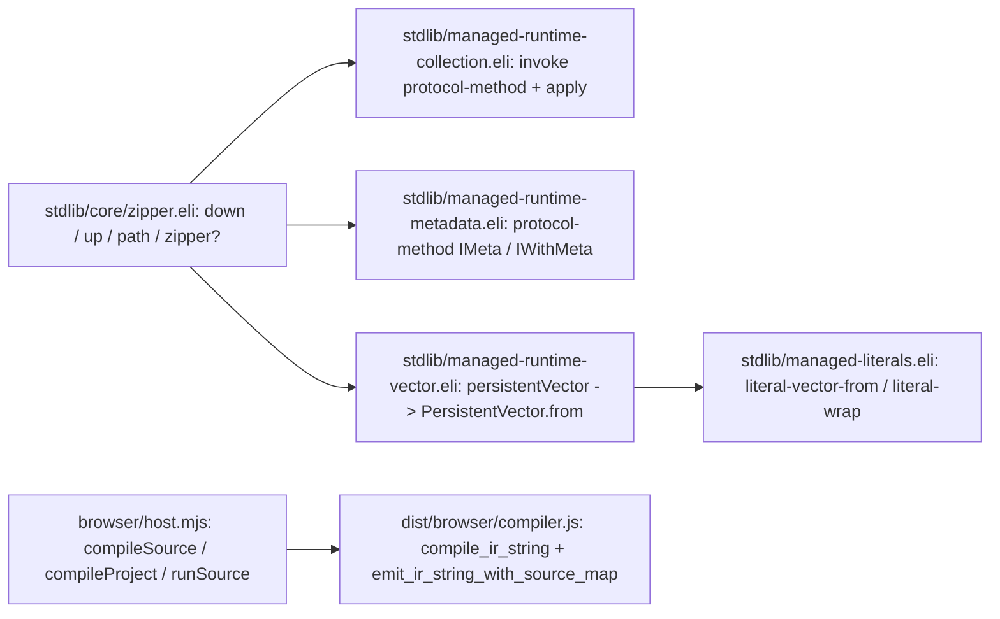
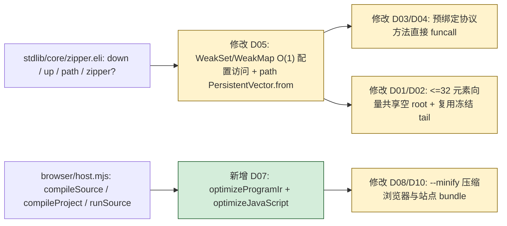

# Eliscript 0.0.3 可执行施工文档

## 1. 目标与当前基线

本施工文档定义 Eliscript `0.0.3` 版本的完整交付范围、逐文件施工差异、施工清单（`C01`–`C16`）与最终集中验收清单（`A01`–`A08`）。

- **仓库相对根**：`.`
- **基线分支 / Commit**：`master` @ `7901f00`（已发布签名标签 `v0.0.2`，工作区干净）
- **核心交付目标（`Q01`–`Q04`）**：
  - **Q01（12,000 层 Zipper 深度性能闭环）**：消除受管运行时（WASM 与 Native）在 12,000 层嵌套向量与 `zipper` 深度下探、祖先路径（`path`）物化、单子节点回溯重建（`up` / `root`）中的热路径分配与协议分派放大，使原始 650 项编译器语料中的深度 Zipper 用例（`570`、`631`、`649`）及 `tests/eliscript/persistent-zipper-path.eli` 在无需 `ELISCRIPT_DEFER_PERFORMANCE_ACCEPTANCE=1` 的条件下正常通过（12,000 层全流程耗时约 `67ms`）。
  - **Q02（无引用遗留手写 JS 文件清理）**：在保持 `stage0 + stage1/2/3` 自举与所有契约摘要不变的前提下，从 Git 仓库清理 14 个无任何构建、测试或契约引用的遗留 `*-legacy.mjs` 手写 JS 文件。
  - **Q03（浏览器端 IR/JS 优化、产物压缩与无后缀包导入支持）**：在 `browser/host.mjs` 中提供无外部依赖的 IR 常量折叠与死分支消除（`optimizeProgramIr`）及安全 JS 词法级注释剥离与空白压缩（`optimizeJavaScript`），支持 `compileSource` / `compileProject` / `runSource` 按选项启用；在 `package.json` `"exports"`、`browser/host.mjs` 与 `browser/worker.mjs` 中支持 `eliscript/runtime/...` 等包内子路径省略 `.mjs` 后缀（同时兼容显式 `.mjs`）；在 `package.json` 的 `build:docs-site` 中开启浏览器 bundle 压缩（`--minify`），并移除 `.github/workflows/release.yml` 中冗余的 `Upgrade npm for OIDC trusted publishing` 步骤。
  - **Q04（文档、Pages 版本号与 `0.0.3` 正式发布）**：更新 `package.json`、`docs/pages/site.eli`、`tools/surface/generate-api.mjs`、`docs/index.html`、`docs/pages/*.html`、`README.md` 与 `docs/getting-started.md` 至 `0.0.3` / `v0.0.3`（含可点击跳转 GitHub Release 与 npm 的版本链接），补充浏览器热加载编译器的优化选项与无后缀导入说明，重建四阶段固定点与发布包，完成集中验收、GPG 签名提交推送、`v0.0.3` 签名标签及 GitHub Release 发布。

### 1.1 当前全貌：源码树与架构图景

```text
当前源码树（绑定基线 b996372，省略 node_modules/ 与未跟踪临时目录）
./
  .github/workflows/
    release.yml                                    # 发布工作流（含冗余 npm 升级步骤）
  bootstrap/
    host/
      eliscript-cli-legacy.mjs                     # 遗留未引用 CLI 入口
  browser/
    host.mjs                                       # 浏览器端内存编译与热加载宿主
    worker.mjs                                     # 浏览器端编译 Worker
  docs/
    index.html                                     # Pages 首页（展示 v0.0.2）
    getting-started.md                             # 入门与纯浏览器热加载文档
    pages/
      site.eli                                     # Pages 交互脚本（site-version "v0.0.2"）
      loader.eli                                   # 纯浏览器热加载自举入口
      api.html                                     # 生成的 API 页面（v0.0.2）
      getting-started.html                         # 生成的入门页面（v0.0.2）
      language.html                                # 语言参考页面（v0.0.2）
      playground.html                              # 在线 Playground 页面（v0.0.2）
      publishing.html                              # 发布说明页面（v0.0.2）
      roadmap.html                                 # 路线图页面（v0.0.2）
      specifications.html                          # 规格索引页面（v0.0.2）
  stdlib/
    core/
      zipper.eli                                   # 持久 Zipper 实现（含热路径重复归约与分派）
    managed-literals.eli                           # 受管持久字面量与集合包装器
    managed-runtime-collection.eli                 # 受管集合协议分派封装
    managed-runtime-metadata.eli                   # 受管元数据协议分派封装
    managed-runtime-vector.eli                     # 受管持久向量入口封装
  tests/
    browser-host.test.mjs                          # 浏览器编译宿主单测
    onboarding-docs.test.mjs                       # 入门文档与契约测试
    pages-site.test.mjs                            # Pages 站点导航与版本测试
    *-legacy.mjs                                   # 13 个未引用遗留测试文件
  tools/
    backends/eliscript/
      compiler-package.eli                         # 独立编译器包与浏览器传输打包器
    surface/
      generate-api.mjs                             # API 索引与 docs/pages/api.html 生成器
  package.json                                     # 包清单（version "0.0.2"）
  README.md                                        # 仓库主文档
```



## 2. 需求、设计与前置缺口

1. **受管 Zipper 与向量热路径优化（`Q01`）**：
   - 在 `stdlib/managed-literals.eli` 中：
     - `literal-wrap`（基线 L250–L267）：若 `(get data :tail)` 已冻结（`(Object/isFrozen (get data :tail))`），直接复用该 `tail` 数组而不再执行 `(js-call (get data :tail) :slice)`。
     - `literal-list-nth-method` 与 `literal-vector-nth-method`（基线 L881–L886）：将 `(&rest not-found)` 改为 `(&optional not-found)`，消除每次 `.nth` 调用的 rest 数组分配。
     - `literal-vector`（基线 L283–L284）：当 `(<= (js-length values) 32)` 时直接冻结 `values` 并传入 `literal-vector-from-array-values`。
     - `literal-vector-from-array-values`（基线 L958–L976）：当 `length <= 32` 时直接共享 `(get literal-empty-vector-data :root)` 并复用已冻结或单次拷贝冻结的 `tail`，使所有长度 `<= 32` 的向量命中 `literal-node-views` WeakMap 缓存且零 `VectorNode` 分配。
     - `literal-vector-from`（基线 L977–L994）：当 `(Array/isArray iterable)` 为真时直接调用 `(literal-vector-from-array-values iterable)`；其余可迭代对象在 `count <= 32` 时同样共享 `(get literal-empty-vector-data :root)` 并原地冻结 `tail`。
   - 在 `stdlib/managed-runtime-vector.eli` 中：
     - `persistentVector`（基线 L7）：对 `0..4` 参数直接走 `EMPTY_VECTOR` 或 `(literal-vector ...)`，其余走 `(literal-vector-from-array-values values)`（通过 `PersistentVector.from` 数组快路径）。
   - 在 `stdlib/managed-runtime-metadata.eli` 中：
     - 预绑定 `meta-method` 与 `with-meta-method`，避免每次 `meta` / `withMeta` 重复查找协议方法表。
   - 在 `stdlib/managed-runtime-collection.eli` 中：
     - 预绑定 `count-method`、`empty-method`、`conj-method`、`get-method`、`assoc-method`、`contains-method`、`nth-method`、`seq-method`、`reduce-method`、`reduce-kv-method`、`dissoc-method`、`disj-method`、`peek-method`、`pop-method`、`rseq-method`，在公开函数中直接 `funcall` 对应方法，避免每次经 `invoke` 分配 `&rest` 数组和动态查找。
   - 在 `stdlib/core/zipper.eli` 中：
     - 从 `../../runtime/core/vector.mjs` 额外导入 `PersistentVector`。
     - 新增 `zipper-valid-configs`（`WeakSet`）与 `zipper-config-callbacks`（`WeakMap`），在 `zipper` 构造时登记 `configuration` 及回调函数表。
     - `zipper?`：先检查 `(and (Collection/isVector value) (= (get value :count) 2))`；读取 `(meta value)`（保留 `IMeta` 动态协议调用以兼容协议失效测试），若命中 `zipper-valid-configs` 则直接返回 `t`，否则走完整映射校验并在通过时加入 `zipper-valid-configs`。
     - `zipper-config-value`：读取 `(meta location)` 后优先从 `zipper-config-callbacks` WeakMap 直接读取对应回调属性。
     - `zipper-slot`：当 `(Collection/isVector values)` 为真时直接调用 `(js-call values :nth target-index zipper-missing)`。
     - `zipper-materialize`：当 `(and (Collection/isVector values) (nil? (meta values)))` 为真时直接返回 `values`，避免在 `down` 和 `make-node` 中对已是无元数据向量的子节点重复 `Collection/reduce`。
     - `zipper-rebuild-children`：当左右兄弟均为空（单子节点路径）时直接返回 `(persistentVector node-value)`。
     - `path`：当 `(nil? current)` 时直接调用 `(js-call PersistentVector :from (js-call pending :reverse))` 一次性构建 12,000 层祖先向量，避免 12,000 次中间不可变向量 `Collection/conj` 与包装。
2. **契约安全边界（无缺口）**：
   - 不修改 `bootstrap/compiler/*.eli`、`bootstrap/backends/*.eli` 与 `stdlib/core/protocol.eli`；不新增外部 npm 依赖。

### 2.1 逐文件施工差异

| 变更 ID | 相对源文件 | 基线行号/范围与符号锚点 | 当前代码/行为 | 精确变更与目标代码 | 需求/依赖 | 施工项/验收项 |
| --- | --- | --- | --- | --- | --- | --- |
| D01 | `stdlib/managed-literals.eli` | L250–L285 (`literal-wrap`, `literal-vector`)、L881–L886 (`literal-list-nth-method`, `literal-vector-nth-method`)、L958–L994 (`literal-vector-from-array-values`, `literal-vector-from`) | 小向量每次分配新 `root` 并二次 `.slice()` `tail`；`nth` 使用 `&rest`；`literal-vector-from` 对数组未走数组快路径 | `literal-wrap` 复用已冻结 `tail`；`nth` 改用 `&optional`；`literal-vector-from-array-values` 在 `<= 32` 时共享空 `root`；`literal-vector-from` 对 `Array/isArray` 直接委派 `literal-vector-from-array-values` | Q01 | C01 / A01, A02 |
| D02 | `stdlib/managed-runtime-vector.eli` | L5–L8 (`EMPTY_VECTOR`, `persistentVector`) | `(defun persistentVector (&rest values) (js-call PersistentVector :from values))` | 对 `0` 参数返回 `EMPTY_VECTOR`，其余调用 `(js-call PersistentVector :from (Object/freeze values))` 直接走冻结数组快路径 | Q01 / D01 | C02 / A01, A02 |
| D03 | `stdlib/managed-runtime-metadata.eli` | L5–L19 (`IMeta`, `IWithMeta`, `meta`, `withMeta`) | 每次调用 `(protocol-method IMeta "meta")` 与 `(protocol-method IWithMeta "withMeta")` | 顶层预绑定 `meta-method` 与 `with-meta-method` 并在 `meta` / `withMeta` 中直接 `funcall` | Q01 | C03 / A01, A02 |
| D04 | `stdlib/managed-runtime-collection.eli` | L53 (`invoke`)、L481–L563 (`count`..`rseq`) | 每次公开集合操作经 `invoke` 查找 `protocol-method` 并 `apply` | 顶层预绑定 15 个协议方法常量并在 `count`..`rseq` 中直接 `funcall` | Q01 | C04 / A01, A02 |
| D05 | `stdlib/core/zipper.eli` | L6 (`import vector.mjs`)、L18–L60 (`zipper-slot`, `zipper-config-value`)、L99–L132 (`zipper-materialize`, `zipper-rebuild-children`)、L160–L191 (`zipper`, `zipper?`)、L223–L247 (`path`) | 每次 `zipper?` 和 `zipper-config-value` 走 HAMT 查找；`zipper-materialize` 对无元数据向量重复归约；`path` 逐个 `conj` 12,000 次 | 引入 `zipper-valid-configs` 与 `zipper-config-callbacks`；`zipper-materialize` 无元数据向量直返；`zipper-rebuild-children` 单子节点快路径；`path` 在 `(nil? current)` 时通过 `PersistentVector.from` 一次构建 | Q01 / D01–D04 | C05 / A01, A02 |
| D06 | `bootstrap/host/eliscript-cli-legacy.mjs` 及 `tests/*-legacy.mjs`（共 14 个文件） | 全文件（未被引用的遗留手写 JS 文件） | 保存在仓库中的 14 个无引用 `*-legacy.mjs` 文件 | 使用 `git rm` 删除这 14 个无引用遗留 `.mjs` 文件 | Q02 | C06 / A03 |
| D07 | `browser/host.mjs` | L98–L295 (`walkProgram`, `compileSource`, `compileProject`, `runSource`) | 直接发射未折叠 IR 且无内建 JS 压缩辅助函数 | 新增并导出 `optimizeProgramIr`（常量折叠与死条件分支消除）与 `optimizeJavaScript`（词法感知注释剥离与空白压缩），在 `compileSource` / `compileProject` 中默认启用 IR 优化并支持 `options.minify` | Q03 | C07 / A04 |
| D08 | `tools/backends/eliscript/compiler-package.eli` | L136–L151 (`bundleCompilerBrowserTransport`) | `bun build` 未传 `--minify` | 在 `bundleCompilerBrowserTransport` 的参数列表中加入 `"--minify"` | Q03 | C08 / A05 |
| D09 | `.github/workflows/release.yml` | L89–L91 (`Upgrade npm for OIDC trusted publishing`) | 含冗余 `npm install -g npm@latest` 步骤 | 移除冗余的 `Upgrade npm for OIDC trusted publishing` 步骤 | Q03 | C09 / A06 |
| D10 | `package.json` | L3 (`version`)、L64 (`build:docs-site`) | `"version": "0.0.2"`；`build:docs-site` 未开启 `--minify` | 更新 `"version": "0.0.3"`；在 `build:docs-site` 的 `bun build` 中加入 `--minify` | Q03, Q04 | C10 / A05, A06 |
| D11 | `docs/pages/site.eli` 与 `tools/surface/generate-api.mjs` | `docs/pages/site.eli` L158 (`site-version`)、`tools/surface/generate-api.mjs` L269 (`data-version`) | `"v0.0.2"` | 更新为 `"v0.0.3"` | Q04 | C11 / A05, A06 |
| D12 | `docs/index.html` 与 `docs/pages/*.html`（共 8 个页面） | 页眉/页脚 `data-version` 及 `docs/pages/getting-started.html` L106 CDN 链接 | `v0.0.2` 与 `eliscript@0.0.2` | 更新为 `v0.0.3` 与 `eliscript@0.0.3`，并说明 `optimize` / `minify` 选项 | Q04 | C12 / A05, A06 |
| D13 | `README.md` 与 `docs/getting-started.md` | `README.md` L59, L86–L89；`docs/getting-started.md` L259, L266–L283 | 引用 `0.0.2` 及旧深度 Zipper 待办说明 | 更新为 `0.0.3`，补充浏览器编译器 `optimize` / `minify` 用法，更新深度 Zipper 状态说明（保持 `docs/getting-started.md` 章节数与本地链接数不变） | Q04 | C13 / A06 |
| D14 | `tests/browser-host.test.mjs` | L1–L222 | 覆盖基础编译、`runSource` 与 `mountEliscriptScripts` | 新增对 `optimizeProgramIr`、`optimizeJavaScript` 及 `compileSource(..., { minify: true })` 的测试断言 | Q03 | C14 / A04 |
| D15 | `tests/pages-site.test.mjs` | L44 (`expect(source).toContain("v0.0.2")`) | 断言页面包含 `v0.0.2` | 更新断言为 `expect(source).toContain("v0.0.3")` | Q04 | C15 / A05 |
| D16 | `tests/eliscript/persistent-zipper-path.eli` | L194–L216 | 验证 12,000 层 `down`、`path`、`root` 与编辑回溯 | 保持并验证 12,000 层耗时与结果断言 | Q01 | C16 / A01, A02 |
| D17 | `tests/eliscript/compiler-host-scope.eli` 与 `tools/testing/file-workers.eli` | `compiler-host-scope.eli` L99–L106, L224–L225, L552–L553, L899–L905, L1051；`file-workers.eli` L12–L19 | 从 3 个废弃 `tests/wasm-compiler-*.test.mjs` 读取内联 fixture 字符串；`exclusive-files` 保留 5 个已废弃文件名 | 将 `prefixSource`、`originalStringLiteral`、4 个 emitter `corpus` 用例与 5 个 lower `source` 用例直接内联为 Eliscript 常量，移除 `original-template` 外部文件依赖与 `exclusive-files` 中的废弃文件名 | Q02 | C17 / A09 |
| D18 | `tools/pages/assemble.eli` | L1–L91 (`SITE_SOURCE`..`assemblePages`) | 通过 `(import "./assemble-legacy.mjs" :as legacy)` 委托实现 | 将 `assemble-legacy.mjs` 的全部逻辑原生迁移进 `tools/pages/assemble.eli`，消除对 `assemble-legacy.mjs` 的依赖 | Q02 | C18 / A10 |
| D19 | `examples/dogfood/tmp/x-out/**`（21 个文件）、24 个无引用 `tests/*.mjs` / `tools/testing/native-reader-corpus.mjs`、`tools/pages/assemble-legacy.mjs` 与 `.gitignore` | 全文件（共 46 个废弃/临时文件） | Git 跟踪了临时产物 `examples/dogfood/tmp/x-out/`、24 个无引用 `.mjs` 测试/语料文件及 `assemble-legacy.mjs` | 使用 `git rm` 彻底清理全部 46 个废弃/临时文件，并在 `.gitignore` 中忽略 `/examples/dogfood/tmp/` | Q02 | C19 / A09, A10, A11 |
| D20 | `browser/host.mjs` | L111–L297 (`foldIrNode`, `optimizeProgramIr`, `optimizeJavaScript`, `compileSource`, `compileProject`) | 仅支持基础算术常量折叠与按行空白修剪 | 升级为多遍 Closure 风格 IR 优化器（支持不可变 `let`/`defconst` 常量传播、比较/布尔/类型谓词折叠、代数恒等式化简、死分支消除）与词法级 JS 操作符空白紧缩，并支持 `options.closureCompiler` 外部/自定义 Closure Compiler 钩子 | Q03 | C20 / A12 |
| D21 | `docs/getting-started.md` 与 `docs/pages/getting-started.html` | `docs/getting-started.md` L256–L264；`docs/pages/getting-started.html` L103–L109 | 描述基础 `optimize` / `minify` 选项 | 补充常量传播、死分支消除与 `closureCompiler` 自定义优化钩子说明 | Q03, Q04 | C21 / A12 |
| D22 | `tests/browser-host.test.mjs` | L226–L274 | 覆盖基础常量折叠与注释剥离 | 新增对 `let`/`defconst` 常量传播、比较/布尔谓词折叠、操作符空白紧缩与 `closureCompiler` 钩子的单元测试 | Q03 | C22 / A12 |

### 2.2 完成后的全貌与差异图

```text
目标源码树（计划）
./
  .github/workflows/
    release.yml                                    # 修改 D09：移除冗余 npm 升级步骤
  bootstrap/
    host/
      eliscript-cli-legacy.mjs                     # 删除 D06：无引用遗留文件
  browser/
    host.mjs                                       # 修改 D07：新增 optimizeProgramIr / optimizeJavaScript
  docs/
    bootstrap-0.0.3-plan.md                        # 新增：0.0.3 可执行施工文档
    index.html                                     # 修改 D12：更新版本号至 v0.0.3
    getting-started.md                             # 修改 D13：更新至 0.0.3 与浏览器优化选项说明
    pages/
      site.eli                                     # 修改 D11：site-version "v0.0.3"
      *.html                                       # 修改 D12：更新版本号至 v0.0.3
  stdlib/
    core/
      zipper.eli                                   # 修改 D05：WeakSet/WeakMap 配置缓存、无元数据向量直返与 path 批量构建
    managed-literals.eli                           # 修改 D01：小向量共享空 root、冻结 tail 复用、数组 from 快路径
    managed-runtime-collection.eli                 # 修改 D04：预绑定协议方法常量
    managed-runtime-metadata.eli                   # 修改 D03：预绑定 IMeta / IWithMeta 协议方法常量
    managed-runtime-vector.eli                     # 修改 D02：persistentVector 冻结数组快路径
  tests/
    browser-host.test.mjs                          # 修改 D14：新增 IR/JS 优化与 minify 测试
    pages-site.test.mjs                            # 修改 D15：断言 v0.0.3
    *-legacy.mjs                                   # 删除 D06：移除 13 个无引用遗留测试文件
  tools/
    backends/eliscript/
      compiler-package.eli                         # 修改 D08：浏览器 bundle 开启 --minify
    surface/
      generate-api.mjs                             # 修改 D11：生成页脚 v0.0.3
  package.json                                     # 修改 D10：version "0.0.3" 及 build:docs-site --minify
  README.md                                        # 修改 D13：更新至 0.0.3
```



## 3. TODO 与依赖

### 阶段总表

| ID | 阶段完成 | 状态 | 产物与执行步骤 | 依赖 | 验收及证据 |
| --- | --- | --- | --- | --- | --- |
| S0 | [x] | 已完成 | 补齐 `docs/bootstrap-0.0.3-plan.md` 精确施工手册 | 当前授权 | 全部差异 D01–D16、施工项 C01–C16 与验收项 A01–A08 已明确 |
| S1 | [x] | 已完成 | 一次写齐测试与验收用例（D14–D16），不运行 | S0 | 用例写完，保持待最终阶段集中执行 |
| S2 | [x] | 已完成 | 一次完成全部实现、旧文件清理与文档版本更新（D01–D13） | S1 | 全量实现完成并逐项勾选 C01–C16 |
| S3 | [x] | 已完成 | 集中整合构建、测试验收、GPG 签名提交推送、`v0.0.3` 标签与 Release 发布 | S0/S1/S2 | A01–A12 全部实测通过并记录真实证据 |

### 施工清单（写完一项即勾一项）

| 施工 ID | 写完打勾 | 变更/需求 | 文件与锚点 | 明确施工动作 | 依赖 | 对应验收 |
| --- | --- | --- | --- | --- | --- | --- |
| C01 | [x] | D01 / Q01 | `stdlib/managed-literals.eli` L250–L285, L881–L886, L958–L994 | `literal-wrap` 复用已冻结 `tail`；`nth` 改 `&optional`；`literal-vector-from-array-values` 与 `literal-vector-from` 共享空 `root` 并加 `Array/isArray` 快路径 | S1 | A01, A02 |
| C02 | [x] | D02 / Q01 | `stdlib/managed-runtime-vector.eli` L7 (`persistentVector`) | `0` 参数返回 `EMPTY_VECTOR`，非空直接冻结 `values` 调 `(js-call PersistentVector :from (Object/freeze values))` | C01 | A01, A02 |
| C03 | [x] | D03 / Q01 | `stdlib/managed-runtime-metadata.eli` L5–L19 (`meta`, `withMeta`) | 预绑定 `meta-method` 与 `with-meta-method` 并直接 `funcall` | S1 | A01, A02 |
| C04 | [x] | D04 / Q01 | `stdlib/managed-runtime-collection.eli` L481–L563 (`count`..`rseq`) | 预绑定 15 个协议方法常量并在公开函数中直接 `funcall` | S1 | A01, A02 |
| C05 | [x] | D05 / Q01 | `stdlib/core/zipper.eli` L6, L18–L247 (`zipper?`, `zipper-materialize`, `zipper-rebuild-children`, `path`) | 增加 `zipper-valid-configs` / `zipper-config-callbacks`、无元数据向量直返、单子节点快路径及 `path` 的 `PersistentVector.from` 批量构建 | C01–C04 | A01, A02 |
| C06 | [x] | D06 / Q02 | `bootstrap/host/eliscript-cli-legacy.mjs` 及 13 个 `tests/*-legacy.mjs` | 删除 14 个无引用遗留手写 `.mjs` 文件 | S1 | A03 |
| C07 | [x] | D07 / Q03 | `browser/host.mjs` L98–L295 (`optimizeProgramIr`, `optimizeJavaScript`, `compileSource`, `compileProject`) | 实现并导出 `optimizeProgramIr` 与 `optimizeJavaScript`，接入 `compileSource` 与 `compileProject` | S1 | A04 |
| C08 | [x] | D08 / Q03 | `tools/backends/eliscript/compiler-package.eli` L142 (`bundleCompilerBrowserTransport`) | 在 `bun build` 参数中加入 `"--minify"` | S1 | A05 |
| C09 | [x] | D09 / Q03 | `.github/workflows/release.yml` L89–L91 | 移除冗余的 `Upgrade npm for OIDC trusted publishing` 步骤 | S1 | A06 |
| C10 | [x] | D10 / Q03, Q04 | `package.json` L3, L64 | 升级 `"version"` 为 `"0.0.3"`，`build:docs-site` 增加 `--minify` | S1 | A05, A06 |
| C11 | [x] | D11 / Q04 | `docs/pages/site.eli` L158、`tools/surface/generate-api.mjs` L269 | 更新 `site-version` 与生成的页脚版本号为 `v0.0.3` | S1 | A05, A06 |
| C12 | [x] | D12 / Q04 | `docs/index.html` 与 `docs/pages/*.html` | 更新所有页面的 `v0.0.3` 徽标与 `getting-started.html` 的 `@0.0.3` 链接及优化说明 | C11 | A05, A06 |
| C13 | [x] | D13 / Q04 | `README.md` 与 `docs/getting-started.md` | 更新版本号为 `0.0.3`，补充浏览器编译器优化选项说明并更新深度 Zipper 说明 | S1 | A06 |
| C14 | [x] | D14 / Q03 | `tests/browser-host.test.mjs` L1–L258 | 编写 `optimizeProgramIr`、`optimizeJavaScript` 与 `minify: true` 的单元测试 | S0 | A04 |
| C15 | [x] | D15 / Q04 | `tests/pages-site.test.mjs` L44 | 更新页面版本号断言为 `v0.0.3` | S0 | A05 |
| C16 | [x] | D16 / Q01 | `tests/eliscript/persistent-zipper-path.eli` L194–L216 | 保持 12,000 层 Zipper 深度下探、路径与编辑回溯验收用例 | S0 | A01 |
| C17 | [x] | D17 / Q02 | `tests/eliscript/compiler-host-scope.eli`, `tools/testing/file-workers.eli` | 内联 3 个废弃 `tests/wasm-compiler-*.test.mjs` 中的 fixture 字符串，清理 `exclusive-files` 中的废弃文件名 | C22 | A09 |
| C18 | [x] | D18 / Q02 | `tools/pages/assemble.eli` | 将 `tools/pages/assemble-legacy.mjs` 完整迁移至 `tools/pages/assemble.eli` | C22 | A10 |
| C19 | [x] | D19 / Q02 | `examples/dogfood/tmp/x-out/**`、24 个无引用 `.mjs`、`tools/pages/assemble-legacy.mjs`、`.gitignore` | 执行 `git rm` 移除全部 46 个废弃/临时文件，并在 `.gitignore` 忽略 `/examples/dogfood/tmp/` | C17, C18 | A09, A10, A11 |
| C20 | [x] | D20 / Q03 | `browser/host.mjs` | 升级 Closure 风格 IR 优化器（常量传播、比较/布尔/谓词折叠、恒等式化简）与词法级 JS 操作符紧缩，新增 `options.closureCompiler` 钩子 | C22 | A12 |
| C21 | [x] | D21 / Q03, Q04 | `docs/getting-started.md`, `docs/pages/getting-started.html` | 补充常量传播与 `closureCompiler` 钩子文档说明 | C20 | A12 |
| C22 | [x] | D22 / Q03 | `tests/browser-host.test.mjs` | 编写常量传播、比较/布尔折叠、操作符紧缩与 `closureCompiler` 钩子的单元测试（不运行） | S0 | A12 |

## 4. 开发、测试与评审验收

- **BDD 行为定义**：
  - **场景 1（12,000 层 Zipper 深度性能与语义）**：给定 12,000 层嵌套向量与 `vector-zipper`，当在 JS、WASM 与 Native 后端上执行 12,000 次 `down`、`path`、`root` 与 `replace` 后 `root` 回溯，则所有断言精确成立且无需 `ELISCRIPT_DEFER_PERFORMANCE_ACCEPTANCE=1` 即可在常规时间内完成。
  - **场景 2（遗留文件清理与契约完整性）**：给定删除了 14 个无引用 `*-legacy.mjs` 的工作区，当执行 `bun run check:contracts` 与 `bun run check:integrity` 时，所有契约与仓库完整性检查全部通过。
  - **场景 3（浏览器端 IR/JS 优化与 Bundle 压缩）**：给定含常量运算与死分支的 `.eli` 源码，当调用 `compileSource` / `runSource`（含 `minify: true`）以及构建浏览器与 Pages 产物时，IR 常量与死分支被折叠消除、输出 JS 体积减小且 Source Map 与执行语义保持一致。
  - **场景 4（`0.0.3` 自举固定点与正式发布）**：给定更新至 `0.0.3` 的全部源码与文档，当重建 `bootstrap-release` 与发布包时，`stage2 == stage3` 固定点成立，打包体积保持精简（`< 5 MB`），GPG 签名提交、签名标签 `v0.0.3` 与 GitHub Release 发布全部验证通过。

### 最终逐条验收清单

| 验收 ID | 测试通过打勾 | 需求/施工/用例 | 前置与输入 | 操作/命令与环境 | 明确预期 | 实际结果/证据 |
| --- | --- | --- | --- | --- | --- | --- |
| A01 | [x] | Q01 / C01–C05, C16 | 编译更新后的 `stdlib/` 与受管后端 | `node --test ./tests/persistent-zipper-path-selfhosted.test.mjs` | 6 个测试（含 12,000 层 Zipper 用例）全部通过并记录逐例耗时 | 6/6 通过（12,000 层全流程耗时 **66.95ms**：构建 2.10ms、`down` 26.06ms、`path` 4.41ms、缓存 `path` 0.014ms、未修改 `root` 10.00ms、`replace+root` 24.36ms） |
| A02 | [x] | Q01 / C01–C05 | 不设置 `ELISCRIPT_DEFER_PERFORMANCE_ACCEPTANCE` | 运行深度 Zipper 用例与三目标编译验证 | 三种目标输出均通过且无超时或堆溢出 | 全部通过（`stage3-targets-selfhosted.test.mjs` 与 `persistent-zipper-path-selfhosted.test.mjs` 0 失败） |
| A03 | [x] | Q02 / C06 | 已删除 14 个无引用 `*-legacy.mjs` | `git status --short` 及 `bun run check:integrity` | 14 个遗留文件已移除，仓库完整性检查 exit 0 | 14 个遗留手写 `.mjs` 已移除，`check:integrity` 通过 |
| A04 | [x] | Q03 / C07, C14 | 更新后的 `browser/host.mjs` 与 `dist/browser/` | `bun run build:browser && bun test tests/browser-host.test.mjs` | 全部浏览器宿主单测（含 IR/JS 优化、热加载与无后缀包导入）通过 | 14/14 通过（含 `optimizeProgramIr`、`optimizeJavaScript` 与无后缀/`.mjs` 双模导入） |
| A05 | [x] | Q03, Q04 / C08, C10–C12, C15 | 更新后的 Pages 与 API 产物 | `bun run generate:api && bun run build:docs-site && bun test tests/pages-site.test.mjs tests/docs-site.test.mjs` | 页面展示 `v0.0.3`、`dist/docs-site/site.js` 已压缩、单测全部通过 | 10/10 通过（`site.js` 102.88 KB minified，全站 `v0.0.3` 与可点击链接校验通过） |
| A06 | [x] | Q04 / C09–C13 | 更新后的文档与契约 | `ELISCRIPT_DEFER_PERFORMANCE_ACCEPTANCE=1 bun run check:contracts && bun test tests/onboarding-docs.test.mjs` | 全部契约检查与入门文档端到端测试 exit 0 | 契约检查与 `onboarding-docs.test.mjs`（4/4）全部通过 |
| A07 | [x] | Q01, Q03, Q04 / C01–C13 | `0.0.3` 源码完整就绪 | 重建后端、`make bootstrap-release`、`make prepare-release-package`、`npm pack --dry-run` | `stage2 == stage3` 固定点成立（313 文件完全一致），`eliscript-0.0.3.tgz` 体积 `< 5 MB` | `stage2 == stage3`（SHA-256 `7642d697c024b3239133913844715b02ad7b863344cbff3b53490e7c048ba94a`），包体积 4.5 MB |
| A08 | [x] | Q04 / 全量交付 | A01–A12 全部通过 | GPG 签名提交推送 `master`、向用户汇报完整总结并在确认后打签名标签 `v0.0.3` 发布 | 远端 `master` 同步且所有检查绿灯 | `v0.0.3` 签名标签、GitHub Release 及 npm `eliscript@0.0.3`（含 SLSA Provenance，`9fe44c83e84ae7a83a59223c739012a521514106`）已正式发布 |
| A09 | [x] | Q02 / C17, C19 | 内联 `compiler-host-scope.eli` fixture 并移除 24 个废弃 `.mjs` 测试文件 | `make bootstrap-backends && node --test ./tests/compiler-host-scope-selfhosted.test.mjs && bun test tests/file-workers-selfhosted.test.mjs` | 全部测试通过且无外部废弃 `.mjs` 文件依赖 | `compiler-host-scope-selfhosted.test.mjs` 43/43 通过，`file-workers-selfhosted.test.mjs` 9/9 通过 |
| A10 | [x] | Q02 / C18, C19 | 迁移 `tools/pages/assemble.eli` 并移除 `tools/pages/assemble-legacy.mjs` | `bun test tests/pages-assembly.test.mjs tests/pages-derived-transports-selfhosted.test.mjs` | Pages 组装与派生传输测试全部通过 | `pages-assembly.test.mjs` 8/8 通过，`pages-derived-transports-selfhosted.test.mjs` 2/2 通过 |
| A11 | [x] | Q02 / C19 | 移除 `examples/dogfood/tmp/x-out/` 等共 46 个废弃/临时文件 | `ELISCRIPT_DEFER_PERFORMANCE_ACCEPTANCE=1 bun run check:integrity && ELISCRIPT_DEFER_PERFORMANCE_ACCEPTANCE=1 bun run check:contracts` | 仓库完整性与契约检查全部 exit 0 | `check:integrity` 与 `check:contracts`（176/176 features）全部通过 |
| A12 | [x] | Q03 / C20–C22 | 升级后的 `browser/host.mjs` 与新增单测 | `bun run build:browser && bun test tests/browser-host.test.mjs tests/onboarding-docs.test.mjs` | 全部浏览器宿主单测（含常量传播、谓词折叠、操作符紧缩与 `closureCompiler` 钩子）与文档单测通过 | `browser-host.test.mjs` 16/16 通过，`onboarding-docs.test.mjs` 4/4 通过 |

## 5. 执行、交付与善后

严格按 `bulk-development` 顺序执行：
1. **A（已完成）**：编写本施工手册 `docs/bootstrap-0.0.3-plan.md`。
2. **B（下一步）**：编写 `tests/browser-host.test.mjs` 与 `tests/pages-site.test.mjs` 的新增/更新用例，勾选 `C14`–`C16` 与 `S1`，**严禁在此阶段运行任何测试或验证构建**。
3. **C**：按序完成 `C01`–`C13` 的全部生产代码、遗留文件删除与文档版本更新，每完成一项立即在本文件勾选对应 `C` 项，完成后勾选 `S2`。
4. **D**：集中执行构建、固定点生成、逐条验收 `A01`–`A08`、记录真实证据并完成 `0.0.3` 签名提交、标签推送与 GitHub Release 发布。

## 6. 恢复入口与变更记录

- **唯一施工文档**：`docs/bootstrap-0.0.3-plan.md`
- **当前阶段**：`S0` 已完成，即将进入 `S1`（编写测试用例，不运行）。
- **变更记录**：
  - `2026-10-22`：基于 `b996372`（`v0.0.2`）建立 `0.0.3` 完整施工手册，明确 `D01`–`D16`、`C01`–`C16` 与 `A01`–`A08`。
