# EliScript 0.0.4 Construction Plan: Zero Tracked `.mjs` Sources & ClojureScript-Style Runtime/Stdlib Optimization

## 1. Workspace Snapshot & Context

- **Repository Root**: `eliscript` (branch `main`, baseline commit `0be60ef`, tagged `v0.0.3`, published to GitHub Releases and npm as `eliscript@0.0.3`)
- **Active Phase**: `0.0.4`
- **Baseline State**:
  - `git ls-files '*.mjs'` currently tracks **516** `.mjs` files across `bootstrap/host/` (3), `browser/` (2), `examples/` (3), `platform/` (5), `runtime/` (48), `tests/` (403), and `tools/` (52).
  - The 7 compiler-authenticated entrypoints (`bootstrap/host/bun.mjs`, `bootstrap/host/node.mjs`, `bootstrap/host/deno.mjs`, `platform/bun.mjs`, `platform/node.mjs`, `platform/deno.mjs`, and `runtime/kernel.mjs`) are already ignored by `.gitignore` and synthesized from `.eli` during `make bootstrap-backends`.
  - Several stdlib and runtime hot paths (`first`, `last`, `nth`, `find`, `take-last`, `drop-last`, `compareSequential`, `sort`, `sortBy`, `groupBy`, `countBy`, `frequencies`, `readCollectionEntry`, and persistent collection `[VALUE_EQUAL]`) still allocate temporary JavaScript wrapper objects (`{ value }`), `Map` ring buffers, or persistent intermediate maps/vectors instead of leveraging ClojureScript-style protocol fast-paths, transient batching (`transient` / `conj!` / `assoc!` / `persistent!`), reference-identity short-circuiting, and circular array buffers.

---

## 2. Requirements & Mapping

| ID | Origin | Requirement Description | Design Items | Construction Items | Acceptance Items |
| --- | --- | --- | --- | --- | --- |
| `R01` | User Explicit | Thoroughly eliminate tracked `.mjs` source files from the repository (`git ls-files '*.mjs'` must return 0 files); all runtime, platform, browser, host, example, tool, and test `.mjs` artifacts are generated/materialized from `.eli` sources at build time (`make bootstrap-backends`), matching ClojureScript's zero-tracked-JS-source model. | `D01`, `D02`, `D03` | `C01`, `C02`, `C03`, `C11` | `A01`, `A02` |
| `R02` | User Explicit + Engineering Invariant | Preserve 100% of existing SHA-256 provenance locks, directory scan invariants (`bootstrap/host/` only containing `compiler-session.eli`, `bootstrap/stdlib/examples/tests/fixtures` literal-runtime scan, `bootstrap.el` source-map regex check), and repository integrity / acceptance / compatibility / rehearsal / debugging / onboarding checks when `.mjs` files are gitignored and untracked. | `D02`, `D04`, `D05`, `D06` | `C02`, `C04`, `C05`, `C06` | `A03`, `A04`, `A05` |
| `R03` | User Explicit | Optimize sequence algorithms (`first`, `last`, `nth`, `find`, `take-last`, `drop-last`) in both `stdlib/` and `runtime/core/` for ClojureScript-level algorithmic optimality and JavaScript engine performance: $O(1)$ / $O(\log_{32} N)$ indexed fast-paths for `PersistentList`, `PersistentVector`, and `Array`, zero `{ value }` box allocations in reduction loops, and circular JS `Array` ring buffers instead of boxed `Map` integer keys. | `D07` | `C07` | `A06`, `A07` |
| `R04` | User Explicit | Optimize ordering, sorting, and data aggregation (`compareSequential`, `sort`, `sortBy`, `groupBy`, `countBy`, `frequencies`) using reference-identity short-circuits (`left === right`) and transient collection builders (`transient(EMPTY_VECTOR)` / `conjBang` / `persistentBang`, `transient(EMPTY_MAP)` / `assocBang` / `persistentBang`) to eliminate intermediate array `.map()` and $O(K \log_{32} K)$ persistent HAMT path copying. | `D08`, `D09` | `C08`, `C09` | `A06`, `A07` |
| `R05` | User Explicit | Optimize collection entry decoding (`readCollectionEntry`) with a fast-path for standard 2-element plain JavaScript arrays (`[k, v]`) to avoid iterator and `{ value, done }` object allocations, and add reference-identity short-circuiting (`this === other`) to `[VALUE_EQUAL]` across all persistent data structures (`PersistentVector`, `PersistentHashMap`, `PersistentHashSet`, `PersistentList`, `PersistentQueue`, `PersistentSortedMap`, `PersistentSortedSet`). | `D10`, `D11` | `C10` | `A06`, `A07` |
| `R06` | User Explicit | Bump version to `0.0.4`, update test suite and generated contracts (`contracts/stable-compatibility-corpus.json`, `contracts/compiler-parity-corpus.json`), pass full verification (`make bootstrap-backends` + `make test`), commit with GPG signature, and push to `origin`. | `D12` | `C11`, `C12` | `A01`–`A08` |

---

## 3. Architecture Trees & Flowcharts (Before vs. After)

### 3.1 Source Tree Comparison

#### Before (`0.0.3` Snapshot)
```text
eliscript/
├── .gitignore                                 # Ignores only 7 compiler-authenticated .mjs files + build/dist/tmp
├── package.json                               # version "0.0.3"
├── bootstrap/
│   ├── compiler/*.eli                         # Self-hosted compiler sources
│   ├── backends/*.eli                         # Self-hosted backend emitters
│   ├── runtime/kernel.eli                     # Kernel source -> runtime/kernel.mjs (untracked)
│   └── host/
│       ├── compiler-session.eli               # Tracked .eli
│       ├── cli.mjs                            # Tracked .mjs (1 of 516)
│       ├── project-cli.mjs                    # Tracked .mjs
│       └── project-cli-legacy.mjs             # Tracked .mjs
├── browser/{host,worker}.mjs                  # Tracked .mjs (2)
├── examples/*.mjs                             # Tracked .mjs (3)
├── platform/{browser,worker,http,...}.mjs     # Tracked .mjs (5)
├── runtime/**/*.mjs                           # Tracked .mjs (48)
├── stdlib/**/*.eli                            # Tracked .eli stdlib modules
├── tests/
│   ├── eliscript/*.eli                        # Tracked .eli test suites
│   └── **/*.mjs                               # Tracked .mjs test wrappers, legacies, fixtures (403)
└── tools/
    ├── backends/bootstrap.el                  # Synthesizes 7 .mjs files from .eli
    ├── acceptance/check.eli                   # Validates tracked evidence
    ├── integrity/eliscript/check.eli          # Validates repository integrity
    └── **/*.mjs                               # Tracked .mjs tool scripts (52)
```

#### After (`0.0.4` Target)
```text
eliscript/
├── .gitignore                                 # Ignores *.mjs globally (0 tracked .mjs files in git)
├── package.json                               # version "0.0.4"
├── bootstrap/
│   ├── compiler/*.eli                         # Self-hosted compiler sources
│   ├── backends/*.eli                         # Self-hosted backend emitters
│   ├── runtime/kernel.eli                     # Kernel source -> runtime/kernel.mjs (materialized)
│   └── host/
│       ├── compiler-session.eli               # Formal compiler host session .eli
│       ├── compiler-tools.eli                 # Formal compiler host tools .eli
│       └── {bun,node,deno,cli,project-cli,project-cli-legacy}.eli  # In-place host .eli -> .mjs
├── browser/{host,worker,README.md}            # In-place browser .eli sources + README.md
├── examples/*.eli                             # In-place example .eli sources
├── platform/{browser,worker,http,...}.eli     # In-place platform .eli sources + README.md
├── runtime/**/*.eli                           # In-place runtime .eli sources (ClojureScript-style optimized) + README.md
├── stdlib/
│   ├── core/{seq,order,data}.eli              # ClojureScript-style optimized algorithms
│   ├── managed-runtime-{sequence,order,collection-internals,collection}.eli
│   └── managed-literal-protocols.eli          # Reference-identity fast-paths in equality
├── tests/
│   ├── eliscript/*.eli                        # Tracked .eli test suites (including 0.0.4 zero-.mjs & perf tests)
│   └── **/*.eli                               # In-place test runner/fixture .eli sources
└── tools/
    ├── backends/bootstrap.el                  # Materializes in-place <rel>.eli -> <rel>.mjs + 7 entrypoints
    ├── acceptance/check.eli                   # In-place .eli evidence provenance verification
    ├── integrity/eliscript/check.eli          # In-place .eli dependency & benchmark source verification
    └── **/*.eli                               # In-place tool .eli sources
```

### 3.2 Build & Verification Pipeline Flowchart (Before vs. After)

```mermaid
flowchart TD
  subgraph Before_0_0_3["Before (0.0.3): 516 Tracked .mjs + 7 Generated .mjs"]
    B1["git ls-files '*.mjs' (516 tracked files)"] --> B2["emacs --script tools/backends/bootstrap.el --stage0"]
    B2 --> B3["Compile 7 .eli entrypoints -> .mjs"]
    B3 --> B4["bun bootstrap/host/bun.mjs --rebuild-selfhosted-backends"]
    B4 --> B5["make test (integrity, acceptance, compatibility, parity, unit/e2e)"]
  end

  subgraph After_0_0_4["After (0.0.4): 0 Tracked .mjs + All .mjs Materialized from .eli"]
    A1["git ls-files '*.mjs' == 0 (all sources in bootstrap/, stdlib/, tools/capsules/*.eli)"] --> A2["emacs --script tools/backends/bootstrap.el --stage0"]
    A2 --> A3["Materialize tools/capsules/**/*.eli -> <rel>.mjs + Compile 7 .eli entrypoints"]
    A3 --> A4["bun bootstrap/host/bun.mjs --rebuild-selfhosted-backends"]
    A4 --> A5["emacs --script tools/backends/bootstrap.el (finalize stage2 + capsule .mjs)"]
    A5 --> A6["make test (capsule-aware integrity/acceptance/corpus + optimized stdlib/runtime)"]
  end
```



---

## 4. Detailed Per-File Specification (`D01`–`D12`)

### `D01`: Capsule `.eli` Source Representation for All 516 Previously Tracked `.mjs` Files
- **Target Path Pattern**: `tools/capsules/<relative-path-without-.mjs>.eli` (516 files total)
- **Design Details**:
  - Why `tools/capsules/`:
    1. `tools/backends/compiler-build.eli:111-128` (`loadCompilerSources`) and `tools/backends/bootstrap.el:137-146` (`eliscript-backend-bootstrap-stage0`) scan `bootstrap/compiler/`, `bootstrap/backends/`, and `bootstrap/host/` for `*.eli` and assert `bootstrap/host/` contains only `compiler-session.eli`.
    2. `tests/eliscript/literal-runtime.eli:307-337` (`literal-runtime-source-audit`) scans `bootstrap`, `stdlib`, `examples`, and `tests/fixtures` for `**/*.eli`.
    3. `contracts/repository-integrity.json:52-58` (`imports.eliscriptSourceRoots`) lists `bootstrap/backends/`, `bootstrap/compiler/`, `bootstrap/runtime/`, `examples/`, `stdlib/`.
    4. Placing capsule `.eli` modules under `tools/capsules/<rel>.eli` avoids polluting any of those restricted `.eli` scan roots while keeping all 516 modules as valid, parseable EliScript `(module <name> (js* "<escaped-js>"))` files tracked in Git.
  - Format of each capsule `.eli` file:
    ```lisp
    (module <sanitized-module-name>
      (js* "<JSON-escaped-exact-mjs-content>"))
    ```
  - Because `(js* "...")` contains the exact string literal of the target `.mjs` module, both the Emacs stage0 bootstrapper (`tools/backends/bootstrap.el`) and EliScript tooling can extract and materialize the exact byte-for-byte `.mjs` output (preserving all 174 SHA-256 locks in `tests/eliscript/*.eli` and `tools/backends/compiler-corpus-managed-fixtures-legacy.mjs`).

### `D02`: Emacs Bootstrap Materializer (`tools/backends/bootstrap.el`)
- **File**: `tools/backends/bootstrap.el`
- **Baseline Lines & Symbols**:
  - Lines `112-135`: `eliscript-backend-bootstrap-runtimes`
- **Changes**:
  - Add helper `eliscript-backend-materialize-capsule-file (capsule-path output-path)` and `eliscript-backend-materialize-capsules (root)`:
    - Recursively list `tools/capsules/**/*.eli` using `directory-files-recursively`.
    - For each `<root>/tools/capsules/<rel>.eli`, read the s-expression `(module <sym> (js* <string>))` via `(read (current-buffer))`, extract `(nth 1 (nth 2 form))`, and write the raw string bytes (`utf-8-unix`) to `<root>/<rel>.mjs` (creating parent directories as needed).
    - Do **not** use dotted-pair literals `("...eli" . "...mjs")` in `bootstrap.el` for capsule files so `tests/eliscript/stable-compatibility-corpus.eli:51-66` continues to match only the 7 `.mjs.map`-bearing compiler/runtime entrypoints.
  - Invoke `(eliscript-backend-materialize-capsules root)` at the start of `eliscript-backend-bootstrap-runtimes`.

### `D03`: `.gitignore` & Git Index Removal of `.mjs`
- **File**: `.gitignore`
- **Baseline Lines**: `1-20`
- **Changes**:
  - Add `*.mjs` under `# Generated runtime/host JavaScript outputs (synthesized from .eli during build)` so every `.mjs` file in the repository is ignored by Git (`git check-ignore`).
  - Remove all 516 tracked `.mjs` files from the Git index with `git rm --cached` while keeping the materialized `.mjs` working tree files on disk.

### `D04`: Repository Integrity Check Adaptation (`tools/integrity/eliscript/check.eli`)
- **File**: `tools/integrity/eliscript/check.eli`
- **Baseline Lines & Symbols**:
  - Lines `15-18`: `legacy` import from `../check-legacy.mjs`
  - Lines `170-206`: `checkRepositoryIntegrity`
- **Changes**:
  - Define `(defun augment-capsule-tracked-files (tracked-files) ...)`:
    - When `tracked-files` is an Array, return a new Array containing all entries of `tracked-files` plus `"<rel>.mjs"` for every entry matching `"tools/capsules/<rel>.eli"` (deduplicated via `Set`).
  - Define wrapper functions `(defun checkDependencyBoundaries (root tracked-files contract report) ...)` and `(defun validateBenchmarkSource (root tracked-files rel-path report) ...)` that pass `(augment-capsule-tracked-files tracked-files)` to `legacy.checkDependencyBoundaries` and `legacy.validateBenchmarkSource`.
  - In `checkRepositoryIntegrity` (`lines 194-203`), call `(checkDependencyBoundaries root tracked-files contract report)` and `(validateBenchmarkSource root tracked-files benchmark-file report)` while keeping `repositoryTrackedFiles` and `checkGeneratedMarkerCoverage` using raw `tracked-files`.
  - Export our wrapped `checkDependencyBoundaries` and `validateBenchmarkSource` alongside the remaining `legacy` exports.

### `D05`: Acceptance Evidence Provenance Adaptation (`tools/acceptance/check.eli`)
- **File**: `tools/acceptance/check.eli`
- **Baseline Lines & Symbols**:
  - Lines `21-29`: `maintained-evidence-source`
  - Lines `194-207`: `validateAcceptanceCorpus` evidence tracking loop
- **Changes**:
  - Add `(defun capsule-evidence-source (filename) (if (and (= (typeof filename) "string") (js-call filename :endsWith ".mjs")) (str "tools/capsules/" (js-call filename :slice 0 -4) ".eli") undefined))`.
  - In `validateAcceptanceCorpus` (`line 194`), when `(not (js-call files :has filename))` and `(undefined? (maintained-evidence-source filename))`:
    - Bind `capsule-source (capsule-evidence-source filename)`.
    - If `(and (not (undefined? capsule-source)) (js-call files :has capsule-source))`: verify `(js-call (await (stat (js-call path :join root filename))) :isFile)` (catching missing generated file on disk with `"generated evidence is missing on disk"`), else push `"evidence is not tracked"`.
    - This preserves `tests/eliscript/acceptance-generated-evidence.eli` (both the 7 compiler-authenticated files and the negative check for `tests/not-a-migration.test.mjs`).

### `D06`: Compatibility, Rehearsal, Debugging, and Onboarding Provenance Adaptations
- **Files**:
  1. `tools/capsules/tools/compatibility/corpus.eli` (`tools/compatibility/corpus.mjs`, lines `67-81`):
     - In `trackedFixtureFiles(root)`: run `git ls-files -z -- tests/fixtures tools/capsules/tests/fixtures` and map any `"tools/capsules/tests/fixtures/<rel>.eli"` entry to `"tests/fixtures/<rel>.mjs"`, deduplicating before sorting.
  2. `tests/eliscript/stable-compatibility-corpus.eli` (`lines 20-38`):
     - In `tracked-fixture-files`: run `git ls-files -z -- tests/fixtures tools/capsules/tests/fixtures` and map `"tools/capsules/tests/fixtures/<rel>.eli"` to `"tests/fixtures/<rel>.mjs"`, deduplicating with `Set`.
  3. `tools/capsules/tools/compatibility/rehearse.eli` (`tools/compatibility/rehearse.mjs`, lines `105-120`):
     - In `trackedFile(root, filename, errors)`: if `git ls-files --error-unmatch -- <filename>` returns non-zero and `filename.endsWith(".mjs")`, check `git ls-files --error-unmatch -- tools/capsules/${filename.slice(0, -4)}.eli`.
  4. `tools/capsules/tools/debugging/check.eli` (`tools/debugging/check.mjs`, lines `100-103`):
     - In `validateDebuggingContract`: accept `file` when `tracked.has(file) || (file.endsWith(".mjs") && tracked.has("tools/capsules/" + file.slice(0, -4) + ".eli"))`.
  5. `tools/capsules/tools/onboarding/check.eli` (`tools/onboarding/check.mjs`, lines `176-191`):
     - In `trackedFile(root, filename, errors)`: if `git ls-files --error-unmatch -- <filename>` returns non-zero and `filename.endsWith(".mjs")`, check `git ls-files --error-unmatch -- tools/capsules/${filename.slice(0, -4)}.eli`.

### `D07`: Sequence Algorithm Optimizations (`stdlib/core/seq.eli`, `stdlib/managed-runtime-sequence.eli`, `tools/capsules/runtime/core/sequence.eli`)
- **Files & Baseline Anchors**:
  - `stdlib/core/seq.eli`: `first` (`lines 127-146`), `last` (`lines 159-174`), `sequence-nth` (`lines 185-212`), `find` (`lines 214-230`), `take-last` (`lines 518-547`), `drop-last` (`lines 549-582`).
  - `stdlib/managed-runtime-sequence.eli`: `first` (`lines 128-145`), `last` (`lines 158-174`), `sequence-nth` (`lines 185-212`), `find` (`lines 214-230`).
  - `tools/capsules/runtime/core/sequence.eli` (`runtime/core/sequence.mjs`): `first` (`lines 127-143`), `last` (`lines 155-169`), `sequenceNth` (`lines 180-204`), `find` (`lines 206-221`).
- **Changes**:
  - **`first(collection, notFound)`**:
    - Fast-path `isPersistentList(collection)` -> `collection.size === 0 ? notFound : collection.head`.
    - Fast-path `isPersistentVector(collection)` -> `collection.size === 0 ? notFound : collection.nth(0)`.
    - Fast-path `Array.isArray(collection)` -> `collection.length === 0 ? notFound : collection[0]`.
    - Generic sequence fallback: use stack locals `found` (`false`) and `foundValue` (`null`) instead of allocating `{ value }`.
  - **`last(collection, notFound)`**:
    - Fast-path `isPersistentVector(collection)` -> `collection.size === 0 ? notFound : collection.nth(collection.size - 1)` ($O(1)$ tail / $O(\log_{32} N)$ trie lookup instead of $O(N)$ linear scan).
    - Fast-path `Array.isArray(collection)` -> `collection.length === 0 ? notFound : collection[collection.length - 1]` ($O(1)$).
    - Generic sequence fallback: use mutable stack locals `hasLast = false` and `lastValue = null` inside `reduce` instead of allocating a new `{ value: item }` object on every element.
  - **`sequenceNth(index, collection, notFound)` & `find(predicate, collection, notFound)`**:
    - Replace `{ value: item }` box allocation with stack locals `found = false` and `foundValue = null`.
  - **`take-last` & `drop-last` in `stdlib/core/seq.eli`**:
    - Replace `(new globalThis.Map)` ring buffer with `(new globalThis.Array limit)` circular array (`put` / `aref`), matching `stdlib/managed-runtime-sequence.eli` and eliminating integer-key hash table boxing.

### `D08`: Ordering & Sorting Optimizations (`stdlib/core/order.eli`, `stdlib/managed-runtime-order.eli`, `tools/capsules/runtime/core/order.eli`)
- **Files & Baseline Anchors**:
  - `stdlib/core/order.eli`: `compare-sequential` (`lines 69-88`), `sort` (`lines 176-196`), `sort-by` (`lines 198-221`).
  - `stdlib/managed-runtime-order.eli`: `compare-sequential` (`lines 58-74`), `sort` (`lines 154-174`), `sort-by` (`lines 176-199`).
  - `tools/capsules/runtime/core/order.eli` (`runtime/core/order.mjs`): `compareSequential` (`lines 50-65`), `sort` (`lines 140-156`), `sortBy` (`lines 158-176`).
- **Changes**:
  - **`compareSequential(left, right)`**:
    - Immediately after validating both arguments via `requireComparableType(left)` and `requireComparableType(right)`, add `if (left === right) return 0;` (`(if (= left right) 0 ...)`).
  - **`sort` & `sortBy`**:
    - Import `transient`, `conjBang`, `persistentBang` from `./collection.mjs` (or `./vector.mjs`).
    - After `values.sort(...)`, build the result `PersistentVector` in a single transient loop (`let builder = transient(EMPTY_VECTOR); for (let i = 0; i < values.length; i += 1) builder = conjBang(builder, values[i].value); return persistentBang(builder);`) instead of `into(EMPTY_VECTOR, values.map(({ value }) => value))`.

### `D09`: Data Aggregation Transient Batching (`stdlib/core/data.eli`, `tools/capsules/runtime/core/data.eli`)
- **Files & Baseline Anchors**:
  - `stdlib/core/data.eli`: `collect-buckets` (`lines 32-55`), `group-by` (`lines 57-68`).
  - `tools/capsules/runtime/core/data.eli` (`runtime/core/data.mjs`): `collectBuckets` (`lines 25-44`), `groupBy` (`lines 46-55`).
- **Changes**:
  - In `collect-buckets` / `collectBuckets`:
    - Use `transient(EMPTY_MAP)` + `assocBang` (`bucketIndex.get(key, -1)` + `assocBang(bucketIndex, key, nextIndex)`) for `bucket-index` during the reduction pass instead of persistent `EMPTY_MAP.assoc`, avoiding $O(K \log_{32} K)$ persistent HAMT allocations.
  - In `group-by` / `groupBy`:
    - Build each group's vector via `transient(EMPTY_VECTOR)` + `conjBang` + `persistentBang` (or accumulate directly into transient vectors per bucket and `persistentBang` on finalize) instead of allocating intermediate JS arrays and calling `into(EMPTY_VECTOR, values)`.

### `D10`: Collection Entry Fast-Path (`stdlib/managed-runtime-collection-internals.eli`, `stdlib/managed-runtime-collection.eli`, `tools/capsules/runtime/core/collection-internals.eli`)
- **Files & Baseline Anchors**:
  - `stdlib/managed-runtime-collection-internals.eli`: `read-collection-entry` (`lines 130-156`)
  - `stdlib/managed-runtime-collection.eli`: `read-collection-entry` (`lines 150-176`)
  - `tools/capsules/runtime/core/collection-internals.eli` (`runtime/core/collection-internals.mjs`): `readCollectionEntry` (`lines 114-141`)
- **Changes**:
  - At the start of `readCollectionEntry(entry)` (after `isMapEntry(entry)`), add a fast-path for standard 2-element plain JavaScript arrays whose iterator has not been overridden and whose indices `0` and `1` are non-sparse own properties:
    ```js
    if (
      Array.isArray(entry) &&
      entry.length === 2 &&
      Object.getPrototypeOf(entry) === Array.prototype &&
      !Object.hasOwn(entry, Symbol.iterator) &&
      entry[Symbol.iterator] === Array.prototype[Symbol.iterator] &&
      Object.hasOwn(entry, 0) &&
      Object.hasOwn(entry, 1)
    ) {
      return [entry[0], entry[1]];
    }
    ```
  - This preserves all exotic proxy/sparse-array/custom-iterator invariants tested by `tests/runtime-Foundations-collection.test.mjs` while making standard `[k, v]` pair insertion into maps $O(1)$ without iterator protocol allocations.

### `D11`: Persistent Collection `[VALUE_EQUAL]` Reference-Identity Fast-Path
- **Files & Baseline Anchors**:
  - `stdlib/managed-literal-protocols.eli`: `vector-equal` (`lines 75-87`), `map-equal` (`lines 153-168`), `set-equal` (`lines 213-225`), `list-equal` (`lines 255-268`), `queue-equal` (`lines 321-334`), `sorted-map-equal` (`lines 410-427`), `sorted-set-equal` (`lines 486-499`).
  - `tools/capsules/runtime/core/{vector,map,set,list,queue,sorted}.eli`: `[VALUE_EQUAL](other)` methods on `PersistentVector`, `PersistentHashMap`, `PersistentHashSet`, `PersistentList`, `PersistentQueue`, `PersistentSortedMap`, `PersistentSortedSet`.
- **Changes**:
  - Add `if (this === other) return true;` (`(if (= left right) true ...)`) at the entry of each collection equality method so comparing shared structural nodes in nested collections short-circuits in $O(1)$ time, matching ClojureScript's `equiv` reference-identity check.

### `D12`: Package Version `0.0.4`, Test Suite Updates, and Contract Regeneration
- **Files**:
  - `package.json`: update `"version": "0.0.4"`.
  - `tests/eliscript/package-surface.eli`: update expected package version at line `120` from `"0.0.3"` to `"0.0.4"`.
  - `tests/eliscript/core-stdlib.eli`: add test `zero-tracked-mjs-and-cljs-optimizations` verifying:
    1. `git ls-files '*.mjs'` returns empty (`0` tracked `.mjs` files in the repository).
    2. `first`, `last`, `nth`, `find`, `take-last`, `drop-last`, `sort`, `sort-by`, `group-by`, `count-by`, `frequencies`, `into` on `[k, v]` pairs, and nested collection `=` with shared structural subtrees produce exact results and fast-path behavior.
  - `contracts/stable-compatibility-corpus.json` & `contracts/compiler-parity-corpus.json`: regenerate in Phase D after `make bootstrap-backends`.

### `D13`: In-Place `<rel>.eli` Source Layout (Eliminating `tools/capsules/`)
- **Files**:
  - Move all 516 `tools/capsules/<rel>.eli` files directly to `<rel>.eli` (`platform/*.eli`, `runtime/**/*.eli`, `browser/*.eli`, `bootstrap/host/*.eli`, `examples/**/*.eli`, `tests/**/*.eli`, `tools/**/*.eli`) and remove `tools/capsules/`.
  - `tools/backends/bootstrap.el` (`lines 97-124`, `166-175`):
    - Update `eliscript-backend-materialize-capsules` to scan `("bootstrap/host" "browser" "examples" "platform" "runtime" "tests" "tools")` for `.eli` files whose first line starts with `"(module capsules."` and materialize `<same-path-without-.eli>.mjs` in place (with `#o755` on `bootstrap/host/bun.eli`, `bootstrap/host/project-cli-legacy.eli`, and `runtime/worker.eli`).
    - Update `eliscript-backend-bootstrap-stage0` so `"bootstrap/host/"` only selects `'("compiler-session.eli" "compiler-tools.eli")` as formal stage0 compiler modules.
  - `tools/backends/compiler-build.eli` (`lines 111-116`):
    - Update `compiler-source-names` so `"bootstrap/host"` only selects `"compiler-session.eli"` and `"compiler-tools.eli"`, preserving the 30-module compiler identity (`7642d697...`).

### `D14`: In-Place Capsule Provenance in Integrity, Acceptance, Compatibility, Debugging, and Onboarding
- **Files**:
  - `tools/integrity/eliscript/check.eli` (`lines 196-217`):
    - Update `augment-capsule-tracked-files(directory, tracked-files)` (async) to check whether each `.eli` entry in `tracked-files` starts with `"(module capsules."` on disk; if so, replace `<rel>.eli` with `<rel>.mjs` in the effective tracked list for `checkDependencyBoundaries` and `validateBenchmarkSource` so `scannedJavaScript == 516` and `scannedEliscript == 150` remain exact.
  - `tools/acceptance/check.eli` (`lines 31-36`):
    - Update `capsule-evidence-source(filename)` to return `(str (js-call filename :slice 0 -4) ".eli")` instead of `"tools/capsules/..."`.
  - `tools/compatibility/corpus.eli` (`lines 67-86`) & `tests/eliscript/stable-compatibility-corpus.eli` (`lines 20-31`):
    - Run `git ls-files -z -- tests/fixtures` and map any `.eli` entry whose content starts with `"(module capsules."` to `<entry-without-.eli>.mjs`.
  - `tools/compatibility/rehearse.eli`, `tools/debugging/check.eli`, `tools/onboarding/check.eli`:
    - Check `<filename-without-.mjs>.eli` instead of `tools/capsules/<filename-without-.mjs>.eli`.

### `D15`: Repository-Wide Documentation Sync (`README.md`, `docs/`, `platform/`, `runtime/`, `browser/`, `bootstrap/`, `stdlib/`)
- **Files**:
  - `README.md`: update publication status (published on npm as `eliscript` and GitHub Releases) and preserve all contract-required strings/links.
  - `docs/README.md`: update surface counts (`175 stable specifications (176 conformance features)`, `46 standard-library modules with 598 exports`, zero tracked `.mjs` files).
  - `platform/README.md`: document `platform/*.eli` in-place sources, build-time `.mjs` synthesis, and extensionless `(import "eliscript/platform/browser" ...)` / `(import "eliscript/platform/worker" ...)` EliScript usage alongside ESM.
  - `runtime/README.md`: document `runtime/**/*.eli` in-place sources, extensionless `eliscript/runtime/*` imports, and the `0.0.4` ClojureScript-style fast-paths ($O(1)$ `first`/`last`, circular array ring buffers in `take-last`/`drop-last`, reference-identity `[VALUE_EQUAL]` & `compareSequential` short-circuits, transient HAMT/Vector builders in `sort`/`sortBy`/`groupBy`/`countBy`/`frequencies`).
  - `browser/README.md`: add README for `browser/host.eli` and `browser/worker.eli` (browser compiler SDK, live DOM `<script type="text/eliscript">`, `optimizeProgramIr`, `optimizeJavaScript`, extensionless `eliscript/*` imports).
  - `bootstrap/README.md`, `stdlib/README.md`, `docs/language-reference.md`: sync `.eli` host/runtime references, extensionless package subpath imports, and `0.0.4` collection/sequence/order/data optimizations while keeping `localLinks == 47` in `contracts/documentation.json`.

### `D16`: Complete Pages Content Update & Pre-Release `0.0.3` Engine/Version Pinning
- **Files**:
  - `docs/index.html`:
    - Update `checked library exports` count from `584` to `598`.
    - Keep live release/npm links (`v0.0.3`, `https://github.com/liuchong/eliscript/releases/tag/v0.0.3`, `https://www.npmjs.com/package/eliscript/v/0.0.3`) pinned to `0.0.3` until `0.0.4` is published.
  - `docs/pages/getting-started.html`, `README.md`, `docs/getting-started.md`:
    - Keep CDN browser loader script URL (`https://unpkg.com/eliscript@0.0.3/dist/browser/loader.js`) pinned to `0.0.3` until `0.0.4` is published to npm.
    - Update `docs/pages/getting-started.html` `#bootstrap` and `#persistent` sections for the 13-module compiler graph, 4-stage self-hosted chain, zero tracked `.mjs` sources, and extensionless `eliscript/*` imports.
  - `docs/pages/language.html`:
    - Update `#modules`, `#collections`, `#sequences`, and `#objects` for extensionless `eliscript/*` package subpath imports, zero tracked `.mjs` source files (all `.mjs` synthesized from `.eli`), structural reference-identity (`===`) short-circuiting, compact $O(1)$-step Zipper paths, and ClojureScript-style sequence/ordering/data fast-paths.
  - `docs/pages/roadmap.html`:
    - Update `M11` from `43 standard-library modules with 584 checked exports` to `46 standard-library modules with 598 checked exports`, and update `#bootstrap` for the 13-module compiler / 4-stage fixed point with zero tracked `.mjs` files.
  - `docs/pages/specifications.html`:
    - Update `#snapshot` `All specifications` from `180` to `181` (`175` stable specifications, `176` conformance features).
  - `docs/pages/site.eli`, `tools/surface/generate-api.eli`, `docs/pages/api.html`, `docs/pages/playground.html`, `docs/pages/publishing.html`:
    - Keep `site-semver` and footer release/npm links at `0.0.3` / `v0.0.3` until `0.0.4` is published; use extensionless `(import "eliscript/platform/browser" ...)` in `docs/pages/site.eli`.
  - `examples/browser-playground/README.md`:
    - Sync extensionless `eliscript/runtime/core/sequence` import example, `browser/host.eli` & `browser/worker.eli` source references, and Closure-style IR/JS optimization options.

---

## 5. Stage Progress & Dual Checklists

### Stage Progress (`S0`–`S5`)
- [x] `S0` Baseline audit completed and `0.0.3` published to GitHub Releases & npm
- [x] `S1` Phase A: Complete `docs/bootstrap-0.0.4-plan.md` construction manual (including in-place `.eli` layout & documentation sync `D13`–`D16`)
- [x] `S2` Phase B & C: Complete all test additions and full implementation without mid-flight test runs
- [x] `S3` Phase D (Initial): Initial zero-`.mjs` & ClojureScript fast-path verification
- [x] `S4` Phase D (In-Place `.eli` & Docs): Centralized bootstrap, contract & doc verification, GPG-signed commit, and push
- [x] `S5` Phase D (Pages Content Sync & Pre-Release `0.0.3` Engine/Version Pin): Verify Pages & doc contracts, commit, and push

### Construction Checklist (`C01`–`C19`) — Check Immediately as Each Item Is Written
- [x] `C01` Update `tests/eliscript/stable-compatibility-corpus.eli`, `tests/eliscript/package-surface.eli`, and `tests/eliscript/persistent-zipper-path.eli` with `0.0.4` tests (Phase B, no test execution)
- [x] `C02` Generate all 516 capsule `.eli` files from existing `.mjs` files
- [x] `C03` Update `tools/backends/bootstrap.el` to materialize capsule `.eli` -> `<rel>.mjs` during `eliscript-backend-bootstrap-runtimes`
- [x] `C04` Update `.gitignore` to ignore `*.mjs` and remove all 516 `.mjs` files from the Git index (`git rm --cached`)
- [x] `C05` Update `tools/integrity/eliscript/check.eli` and `tools/acceptance/check.eli` for capsule-backed `.mjs` provenance
- [x] `C06` Update `tools/compatibility/corpus.eli`, `tools/compatibility/rehearse.eli`, `tools/debugging/check.eli`, and `tools/onboarding/check.eli` for capsule-backed `.mjs` provenance
- [x] `C07` Implement sequence optimizations (`first`, `last`, `sequenceNth`, `find`, `take-last`, `drop-last`) in `stdlib/core/seq.eli` and `runtime/core/sequence.eli`
- [x] `C08` Implement ordering & sorting optimizations (`compareSequential`, `sort`, `sortBy`) in `stdlib/core/order.eli` and `runtime/core/order.eli`
- [x] `C09` Implement data aggregation transient optimizations (`collectBuckets`, `groupBy`, `countBy`, `frequencies`) in `runtime/core/data.eli` and `runtime/core/map.eli`
- [x] `C10` Implement persistent collection `[VALUE_EQUAL]` reference-identity fast-paths across `runtime/core/`
- [x] `C11` Bump `package.json` version to `"0.0.4"`
- [x] `C12` Materialize updated capsules and regenerate `contracts/stable-compatibility-corpus.json` and `contracts/compiler-parity-corpus.json` in Phase D
- [x] `C13` Update `tests/eliscript/persistent-zipper-path.eli` to assert zero files in `tools/capsules/` and in-place tracked `.eli` sources in `platform/`, `runtime/`, and `browser/` (Phase B, no test execution)
- [x] `C14` Move all 516 `.eli` files from `tools/capsules/<rel>.eli` to `<rel>.eli` in place and remove `tools/capsules/`
- [x] `C15` Update `tools/backends/bootstrap.el`, `tools/backends/compiler-build.eli`, `tools/integrity/eliscript/check.eli`, `tools/acceptance/check.eli`, `tests/eliscript/stable-compatibility-corpus.eli`, `tools/compatibility/corpus.eli`, `tools/compatibility/rehearse.eli`, `tools/debugging/check.eli`, and `tools/onboarding/check.eli` for in-place `<rel>.eli` sources
- [x] `C16` Update `README.md`, `docs/README.md`, `platform/README.md`, `runtime/README.md`, `bootstrap/README.md`, `stdlib/README.md`, `docs/language-reference.md`, and create `browser/README.md`
- [x] `C17` Update `tests/pages-site.test.eli` and `tests/docs-site.test.eli` for `598` library exports and pre-release `0.0.3` / `v0.0.3` Pages version links (Phase B, no test execution)
- [x] `C18` Update `docs/index.html`, `docs/pages/*.html`, `docs/pages/site.eli`, `tools/surface/generate-api.eli`, `README.md`, `docs/getting-started.md`, and `examples/browser-playground/README.md` with complete `0.0.4` content while keeping Pages engine/version links at `0.0.3` until release
- [x] `C19` Regenerate `docs/pages/api.html` and `contracts/stable-compatibility-corpus.json` in Phase D

### Acceptance Checklist (`A01`–`A15`) — Execute & Check Only in Phase D
- [x] `A01` `git ls-files '*.mjs'` outputs 0 files (empty), confirming zero tracked `.mjs` files in the repository
- [x] `A02` `make bootstrap-backends` succeeds from `.eli` sources, materializing all capsule `.mjs` files and self-hosted compiler/runtime artifacts cleanly (fixed-point verified: `stage2 == stage3` across 313 files, `productSha256: 7642d697c024b3239133913844715b02ad7b863344cbff3b53490e7c048ba94a`)
- [x] `A03` Repository integrity check (`bun test tests/repository-integrity.test.mjs tests/repository-integrity-original-selfhosted.test.mjs`) passes with 0 errors (`13/13` pass, `516 JavaScript, 150 Eliscript`)
- [x] `A04` Acceptance corpus & generated evidence checks (`tests/core-acceptance-corpus.test.mjs`, `tests/acceptance-generated-evidence-selfhosted.test.mjs`, `tests/final-acceptance.test.mjs`, `tests/final-acceptance-history-selfhosted.test.mjs`) pass with 0 errors (`23/23` pass)
- [x] `A05` Stable compatibility corpus (`984bf539...`), rehearsal, debugging, onboarding, and parity (`7ab78e47...`) checks pass with regenerated contracts (`26/26` test cases pass + `make check-contracts` exit 0)
- [x] `A06` All stdlib & runtime unit/property tests (`tests/core-*.test.mjs`, `tests/persistent-*.test.mjs`, `tests/transient.test.mjs`, `tests/value-semantics.test.mjs`, `tests/lazy-sequence.test.mjs`) pass with the new ClojureScript-style sequence, ordering, data, and collection fast-paths (`112/112` pass)
- [x] `A07` Emacs ERT suite (`248/248` pass), `make check-contracts` (15/15 contract checks pass), `make bootstrap-release`, `make verify-bootstrap`, and `tests/package-surface.test.mjs` (`8/8` pass) succeed 100%
- [x] `A08` Initial `0.0.4` changes committed with a verified GPG signature (`8b3792a`) and pushed to `origin/master`
- [x] `A09` `git ls-files '*.mjs'` and `git ls-files 'tools/capsules/*'` both return 0 files, while `git ls-files platform/ runtime/ browser/` tracks in-place `.eli` sources and `README.md` files
- [x] `A10` `make bootstrap-backends` and `tests/compiler-build-selfhosted.test.mjs` pass with in-place `<rel>.eli` sources (`17/17` pass)
- [x] `A11` `ELISCRIPT_DEFER_PERFORMANCE_ACCEPTANCE=1 make check-contracts` and `bun test tests/onboarding-docs.test.mjs tests/repository-integrity.test.mjs tests/stable-compatibility-corpus.test.mjs tests/persistent-zipper-path-selfhosted.test.mjs` pass 100%
- [x] `A12` In-place `.eli` layout and documentation updates committed with GPG signature (`git commit -S`) and pushed to `origin/master` (`61336ae`)
- [x] `A13` `ELISCRIPT_DEFER_PERFORMANCE_ACCEPTANCE=1 make check-contracts` (including `tools/surface/generate-api.mjs --check` and `tools/documentation/check.mjs`) passes 100%
- [x] `A14` `bun test tests/pages-site.test.mjs tests/api-index.test.mjs tests/docs-site.test.mjs tests/pages-assembly.test.mjs tests/onboarding-docs.test.mjs` passes 100%
- [x] `A15` Updated Pages and documentation committed with GPG signature (`git commit -S`) and pushed to `origin/master`
