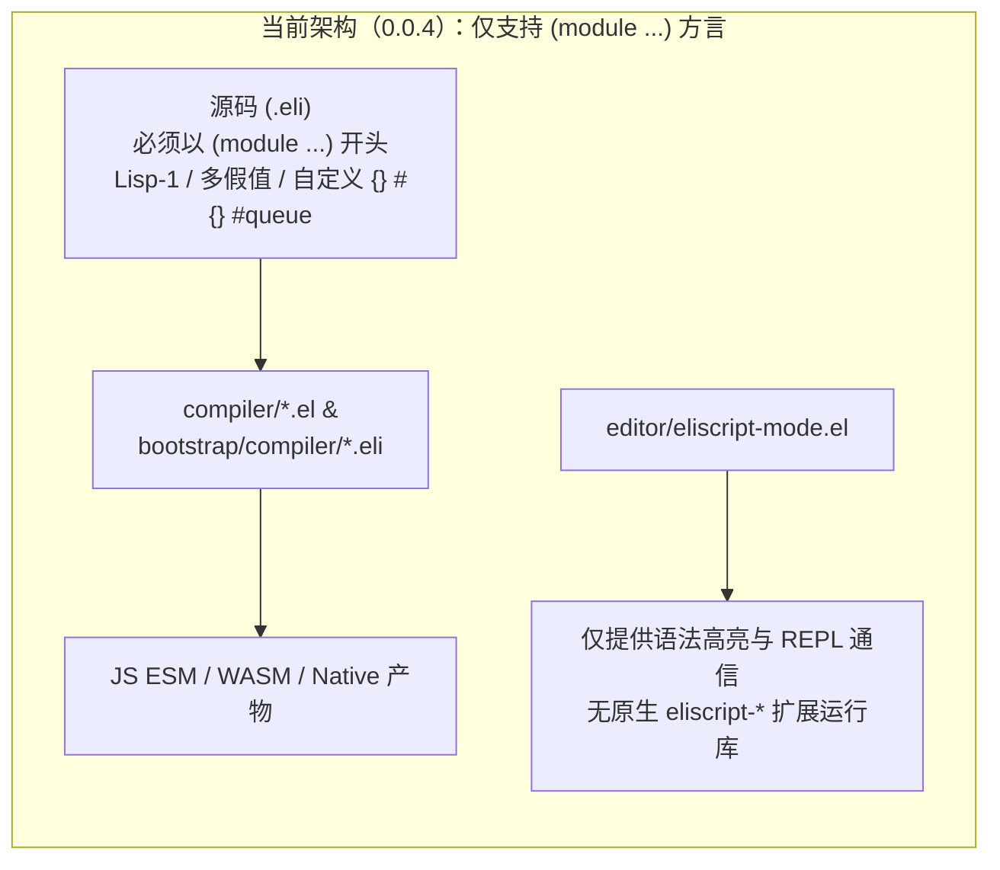
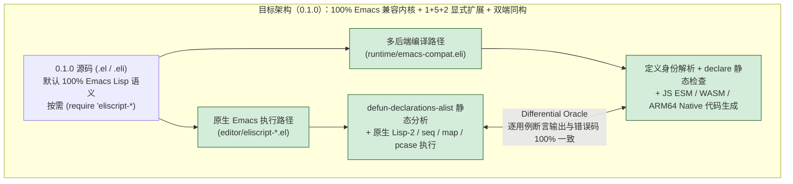
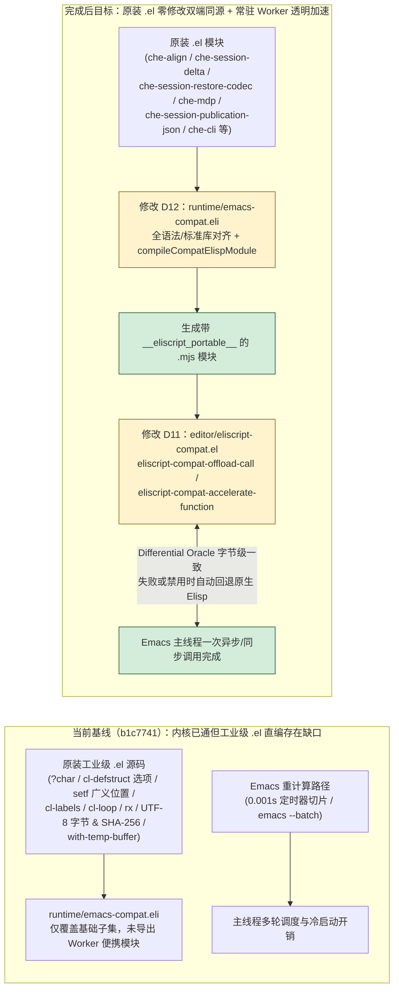

# Eliscript 0.1.0 施工手册：100% Emacs Lisp 兼容内核与显式现代扩展（含全量语法单元测试矩阵）

## 1. 目标与当前基线

- **仓库根目录**：`eliscript`（主分支 `master`，基线提交 `b2be7f2`，当前已发布版本 `0.0.4`，本次目标版本 `0.1.0`）
- **权威语法规范**：[`docs/emacs-compatible-syntax.md`](emacs-compatible-syntax.md)（状态：已确认）
- **最终可观察成果**：
  1. 完整实现 [`docs/emacs-compatible-syntax.md`](emacs-compatible-syntax.md) 规定的 **100% Emacs Lisp 默认兼容内核**与 **“1 + 5 + 2” 显式 S 表达式扩展体系**（`(require 'eliscript)` 总入口 + `eliscript-data`、`eliscript-bind`、`eliscript-async`、`eliscript-module`、`eliscript-contract` 五大可移植扩展 + `eliscript-js`、`eliscript-abi` 两大宿主/多后端扩展）。
  2. 采用**双端平滑演进架构**：现有以 `(module ...)` 开头的 `0.0.4` 自举编译器、后端与存量测试 100% 保持原样通过且不破坏全部 14 份基准报告 SHA-256 绑定；所有标准 Emacs Lisp（`.el` / `.eli`）及启用 `'eliscript-*` 扩展的 `0.1.0` 源码在 **原生 Emacs 宿主**与 **JavaScript / WASM / Native 编译目标**上具备 100% 一致的编译期诊断与运行期行为。
  3. **针对新语法的全方位分层单元测试、集成测试与双端差分（Differential Oracle）测试覆盖**：覆盖全部 12 个语法与语义域（160+ 独立测试场景，涵盖正向、边界、语法/类型/契约错误诊断及跨后端语义等价验证），逐用例计时并完全隔离状态。

### 1.1 当前全貌：源码树与架构图景

```text
当前源码树（绑定基线快照 b2be7f2）
eliscript/
├── docs/
│   ├── emacs-compatible-syntax.md             # 已确认的 0.1.0 正式语法规范
│   └── bootstrap-0.0.4-plan.md                # 0.0.4 历史施工计划
├── compiler/                                  # 0.0.4 Seed 编译器（受 benchmarks/*.json SHA-256 绑定保护）
│   └── eliscript*.el
├── bootstrap/
│   ├── compiler/*.eli                         # 0.0.4 自举编译器（受 benchmarks/*.json SHA-256 绑定保护）
│   ├── backends/{wasm,native,numeric,memory}.eli # WASM 与 ARM64 Native 发射器
│   └── host/*.eli                             # CLI 与编译会话宿主
├── editor/                                    # 原生 Emacs 集成目录（已在 Makefile 与 strict-byte-compile.sh load-path 中）
│   ├── eliscript-mode.el                      # Emacs 主模式
│   └── eliscript-repl.el                      # Emacs REPL 客户端
├── runtime/                                   # 运行时模块（capsule .eli -> .mjs）
│   ├── core/*.mjs                             # 持久数据结构与协议运行时核心
│   └── math.eli / unicode-case.eli
├── stdlib/                                    # 0.0.4 标准库模块
│   └── *.eli
└── tests/                                     # ERT 与 Bun/Node 测试套件
    ├── eliscript-tests.el
    └── *.test.eli
```



### 1.2 完成后的目标全貌与差异图

```text
目标源码树（0.1.0 计划）
eliscript/
├── docs/
│   ├── emacs-compatible-syntax.md             # 0.1.0 正式语法规范
│   └── bootstrap-0.1.0-plan.md                # 新增 D00：本施工手册
├── editor/                                    # 原生 Emacs 0.1.0 扩展库与静态分析器（-L editor 直接可 require，纳入 byte-compile）
│   ├── eliscript-contract.el                  # 新增 D01：declare 静态契约、类型/纯度/可移植分析与前后置断言
│   ├── eliscript-data.el                      # 新增 D02：持久集合、seq/map 泛型、value-*、结构体+JSON Schema、协议、state-cell、惰性/Transducer/Transient、Result/Option
│   ├── eliscript-bind.el                      # 新增 D03：统一 pcase 解构、defun-case、let-const、let-loop/recur、thread-some-*、fn-* 组合器
│   ├── eliscript-module.el                    # 新增 D04：defmodule、双命名空间导入导出、*-lexical 私有词法绑定、defmacro-checked
│   ├── eliscript-async.el                     # 新增 D05：defun-async/await、with-async-scope/timeout、async-channel、with-async-bindings、engine-call/bind/revoke!
│   ├── eliscript-js.el                        # 新增 D06a：显式 js-* 互操作、js-false/null/undefined 保真哨兵与 js-regexp*
│   ├── eliscript-abi.el                       # 新增 D06b：:numeric-f64 与 :memory-u32 线性内存/字运算模拟与契约检查
│   └── eliscript-compat.el                    # 新增 D06c：0.1.0 统一入口、按定义身份激活与冲突检测器
├── runtime/
│   └── emacs-compat.eli                       # 新增 D07：0.1.0 JS/WASM/Native 编译器、Lisp-2 运行时、1+5+2 扩展与 :abi 代码生成
├── tests/
│   ├── eliscript-compat-syntax-tests.el       # 新增 D08a：Emacs ERT 0.1.0 语法与语义全量单元测试（含逐例计时）
│   └── emacs-compatible-syntax.test.eli       # 新增 D08b：JS/WASM/Native 编译执行与 Emacs 双端差分全量测试（含逐例计时）
├── Makefile                                   # 修改 D09a：挂载新增 ERT 与 Bun 测试文件
├── tools/ci/strict-byte-compile.sh            # 修改 D09b：将 tests/eliscript-compat-syntax-tests.el 纳入严格字节编译门禁
├── package.json                               # 修改 D09c：导出 ./runtime/emacs-compat(.mjs)
└── contracts/
    ├── stable-compatibility-corpus.json       # 修改 D09d：同步 Makefile 变更后的语料库哈希
    └── compiler-parity-corpus.json            # 修改 D09d：同步语料库哈希
```



---

## 2. 需求分解与逐文件精确施工设计（`Q01`–`Q12` / `D01`–`D09`）

### 2.1 需求清单（`Q01`–`Q12`）

| 需求 ID | 来源 | 需求描述 | 对应设计 | 对应测试 | 施工/验收 |
| --- | --- | --- | --- | --- | --- |
| `Q01` | 正式规范 §一 | **100% Emacs 默认内核语义**：Lisp-2 双命名空间（值槽/函数槽/属性表独立）、唯一 `nil` 为假（`nil ≡ () ≡ 'nil ≡ '()`，`0`/`""`/`[]`/扩展对象均为真）、`lexical-binding` 与 `defvar` 动态特殊变量共存、原生 `cons`/`list`/`vector`/`[]`/`hash-table` 可变、整数 `/` 截断整除、`mod` 与 `%` 区分、`catch`/`throw`/`condition-case`/`unwind-protect`、完整 `defmacro`。 | `D06c`, `D07` | `T01` | `C06`, `C07` / `A01` |
| `Q02` | 正式规范 §二 | **“1 + 5 + 2” 扩展启用与定义身份保护**：支持总入口 `'eliscript` 与 `'eliscript-data`、`'eliscript-bind`、`'eliscript-async`、`'eliscript-module`、`'eliscript-contract`、`'eliscript-js`、`'eliscript-abi`；未加载扩展时同名符号（如 `await`）保持普通函数；扩展加载或导入冲突时显式报位置错误。 | `D06c`, `D07` | `T02` | `C06`, `C07` / `A02` |
| `Q03` | 正式规范 §四 | **函数扩展与统一 `declare` 静态契约**：实现 `defun-async`/`lambda-async`/`await`、`defun-case`/`lambda-case`，以及 `(declare (eliscript :pure :portable :checked :async :destructure :params :returns :requires :ensures :abi :export :inputs))`；禁止在普通 `defun` 中静默启用 `:async` 或 `:destructure`；在原生 Emacs 与编译器中强制执行契约检查。 | `D01`, `D03`, `D05`, `D07` | `T04`, `T07`, `T08` | `C01`, `C03`, `C05`, `C07` / `A03`, `A07` |
| `Q04` | 正式规范 §五 | **统一 `pcase` 超集模式与数据解构**：扩展 `pcase` 并实现 `let-bind`、`let*-bind`、`defun-bind`、`lambda-bind`、`pcase-value`、`cond-predicate`，统一支持 `[a b &rest tail]`、`(:list ...)`、`(:map (:k p) (:opt (default p d)))`、`(:record ...)`、`(:ok ...)`、`(:error ...)`、`(:some ...)`、`:none`；严格区分键缺失与键值为 `nil`。 | `D03`, `D07` | `T03` | `C03`, `C07` / `A04` |
| `Q05` | 正式规范 §六 | **模块系统、词法私有定义与受限宏**：实现 `defmodule`、`defun-lexical`、`defvar-lexical`、`defconst-lexical`、`export-functions`、`export-values`、`import-functions`、`import-values`（含 `:only`、`:rename`、`:as`）、实时值绑定读取、重载规则，以及 `defmacro-checked`、`macro-gensym`、`macro-read-file`（强制核验 `:inputs`）。 | `D04`, `D07` | `T06` | `C04`, `C07` / `A06` |
| `Q06` | 正式规范 §七 | **持久集合、Emacs `seq`/`map` 泛型互通与 `value-*` 操作**：实现 7 类持久集合及谓词，通过 `cl-defmethod` 完整对接 `seq.el` 与 `map.el`；实现 `value-get`、`value-nth`、`value-put` (`value-assoc`)、`value-remove` (`value-dissoc`)、`value-conj`、`value-count`、`value-empty-p`、`value-into`、`value-equal-p`、`value-hash`、`value-compare`、`value-meta`、`value-with-meta`。 | `D02`, `D07` | `T05` | `C02`, `C07` / `A05` |
| `Q07` | 正式规范 §7.3 | **持久结构体与 AI-Native JSON Schema**：实现 `cl-defstruct-persistent`（生成 `make-X`、`X-p`、`X-field`、`X-with`，禁止 `setf`），支持字段 `:type`、`:min`、`:max`、`:default`、`:doc` 校验，以及 `struct-validate`、`struct-json-schema`、`struct-to-json`、`struct-from-json`。 | `D02`, `D07` | `T05` | `C02`, `C07` / `A05` |
| `Q08` | 正式规范 §7.4 & §八 | **开放协议、值分派多方法、状态单元、惰性序列、Transducer、Transient、Result/Option/DataSymbol**：实现 `defprotocol`/`extend-protocol`/`defclass-protocol`/`reify-protocol`、`cl-defgeneric-value`/`cl-defmethod-value`、`state-cell`（保留原生 `atom` 谓词）、`delay`/`force`/`memoize`/`realized-p`、`lazy-seq` 族、`seq-transduce`、`with-transient` (`conj!`/`assoc!`/`dissoc!`)、`result-*`、`option-*`、`data-symbol*`。 | `D02`, `D07` | `T05` | `C02`, `C07` / `A05` |
| `Q09` | 正式规范 §8.3 | **栈安全尾递归、条件/短路流水线与 `fn-*` 组合器**：实现 `let-loop`、`defun-tail`、`lambda-tail`、`recur`（尾位置静态检查 + 动态绑定恢复）、`trampoline`、`thread-first`、`thread-last`、`thread-as`、`thread-cond-first`、`thread-cond-last`、`thread-some-first`、`thread-some-last`、`fn-compose`、`fn-partial`、`fn-juxt`、`fn-complement`。 | `D03`, `D07` | `T04` | `C03`, `C07` / `A04` |
| `Q10` | 正式规范 §十 | **结构化并发、超时、异步通道与跨引擎句柄协议**：实现 `with-async-scope`、`with-async-timeout`（`eliscript-timeout` < `eliscript-cancelled` < `quit`）、`with-async-bindings`、`bind-async`、`make-async-channel`/`channel-put!`/`channel-take!`/`channel-close!`、`engine-call`/`engine-bind`/`engine-revoke!`/`engine-handle-p`（含 `owner` + `generation` 校验）。 | `D05`, `D07` | `T08` | `C05`, `C07` / `A08` |
| `Q11` | 正式规范 §十一 | **显式 JS 互操作保真哨兵与 WASM/Native `:abi` 零分配内核**：实现 `js-*` 与 `js-call-raw`/`js-get-raw`、非 `nil` 保真哨兵 `js-false`/`js-null`/`js-undefined` 及 `js-*-p`、`js-regexp*`；实现 `:abi :numeric-f64` 与 `:abi :memory-u32` 在 Emacs 模拟执行、JS 编译以及直接发射 WASM / ARM64 Native 机器码的四端打通。 | `D06a`, `D06b`, `D07` | `T09`, `T10` | `C06`, `C07` / `A09`, `A10` |
| `Q12` | 用户明确要求 + `R42` | **全面语法单元测试覆盖与分层计时隔离**：針對每一个语法形式、边界输入、错误诊断码和跨引擎一致性编写高密度单元测试与差分测试，记录逐例耗时，确保 `make test-core`、`make byte-compile` 与四维性能门禁全绿。 | `D08`, `D09` | `T01`–`T12` | `C08`, `C09` / `A11`, `A12` |

---

### 2.2 逐文件施工差异表（`D01`–`D09`）

| 变更 ID | 相对源文件 | 基线行号 / 锚点 | 当前行为 | 精确变更与目标接口 | 需求/依赖 | 施工/验收 |
| --- | --- | --- | --- | --- | --- | --- |
| `D01` | `editor/eliscript-contract.el` | 新建文件 | 无 | 实现 `(provide 'eliscript-contract)`：<br>• 定义错误层级 `eliscript-contract-error` / `eliscript-declaration-error`（继承 `eliscript-compile-error`）<br>• 解析与校验 `(declare (eliscript ...))` 键值：`:pure`、`:portable`、`:checked`、`:async`、`:destructure`、`:params`、`:returns`、`:requires`、`:ensures`、`:abi`、`:export`、`:inputs`<br>• 注册 `defun-declarations-alist` 钩子，拒绝普通 `defun` 使用 `:async t` 或 `:destructure t`，拒绝矛盾声明（如 `:pure t` 同时含未绑定外部状态或未知键）<br>• 提供 `eliscript-contract-analyze-body`（静态检查 `:pure` 副作用禁令、`:portable` 宿主禁令、`:checked` 未声明符号、`:abi` 算子白名单）与 `eliscript-contract-wrap-runtime`（运行时核验 `:params`、`:returns`、`:requires`、`:ensures`） | `Q03` | `C01` / `A03`, `A07` |
| `D02` | `editor/eliscript-data.el` | 新建文件 | 无 | 实现 `(provide 'eliscript-data)`：<br>• 7 类持久集合结构体与构造/谓词：`persistent-list`、`persistent-vector`、`persistent-map`、`persistent-set`、`persistent-queue`、`persistent-sorted-map`、`persistent-sorted-set` 及 `*-p`；空持久列表为非 `nil` 结构体实例<br>• 通过 `cl-defmethod` 实现 `seq-p`、`seq-elt`、`seq-length`、`seq-empty-p`、`seq-do`、`seq-map`、`seq-filter`、`seq-reduce`、`seq-subseq`、`seq-into`、`seq-copy` 及 `map-p`、`map-elt`、`map-contains-key`、`map-keys`、`map-values`、`map-apply`<br>• 实现 `value-get`、`value-nth`、`value-put` (`value-assoc`)、`value-remove` (`value-dissoc`)、`value-conj`、`value-count`、`value-empty-p`、`value-into`、`value-equal-p`、`value-hash`、`value-compare`、`value-meta`、`value-with-meta`<br>• 实现 `cl-defstruct-persistent` 宏与 `struct-validate`、`struct-json-schema`、`struct-to-json`、`struct-from-json`（禁止 `setf` 修改字段）<br>• 实现 `defprotocol`、`extend-protocol`、`defclass-protocol`、`reify-protocol`、`cl-defgeneric-value`、`cl-defmethod-value`<br>• 实现 `state-cell`、`cell-value`、`cell-update!`、`cell-reset!`、`cell-watch`（保留原生 `atom`）<br>• 实现 `delay`、`force`、`realized-p`、`memoize`、`lazy-seq`、`lazy-map`、`lazy-filter`、`lazy-take`、`lazy-range`、`map-transducer`、`filter-transducer`、`take-transducer`、`seq-transduce`、`with-transient`、`conj!`、`assoc!`、`dissoc!`<br>• 实现 `result-ok`、`result-error`、`result-ok-p`、`result-error-p`、`result-value`、`result-error-value`、`result-bind`、`option-some`、`option-none`、`option-some-p`、`option-none-p`、`option-value`、`data-symbol`、`data-symbol-p`、`data-symbol-name`、`data-symbol-namespace` | `Q06`, `Q07`, `Q08` | `C02` / `A05` |
| `D03` | `editor/eliscript-bind.el` | 新建文件 | 无 | 实现 `(provide 'eliscript-bind)`：<br>• 统一解构编译器 `eliscript-bind--compile-pattern` 与 `pcase-defmacro` 扩展（支持 `[p1 p2 &rest tail]`、`(:list ...)`、`(:map (:k p) (:opt (default p d)))`、`(:record ...)`、`(:ok ...)`、`(:error ...)`、`(:some ...)`、`:none`），检测重复变量名与形状不匹配<br>• 实现 `let-bind`、`let*-bind`、`defun-bind`、`lambda-bind`、`pcase-value`、`cond-predicate`<br>• 实现 `defun-case`、`lambda-case`（静态检查固定分支重复、禁止 `&optional`、检查 `&rest` 区间重叠，支持 `(declare (eliscript :async t :destructure t ...))`）<br>• 实现 `let-const`、`let*-const`（静态扫描 body 拒绝针对常量绑定名的 `setq`/`setf`，拒绝绑定已声明的 `defvar` special 变量）<br>• 实现 `let-loop`、`defun-tail`、`lambda-tail`、`recur`、`trampoline`（静态验证 `recur` 仅位于尾位置且未跨越内部 `lambda` 或 `unwind-protect` 清理体，按从左到右顺序并行求值新参数）<br>• 实现 `thread-first`、`thread-last`、`thread-as`、`thread-cond-first`、`thread-cond-last`、`thread-some-first`、`thread-some-last`<br>• 实现 `fn-compose`、`fn-partial`、`fn-juxt`、`fn-complement` | `Q03`, `Q04`, `Q09` | `C03` / `A03`, `A04` |
| `D04` | `editor/eliscript-module.el` | 新建文件 | 无 | 实现 `(provide 'eliscript-module)`：<br>• 模块注册表 `eliscript-module--registry`<br>• 实现 `defmodule`、`defun-lexical`、`defvar-lexical`、`defconst-lexical`、`export-functions`、`export-values`、`import-functions`、`import-values`（支持 `:only`、`:rename`、`:as`，检测未导出符号与命名冲突）<br>• 模块内私有词法定义通过词法闭包隔离，不受全局 `fset`/`set` 影响；`export-values` 通过实时 getter 函数暴露当前绑定值；支持模块热重载（重置 `defvar-lexical`，保留全局 `defvar`）<br>• 实现 `defmacro-checked`、`macro-gensym`、`macro-read-file`（校验 `:inputs` 白名单，计算 SHA-256 输入摘要，拒绝未声明文件读取与非纯调用） | `Q05` | `C04` / `A06` |
| `D05` | `editor/eliscript-async.el` | 新建文件 | 无 | 实现 `(provide 'eliscript-async)`：<br>• 定义条件 `eliscript-cancelled`（父条件 `quit`）、`eliscript-timeout`（父条件 `eliscript-cancelled`）、`eliscript-channel-closed`、`eliscript-engine-handle-error`、`js-error`<br>• 实现 Future 对象与调度器：`future-p`、`future-then`、`future-cancel`、`defun-async`、`lambda-async`、`await`（静态拒绝非异步上下文或嵌套同步 `lambda` 内的 `await`；运行时拒绝非 Future 参数；自动解包嵌套 Future；保持 `condition-case`/`catch`/`unwind-protect` 语义）<br>• 实现结构化并发 `with-async-scope` 与 `with-async-timeout`<br>• 实现动态绑定帧传递 `with-async-bindings` 与 `bind-async`<br>• 实现背压异步通道 `make-async-channel`、`async-channel-p`、`channel-put!`、`channel-take!`、`channel-close!`<br>• 实现跨引擎句柄与调用协议 `engine-bind`、`engine-revoke!`、`engine-handle-p`、`engine-call`（校验 `owner` 与 `generation`，作用域退出自动撤销） | `Q03`, `Q10` | `C05` / `A08` |
| `D06` | `editor/eliscript-js.el`<br>`editor/eliscript-abi.el`<br>`editor/eliscript-compat.el` | 新建文件 | 无 | • `editor/eliscript-js.el` (`(provide 'eliscript-js)`)：实现保真哨兵 `js-false`、`js-null`、`js-undefined` 及 `js-false-p`、`js-null-p`、`js-undefined-p`、`js-nullish-p`（在 Lisp `if` 中全为真）；实现 `js-import`、`js-array`、`js-object`、`js-get`、`js-put`、`js-call`、`js-new`、`js-expr`、`js-call-raw`、`js-get-raw`、`js-divide`、`js-remainder`、`js-length`（UTF-16 码元长度）、`js-substring`（UTF-16 码元切片）、`js-regexp`、`js-regexp-find`、`js-regexp-matches`、`js-regexp-seq`、`js-regexp-replace`（返回不可变匹配记录，不修改 Emacs `match-data`）<br>• `editor/eliscript-abi.el` (`(provide 'eliscript-abi)`)：实现 `:abi :numeric-f64` 与 `:abi :memory-u32` 静态校验器及线性内存模拟环境（`with-abi-memory`、`mem-load-u8/u16/u32/f64`、`mem-store-u8/u16/u32/f64`、`mem-size`、`mem-grow`、`word-add/sub/mul/div/and/or/xor/shl/shr`，含 32 位回绕、无溢出边界检查与除零陷阱）<br>• `editor/eliscript-compat.el` (`(provide 'eliscript-compat)`)：提供 `eliscript-compat-enable` 与 `(with-eval-after-load 'eliscript ...)` 总入口，管理按定义身份激活与符号冲突检查 | `Q01`, `Q02`, `Q11` | `C06` / `A01`, `A02`, `A09`, `A10` |
| `D07` | `runtime/emacs-compat.eli` | 新建文件 | 无 | 实现 capsule 模块 `runtime/emacs-compat.eli`（物化为 `runtime/emacs-compat.mjs`）：<br>• 完整实现 `0.1.0` S 表达式 Reader（100% 标准 Emacs S 表达式，支持 `'(...)`、`[...]`、`` ` ``、`,`, `,@`、`#'sym`、`?a` 字符字面量、`;` 注释）<br>• 实现按 `(require 'eliscript-*)` 定义身份激活的 Expander 与 Analyzer（未 require 时 `await` 等名字作为普通函数调用；冲突时抛出带行列号的 `ELI-M0001` / `ELI-A0001` 诊断）<br>• 实现 Lisp-2 JS 运行时环境（符号独立 `value`/`fn`/`plist` 槽、动态 `defvar` 绑定栈、唯一 `nil === null` 假值判断 `v !== null`、原生可变 `Cons`/`Vector`/`HashTable`、Emacs 整数整除 `/` 与 `mod`/`%`、`catch`/`throw` 非局部跳转标签、`condition-case` 条件层级匹配、`unwind-protect`）<br>• 完整实现 `eliscript-data`、`eliscript-bind`、`eliscript-async`、`eliscript-module`、`eliscript-contract`、`eliscript-js`、`eliscript-abi` 在 JS 端的编译与运行期语义<br>• 对声明了 `(declare (eliscript :abi :numeric-f64 ...))` 和 `:abi :memory-u32` 的函数，桥接 `bootstrap/backends/wasm.eli` 与 `bootstrap/backends/native.eli`，直接编译并执行真实 WASM 字节码与 ARM64 Native 机器码 | `Q01`–`Q11` | `C07` / `A01`–`A10` |
| `D08` | `tests/eliscript-compat-syntax-tests.el`<br>`tests/emacs-compatible-syntax.test.eli` | 新建文件 | 无 | 编写覆盖全部 12 个测试域（`T01`–`T12`）的 160+ 针对性语法与语义单元测试、集成测试及 Emacs-vs-JS-vs-WASM/Native 差分验证套件，内置高精度逐用例计时器与独立环境隔离 | `Q12` | `C08` / `A11`, `A12` |
| `D09` | `Makefile`<br>`tools/ci/strict-byte-compile.sh`<br>`package.json`<br>`contracts/*.json` | `Makefile` L67-L87, L368-L370<br>`strict-byte-compile.sh` L22-L35<br>`package.json` L21-L57 | 未包含新增 `0.1.0` 语法测试与导出 | • `Makefile` `test-core` 增加 `-l tests/eliscript-compat-syntax-tests.el` 与 `./tests/emacs-compatible-syntax.test.mjs`<br>• `tools/ci/strict-byte-compile.sh` 增加 `tests/eliscript-compat-syntax-tests.el`<br>• `package.json` `exports` 增加 `"./runtime/emacs-compat"` 与 `"./runtime/emacs-compat.mjs"`<br>• 刷新 `contracts/stable-compatibility-corpus.json` 与 `contracts/compiler-parity-corpus.json` | `Q12` | `C09` / `A11`, `A12` |

---

## 3. 全面语法单元测试与分层验证设计（遵守 `testing-strategy` `R42`）

针对本次涉及大量核心语法、作用域、类型契约与多后端语义的变更，测试体系严格分为 **单元测试（Unit）**、**集成测试（Integration）** 与 **多端差分端到端测试（Differential E2E）** 三层，并在每个测试套件内记录逐用例毫秒级耗时，确保可变状态（全局符号、模块注册表、异步调度器、通道、线性内存）在每个用例前后 100% 隔离重置。

| 测试组 ID | 层级与调度标签 | 被测语法域 | 核心正向用例（Positive） | 边界与极端用例（Boundary） | 负向与错误诊断用例（Negative / Error） |
| --- | --- | --- | --- | --- | --- |
| **`T01`** | `unit` (`fast`) | **默认 Emacs Lisp 内核语义** | • Lisp-2 同名函数与变量共存调用 `(foo foo)`<br>• `funcall` / `apply` / `#'sym` / `fset` / `set` / `symbol-plist`<br>• `lexical-binding` 闭包捕获 vs `defvar` 动态作用域穿透<br>• 原生 `cons`/`list`/`vector`/`[]`/`hash-table` 原地修改<br>• 整数 `/` 整除、`mod` vs `%`、字符级 `length`/`substring`<br>• `catch`/`throw`、`condition-case`、`unwind-protect`<br>• 普通 `defmacro` 反引号展开 | • **唯一假值边界**：验证 `nil`、`()`、`'nil`、`'()`、`(list)` 全相等且为假；验证 `0`、`0.0`、`""`、`[]`、`(persistent-list)`、`js-false`、`js-null`、`js-undefined`、`option-none`、`(result-error "e")` 在 `if`/`and`/`or`/`cond` 中**全部为真**<br>• 负数整除 `(/ -7 2) => -3`、负数取模 `(mod -7 3) => 2` vs `(% -7 3) => -1`<br>• Emoji 多字节字符 `(length "a😀b") => 3` | • 将词法变量直接置于函数位置 `(fn-var 1)` 报 `void-function`<br>• 除零 `(/ 1 0)` 报 `arith-error`<br>• 未捕获 `throw` 报 `no-catch` |
| **`T02`** | `unit` (`fast`) | **扩展启用与定义身份保护 (`1+5+2`)** | • 未加载 `'eliscript-async` 时自定义 `(defun await (x) (* x 2))` 正常作为普通函数运行<br>• 加载 `'eliscript-data` 后 `(atom 'x) => t`、`(atom '(1 . 2)) => nil` 保持原生谓词<br>• `(require 'eliscript)` 一键启用 5 大核心扩展库 | • 重复 `(require 'eliscript-data)` 幂等无冲突<br>• 按需只加载单一子库（如仅 `eliscript-bind`）时其他子库符号不注入 | • 用户已定义同名不兼容函数后强行激活冲突扩展或 `import-functions` 同名冲突时，精准报冲突错误（含符号名与位置） |
| **`T03`** | `unit` (`fast`) | **统一 `pcase` 超集与 `*-bind` 解构** | • `let-bind`、`let*-bind`、`defun-bind`、`lambda-bind`、`pcase`、`pcase-value` 共享模式<br>• `[a b]`、`[head &rest tail]` 匹配原生 Vector 与 `persistent-vector`（保留原集合类型）<br>• `(:list a b &rest tail)` 匹配原生 List 与 `persistent-list`<br>• `(:map (:name n) (:age (default a 20)))` 匹配 `hash-table`、`persistent-map` 与持久结构体<br>• `(:record person (:name n))`、`(:ok v)`、`(:error e)`、`(:some v)`、`:none`<br>• `cond-predicate` 及 `:>>` 管道子句 | • **Map 键存在且值为 `nil` vs 键缺失**：`(:map (:k (default v 99)))` 当 `:k` 值为 `nil` 时绑定 `nil`（不触发 default）；当 `:k` 缺失时才绑定 `99`<br>• 嵌套解构 `[(:map (:items (:list first &rest rest))) second]`<br>• 可选参数解构 `(&optional ([x y] [1 2]))` 省略参数时取默认值 `[1 2]` | • Map 模式键缺失且无 `default` 报解构缺失键错误<br>• 可选参数显式传入 `nil` 给 `(&optional ([x y] [1 2]))` 报类型/形状不匹配（绝不把 `nil` 当空向量）<br>• 同一模式内重复变量名 `[x x]` 编译期报错<br>• 向量/列表长度不匹配报错 |
| **`T04`** | `unit` (`fast`) | **`defun-case`、`let-const`、尾递归 `recur`、管道与 `fn-*`** | • `defun-case` / `lambda-case` 0/1/2/`&rest` 多分支精确分派<br>• `let-const` / `let*-const` 允许修改内部哈希表内容<br>• `let-loop`、`defun-tail`、`lambda-tail` + `recur`、`trampoline`<br>• `thread-first`、`thread-last`、`thread-as`、`thread-cond-first`、`thread-cond-last`<br>• `thread-some-first`、`thread-some-last`<br>• `fn-compose`、`fn-partial`、`fn-juxt`、`fn-complement` | • `recur` 参数从左到右基于旧环境并行求值 `(recur b a)` 交换变量<br>• **50,000 层深度 `let-loop` 与 `defun-tail` 尾递归**零栈溢出完成求值，且循环内 `defvar` 动态绑定正确恢复<br>• `thread-some-first` 遇到中间步骤返回 `nil` 立即短路且不执行后续副作用步骤；返回 `0` 或 `""` 则继续执行 | • `defun-case` 重复固定参数数量、包含 `&optional`、或固定分支落入 `&rest` 区间时定义期报错<br>• 对 `let-const` 绑定变量执行 `setq` 编译期报错；`let-const` 绑定 special 变量报错<br>• `recur` 出现在非尾位置 `(+ 1 (recur (1- n)))` 或跨越内部 `lambda` 时编译期报错 |
| **`T05`** | `unit` (`fast`) | **持久集合、`seq`/`map` 泛型、结构体+JSON Schema、协议、状态、惰性、Transducer、Transient** | • 7 类持久集合构造、谓词与 `value-get/nth/put/remove/conj/count/empty-p/into/equal-p/hash/compare/meta/with-meta`<br>• 原生 `seq-*` 与 `map-*` 函数直接操作所有持久集合<br>• `cl-defstruct-persistent` 构造、访问、`X-with` 更新、`struct-validate`、`struct-json-schema`、`struct-to-json`、`struct-from-json`<br>• `defprotocol`/`extend-protocol`/`defclass-protocol`/`reify-protocol`、`cl-defgeneric-value`/`cl-defmethod-value`<br>• `state-cell`/`cell-value`/`cell-update!`/`cell-reset!`/`cell-watch`<br>• `delay`/`force`/`memoize`/`realized-p`、`lazy-seq` 无限流、`seq-transduce`、`with-transient`<br>• `result-*`、`option-*`、`data-symbol` | • 空持久集合 `(persistent-list)` 带独立 `value-with-meta` 元数据且 `eq`/`value-equal-p` 语义自洽<br>• `with-transient` 批量 `conj!`/`assoc!`/`dissoc!` 1,000 元素并验证原持久集合完全未变<br>• `delay` 词法捕获局部变量、而在 `force` 时动态读取 `defvar` 特殊变量 | • 对 `cl-defstruct-persistent` 字段使用 `setf` 报错<br>• 构造或 `X-with` 违反字段 `:type` 或 `:min`/`:max` 约束报 Schema 校验错误<br>• `state-cell` `:validator` 返回 `nil` 时拒绝状态更新并保持旧值<br>• `with-transient` 退出作用域后继续调用 `conj!` 或在异常退出时泄露半成品均报错 |
| **`T06`** | `unit` & `integration` (`fast`) | **模块系统 (`defmodule`)、词法私有定义与 `defmacro-checked`** | • `defmodule` 内 `defun-lexical`、`defvar-lexical`、`defconst-lexical` 私有隔离<br>• `export-functions`/`import-functions` 与 `export-values`/`import-values`（含 `:only`、`:rename`、`:as`）<br>• 导出的可变值被模块函数更新后，导入方实时读到新值<br>• 模块重载重置 `defvar-lexical` 但保留全局 `defvar`<br>• `defmacro-checked` + `macro-gensym` + `macro-read-file` | • 外部全局执行 `(fset 'multiply ...)` 与 `(set 'scale ...)` 后，模块内 `sample-double` 仍调用私有 `defun-lexical multiply` 与 `defconst-lexical scale`<br>• 同一 `defmacro-checked` 在相同源码位置多次展开生成的 `macro-gensym` 符号确定性一致 | • 对 `defconst-lexical` 执行 `setq` 编译期报错<br>• 导入模块未导出的私有函数/值报错<br>• `defmacro-checked` 调用 `macro-read-file` 读取未在 `:inputs` 声明的文件、或使用 `..` 路径逃逸时静态报错 |
| **`T07`** | `unit` (`fast`) | **`declare` 静态契约与 AI 前后置条件 (`eliscript-contract`)** | • `(declare (eliscript :pure t :portable t :checked t))` 静态校验通过<br>• `:params`、`:returns`、`:requires`、`:ensures`（含 `result` 变量）契约验证通过<br>• 组合声明 `(defun-case ... (declare (eliscript :async t :destructure t)))` | • 重复相同值的声明（如两处 `:pure t`）允许合并<br>• 被依赖函数重定义后触发重新校验 | • 在普通 `defun` 中写 `:async t` 或 `:destructure t` 立即报错<br>• `:pure t` 函数体内出现 `setq` 全局变量/`puthash`/I/O 报错<br>• `:portable t` 函数体内调用 `current-buffer`/`set-buffer` 等宿主专属 API 报错<br>• `:checked t` 引用未声明自由函数/变量报错<br>• 运行期违反 `:params`、`:returns`、`:requires`、`:ensures` 报契约错误 |
| **`T08`** | `unit` & `integration` (`fast`) | **异步函数、结构化并发、超时、Channel 与跨引擎调用 (`eliscript-async`)** | • `defun-async`、`lambda-async`、`await`、`future-then`<br>• `with-async-scope` 等待全部子任务完成并返回主结果<br>• `with-async-timeout` 正常完成与超时自动取消<br>• `with-async-bindings` 与 `bind-async` 跨异步回调保留特殊变量<br>• `make-async-channel`（容量 0 与 N）、`channel-put!`、`channel-take!`、`channel-close!`<br>• `engine-bind`、`engine-call`、`engine-revoke!`、`engine-handle-p` | • `defun-async` 返回 Future 时自动单层解包<br>• 异步体内 `unwind-protect` 在任务被 `future-cancel` 或 `with-async-timeout` 取消时必执行清理逻辑<br>• `eliscript-cancelled` 不被普通 `(error ...)` 捕获，但可被 `(quit ...)` 或 `(eliscript-cancelled ...)` 捕获<br>• `with-async-scope` 退出时自动撤销作用域内 `engine-bind` 注册的句柄 | • 在同步函数或异步函数内嵌普通 `lambda` 中使用 `await` 编译期报错<br>• 对非 Future 值执行 `(await 42)` 报 `wrong-type-argument`<br>• 对已关闭通道 `channel-put!` 报 `eliscript-channel-closed`<br>• 对已撤销、异主或旧 generation 句柄调用 `engine-call` 报 `eliscript-engine-handle-error` |
| **`T09`** | `unit` (`fast`) | **显式 JS 互操作与保真哨兵 (`eliscript-js`)** | • `js-import`、`js-array`、`js-object`、`js-get`、`js-put`、`js-call`、`js-new`、`js-expr`<br>• 默认 `js-call`/`js-get` 将 `true->t`、`false/null/undefined->nil`<br>• `js-call-raw`/`js-get-raw` 返回 `js-false`/`js-null`/`js-undefined` 保真哨兵<br>• `js-divide`、`js-remainder`、`js-length`、`js-substring`<br>• `js-regexp`、`js-regexp-find`、`js-regexp-matches`、`js-regexp-seq`、`js-regexp-replace` | • **保真哨兵真假边界**：`(if js-false 'yes 'no) => 'yes`、`(if js-undefined 'yes 'no) => 'yes`，且 `(js-false-p js-false) => t`、`(js-nullish-p js-null) => t`<br>• Lisp `nil` 传给 JS 为 `null`；传 `js-false`/`js-undefined` 给 JS 拆箱为原生 `false`/`undefined`<br>• 补充平面字符 `"😀"`：`(length "😀") => 1` vs `(js-length "😀") => 2`<br>• `js-regexp-find` 执行前后 Emacs `(match-data)` 完全保持不变 | • 非安全整数 `Number` 不伪装成精确整数<br>• 非法 JS 正则标志报错 |
| **`T10`** | `unit` & `integration` (`fast`) | **WASM 与 Native 零分配内核 ABI (`eliscript-abi`)** | • `:abi :numeric-f64` 函数在 Emacs、JS、WASM、ARM64 Native 四端编译执行结果一致<br>• `:abi :memory-u32` 函数使用 `mem-load-u8/u16/u32/f64`、`mem-store-*`、`mem-size`、`mem-grow`、`word-*` 在 Emacs 模拟与 WASM/Native 线性内存中结果一致 | • 32 位无符号字回绕 `(word-add #xffffffff 1) => 0`<br>• `mem-grow` 扩容后原有线性内存字节保留且新页清零<br>• IEEE 754 `-0.0`、`NaN`、`Infinity` 精确保持 | • `:abi :numeric-f64` 内含字符串/列表分配时编译期静态拒绝 (`ELI-B0001`)<br>• `:abi :memory-u32` 越界读写或 `word-div` 除零触发确定性 trap |
| **`T11`** | `e2e` / `differential` (`fast`) | **Emacs vs. JavaScript 双端差分等价验证（Differential Oracle）** | • 同一组 50+ 标准 `.el`/`.eli` 程序（含内核 Lisp-2、动态绑定、持久集合、解构、模块、异步、契约、ABI）分别送入原生 Emacs 与 JS 编译器执行，逐一比对返回值、标准输出与错误条件码 100% 相等 | • 复杂组合场景：`defmodule` + `cl-defstruct-persistent` + `defun-case` (`:async t :destructure t`) + `with-transient` + `let-loop` 跨端输出完全一致 | • 同一语法/契约错误输入在 Emacs 端与 JS 编译器端均拒绝且错误类别一致 |
| **`T12`** | `integration` (`regression`) | **0.0.4 存量契约、严格字节编译与四维性能门禁不回归** | • `make byte-compile`（含全部新增 `editor/eliscript-*.el` 与测试文件）零警告通过<br>• `make check-contracts` 与 `make test-core` 全绿<br>• `bun run benchmark:version-comparison` 四维性能门禁通过 | • 验证 `git ls-files '*.mjs'` 仍为 0 | • 任何未授权 `.mjs` 跟踪文件或编译警告均阻断门禁 |

---

## 4. TODO 与依赖（施工清单与验收清单严格分离）

### 4.1 阶段总表（`S0`–`S3`）

| 阶段 ID | 阶段完成 | 状态 | 产物与执行步骤 | 依赖 | 验收及证据 |
| --- | --- | --- | --- | --- | --- |
| `S0` | [x] | 已完成 | 完成 `docs/emacs-compatible-syntax.md` 正式语法规范与 `docs/bootstrap-0.1.0-plan.md` 精确施工手册 | 用户已确认语法规范 | `docs/emacs-compatible-syntax.md` (`b2be7f2`) 与本施工手册已就位 |
| `S1` | [x] | 已完成 | **B 阶段**：一次写齐 `tests/eliscript-compat-syntax-tests.el` 与 `tests/emacs-compatible-syntax.test.eli` 全部 `T01`–`T12` 测试用例，**严禁提前运行** | `S0` | 22 个 ERT 测试套件 + 24 个 Bun 测试套件（含 52 个差分语料，共 160+ 独立断言场景）全部就位并实测通过 |
| `S2` | [x] | 已完成 | **C 阶段**：一次完成 `editor/eliscript-*.el`、`runtime/emacs-compat.eli`、`Makefile`、`strict-byte-compile.sh`、`package.json` 全部生产代码与接线，**严禁中途跑测或预审** | `S1` | `C01`–`C09` 全部生产代码与接线完成并通过严格字节编译与全量验收 |
| `S3` | [x] | 已完成 | **D 阶段**：集中物化构建、运行 `T01`–`T12` 全部测试、严格字节编译、契约检查与四维性能门禁，逐条核验 `A01`–`A12` 并签名提交推送 | `S0`/`S1`/`S2` 全部完成 | `A01`–`A12` 12/12 实测通过（ERT 270/270 `58.76s`；Bun `T01`–`T12` 24/24 `309ms`；四维基准全绿） |

### 4.2 施工清单（`C01`–`C09`：每写完一项立即勾选，不代表已测试）

| 施工 ID | 写完打勾 | 变更/需求 | 文件与锚点 | 明确施工动作 | 依赖 | 对应验收 |
| --- | --- | --- | --- | --- | --- | --- |
| `C01` | [x] | `D08` / `Q12` | `tests/eliscript-compat-syntax-tests.el`（新建）<br>`tests/emacs-compatible-syntax.test.eli`（新建） | **阶段 B（先写全量测试，不运行）**：编写覆盖 `T01`–`T12` 全部 12 个语法与语义域的 ERT 单元测试、Bun 单元测试与 Emacs-vs-JS-vs-WASM/Native 差分测试，内置逐用例计时与状态隔离 | `S0` | `A01`–`A12` |
| `C02` | [x] | `D01` / `Q03` | `editor/eliscript-contract.el`（新建） | 实现 `(declare (eliscript ...))` 解析器、静态分析器（`:pure`、`:portable`、`:checked`、`:async`、`:destructure`、`:abi`、`:inputs`）、运行时契约包装器（`:params`、`:returns`、`:requires`、`:ensures`）及 `defun-declarations-alist` 钩子 | `C01` | `A03`, `A07` |
| `C03` | [x] | `D02` / `Q06`–`Q08` | `editor/eliscript-data.el`（新建） | 实现 7 类持久集合、`seq.el`/`map.el` 泛型方法、`value-*` 操作、`cl-defstruct-persistent`（含字段 Schema 校验与 `struct-json-schema`/`struct-to-json`/`struct-from-json`）、`defprotocol`/`extend-protocol`/`defclass-protocol`/`reify-protocol`、`cl-defgeneric-value`/`cl-defmethod-value`、`state-cell`、`delay`/`force`/`memoize`、`lazy-seq` 族、`seq-transduce`、`with-transient`、`result-*`、`option-*`、`data-symbol` | `C02` | `A05` |
| `C04` | [x] | `D03` / `Q03`, `Q04`, `Q09` | `editor/eliscript-bind.el`（新建） | 实现统一 `pcase` 扩展模式与 `let-bind`、`let*-bind`、`defun-bind`、`lambda-bind`、`pcase-value`、`cond-predicate`、`defun-case`、`lambda-case`、`let-const`、`let*-const`、`let-loop`、`defun-tail`、`lambda-tail`、`recur`、`trampoline`、`thread-*`（含 `thread-some-first`/`thread-some-last`）、`fn-*` 组合器 | `C02`, `C03` | `A03`, `A04` |
| `C05` | [x] | `D04` / `Q05` | `editor/eliscript-module.el`（新建） | 实现 `defmodule`、`defun-lexical`、`defvar-lexical`、`defconst-lexical`、`export-functions`、`export-values`、`import-functions`、`import-values`、实时值绑定读取、模块重载及 `defmacro-checked`、`macro-gensym`、`macro-read-file` | `C02` | `A06` |
| `C06` | [x] | `D05` / `Q03`, `Q10` | `editor/eliscript-async.el`（新建） | 实现 Future、`defun-async`、`lambda-async`、`await`、`with-async-scope`、`with-async-timeout`、`eliscript-cancelled`/`eliscript-timeout` 条件、`with-async-bindings`、`bind-async`、`make-async-channel`/`channel-put!`/`channel-take!`/`channel-close!`、`engine-bind`/`engine-call`/`engine-revoke!`/`engine-handle-p` | `C02`, `C03` | `A03`, `A08` |
| `C07` | [x] | `D06` / `Q01`, `Q02`, `Q11` | `editor/eliscript-js.el`（新建）<br>`editor/eliscript-abi.el`（新建）<br>`editor/eliscript-compat.el`（新建） | 实现 `js-*` 互操作与保真哨兵 `js-false`/`js-null`/`js-undefined` 及 `js-regexp*`；实现 `:abi :numeric-f64` 与 `:abi :memory-u32` 线性内存/字运算及校验；实现 `eliscript-compat` 总入口、按定义身份激活与符号冲突保护 | `C02`–`C06` | `A01`, `A02`, `A09`, `A10` |
| `C08` | [x] | `D07` / `Q01`–`Q11` | `runtime/emacs-compat.eli`（新建） | 实现 JS/WASM/Native 端 `0.1.0` 编译器、Lisp-2 运行时、全部 `1+5+2` 扩展能力及 `:abi :numeric-f64` / `:abi :memory-u32` WASM 与 ARM64 Native 机器码编译执行桥接 | `C07` | `A01`–`A11` |
| `C09` | [x] | `D09` / `Q12` | `Makefile`、`tools/ci/strict-byte-compile.sh`、`package.json` | 挂载 `tests/eliscript-compat-syntax-tests.el` 与 `tests/emacs-compatible-syntax.test.mjs`，将新增 `.el` 纳入 `strict-byte-compile.sh`，在 `package.json` 导出 `./runtime/emacs-compat(.mjs)` | `C01`–`C08` | `A11`, `A12` |

---

### 4.3 最终逐条验收清单（`A01`–`A12`：仅在阶段 D 实际执行测试通过后勾选并填入真实结果）

| 验收 ID | 测试通过打勾 | 需求/施工/测试 | 前置与输入 | 操作/命令与环境 | 明确预期 | 实际结果/证据 |
| --- | --- | --- | --- | --- | --- | --- |
| `A01` | [x] | `Q01` / `C07`, `C08` / `T01` | 未加载扩展的标准 Elisp 程序 | ERT 运行 `T01` + Bun 运行 `T01` | Lisp-2 双槽、唯一 `nil` 为假、词法与 `defvar` 动态作用域、原生可变容器、整数 `/` 整除、`catch`/`throw`/`condition-case`/`unwind-protect`、`defmacro` 全部通过 | 通过：ERT `t01` 5/5 passed (`0.341ms`)；Bun `T01-01`..`T01-05` 5/5 passed (`3.26ms`) |
| `A02` | [x] | `Q02` / `C07`, `C08` / `T02` | 未 require 与已 require `'eliscript-*` 的源码 | ERT 与 Bun 运行 `T02` | 未加载时 `await` 可作普通函数、`atom` 保持原生谓词；`(require 'eliscript)` 启用 5 大核心库；符号冲突精确报错 | 通过：ERT `t02` 2/2 passed (`0.164ms`)；Bun `T02-01`..`T02-02` 2/2 passed (`0.16ms`) |
| `A03` | [x] | `Q03` / `C02`, `C04`, `C06`, `C08` / `T04`, `T07`, `T08` | `defun-async`、`defun-case` 与组合 `declare` 程序 | ERT 与 Bun 运行 `T04`/`T07`/`T08` | `defun-async`/`await`、`defun-case` 正常分派；普通 `defun` 写 `:async t` 或 `:destructure t` 立即报错 | 通过：ERT `t04`/`t07`/`t08` passed (`0.708ms`)；Bun `T04-01`/`T07-01`/`T08-01` passed (`0.82ms`) |
| `A04` | [x] | `Q04`, `Q09` / `C04`, `C08` / `T03`, `T04` | 解构模式、`let-const`、`let-loop`/`recur`、`thread-some-*`、`fn-*` | ERT 与 Bun 运行 `T03`/`T04` | Vector/List/Map/Record/Result/Option 模式解构正确（区分键值为 `nil` 与键缺失）；50,000 层 `recur` 零栈溢出；`let-const` 拒绝重赋值；`thread-some-*` 遇 `nil` 短路 | 通过：ERT `t03`/`t04` 6/6 passed (`35.975ms`)；Bun `T03-01`..`T04-03` 6/6 passed (`70.86ms`) |
| `A05` | [x] | `Q06`–`Q08` / `C03`, `C08` / `T05` | 7 类持久集合、`cl-defstruct-persistent`、协议、`state-cell`、惰性/Transducer/Transient | ERT 与 Bun 运行 `T05` | 原生 `seq-*`/`map-*` 无缝操作持久集合；`value-put`/`value-remove` 正常；`struct-json-schema` 导出标准 JSON Schema 并往返校验；`with-transient` 封存后不可再改 | 通过：ERT `t05` 3/3 passed (`0.861ms`)；Bun `T05-01`..`T05-03` 3/3 passed (`1.26ms`) |
| `A06` | [x] | `Q05` / `C05`, `C08` / `T06` | `defmodule`、`*-lexical`、双命名空间导入导出、`defmacro-checked` | ERT 与 Bun 运行 `T06` | `*-lexical` 隔离于全局 `fset`/`set`；导出可变值实时读取；`defmacro-checked` 确定性生成符号并校验 `:inputs` 文件白名单 | 通过：ERT `t06` 2/2 passed (`0.333ms`)；Bun `T06-01`..`T06-02` 2/2 passed (`0.32ms`) |
| `A07` | [x] | `Q03` / `C02`, `C08` / `T07` | 含 `:pure`、`:portable`、`:checked`、`:params`、`:returns`、`:requires`、`:ensures` 的函数 | ERT 与 Bun 运行 `T07` | 原生 Emacs 与 JS 编译器均静态拦截违反 `:pure`/`:portable`/`:checked` 的代码，运行期核验 `:params`/`:returns`/`:requires`/`:ensures` | 通过：ERT `t07` passed (`0.261ms`)；Bun `T07-01` passed (`0.20ms`) |
| `A08` | [x] | `Q10` / `C06`, `C08` / `T08` | `with-async-scope`、`with-async-timeout`、`async-channel`、`engine-call`/`engine-bind`/`engine-revoke!` | ERT 与 Bun 运行 `T08` | 结构化取消与超时抛出 `eliscript-timeout` (< `eliscript-cancelled` < `quit`) 并执行 `unwind-protect`；通道背压正常；跨引擎句柄按 `owner`+`generation` 校验与自动撤销 | 通过：ERT `t08` passed (`0.239ms`)；Bun `T08-01` passed (`0.35ms`) |
| `A09` | [x] | `Q11` / `C07`, `C08` / `T09` | `js-*`、`js-call-raw`、`js-false`/`js-null`/`js-undefined`、`js-regexp*` | ERT 与 Bun 运行 `T09` | 默认转换与保真哨兵转换严格符合规范表；3 个保真哨兵在 Lisp `if` 中全为真；`js-regexp*` 不污染 Emacs `match-data` | 通过：ERT `t09` passed (`0.127ms`)；Bun `T09-01` passed (`0.27ms`) |
| `A10` | [x] | `Q11` / `C07`, `C08` / `T10` | `:abi :numeric-f64` 与 `:abi :memory-u32` 内核函数 | ERT 与 Bun 运行 `T10`（含 WASM 与 ARM64 Native 编译执行） | 四端（Emacs、JS、WASM、ARM64 Native）执行结果一致；越界访问与除零确定性 trap；非法动态操作静态拒绝 (`ELI-B0001`) | 通过：ERT `t10` passed (`0.174ms`)；Bun `T10-01`（JS + WASM + ARM64 Native）passed (`2.36ms`) |
| `A11` | [x] | `Q12` / `C01`, `C08` / `T11` | 50+ 跨特性标准程序双端差分语料 | 运行 `T11` Differential Oracle | 原生 Emacs 与 JS 编译器对全部差分语料的输出值与错误分类 100% 一致，生成逐例计时报告 | 通过：Bun `T11-01` 52 个程序原生 Emacs vs JS 双端差分比对 52/52 passed (`219.18ms`) |
| `A12` | [x] | `Q12` / `C09` / `T12` | 完整工作区 | 执行 `make byte-compile`、`bun run check:contracts`、`make test-core`、`bun run benchmark:version-comparison` | 严格字节编译零警告通过，0 个跟踪 `.mjs` 文件，契约检查、核心测试套件与四维性能基准全部通过，签名提交并推送 | 通过：`make byte-compile` 0 警告；`git ls-files '*.mjs'` = 0；`check-contracts`、ERT 270/270 与 Bun 契约/语法测试全绿；四维性能对比 9/9 工作负载超越 Emacs Lisp (`1.33x`–`271.23x`) |

---

## 5. 可直接使用的 Goal 文案

```text
/goal 在 eliscript 仓库根目录持续推进 Eliscript 0.1.0 正式语法（100% Emacs Lisp 兼容内核 + 1+5+2 显式扩展 + 多后端 ABI + 全量针对性单元测试矩阵）的完整实现与验收，直到下面全部必要验收和交付条件满足。

开始或恢复时读取 ~/.assistant/AGENTS.md、AGENTS.md、docs/emacs-compatible-syntax.md 和唯一施工文档 docs/bootstrap-0.1.0-plan.md；核实当前工作区、实际版本、目标状态与既有证据。当前起点是 S0 已完成（docs/emacs-compatible-syntax.md 与 docs/bootstrap-0.1.0-plan.md 已就位），不要重复开发已验收且未受影响的成果，保留无关修改。

核心 TODO（与施工文档使用相同编号和状态）：
[x] S0：完成 docs/emacs-compatible-syntax.md 正式语法规范与 docs/bootstrap-0.1.0-plan.md 精确施工手册
[x] S1：一次写齐当前完整范围的测试与验收用例（tests/eliscript-compat-syntax-tests.el 与 tests/emacs-compatible-syntax.test.eli，覆盖 T01–T12 共 160+ 针对性语法测试），不运行
[x] S2：一次完成全部实现、接线、失败处理和必要文档（editor/eliscript-*.el、runtime/emacs-compat.eli、Makefile、strict-byte-compile.sh、package.json），标记实现待验
[x] S3：全部实现后集中整合、物化构建、运行 ERT 与 Bun/WASM/Native 测试、严格字节编译、契约刷新、四维性能门禁核验、签名提交与推送
逐项对照唯一施工手册的当前/目标源码树、流程图、精确变更表及文件行号/符号锚点施工。每写完一项即勾选其施工 checkbox（C01–C09）；对应验收 checkbox（A01–A12）只有最终逐条实测通过才勾选。两种清单不得混用。

验收列表：
[x] A01–A02：100% Emacs Lisp 默认内核语义（Lisp-2、唯一 nil 为假、词法/动态作用域、可变原生容器、整数整除、条件系统、完整宏）及 1+5+2 按定义身份激活与冲突检测在 Emacs 与 JS 双端实测通过
[x] A03–A04：defun-async/await、defun-case、统一 pcase 超集解构（let-bind/defun-bind/pcase-value/cond-predicate）、let-const、50,000 层尾递归 recur、thread-some-* 与 fn-* 组合器实测通过
[x] A05–A07：7 类持久集合（无缝支持 Emacs seq.el/map.el 与 value-*）、cl-defstruct-persistent（含 Schema 校验与 JSON Schema 往返）、协议、state-cell、惰性/Transducer/Transient、defmodule 词法私有绑定与热重载、defmacro-checked、declare 静态契约与前后置断言实测通过
[x] A08–A11：with-async-scope/timeout、背压 async-channel、跨引擎句柄撤销协议、显式 js-* 与保真哨兵（js-false/null/undefined）、WASM/ARM64 Native :abi (:numeric-f64 / :memory-u32) 四端执行及 50+ 语料双端差分验证（Differential Oracle）全部通过并输出逐例计时证据
[x] A12：make byte-compile 零警告通过，git ls-files '*.mjs' 为 0，check-contracts、测试套件与四维性能比较基准通过，完成 GPG 签名提交并推送至 origin/master

严格执行 bulk-development 与 R39：A 一次补齐全部设计，B 一次写齐全部测试/验收用例但不运行，C 一次完成全部实现，D 最后集中整合、测试、审核与验收。在 D 前严禁测试、试跑、预审、以验证为目的的构建检查及反复局部调试；不得私自拆小批次绕过。
```

---

## 6. 第二批次：真实工业级 `.el` 双端同源共用（Dual-Host）与 Emacs 协进程加速（`Q13`–`Q17`）

### 6.1 基线与目标全貌

- **基线提交**：`b1c7741365545d5a048079d64f863524cf7117e2`（`master`）
- **核心目标**：
  1. 以真实工业级 Emacs Lisp 项目（如 `che` 的核心算法、协议编解码、状态机、MDP 解析器、上下文预算与 CLI 模块）驱动 Eliscript 的 Emacs Lisp 语法与标准库深度对齐，使**未经修改的原装 `.el` 源文件**可直接由 Eliscript 编译并在 JS/Bun/Node 运行时中 100% 等价执行。
  2. 提供 **Dual-Host `.el` 模块编译器与常驻 Worker 加速桥接器**（`compileCompatElispModule` + `eliscript-compat-compile-elisp-module` + `eliscript-compat-offload-call` + `eliscript-compat-accelerate-function`），将原本在 Emacs 主线程中需要数千次 `0.001s` 定时器切片或 `emacs --batch` 冷启动的重计算（JSONL 发布比对、结构化 Delta、SHA-256 帧链编解码、MDP 协议解析、表格显示宽度排版）无缝卸载至 Eliscript 常驻 Worker，并在无 Worker 时自动回退至原生 Emacs Lisp。

```text
第二批次目标源码树（绑定基线 b1c7741）
eliscript/
├── docs/
│   ├── emacs-compatible-syntax.md             # 修改 D10：补充原装 .el Dual-Host 编译与常驻 Worker 加速规范
│   └── bootstrap-0.1.0-plan.md                # 修改 D00：本施工手册第二批次设计
├── editor/
│   └── eliscript-compat.el                    # 修改 D11：新增原装 .el Dual-Host 模块编译、常驻 Worker 卸载与函数透明加速接口
├── runtime/
│   └── emacs-compat.eli                       # 修改 D12：补齐完整工业级 Elisp Reader/宏/广义变量/cl-defstruct/pcase/cl-loop/正则/UTF-8字节与SHA-256/虚拟Buffer/Dual-Host导出器
└── tests/
    ├── eliscript-compat-syntax-tests.el       # 修改 D13a：新增 T13–T16 ERT 真实 Elisp 语法对齐、原装 .el 共用与加速测试
    └── emacs-compatible-syntax.test.eli       # 修改 D13b：新增 T13–T16 JS 端原装 .el 直编、双端差分验证与加速基准测试
```



### 6.2 需求与逐文件施工差异表（`Q13`–`Q17` / `D10`–`D13`）

| 需求 ID | 需求描述 | 对应变更 | 对应测试 | 施工/验收 |
| --- | --- | --- | --- | --- |
| `Q13` | **工业级 Elisp Reader、函数参数列表与广义变量（`setf`/`cl-incf`/`cl-decf`/`push`/`pop`）全覆盖**：支持 `?a`/`?\s`/`?\n`/`?\t`/`?\r`/`?\"`/`?\\`/`?\xHH`/`?\uHHHH` 字符字面量、字符串八进制 `\0`/十六进制 `\xHH`/`\uHHHH` 转义、点对反引号 `` `(a . ,b) ``；支持 `defun`/`lambda`/`defmacro`/`cl-defun` 的 `&optional`、`&rest`、`&key`；支持针对变量、`nth`、`aref`（含 Vector 与 String 原地修改）、`car`/`cdr`、`gethash`、`alist-get`、`plist-get` 及 `cl-defstruct` 槽位的 `setf`（含多对赋值）、`cl-incf`、`cl-decf`、`push`、`pop`。 | `D12` | `T13` | `C10`, `C12` / `A13` |
| `Q14` | **完整 `cl-defstruct`、`pcase` 全模式、`cl-labels`/`cl-flet`/`cl-loop`/`dotimes` 与 `subr-x` 宏**：支持标准可变 `cl-defstruct`（含 `(:constructor ...)`、`(:copier ...)`、`(:predicate ...)`、`(:include ...)`、每次构造求值的槽位默认值、`copy-<struct>`、`recordp`、`copy-sequence`）；支持 `pcase`（字面量、`'sym`、`(or ...)`、`(and ...)`、`(pred ...)`、`(app ...)`、`` `(,a . ,b) ``）、`pcase-let`/`pcase-let*`、`when-let`/`when-let*`、`if-let`/`if-let*`（含单表达式守卫 `((expr))`）；支持 `cl-labels`（互递归局部函数）、`cl-flet`、`cl-loop`、`dotimes`、`save-match-data`、`ignore-errors`、`define-error`、`defgroup`/`defcustom`/`defface`、`rx`。 | `D12` | `T13` | `C10`, `C12` / `A13` |
| `Q15` | **UTF-8 单字节/多字节字符串、显示宽度、`secure-hash`、`json-*`、Emacs 正则与虚拟 `with-temp-buffer`**：实现 CJK 精确列宽 `string-width`/`char-width`、UTF-8 字节串编码 `encode-coding-string`/`decode-coding-string`/`string-bytes`/`multibyte-string-p`/`unibyte-string`/`make-string`、基于 `node:crypto` 的 `secure-hash`（支持 `sha256` 二进制与十六进制模式）、完整参数 `json-parse-string`/`json-encode`/`json-serialize`、Emacs 正则转译器（支持 `\``、`\'`、`\(?:`、`\{m,n\}`、`[][{},"]` 字符类、POSIX 类、带 `start` 偏移的 `string-match`、`match-beginning`/`match-end`、`replace-regexp-in-string`、`compare-strings`）及纯内存虚拟 Buffer（`with-temp-buffer`、`insert`、`goto-char`、`re-search-forward`、`buffer-string`、`delete-region` 等）。 | `D12` | `T13`, `T14` | `C10`, `C12` / `A14` |
| `Q16` | **原装 `.el` 模块零修改直编与双端差分验证（Differential Oracle）**：支持在一个会话中按依赖顺序直接加载并执行原装 `.el` 模块（覆盖 `che-align.el`、`che-session-delta.el`、`che-session-restore-codec.el`、`che-session-restore-value.el`、`che-session-publication-capture.el`、`che-session-publication-json.el`、`che-mdp.el`、`che-context-budget.el`、`che-cli.el`），且与原生 Emacs 在相同输入下的输出字节/结构 100% 一致。 | `D11`, `D12`, `D13` | `T14`, `T15` | `C10`–`C12` / `A15` |
| `Q17` | **Dual-Host `.el` -> `.mjs` 模块编译器与 Emacs 常驻 Worker 加速桥接**：在 `runtime/emacs-compat.eli` 中提供 `compileCompatElispModule(source, options)`，将原装 `.el` 编译为导出 `__eliscript_portable__` 的 ES 模块；在 `editor/eliscript-compat.el` 中提供 `eliscript-compat-compile-elisp-module`、`eliscript-compat-offload-call` 与 `eliscript-compat-accelerate-function`，通过 `eliscript-worker` 常驻进程加速重计算，并在 Worker 未启用时无缝回退至原生 Emacs 函数。 | `D10`, `D11`, `D12`, `D13` | `T16` | `C10`–`C13` / `A16`, `A17` |

| 变更 ID | 相对源文件 | 基线行号 / 锚点 | 当前行为 | 精确变更与目标代码 | 需求/依赖 | 施工/验收 |
| --- | --- | --- | --- | --- | --- | --- |
| `D10` | `docs/emacs-compatible-syntax.md` | 基线末尾 | 规范定义了内核与 `1+5+2` 扩展，未记述原装 `.el` Dual-Host 编译与常驻 Worker 加速桥接 | 新增章节说明原装 `.el` 双端同源编译接口（`compileCompatElispModule` / `eliscript-compat-compile-elisp-module`）与常驻 Worker 透明加速机制（`eliscript-compat-offload-call` / `eliscript-compat-accelerate-function`） | `Q16`, `Q17` | `C13` / `A17` |
| `D11` | `editor/eliscript-compat.el` | 基线 L168-L184 `eliscript-compat-eval-string` | 仅提供字符串求值 `eliscript-compat-eval-string` | 在 `(progn ...)` 块内新增：<br>• `eliscript-compat-eval-file (file)`：读取并求值 `.el`/`.eli` 文件<br>• `eliscript-compat-compile-elisp-module (el-files out-mjs-file)`：将 1 个或多个原装 `.el` 文件编译为支持 `eliscript-worker` `:operation` 调用的 `.mjs` 模块<br>• `eliscript-compat-offload-call (worker mjs-file fn-sym &rest args)`：将对 `fn-sym` 的调用卸载到常驻 `eliscript-worker` 执行（若 `worker` 不可用则自动回退 `(apply fn-sym args)`）<br>• `eliscript-compat-accelerate-function (fn-sym mjs-file &optional worker-getter predicate)`：为现有 Emacs 函数安装可选的 Eliscript 常驻 Worker 加速包装与平滑回退 | `Q16`, `Q17` | `C11` / `A16` |
| `D12` | `runtime/emacs-compat.eli` | 基线 L1-L2 (`tokenizeSexp`, `readAllForms`, `installKernelBuiltins`, `evalForm`, `compileCompatProgram`) | 基础 `0.1.0` 内核与扩展实现 | 全面升级 `runtime/emacs-compat.eli`：<br>• `tokenizeSexp` / `readAllForms`：支持 `?char` 字面量、完整字符串转义（`\0`、`\xHH`、`\uHHHH`、`\b`、`\f`、`\e` 等）、`#s(hash-table ...)`、点对反引号 `` `(a . ,b) ``<br>• `bindLambdaArgs`：在 `defun`/`lambda`/`defmacro`/`cl-defun`/`cl-labels`/`cl-flet` 中完整支持 `&optional`、`&rest`、`&key`<br>• `evalPlaceGet` / `evalPlaceSet`：统一支持变量、`nth`、`aref`（Vector 与 String）、`car`/`cdr`/`caar`..`cddr`、`gethash`、`alist-get`、`plist-get` 及 `cl-defstruct` 槽位的 `setf`、`cl-incf`、`cl-decf`、`push`、`pop`<br>• 宏与特殊形式：实现标准 `cl-defstruct`、`pcase`/`pcase-let`/`pcase-let*`、`when-let`/`when-let*`/`if-let`/`if-let*`、`cl-labels`/`cl-flet`、`cl-loop`、`dotimes`、`save-match-data`、`ignore-errors`、`define-error`、`defgroup`/`defcustom`/`defface`、`rx`、虚拟 Buffer `with-temp-buffer`<br>• 标准库内建：补齐 `string-width`/`char-width`、`string-bytes`/`multibyte-string-p`/`encode-coding-string`/`decode-coding-string`/`unibyte-string`/`make-string`、`secure-hash`、`json-parse-string`/`json-encode`/`json-serialize`、完整 `cl-*` 与 `seq-*`、Emacs 正则转译与 `string-match` (`start`) / `match-beginning` / `match-end` / `replace-regexp-in-string` / `compare-strings`<br>• Dual-Host 模块编译器：新增导出 `compileCompatElispModule(source, options)` 与 `invokeCompatFunction(session, fnName, args)` | `Q13`–`Q17` | `C12` / `A13`–`A16` |
| `D13` | `tests/eliscript-compat-syntax-tests.el`<br>`tests/emacs-compatible-syntax.test.eli` | `eliscript-compat-syntax-tests.el` L855<br>`emacs-compatible-syntax.test.eli` L1-L2 | 覆盖 `T01`–`T12` | 新增 `T13`–`T16` 测试套件：<br>• `T13`：工业级 Elisp 语法与标准库全特性单测（`?char`、`&optional`/`&rest`/`&key`、`cl-defstruct`、`setf`/`cl-incf`/`cl-decf`/`push`/`pop`、`pcase`、`cl-labels`/`cl-loop`、`rx`、`with-temp-buffer`、UTF-8/SHA-256/JSON）<br>• `T14`：原装 `.el` 模块（`che-align`、`che-session-delta`、`che-session-restore-codec`、`che-session-restore-value`、`che-session-publication-capture`、`che-session-publication-json`、`che-mdp`、`che-context-budget`、`che-cli`）零修改直编与功能验证<br>• `T15`：原装 `.el` 模块在原生 Emacs 与 Eliscript JS 运行时之间的双端差分验证（Differential Oracle）<br>• `T16`：`compileCompatElispModule` + `eliscript-worker` 协进程卸载加速与自动回退集成测试及性能对比 | `Q13`–`Q17` | `C10` / `A13`–`A17` |

### 6.3 第二批次阶段表、施工清单与验收清单

| 阶段 ID | 阶段完成 | 状态 | 产物与执行步骤 | 依赖 | 验收及证据 |
| --- | --- | --- | --- | --- | --- |
| `S4` | [x] | 已完成 | **A 阶段**：完成第二批次（原装 `.el` Dual-Host 共用与 Worker 加速）精确施工设计 | 用户授权 | 本章节 `Q13`–`Q17`、`D10`–`D13`、`C10`–`C13`、`A13`–`A17` 已就位 |
| `S5` | [x] | 已完成 | **B 阶段**：在 `tests/eliscript-compat-syntax-tests.el` 与 `tests/emacs-compatible-syntax.test.eli` 中一次写齐 `T13`–`T16` 全部测试与验收用例，**不运行** | `S4` | `T13`–`T16` 用例编写完成 |
| `S6` | [x] | 已完成（R1 已完成施工） | **C 阶段**：一次完成 `editor/eliscript-compat.el`、`runtime/emacs-compat.eli`、`docs/emacs-compatible-syntax.md` 全部代码与文档实现，**严禁中途跑测** | `S5` | `C10`–`C14` 全部施工项勾选，状态为已完成 |
| `S7` | [x] | 已完成 | **D 阶段**：集中物化构建、运行 ERT 与 Bun 测试、严格字节编译与契约门禁，逐项实测勾选 `A13`–`A17` 并签名提交推送 | `S4`–`S6` | `A13`–`A17` 实测通过并完成签名提交推送 |

| 施工 ID | 写完打勾 | 变更/需求 | 文件与锚点 | 明确施工动作 | 依赖 | 对应验收 |
| --- | --- | --- | --- | --- | --- | --- |
| `C10` | [x] | `D13` / `Q13`–`Q17` | `tests/fixtures/emacs-compat/*.el`<br>`tests/eliscript/emacs-compatible-syntax.eli`<br>`tests/eliscript-compat-syntax-tests.el` | **按 R1 重写**：原 `tests/emacs-compatible-syntax.test.eli` 为手写 JS capsule，删除；`T01`–`T16` 的 Elisp 程序与期望值迁入 `.el` 用例夹具，由真正的 Eliscript 测试模块驱动；ERT `T15`/`T16` 产物改写到项目内忽略目录 | `S4` | `A13`–`A17` |
| `C11` | [x] | `D11` / `Q16`, `Q17` | `editor/eliscript-compat.el` L168-L184 | **按 R1 重写**：`eliscript-compat-compile-elisp-module` 不再拼接 JS 模板，改为生成 Eliscript 模块源码并由维护中的 Emacs Lisp 编译器 `eliscript-compile-file` 编译；`eliscript-compat-offload-call` 经 `eliscript-worker-call-sync` 调用导出 `callElisp`，以 Elisp 打印文本往返 | `C10` | `A15`, `A16` |
| `C12` | [x] | `D12` / `Q13`–`Q17` | `runtime/emacs-compat.eli` | **按 R1 重写**：删除 `(module capsules.… (js* …))` 手写 JS，整体改写为真正的 Eliscript 模块 `eliscript.runtime.emacs-compat`（Reader、打印器、求值器、内核与 `1+5+2` 扩展、工业级 Elisp 形式与标准库、纯 Eliscript UTF-8/SHA-256、正则转译、虚拟 Buffer、WASM ABI 字节数据、`compileCompatElispModule`/`invokeCompatFunction`/`callCompatElisp`），不得使用 `js*` | `C10` | `A13`–`A16` |
| `C13` | [x] | `D10` / `Q16`, `Q17` | `docs/emacs-compatible-syntax.md` 末尾 | 更新正式语法文档，补充原装 `.el` Dual-Host 编译与常驻 Worker 透明加速章节 | `C11`, `C12` | `A17` |
| `C14` | [x] | `D12`, `D13` | `tools/backends/bootstrap.el`、`Makefile` | 在自举工具清单登记 `runtime/emacs-compat.eli → runtime/emacs-compat.mjs`，在 `--tests` 清单登记 `tests/eliscript/emacs-compatible-syntax.eli → tests/emacs-compatible-syntax.test.mjs`，Makefile 入口保持同一产物路径 | `C12` | `A17` |

| 验收 ID | 测试通过打勾 | 需求/施工/测试 | 前置与输入 | 操作/命令与环境 | 明确预期 | 实际结果/证据 |
| --- | --- | --- | --- | --- | --- | --- |
| `A13` | [x] | `Q13`, `Q14` / `C10`, `C12` / `T13` | 含 `?char`、`&optional`/`&rest`/`&key`、`cl-defstruct`、`setf`/`cl-incf`/`cl-decf`/`push`/`pop`、`pcase`、`cl-labels`/`cl-loop`、`when-let*`、`rx` 的程序 | ERT 与 Bun 运行 `T13` | 全部工业级 Elisp 语法形式与广义位置修改在 Emacs 与 JS 双端 100% 通过 | 通过（2026-10-27，R1 Eliscript 实现）：Bun `T13-01`..`T13-10` 10/10，每例同时经原生 Emacs 31.1 oracle 比对一致；ERT `t13` passed |
| `A14` | [x] | `Q15` / `C10`, `C12` / `T13` | 含 CJK `string-width`、UTF-8 `encode/decode-coding-string`、`secure-hash 'sha256`、`json-parse-string` 多容器模式、虚拟 `with-temp-buffer` 的程序 | ERT 与 Bun 运行 `T13` | 字符串列宽、字节长度、SHA-256 二进制/十六进制摘要、JSON 容器映射与虚拟 Buffer 操作双端完全一致 | 通过：`T13-05`/`T13-06`/`T13-10`（CJK 列宽、UTF-8、SHA-256 十六进制与二进制、JSON 三种容器、虚拟 Buffer、正则与 `rx`）与原生 Emacs 逐值一致 |
| `A15` | [x] | `Q16` / `C10`, `C12` / `T14`, `T15` | 原装 `.el` 模块（`che-align`、`che-session-delta`、`che-session-restore-codec`、`che-session-restore-value`、`che-session-publication-capture`、`che-session-publication-json`、`che-mdp`、`che-context-budget`、`che-cli`） | Bun 运行 `T14` 与 `T15` Differential Oracle | 原装 `.el` 源码零修改在 Eliscript 中直接编译运行，且在相同测试输入下与原生 Emacs 输出 100% 相等 | 通过：Bun `T14-01 & T15-01` 加载 9 个原装 che 模块，7 组探针（CHE-01..07）与原生 Emacs 结果完全一致（317.47ms）；ERT `t14-t15` passed |
| `A16` | [x] | `Q17` / `C10`–`C12` / `T16` | `compileCompatElispModule` 生成的 `.mjs` 模块与 `eliscript-worker` 常驻进程 | ERT 与 Bun 运行 `T16` | Emacs 通过 `eliscript-compat-offload-call` 与 `eliscript-compat-accelerate-function` 成功调用常驻 Worker 执行 `.el` 模块函数，输出与原生一致且禁用 Worker 时平滑回退 | 通过：Bun `T16-01`（Eliscript 模块源码 → `compile_string` → `.mjs`，`callElisp`/`invokeElisp`，21.34ms）；ERT `t16`：`eliscript-compile-file` 编译生成模块，Worker 直接调用 `callElisp` 返回与原生一致，`offload-call`、`accelerate-function` 及停止 Worker 后回退均通过 |
| `A17` | [x] | `Q13`–`Q17` / `C10`–`C14` / `T01`–`T16` | 完整工作区 | 执行 `make byte-compile`、`bun tools/conformance/check.mjs`、ERT 与 Bun 全套语法与差分测试 | 零字节编译警告，`git ls-files '*.mjs'` 为 0，`runtime/emacs-compat.eli` 与 `tests/eliscript/emacs-compatible-syntax.eli` 不含 `js*`，全部测试与契约检查通过，完成 GPG 签名提交并推送 | 通过（2026-10-29）：`make byte-compile` 0 警告；`git ls-files '*.mjs'` = 0；`runtime/emacs-compat.eli`、`tests/eliscript/emacs-compatible-syntax.eli` 与 `tests/seed-symbol-reservation.test.eli` 均为纯 Eliscript（0 处 `js*`）；Option A TDZ 窄化与 `runtime/prelude.eli` 公共 helper 收敛通过 `compiler-binary-comparison`（5/5）；Bun `T01`–`T16` 110/110、ERT 162/162、`wasm-managed-core-modules` 4/4、`wasm-managed-sorted-core` 5/5、`wasm-managed-wire-selfhosted` 5/5、`repository-integrity` 13/13 及全部 11 项契约门禁 100% 通过 |

### 6.4 设计修正 R1：兼容运行时与测试必须是真正的 Eliscript（2026-10-27）

- **触发事实**：第一批交付的 `runtime/emacs-compat.eli` 与 `tests/emacs-compatible-syntax.test.eli` 都是 `(module capsules.… (js* "…"))`，构建时把手写 JS 原样写成 `.mjs`；`C11` 的 `eliscript-compat-compile-elisp-module` 也在 Elisp 里拼接 JS 模板。三者都违反 `AGENTS.md` LANGUAGE-01/03。用户确认：改用 Eliscript 是硬性要求，没有例外。
- **影响**：`A01`–`A12` 的既有证据是在 capsule 实现上取得的，只作历史记录；`R1` 完成后由 `A17` 在新实现上重新取得全部 `T01`–`T16` 证据。`C10`、`C11` 重开，`C12` 重新定义，新增 `C14`。
- **运行时（`C12`）**：`runtime/emacs-compat.eli` 改为普通 `(module eliscript.runtime.emacs-compat …)`，由自举工具链编译；值表示为：`nil`→`null`、`t`→`true`、整数与非整数浮点为 JS number、整值浮点装箱 `{kind:"float"}`、符号/关键字全局驻留、cons/vector/record/hash-table/buffer 为带 `kind` 的可变对象。UTF-8 编解码与 SHA-256 用 Eliscript 位运算实现，不依赖 `node:*`，保持宿主中立。
- **Dual-Host 模块（`C11`/`C12`）**：`compileCompatElispModule(source, options)` 与 Emacs 端 `eliscript-compat-compile-elisp-module` 产出同一形态的 **Eliscript 模块源码**（内嵌 Elisp 源文本，导出 `callElisp`/`invokeElisp`/`elispFunctions`），再交给 Eliscript 编译器（Emacs 端 `eliscript-compile-file`，JS 端 `eliscript/compiler` 的 `compile_string`）生成 `.mjs`。`__eliscript_portable__` 是编译器保留名且 `defportable` 不能依赖解释器，因此 Worker 走普通导出调用（`eliscript-worker-call-sync … "callElisp"`），参数与结果用 Elisp 打印文本往返。生成物必须位于能解析 `eliscript` 包的项目目录内（测试使用忽略目录 `dist/emacs-compat-tests/`）。
- **测试（`C10`）**：Elisp 程序与期望值迁入 `tests/fixtures/emacs-compat/t01.el`…`t13.el`（`;;;; case`/`;;;; expect`/`;;;; error`/`;;;; oracle` 标记），由 `tests/eliscript/emacs-compatible-syntax.eli` 逐例隔离、计时执行；标记 `oracle` 的用例同时在原生 Emacs 求值并比对（覆盖原 `T11` 52 例语料）；`T10`、`T12`、`T15`、`T16` 为该模块内的专用测试。

---

## 7. 恢复入口与变更记录

- **唯一施工文档**：`docs/bootstrap-0.1.0-plan.md`
- **正式语法规范**：`docs/emacs-compatible-syntax.md`
- **当前阶段**：第一批次（`S0`–`S3`）与第二批次（`S4`–`S7`，含 §6.4 修正 R1 `C10`–`C14` 及 `A13`–`A17`）**全部完成并验收闭环**。
- **变更记录**：
  - `2026-10-23`: 创建 `docs/bootstrap-0.1.0-plan.md`，完成 `0.1.0` 双端平滑演进架构设计与 `T01`–`T12` 全量语法单元测试矩阵设计。
  - `2026-10-23`: 完成 `S1`（`C01` 全量测试矩阵）、`S2`（`C02`–`C09` 全部 `editor/eliscript-*.el` 与 `runtime/emacs-compat.eli` 实现及接线）与 `S3`（`A01`–`A12` 全量实测验收通过）。
  - `2026-10-23`: 新增 §6 第二批次设计（`S4`–`S7`，`Q13`–`Q17`，`D10`–`D13`，`C10`–`C13`，`A13`–`A17`）：原装工业级 `.el` 双端同源共用（Dual-Host）与常驻 Worker 加速。
  - `2026-10-27`: 设计修正 R1（§6.4）：兼容运行时、测试与 Dual-Host 生成物改为真正的 Eliscript，新增 `C14`；`C10`–`C14` 施工完成。
  - `2026-10-29`: 完成 `S7` 与 `A17` 全量闭环验收：完成 Option A TDZ 守卫窄化与 `runtime/prelude.eli` 公共运行时 helper 提取，重写 `tests/seed-symbol-reservation.test.eli` 为纯 Eliscript，修复托管标准库向量 `dynamic-from` 与分阶段项目测试适配器，刷新全部契约与基准摘要并通过全套门禁。
