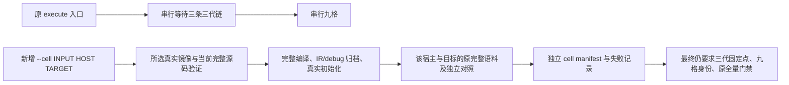
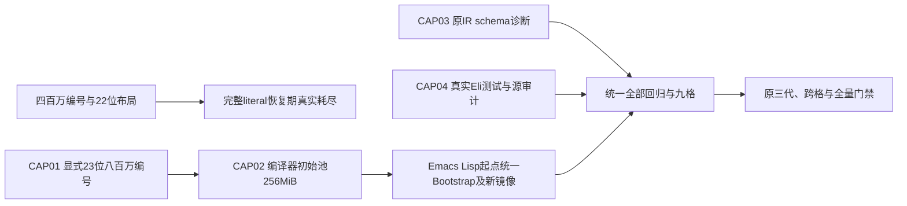

# Eliscript Native / WASM 可行性与最小实验

> 日期：2026-10-14；性质：评估与独立实验，不是完整后端交付
> 证据：[实验源码与复现步骤](../tools/experiments/native-wasm/README.md)、
> [优化前采样报告](../tools/experiments/native-wasm/results/native-wasm-probe-macos-arm64.json)、
> [JS 优化前后同机对照](../tools/experiments/native-wasm/results/js-codegen-probe-macos-arm64.json)

**当前施工顺序：先补齐功能和语义一致性，完成完整 3×3 自举后发布 0.0.2；
再推进不兼容的新语法与 0.1.0。** 已证明有效的优化保留，有明确依据且可随
功能完成的优化继续；困难性能项多次尝试仍无实质收益时后移，不阻塞功能和
九格验收。原采样参数、门槛、报告及失败决定保留，延期不等于性能通过，也
不代表完整后端已具备生产性能。开发期间版本保持 0.0.1。

### 后移的性能工作与复用入口

以下均保留原门槛和原始测量，不计为通过；同一优化有依据地尝试一至三轮仍
无收益时先搁置，功能和完整九格继续推进。恢复时先读取这些记录和测试，
避免重新探索相同失败方案；已保留的有效优化无需回滚。

| 工作 | 当前结论 | 原始证据与可复用测试 |
| --- | --- | --- |
| Reader 完整编译 1.08× 门槛 | 最新 1.037995815×，未达标，后移 | [完整失败样本](../tools/compiler/results/reader-portable-direct-first-macos-arm64.json)、[原参数基准](../tools/compiler/reader-character-benchmark.mjs)、[语义及防伪测试](../tests/compiler-reader-character.test.mjs) |
| 数组文本直接调用与字符串元素分支 | 直接调用保留；字符串分支未见稳定收益，已撤回 | [四组合 A/B 样本](../tools/compiler/results/reader-array-text-codegen-ab-macos-arm64.json)、[调用时序](../tests/compiler-js-array-text-call.test.mjs)、[运行时语义](../tests/js-array-text-fast-path.test.mjs) |
| combine 字符串免包装 | 总耗时约增加 1%，已撤回 | [A/B 样本](../tools/compiler/results/reader-combine-ab-macos-arm64.json)、[独立原算法回归](../tests/compiler-fragment-combine.test.mjs) |
| VLQ 热包装与冷 continuation | 总耗时约增加 0.35%，已撤回 | [A/B 样本](../tools/compiler/results/reader-vlq-ab-macos-arm64.json)、[方法读取与转换顺序回归](../tests/compiler-source-map-vlq.test.mjs) |
| 私有数值计数器关系比较 | 尚未实现，没有收益测量；不影响功能推进 | [独立实验](../tools/compiler/experiments/private-counter.mjs)：`bun tools/compiler/experiments/private-counter.mjs --semantics-only` 保留原语义、多引擎及多代测试；默认执行另会在尚未实现的形状断言处真实失败，不列入当前功能门禁 |

A/B 是阶段诊断，采用两次预热、五个样本和八轮编译，不能替代 Reader 原
十五样本验收，也不能替代完整编译器性能验收。记录中的源码身份是采样时
身份，不改写为后续源码的身份。

功能批次采用显式的 `ELISCRIPT_DEFER_PERFORMANCE_ACCEPTANCE=1 make test
BUN_TEST_RUNNER=tools/testing/file-workers.mjs`，性能的新源码绑定检查标为
`DEFERRED / NOT ACCEPTED`；历史报告原门槛、样本完整性和伪造拒绝仍执行，
功能和语义测试照常执行，仓库依赖与生成物完整性也不跳过。不设置该变量时
原严格性能检查仍运行，当前 Reader 未达标不会冒充通过。兼容性 CI 明确
记录延期模式，完整命令和原时限保留；后续恢复性能验收时再切回 strict。

## 结论

**正式方向是纯 Eliscript 独立自举：编译器可运行于 JS、WASM、native，任一
运行形式均可输出 JS、WASM、native。** 编译器宿主和输出目标必须独立选择。
前端、共享优化、类型化 lowering、代码生成和必要链接能力最终均由 Eliscript
实现；首次引导可以使用现有 seed，正常独立编译不能依赖外部编译器服务。

当前交付是 [独立后端基础](../bootstrap/backends/README.md)：共享的严格常量
优化层、显式 numeric-f64 类型化 lowering、纯 Eliscript WASM 二进制直接
发射器。它支持绑定、赋值返回值、循环、分支、静态函数调用和普通递归，并已
验证 Seed → Generation 2 → Generation 3 的 JS/Source Map 与 WASM 字节一致。
真实浏览器内也能由 JS 运行形式的编译器独立产生和执行相同 WASM。
这不表示编译器自身已运行在 WASM，也不表示完整动态语言或 native 后端完成。

新 [性能报告](../tools/backends/results/direct-wasm-macos-arm64.json)以同一份
Eliscript 内部批量循环比较优化 JS 与直接 WASM，避免每元素跨 JS/WASM 边界。
当前 numeric-f64 热执行门禁已 9/9 通过，原始样本及门槛保留。这不关闭完整
动态语言、编译器运行形式或端到端生产验收；完整后端仍保持实验状态。

本轮还实现了独立 ARM64 macOS 数值后端：直接发射对象、动态库和可执行
文件，并在目标系统执行。native 三负载已按原门槛重新验收通过；
完整 WASM/native 编译器运行形式和完整动态语言输出继续作为未完成项。

### 数值优化、性能验收与剩余边界

2026-10-13 增加按结果是否使用选择 WASM 指令的发射路径：丢弃的赋值使用
`local.set`，移除丢弃的纯数值运算及循环占位结果，保留求值效果、短路与调用。
相同基准产物由 840 字节降到 789 字节（约 6.1%），JS 产物 SHA-256 不变。
该阶段仍有 4/9 项失败，没有稳定吞吐改善；文件缩小没有被当作热执行通过。

后续增加了纯 `.eli` 类型化优化：带范围证明和 f64 回退的整数计数器、循环
计数器掩码、叶函数内联、零/单次循环版本、保序展开、纯初始化外提和平方
复用。嵌套循环先在被调用函数内证明参数不变，再扩展到调用者，避免计算
得到的步数上限失去整数化机会。发射器直接分支并旋转循环，减少布尔中间值。

独立标量调用还能以两份私有状态交错执行，减少串行浮点依赖等待；每份状态
的运算和最终归约加法保持原顺序。输入或其他更新依赖累计结果、被调用函数
修改上限、上限非有限或过大时拒绝该快路径。优化依据是 IR 结构、类型、
依赖和范围，禁止识别基准名称或为固定测试参数生成专用结果。

原来的 3 个新会话、5 次预热、9 个样本、交替测量顺序和每项至少 1.0× 的
门槛保持不变。首轮及确认轮热执行均通过，JS/WASM 产物哈希相同；源码绑定
以保留报告绑定的对应源码为准。下面是此前 4714 字节产物的确认轮历史结果，
不代表本轮修改后的测量，比例为 JS 耗时 / WASM 耗时：

| 负载 | Node | Bun | Chromium |
| --- | ---: | ---: | ---: |
| recurrence-batch | 2.062× | 2.072× | 2.006× |
| escape-grid-batch | 1.074× | 1.128× | 1.009× |
| recurrence-tiny-batch | 3.416× | 1.325× | 2.621× |

全部校验和与 JS 对照一致，JS 产物 SHA-256 与此前失败阶段不变。三代自举
字节固定点、八种优化组合、整数边界、小数维度/上限、负零/NaN/无穷大、
参数求值与隔离、循环条件效果、双状态归约和拒绝路径均有语义回归；Node、
Bun 和真实 Chromium 执行比较相应覆盖。

WASM 模块从 789 增到 4714 字节，主要来自保留回退的版本和展开代码。
这里只证明 numeric-f64 产物的热执行，不证明下载、冷启动、编译器吞吐、
峰值内存、完整动态语言或 native 性能。Chromium 网格仅有约 0.9% 余量，
仍需后续稳定化，不能据此扩大生产声明。本轮无需外部优化器通过数值门禁；
本地可选生产后端仍须单独实现和验收。

前期允许本地显式引用外部后端优化作为生产代码生成路径，但必须独立满足完整
语义及生产性能门禁，记录后端身份/版本/参数。浏览器线上实时编译和开发场景
采用完整 JS/WASM 部署形态，不能调用本地外部编译器或依赖在线编译服务。
外部优化是可选的阶段性路径，不取代独立自举目标，也不自动加入正常编译。

此前复合循环保护条件展开后的确认报告如下，仍为 JS 耗时 / WASM 耗时：

| 负载 | Node | Bun | Chromium |
| --- | ---: | ---: | ---: |
| recurrence-batch | 2.003× | 1.967× | 2.011× |
| escape-grid-batch | 1.005× | 1.400× | 1.007× |
| recurrence-tiny-batch | 2.600× | 1.174× | 2.842× |

产物为 5197 字节、零 imports，JS 对照哈希不变，原采样参数和门槛不变。
当时网格最低余量仅约 0.5%，仍需稳定化；原始样本与源码绑定以对应保留报告
为准。独立 native 初始栈路径与优化路径另有同输入报告，见下方 N-PERF。

本轮 WASM 复核的第一份报告中 Node 网格为 0.9950×，其余八项通过；
[完整失败样本](../tools/backends/results/direct-wasm-native-recheck-first-macos-arm64.json)
予以保留。逐会话检查显示 WASM 首个会话的多个样本高于后两个会话，
JS 与 WASM 字节均与上次通过产物相同。按原参数复核后九项通过，
没有删改首份样本或改变门槛。Node/Chromium 网格的低余量仍是明确的
稳定化缺口，单次确认通过不能关闭完整后端的稳定化或生产验收。

共同运行时切片接入后按原参数重新采样：首次 Node 网格为 0.99948×，
其余八项通过，[失败报告](../tools/backends/results/direct-wasm-memory-recheck-first-macos-arm64.json)
保留。循环条件外提单独试验未改变固定负载产物；对应
[确认报告](../tools/backends/results/direct-wasm-memory-recheck-confirmation-macos-arm64.json)
九项通过，不能将这一采样波动说成优化收益。

随后 WASM 默认数值路径启用严格常量数据流、未读存储消除及循环不变条件
外提后，WASM 循环分支发射进一步省去末次 conjunction 包装、整数 eqz
及否定条件的布尔中间值，当前产物为 5496 字节，JS 对照不变。以下是
该次分支修改的历史原参数测量；九项精确校验和及至少 1.0× 门槛通过。
这只关闭本次数字热执行复测，完整 WASM 后端仍为实验阶段：

| 负载 | Node | Bun | Chromium |
| --- | ---: | ---: | ---: |
| recurrence-batch | 2.0156× | 1.9717× | 2.0069× |
| escape-grid-batch | 1.0054× | 1.3946× | 1.0070× |
| recurrence-tiny-batch | 2.6108× | 1.1731× | 2.7396× |

显式内存边界检查与内部键 XOR capability 接入后的同参数复测保持相同数值
产物；余数/word lowering 后首次 Node 网格 0.9977×，相同参数的唯一
确认复测为 0.9896×，其余八项通过。两份完整失败报告分别保留为
[首次复测](../tools/backends/results/direct-wasm-word-recheck-first-macos-arm64.json)与
[确认复测](../tools/backends/results/direct-wasm-word-recheck-confirmation-macos-arm64.json)。
这些历史失败的数值字节与 JS 对照相同；第一轮尾部多个 WASM 样本偏高，
后两轮余量也极小，不能仅笼统归因为环境或靠反复采样关闭缺口。
本次通用分支发射修改实际改变 WASM 字节，JS 对照不变，原参数九项复测
通过。但 Node/Chromium 网格仅约 0.54%/0.70% 余量，不能由两轮不同
采样直接推导优化净收益，也不能视为稳定化完成；
稳定化保持未完成，不能据此
关闭完整编译器的端到端或生产验收。优化保留求值顺序、负零及条件写入，
不重排浮点表达式；三代、随机副作用与跨宿主回归须一起通过。

本次没有新增公开 `eliscript-native` 命令，没有修改默认编译目标、规格状态、
1.0 验收范围或版本号。现有 [0040](../specs/0040-maturity-roadmap.md) 将 native
emission 排除在 1.0 范围之外；本实验单独评估可行性，不把它计入既有成熟度。

## 三种不同的“编译到二进制”

| 路线 | 产物与执行方式 | 价值与成本 |
| --- | --- | --- |
| `.eli → JS → Bun executable` | 单文件内包含生成 JS 和 Bun 运行时 | 可先解决 CLI 分发；仍经 JS 引擎执行，不预设数值吞吐提升 |
| `.eli → IR → 受限数值后端 → native/WASM` | 明确 f64 ABI 的机器码或 WASM 内核，外围可保留 JS | 最小验证路径；适合批量计算，需类型与边界证明 |
| 完整 Eliscript native/WASM 后端 | 运行整个语言和 stdlib 的新执行路径 | 可研究独立部署、启动与计算收益；必须承担动态值、内存、闭包、异常和宿主协议 |

Bun 的单文件机制确实包含其运行时，不能把可执行文件的存在当成语言 AOT
后端完成；这一路线可以另行实测 CLI 启动和包体积。
[Bun 官方说明](https://bun.com/docs/bundler/executables)

## 现有架构能复用什么

现有链路为 reader → expander → analyzer → lowerer → IR → JS emitter。
[0007](../specs/0007-intermediate-representation.md) 的 IR 表达语义结构与源位置，
[0108](../specs/0108-versioned-canonical-ir.md) 提供版本化序列化边界。
实验直接调用 `compile_ir_string`，再由单独的 `emitNumericC` 消费这份 IR，
证明无需重写 reader 或宏展开就能接入第二个发射路径。

但 IR 不是带有完整类型、对象布局和内存所有权信息的 LLVM IR。通用 arithmetic
和 reference 节点并不证明操作数为数字；函数节点也不直接给出闭包环境、调用
ABI 或动态 arity 的实现。实验将参数/返回值限定为 f64，并拒绝其余表达式。
正式后端需要类型推导/注解或可验证的 specialization，以及动态值运行时。

完整后端共享优化和类型化 lowering，并分别实现 WASM、native 发射器及目标
运行时。当前的 C/Clang/Zig 路径保留为外部后端对照，不是独立后端的主路径。
WASM 导出、imports 和函数签名有独立约束，应设计明确的宿主 ABI。
[LLVM WASM linker 文档](https://lld.llvm.org/WebAssembly.html)

## 本次最小测试

输入是 [kernels.eli](../tools/experiments/native-wasm/kernels.eli) 的两个真实函数：

1. `recurrence`：浮点递推并累加，输入一百万步，每样本调用两次。
2. `escape-grid`：160×160 网格，每样本调用两次；迭代阈值分别为 64 和
   64.000000001，对应每点最多 64/65 次迭代。
3. 同一个 `recurrence` 只执行一步，调用两百万次，观察细粒度调用与边界成本。

每次调用改变输入并消费输出，避免无用代码消除。先验证 seed/self-hosted
生成 JS 字节相同，再检查 native/WASM 的 26 个结果及直接写法 JS 的 13 个结果。
所有计时样本校验 checksum 一致。另有两个独立测试，覆盖 64 组绑定、赋值顺序、
分支、大数常量和 IEEE 浮点结果，以及 14 类不支持功能的拒绝规则。

浮点使用 f64，关闭 fast-math 与 FMA contraction；保留运算顺序，检查 NaN、
Infinity 与负零，不用数值近似掩盖语义差异。测试仅证明本次子集与输入，不能
推出任意 Eliscript 程序等价。

## 优化前的本机测量结果

环境：macOS arm64 / Apple M5 Max；Node 26.8.2、Bun 1.4.0、Apple Clang 21、
Zig 0.16.0。原生为 ARM64 机器码；WASM 为无 imports 的 wasm32 核心模块。
每项 5 轮预热、9 个计时样本，3 个新进程会话轮换测量，共 27 个热运行样本。
以下为中位数，单位 ms，越小越好；原始样本及会话中位数保存在报告中。

| 执行路径 | 百万步递推 ×2 | 网格计算 ×2 | 微小调用 ×200万 |
| --- | --- | --- | --- |
| 优化前生成 JS / Node | 14.403 | 6.373 | 26.008 |
| 直接写法 JS / Node | 2.677 | 1.369 | 10.927 |
| WASM / Node | 2.648 | 1.462 | 13.600 |
| 优化前生成 JS / Bun | 4.397 | 6.002 | 20.242 |
| 直接写法 JS / Bun | 2.624 | 1.862 | 5.385 |
| WASM / Bun | 2.640 | 1.420 | 7.208 |
| Native / 本机 C 进程 | 2.639 | 1.446 | 1.756 |

据此可作三点判断：

- 相比优化前生成 JS，WASM 在两个批量内核中分别约快 **1.67–5.44 倍**和
  **4.23–4.36 倍**；native 与 WASM 耗时接近。但这是两个数值内核的结果，
  不能外推到持久集合、字符串、协议 dispatch 或 I/O 程序。
- 直接写法 JS 在递推中已接近 native/WASM；Node 的网格 JS 还略快于 WASM。
  Bun 网格中 WASM 比直接 JS 快约 1.31 倍。现有生成代码的多层 IIFE、闭包捕获
  与通用真值检查是调查线索；最小对照尚未隔离每种构造的独立成本。
- 微小调用中 WASM 比直接 JS 慢约 24%（Node）和 34%（Bun）。native 在 C 内
  调用，没有经过 JS FFI；不能把 1.756ms 当作 JS 调原生函数的预期性能。
  新后端应批量调用，避免每元素跨边界。

OS 文件缓存已热时，新进程到首个一步递推结果的中位数为：native 约 1.16ms，
Bun 直接 JS 约 5.31ms、生成 JS 约 8.90ms、WASM 约 7.62ms；Node 三条路径
均约 22ms。该指标包含父进程 spawn、宿主启动、加载与输出，不是纯内核
耗时或机器冷启动。native 的优势证明的是本次极小无对象程序，不包含完整
语言运行时/GC/stdlib 的加载成本。

生成 JS 1,572 字节、WASM 2,459 字节、native 文件 33,872 字节；native 依赖
系统库，以上不含宿主引擎、完整 stdlib 或页面下载。WASM 并没有自动产生更小
的总应用。单次 C 编译约 76ms、WASM 编译约 66ms，前端到 C 发射约 4.99ms，
这些只是缓存状态和工具链相关的构建样本，不是编译速度预算。

没有测浏览器、Linux/x64、数组传输/序列化或峰值内存；Node/Bun 的 WASM
结果不等于浏览器验收。本报告是本地探索证据，不是跨宿主发布门禁。

## JS codegen 优化后的复测

本轮在 Emacs seed IR emitter、兼容 form emitter 与 self-hosted emitter 中同步
实现语句/返回上下文发射。同步的普通 `while`、`progn`/`do` 和简单局部绑定
直接生成语句及词法块；所有初始化表达式先求值，再进入新绑定作用域，避免
遮蔽导致 TDZ。`let*` 按绑定嵌套作用域。布尔字面量和明确返回布尔值的内建
操作无需真值转换，纯布尔 `and`/`or` 直接生成 `&&`/`||`。

普通值的 Lisp 真值检查仍保留：0、空字符串、NaN 都是真值；`and`/`or` 仍返回
操作数。表达式位置、解构绑定、异常和 async 的必要边界保留；未做猜测性的
变量类型推断，也未改变一般递归或 `recur` 的降级策略。

复测使用同一份内核、旧生成 JS 的已记录哈希与旧报告绑定，并把优化前后 JS、
手写 JS、WASM/native 放在同一轮的 3 个新进程会话中轮换执行。每项仍为
5 轮预热、每会话 9 样本。以下单位 ms，报告中保存全部原始样本。

| 宿主 / 测试 | 优化前 JS | 优化后 JS | 加速比 | 手写 JS | WASM |
| --- | ---: | ---: | ---: | ---: | ---: |
| Node / 百万步递推 ×2 | 14.672 | 2.837 | 5.17× | 2.841 | 2.827 |
| Node / 网格计算 ×2 | 6.507 | 1.453 | 4.48× | 1.434 | 1.524 |
| Node / 微小调用 ×200万 | 27.245 | 11.204 | 2.43× | 11.319 | 14.602 |
| Bun / 百万步递推 ×2 | 4.698 | 2.782 | 1.69× | 2.825 | 2.820 |
| Bun / 网格计算 ×2 | 6.491 | 1.961 | 3.31× | 1.963 | 1.516 |
| Bun / 微小调用 ×200万 | 21.562 | 5.600 | 3.85× | 5.623 | 7.529 |

此轮 native 三项分别约 2.820、1.524、1.868ms；C 内调用仍不能代表 JS FFI。
优化后生成 JS 与手写 JS 接近。Bun 网格中 WASM 仍约快 1.29×，两宿主的微小
WASM 调用约比优化 JS 慢 30%/34%。这是组合优化的结果，不单独归因于一种
构造，也不代表所有程序都获得同样加速。启动采样波动较大，不以它主张收益。

对照验证包括旧/新 JS 的 13 组标量结果、native/WASM 的 26 个结果、手写 JS
13 个结果，以及所有测量的 checksum。新增回归覆盖并行/顺序绑定遮蔽、初始化
副作用顺序、循环内闭包捕获、语句和表达式返回值、10 类真值、短路、async
及 finally；另由现有 corpus 校验 seed/self-hosted JS 和 Source Map 字节一致。

核心性能报告已重新绑定当前源码，预算保持不变。三份历史编译器报告也已
重新验收：缩进使用 native LF 分段和单次 join，在保持独立字符参考及 mark
语义的条件下达到 10.002×，原门槛仍为 10×。此前的
[8.99× 失败诊断](../tools/experiments/native-wasm/results/indent-reference-diagnostic-macos-arm64.json)
作为历史证据保留，不能当作当前通过报告。

Reader 和 Source Map 对照共用当前源码及代码生成器，仅恢复固定历史 revision
的目标函数；报告记录历史函数、共享模块及生成产物哈希，并要求整编译器的
JS/Source Map 逐字节一致。负零修复后按原参数重新采样，Reader 整编译达到
1.094×，包含 token 与空白/注释游标扫描的进一步优化；Source Map 管线达到
3.547×、整编译达到 1.087×。原门槛仍为 Reader 整编译 1.08×，Source Map 管线 1.5×/整编译
1.08×。这属于当前代码生成条件下的历史函数对照，不冒充原历史编译器的输出。

发布测试已与 `0.0.1` 有意移除 `private` 的状态对齐，继续检查手动触发、签名
release tag、包内版本一致性、默认 staging 和显式 publish 分支；发布配置及
版本未改动。集合布局复测扩大单样本操作次数，保留宿主、样本、判定规则及
32/24 切换点；worker 生命周期和其他受影响报告也已用当前源码重新运行。

## 完整后端的主要缺口

| 领域 | 需要解决的设计 | 性能上的含义 |
| --- | --- | --- |
| 动态值与数值 | tagged value、Number/BigInt、truthiness、精确相等与碰撞处理 | 没有类型信息时仍有分派、装箱成本，AOT 不自动优于 JIT |
| 持久集合和协议 | HAMT/trie/cons 布局、结构共享、metadata、transient owner、协议派发 | GC 和分配成本必须用真实集合负载评估 |
| 内存与闭包 | 捕获环境、循环引用、atom、宿主对象、跨边界寿命 | 不能因持久结构就假定引用计数足够；WASM 线性内存或 GC 路线均需设计 |
| 控制流与调试 | 动态 arity、递归/尾调用、异常、async、Source Map/原生调试定位 | 子集内核无法证明整个语言的行为一致 |
| 宿主能力 | JS interop、对象/函数身份、Node/Bun API、浏览器 DOM、I/O | 需要 imports、胶水层或独立宿主包；频繁跨界可抵消计算收益 |
| 工具链 | 跨平台 ABI、链接、缓存键、部署、功能探测与回退 | native 平台矩阵增加；WASM 也必须验证目标特性与宿主矩阵 |

WASM 本身提供数值及引用等类型，不能据此假定已有 JS runtime 会自动搬过去。
完整后端仍要实现语言的动态语义和宿主协议。
[WASM 类型规范](https://webassembly.github.io/spec/core/syntax/types.html)

## 后续计划与决策门槛

这是本主题的唯一后续工作清单。新后端不改变既有 1.0 兼容范围，不以实验
结果增加完整语言成熟度。施工能力批次保持 0.0.1，不升级包、协议、release
或 tag；完整目标全部验收后，按下述最终发布条件统一发布 0.0.2。

### 完整 3×3 目标与当前边界

| 编译器运行形式 | 输出 JS | 输出 WASM | 输出 native |
| --- | --- | --- | --- |
| JS | 已有完整编译器自举基线；共享优化可显式调用 | 已有 numeric-f64 及逐步交付的动态运行时切片；尚不能编译完整编译器 | 已有独立 ARM64 macOS numeric-f64 对象/库/可执行切片；完整动态语言待实现及验收 |
| WASM | 前端/运行时迁移与自举待实现 | 待完整 WASM 编译器自举 | 待 WASM 内 native 发射/链接能力 |
| native | 待 native 编译器自举 | 待 native 编译器运行共享发射器 | 待 native 编译器自举 |

进度分别报告可运行语言能力、完整编译器运行形式和九格联合终验。数值性能
3/3、9/9 通过只关闭对应固定基准，不表示动态运行时和完整宿主完成；联合
终验尚未关闭任何格，也不能掩盖已有 JS 自举基线和已交付运行时切片。

同一份 Eliscript 编译器源码组成三种运行形式，前端和优化算法共用，目标后端
按显式参数选择，不能由宿主默认推断。浏览器可下载其生成的 native 文件；
浏览器不能执行该文件不影响输出能力。浏览器 native 输出仍须证明机器码和
链接过程在独立宿主内完成；输出 C/LLVM IR 或转发到服务器不能完成该验收。

### 一致性硬门禁

固定源码、宏依赖、运行时、输出目标（含 OS/架构/ABI/CPU 特性）、优化选项、
后端身份及全部链接输入时，要求 `C_JS(S,T,O) = C_WASM(S,T,O) = C_native(S,T,O)`：

- 同一输出目标逐字节比较完整产物和相应调试信息；native 必须固定 target，
  并控制路径、时间戳、符号次序和构建元数据。发布签名另按发布合同验收。
- 跨输出目标比较实际执行语义：结果、求值顺序、作用域/闭包、异常/finally、
  async、真值、数值、集合/协议、宿主能力及源位置诊断；不比较异种文件的字节。
- canonical IR 保持现有版本和无损规则；内部类型化表示不得偷换公共 IR。
  Number 不自动窄化为 i32，保留 NaN/Infinity/负零，禁止未经语义许可的浮点
  重排、FMA/fast-math 和近似相等。当前普通递归不冒充尾调用优化。
- 三代自举固定点、全部九格交叉构建和目标平台实际运行均须通过。固定点只
  证明稳定，还必须与独立参考及生成/变异语料对照，不能只比较同一实现。
- `js*` 与宿主 interop 要有各目标明确契约。编译器内部 JS 依赖必须迁移为
  共同运行时能力；不支持的目标能力必须准确诊断，不静默转换或隐藏回退。

外部后端与自研后端是不同的构建选项，不能要求它们生成相同机器码；同一
后端/版本/选项下，三个编译器宿主仍须生成相同产物并满足相同语义标准。

### 性能与部署硬门禁

保持现有全部核心预算和历史门槛：缩进 10×，Reader 整编译 1.08×，Source Map
管线 1.5×、整编译 1.08×。不得通过换用旧 IIFE JS、缩小语料、移除边界成本、
修改对照函数或降低预算获得通过。

新增后端负载/输入/样本/预算在采样前冻结，以当前优化 JS 和生产外部后端为
对照；分别报告热计算、输入转换/传输、分配、初始化、冷启动、总编译、体积
和峰值内存。当前 numeric-f64 热计算提升门槛固定为每个宿主/负载至少 1.0×，
任一格未达标即不提升为生产后端。完整编译器预算须在迁移测试前单独冻结，
不能从两个内核的加速比推导，也不能替代已有语言/stdlib 性能门禁。

本地外部生产路径须显式选择，提供可复现工具链身份、输入哈希、缓存键及
源位置调试证据；优化后产物必须再次执行语义与性能验收。浏览器开发/实时
编译路径可先保持独立且实验性的性能状态，但不得声称生产门槛通过，不得
降低语义要求。该区分不限制最终九格目标。

### WASM 运行时与面向 AI 的工具链约束

WASM 输出应显式区分线性内存运行时与可选 GC/引用类型运行时，不把它们
变成额外的编译器宿主或改变九格含义。先保留当前直接发射路径，再用同一
动态值语义评估两种布局：循环引用、闭包逃逸、外部句柄寿命、异常与峰值
内存必须实测。GC 路径能否用于某个宿主由实际特性探测和目标能力描述决定，
不能用“支持 WASM”推导全部扩展可用；缺少能力须明确诊断，禁止静默换目标。
JS 字符串内建可作为可选边界优化，不能成为独立编译器运行的必需宿主服务。
UTF-16 code unit 与诊断使用的 Unicode code-point 坐标须分别保留准确转换。

编译器宿主能力、输出目标能力与项目依赖能力分别声明：浏览器无文件系统
时通过既有虚拟项目输入编译，不扩大宿主权限；请求明确选择目标、优化模式
及 ABI，依赖不支持目标时在完整代码生成前拒绝。输入/输出批量跨界并绑定
源码身份，避免逐节点、逐字符宿主调用。完整验收增加真实文本与集合负载，
分别计量初始化、传输、分配/回收、编译与执行，不能由数值热循环替代。

面向 AI 优化的是生成、理解、修改、验证代码的闭环。沿用
[结构化诊断](../specs/0043-structured-diagnostics.md)、
[只读项目检查](../specs/0116-read-only-project-check-and-emacs-diagnostics.md)
和现有增量项目构建，避免建立另一套语义或只向工具提供终端文本。
可查询接口应逐步提供绑定定义、引用、模块接口与宏展开来源；同名遮蔽、
Unicode 标识符和生成绑定必须来自编译器分析。查询结果绑定文件内容哈希，
支持范围/分页，供工具按需获取上下文，不以全文转储衡量能力。

修改与修复须声明适用的源码身份和范围，拒绝过期位置；建议本身不能自动
执行源文件写入、宏文件读取、网络或生成代码。工具调用返回请求身份、成功/
失败、诊断和验收证据；编译、执行及修改授权分别传递。浏览器执行预算、
内存限制和取消属于宿主边界，须实际覆盖无限循环与分配失控，WASM 模块
本身不替代这些边界。声明目标所必需的实现、类型证明或能力缺失，不能为了
接受 AI 生成代码降为警告；一般动态语言语义仍按现有语言契约执行。

AI 工具链验收须先冻结一组可复现的代码生成、定点修复、跨模块改名和文档
示例任务，包含有缺陷的输入及预期拒绝；使用确定的编辑序列作持续门禁，
模型产生的编辑另行记录模型/输入/样本，不让非确定响应控制语言语义。
比较反馈延迟、正确修复率、上下文/诊断体积、完整验证成本与峰值内存，预算
在实现前冻结。增量检查必须与全量结果一致，文档示例须绑定原文位置并实际
编译/执行，三个编译器宿主须给出同目标相同诊断、查询结果与产物。

### 2026-10-16 集成源码与统一验收状态

本批变更归属既有 R10、H02–H04、T01、A01、M01–M04、Q03，不增加计分
分母。共享运行时、完整编译器宿主接口、IR 输入、源码身份归档、浏览器与包内
CLI、原始完整套件回放及多代矩阵接线均已有源码和对应测试样例；源码存在不
等同于行为验收通过。以下进展不能用旧的全零施工状态或旧验收基线代替。

- bootstrap 与 stdlib 的全部 115 份 `.eli` 已由实际自举编译器逐份通过
  `compile_ir_string`，未缩减源码；严格 Emacs 字节编译也已通过。
- 第一轮统一功能验收暴露共享运行时的函数/模块括号边界与 sumPrecise 条件
  参数错误，已修正并补声明归属回归。还修复了常量赋值负面样例的错误分类、
  完整原 case/执行片段覆盖接线、JS 指数表达式语法以及公开接口计数断言。
- Seed 的完整正则源码暴露普通深树依赖 Emacs 调用栈的问题；展开、主分析、
  transient/portable 附加检查、IR 转换、发射及辅助扫描已补显式任务栈，
  不提高限额、不缩短原源码。新增深树、作用域、消费、首错误与精确产物
  回归源码；统一 Emacs 门禁已得到 223/223 通过证据，严格字节编译通过。
- 完整正则后端已由真实 Seed 编译入口生成。CLI 后续失败另定位为未消费
  命令行参数，导致 Emacs 在编译后再次打开 21 MiB 产物并询问；已清空本
  脚本拥有的参数并补零大文件阈值的真实入口回归，未改变资源或性能预算。
  最新真实 Seed/自举完整后端构建均已完成，22 份 JavaScript 与 Source Map
  文件逐字节相同。该证据不能计作完整九格、多代固定点或全部 CLI 验收。
- 统一功能验收因 Bun 测试进程内存失控中止；已观察到浏览器编译器测试进程
  RSS 约 36 GiB，用户强杀另一个进程后，本任务整组进程已强制回收。禁止原样
  重跑或把此轮记为通过。测试进程树增加独立进程监督、1 GiB 单树/2 GiB 总量
  保护、越界强杀、停止派发与父进程退出回收；保护只可收紧，不替代原预算。
- 源码明确存在字符串逐 code-unit 展开多层 IR 的放大路径，且完整正则函数的
  JS 源码约 21 MiB。源码已改为统一 `memory-data-copy` typed 节点：WASM 被动
  静态段与 native 只读分块直接复制 UTF16LE，保留原 Function.toString 全文、
  非配对 surrogate、求值次序、完整界检查、GC 根和零算法 imports；不缩小输入。
  源码与小资源回归样例已写齐；IR/metadata 序列化也已改为有界 token 批量合并，
  保持原字节。监督器首轮小资源验收 9/10，通过真实超限、取消与守卫失联回收；
  异常父进程用例暴露 Node fork 继承 eval 专用参数，已隔离启动参数并补有界
  stderr。需在统一受控执行入口下重新验收，当前没有完整后端或内存预算通过
  结论，不能因此直接重跑原失控套件。
- 有界数据整合已实际运行：百万项 metadata 在原 64 MiB Node 堆约束下保持
  精确 JSON，2 万层对象/数组、共享引用、负零、BigInt、getter 首错误等通过。
  首轮 23 项为 21 通过、2 失败：完整测试新增后原注册时限断言仍使用旧数量，
  以及 AggregateError 原套件 adapter 未同步新的 oracle 装载；均保留失败证据，
  同步为完整 18 个身份用例与 5 个 Value/JSON 用例，不裁剪原测试。
- 监督器修复后的 10/10 小资源用例已全部通过，实际覆盖超限、取消、守卫和
  父进程异常退出及后代回收；受控执行记录峰值约 211 MiB，正常退出且清理
  完成。完整语料装载随后触发 512 MiB 保护，采样峰值约 1092 MiB，执行器
  立即以 137 终止并确认清理，不扩大限额重试。源码中重复 base64 解码、
  源模块图克隆和已私有语料的额外整份复制正在消除，保留完整语料和输入隔离。
- 首批去重复分配及 adapter 回归 8/8、严格字节编译均已通过。后续整合在
  原 227 项 Emacs 的 164 项通过处、WASM static-data 的构建准备阶段分别
  触发 512 MiB 保护（约 534/563 MiB），native 文件尚未派发；未记为通过。
  Bun 更积极回收的单次试验在准备阶段仍触发保护（约 738 MiB），native
  仍未派发；Emacs 降低回收比例后峰值约 322 MiB，但到第 183 项已触发本轮
  外部 240 秒保护，并揭示新增 fixture 误用了未绑定的 `null`，已修为原语法
  `nil`。这两种未达标的回收调参已撤回，不改变原 GC、原 case 时限和输入。
  512 MiB 是小资源监督器验证时临时收紧的额度，并非项目原验收门槛；继续
  完整构建前须确认可使用统一执行策略的默认普通运行额度，禁止无批准加额。
  fixture 修正后严格字节编译再次通过，`await` 缓存四项回归全部通过，峰值
  约 127 MiB；未据此重计完整 227 项、后端构建或九格的验收状态。
  去重复分配完成后的完整语料单文件仍触发 512 MiB 保护，采样峰值约
  1139 MiB，退出 137 且清理完成；这说明局部 8/8 不能证明完整装载峰值已
  达标。停止继续以该临时额度折返，等待统一默认普通运行额度的明确确认。
- 本轮已明确可自主判断受控执行额度，预算阻断解除；普通完整验收先采用
  2 GiB 整树保护，必要调整仍须受控且有具体依据，不把执行器额度当作后端
  正式性能预算。正常 GC 下 Emacs 全量 227/227 通过，采样峰值约 1010 MiB；
  同一 `.el` 源码的严格字节编译证据继续有效，无需重复。
- static-data 的实际 WASM 首轮 4/5 通过，错误输入提前进入扫描导致原生
  TypeError 而非后端诊断；native 的 2/6 通过，其余被 WASM 修改公开 typed
  输入及错误零页测试前提阻断，尚不能认定 native 指令失败。现已补私有工作
  副本、父节点位置拒绝与真实 native 零页边界；修复后实际 WASM 静态复制
  8/8、native 静态复制 6/6 均通过，输入不可变、真实执行与拒绝断言保留。
- 完整语料仍曾触发 2 GiB 整树保护（约 2290 MiB），已终止并清理；单独
  Node 小堆诊断完整装载 786 个 record、5558 个 module 仅约 239 MiB RSS，
  后续整份快照和序列化必须单独定位，不能继续笼统归于装载或直接加额。
- 完整归档的阶段诊断已定位到长源码重复 JSON 编码和长 token 与分隔符
  拼接的重复副本，并非原语料本身无法装载。编码改为单次调用内复用长
  字符串编码、长 token 直接分块引用，文件读回与调用者快照依序释放无关
  修订；全部原 786 个 record、5558 个 module 保留。修复后完整归档 12/12
  通过，2 GiB 整树内采样峰值约 1921 MiB；元数据 codec 12/12、语料共享与
  快照 10/10 通过。精确字节、负零、Unicode、输入隔离及拒绝断言未减少。
- 普通完整运行不再以临时 512 MiB 阻断。确有编译阶段需求时，本轮有限
  采用 4 GiB 单树保护，不修改共享策略或后端正式性能预算。memory-runtime
  相同配置复用不可变编译产物、每项仍创建独立 Instance，原 17/17 通过；
  采样峰值约 2921 MiB。完整工具套件前 13 项通过，随后完整 WASM 编译器
  构建触及 4 GiB 保护；仍需定位该构建的实际峰值，不能计为完整通过。
  后续完整编译含约 109 万节点的 runtime IR，在转换前即已占约 2.5 GiB，
  转换阶段实测触及 4 GiB。只消除重复序列化及采用低内存模式仍未完成该
  构建；不继续针对临时收紧值反复优化。完整编译与全量文件运行器改用
  执行策略推荐的 8 GiB build 单树及整批总量上限，完整编译文件串行、小
  文件仍可两个并行；普通数据处理保持外层 2 GiB。所有覆盖值只能收紧、
  越界立即清理，不再加额；原功能断言、时限及生产性能预算均未改变。
- Seed 同步 IR 的 `await` 查询新增单次模块内按节点身份复用，保留原先
  左到右首命中、嵌套函数排除与 nil 结果；避免每层 if/let 重扫整棵同步树。
  深树、共享节点、异常先后、模块隔离和精确输出测试已写齐，原公开 Seed
  单次 30 秒时限保持；真实复验仍超时。独立阶段诊断为 Reader 约 15 秒、
  展开约 3 秒、分析约 8 秒，限时到达时尚在 lowering；不是继续重扫 await
  的证据。优先消除 Reader 中普通字符的重复预处理，保留原完整入口验收。
- 本轮统一源码验收中，Reader 跳段扫描及其四项完整边界回归已进入
  Emacs 231/231，严格字节编译通过；无输出 IR 校验 5/5、受控监督器
  10/10 通过。完整 runtime 的公开 Seed 原 30 秒门槛仍失败，不能将
  Reader 专项通过替代它；下一批只针对 CLI 的解释执行开销，不调 GC、
  不放宽原时限。普通 `require` 的库行为与 CLI 输出、错误合同保持。
  大输入 CLI 的 RAM 字节编译实现后，原 Seed 完整 runtime 已在原 30 秒
  内结束，三个原 case 均进入，宽/深两项精确产物和 Node 执行通过。
  完整 runtime 对照现暴露原数字发射拼写差异：17 处整数值浮点常量的
  `.0` 使产物多 34 字符；源码语义仍须精确验证，不能改宽字节断言。
  已统一有限 binary64 数字的 Seed 拼写与现自举拼写，并保留负零和原
  非有限数拒绝。失败诊断改为首差异及有限上下文，避免格式化两份约
  50 MiB 源码。修复后完整原 Seed 三项全部通过，原子进程 30 秒时限
  不变；完整 runtime 的 JavaScript 与自举产物精确相同并经 Node 检查。
  最新 Emacs 全量 235/235、严格字节编译零诊断、完整 CLI 均通过。
  CLI 新回归覆盖真实入口的 RAM 字节编译、普通小输入、别名及原函数
  引用、Source Map、Unicode、错误和不生成 `.elc`，未改变编译合同。
- 无输出校验、链接前缀流式碰撞域和可达 namespace 修复均已进入源码。
  namespace 的原真实链接失败已转为通过；完整工具套件仍仅前 13 项通过，
  后续 WASM 构建触及 4 GiB，未到发射阶段。字符串原完整文件出现动态
  方法调用和函数源码调用的两处真实运行时拒绝，正在同一批修复，不能
  缩小输入或改宽断言。locale casing 与 Unicode normalize 仍明确不支持，
  自定义同名方法及不执行的分支不得被其属性拼写静态误拒绝。
  构建文件启动采用 Bun 的低内存模式，让已不可达编译树及时回收；原
  全部用例及时限保持；普通文件仍使用本轮受控的收紧额度，完整编译使用
  前述推荐 build 上限，尚待整批复验。
- 完整工具套件以推荐的 8 GiB 进程树上限真实执行后，仍在前 13 项通过
  后的完整 WASM 编译阶段超限：采样峰值约 8.38 GiB，退出 137，执行器
  确认整树清理。没有断言失败也不等于文件通过；其余用例未执行。本次
  不继续加额或原样重跑。本批接续将链接器改为只复制实际变化的路径，
  共享未改写的子树与嵌套字面量叶子，顶层的私有模块标记仍由私有节点
  承担；保持完整依赖图、原函数源码、输入只读和原检查顺序。内部新加载
  的源码图也不再重复克隆，显式外部源码仍保留原快照隔离。新增冻结宽图、
  私有持久集合依赖、源码身份与异步输入隔离回归；尚须实际验收降峰效果。
  WASM 发射器的公开输入快照本批保留，未改变任意宿主对象的读取边界。
  后续源码追踪还发现，函数原文捕获入口会收集其不消费的逐表达式 Source
  Map 标记；已仅在该私有模式关闭标记收集，普通 JS 和 Source Map 路径
  保留。共享/合法内部别名/冻结根节点回归 3/3，原 combine 算法、Node
  完整函数文本、普通映射及失败后恢复回归 3/3，完整语料归档 12/12 均
  通过。改后完整工具门禁仍仅前 13 项通过，完整 WASM 构建在约 8.41 GiB
  触发保护，已清理并停止该构建的重试；这些修复不能计为完整构建通过。
- CI 契约的完整受控诊断实际执行 30 项，29 项通过、一项因测试辅助函数
  不在分片测试作用域内而失败；已将同一辅助函数移至文件作用域，保留
  全部断言，待本批统一复验。此前监控器的 `GuardError` 本次未复现，
  不能据此声称已修复监控器，也不修改共享执行策略。后续纯日志诊断已
  捕获明确原因：监控器读取本任务所属进程 RSS 时，系统通过 psutil
  返回 `AccessDenied`，执行器随即拒绝继续并清理；不是内存超限或预算
  锁，底层拒绝原因仍无充分证据。资源监督器原 10/10 回归再次通过，
  当前 CI 契约文件本身尚未取得完整结束证据。
- 完整功能套件尚未通过。保留原全部输入、时限和预算；当前没有完整
  九格或多代固定点通过结论，未签名提交、未推送、未发布，版本仍为 0.0.1。
- 原最终验收仍被历史 fuzz 测试源码绑定及 transient/soak 报告源码绑定阻断。
  不能手改哈希、把过期报告签进新源码来制造新历史，或以独立 fuzz 小跑替代
  原完整 source run。功能修复冻结后，先按原参数真实重测并严格校验两个报告，
  再以签名源码快照和干净 checkout 执行原完整 source run 与最终门禁。
- Error 的独立运行时声明标准反射范围；宿主专有堆栈扩展与标准功能分开，
  保留 Node 完整观察和明确差异用例，不以空实现声称支持堆栈 API。
- 最新完整宿主身份文件已 20/20 通过，包含真实 native 模块/项目、WASM、
  Node、循环 TDZ、命名碰撞与分阶段加载。分阶段样例现实际部署同一
  descriptor 的全部 ESM facades，再调用原加载器，生产拒绝条件未放宽。
  字符串完整文件为 16/17，真实 native 静态 UTF16、完整函数原文与新增
  根区间释放回归通过。后续现场显示默认手动回收模式中对象名额已达
  1024、仅用 99496 字节、回收次数为零；功能测试此前错误地假设自动
  回收。原容量不变，现明确验收自动回收，以及请求边界回收的手动模式。
  原自动回收的功能序列已全部执行通过，但完整文件仍为 16/17：承接
  prototype 修改/恢复后的同一 realm 在手动压力阶段容量拒绝，后续清理
  还暴露借用句柄失效。已保留首错误及有界清理错误，不能用清理错误覆盖
  原失败；R10/Q03 继续包含该拒绝后根保留、调用者负零/帧和 live0/frame0
  恢复回归，不以独立实例的成功替代。同预算的独立手动/自动 16 轮压力
  源码和同一 dirty realm 的拒绝恢复样例均已补齐，尚未完成本批复验。
  Reader 树在展开后释放无用的独立局部引用；普通/来源/portable 编译
  先后顺序不变。完整三代编译器回归 305 项断言通过，包含 IR、JS、宏
  来源、原错误与负零；它不代替尚未通过的完整 WASM 编译器构建。
- R10/Q03 后续定位到确定的堆元数据破坏：临时根借用/归还把 `nil`、布尔值
  与 `undefined` 的立即值编号当作对象槽位。已阻止立即值访问槽位，保留真实
  句柄的计数与手动/自动回收策略。实际字符串复验为 16/18：原 dirty realm
  的容量拒绝、独立句柄及调用者根保留和清理均已通过；余下两项分别是新增
  手动正向压力仍假设单次复杂请求不会耗尽 1024 名额，以及新增底层回归调用
  了不存在的导出名。继续修正测试前提与实际 ABI，保留容量拒绝后的强制恢复
  验收，不把资源拒绝当成功。该次峰值约 4.94 GiB，正常非零退出并完成清理。
  宿主调用边界另补首错误保留及全部临时根释放，清理失败不能覆盖任意原始
  抛出值；对应 ABI 故障样例已写入原控制文件，尚待统一验证。
- H02 的 JS 构建在不归档 IR 时，保留原全部编译与错误顺序，在末次使用后
  释放完整 runtime IR 及逐份已发射的模块 IR；显式调用者输入、二进制与
  `retainIR` 路径保持原合同。真实完整产物测试保留，尚不能声称 8 GiB 构建
  阻塞已消除，须以该完整文件实际结束为证。
- Q03 的共享执行器已修复 RSS 查询拒绝后的退出竞态处理：使用新进程对象
  复核原 PID 与创建时间，只在确认原身份已退出、被复用或已死亡时跳过；
  存活或无法确认仍终止。18 项执行器测试通过，原预算、采样周期及清理策略
  不变；修复在共享工具仓库独立签名提交并推送，不混入本项目。CI 契约仍须
  用正常执行入口重新跑完，不能把监控器测试当作项目 CI 通过。
- 后续完整字符串文件 18/18 通过，包含原 active/dirty realm、160 次手动
  容量拒绝及同输入恢复、立即值槽位逐字保护和真实 native UTF16。完整
  控制文件先暴露旧负面样例把已实现参数解构列为不支持；转为真实执行后，
  又揭示宿主将全必需参数的解构入口误判为非法 argument-list ABI。已修复
  入口检查，保留参数顺序、实际导出签名及空模式拒绝；原拒绝源码转为
  Node 对照和 GC 下精确负零/闭包执行。修复后控制 16/16、变参 17/17
  完整文件通过。首错误身份和全部临时根释放的 ABI 故障回归也均通过。
  正常受控入口的 CI 契约现为 30/30、445 项断言通过；共享执行器扩展到
  22 项回归通过并已独立签名推送。整合文件运行另有一次 `measure_rss`
  拒绝中止，仍存活/无法确认的进程保持 fail-closed，整树已清理；该次未
  完成文件不计通过。完整编译器产物文件正在按原输入重新验证 IR 存活期
  修复，完整 WASM 构建和九格状态仍未改变。
- H02 的实际边界已有进一步证据：内部 JS 种子改为逐模块编译/发射并延迟
  首个发射错误，完整默认 JS 编译器构建及真实 runtime 加载现均已完成。
  原完整文件随后在 `cached-ir` 导出前触及 8 GiB 保护，约 9.18 GiB 采样
  峰值后退出 137 并完成清理；不是 JS 构建仍未返回，也不是完整文件通过。
  规范 IR JSON 的逐层 `parts/join` 仍产生祖先字符串副本，正在改为单次
  调用共享的有界输出块；保留完整 `ir`/`canonicalIR`、原格式与拒绝路径。
  JS 种子私有编排已补错误身份、顺序、Map/来源和恢复回归，尚待统一运行。
- 规范 JSON 有界输出的全部 7 项回归已通过。后续有界诊断显示，导出前
  活堆约 336 MiB，且尚未格式化任何超过 1 MiB 的 token 就触及保护；
  生成 JS 又确认私有 token/chunk 的 `join` 仍进入通用数组文本转换。
  两个私有 JSON 编码器现改为捕获标准 `Array.prototype.join` 并通过
  `Reflect.apply` 合并自己的字符串缓冲；语言的循环数组合同保持原实现。
  相同 7 项回归再次全部通过，后续原完整文件已打印完整缓存 runtime IR
  导出成功；但保留该结果并再次独立编译原 runtime 作对照时仍触及 8 GiB，
  约 8.30 GiB 采样峰值后已清理。完整文件仍未通过，不能把阶段日志算作
  完整九格证据，也不能复用缓存来代替该独立编译。
  按本轮用户对特殊受控额度的明确授权，该完整比较允许一次 12 GiB 整树
  验证，预期同时保留的完整结果与新编译约需 10–11 GiB；普通 2/8 GiB、
  共享 16 GiB、系统余量与超限清理保留，正式后端性能预算不变。例外执行
  支持与测试在共享工具独立维护，不通过临时策略/账本或关闭监控绕过。
  单次例外现已实际完成：原完整 compiler-artifact-archive 文件 28/28 通过，
  包含完整默认源码、缓存 IR 与真实独立编译对照、Unicode 资产认证、修复后
  重试、事务恢复及私有 JS 编排回归；峰值约 9.69 GiB，正常退出并确认整树
  清理。原全部输入与 case 时限保留。共享工具 32 项回归通过，单次例外入口
  已独立签名推送，普通任务不会继承加额。此结果解除该文件的功能阻断，
  不代表正式内存性能验收或完整 WASM/native 编译器宿主、九格已通过。
  后续同批源码的控制 16/16、memory-runtime 17/17 和真实 JS 多代固定点
  305 项断言再次通过；其整批峰值约 4.97 GiB，普通 8 GiB 内正常结束并清理。
- H03 的完整 compiler-session-tools 原文件以当前代码重验，8 GiB 仍在
  前 13 项通过后的完整 WASM 编译器构建中超限；另一次明确的单次 12 GiB
  构建例外也在约 12.01 GiB 采样峰值处退出 137 并清理，尚未返回完整产物。
  后续用例未执行，不能记为通过，也不再加额或原样重跑。随后唯一一次
  8 GiB 阶段观察确认：27 个模块链接结束，runtime 转换得到 1575 个函数，
  managed 转换也已返回完整 4638 个函数；WASM 发射入口处 RSS 约 6.53 GiB、
  活堆约 3.77 GiB，进入发射器后超限并清理，未返回二进制。对应修复限定为
  发射器的工作树存活与复制；公开 typed 输入不可变、完整校验顺序和原输出
  必须保留，不把观察样例或新增资源额度作为通过证据。完整错误传输文件
  44/44 通过；它不替代尚未结束的完整编译器构建和九格验收。
- Q03 两份历史报告已用原负载实际更新：transient 的 200000/100000/100000、
  2 次预热/11 个样本、1.5 倍与三分之一门槛均通过；Worker 的 100000 次、
  batch64、40 个检查点、5 代恢复及原 180 秒/内存趋势门槛均通过。
  两份报告的替换合同合计 8/10：原报告真实性、拒绝弱门槛和伪造数据的
  用例均通过，余下两项仍由同一个 reader-program-fuzz 旧验收绑定阻止；
  保留该失败，待源码冻结与真实新一轮验收，不手改旧结果或哈希。
- H03 发射器现在保持原完整提前快照与逐次读取，仅在每个函数内合并完全
  相同的已完成私有子树。12 项静态数据/快照回归通过，包括有副作用 getter
  的次数/顺序、IEEE/符号元数据、跨函数隔离、完整字节及调试信息对照。
  本地可选阶段观察不进入独立语料回放，回放仍严格绑定原构建替换位置；
  矩阵/语料五个合同文件 38/38 通过。完整大编译器的资源改善仍待原文件结束。
  子树合并后的完整构建仍触及 8 GiB，因此进一步加入高层 source IR/project
  产物入口：实际 lowering 后由发射器独占新建 typed 图，只读完整校验后直接
  发射，不接受外部 typed 或跳过复制标记。配置回调不接收 typed，保留原
  源码/配置/发射错误顺序；函数内存临时索引用各函数私有表隔离。公开 typed
  快照和原底层入口保持原合同。完整真实 runtime、循环项目、normal/debug
  的新旧字节/描述/调试对照及拒绝/恢复现合计 14/14 通过。后续完整构建仍
  触及普通 8 GiB，已清理；对该修改后代码的唯一 12 GiB 受控验证仍超限，
  采样峰值约 12.27 GiB、退出 137 并完成清理，不再上调。后续有界诊断确认
  lowering 已返回 4661 个函数，约 6.60 GiB RSS；未观察到发射器内的跨模块
  capability 事件，优先检查其间配置/全图验证，缺少事件仍不能单独证明
  私有阶段没有执行。验证器现复用深度数组，访问 memo 最多 65536 节点，
  满后忘记缓存并重新验证；活动路径始终完整并定期重建，保留每边检查、
  完整 DFS、循环检测及首错顺序。宽图、12000 深度、跨重建循环和清缓存
  后首错等回归合计 17/17 通过，但完整构建随后仍触及 8 GiB 并清理，
  未据此记完整构建、普通内存预算或正式性能通过。继续减少私有 lowering
  中相同错误局部变量的纯判断节点分配；只共享 IR，不缓存运行时判断结果。
  该项 6/6 回归和完整控制 16/16 通过，但 Bun 完整构建仍超限，保留失败。
  Node 受控运行同一原始工具文件全部 21 项断言时，完整 WASM 二进制已生成，
  峰值约 6.58 GiB，20/21 通过；剩余失败是引擎拒绝单个 18609252 字节函数
  （引擎上限 7654321 字节），并非笼统的负载波动。该运行仅替换测试注册器，
  保留原断言、输入和时限，不能替代原 Bun 门禁或九格验收。一次有界诊断已
  将它映射至实际 `regexp-property-id-base`，其 managed 产物有 241690 个局部
  变量。原树现已分为 68 个有界私有函数，根函数仍保留原 >1000 IR 节点门槛；
  还原原定义的冻结 SHA、全部属性名 JS 对照及真实 WASM 生成/执行 3/3 通过，
  原 Emacs 两项深树回归也通过，未删除分支、别名或 Unicode 数据。
  更新后的完整约 100 MB WASM 已被 Node 的 Module/Instance 实际接受。
  原完整 Bun 文件和随后 Node 全文件仍触发 8 GiB 保护，均未记通过；独立
  加载该真实产物后，Module/Instance/heap-new 合计约 253 MiB，超限集中在
  模块初始化调用，不能再归因于源码装载或继续加额。下一有限修复在私有
  managed 函数中复用不同顺序子项独占的局部变量，入口显式清零，保留跨项
  变量、循环状态、根槽和全部原语义。该复用的 10/10 回归已通过，但按最宽
  序列选取的位置几乎没有压缩真实模块主体；直接以无效 heap 调用同一主体，
  尚未执行初始化内容也触发引擎内存保护。该函数仍有 9523 个局部变量，
  因此修正为优先使用真实源码的顺序 body 序列。修复后的 11/11 回归通过，
  包含较宽但无收益的字面量序列、共享节点、循环、入口清零、GC 根、负零及
  容量失败恢复。完整原工具文件在 Node 的后续运行生成 101959160 字节真实
  WASM，Module/Instance 均返回；初始化仍未在原 case 时限内返回，外部
  180 秒保护最终退出 124，整树峰值约 6.25 GiB 且清理完成。此轮前 13 项
  通过，不能把剩余未执行的用例或完整文件记为通过。
  下一修复复用现有项目分步函数生成器，将普通模块的各个顶层初始化项发射
  为独立私有函数，以薄调用序列保留原求值顺序；不保留全集初始化大函数。
  原模块 begin/declare/complete/abort、错误缓存、TDZ、函数身份和 GC 合同
  保持，纯独立编译器不引入 ESM facade 或算法 imports。此工作及拒绝路径
  回归归 H02/H03，完成整批代码后统一运行，不重复未修改的巨型初始化。
  这批拆分源码已完成；新增真实 WASM 7/7 与 native 3/3 用例均通过，包含
  同源 JS/WASM/native 顺序与负零对照、函数/闭包身份、循环依赖和 TDZ、
  幂等初始化、首错停止和缓存、强制 GC、caller frame、容量与真实 trap 清理。
  结构断言确认协调函数不再含完整初始化副本，局部变量不随顶层项数增长，
  描述符不暴露私有函数，WASM imports 精确为 `[]`。整批在普通 8 GiB 内
  正常退出并清理，采样峰值约 6.59 GiB。首轮两项新增测试设置错误已保留：
  容量测试将槽位收紧至合法初始布局，恢复测试补上同成功用例的自动回收；
  原字节上限、输入和断言保持。完整编译器原工具文件仍需重新验收，以上
  10 项局部结果不替代该文件或完整九格。
  后续原完整 Bun 构建在 8 GiB 和一次受控 12 GiB 下仍超限并清理，不再
  加额重跑。Node 使用该轮认证的完整 JS 产物生成 101978524 字节 WASM，
  Module/Instance 返回，仍由外部 180 秒保护终止。真实产物独立加载的
  有界采样随后确认已进入 WASM 运行，而不是停在引擎编译；30 秒采样峰值
  约 872 MiB，19992 个采样中 17447 个包含数组原型注册函数。原源码 IR
  进一步确认其 `index` 更新在循环外，导致反复注册第一项，属于功能性
  不终止缺陷。已用最小括号修复将递增移回循环；保留全部 27 个方法、
  constructor、Symbol.iterator、缓存、求值顺序及原错误/根帧逻辑。
  结构回归已确认递增实际位于生产 IR 的循环体内，真实 Array 注册现在
  返回；新增严格属性对照进一步揭示普通反射入口未读取数组属性标记。
  已将该入口接到原有的完整数组描述符路径，保留不可枚举断言和全部标记。
  修复后 WASM 9/9、native 4/4 均通过，包含全部 27 个方法、属性标记、
  constructor/iterator 关系、用户覆写后缓存身份、重复初始化及 GC/负零。
  新增 Array 对照采用普通 1024 槽/64 KiB 初始布局，1 MiB 最大值不变，
  原有三个 native 用例的 256 槽/16 KiB 预算不变。整批普通 8 GiB 受控运行
  峰值约 7.53 GiB，正常退出并清理；该修复仍归 H02/H03，完整编译器启动
  与九格仍需原输入重新验收。
  随后的完整原工具文件在 Node 下已完成真实 WASM 初始化、session 创建
  和全部 21 项执行，约 30.42 秒、峰值约 6.16 GiB，正常结束并完成清理。
  20/21 通过；剩余 AggregateError 传输用例实际返回的错误类型不符，
  保留原断言并继续诊断，不能记完整文件或九格通过。此运行仍是保留原
  输入/断言/时限的 Node 注册器适配，不替代原 Bun 门禁。
  一次同断言的有界错误观察确认，返回的是 `ELI-RT0003`，不是错误图解码
  替换了原异常。实际源码必经的 `put child :stack ...` 被“自动堆栈未实现”
  的读取检查提前拒绝。旧局部测试也把该写入列为未实现，和完整工具用例
  要求保留自定义文本相冲突。本次按既有普通属性赋值行为补齐显式自定义
  stack：保留新建 Error 的未实现自动堆栈读取/反射拒绝，并用同源 JS
  对照验证显式值、身份、不可枚举属性及只读/冻结拒绝。不是生成或伪造
  原生引擎堆栈，也不修改完整工具用例的异常类型、文本、共享引用或原因
  断言。该项及 Array 初始化后的真实嵌套异常回归仍归 H02/H03，代码
  收齐后统一验收。
  用户已授权由执行者按实际任务选择受控预算，特殊情况可有限提高；默认
  2/8 GiB 作为推荐上限，进程树监控、共享预约、系统余量和超限清理始终保留。
  资源预算变化不能改变语言、原 case 时限或正式性能验收标准。
  后续已区分冷启动容量失败与泄漏：原 64 槽 Error 用例首次创建即耗尽，
  回收后恢复到初始 5 个存活值。Error 专属原型仍立即建立，共享 Function/
  Object 成员改为首次真实观察时装配；编译后读取、宿主直接读取和隐式转换
  共用运行时握手。私有初始化函数提前进入函数声明/表生成，保留异常、
  trap、GC 和关闭时清理。该批原异常文件 16/16 通过，包含 Seed/三代和
  Node 原字节执行；真实 native 与 WASM 的原 64 槽容量恢复也通过。
  新增嵌套异常图的附加 JSON/反射检查需要 2048 槽，保留 1 MiB 字节上限；
  1024 槽失败留作诊断，不宣称该预算通过，不改变原容量用例。
  工具边界随后补上仅查询“是否已表示 stack”的窄 ABI：未表示的自动堆栈
  不阻止复制源错误，显式属性及 getter 仍按原规则读取；诊断字段共用同一
  复制 memo，保留跨字段引用身份。新增真实 WASM/native 小协议回归 4/4
  通过，不替代完整编译器。原完整工具文件最近一次 Node 运行在发射阶段
  触及 5120 MiB V8 堆上限，外部 8 GiB 进程树保护仍生效并完成清理；
  未记该次文件或九格通过，随后修正新增预检对共享 DAG 的重复遍历。
  保持原 21 项输入、断言和时限的 Node 注册器重放改用 6144 MiB V8 堆、
  10 GiB 进程树上限后，完整 21/21 通过，包含真实完整 WASM 编译器的
  嵌套 AggregateError 共享图传输、三次异常后的正常编译、CLI 和语义查询。
  此次峰值约 6.25 GiB、正常退出并清理；没有改变原编译器资源 profile，
  也不把 Node 注册器适配当成 Bun 原门禁或完整九格通过。
  模块绑定原文件已 30/30 通过；项目链接的诊断阶段、命名空间枚举/快照、
  反射故障注入及新增夹具的显式全局引用/宏依赖仍按原断言收口。
  同源 JS 对照揭示的 TDZ writer 形参遮蔽和发射名称遮蔽也已修源码，
  属现有语义修复，不引入新语法。原命名空间失败栈实际停在 `keys`，此前
  追查复制路径不准确；已定位为枚举结果未受根保护，逐项 TDZ 读取分配时
  被自动 GC 回收。现为整个枚举过程补上保护帧，保留读取顺序和首错清理，
  不改原自动 GC 频率。上述后续源码变化仍需受影响的统一回归。
  该轮命名空间原用例（枚举、快照、自动 GC）已通过；项目文件 24/25，
  剩余八组名称遮蔽、各含 standalone/linked 编译的用例超过原 5 秒，保留
  为时限失败，不抬高门槛。反射描述符 6/6、JS/WASM/native 初始化 6/6、
  小协议错误传输 4/4 通过。另两份函数属性文件在加载刚生成的 JS 对照文件
  时失败，已改为直接加载同一生成文本的 data URL；保留磁盘文件及独立
  Node 对照，不改任何断言，待统一复验。
  随后当前完整 26 模块 WASM 编译器已真实构建（104059079 字节、无宿主
  编译后端替代），用其实际编译的 JavaScript 与 JS 编译器结果一致；仍需
  三个输出、完整源码和原语料。完整 native 发射失败已定位为累计机器码
  `words` 数组达到 134217728 项；不是单函数无限生成，亦不是外部监控
  超限。当前保留固定宽表补丁，仅缩短精确的 ARM64 局部槽寻址和 word
  立即数发射，作为该功能阻断的修复；边界与实际 native 回归收齐后统一
  运行。未把宿主小源验证记为九格或多代固定点通过。
  后续 native 内部无用结果和重复纯错误 guard 已收紧，分支/循环仍保留
  副作用、内存读取 trap、首错与原顺序；固定宽间接表补丁不变。镜像 UUID
  改为直接逐块哈希小端机器码 word，避免整份字节展开及其哈希副本，保留
  原哈希值和页面签名。新增实际 native/WASM 边界、精确负整数编码、调用
  保存恢复、未消费结果的副作用/trap 与同实例恢复，以及 Node crypto
  哈希对照共 2/2 通过。严格 Emacs 字节编译亦通过。此前完整 native 的
  6/7.5 GiB 堆内存失败均保留；不因局部通过就宣称完整宿主成功。
  函数反射还发现标准受限访问器与当前 V8 非标准独立具名 getter 的差异；
  原标准硬断言保留为独立失败项，使其它真实对照可执行，不将差异默认为
  可接受，也不改独立运行时模拟宿主扩展。构造器原型和真实原型数据读取
  的确定缺陷已修，函数/闭包运行时反射原文件 9/9 已通过；原 64 槽 native
  异常容量恢复亦通过。构造器组前次 7/8 通过，仍保留上述独立 Node 标准
  差异。Symbol 的原 0–12 身份编号不变，追加 dispose/asyncDispose，完整
  属性顺序、双向宿主传输、缺失宿主值拒绝和回收身份已通过 WASM/native
  对照。后续统一运行原 Symbol 文件又发现 Seed TDZ writer 参数尚未同步、
  对象形式数组长度遗漏数值转换，以及小容量下提前装配未观察内建成员的
  问题；修复和拒绝/恢复用例已写入，正在统一复验，不能将此前通过数直接
  继承为新批次结果。
  native 分支松弛现倒序原地回写，不再同时保留两份完整机器码；分支、
  常量、函数、间接表和调试地址仍按原规则重定位。对应原文件 10/10 通过，
  包含实际 ARM64 执行、远距正反跳、长调用返回、trap 与 IEEE 对照。远距
  填充改用同源真实内存读取并断言实际长分支，避免无用常量删除后测试失效。
  该次进程树峰值约 1.86 GiB，正常退出并清理；不代表完整 native 宿主。
  完整 native 构建前两批修复后仍触及 V8 堆上限，保留失败，不再原样加额
  重试。完整 WASM 宿主最近一次真实构建为 100614846 字节，小源码 JS 输出
  与同源 JS 编译器一致；其随后编译完整 JS 编译器的尝试在 300 秒超时，
  峰值约 7.07 GiB，已终止并清理，没有完整自编译产物。后续源码已变化，
  该宿主构建只作该轮证据，不能替代当前源码绑定或原固定时限验收。
  Seed TDZ 修复的原保留名称文件 4/4、两项对应 Emacs ERT 与严格字节编译
  已通过，包含完整 memory runtime 的 Seed/自举 JS 逐字节一致、保留名称
  完整诊断，以及真实模块赋值后的值与身份。Symbol 的原空值迭代回退、
  原 256 槽迭代器关闭和 Seed/三代产物一致用例已由失败转为通过；该批到
  浏览器步骤时触及所选 6 GiB 进程树上限并已清理，后续项未执行完，不能
  记原文件或浏览器通过。新增首次 Symbol 反射回归仍有确定 ELI-RT0003，
  已限于该原 case 冷运行定位，不重复完整文件或提高限额代替修复。
  后续冷运行已澄清：该新回归引用注册函数的夹具写法不符合既有保留名称
  映射规则，改用显式原生引用后，独立 Node 对照的九个阶段、五种首次观察
  和容量失败恢复均通过。原 128 槽失败另已确定为只读取不可变 WKS 却先
  装配整个 Symbol；恢复既有直接常量路径并保留词法遮蔽后，原 skip-hole、
  Symbol 遮蔽及 Array 迭代覆盖三项均通过。构造器组当前 8/9，剩余仍为
  已知 Node 受限访问器标准差异；原手动初始化现在成功，相同 1024 槽的
  真实容量拒绝、自动回收及完整清理另有保留。原弱集合组合仍有句柄错误，
  不将该原用例记为通过。测试间引擎垃圾清理不替代每个 case 的 managed
  根断言，完整 Symbol 文件仍触及所选资源上限，未取得全文件通过证据。
  一轮固定 26 模块源图的真实 JS 种子重建和源码身份核对已完成。其完整
  native 构建的 runtime 请求通过，project 请求在 6144 MiB V8 堆上限失败，
  进程树峰值约 6.55 GiB、已清理；这不是完整宿主、性能或九格通过。
  源码核对进一步确认：普通内建函数读取点仍重复内联 Function/Object
  公共成员初始化 IR，运行时 initialized guard 不能消去其机器码。下一批
  仅复用已有四参数 realm initializer 共享这段代码，保留初始化时点、
  完整成员、Error/Symbol 冷路径、首错与 GC；整批源码冻结后统一验收。
  这些修复仍归 H02/H03/H04/R10 功能阻断项，
  完整工具、九格及多代固定点均保持未验收。
  后续 H02/H03/H04 同批进一步消除了两个大产物传输阻断：native 发射器
  增加可选的有界 UTF16 双字节分块，默认 byte-array 接口保持不变；Mach-O、
  ELF 的逐字节结果、页签名、调试位置和实际 native 执行回归 4/4 通过。
  完整 native 构建随后越过原字节数组容量错误，但在会话响应整体拼成单个
  字符串时失败；保留该失败，不把它计为宿主成功。会话现新增可选事件分批
  传输，完整保留 IR、负零、UTF16、错误与取消清理；真实 JS 编译器及协议
  边界 5/5 通过，完整 native 规模验证仍待完成。元数据散列与文件写入亦
  改为原编码的分块消费，深层、Unicode、调用时快照与超过单字符串容量的
  逻辑输入回归 15/15 通过。以上均为传输修复，不是外接代码生成后端。
  首次使用事件传输的完整 native 构建又触及所设 6144 MiB Node 堆上限，
  外层 8 GiB 进程树峰值约 6.30 GiB，退出 134 并完整清理；该轮没有产物，
  也没有足够阶段记录判断是发射还是接收副本占用。后续在同一外层预算内
  仅调整一次 Node 堆，并记录有界分批进度，不用连续加额代替功能修复。
  共享初始化回归曾为 15/17，新增首次反射覆盖继续暴露两项 64 槽首错问题；
  后续按实际使用才初始化盒装值后，原弱集合组合已通过。新补 BigInt 原始值
  借用 Array.slice 曾失败，而预先 Object 包装的 length/slice 看似通过；
  进一步定位发现普通 BigInt 十进制解析的括号作用域错误，使测试的 1n
  输入实际变成 null；生产解析与严格输入前提已修复，不能保留原先
  Object 包装测试的假绿结论。新一轮 WASM 冷路径不再出现该品牌错误，
  仍有两项 64 槽首错失败；跨文件运行在进入 native 文件时触及 8 GiB
  外层上限并已清理，后续须按文件分进程验收。未闭合问题仍归 H03/H04，
  不能据局部通过更新整行或九格验收分数。
  同一 8 GiB 外层预算内的下一轮完整 native 构建已明确生成 347671021
  字节机器码、5144 个函数，随后在分批接收阶段累计超过三亿事件，180 秒
  到时终止；峰值约 7.06 GiB、完整清理，没有可运行宿主或九格通过证据。
  下一批仅合并有界连续数字传输，并去掉 native 加载时未消费的函数体复制；
  完整 typed IR、原始产物和原验收时限保留。文件身份散列改为有界读入后，
  原源图快照、调用后隔离与真实归档散列回归 4/4 通过。BigInt 的独立
  解析、非法拒绝、负零根、GC 与恢复回归 1/1 通过，另保留 Bun 对单独
  正负号字符串的解析差异，不能用该宿主偏差放宽语言运行时断言。
  此后原 WASM 冷数组完整用例（含两个 64 槽首错、五品牌真实输入）已通过，
  新增已有数据属性写入反例也已通过，均未增加 managed 容量。原 native
  字节/SHA-256/页签名/独立 IEEE 可执行程序四项复验通过。图引用响应的
  12 项功能批次通过，但完整 native 产物在对象身份 Map 达到容量上限时
  失败，不能据此宣称解决完整规模；保留显式图选项，默认 native 协商
  优先普通分批事件，图模式仅用于仅声明图能力的 producer。
  native loader 原文件当前 10/11，剩余原 256 槽组合首次 Math.round 因
  提前装配共同内建元数据失败，正修静态成员未观察路径，不扩容量或删根。
  新增四协议组合补测触及本次所选 8 GiB 外层保护，后续按实测仅一次使用
  9 GiB 统一运行；完整 native 功能诊断另仅一次允许 12 GiB/300 秒。
  这些是用户允许自主有限调整的执行器保护例外，不修改原输入、单项时限、
  性能报告或正式门禁，不据例外运行关闭 H02/H04/M02/P01。
  这次完整 native 功能例外现已退出 0：27 模块和原完整 runtime 经真实
  JS producer 生成 348414445 字节独立机器码、5153 函数，全部 322336383
  事件已接收；产物 SHA-256 为
  `adedc50780b7ff2fe314187c63f9610b27c4909fdfbe6817e81b20d6743e4c37`。
  实际打开 native 编译器后，JS 编译结果与 JS producer 完全一致，能力列表
  包含三个目标。外部受控报告退出 0、235.365 秒、峰值 9756491776 字节、
  清理完成；本次只证明完整 native 宿主能运行及执行这一 JS 编译，未验证
  它输出完整 WASM/native 编译器、原性能门槛或完整九格。
  其归档 JSON 实际超过单字符串上限，现新增保持原 JSON 格式的分块读取，
  CLI、包构造和已校验资源加载共用该解码器，未删除完整 typed IR。元数据
  整组 19 项通过，包含逐边界、非法 JSON/UTF8、负零、原型键、两万层深度
  以及独立 Node 小堆下超过单字符串容量的输入。上述真实大产物另在新进程
  完整读取并加载，native 编译结果实际执行为 42；该轮退出 0、33.377 秒、
  峰值 5012799488 字节，清理完成，无重新生成编译器或 JS 替代执行。
  原 native adapter 已由 10/11 转为 11/11；原冷数组完整用例亦已在 WASM
  和真实 native 中通过，未增加 managed 槽数。四协议补测隔离各轮引擎堆，
  保留四个实际产品、全部断言和原总限时；8 GiB 批次仍保护终止，后续仅
  按新的实测峰值使用一次 9 GiB，并直接记录各协议的有界进程用量。
  Node 26 的受限函数访问器断言仍为真实 Red；同一进程在导入生成模块前
  已有相同差异，且无 preload/loader 配置，不能归因于 Eliscript 修改原型，
  也未将该宿主观测替代原标准断言。完整功能门禁仍未通过。
  同批 WASM 发射器现亦支持有界双字节分块，函数体、各 section 与追加元数据
  均保持原字节顺序；默认公开字节数组未变。新增七项统一通过，包含完整
  managed runtime、调试范围、真实 capability import、零导入 WASM、native
  对照执行及非法编码的原始结构化诊断。原四种 native 协商与新 WASM 协商
  均通过；同文件新增非法编码断言曾错误要求 Error 实例，现按原诊断记录
  逐字段验证后通过，不改变实际抛值。Node/Bun CLI 的七项包与真实分块产物
  执行通过，元数据及命令行错误合计 42 项通过。文件读取使用固定 64 KiB
  异步读取，保留原文件错误堆栈；这不代表完整 WASM 调试包规模已通过。
  Math 冷调用新增语料已独立编译，原完整组合仍在原 1024 槽耗尽容量，
  当时整组 14/17，另外保留宿主 sumPrecise 的独立精确计算失败；不增加
  槽数或修改期望值关闭问题。进一步故障快照确认迭代器 mode 24 前仍有
  973 个存活值，失败时正好占满 1024 槽，字节空间未满；不再将此失败
  误归为后续 extra-order 样例。共享 scratch 记录、构建观察、原子有界
  打包同批的 7/29/8/2 项通过，观察器仅报告阶段与标量且不改变原首错。
  完整 WASM 调试包的受控诊断仍在发射阶段超限，未到元数据写入；另核对
  发现这些手动 Bun 命令遗漏仓库 file-workers 已有的 `--smol`，因此其
  失败只对应所记录参数，不能冒充原 CI 运行失败。报告原样保留，后续恢复
  仓库已有内存模式、原输入和时限，不增加槽数或降低门槛。
  后续 Number 按现有统一握手延后未观察的静态成员，原 native 与独立 Node
  WASM 的完整 Math 组合均通过原 1024 槽及全部 30 个迭代器样例。新增
  Number 回归另揭示 accessor 转回数据属性时错误覆盖显式 writable 的
  通用缺陷；修正默认值合并后，Number 两项、原描述符六项及原函数反射
  九项统一 17/17 通过，包含对象/数组/函数三类和真实 native。WASM 仅在
  私有 fresh 路径释放已完成函数的临时 body，公开 typed 输入、cached IR
  与完整 debug 保留，八项字节/映射/首错/GC 回归通过。完整调试包在恢复
  `--smol` 和默认 8 GiB 后仍在发射阶段受控终止；阶段宿主回收未消除该
  失败，不计通过、不继续原样重跑。构建 fixture 已移入所属子进程，保留
  两代真实 JS、同一 producer、完整 WASM/debug 和原总时限，退出后再由
  父进程加载真实包。修改后的八项包、重定位、Node/Bun CLI 与分块二进制
  执行通过，进程树峰值 2333163520 字节；完整 WASM 调试包仍在发射阶段
  超过原 8 GiB，峰值 8642658304 字节，退出 137 且所属进程清理完成。
  用户授权自主选择受控的有限资源例外后，单次 12 GiB 也在相同阶段超限，
  峰值 12992806912 字节、退出 137、清理完成；不继续重复该 Bun 构建。
  相同源码和公开构建 API 的 Node 构建也在 project 阶段失败：外层
  12 GiB 受控、V8 堆 8 GiB，峰值 9384607744 字节、堆耗尽退出 134、
  所属进程清理完成，完整产物尚未写出。该运行未装内部发射阶段观察器，
  不能仅凭 project 阶段将堆耗尽归因于发射或响应复制中的某一处。
  源码核对排除了进一步清理 function.source 的方案：新 managed 函数
  本来不持有该字段，runtime 前缀引用的是 session 仍须缓存的原 IR，
  清除该别名不能释放整图，因此未做无效修改。下一批仅在支持共享图协议
  的调试构建中保留源位置别名，避免在传输中反复展开；完整调试记录及
  所有原断言仍保留。两项新增回归通过，包含真实小型 WASM 的全字节、
  全调试深值、共享 span、负零和 trap 执行、取消/原首错清理，以及真实
  producer 的两种二进制目标协商与无 Seed 回退边界；后者在 project 边界
  故意拒绝，仅验证协商，不能冒充成功的完整产物。新增测试最初错误地把
  映射后的 trapSites 地址记录当成 ranges 中的原记录，现按真实 expression
  与 trap-site 范围的 span 别名验证，保留完整深值对照。
  整个协议文件仍未通过：四种真实 native 协商的第二个子进程运行时触及
  8 GiB，峰值 8665628672 字节、退出 137 且清理完成，未把未运行项目计为
  通过。该子进程本来已有 `--smol`，不将本次超限误归为遗漏参数，也不原样
  重跑。上述传输选择不消除已定位的 Bun 发射阶段失败，规模效果必须另行
  实测，不据小输入通过或推测关闭失败项。当前严格 Emacs 字节编译退出 0。
  正常生成器已刷新稳定语料与 parity 的当前源码身份；两者验证通过，不改
  历史测量。完整 check-contracts 继续因 final acceptance 的真实来源不一致
  失败：原 reader-program-fuzz 用例文件已变更，retained soak 的 fresh source
  entry 也过期。须按各自原命令取得新执行证据，不能手改历史报告哈希或把
  这些身份校验删掉；在该门禁和上述构建失败关闭以前不签名交付或发布。
  上述传输验证只关闭相应局部缺陷，完整九格、
  多代固定点、最终全量门禁和发布均仍开放。

  接续批次保留原 15 个协议样例，将完整编译器 fixture 的生成限制在所属
  子进程内，退出后才加载必要模块。原四种 native 协商均实际执行；整文件
  15/15 通过，默认 8 GiB 下进程树峰值 7988068352 字节、退出 0 且清理完成。
  同批修复公开 build/bootstrap 入口遗漏 sourceRoot，以及 build 忽略 debug
  和独立 JS 项目未请求 sourceMap 的问题；原完整源码加注释后的身份由实际
  Node/Bun CLI 生成并核对，全部调试文件和两宿主产物身份一致，专项通过。
  WASM trap-site 自定义段改为逐记录计长和写入，不再构造整表 JSON 与整份
  UTF-8 临时副本；原八项和新增完整映射/字节对照均通过，不删调试记录。
  以上归 H03/H04/M04/Q03，不增加工作量分母。
  完整 Node WASM 调试构建随后在 12 GiB 受控例外下真实到达
  wasm-emit-complete（进程 RSS 约 5.56 GB），但传回复制完整响应图时耗尽
  10 GiB V8 堆，退出 134、峰值 11136532480 字节且清理完成；文件未写出，
  仍不能记为完整 WASM 构建通过。此证据仅定位该 Node 路径的发射后复制，
  不改写此前 Bun 在发射阶段失败的记录。同进程 JS 构建现可私有接收新
  产物，保留公开 JSON 快照、完整 debug 及独立宿主原协议。原 15 项和
  两项新增边界/真实包回归均通过；初跑新增断言误读 expression 字段，
  修正为原 emission 字段后通过，不改生产实现。修改后的完整输入在
  默认 8 GiB 下已写出 301829967 字节 WASM 二进制，但调试文件写入前
  仍因公开 writer 收集全部 JSON 文本耗尽 6 GiB V8 堆；峰值 7133249536
  字节、退出 134、清理完成，仍不算完整构建成功。下一批仅为真正私有
  产物增加逐片段写入，公开 writer 的同步快照、首错和原字节合同保留。
  该逐片段写入现已实现：元数据原 19 项通过，真实独占产物的公开快照
  隔离和完整文件逐字节对照通过。完整原输入随后成功构建，包含全部
  27 个源码模块和 53 份字面量依赖；WASM 301829967 字节、完整 debug
  约 4.7 GiB，产物身份
  `56828b302f6677fd979f5bd59c72504865dd5c730b92d91e45cc0cb72d52e5aa`。
  默认 8 GiB 进程树峰值 6073139200 字节，68.315 秒退出 0、清理完成。
  这关闭该输入的发射与完整文件写出失败，不代表编译器加载、任一正式
  九格或生产性能通过。后续加载亦必须逐块校验/解码该完整 debug 文件，
  避免整份读取与新内部文档的第二份克隆；普通调用者的快照语义保持。
  该读取路径的三项完整值/篡改/首错回归通过，元数据及调试映射 22 项
  通过，含 64 MiB Node 堆下四十万完整记录、容器身份和独立线性区间模型。
  首次完整默认加载仍耗尽 6 GiB V8 堆（进程树峰值 8052752384 字节，
  退出 134、清理完成），未到编译器 ready。现仅复用不可变的重复短字符串，
  区间索引改存记录下标和精确最大终点；所有对象/数组仍分别解码，不合并
  容器、不删字段。修改后的完整默认加载及实际编译现已通过：27 模块完整
  WASM 编译器生成的 JS、完整 Source Map 与同源 JS 编译器逐值相同，产物
  实际执行保持负零和对象赋值身份；原精确诊断及错误后重新编译亦一致。
  该运行保留全部输入调试数据，默认 8 GiB 峰值 7075512320 字节，86.830 秒
  退出 0、清理完成。新增独占写入的 Unicode 跨片段/非配对 surrogate
  回归也通过；不重跑已通过且未变的原 15 项。此项是完整宿主发射 JS 的
  小项目纵向证据，尚不关闭完整编译器三输出或正式九格；下一实际验证为
  该 WASM 宿主编译原完整 runtime/53 literal，再发射并执行两个二进制目标。
  该验证已实际尝试：完整默认 debug 加载后进入原 runtime 请求，但在
  外层 300 秒仍未返回；进程树峰值 7214317568 字节、退出 124、清理完成。
  两个二进制目标均尚未进入发射，不能记为其通过。所属进程的有界 CPU
  样本只证明调用仍在 WASM 内执行，不能据匿名栈猜测 JSON、Reader 或
  某个 literal 是热点；接下来复用原二进制和原完整请求做阶段定位，
  不重建巨型编译器、不原样重试、不把诊断替代原 180 秒入口验收。
  原二进制对同一完整 runtime 请求的独立 JSON 解码已实际返回：
  6357029 UTF-16 单元、53 literal，648.182 ms；受控进程树峰值
  746078208 字节、退出 0、清理完成，释放后 live/frame 均为零。
  这仅排除请求解码本身，源码编译的具体阶段仍开放。
  同产物按真实函数反射寻找 Reader 的尝试在私有 module getter 首次调用
  时触及 4 GiB 预算（峰值 5858410496 字节，退出 137、清理完成）；尚未
  进入任一 Reader 源码调用，不能据此认定 Reader 失败或改大原输入门槛。
  此诊断路线暂缓，不继续重复编译巨型 getter。源码另确认编译阶段显式
  释放 read-forms 后，原 managed-result 临时根仍可能保留旧树至函数返回。
  H02/H03/H04 本批仅清理 scalar initializer 和 assignment RHS 完成后的
  真实私有临时根；先完成接收绑定/返回值入根，保留命名变量、captures/
  cells、首错及现有 runtime ABI。相关 WASM/native 回归代码补齐后统一
  验收，不先行宣称它解释或解决了上述完整请求超时。
  本批四项真实小容量回归现已通过：64 槽、16 KiB 上限不变，释放旧值后
  同函数再分配成功，两个完整大值同时活跃仍按原容量拒绝；返回对象、
  负零、别名、首次解析 capture、cell 更新、嵌套闭包、用户 temporary
  变量名及首错/恢复/关闭均保持。保留的真实修复前 JS 生成器对相同
  源码和预算实际复现 initializer/assignment 两种容量失败，新 WASM 和
  native 均通过；不是构造测试替身。首次新增夹具误把字符串逐次翻倍的
  额外增长内存当作可容纳，改为直接生成完全相同 4096 单元字符串后，
  所有容量和值断言不变。原控制流完整 16 项亦通过；临时收紧的 2/4 GiB
  构建预算曾被终止，按正常构建预算重验通过，失败日志保留。该修复后
  的完整 WASM 构建已通过：保留全部 27 模块、53 literal 和完整 debug，
  WASM 312849001 字节、产物身份
  `8575a1b703698f6043fdd0558a963ee912032ea0be7be6daa7d2693f825dcf35`，
  默认 8 GiB 下峰值 6356107264 字节、74.028 秒退出 0、清理完成。
  原完整 runtime 请求仍待本版实际执行。原 callable 回归为 25/27，两个
  拒绝样例在构造器遮蔽与严格 IR 校验边界失败，保留实际错误，待核对
  当前合同；不因小容量回收通过而记为原完整文件或 Q03 通过。
  接续已修复实际 lexical/captured 构造器被过宽拒绝的问题，保持顶层
  module/global/function shadow 原拒绝不变；两个原顶层拒绝回归通过。
  IR 缺 span 的输入仍在结构校验阶段严格拒绝，完整结构的非法参数仍
  由原后端拒绝。原 callable 中两个已实现的解构参数仍需从旧拒绝断言
  补成同源 JS/实际 WASM 执行，保留原输入，不回退已有功能。
  接续已完成这两个原解构输入的真实 JS/WASM 对照（负零、普通数值、
  undefined、null、false）；不支持的 apply 仍按原 B0001 拒绝。
  局部和捕获的构造器在独立及链接 WASM 中也已通过真实 JS 对照，覆盖
  属性 getter 先于参数、参数覆盖 callee 后仍调用已解析构造器、下次调用
  观察新值、nil 属性访问先失败、getter 抛 false、GC 及根/帧释放。
  其中暴露的有效非构造器错误分类已在 value-source-construct 修正：先
  保留原参数与句柄验证，再把有效 primitive/nonfunction 归为 TypeError；
  stale/forged 仍是原 ABI 错误，foreign dispatch 与非构造函数限制不变。
  本批最后统一重验原始运行时整文件 60/60、callable 整文件 29/29 通过；
  分文件进程顺序执行，受控进程树峰值 6244876288 字节、退出 0、清理
  完成，不以这两个文件通过代替正式九格通过。之后完整 WASM 已由当前
  27 模块和 53 literal 再生成：312835251 字节、产物身份
  `127f0e20c0188fe0af57b232c170d933107d4ebe402c055f6f0cf7e4c1b13e51`，
  正常 8 GiB 下峰值 5942886400 字节、71.994 秒退出 0 且清理完成。
  该版实际 JS 输出的执行、完整 source map、诊断及错误后恢复均已通过
  JS 编译器对照；此验证显式关闭输入编译器自身 debug，保留生成映射，
  不替代默认映射加载或完整二进制目标验收。
  同产物的完整 runtime/53 literal 请求在单次 900 秒功能诊断上限仍未
  返回（900.136 秒、峰值 2434678784 字节、退出 124、所属进程清理完成）；
  未进入二进制项目发射。另一独立进程的全部 27 模块 JS 输出亦未在
  240 秒返回（240.190 秒、峰值 2331033600 字节、退出 124、清理完成）。
  两项均保留失败，不据延长功能诊断上限修改原 180 秒预算或记九格通过。
  本轮不是内存超限：完整 runtime 请求超过原门槛后，在同一受控进程
  仅启用一次 2 秒 CPU 采样；670 个样本中 value-function-named 为 207，
  heap-control 为 221，heap-base 为 181。后两者也是其他操作的共享函数，
  不能把全部样本都算到 named lookup；但前者的实际热度与源码的逐次
  allocated-slot 全扫描已足以支持该处针对性修复，不原样重复慢调用。
  针对该采样，named lookup 已增加 256 项弱缓存，只在最大槽表末尾
  256 项全部未分配时借用其 root-count 字段；命中校验完整 generation、
  live/kind/named/code，临近满槽时完全回退，创建后重新核对窗口和地址。
  不分配额外内存、不减少可用槽、不增加 GC 根、不改原错误与容量预算；
  miss 扫描本身不分配，原不变 base/highwater 也已外提。完整原始运行时
  加新回归统一 64/64 通过（峰值 3126706176 字节、退出 0、清理完成），
  覆盖碰撞、失效与复用、双 heap、增长/整理、满槽回退及失败恢复。
  新 raw 夹具曾误调用不属于原始 runtime 的 module-close，修正后保留
  原全部 60 项和新增适用的 heap/retire 生命周期断言；真正 module 关闭
  继续由实际 managed 产物验收。该版完整 WASM 已生成，312836685 字节，
  身份 `5b8c162041d3c0d31aaec069e7b7bf483884094ed1b1854b44129a3fe3fb0837`，
  峰值 6016368640 字节、75.526 秒、退出 0 且清理完成；缓存实际工作负载
  改善与完整输出接口仍待本版真实执行，不以实现或单元测试替代。
  该缓存版两项大输入仍未返回：runtime 300.265 秒、峰值 2355806208 字节，
  27 模块 JS 输出 240.308 秒、峰值 2357460992 字节，均退出 124 且清理
  完成。runtime 超过原门槛后再采样 2 秒，669 样本的主要函数已变为
  heap-base 291、heap-block 175、heap-control 165，named lookup 不在
  本次主要样本内，不能据有限采样声称全部调用已无开销。最后仅把三个
  纯地址 helper 的重复调用展开为相同直接读取，heap-block 复用一个
  base；不改读取顺序、u32 运算、验证、分配或布局。新 raw 运行时整文件
  64/64（峰值 3260153856 字节）及真实 native adapter 整文件 11/11
  （峰值 6971965440 字节）通过，均退出 0、清理完成。callable 整文件
  29/29 也通过，峰值 6448463872 字节；该版完整 WASM 已生成，312837298
  字节，身份 `a31e5ea81a8aec82a8d3ca8e71a44063a61aaaaf99f5c9a55358c72761d40e99`，
  7 GiB 保护下峰值 6041190400 字节、78.219 秒、退出 0 且清理完成。
  该地址 helper 版实际 JS 输出、完整 source map、诊断和恢复仍通过；
  原完整 runtime/53 literal 请求在本次 240 秒诊断上限仍未返回，峰值
  2349645824 字节、240.272 秒、退出 124 且清理完成，未进入后续二进制
  项目发射。原 180 秒性能门槛不变，停止本轮此性能优化及原样重试，转
  当前 native 的完整功能验证。
  M04 的显式输入 `debug: false` 现与 native 一致：仅关闭运行中的编译器
  自身源码帧查询，精确机器帧和生成产物的 debug 选项均保留；三个真实
  小 WASM 选项、映射快照和非法值拒绝用例通过。它不改变默认完整加载
  的验收，也不把输入映射省略当作生成映射或正式九格通过。
  Q03 的完整 source-assets 原用例另保留真实资源失败：205100901 字符
  runtime IR 参考与全部 53 份 literal 仍实际编译、全字符串比较，没有换成
  摘要或缩小输入。生成移入所属子进程、缩短持有和前移独立参考后，完整
  原用例在发布 runtime 缓存时仍触及 8 GiB（8660582400 字节，退出 137、
  清理完成）；整文件不计通过。此困难资源优化暂缓，不再原样重跑，保留
  原 120 秒、全部恢复/取消/关闭断言及有界阶段诊断，继续宿主功能验证。
  接续仅修正该原始测试的参考生成寿命：独立参考在原所属子进程中完整
  编译并写为 UTF-16LE 文本，子进程退出后父才发布实际缓存，逐块比较
  全部原文单元而非摘要。runtime、53 literal、恢复/取消/关闭与原 120 秒
  不变；该完整原始单项已通过，23.677 秒、峰值 7309705216 字节、退出 0
  且清理完成。此前资源失败仍保留，整个归档文件尚须统一重验。
  整文件重验仍有独立资源缺口：8 GiB 上限实际峰值 8725741568 字节、
  10 GiB 单次受控例外实际峰值 11902222336 字节，均被监控终止（137、
  清理完成），没有把整个文件记为通过。外层监控例外不改原 120 秒、
  语料或内部运行时预算；两次失败后暂缓此资源项，不继续提高或重复
  运行，不把此前单项通过替代 Q03 全量通过。
  资源诊断继续归 H02/Q03：超限后先区分必要活数据、重复副本、持有寿命
  与实际缺陷；禁止持续追加额度，暂停大型重试，保留所属进程树超限回收
  及系统余量保护。小输入实际 JS 编译器诊断使用 8/32/128 KiB 字符串、
  256 MiB Node 堆与 512 MiB 外层上限，采样 RSS 约 79–89 MB；完整
  wire、ir、canonicalIR 长度随输入增长，丢弃返回值并 GC 后堆占用下降。
  这只证明小输入路径的副本可以回收，不能排除大输入缺陷，不能证明
  10 GiB 是必要用量，也不替代原完整语料验收。原恢复断言另改用完整
  strict 比较再输出固定短错误，新增 Unicode、孤立 surrogate、负零、
  类型、原型及字段缺失/额外字段回归通过，避免失败格式化复制巨量正文；
  没有证据证明此前超限实际发生于该断言。
  原用例首次实际导出的 ir/canonicalIR 现按最多 64 KiB 块存盘，解除返回
  记录引用后才开始 53 份 literal；恢复时仍逐字节比较两段全文、严格比较
  全部其余字段。两项小资源回归在 512 MiB 保护下通过，包括奇数短读、
  跨块代理对/孤立 surrogate、正文改动、长度、文件截断/尾字节、字段及
  原型差异。修复后原完整归档文件实际 34/34 通过，保留全部语料和原
  120 秒，整树 8 GiB 上限内峰值 7928020992 字节、25.771 秒、退出 0
  且清理完成；使用有界阶段诊断观察两段原文分别为 205130823 与
  205130871 个 UTF16 单元，全文比较未改成摘要。整体 Q03、完整九格及
  生产内存预算仍未通过，
  本次结果不证明导出路径的高内存已全部消除。
  H04 的 JS 进程内 native 产物现接入已有私有交接，省去完整 typed/debug
  经 graph-events 重建的副本；公开请求、事件协议、包装退出及完整 typed
  文件和身份仍保留。JSON 归一仅按需复制，借用的 function.source、span
  等分支隔离缓存，不把数据删为 ABI 摘要。owned 最终 metadata 与 debug
  同用原 codec 有界写入，新增值归一/首错/取消与真实 native 全文/身份/
  执行测试源码。统一 response-events 整文件在四种原协商模式均通过、
  两项 owned 边界/归一通过后，于原 WASM debug 用例触发 8 GiB 保护：
  峰值 8825651200 字节、112.883 秒、137、清理完成。改掉两份完整文件
  Buffer 同存后仍在再次读取完整 debug 时超限（8736948224 字节、
  23.868 秒、137、清理完成），并未到新 native 实例用例；该资源项暂缓，
  不升额度、不据此前通过部分称整文件通过。下一步只进行有硬 Node 堆
  约束的当前完整 native 功能构建；编译器自身 debug 关闭的构建不计完整
  调试或正式九格通过，输出目标的 debug 合同继续独立验收。
  首次 Node 4 GiB 堆/8 GiB 整树功能构建在 managed lowering 完成后、
  native 发射阶段触发 V8 自身堆上限：最后两次 GC 后仍各有约 4043.5 MiB
  活数据，19.754 秒、RSS 峰值 5157650432 字节、退出 134、清理完成。
  这证明临时 4 GiB 堆不足以容纳本阶段当前表示，不能泛称进程树监控超限
  或直接判定泄漏。依据同规模 WASM 已在 6 GiB 堆内完成的证据，仅在原
  8 GiB 整树保护中试一次 6 GiB 堆；继续失败则修具体表示/分配，不增加
  进程树上限或再追加额度。此前所有失败和生产资源门槛保留。
  该 6 GiB 堆实测以 134 退出，113.754 秒、RSS 峰值 5811372032 字节、
  清理完成；最后 GC 后仅约 3568 MiB 活数据，实际错误为 `invalid table
  size`，栈落在 WeakSet/弱哈希表插入，不是 6 GiB 堆耗尽。停止加额与原样
  重试，定位私有归一层的整图完成表及必要别名表容量；必须修复数据结构
  上限，同时保留完整 typed、DAG 身份、缓存隔离及错误次序。
  已确认归一层 complete 是唯一逐个记录全部节点的 WeakSet；active 仅为
  深度路径。现将完成缓存固定在最多 65536 项并允许丢弃，必要 changed/
  borrowed memo 每段最多 1048576 项；已 detach 的 fresh 节点保持身份，
  回绕不重新克隆共享叶子，不写原节点标记。小阈值 1/2/4 的真实分段、
  回绕、跨 typed/debug 身份、缓存隔离与原首错等三项专项通过，整树峰值
  1486225408 字节、7.206 秒、退出 0 且清理完成；完整构建尚未因此记通过。
  新真实 native 的 wire/owned 比较用例单独执行仍触发原 8 GiB 整树保护：
  8611561472 字节、31.865 秒、137、清理完成；现有日志未细分到子阶段，
  不将其归咎于环境或记作语义通过，不追加额度或原样重跑此测试。完整
  native 功能构建只在上述单表缺陷修复后按同一 6 GiB 堆/8 GiB 整树参数
  重新运行，两个资源验收缺口继续保留。
  分段修复后的当前完整 native 功能构建已通过：全部 27 模块、53 literal，
  360288093 字节，产物身份
  `d49b00fc03fec8d84cd2de7a5a4f09528fdecaaaa40d33918bd0cb6aab2eb926`；
  6 GiB Node 堆、原 8 GiB 整树上限，118.685 秒、RSS 峰值 5771067392
  字节、退出 0 且清理完成。完整 typed、源码身份与文件哈希均已发布；
  编译器自身 debug 关闭，生成目标的 debug 能力仍待实际调用验证，不能
  以此关闭 M04、完整 H04 或九格。此构建替换原同属本任务的过期 native
  构建目录，未复制另一套大产物占用磁盘，旧失败报告仍保留。
  实际 Node 加载在 dlopen 前暴露 `debug: false` 被 raw native loader 当作
  文档拒绝的问题；已只修关闭映射的分支，其他非法值继续严格拒绝。
  两函数真实 memory-u32 夹具覆盖 native 与 Node→Bun 桥接的精确机器帧、
  有效映射快照及 trap 后恢复，新增 4 项与原 WASM 3 项统一 7/7 通过，
  峰值 895352832 字节、10.110 秒、退出 0 且清理完成；无需重建上述
  native 编译器二进制，完整调用仍须重新实际运行。
  该加载修复后，当前完整 native 实际打开并完成 JS 输出的执行、完整
  source map、诊断与错误恢复对照；随后原完整 runtime/53 literal 请求
  未在本次 300 秒外层时限返回（含约 35 秒完整 metadata 装载），未到
  后续 WASM/native 产物发射。峰值 5292507136 字节、300.244 秒、124、
  清理完成；观察所属 Bun native 子进程持续 CPU 工作，不是父进程内存
  超限，也没有以机器负载解释失败。原 180 秒门槛不变，不原样重复此
  功能调用；完整宿主与九格保持未通过。新 native loader 回归已进入
  Makefile 原核心测试清单，本地 CI 契约整文件 30/30 通过（325894144
  字节、7.341 秒、0、清理完成），不等同远端 CI 或整体 Q03 通过。
  H04/Q03 接续资源修复先核实强引用：私有 owned 构建的 binary 编码在
  解码成功后、debug 图在完整写盘后均无后续消费者，现及时解除对应根；
  typed、完整文件、身份及公开 producer 返回值保留。两项独立小构建合同
  已通过，涵盖文件全文、typed、负零、外部返回值、取消、首错及恢复。
  原完整 WASM/native 对比改为顺序子进程分隔 snapshot/build/debug 或
  reference/owned 的完整数据寿命，原输入、断言及每项累计 120 秒不变。
  首次整文件复验在两个原协商模式通过后，因磁盘仅余约 2 GiB 主动取消；
  80.285 秒、整树峰值 8030683136 字节、143、清理完成，不能记为内存
  超限或整文件通过。仅清理本次新建且已退出的准确测试目录，原始日志
  保留；测试自身完成比较后的产物也需及时释放磁盘，避免跨例累积。
  该清理已移到各模式/用例的最后一次使用之后，严格限于本 fixture 的
  具体产物路径，清理异常不覆盖原断言或子进程首错。随后原完整 WASM
  对比单项实际通过，26.610 秒，三阶段完成 387001468 字节 debug 全文
  比较、真实执行、缓存隔离和错误恢复；debug 解码完成时 RSS 为
  1754038272 字节。该数字是阶段采样，不是整个测试或编译器的峰值。
  同批 native 原完整对比在独立 reference 构建返回前仍超限：整树
  峰值 9140666368 字节、56.761 秒、137、清理完成；未到 owned 构建。
  这已排除 reference/owned 两轮累积为本次直接原因，但现有阶段日志
  尚不足以区分公共 project 返回、debug 写入及 metadata 写入，不能据此
  断言需要更高内存。保留失败与原上限，停止本项原样重试，先定位上述
  构建内部的活数据和重复副本。Makefile 新测试入口的本地 CI 契约重验
  30/30 通过（337100800 字节、7.262 秒、0、清理完成）；首次独立 CI
  复验因监控测量异常退出 125 的记录也保留，不将它误报为程序内存失败。
  静态核对发现公共 metadata writer 为调用者快照保留全文 chunks，已编码
  的前缀却也一直持有到函数结束；现仅在 UTF8 字节转换成功后释放该段
  文本，原同步 getter 读取、调用后修改隔离及首错次序不变。不把这一处
  有限寿命修复称为 native 根因或初始全文快照峰值已解决。原 metadata
  整文件和两项小构建合同统一 24/24 通过，239534080 字节、3.498 秒、
  0、清理完成。native 原参考构建另补最多 24 条阶段/请求标量诊断，尚未
  重跑；完整九格、原整文件及生产内存验收仍保持开放。
  接续仅对该 native 原例增加编译器私有阶段观测，未换输入或扩大预算。
  本次 project 事件传输已完成并返回，RSS 6705594368 字节；完整 debug
  写盘完成后 RSS 8506949632 字节，随后触发 8 GiB 保护（8974385152
  字节、30.735 秒、137、清理完成）。因此本次失败已定位到写盘完成后的
  构建阶段，不能再归为 project 未返回、native 执行失败或两轮构建累积。
  后续只处理 writer、file hash 和 metadata hash 的逐块临时字节分配；
  公共全文快照合同和初始快照峰值另保留，不以此诊断降低资源门槛。
  该 I/O 批次已完成：public/owned writer 与 metadata hash 各使用调用内
  同一 64 KiB UTF8 缓冲，文件 hash 以同一 FileHandle/64 KiB 缓冲完整
  读取；全部响应字段持久化后终结局部 product 引用，不修改外部响应。
  新增 UTF8 边界、短写复用和短读/close 首错用例连同原回归 27/27 通过
  （244563968 字节、3.494 秒、0、清理完成）。原 native 完整比较随后
  仍未通过：debug 写盘后 RSS 降至 8160264192 字节，文件身份计算完成
  时 8160329728 字节；进入完整 typed 身份 hash 后触发原保护，峰值
  9023324160 字节、32.130 秒、137、清理完成。此结果不支持再提高额度，
  本轮停止大用例重试，也不将约 350 MB 的阶段下降计为资源验收通过。
  另有源码确定的独立缺陷：流式 codec 原 quotedStrings 会保留每个不同
  长字符串及其完整引号编码，不能把它当作必要对象身份表。现按原文加
  编码共最多 4194304 UTF16 单元、1024 项限制可丢弃缓存，超限淘汰仍
  完整编码全部值。8192 个独立长字符串 getter 的精确访问顺序、负零和
  独立 SHA 参考在 Node 64 MiB 堆通过；本批原整文件与小构建合同统一
  28/28 通过，外层 512 MiB，峰值 230539264 字节、3.531 秒、0、清理
  完成。未据这个小资源回归关闭 native 大例、完整九格或生产内存门槛。
  产物归档与包内磁盘文件复制/哈希已改为逐块消费，原全部字节、路径与
  身份拒绝次序保留；包复制的三项原回归已通过，归档其余 31 项原门禁
  先前通过。完整 source-assets 的旧资源失败仍保留，修复后整文件结果
  以上述 34/34 的实际重验为准。
  可分发 package loader 的 file/HTTP 元数据和默认 debug 现改为同一
  文件描述符或响应 reader 逐块解码及校验；浏览器附带固定缓冲的增量
  SHA-256，首错及调用者快照不变。此批代码仍归 T01/M04；新增哈希七项
  （含独立 Node 对照）通过，真实 JS 包 file 完整值和 HTTP 元数据拒绝/
  清理首错两项连同原包复制三项统一 5/5 通过，峰值 2318385152 字节。
  复用完整 WASM 包的 HTTP 成功用例已补齐源码但尚未运行，其生成和副本
  受本机剩余磁盘容量限制；不能据其他路径通过关闭它或完整浏览器编译器。
  原十万输入随机检查的输入、接受/诊断数量和语料摘要均保持；生成 JS
  摘要变化已准确归因于避免遮蔽模块变量 value 的私有 TDZ writer 参数修复，
  逆转这一处名字即可复现原摘要。实际赋值/TDZ 语义回归连同原十万输入
  已统一通过，进程树峰值 403161088 字节、退出 0 且清理完成。worker soak
  已按原十万请求和全部原预算实测通过，
  通过既有来源校验后安装原始报告；历史随机检查的正式来源绑定仍开放，
  不手改历史哈希或增加校验豁免。

本批统一整合已取得进一步证据：完整运行时的 Seed/自举 JS 精确输出检查
通过；源码归档流式边界 7 项、元数据 34 项与离线 Unicode 生成 9 项通过。
实际异步修改回归发现公共 producer 图被误当成独占图，现以原 wire/events
解码取得新的消费图，保留 seed 私有图的直接消费；旧 token 或公共 wrapper
不能提升消费权限。原身份合同保留，相关 8 项通过，峰值约 57 MB。

紧凑 Unicode 数据在真实 WASM/native 中的原 7 项全部通过，覆盖 519 行的
完整端点/间隙、1715 个别名、缓存、退役、GC、容量失败和原错误恢复，整树
峰值 1537048576 字节。整合同时修复生成地址表达式不符合 memory 后端二元
算术限制，以及 RegExp exec/test 未执行对象字符串转换的实际缺陷。包加载的
5 项流式源码/缓存生命周期用例通过，整树峰值 2700918784 字节；测试保留
完整数据相等检查，但失败诊断只输出首个差异，避免打印整份源码。

本批构建检查主动收紧至 4 GiB，普通数据处理仍受 2 GiB 或更低限额保护，
不增加共享或单任务上限。此前完整 make 因 RSS 测量被拒绝而安全终止，
峰值 1095352320 字节、退出 125、所属进程清理完成；这不是 OOM，通过的
后续小批次也不证明该监控故障已修复。全部完整宿主及九格资源验收仍开放。

后续真实整合中，JSON 回调/raw JSON 原 6 项与 Unicode v 正则原 8 项全部
通过，含真实 WASM/native、独立 Node、首错、GC 和容量恢复；最近合批峰值
1311703040 字节，正常退出并清理。遗漏 else 的合法条件编译已修复，原控制
16 项通过，新增回归在修正测试读取 API 后也通过。七项 f64 原语的原 5 项及
严格字节编译通过。Math 原 5 项目前 3 项通过，仍保留 Node pow 和 Bun hypot
参考值末位不同的两个严格失败，不改预期、不按固定向量生成结果。

容量失败也按实际资源区分：v 的 raw checker 在手动回收模式耗尽 256 槽，
当时仅用 119392/131072 字节，物理内存 196608 字节；保留这一拒绝后，
在原槽数和原字节预算下启用自动回收，同输入及全部损坏字节码检查通过。
indices 的 16 KiB 测试失败后回收到与初始化相同的 3296 字节、5 个对象；
全新同预算实例的完整反射/JSON 恢复报告也失败。32 KiB 的一次诊断证明
128 槽仍不足；源码下界也证实仅 Object 的 27 个方法就至少需要 135 槽。
最终保留原 128 槽/16 KiB 压力及精确回收断言；完整恢复采用同套件已通过的
原常规配置，并暂时持有可释放保留块，使原 4096 字符输入的匹配工作量仍必
超过原 1 MiB 字节预算。释放输入/保留块后，同实例的完整恢复报告严格相等
检查在 WASM/native 通过，原负零、调用者根和全部清理断言未减；该专项峰值
1250082816 字节，未提高执行器或生产预算。

原完整 compiler-artifact-archive 文件也已真实 34/34 通过，但整树 RSS 峰值
8558051328 字节，已接近原 8 GiB 上限；保留低余量风险，不能据功能通过认定
生产内存验收通过或继续追加预算。进一步定位到参考子进程同时保留 Seed 和
生成编译器的 ESM 模块/JIT；现将构建与加载真实产物分为顺序退出的两个
子进程，共用同一产物和原 120 秒总期限，完整图与全部比较保留。修复后原
34/34 再次通过，整树峰值 7639859200 字节、16.568 秒、退出 0 且清理完成，
比上次减少约 10.7%；公开 cached-ir 同时保留完整 IR、canonicalIR 及外层
JSON 的协议成本仍存在，不能将本次测试进程优化等同生产协议内存达标。

当前源码的完整 JS 编译器已持久构建，包含 27 模块、53 literal、full-runtime，
整树峰值 577585152 字节、5.243 秒，退出 0 且清理完成。复用该实际 JS 产物
发射完整 WASM（debug=false，不改变模块或运行语义）时，runtime 请求完成
RSS 为 499679232 字节，但随后 project 请求触及原 8 GiB 保护：整树采样峰值
8838021120 字节、10.748 秒、退出 137，所属进程已清理。该结果只定位到
project 请求边界，不能据此断言已进入二进制发射或已确认泄漏；不加额、不
原样重跑，先查降低过程、输出缓冲及协议副本的具体保留点。H02/H03/H04 的
完整资源验收仍开放。上述局部结果不代替原完整 make、九格、多代、浏览器、
签名源码来源及远端 CI 验收。

本轮 H02/H03 的内存诊断继续按阶段缩小，而非追加额度：persistent 内部
别名防撞的整图 JSON 搜索已改为普通数据图扫描，保留字符串键/值、数字前缀
冲突及原异常观察，专项 2/2 通过。新完整 JS 编译器重建后，原完整 WASM
构建仍触及 8 GiB（9015738368 字节，退出 137，清理完成）；该修复不冒充
本次超限主因。随后仅运行阶段入口，全部 27 模块及 53 literal 的编译缓存
建立在 2 GiB 保护内完成，实际普通数据图没有触发兼容序列化分支；完整项目
链接峰值报告 1017610240 字节，运行时单独 memory lowering 得到 1680 个
函数、9516 个局部槽并正常完成。完整 managed lowering 则在尚未发射任何
WASM 字节时触及收紧的 4 GiB 诊断保护，峰值 4307697664 字节、退出 137，
清理完成。这将主要增长定位到 managed lowering，不能再归因二进制缓冲。
成功完成的闭包 lowering 已解除无后续消费者的父 state/scope 保留链，保留
captures/body/locals；原闭包语料的嵌套、跨层、共享可变捕获及强制 GC 回归
通过。同一内存缺陷批次现已修复同值私有结果重复加根，以及嵌套 RHS
重复生成清根 IR：普通 RHS 完成后仅消费已清理的临时根登记，异常、循环、
recur、await 等出口保留原保护；不改变物理根槽、命名根或捕获寿命。新增
2 项私有结果和 5 项临时根清理回归通过，覆盖共享 DAG、原 64 槽/16 KiB
压力、首错、调用者零根及真实 WASM 的控制流/GC。原 WASM/native 临时根
用例各 2/2 通过；项目共享文件首次全跑为 15/16，余项是既有断言将结构化
诊断当作字符串，改为严格核对原消息、代码、阶段及源位置后，该项单独通过；
尚不能把这一组合称为该文件完整退出 0。

当前完整 managed lowering 已在 4 GiB 诊断保护内完成：5194 个函数、
299783 个局部槽，峰值 3422011392 字节、7.534 秒。随后完整 JS→WASM
编译器构建在原 8 GiB 保护内完成：27 模块、53 literal、35210707 字节产物，
峰值 7061389312 字节、11.413 秒，退出 0 且清理完成。新进程实际启动该
WASM 编译器并读取完整能力响应，峰值 977551360 字节、0.661 秒；这不是
九格或多代验收。该宿主随后处理完整 runtime 与 53 literal 的请求仍在原
180 秒期限超时，峰值 1053212672 字节，退出 124 且清理完成；此项是超时，
不是内存超限，不追加容量或把静态 GC 候选写成已证实原因。

native 现优先协商已声明的 graph-events，保留完整 typed DAG、公共快照及
旧协议回退；两项新增协商/对象隔离回归和此前事件回归已通过，但合跑文件的
真实 native 构建子进程触及主动收紧的 2 GiB 保护，不能声称全文件通过。
完整 native 构建仍在原 8 GiB 保护失败：加入现有私有阶段观察后，确认
managed-lower-complete 时 RSS 3469869056 字节，之后尚无
response-events-start 即超限；整树峰值 8680685568 字节、23.626 秒，
退出 137 且清理完成。这将下一修复限定到 native 产物生成阶段，不能再把
传输编码当作这次超限原因。保留失败、不原样重试、不提高额度；先消除已
定位的生成阶段分配。H02/H03/H04 和正式 0/9 状态仍未关闭。

该阶段新增的 native 紧凑机器码存储批次已完成：1024 word 的不可变 UTF16
块与单可写缓存，分支原地修补、SHA 及 ELF 消费均直接读取分块，不经全量
普通数值数组；完整公开 typed/debug 保留。原 4 项加新增 4 项回归已完整
8/8 通过，覆盖跨块随机修补、截断/未初始化洞拒绝、分支扩展、双目标全部
字节/调试对照及实际 native 执行，峰值 315326464 字节、4.934 秒。新 JS
编译器以更新后的全部 27 模块重建成功，峰值 544718848 字节、5.493 秒。
但一次更新源码后的完整 native 构建仍触及原 8 GiB：managed lowering 完成
时 RSS 3193602048 字节，此后仍未进入 response-events；整树峰值
8609300480 字节、32.008 秒，退出 137 且所属进程已清理。不能把紧凑存储
的局部一致性通过写成完整内存问题解决，也不能继续加额。完整构建暂停
原样重试；下一增量是用有界发射诊断区分验证、指令生成和容器装配的实际
分配，再修复具体保留点。WASM 的短 CPU 采样仅得到匿名 JIT 地址，未能
证明 GC 热点；实际 auto 为 4194304，不采用默认 65536 的错误前提。

后续 H02/H04 阶段观察已接入仅私有 session 状态，原 public 发射函数的签名、
options 读取和错误顺序保留，request JSON 不能注入观察器。收紧至 4 GiB 的
完整输入诊断首先在 native-prepare-start 后停止，尚未生成指令；据此将本次
lowering 独占生成的 typed 图改为按函数验证共享子树一次，能力扫描及类型
校验均只缓存完整成功的子树。公开 typed 输入继续原逐次读取，不靠可伪造
字段选择快路。原共享图实际验证访问 2046 次，新路径 20 次；完整 13/13
回归通过，峰值 415137792 字节、5.295 秒，覆盖跨函数局部槽隔离、能力
首次 DFS 顺序、首错、完整 typed 与双平台产物/调试严格一致。

更新后原完整输入已实际越过 prepare-complete（5233 函数）并进入指令
生成，4 GiB 诊断在第 2432 函数后停止；原 8 GiB 诊断进一步到第 5120
函数、43413299 word、4448920 个分支记录、1255633 个调用记录后超限，
峰值 8724119552 字节、14.935 秒，退出 137 且清理完成。未再归因为输入
验证或传输。一次同上限的显式 JS 引擎 GC 诊断完成全部 5233 函数、分支
松弛及表修补，共 45182366 word；在容器装配前主动退出，峰值
7046365184 字节、26.042 秒、退出 0 且清理完成。显式 GC 后 RSS 未立即
下降，不能断言全部差异由 GC 造成；该诊断不能代替默认路径完整产物、
生产资源或九格验收。下一增量是完整 native 产物与真实宿主运行的功能
证据，同时继续明确区分运行引擎的回收时机和编译器强引用保留。

Q03 的响应协议整合另定位到测试父进程不必要的 ESM/JIT 重叠：四种协议、
owned WASM 及真实 native 的原大用例均已使用顺序子进程，但此前父进程先
加载其他用例的完整编译器/serializer，导致 legacy 子进程启动后整树超限
9022832640 字节。仅将这三个 child-only 原用例提前注册，全部输入、四种
模式、字节/身份/FFI/清理断言及各原 120 秒期限保持；新整合运行峰值
7217283072 字节、91.342 秒，四协议及真实 WASM/native 大用例均通过。
该次总计 29/30：余项仍期望 native 优先 events，已严格同步为 native
graph、WASM events，原首错和零 Seed 回退断言保留，单项复验通过，峰值
634159104 字节、6.095 秒。最终 make 仍需完整退出 0；该测试寿命修复也不
等同 legacy 生产协议的内存优化。没有追加保护额度。

H04 已进一步实际发射完整 native 编译器动态库：27 模块、53 literal、
5233 个生成函数，182406701 字节；原 8 GiB 保护下整树峰值
7178174464 字节、40.884 秒，退出 0 且清理完成。该次为明确标记的开发诊断，
在 prepare/container 边界显式触发 JS 引擎 GC；只保存实际二进制及加载所需
ABI 快照，尚未保存完整公开 typed 元数据，不能代替正常完整产物或生产
内存验收。独立新进程校验二进制 SHA256 后，在禁用 WASM 回退且没有逐节点
host callbacks 的条件下，已实际启动 native 编译器。实际 native 编译的六项
JS/IR 请求与独立 JS 参考逐值严格一致，覆盖 Unicode、负零、Lisp 真值、
source maps、完整结构化错误及错误后恢复；生成的 JS 也实际执行通过。
该功能批峰值 92831744 字节、2.087 秒，不冒充完整语料或正式九格。

随后 native 宿主加载原完整 runtime 与 53 literal 的请求仍在原 180 秒期限
超时：整树峰值仅 195018752 字节，退出 124 且清理完成。这是计算路径问题，
没有证据支持追加内存。原生符号 CPU 采样的主线程 673 个样本中，叶节点
heap-allocate-block 为 244、heap-base 为 160、heap-gc-free-blocks 为 11；
主要热点落在空闲块搜索与重复基址访问，不能笼统归因 GC 或系统负载。
下一修复限定为共享分配器的基址复用及精确请求大小的搜索前缀复用，保留
原地址顺序 first-fit、容量、句柄及失败语义，并以独立旧算法模型验证实际
分配地址。该代码批通过后才重建受影响宿主，不原样重试超时，不提高额度。

共享分配器该批已实现并通过专项及原内存运行时合跑 20/20：仅在无分配或
回调的搜索区间复用 base，增长后重新取得地址；空闲链头的未使用字段只保存
一种精确请求大小的过小前缀，普通释放、合并、GC 重建或链头替换即清除。
新增真实 WASM 用例用独立旧 first-fit 模型逐地址对照，覆盖 24 个碎片块、
双 heap 的 512 步混合轨迹、原容量失败、回收、搬迁、根帧与负零；没有增加
控制字、句柄槽、页面或最大容量。原 2 GiB 保护下峰值 1169457152 字节、
8.804 秒，退出 0 且清理完成。更新后完整 JS 产物重建成功，仍为 27 模块与
53 literal，峰值 596017152 字节、5.205 秒；完整 WASM/native 请求须使用
重新生成的镜像复验，不能拿旧镜像的热点或超时冒充修复后结果。

修复后完整 WASM 镜像已实际重建（35399629 字节，无 host callbacks），
峰值 7037206528 字节、14.824 秒，退出 0 且清理完成；新进程能力响应也
通过。但同一原完整 runtime/53 literal 请求仍在 180 秒超时，整树峰值
1130430464 字节，退出 124 且所属进程清理完成。专项正确性通过不能写成
完整请求速度达标；没有提高内存或延长原验收期限，暂停这一参数下的原样
重复。保留本批修复及永久回归，完整功能和原耗时验收仍分别开放。

H02/H04 普通 seed 构建的 native 接线也已修复：刚由本次 lowering 创建的
typed 图使用既有 fresh observed 发射入口，原 public typed 路径和 session
消费所有权不变。新增真实构建回归 2/2 通过，覆盖 debug 开关两种完整产物与
公开发射器的严格字节/调试对照、完整 typed 与 source identity 持久化、
observer 抛错隔离、实际 native 执行/负零/强制 GC/关闭清理，以及公共 typed
重复 getter 和原始首错；峰值 3155296256 字节、37.907 秒，原普通 build
上限内退出 0 且清理完成。原 owned-consumption 10 项亦已通过。新用例首次
失败来自测试错误地传入 frontend 后未准备其相邻 bootstrap 模块；仅移除该
fixture 参数改走原默认 seed，保留所有断言，没有为测试改造生产加载行为。
此处构建的是完整运行时支持的小源项目，不是完整编译器或九格验收。

H02/H03/H04 已把原 native 采样的 managed 函数编号对应到编译器源码：
完整请求仍处于 literal 的 analyzer 路径，不能误归因巨大 runtime 字符串
的 Reader。进一步修复命名函数反复取值时重复创建 name/source 临时文本：
分别无分配检查已有 info 和已安装真实 source，仅补缺失部分，复用既有
状态而不加缓存、标志位、槽或容量；realm 注册和 native 初始化顺序保留。
新增真实 WASM/native 小容量压力、属性改写/删除、精确源码、闭包、半完成
恢复及无分配查询共 5/5 通过；原函数运行时整文件 9/9 通过。两处原陷阱
夹具的哨兵误用了已分配给随机种子的地址，已迁到空闲保留地址，原陷阱、
首错、GC 和全部断言不变。新增源码参考使用独立 Node 加载相同生成字节；
Bun 加载 MJS 时重打印 escape/格式，不能将其加载后文本误当原生成源码。

原标准函数属性文件在本机 Node 26.8.2 为 8/9，独立子进程导入前就不满足
共享 ThrowTypeError 的严格标准断言，保留失败。按既定 CI 的 Node 24.20.0
官方包及官方 SHA256 清单校验后，相同文件完整 9/9；没有改标准断言、系统
默认 Node 或支持版本声明。它与新增描述用例合跑 14/14，峰值 1846116352
字节、17.280 秒，退出 0 且清理完成，不能据此抹除 Node 26 的环境差异。

另修复 supplied frontend 的实际依赖缺漏：生成后端前，用该 frontend 自身
生成相邻完整 bootstrap 模块，避免树外构建找不到 IR 依赖；不回退种子。
真实树外 WASM/native 构建、精确依赖文件及 source maps、输出隔离、首错
和禁止回退的新增 2/2 通过，受影响 owned-consumption 原整文件 10/10。
这些证明依赖闭合和局部功能；完整宿主大请求仍须由新镜像实际执行。

上述描述分配修复后，完整 JS 编译器产物已通过公开 session 构建入口实际
生成新的完整 WASM 编译器：27 模块、53 literal、36966866 字节，源码身份
与 producer 逐项严格相等，descriptor 的 hostCapabilities 为空；没有使用
私有项目入口、外部后端或显式 GC。原普通 8 GiB 保护下整树采样峰值
8219148288 字节、11.220 秒，退出 0 且清理完成。该结果证明正常构建路径
可以完成，但余量很低，不能宣称构建内存已经稳定达标。

新镜像在独立进程核对完整源码身份后，执行原完整 runtime/53 literal 请求，
仍在原 180 秒期限超时：原 2 GiB 保护下峰值 1087537152 字节，退出 124、
180.100 秒且清理完成。该次没有触及内存上限；不通过加内存、改超时或
重复原样运行解决。完整功能及原耗时门禁均继续保留未完成状态。

H02/H03/H04 的下一内存修复批限定为已存在的生产数据寿命：核对发射阶段
的分支/调用记录、WASM 中间段及 session 产品是否保留不再使用的数据或
重复表示，修复须保留完整 typed、字节、调试、公开读取与首错合同。普通
构建最多 8 GiB、运行最多 2 GiB，小任务进一步收紧；超限先区分真实容量
需求、重复分配与程序错误，不追加预算或把受控超限转成机器级内存压力。

该批已消除两处具体重复表示：native 的 pending call 仍只保存两个字段，
在目标确定后将同一私有对象交接给 branch 队列并逐项清空旧队列；新增字段
仅在交接时用全批复用的一个属性描述符定义，避免提前扩大百万级记录，也
不触发继承 setter。原 observer 的调用总数保留为标量。WASM 私有 packed
body/code-section 在组装后释放源存储，偶数字节前缀直接合并现成字符串，
局部 carry 与输入块合计最多 4095 个 UTF16 单元，仅首尾转换数字 batch；
奇数前缀保留原字节路径，公开 append、已发布快照及 debug/scratch 不变。

统一回归首轮发现新 carry helper 缺一个右括号，已修复；原失败日志保留，
不将语法错误归因内存。修复后 native binary 整文件 16/16、WASM binary
整文件 12/12，通过独立分支编码、远跳、完整二进制/debug 同值、真实执行、
42 种对齐、尾字节、复用、getter 和首错断言。owned-consumption 原整文件
10/10 亦已通过。其后 seed-native 构建回归连续两次被外部保护器以
`monitor_error/measure_rss` 终止，峰值分别 3349659648 和 2007121920 字节，
均低于本次收紧的 4 GiB；两次退出 125、清理完成。没有改保护器、提高额度
或再原样重试，seed-native 修复后复验继续开放，整批不计通过。上述永久
回归不能代替完整编译器镜像的构建峰值、完整 runtime 或九格终验。

本批后正常公开 JS session 路径已生成当前完整 WASM 编译器：37053145 字节、
27 模块、53 literal；原 8 GiB 内峰值 7557398528 字节、11.974 秒。构建后的
探针误把 descriptor 中缺省的 hostCapabilities 要求成空数组而退出 1，
未重复构建；另在独立受控进程从已保存完整元数据核验当前全部源码身份、
producer 身份和实际 WASM imports=[]，并成功启动、返回完整能力。
产物身份为 bdd10a74e747e99af4bb400894e2ad7b579d8502684dcc278b2d3389f95b5ab6。
与此前普通公开路径的峰值相比下降 661749760 字节（约 631 MiB），只计
本次实测差异，不据单次结果宣称稳定内存验收。原 180 秒失败继续保留；
另一个 600 秒、2 GiB 的完整请求仅用于区分功能缺陷与耗时，不能替代原门槛。

该功能诊断也在 600.038 秒超时：峰值 1511227392 字节、退出 124 且清理完成，
未触及 2 GiB。完整 runtime 仍未完成；停止对同一路径追加时限或原样重跑，
不以构建、启动或小输入代替完整请求。完整 native 的当前产物落盘还受剩余
磁盘容量约束，未授权删除的旧产物继续保留。

Q03 的完整 Emacs ERT 首次在临时收紧的 512 MiB 下报告 240/241 通过后超限。
定位发现两条生产 tail short-circuit 发射器和测试预期均反复缩进整段嵌套
文本，导致三次方的临时文本处理；已改为各片段仅在最终深度缩进一次，
预期用独立逐行规则生成，保留 512 宽度、and/or、两发射器、完整字节及
临时编号断言，并补 2/3 宽度手写字节对照。按正常 2 GiB 运行预算完整复验
241/241、0 unexpected，峰值 464076800 字节、55.124 秒，退出 0、清理完成；
原严格字节编译亦通过，峰值 126631936 字节、1.506 秒、退出 0、清理完成。
这两项已闭合，不再为临时 512 MiB 条件单独重复验收；Bun 全量、三浏览器、
完整宿主及九格与交付仍开放。

H02/R01 的后续小批将原“精确请求大小”前缀提示推广为该前缀实际最大块
加一的阈值：任意不小于阈值的请求均可跳过已经证明不够大的前缀，较小
请求从头重扫。仍只用原两个空闲块 scratch 字段，free/coalesce/GC 与
链头替换的原失效规则、基址重取、first-fit 地址与容量保持。真实 WASM 的
扫描计数覆盖 96 个混合小洞及变化请求，原独立 FirstFit 地址模型保留；
专项 4 项与原运行时 17 项合跑 21/21，峰值 1317797888 字节、9.812 秒，
原 2 GiB 内退出 0 且清理完成。完整镜像正在重建，尚无修复后完整 runtime
通过证据，不据局部扫描计数关闭完整宿主验收。

该次完整 WASM 重建在原 8 GiB 下触限：峰值 8725151744 字节、11.237 秒，
退出 137 且清理完成。当前完整编译器构建已获准使用最多 10 GiB 的受控
进程树预算，按执行器批准的构建例外执行；保留系统余量、共享预算、超限
终止及清理，运行请求仍保持 2 GiB。此授权不修改历史测量或默认执行器
策略，也不因构建成功豁免完整宿主功能、语义和九格验收。
批准的 10 GiB 内同一完整构建已成功：峰值 8812199936 字节、11.749 秒，
退出 0 且清理完成；完整镜像 37053194 字节，27 模块、53 literal，正常
公开 JS session producer，完整源码身份严格一致。产物身份为
8d3c58f4d862ffd235e7bdcaecf565577a8e0d14e591ce1bafe27f129ed08622。
既定 Node 24.20.0 的相同完整请求也在 180.165 秒超时：峰值 961036288
字节、退出 124 且清理完成，未触及 2 GiB；不再对同一镜像延长时限或
原样重跑。该失败与此前 Bun 的 600 秒诊断分别保留，不能归因内存不足。

针对已经定位的计算路径，H02/H04、R01 与 Q03 现合并为一次源码修复批：
analyzer 在单次分析内复用成功的名称规范化，按声明变化使继承绑定缓存
失效，直接继承最近函数上下文，并减少重复 tail 状态写入和遍历闭包；
分配器复用首遍已知前驱完成空闲尾收缩，在无分配区间复用对象/表地址；
session 缓存直接保留源字符串和文件名，项目键使用同事务的 literal 修订，
不再重复转义整批源码，读取 literal IR 也直接取得缓存文件名。全部新增
回归先集中写入，再统一执行，不为每个小修改单独构建或测试。

首轮统一批的独立 Seed 对照揭示原 portable analyzer 对 if 两个备选分支
错误使用顺序语句的尾位置规则，导致两个合法 recur 被拒绝；现已修复为
条件先按非尾位置分析、两个分支分别继承父尾位置，原两个失败用例保留。
同批 WASM analyzer 已完成的八项通过，但随后外部监控以 measure_rss
故障退出 125，整树峰值 2020065280 字节，低于批准的 10 GiB，清理完成。
未启动的三个文件不计通过；修复后的整个源码批尚待统一验收，不将局部
结果用于关闭完整 runtime、九格或交付。

同批随后按受控外层下的顺序独立文件进程完成全部五文件：Seed 对照
1/1、完整 WASM analyzer 12/13、真实 WASM 分配器 7/7、原内存运行时
17/17、完整响应协议 20/21。该批整树峰值 9113010176 字节，低于批准
10 GiB，206.586 秒，退出 1 且清理完成，没有再遇到 RSS 采样故障。
analyzer 剩余项是原随机语料的 5 秒门槛，实测 30255.73 ms；保留严格
失败并暂缓后续性能优化，不延长门槛或原样重试。响应协议新增回归误将
空 literal 图也要求公开 literalRevision；已按既有省略规则修正，同时
严格核验内部修订变化和重复空图稳定，独立复验 1/1。其余 20 项覆盖原
四协议协商、实际 WASM/native、typed/调试/公开快照/首错及清理，没有
删减、重跑或以新回归代替原语料。全量 make 及正式性能仍未通过。

更新后的正常公开完整 WASM 构建再次成功：全部 27 模块、53 literal，
37072689 字节，12.279 秒，峰值 7335346176 字节，退出 0 且清理完成。
其 producer 为本批完整 JS 编译器，完整源码身份严格匹配，没有 Seed
回退或显式宿主 GC；产物身份为
a02e9815bf7fb1a5a1fd4f634801bb26fca4f22f55634de98d9bcbb45bd2a35b。
该镜像的原完整运行请求仍在 Node 24.20.0 下超时：180.242 秒，峰值
925188096 字节，退出 124 且清理完成。不能将本次构建计作完整宿主或
九格验收；本候选不再原样重试，不追加运行预算，吞吐问题保留为后续
优化项，先推进其他完整功能链路。

native 指令缓冲批现已闭合两项真实回归：条件跳转的位置列表不得使用
字节追加操作截断整数，丢弃结果的纯 sequence 包装也不能保留无用分支。
两个完整受影响文件合计 51 项功能通过，0 失败；当前源码性能报告明确
DEFERRED / NOT ACCEPTED，未计通过。原长分支、响应协议和所有权测试
的既有通过证据保留，不为未受影响的文件反复重跑。

完整 native 的正常公开 graph 构建在 Bun 下完成机器码及封装后仍触及
10 GiB，峰值 10841554944 字节、45.005 秒、退出 137、清理完成；不再
原样重试或追加预算。同一源码及公开构建路径改由 CI 固定的 Node 24.20.0
执行，限制托管堆 6144 MiB，原 10 GiB 外部进程树保护保持。完整构建已
成功：144.378 秒、峰值 5314281472 字节、退出 0 且清理完成，27 模块、
53 literal，191901101 字节 native 镜像及完整 typed/descriptor/源码身份
元数据均真实写出，无外部代码生成后端、无显式宿主 GC。产物身份为
a4b8d9cfa4ef96d0793adc16953620f5974cf43d1bda1478a995f024e1005978。
其完整元数据已由流式解码器重新读取并按声明核验二进制，在独立进程实际
执行该 native 编译器：JS 结果返回 42 并保留负零，原始内存 ABI 的 WASM
和 native 产物也分别执行返回 42；62.546 秒、峰值 2825895936 字节、退出
0、清理完成。此证据关闭 H04 的运行形式实现，不代替完整 runtime 注册、
语言标准库语料、调试协议、完整九格或多代验收，H04 的 T/A/D 仍开放。
此前闲置的 5254478612 字节调试 JSON 已无损压缩保存；完整解压 SHA-256
及字节数与原产物声明一致，原元数据未改，不丢弃失败证据或修改测量结果。

随后 analyzer/literal 注册批集中消除普通调用名单小数组、空作用域建表、
无 portable 队列时的全模块依赖重建，以及 literal 缓存命中的替换容器。
原验证先后、真实 portable 检查、缓存修订和失败事务保留。三个完整文件
统一结果为 33 通过、2 失败：原 portable/所有权与随机树用例分别在
5024.10 ms、29851.29 ms 超过原 5000 ms，严格失败保留，不延长门槛或
原样重试；新增边界和整个响应协议 21/21 通过。整批峰值 9312894976 字节、
198.599 秒、退出 1、清理完成。基于此新批的完整宿主镜像需要重新绑定源码，
不能拿前一 native 产物冒充最终当前源码的九格结果。
该新批完整 JS producer 已绑定当前源码，随后正常公开路径的 WASM/native
连续构建均成功：合计 152.406 秒、峰值 5503909888 字节、退出 0、清理完成。
WASM 为 37108816 字节，身份
3c6d8f4931c1148c20b7ed8c1279ec54377d6ad8c909001535f45ae735ba227f；
native 为 191934173 字节，身份
6e883d4ceb6c7609278acb26a3fb99c8bcf8bd241b8e232968d0dd5463689844。
两者均含完整元数据、27 模块与 53 literal，无外部后端或显式宿主 GC。
新 WASM 镜像的原完整请求仍在 180.290 秒超时，峰值 924172288 字节、
退出 124 且清理完成；原失败保留，该镜像不再按相同参数原样重试。
完整源码注册的原时限结果与功能结果分开记录：native 新镜像首次完整
功能运行最多允许受控执行 600 秒，仍记录原 180 秒预算是否满足；超出原
预算不能计性能通过，也不能据功能完成关闭原性能门禁。旧镜像的超时和
两个原 5 秒用例仍保留失败，不因该功能运行窗口而修改或改记通过。

随后完整 native 功能请求两次收到终止信号，分别在 315.406 秒和 127.056 秒
退出 143，峰值 3147251712 和 2990505984 字节，监控均记录 cancelled 且所属
进程清理完成。终止来源未确定，不能解释成内存超限、原 600 秒窗口耗尽或
功能通过；不再无依据原样重启。

工具、语料和数组的七个完整文件统一结果为 117 通过、7 失败；123.511 秒，
峰值 9298345984 字节，退出 1 且清理完成。显式协商的有界 UTF16 字符串
事件传输及 cached-ir 按字段生成已通过完整响应协议文件 25/25；原完整
archive 的内存和时限门禁仍开放，不能拿协议回归代替。语料模板装载修复
通过后，新增严格检查一次列出 36 个原验收项尚缺完整适配；这些缺口已集中
补齐源码、原断言运输或精确原宿主门禁依赖，等待整批重新验收，不以源码
完成就计 M01 通过。数组失败包括新描述符/GC 场景、原容量恢复，以及两项
已偏离实际读取路径的故障注入和一项仍期待拒绝现已实现 callable 的旧测试；
故障注入已接回真实读取路径，callable 改做独立 JS 严格行为对照，64/256 槽
限制与失败后恢复断言保留。容量问题按实际访问延迟物化原生属性处理，
完整反射、删除后重加顺序和分配失败事务仍须通过原语义门禁。
本批均归入 H02/H04/M01/Q03；尚未关闭新的整项验收或交付，计分不增加。
本批编译器/运行时源码已变化，之前完整镜像只证明其绑定的旧源码快照，
不能直接作为本批最终九格或多代证据。

随后统一执行八个受影响完整文件：107 项通过、3 项失败，47.674 秒，峰值
3335553024 字节，原 10 GiB 进程树上限内退出 1 并清理完成。原语料缺失
适配从 36 项降至 0；源码归档检查 20/20、工具适配 13/13。三类数组/字节
存储的真实移动回收回归全部通过，继承读取真实陷阱清理通过，realm 生命周期
4/4 与函数反射 9/9（包含真实 native）通过。数组描述符套件因新增独立 Node
对照自身的 `this` 前提错误而未进入主体，不能计作语义通过；该测试将使用
已有动态 receiver 构造修正。其余两项仍是原 64/256 槽失败后恢复，源码定位为
读取单个 Object 方法便创建全部静态/原型方法的常驻图，正在同批改为按观察
创建；完整枚举、冻结、属性顺序、替换/删除与回收身份仍保留原合同，并补入
同源对照和恢复回归。上述均归 H02/H04/M01/Q03，不增加分母或提前计分。

后续六个运行时完整文件已到 99 通过、7 失败；43.507 秒、峰值
1691762688 字节、退出 1 且所属进程清理完成。Object 按观察创建的全部
生命周期/替换/删除/冻结及 64/256 槽恢复 10/10，通过真实 native；函数
反射 9/9 与移动分配器 10/10 也通过。修正的确定接线错误为 prototype
成员安装接口要求构造器却收到 prototype，现生成层已区分两者。仍未闭合
的是数组 readonly length/sealed、显式回调接收者，以及四项原容量恢复；
保留全部失败，不继续重测已通过且未受影响的语料/协议。共享参数帧的
全部直接字面不足三槽调用已修齐；普通非构造原生函数不再预建未观察的
共享属性，实际继承和反射仍由原观察入口保证。上述行及正式九格仍开放。

其后五个受影响完整运行时文件按原输入与 10 GiB 外部保护统一执行，
先为 91/97，通过修正 common 完成判定和测试中的原始索引读取，现为
94/97；41.263 秒、峰值 1679015936 字节、退出 1 且清理完成。
readonly length/sealed、显式回调接收者与原 64/256 槽 `.at.call` 恢复
已经通过；先前已通过且未受影响的移动分配器未重复执行。余下 Array
slice/push 恢复与新增原型查询的有界计数分别显示 64/256/64 个对象名额
耗尽，而字节使用仍在容量内，不能再归因于宿主内存不足。源码进一步
定位到 species 观察使用零参数，误进入 Function 的公共初始化；现按
真实 constructor/key 请求，并保留已有发布、覆盖和删除标记，等待同批
完整反射回归。此处不提前关闭整项或增加计分，正式九格仍为 0/9。

加入 species 与 JSON 四方法完整回归后，六文件统一结果为 37/117，
80 项失败；41.423 秒、峰值 1892483072 字节，退出 1 且清理完成。
新增按需路径出现 Array 句柄失效回归；冷 JSON 还暴露原继承 Set 未观察
默认原型 setter 的缺口，源码已补齐真实 key 的观察，尚未复验。独立
Node 对照中用箭头函数读取 `this` 的错误前提已改为显式 receiver 工厂，
保留严格接收者断言。先集中修复，不把上一批的 94/97 当作当前源码结论。
同批完整 27 模块、53 literal 的 JS 编译器已生成；后续 WASM 构建在
Node 24.20.0 的 6144 MiB 托管堆内存上限退出 134，整树峰值
6730072064 字节、153.257 秒，10 GiB 监控确认清理完成。native 尚未
进入；本次不是磁盘不足或系统杀进程，也不属于旧镜像完整请求超时。
保留失败日志，修复代码后才继续构建，不追加外部内存预算或原样重跑。

Array 失效句柄随后由真实 Node WASM 栈定位到 realm callback 把 Array
原型传入函数状态检查：生成层把内部 u32 0/1 条件直接作为 Eliscript
条件，数字零仍为真，误选构造器分支；member-needed 亦有同类问题。
两处均改为显式比较 1，保留语言真值规则。修后七文件统一为 133/137，
46.297 秒、峰值 2772762624 字节、退出 1 且清理完成；species 四模式、
完整 Array 方法 29/29 和源码归档 20/20 均通过。剩余三项 64 槽压力
恢复仍严格失败，另一个新增 JSON 用例暴露非 callable 调用缺少源语言
TypeError 分类；现保留失效句柄的 ABI 拒绝，并为有效但不可调用的值
补齐 TypeError、参数先求值和拒绝后恢复回归，等待本批统一验证。

源调用错误分类修复后，七个完整运行时文件为 143/146；67.147 秒、
峰值 3383050240 字节、退出 1 且清理完成。完整 JSON 16/16、调用与
闭包 29/29 均通过，包含独立 Node 的全部非 callable 原始输入与错误
先后；三项 64 槽压力仍保留失败。完整 JS producer 已按新源码重新
生成。构建时 V8 的 6144 MiB 托管堆限制是本地驱动设置，不是后端
性能预算；基于上次约 6116 MiB 存活数据的证据，仅有限调整为
7168 MiB，外层进程树仍严格限制 10 GiB、600 秒，未修改测试或
运行时资源档。加入仅本地 JS session 的固定阶段计数，以区分必要
活数据与编译阶段放大；不继续追加额度，不把此构建计作性能通过。

后续实现约束：新增和修改的编译器、运行时、工具及测试代码全部使用 `.eli`，
通过已有版本的 Eliscript 编译器构建并持续自举；不再新增或扩展其他语言实现。
只处理阻碍完整自举主线的故障，其余缺口保留记录，完整主线完成后再处理。
唯一 Bootstrap 入口为维护中的 Emacs Lisp 编译器，再以其生成的 Eliscript
编译器构建后续代；所有生成的 `.mjs` 和编译中间产物均不得提交 Git。

主线当前结果：完整 WASM 镜像已生成，含全部 27 个编译器模块、53 个 literal，
二进制 187051724 字节，产物身份为
325ae09a699fb32ab8473b8ed01906a652c1aa1de02896662bedcaaf142590a9。
该镜像已实际编译自身 `bootstrap/compiler/ir.eli`，输出与当前 JS 编译器逐字节
一致；生成模块已实际加载并完成 IR 序列化往返，受控运行 28.378 秒、峰值
2156052480 字节、退出 0。它只证明该完整编译器的一项真实执行能力，不能
代替完整运行时、全部模块、九格或多代验收。native 已完成机器码和容器生成，
但结果传输阶段托管堆不足退出 134；同批整树峰值 7843184640 字节、清理完成。
该传输阻塞随后通过已有的、经产物校验加载的独占消费路径解除：完整 native
构建 128.668 秒、峰值 6902349824 字节、退出 0 且清理完成。两种完整镜像
均已生成，不能据此认定完整自举已通过。完整 WASM 运行时源码加载在
600.116 秒终止，峰值 1764687872 字节；保留超时，不归因于内存不足，
不原样重试。后续实际请求编排已改用 `tools/backends/eliscript/run-artifact.eli`，
由已有编译器构建；生成入口只留在忽略目录，不提交 Git。
仅处理主线阻塞，不再扩大宿主工具。三项 64 槽压力与非阻塞性能优化暂挂
Q03，原失败与标准保留；当前优先 H02/H04 的完整运行和 M01 九格交叉构建。
完整 native 镜像随后也已编译同一 IR 模块，三种宿主输出的 JS 字节 SHA256
均为 f1424584c10f206317f4813e2d99883b94fee45a0f78f338ee6820b939c14393。
native 完整运行时请求仍在 600.131 秒超时，整树峰值 3079323648 字节且清理
完成。实际执行采样显示大量耗时进入普通数组追加时的通用属性反射；仅针对
该主线阻塞，在 `.eli` 运行时对能证明等价的普通存储写入/长度更新去掉反射
往返，特殊描述符、继承索引和受限数组保留通用路径。修后完整 WASM 初始
镜像构建成功（36.700 秒、峰值 3417915392 字节），完整 native 构建成功
（126.805 秒、峰值 6130368512 字节），均退出 0 且所属进程清理完成。
两者再次完成自身 IR 模块的相同 JS 输出，但完整运行时分别在 600.101 和
600.091 秒超时，峰值 2655404032 和 3082321920 字节；原失败保留，不再
按相同窗口反复重试。native 另执行一次 1800 秒的独立功能运行窗口，源码、
运行时内存和后续三种输出请求不变；即使完成也不能据此关闭原性能预算。

主线所经构建模块已迁为 `tools/backends/compiler-build.eli`，请求与交叉构建
编排统一由 `tools/backends/eliscript/run-artifact.eli` 执行。唯一入口
`tools/backends/bootstrap.el` 先用维护中的 Emacs Lisp 编译器生成首代编译器，
再由首代编译这两个工具；生成文件已忽略且不纳入 Git。该入口及完整 JS
编译器构建已实际走通，合计 4.716 秒、峰值 488423424 字节、退出 0 并清理。
经实际产物校验后选择现有有界事件运输继续 JS→WASM，避免大调试数组进入
独占数据规范化时的宿主属性枚举限制；不能以初始 WASM 镜像代替该交叉构建。
随后该生成工具已实际完成 JS→WASM（182.235 秒、峰值 7713259520 字节）及
JS→native（135.090 秒、峰值 6909526016 字节）的完整 debug 构建，均退出 0
且清理完成。完整 JS 与 native 的产物身份分别与迁移前一致；native 为
087fc43131c4cc8953f46e202405002e1b9e4297eff9d57a811e50d82dd350e9。
WASM 的 187056623 字节二进制与初始镜像 SHA256 一致：
9ec91570cf6ad85a88f63ef0e3c612b7505815985ad2e6d15a76fec86c898e37；
seed 与 session 路径的调试 JSON 尚有差异，不能据二进制一致就关闭全部身份
门禁。迁移新增的 `.eli` 测试源码已集中补齐；不在主线运行前展开旁支验收。
独立 WASM 宿主的下一次功能执行直接使用完整构建序列：在同一会话注册原完整
运行时和 literal 后，连续构建完整 JS、WASM、native 编译器，复用已编译状态，
不以单模块输出替代九格；本次单独保留 1800 秒功能窗口，原性能失败仍开放。
新增工具及测试源码已通过唯一 Emacs→Eliscript Bootstrap 编译（4.164 秒、
峰值 163954688 字节、退出 0）。工具测试执行尚未开始：当前两个主线构建的
预约占用共享预算，执行器拒绝额外预约，未降低预算或抢占其他任务。
对已有 native 原始采样的热点统计补核后，真正主线瓶颈已定位到
`heap-allocate-block`：活跃执行线程约 748 个样本中 617 个停在该函数，约占
82%；GC 本身仅 15 个。此前只追调用栈中的数组/分析器上层，未识别最主要
的空闲块扫描成本。现集中将地址有序 first-fit 链加入平衡搜索索引，保留
最低地址选择、相邻合并、尾部归还、移动池 offset、原失败事务和固定资源
预算；GC 归并后由原链线性重建索引。仅修该主线阻塞，代码完成后再统一构建。
旧 native 功能窗口随后在 1800.215 秒严格超时，峰值 3083075584 字节、退出
124 且清理完成。旧 WASM 在 1147.147 秒由本任务明确取消，峰值 1762508800
字节、退出 143 且清理完成：已找到并实现替代该快照的分配器修复，不再为
被取代镜像继续耗时；不能把取消记为功能通过或完整窗口超时。两项均无存活
后代，不启动相同旧快照重试。接下来两种宿主均直接构建完整 27 模块与 53
literal 的三种编译器产物，在同一会话复用运行时，不再以小 IR 项目代替主线。
分配器生产代码已冻结，完整新 JS、WASM、native 镜像均已生成：JS 包括唯一
Bootstrap 为 4.353 秒、峰值 494288896 字节；WASM 为 176.490 秒、峰值
7708590080 字节；native 为 130.471 秒、峰值 6200066048 字节。三项均退出
0 且所属进程清理完成。WASM/native 两行现直接执行全编译器三目标序列，
仍在运行时编译阶段，不能据镜像构建成功认定阻塞已解除。
原 allocator 的全部 10 项公开行为已迁为 `.eli`，新增 5 项索引回归，保留原
输入、容量、first-fit 地址、回收、移动及失败恢复标准；旧 prefix 私有布局
断言替换为树/链一致性及真实访问计数。测试生成回原门禁入口，生成文件忽略
且不跟踪；旧源在私有构建缓存保留。新测试的裸多行字符串已改为合法 `.eli`
拼接表达式，尚待统一 Bootstrap 重新生成；未运行该批测试，不能提前计通过。
上述仍归 H02/H04/M01，正式九格及整体计分尚未增加。

分配器索引镜像的完整请求随后保留为明确取消：WASM 526.491 秒、峰值
1788674048 字节；native 1378.864 秒、峰值 3072000000 字节，均退出 143
且清理完成，不算通过或完整窗口超时。对该 native 实际执行的一次采样中，
活跃线程 751 个样本有 745 个停在 `value-function-named`；分配器已退出主要
热点。原 256 个单项弱缓存发生碰撞后反复扫描全部槽，是下一项直接主线阻塞。
本批仅将缓存改为保存完整代际句柄的弱碰撞链，保留失效时的原完整扫描，
GC 后按存活命名函数重建；不新增根、对象、公开 ABI 或运行时预算。

同批工具统一验证为 6/6，通过完整 27 模块、53 literal 的 JS 构建及自身 IR
源码执行。分配器原行为与索引回归 15/15 通过，新增三项命名缓存回归因测试
私有镜像遗漏函数导出而失败；现已只补齐测试导出，原断言保持，待统一复验。
生成工具显式区分省略/undefined 选项与 null，恢复原宿主 API；无符号读取
测试 helper 已修正，原 2147483648 断言不变。新完整 JS 镜像构建退出 0，
0.937 秒、峰值 702742528 字节；对应完整 WASM/native 镜像正在构建，不能
提前声称缓存修复已使完整请求通过。上述仍归 H02/H04/M01/Q03。
补齐私有镜像导出后，分配器与命名弱缓存同批完整 18/18 通过，4.935 秒、
峰值 807501824 字节、退出 0 且清理完成；工具测试原 6/6 保持。新完整
native 镜像构建通过：136.005 秒、峰值 6151159808 字节，退出 0 且清理。
随后该新镜像直接进入完整运行时、27 模块和 53 literal 的三目标构建序列。
新完整 WASM 镜像同样构建通过：188.345 秒、峰值 7687766016 字节，退出 0
且清理完成；两种新宿主均已进入原完整运行时编译，尚无完整三目标返回。
同镜像早期采样中命名函数扫描降为 185/742，但完整输入长跑的后续采样再次为
745/751；不能用早期改善或 18 个小测试的通过代表大输入阻塞消除。当前修复
仅针对这一主线退化，补齐接近槽高水位、回收和复用后的有界查找回归，不改
公开槽数、运行时容量、自动回收预算和正式验收门槛。九格/代际验收接线只
复用真实已生成产物；仍要求原三条至少三代链和固定点，不以九格替代代际。
该 WASM 请求随后在 909.107 秒返回原 `ELI-RT0002` 容量耗尽，退出 1，
整树峰值 1789067264 字节且清理完成，非宿主机内存上限。已被新源码取代的
native 请求在 1124.983 秒明确取消，峰值 3314630656 字节，退出 143 并清理；
不算功能通过或限时失败。尾部借用区会在高水位抵达边界后永久禁用，现仅把
256 个弱 bucket 头迁到每堆固定私有控制区，不占 managed 槽、不作为 GC 根；
公开槽数、池字节、自动回收预算不变。原 18 项对应行为保留，新增真实高水位
1020 槽、GC 后 66 个存活值、移动池和重复碰撞访问的零扫描断言。
下一批使用新源码统一生成测试及完整镜像；旧生成测试曾因 Bootstrap 的
record-grid 源码括号错误未刷新，17/18 的旧私有禁用断言结果保留，不能冒充
新 19 项结果。请求驱动新增仅输出标量堆计数的诊断模式，保留完整原输入和
首个错误，以区分槽数与字节耗尽，不作为九格或代际通过证据。
修复整批 Bootstrap 生成后，新分配器/弱缓存 19/19 通过，4.662 秒、峰值
662585344 字节；九格复用接线的拒绝与代际门槛 3/3 通过，0.355 秒、峰值
52510720 字节，均退出 0 且清理完成。原工具 6/6 无相关源码变化，不重复运行。
本次完整 JS 构建 1.062 秒、峰值 620855296 字节，native 为 134.100 秒、峰值
6144901120 字节，均通过并清理；新 native 已进入完整三目标功能序列。
同批完整 WASM 镜像亦通过：180.778 秒、峰值 7661813760 字节，退出 0 且清理。
其完整原运行时请求先执行一次容量诊断，与 native 三目标序列并行；不以
诊断请求替代九格，未增加原固定运行时资源档。
完整原请求的实际诊断在 256.833 秒返回 `ELI-RT0002`，退出 1、峰值
2057338880 字节并清理；失败后标量计数为 usedBytes=121101896、
capacityBytes=134217728、liveValues=1048575、collections=2870、frameDepth=0。
因此已证实触及活值槽上限，而非当前池字节或宿主机内存上限；不能用增加
宿主预算修复。下一源码批只处理完整编译期间中间语法树/展开/降低的必要
寿命，保留公共 API 非破坏性、宏/诊断/IR、全部 53 literal/27 模块及原资源档。
同源码 native 完整请求亦在 517.021 秒返回原容量错误，退出 1，峰值
3072983040 字节并清理；两宿主均无存活后代，不重试此快照。当前源码批已
定位 module 展开与降低过程中整份旧树的强引用，内部 owned 入口逐项消费，
公共展开/降低接口保持非破坏性；未将源码完成或单元通过算为完整请求通过。
本批 owned 前端源码已完成：普通/origins/portable/trace 的内部编译入口接入
逐成员展开与降低，完成后仅断开私有父容器槽，未变化 collection 可复用；
宏体及输出仍持有的子树保持有效。原公共 expand/lower 的成功及失败路径不
消费调用者输入，literal 缓存未改。新回归同时检查输入释放、真实节点共享、
嵌套模块、宏跨成员调用、精确 IR/来源/首错，以及完整 runtime 替换失败回滚。
统一 Bootstrap 退出 0；新完整 JS 镜像构建 0.984 秒、峰值 504561664 字节、
退出 0 并清理。新源码改变编译器身份，后续只用对应新镜像验证完整请求。
同批前端/构建工具 8/8 通过，5.071 秒、峰值 662831104 字节、退出 0 且清理，
包括原 6 项及新增寿命/公共非破坏/宏/精确输出和 runtime 回滚恢复回归。
对应完整 WASM 镜像构建 177.831 秒、峰值 7720370176 字节；native 构建
130.971 秒、峰值 6159777792 字节，均退出 0 且清理完成。两种新宿主现均
直接执行完整运行时和三目标编译器序列，不再重复小输入或已失败旧镜像。

该批完整请求仍未通过：WASM 在 257.797 秒返回原容量错误，峰值
1790443520 字节；native 在 517.677 秒返回同一错误，峰值
3074588672 字节，均退出 1 且所属进程清理完成。不能把 owned 前端
回归通过或镜像生成成功当作容量问题解决。下一批仅在会话私有状态保留
当前 literal 文件名、序号及处理阶段三个标量，失败后读取此记录以定位
完整原输入的具体阻塞，不改变公开响应、原阶段回调、运行时资源档或
九格计分；据具体失败位置集中修复，不重复旧失败快照。
新阶段记录镜像构建通过：173.943 秒、峰值 7739441152 字节、退出 0。
该镜像完整原输入诊断在 221.283 秒保留原容量错误，峰值 2058534912
字节、退出 1 且清理完成；实际失败位置为第 47 个 literal（index=46）
`stdlib/managed-runtime-data-text.eli`，尚未开始大型 runtime 编译。
失败时 usedBytes=120478392、liveValues=1048575，原清理后仅剩 1750 个值，
并非宿主预算不足。阶段及完整 JS 工具回归 8/8 通过；新增阶段断言修正为
包含既有 response-serialize 两个回调，未删减原回调。下一生产批仅共享
语法树/span/IR 构造器重复的不可变 schema 字符串，保留节点独立性、字段
顺序、属性描述符、原型 setter 屏蔽、精确 IR/诊断及原槽数门槛。
schema 共享批已通过唯一 Bootstrap，生成工具/构造器/owned 前端及完整
27 模块、53 literal 的 JS 构建回归 9/9，4.991 秒、峰值 538656768 字节、
退出 0；新增断言覆盖字段顺序、描述符、节点可变性与独立性、span 身份、
负零及 Object.prototype setter。首次构造 key 被识别为字面符号的
Bootstrap 失败和测试括号失败均保留，修后才运行依赖测试。新完整 JS
镜像 0.991 秒、峰值 495271936 字节；WASM 镜像 172.239 秒、峰值
7710392320 字节，均退出 0 且清理完成。完整原输入正在使用该新 WASM
镜像执行，不能提前宣称第 47 个模块或整体容量阻塞解除。
该请求在 247.009 秒返回原容量错误，峰值 2166849536 字节、退出 1 且
清理完成。实际阶段已经越过全部 53 literal，抵达
`runtime-program-compile` 的 `bootstrap/runtime/memory.eli`；失败时
liveValues=1048575、usedBytes=141643832、capacityBytes=268435456。
原第 47 个 literal 阻塞已解除，完整 runtime 和正式九格仍未通过。
下一批并行处理同一 H02/H04/M01/M02/Q03 主线：每次 Reader 内复用原子
名称、有限共享常见位置数字并细分 runtime 的 read/expand/analyze/lower
标量阶段；补齐临时根的结果交接清理；把完整矩阵编排迁移到 `.eli`。
各分支代码冻结后统一 Bootstrap 和验证，未受影响的门禁不提前重复运行。
该并行批源码已冻结并通过唯一 Bootstrap。解析器/构造器/阶段 IR 与首错、
完整 JS 构建工具 10/10 通过；矩阵迁移初轮 3/6，省略参数误变 nil 的
合同已在三个有默认选项的入口统一修复，显式 null 仍保留原拒绝，等待
针对性复验。初轮工具合批 5.528 秒、峰值 592183296 字节、退出 1，未
冒充全通过。新增根寿命回归为 1/4，5.196 秒、峰值 871366656 字节，
三个 Red 均落在新展开的 64 槽/16KiB 压力函数，后两用例此前的异常、
循环、全局赋值和捕获检查已执行；尚无证据证明该新函数的最低必要预算
或生产补丁新增回归。保留全部输入、预算与失败，不为该小容量旁支扩展
诊断、加资源或反复重跑，继续原 1M 槽的大 runtime 主线。新完整 JS
镜像构建 0.962 秒、峰值 489406464 字节、退出 0 且清理完成，对应 WASM
镜像正在构建。native 并行构建被共享预约预算拒绝，命令并未启动；待
已有构建结束释放预约后再执行，不抢占别的任务或修改共享额度。
矩阵工具的默认参数修复后为 5/6；唯一剩余为新测试把内存 own undefined
字段误认为 JSON 会保留的错误前提。现分别严格检查内存 own undefined、
落盘缺省，并仅从完整描述符浅副本删该字段后比较，其余字段、IEEE 值和
未验收断言不变。最终六项全部通过：1.188 秒、峰值 284082176 字节、
退出 0 且清理完成。原 make gate 在普通工具回归中只验证命令/进程传输，
不当作真实门禁；`--full-grid` 入口仍要求真实完整九格、三代和原 make。
新完整 WASM 镜像构建通过：181.366 秒、峰值 7737753600 字节、退出 0
且清理完成。该镜像已进入原完整输入验证，并与新 native 镜像构建并行；
正式九格仍为 0/9，不把六项工具回归、53 literal 或镜像构建算成单格通过。
对应 native 本地生成在 Node 6144 MiB 堆上限退出 134：193.761 秒、峰值
6780698624 字节、清理完成；末次 GC 后仍保留约 6028 MiB，已确定为本地
生成图的活数据压力，单凭 GC 日志不能排除过度保留；不是运行时 1M 槽
问题或整树监控越限。保留原失败
日志与输出目录后，仅将这一次本地生成调整为与 WASM 生成相同的
7168 MiB Node 堆、8192 MiB 进程树预算，输出到独立目录；不增加公开
运行时槽数/池字节/原验收资源档，不反复追加额度。
该有限调整仍在 Node 堆上限退出 134：220.192 秒、峰值 7779893248
字节并清理；停止追加额度和同快照重试。当前补丁新增根登记可能使
未清理的早期 snapshot 一并被全局 epoch 失效，正在只改为按实际根
最后清理的 epoch 判定，保留所有 owner/local/index/屏障检查，等待
统一生成及真实构建，不提前宣称消除 OOM。
同批 WASM 完整请求在 476.632 秒返回原容量错误，峰值 2083897344
字节、退出 1 且清理完成。此次具体位置为 `runtime-program-read`，
尚未进入展开/分析；usedBytes=157492280、liveValues=1048575。
不继续单纯字符串微调或相同输入重试。后续直接处理冷会话叠峰：按原序
编译 literal 后立刻用既有 canonical IR 序列化保存私有快照，释放其树；
runtime 编译成功后才逐份严格解码、消费式恢复常量共享的 IR 并原子发布。
每份 source 仍只编译一次，保留全部 53 模块、literal-first 原首错（含
容量错误）和旧缓存身份。曾核对 runtime-first 的替代顺序：容量 code 2
不属于语言 catch，无法保证原首错，因此该局部尝试已撤回，未执行或交付。

冷 literal 快照与逐根 epoch 批次已统一由 Emacs Lisp Bootstrap 生成。
完整构建工具 10/10 通过：包括全部 53 份恢复 IR 与各自独立编译的 canonical
IR 精确对照、正负零、Unicode、原错误顺序、失败回滚和旧缓存身份；
6.484 秒、峰值 783122432 字节、退出 0，监控清理完成。逐根 epoch 的两项
新增回归及原别名/早期实参回归 3/3 通过：4.881 秒、峰值 607928320 字节、
退出 0 且清理完成，原三项 64 槽压力 Red 未重跑、未放宽。该证据仅证明
对应语义与生成图增长断言，不证明完整 native 生成或原 1M 槽请求已通过。
新 JS 镜像已构建，1.115 秒、峰值 488882176 字节、退出 0 且清理完成；
native 使用同一新源码镜像及原 7168 MiB 堆/8192 MiB 进程树预算构建中。
并行补齐预建镜像接入完整三代及九格执行的缺失入口，避免工具只提供
record-only 或跳过三代链而无法进入真实终验；不把该入口或工具回归算成单格。
该 native 构建仍在 Node 堆上限退出 134：228.931 秒、峰值 7974846464
字节，监控清理完成。逐根 epoch 回归通过并不等于大输入峰值已经消除；
不增加预算或重试同一源码，转为处理 native 发射期间的图和缓冲区寿命。
WASM 新镜像构建同时继续。新增执行入口已连通原三代链、原九格构建、
record-grid 严验与完整语料/原 make gate；四项窄拒绝回归通过，0.369 秒、
峰值 52690944 字节、退出 0 且清理完成，真实端到端仍待三个镜像可用。
新 WASM 镜像构建通过：181.921 秒、峰值 7712440320 字节、退出 0 且清理
完成。native 的一次细阶段归属执行确认机器码与容器均已完成，随后进入
`response-events-start` 才在 OrderedHashMap 扩容时耗尽堆；208.693 秒、
峰值 7804370944 字节、退出 134 且清理完成，不能再归因于 native 发射器。
身份表改为每段 1048576 项后，跨段 DAG、逐事件精确对照、循环拒绝、
部分关闭和失败恢复随完整工具回归 10/10 通过：6.976 秒、峰值 970227712
字节、退出 0 且清理完成。然而真实传输仍未通过：227.830 秒、峰值
7897120768 字节、退出 134 且清理完成，不反复微调该路径。现使用已有
verified artifact 私有消费通道推进 native，绕开整图事件重建；原公开
请求仍保留快照合同、全部 typed/debug/来源字段不删。镜像构建原先的
`retainIR:false` 不构成完整 IR 验收，最终三代和九格仍走保留完整 IR 的
原构建 API，不能将镜像阶段证据替代正式验收。
WASM 完整请求的一次外层运行预算错误选为 runtime 2048 MiB，在 587.780
秒、峰值 2174173184 字节被监控终止，清理完成；没有执行最终诊断，不能
推断内部阶段或将其写成原运行时容量失败。该命令实际执行编译，已纠正为
build 4096 MiB、1800 秒受控执行，原 1M 槽、256 MiB 池及完整输入不变；
此次调整不宣称正式性能通过。前次失败日志与受控报告保留。
同源码 native verified 私有消费构建已通过：140.783 秒、峰值 6032244736
字节、退出 0 且清理完成；完整机器码、typed/debug 元数据和来源/产物身份
均已落盘，未删字段或追加预算。公开整图传输的大输入失败保留为独立待办，
不再让它阻塞已有私有构建主线。现在以相同通道构建同源码 WASM 镜像，
原完整 WASM runtime 请求仍在已纠正的受控编译预算下执行；镜像构建成功
本身不构成单格、多代或完整源请求验收。
WASM 尝试相同私有消费通道时，14.607 秒、峰值 4813914112 字节返回
`Reflect.ownKeys: Too many properties to enumerate`，退出 1 且清理完成；
错误发生于 host normalizer 枚举完整 debug 数组，并非编译语义或发射失败。
构建工具现在按原能力选择传输：native 保留 verified 私有消费；WASM
直接调用原 producer public request 的事件流，避开提前枚举，完整字段和
公开 writer 的快照合同保持。工具整合回归 10/10 通过：6.959 秒、峰值
964886528 字节、退出 0 且清理完成。该策略由 `.eli` 构建工具实现，无新增
协议、后端或手写 JavaScript。修后完整 WASM 镜像构建通过：202.934 秒、
峰值 8023687168 字节、退出 0 且清理完成；此为镜像生成，不计九格。

纠正外层预算后的完整 WASM runtime 请求仍在 868.429 秒返回原容量错误，
峰值 2213904384 字节、退出 1 且清理完成。全部 53 literal 已越过，位置为
`runtime-program-read`，usedBytes=163600232、liveValues=889755、
collections=23015；原收集后剩 2994 个值。外层预算足够，但这些失败后
统计本身不能区分槽退役、事务峰值和字节分配，也不能据此宣称容量足够。

本批只处理已复现的槽复用热点：原 LIFO 会反复使用刚释放的槽，导致其在
代际 4095 永久退役时，队尾仍有旧空槽。私有控制块增加一个 FIFO 尾索引，
死槽按顺序追加、成功分配后才出队；公开槽数、字节池、代际上限、过期句柄
拒绝及原字节 AVL 均未改变。原 19 项加新增 3 项共 22/22 通过，5.094 秒、
峰值 949092352 字节、退出 0 且清理完成；旧 LIFO 的确定性对照确实丢失
可用槽，FIFO 保持原容量。这只验证该修复，尚未证明完整 runtime 已通过。
该测试批第一次在临时 1024 MiB 预算被监控终止，峰值 1128005632 字节，
改用普通 runtime 默认 2048 MiB 后通过，未改测试输入或运行时资源档。

三代执行入口现可按单个真实宿主运行，并严格复用同源、同种子、逐代产物
已认证且达到固定点的完成链；现存不匹配证据拒绝，缺失证据才实际重建。
独立宿主入口不读取其它宿主的大清单。完整工具回归 6/6 通过，0.670 秒、
峰值 243089408 字节、退出 0 且清理完成；不算真实三代通过。生产及测试
源码两处括号修复后由唯一 Bootstrap 重新生成才执行六项，先前旧生成物的
四项结果不充当此证据。所有新代码冻结后，JS、native、WASM 按最新 FIFO
源码分别生成镜像并推进真实三代；重构前镜像不冒充当前源码身份。

为容纳真实多代产物，仅删除本任务已确认可重建的旧镜像二进制及 debug，
保留现用镜像、全部源码、清单与失败日志：52 个文件、48456211091 逻辑字节，
受控执行退出 0，Git 跟踪状态前后相同。没有通过清理掩盖失败或替换证据。
以上仍归 H02/H04/M01/M02/Q03，正式九格仍 0/9，原整体计分不增加。
最新 FIFO 源码的 JS 镜像构建退出 0，1.848 秒、峰值 746340352 字节；随后
真实 JS 三代链退出 0，30.319 秒、峰值 3815407616 字节，均监控清理完成。
该链保留完整 IR、debug、源码归档及逐代固定点比较，M03 的三个宿主链中
完成 1/3；WASM、native 两链和九格跨目标完整语料仍开放，不关闭 M03 整行。
JS 链源码身份为 `3019148cd723c6b5ed24539d7da4fbf88511477f9af1fe578f721ba24e4b60e1`，
三代产物身份均为 `a70153fc7cd5db72d28b5f12082d702b6cd22926e2cf1a7cb1ad1a6778ff52e3`。
native 同源新镜像随后构建通过：136.697 秒、峰值 6057951232 字节、退出 0
且清理完成；其真实 native 三代链与 WASM 新镜像构建并行执行，不将镜像
构建当作 native 编译器完整输入已通过。
WASM 最新同源镜像亦构建通过：192.774 秒、峰值 8081604608 字节、退出 0
且清理完成。native 三代链首次在临时 Node 3072 MiB 堆上限失败：72.232 秒、
峰值 3593666560 字节、退出 134、清理完成；小链清单仍为 created、generations
为空，目录仅源码归档和 seed-metadata 描述符，不能归因为 native runtime。
该临时额度低于已测镜像生成峰值，不为其另建优化：待 WASM 镜像释放预约后，
native 使用普通 build 8192 MiB / Node 7168 MiB 执行；WASM 三代链同时在
build 4096 MiB 下执行，均保持完整输入和 1800 秒受控时限。若出现新失败，
保留原证据并处理具体主线阻断，不重复同快照或无限追加资源。
native 标准预算执行已越过种子归档，进入第一代 building；这只消除了临时
小 Node 堆的前置阻断，不算第一代完成。WASM 真实三代链在 788.798 秒返回
`ELI-RT0002: managed capacity exhausted`，峰值 2062991360 字节、退出 1、
清理完成，第一代目录尚无产物。FIFO 回归及镜像生成的 Green 不能替代该
完整请求；错误日志没有内部 lastPhase，不能猜测具体停在 read/expand。
下一步仅对现存同源 WASM 镜像运行一次既有完整 runtime 诊断，取得原请求
失败时的 lastPhase 与收集前后 stats；不再重建镜像或盲重试三代链。现有
stats 无退役槽及最大空闲块计数，liveValues 未满时不得虚构槽/字节归因。
同时只核对完整 Reader 的必要 AST 与重复不可变 primitive 是否占用额外槽，
没有证据的缓存泄漏、token 队列及逐字符字符串片段假设不作为修复依据。
完整原 Reader 的永久统计回归已实际执行：源码 5050840 个 UTF-16 单元，
473317 个独立 AST 节点、473317 个独立 span、145857 个列表；数值 literal
94199 个，其中不同值 5959 个。仅节点、span 和各列表 items 数组就至少
1092491 个独立对象，已超原 full-runtime 的 1048575 槽，尚未计属性表、
数字及 Reader 状态。统计在 JS 中运行，不冒充 managed 物理槽测量；但
节点/span/列表数组的必要身份下界足以排除“仅复用数值即可装入”的方案。
该完整统计 1/1 通过，0.423 秒、峰值 52559872 字节、退出 0 且清理完成。

本批因此不再追加微型常量池，而实现显式的完整编译器资源档：
`full-compiler` 固定 maxSlots=4194303、initialBytes=134217728、
maxBytes=1073741824、extendedHeap=true，原始内存 initialPages=4096、
maximumPages=65535、auto=16777216。该档在首次取样前冻结；受控进程仍使用
既定构建预算，不将运行时配置当作解除外部内存监控的理由。原 small 与
full-runtime 档、原门槛和原失败均保留，新增档只推进完整功能，不据此
将原资源/性能验收改判为通过。

实现分工归原 H02/H03/H04/M03/Q03：运行时新增显式 heap-new-extended，
采用每 heap 的 slot mask/shift 和代际上限；旧 heap-new 保持原 20 位槽、
12 位代际、4095 永久退役，新最大档为 22 位槽、10 位代际、1023 永久退役，
均不得回绕或令过期句柄重新有效。WASM/native 构造路线迁移到 `.eli`，仅在
显式 opt-in 时选择新构造器；原 ESM/TLA 和全图先验证的宿主 IO 保留为未改写
旧适配器，不以 require 降低合同，不新写 JavaScript。相关源码与原/新边界
测试完整冻结后统一生成和验收，未验收前不关闭任何整项或增加九格计分。
旧档唯一完整 WASM 诊断随后真实结束：799.451 秒、峰值 2201862144 字节、
退出 1、清理完成，lastPhase=`runtime-program-read`。失败后第一份 stats
为 usedBytes=162681912、capacityBytes=268435456、liveValues=881036、
collections=21519；收集后 liveValues=3000。不能把未满槽的失败后统计当作
准确失败资源种类，但完整 AST 的独立对象下界已足以证明旧槽档不可能完成。
native 标准链因此按归属核对后主动取消：1597.321 秒、峰值 6233702400
字节、exit=143、reason=cancelled、清理完成。它没有返回内部容量错误，
不写成容量或限时实测失败，也不继续消耗旧档无解的运行。两条旧运行均已
收口，后续仅推进新显式档的完整代码批与一次统一验收。
扩展档及两构造器的 `.eli` 迁移整批完成后，唯一 Bootstrap 已通过，4.670 秒、
峰值 179601408 字节、退出 0 且清理完成。初次缺括号和新测试误用尚不支持的
`dolist` 均保留失败，修齐本批源码后才运行行为验证。Node 下构建工具、
加载器、矩阵和记录入口 29 项通过，包含真实 native 且禁用 WASM 构造器的
验证；初始合批还误用 Node 加载 Bun 专用分配器文件而非零退出，未记全绿。
该文件随后使用原 Bun 入口完整执行 25/25，原 22 项未删改，新 3 项覆盖
旧构造器拒绝、21/22 位代际耗尽永久退役、弱缓存重建及 1048608 个真实
对象加调用者根/负零/槽满恢复/池移动/GC。Bun 批 5.558 秒、峰值 1365950464
字节、退出 0 且清理完成；本批受影响行为共 54 项通过，不冒充九格或全门禁。

新完整 JS 镜像 1.848 秒、峰值 717242368 字节，通过；`full-compiler` 新
源码的真实 JS 三代链随后 28.029 秒、峰值 3379101696 字节、退出 0 且清理
完成，三代均 instantiated、每代 297 个归档文件，固定点两次均 identical。
源码身份 `d147c02311b9fa2bf3d51d9e80fe17591d98922902bcdec78e63cd61a3e64aab`，
三代产物身份均 `853c8980293f09ff05afb7119c86a88f9efd5acd3eb8bfc6281ab919436c8478`。
旧 FIFO 链保留为历史，不借作新源证据；当前新源宿主链 1/3，WASM/native
镜像及真实链继续推进，完整九格仍 0/9。
新 WASM 镜像首次构建在 8.151 秒明确拒绝 memory.maximumPages=65536，
原 memory32 后端允许的上限为 65535；峰值 2192195584 字节、退出 1 且清理
完成，尚未发射新镜像。更正新 full-compiler 档为合法的 65535 页，保持
其它资源与原 small/full-runtime 档不变，不为配置错误修改后端上限。旧
JS 链的 65536 页声明保留为历史，后续新证据使用更正资源后的独立目录，
不得混用或将首次失败改写为通过。
合法 65535 配置重新通过唯一 Bootstrap（4.793 秒、164577280 字节），完整
构建工具 12/12 通过（6.520 秒、797491200 字节），均退出 0 且清理完成；
没有重复未受影响的加载器及分配器 42 项。新独立目录内 JS 镜像 1.866 秒、
峰值 712605696 字节，通过；新 JS 三代链 30.254 秒、峰值 3536257024 字节、
退出 0 且清理完成，各代均明确记录 initialPages=4096/maximumPages=65535。
源码与三代产物身份分别仍为前述 d147c023…e64aab 和 853c8980…6c8478，
但此次确实重新构建三代，并非借用旧声明；两次固定点比较仍为 identical。
当前实际执行入口为 `matrix-extended-heap-bounded-current`，WASM 新镜像
使用同一合法配置构建，完成后与 native 镜像/链交叉并行，宿主链仍 1/3。
合法配置的 WASM 镜像随后实际构建成功：187.583 秒、峰值 8020099072 字节、
退出 0 且清理完成。该镜像已进入新档真实三代链，build 6144 MiB /
Node 4096 MiB / 1800 秒；同时 native 镜像以既定 build 8192 MiB /
Node 7168 MiB / 600 秒构建，成功后接相同源码及资源声明的 native 三代链。
native 镜像也已实际构建成功：134.637 秒、峰值 6062063616 字节、退出 0 且
清理完成。两种新镜像现各自以同一源码进入真实三代链，并行使用既定的
6144/8192 MiB 进程树预算；不重跑旧档诊断，新的完整 runtime 及三代结果
仍待真实终态。

T01 的分发接线发现主线依赖缺失：新的 `.eli` managed loader 静态导入原样
保留的 legacy 模块，而原装包清单未包含该模块。已新增 `.eli` 装包入口，
委托原装配流程后复制真实依赖并流式记录实际字节数及 SHA，再发布 manifest；
原装包器逐字节保留为 legacy，Bootstrap 生成原入口，生成物不提交。该变更
不改变编译器源码身份，不影响正在运行的三代链。四项永久回归已写，统一
Bootstrap 首次发现测试使用了仅允许模块顶层的 import，修齐动态导入写法
后唯一 Bootstrap 实际通过（5.283 秒、149635072 字节、退出 0 且清理完成）。
四项打包回归首轮为 1 通过、3 失败，三项均被小协议 fixture 的源码身份
缺少 entry 声明拦住；已一次补齐原声明和真实发射 driver 的协议校验，
原装包、CLI、loader、worker/browser、缺依赖及哈希断言均保留。修正后一轮
为 3 通过、1 失败，剩余为原 assembler 的 undefined provenance 在 JSON
落盘时省略而导致 fixture 全文深相等失败；fixture 补明确的协议样例来源，
保留完整深相等断言，不改 writer 或原生产语义。最终唯一 Bootstrap 通过
（5.289 秒、99074048 字节），打包回归 4/4 通过（0.397 秒、52625408 字节），
均退出 0 且清理完成：真实生成协议产物经原 loader 请求得到 42，worker、
browser 的真实传递依赖可加载，CLI 输出完整 manifest；缺依赖拒绝与实际
文件哈希、来源/产物身份及 getter 首错顺序均通过。此为分发接线回归，
不替代完整独立编译器包、浏览器端实际运行或九格验收，不扩展原 loader
的校验合同。

M02 的 `.eli` 调度批次已补齐逐格 manifest 读取：构建九格时沿原构建器
实际发射并保留完整 IR/debug、实际归档及初始化，再仅保留路径和真实产物
身份；原 `recordCompilerGrid` 完整对象返回入口保持兼容。原完整语料矩阵
内部按每格读取并验证完整 manifest、实际运行及关闭，读失败/错宿主不能
认证声明。CLI 的既有阶段回调仅向 stderr 写有界标量，stdout 仍只给结果
路径。统一 Bootstrap 通过（5.406 秒、179634176 字节），两工具旧用例及
新增三项共 15/15 通过（2.198 秒、291766272 字节），均退出 0 且清理完成。
这不代表九格或实际大型产物峰值通过；随后将 producer 初始化移入独立
异步作用域，避免调度器局部变量覆盖三个输出目标的整行运行期；最后
作用域修正已重新通过唯一 Bootstrap（5.530 秒、177504256 字节）及受影响
record-grid 8/8（0.801 秒、278167552 字节），均退出 0 且清理完成，未重复
未变更的 matrix 七项。此处只证明调度引用和工具合同，不把它记成真实
完整大产物峰值、完整语料或九格通过。

新档 WASM 三代链本次真实终态为超时：1800.186 秒、峰值 2249490432 字节、
退出 124 且清理完成，低于既定 6144 MiB；没有返回此前的 ELI-RT0002，也
不能据此断言完整 runtime 已通过。保留的原 manifest 仍为 building，
第一代 building/unverified、产物目录为空、固定点 insufficient-generations，
完成 0/3 代。日志为空，不能将超时直接归因于 Reader、Lower 或 GC；不
原样重跑。native 仍在其原受控链中，已对所属 worker 作唯一一秒原生栈
采样（1.385 秒、18546688 字节、退出 0 且清理完成），确认处于实际
compiler.dylib 执行；正将具体 managed 函数编号映射回源码确定阻塞点，
不是以采样代替任何完整编译验收。
native 同档三代链随后也以超时终止：1800.180 秒、峰值 6176178176 字节、
退出 124 且清理完成，未触及 8192 MiB 预算；第一代仍 building/unverified，
目录为空、固定点 insufficient-generations，完成 0/3 代。两份新镜像构建
成功的证据仍有效，但不替代运行时完成完整编译请求；两条超时都不原样
重跑。当前源码原严格字节编译另已真实通过（2.099 秒、129826816 字节、
退出 0 且清理完成），没有把它作为完整 make gate、语料或九格通过。

唯一原生栈结合实际归档模块声明顺序已定位为
`compiler-session-request → session-runtime → session-literal-modules →
session-packed-literal-ir → session-runtime-ir → read-string → read-node ↔
read-collection`。descriptor 的 create/request/close 源函数序号与确定的
managed 声明分配顺序共同锚定映射；debug function/range 的 span 为 null，
不冒充精确调试行映射。此次是在冷启动标准库 literal 的 Reader 中，不能
误写成已经完成 literal 或进入完整 memory runtime Reader。单次采样证明
执行阶段及正常语法递归形状，不证明读取位置持续前进；静态回边消费输入，
目前没有可据此直接修改的算法缺陷，停止扩展探针。

为优先验证完整功能，两宿主各执行一次长时限功能链：源、完整输入、资源
档、三代数、IR/debug/身份及固定点门槛全部不变，WASM/native 仍为
6144/8192 MiB，Node 堆仍为 4096/7168 MiB；本次看护时限仅扩为 21600 秒，
不改变原 180 秒性能门槛，也不撤销上面 1800 秒失败。使用同一合法资源
入口和新的独立 chain 子目录，保留旧 partial；已通过且同源的 JS 三代不
重跑。新工具会记录有界阶段标量，长时限证据只证明其真实覆盖的功能，
原资源/性能预算仍须分别标为失败或未验收，不能以看护时限变化改判。
M03 另有明确但尚未触发的存活性风险：原 chain 调度的
`options.seedArtifact` 跨三代持有完整 seed，上一代 artifact 跨下一代构建
仍可达，Eli initial 的 await 作用域也延长引用。源码证明引用重叠，不能
由 RSS 推导两份图必然超出预算，也不能假定新鲜产物等于反序列化 seed 的
占用。目前不迁移该调度、不打断长链；若真实发射阶段出现预算失败，再
据具体失败集中处理，不为未证实的峰值提前重写 chain。

长时限 WASM 功能链在到达看护时限前返回真实容量错误：1890.733 秒、峰值
2246787072 字节、退出 1 且清理完成，ELI-RT0002。新独立目录的 manifest
为 failed/generation-1-build，第一代产物目录为空，固定点仍不足、完成
0/3 代；原超时目录未动。这不是宿主 OOM 或看护超时，也没有原始内部
stats/lastPhase，暂不能据此断言是槽位、退役槽、字节或碎片；不原样重跑。
H02/M03 现补齐现有诊断入口的只读 allocator 快照和回归：从真实实例读取
槽位/永久退役、堆用量及最大空闲块，与完整请求失败前后原 stats/源码
checkpoint 同批收集；不改编译器源码、预算、输入或正常 runtime 对象的
五字段 stats 合同。三份工具/测试源码整批完成后统一生成、验证，再执行
一次完整原 runtime diagnostic，避免缺一项统计又重复大请求。native 仍
在原长调用内，不新增重试。
上述诊断批次已整合：真实实例的 WeakMap 定位 heap/owned memory，快照
只读原槽与空闲块元数据，包含 live/reusable/retired、FIFO 与空闲块边界、
位宽/代际和字节余量；不分配 managed 值、不触发 GC 或复制池。旧 runtime
形状与五字段 stats 保留，关闭/未知实例明确拒绝。诊断工具在 collect
前后各先取 raw 快照，再取 stats 和源码 checkpoint；诊断与清理失败不
覆盖原 false/undefined/Error。还修正诊断成功后错误落入普通请求循环的
既有工具缺陷，并按原断言绑定镜像与完整请求的真实源码身份。
首次 Bootstrap 因工具正常分支多一个右括号未通过；随后误执行的旧生成
物只覆盖旧五项，不能计为新快照验收。作用域修正后唯一 Bootstrap 真正
通过（5.130 秒、101777408 字节），确认两份新测试均生成后统一 12/12
通过（7.596 秒、880410624 字节），均退出 0 且清理完成。其中九项是
实际 loader/allocator 行为，三项是诊断顺序/原错误与清理的单元合同，
不把 mock 作为真实容量归因。现复用同一当前镜像、完整源码及原资源，
执行一次 runtime diagnostic；不重建镜像、不重跑旧链或省略 literal。

同批 native 长链随后也返回真实 ELI-RT0002：受控报告
`d5101f79d9304de786a4d5a026ba4a21`，3875.156 秒、峰值 7699415040
字节、退出 1 且清理完成；不是 21600 秒超时或 8192 MiB 外层 RSS
超限。独立目录 `compiler-chain-ADFb4J` 的顶层 manifest 为 failed，
第一代仍 building/unverified、产物目录为空，固定点不足，完成 0/3 代。
该日志没有原始 heap 快照和源码 checkpoint，不能把同名容量错误直接
判作与 WASM 完全相同的耗尽项。保留日志与 partial，不再原样重跑 native
或另起第二个大诊断；先等待已在运行的唯一 WASM 原请求快照，依据真实
槽位/字节/碎片/原始地址数据集中修复共享分配器或请求生命期。

唯一 WASM 原请求诊断随后返回完整数据，受控报告
`f0216f034a67411389cadfac91417333`：1841.928 秒、峰值 2184560640
字节、退出 1、清理完成，仍为原 ELI-RT0002。准确 checkpoint 是
`runtime-program-expand` / `bootstrap/runtime/memory.eli` / index -1，
不是 Reader。GC 前 `maxSlots=highWater=4194303`，live 3429282 加永久
retired 765021 恰好耗尽槽，reusable/neverAllocated/available 均为 0；
usedBytes 494761256，capacityBytes 536870912，maxBytes 1073741824，
freeBytes 16439936、最大空闲块 3195680，尾部容量 42109656、字节余量
578980568；raw cursor 939525592、实际 memory 939589632，故此次明确是
槽容量耗尽，不是字节池或原始地址耗尽。GC 后 live 2927、reusable
3426138、retired 765238、available 3426138，usedBytes 301006240，
freeBytes 187769752、最大空闲块 145500832，frameDepth 0，collections
7343→7344。所有前后原始标量、源码 checkpoint 与首错保留完整日志；
这证明失败发生时请求的存活图及已退役槽共同占满句柄空间，不能将失败
后整帧释放回收的结果当作运行中存在可直接丢弃的对象。依该证据并行处理
槽生命周期、owned expansion 的实际保留点与相应纯 Eli 回归，整批源码
完成后统一验证，不再为缺字段运行第二个大诊断。

本批实际生产改动仅在共享 allocator：显式 21/22 位扩展档优先使用尚未
分配的初次槽，初次槽用尽后继续按既有 FIFO 复用。旧 20 位档的分配策略、
全部档位的容量与资源预算、代际上限、永久退役及防 ABA 规则均不变。
`session-runtime-ir` 已有 owned expansion、完成父边释放及未变节点复用，
本次未发现可证实的额外 AST 保留点，因此 session 没有新增修改；不以
失败后回收结果推导运行中可以删除语法树。

allocator 分支和对应纯 Eli 回归源码整批完成后已统一 Bootstrap 通过：
`29854a6c4d6240d7afd9bfdd1cb89c02`，4.998 秒、峰值 164298752 字节、
退出 0 且清理完成。Bun 实际 allocator 26/26 通过（原 25 项与新增一项）：
`3c9a2d86633944af9016c739ebec491f`，5.752 秒、1167523840 字节；
Node 编译/快照/诊断 24/24 通过：`665be525edd94fb58fd9708a9e70c0ef`，
13.547 秒、900186112 字节，均退出 0 且清理完成。公共位宽、百万对象
规模保留；21/22 位退休循环用同生产布局的私有小槽夹具覆盖真实全部
2047/1023 代，不改永久退役和陈旧句柄断言。新增回归覆盖初次槽优先、
满高水位后 FIFO、字节失败不消耗新槽或队列、恢复及旧 20 位策略。
新 JS 镜像已构建：`b5cb069975f24d3b946eb7cae07ee9f1`，1.539 秒、
681820160 字节、退出 0 且清理完成；WASM/native 新镜像并行生成，入口
为 `fresh-slot-current`，须执行新源码的原完整输入。初次槽优先
可能更早增大 highWater，使 GC 扫描更多槽；其实际扫描成本、峰值和完整
请求结果均待测。当前不宣称该策略已经解决容量失败，也不增加九格、
代际固定点或进度计分，原失败与性能门槛保持原判。

fresh-slot 新镜像随后均实际构建成功：WASM
`c4eff837d4c54b798246ee1f76d71525`，186.441 秒、峰值 8078802944 字节；
native `6ea03f64dfa742d4abf6e49c853c534e`，134.888 秒、5607145472 字节，
均退出 0 且清理完成，三镜像 runtime 源码 SHA-256 相同，为
`e40d358aecdae4fcfc10efc5a63eb55d9c9e77840de604008ffebc43b03203ce`。
新完整源码身份为
`12baa92b10f0c6b06a1bdb37dc657a4c9f6b861c776a888b1fb2bab38c8b93d4`。
该身份的 JS 原三代链真实通过：`cbe40633b5e74226b676e82a69ebdc79`，
26.226 秒、3948855296 字节、退出 0、清理完成；三代全部 instantiated，
保留完整 IR/debug/源码归档，两次固定点比较 identical，三代相同产物身份
`f5100e8cbb3bcd6c66ad55a96b742de1496419a005d1a09c85982755ae1e135c`。
稳定 manifest 为
`matrix-fresh-slot-current/generations/chain-javascript/bootstrap.json`。
WASM/native 新源码三代链现并行执行，分别保持 6144/8192 MiB 原预约和
21600 秒单次功能看护，未重新降低三代数、输入或固定点/完整语料门槛；
该批起初只见各自第一代 build，正式九格仍 0/9，不将新镜像或 JS 链等同九格。

新源码 native 链长调用期间，仅为确认当前执行阶段取一次 1 秒样本，
受控报告 `23a9411097ce413b9bb59281803f6694`，1.287 秒、17858560 字节、
退出 0 且清理完成；原构建未被终止。748 个活跃线程样本的主调用链为
owned module/top-level/sequence/expression 展开，属性读取经过
`value-property-get → value-source-own-descriptor → heap-number-from-word
→ value-number → heap-object → heap-maybe-collect`，进入 GC；该窗口
467/748 个叶样本位于 mark-work/mark-at/collect。它证明本次 native 已在
展开阶段，不是源码 Reader 或最终 lower；单秒窗口不能证明全程占比、
读取进度率、退役数或必然完成。保持当前功能请求，不追加采样/探针，
不据此提前改数值装箱、属性读取或 GC；若功能先通过，这个实际热点归
H02/M03 原性能与扫描成本待办，保留样本供后续使用，不另加计分项。

资源执行按用户最新授权，以整机当前负载保护系统与远程连接；允许对
确有需要的单次构建使用有限内存例外，不因临时小额度反复中断主线。
实际宿主为 64 GiB；本次两条链合计 RSS 约 8.4 GiB，均未达到现有外层
限额，因此不为加额而重启已有调用。后续只在真实峰值与系统余量证明
需要时调整相关单次任务，并按共享预算减少并发；保留执行器的整树
监控、系统余量检查与超限终止，不修改全局限制或停用监控。系统压力、
压缩及换页的变化共同决定能否扩额，不能把已有 swap 存量误作当前
持续换页或把文件缓存误作必须常驻的内存。新增资源档只证明其实际
覆盖的功能，原资源与性能门槛及失败样本不改判。

fresh-slot 的原 16 MiB auto WASM 功能链最终也返回容量错误，受控报告
`7342c95c73c940e7870d7958c60e5d78`，6545.753 秒、2282569728 字节、
退出 1、清理完成；不是 21600 秒时限或 6 GiB 外限触发。manifest
`matrix-fresh-slot-current/generations/chain-wasm/compiler-chain-pqD6NG/bootstrap.json`
记录 generation-1-build 失败，第一代目录为空、0/3 代、无固定点。
此次没有失败时的 raw allocator 快照，不能将前一源码的退役数字沿用为
本次归因，也不能声称初次槽优先已经解决了完整请求容量。

现有 `heap-maybe-collect` 的周期条件是固定的分配债务 auto 阈值，
不会随 live/capacity 增长；GC 清零债务，分配失败时仍另有回收后重试。
仅提高外层 RSS 不能改变这个触发点。按最新内存授权，本次功能调用
改用现有正数 auto=134217728（128 MiB），原 full-compiler 镜像仍声明
auto=16777216（16 MiB），不修改镜像、源码或产物身份。正常三代入口
已有 `sessionOptions.auto` 最后覆盖并应用于 seed 和每一代；只在独立
诊断工具补齐首项 `runtimeOptions.auto` 接线，保证这次真实读取快照
使用同一个已声明的新调用配置。

诊断的可选 auto 配置只做一次 own-property 快照；遵守原 u32 合同，
保留未提供默认值与显式 0，拒绝 -0/非整数/越界/非 number，在 artifact
IO 或 managed 调用前失败。它不进入请求或改写 metadata，也不改
snapshot-first、collect、首错和清理合同。整批 Bootstrap 首次因测试中
两处裸 null 符号未绑定失败，未运行旧测试充数；修为合法 nil 后真正
Bootstrap 通过：`56970b5ff9bc49b08d099839a99160d5`，5.619 秒、175652864
字节、退出 0、清理完成。统一 14/14 通过（原真实 factory 9 + 诊断原 3
及新增 2）：`68014f32e4014242a498c8e8fa16ce79`，8.030 秒、827834368
字节、退出 0、清理完成。

当前唯一新 WASM 完整诊断入口为
`fresh-slot-high-auto-current/runtime-diagnostic-steps.json`，复用原 fresh-slot
镜像和完整当前源码，运行时 auto=128 MiB；不重跑原 16 MiB 失败，也不
在拿到实际 slots/retired/bytes/phase 前盲增内部容量。执行器已按当前
共享规则支持系统余量足够时逐步扩容，本次请求起步目标 6144 MiB、单次
硬帽 12288 MiB；实际启动根据余量先降起步再按需增长，保留完整增长与
压力记录，不将起步值写成实际硬限。原 native 16 MiB 单次长链继续，
不为更换外层策略而重启；正式九格仍 0/9。

本轮磁盘可用量降至约 12 GiB，成为后续大产物写入的实际风险。已按既有
授权仅清理三处确认闲置、Git 忽略且可重建的编译输出，删除前逻辑量
7985732134 字节/38277 文件（约 7.44 GiB）；同期 df 可用量净增约
4.62 GiB，结束时约 15.86 GiB，不能把逻辑量当物理释放或声称已释放
原预期 40–60 GiB。活跃构建及混合数据库/验收证据目录均跳过，未停止
其他开发；一处目标随后被并行构建重建，未反复清理。清理记录仅在
仓库外私有位置保存，不把其他项目库存写入本项目。已收口清理，继续
当前独立编译器请求；这些空间结果不增加功能或九格计分。

### 九格独立并行执行（M01–M04，当前施工）

用户明确要求九项立即开展，不能再由一条未完成的宿主链串行挡住其他格。
当前源码身份仍为 `12baa92b10f0c6b06a1bdb37dc657a4c9f6b861c776a888b1fb2bab38c8b93d4`，
基线提交 `678a52c`；本次不改编译器或运行时源码、语言、版本及验收标准。
已有完整语料、真实 producer、产物归档及初始化逻辑直接复用。

现有/目标源码树（均修改现有文件，不新增外语工具）：

```text
tools/backends/eliscript/
  record-grid.eli     # D01：新增独立 --cell 入口及单格完整编译
  compiler-matrix.eli # D02：复用原 matrix-cell 执行单格原完整语料
tests/eliscript/
  record-grid.eli     # D03：所选宿主、目标、来源及失败隔离
  compiler-matrix.eli # D03：原完整语料与单格/全矩阵验收边界
```



| 施工 | 基线位置/符号 | 精确改动及责任 | 验收 |
| --- | --- | --- | --- |
| [x] D01 | record-grid.eli:414 `grid-build-host`、589 `run-record-grid` | 新增 `executeCompilerMatrixCellFromArtifacts(options, host, target)` 与 `--cell INPUT HOST TARGET`；独立目录、完整 sources、retainIR/debug、真实 producer 和首错/关闭；不调用前置三链等待；实际新入口 L549、CLI L668 | 所选 host/target 与来源正确；其他格失败不阻断本格 |
| [x] D02 | compiler-matrix.eli:598 `matrix-cell`、670 `buildCompilerMatrix` | 新增 `runCompilerMatrixCell(options)`；保持完整原 corpus、源码归档、seed oracle、逐 record 比较和独立 session；单格结果保留全矩阵未认证；实际新入口 L656 | 原语料不删减；本格结果不能宣称三代或跨格已通过 |
| [x] D03 | 两份同名 Eli 测试模块 | 先补齐所选镜像、身份错配、失败记录、完整语料与全矩阵边界用例，不中途执行 | D01/D02/D03 全部完成后统一 Bootstrap、集中执行受影响用例及九格实际调用 |
| [x] D03 既有构建复用 | `record-grid.eli`新增`--cell-from-artifact INPUT HOST TARGET BUILD-METADATA`：仅复用原单格真实session构建；复核当前完整源码、原producer与构建receipt、全部产物字节/IR/debug身份，重新实际初始化/能力/关闭，再完整执行原语料；缺证明严格拒绝，不改旧结果 | 完整Eli拒绝/真实复用用例先写后实现，未执行；默认`--cell`重建及三代、跨格、原全门禁保持，统一验收待执行 |

九格每项分别记录“启动/阶段/失败/通过”；启动数不等于通过数。
新长期调用省略执行器 `--timeout`，保留单次/共享内存硬上限、动态扩容和
系统压力保护；不因慢而丢弃正在推进的计算。已有调用的执行器不支持热改
计时，保留其现状，不为更换参数重启。原性能门槛的失败继续保留。
最终聚合依旧使用原完整九格、三代与原全量门禁，不以独立单格取消依赖。

本次全部工具/用例源码冻结后，统一 Bootstrap 实际通过：
`267743e8350b4e8db431590a440d5618`，5.485 秒、峰值 101711872 字节、
退出 0、清理完成。首次调用因 Emacs 子进程无法搜索相对 Node 路径失败，
改为实际绝对可执行路径后完成，没有以旧生成物替代。随后集中回归
19/19 通过：`db0d4424319d4ec28594dea04401c8b6`，14.483 秒、峰值
1110212608 字节、退出 0、清理完成；额度由 512 自动增到 1536 MiB，
硬帽 4096 MiB。此项仅验证调度/原门禁边界，不能代替九格语义验收。

当前九项均已实际启动，**启动 9/9，终验通过尚未增加**。每格独立进程、
manifest 和日志，配置为 `fresh-slot-high-auto-current/nine-cells.json`，
产物根为 `matrix-independent-nine-current`。九项均无时间超时，起步
1024 MiB、按实际余量自动增长、单次硬帽 12288 MiB，共享上限及系统
压力保护保留。JS→JS 已完成该格完整编译及初始化并进入原完整语料；
其余八格均进入真实 `compiler-build`。后续依据阶段、产物与 record 更新
推进，不以 CPU 占用单独证明进度；确认异常停滞后仅处理所属进程。
原三代 native 与唯一 WASM 完整诊断仍保留，未重复启动或丢弃其计算。

全开后的实际资源结果必须保留：JS→WASM（`3122b9c1ab00463897b86582f6b600b8`）
与 WASM→JS（`81d6818f01264a118c82d0da5d2ce4a5`）在约 17.95 秒被
共享 `aggregate_limit` 保护停止，退出 137、清理完成，峰值分别
3840950272 / 1745715200 字节，均没有取得语义结论。这不是各自触及
12 GiB 单次帽，也不是时间超时。当前七项继续，两项待实际预算释放后
受控接续；不抬共享硬上限，也不把已启动的九项写成九项均仍活跃。
完整输入、原首错、独立输出与现存计算保留，不重复已完成的格。
随后 JS→native 也完成完整编译及真实初始化并进入原完整语料；JS→JS
持续推进至完整模块和项目用例。两格尚未完成全部原语料，不能提前计为
通过。七项继续、两项待接续的状态与源码身份绑定，最终计分不提前增加。

随后共享额度再次达到上限：JS→JS
`3b3d902b9e5a4b589972d147c8538e4b`（526.180 秒、峰值 5321965568 字节）
及 native→native `387ecd4896b846ec983d31741cad4f8e`
（526.212 秒、峰值 2936946688 字节）均以 `aggregate_limit` / 137
安全退出且清理完成，非时间超时或语言错误。JS→JS 已完成完整编译及
初始化、执行到原 `compiler-cli-bootstrap-generations` 用例，部分语料及
产物保留，不能把被中止的整格当作通过。目前五项运行、四项资源停止
待接续；JS→native 原语料仍推进。先保留现存计算，待真实预算释放后
恢复，不能在共享预算已满时不断重启，也不提升共享硬上限。

### 当前完整失败后的集中修复（R01/H02/M01/M03/Q03）

128 MiB auto 的唯一完整诊断实际结束：`12ad40cd0ee14fd787aeed9e3ac12532`，
4082.877 秒、峰值 2866348032 字节、退出 1、清理完成，非超时或外层 RSS
超限。checkpoint 为 `literal-restore / stdlib/managed-runtime-collection.eli / 28`。
GC 前 live 3593590 + retired 600713 = maxSlots/highWater 4194303，
availableSlots 为 0；usedBytes 572264832、capacity/maxBytes 1073741824、
byteHeadroom 501476992，故明确为编号耗尽。GC 后 live 2941、reusable
3588266、retired 603096、frameDepth 0；collections 2580→2581。前后原始
快照、原错误及全部旧阈值结果保留，不再对四百万槽作同输入重试。

同批完整语料的真实部分结果另揭示两个阻断：JS→JS 已保存 537 条，其中
535 条 equivalent；`canonical-ir-refusals` 的非字符串输入被会话包装成
通用错误，覆盖原 IR schema 错误；`compiler-literal-runtime-complete` 的
第三组仍匹配引入 TDZ 防护前的输出字符串。JS→native 的阶段快照已有
342 条且全部 equivalent，尚非整格通过。两项问题均纳入集中修复，不删
原用例，不用单格部分结果宣称九格通过。

当前与目标树/精确施工：

```text
bootstrap/runtime/memory.eli                 # CAP01：显式扩展档增加23位布局
bootstrap/host/compiler-session.eli          # CAP03：保留原IR schema错误
tools/backends/compiler-build.eli            # CAP02：仅full-compiler扩大编号与初始池
tools/backends/eliscript/managed-runtime.eli  # CAP02：真实快照识别23位布局
tools/backends/eliscript/compiler-corpus.eli  # CAP04新增：替换源审计能力，其余委托原legacy
tools/backends/eliscript/compiler-corpus-project-adapters.eli # CAP04新增：literal完整回放
tests/eliscript/                            # CAP01–04全部原回归及新增Eli测试
tools/backends/bootstrap.el、.gitignore      # CAP05：统一生成工具与测试，产物不入库
```



| 施工 | 基线符号及位置 | 精确变更 | 对应最终验收 |
| --- | --- | --- | --- |
| [x] CAP01 | memory.eli:329 `heap-new-extended`、336 `heap-new-layout` | 显式档新增 maxSlots 8388607、slotBits 23、generationMax 511；20/21/22位、永久退役、防ABA、1GiB池上限均保持。23位表201326592字节，最小初始池201326624 | 实际八百万表、23位511代全部退休/陈旧引用、FIFO/分配失败恢复、旧布局原断言 |
| [x] CAP02 | compiler-build.eli:32 `full-compiler`；managed-runtime.eli `readManagedAllocatorSnapshot` | 仅该profile maxSlots=8388607、initialBytes=268435456，maxBytes仍1073741824；原memory4096/65535及旧profile不变；快照识别23位，native复用相同分配器 | 两类实际WASM factory与真实native构造/快照/边界、原资源档精确值 |
| [x] CAP03 | compiler-session.eli:664 `session-protocol` deserialize-ir 分支 | 将 `(session-string input "text" undefined)` 改交 `(get input :text undefined)` 给原 `deserialize-ir-program`，由原schema validator处理类型；不改IR语法或接受范围 | 新compiler-session-protocol Eli用实际独立编译器检查6类非法值的ELI-I0001与同session恢复；原完整sequence保留 |
| [x] CAP04 | 原literal-runtime.test.mjs五组、project adapter literal分支、core corpus:619源审计 | 整套literal测试及受影响source-archive测试迁Eli；hostSource为真实完整生成测试原文，保独立seed/selected算法、完整字节/map/值/错误/codec及原时限。项目adapter和core corpus用Eli facade只替换受影响literal能力，旧其余实现原字节改名legacy；source-only精确绑定Eli审计函数完整form/span/真实hash，最终恢复全部原coverage顺序，不冒充semantic覆盖 | 全部原case及源证据拒绝、5原标题/时限/13模块、源码审计真实执行与独立覆盖、原完整corpus与source-archive全用例 |
| [x] CAP05 | bootstrap.el工具/测试映射与.gitignore | 新Eli工具和测试统一从维护中Emacs Lisp起点生成；新中间.mjs忽略且最终从index排除，保留未修改legacy来源字节；Makefile以bootstrap-backends前置生成，并将新增Eli用例接入原全量门禁 | 全B/全C完成后一次Bootstrap及集中回归，再生成同源三镜像执行九格和原门禁 |

本批 B 已全部写齐且未运行：allocator原回归与23位边界、真实WASM/native工厂、资源档、IR六类非法输入及恢复、完整五组literal、完整source-archive，以及真实来源审计与corpus保真对照。CAP01–CAP05 全部施工完成并冻结，进入统一 Bootstrap、集中回归与九格最终整合；当前尚不计验收通过。

旧四百万槽 cohort 已淘汰。其五个仍在运行的格及旧 native 链经核验归属后
由各自执行器取消并完成清理，原输出和 partial 均保留，标记 cancelled，
不能写成容量失败或验收通过；这次取消由必要源码修复触发，不是时间限制。
完成全批测试编写和全部实现前不启动新编译/测试；不把修改源后的旧镜像
或部分语料继续当作当前九格证据。

集中编译完整收集了五份迁移文件的实际错误（`3ddd2e2c54cf4e2cba12f92e461e8e14`），未运行旧生成物替代。第一批修正后，集中回归 `804d7731021a4664b39e82ca82b89da4` 实际 85 pass / 24 fail、48.637秒、峰值2637086720字节、退出1、清理完成。该计数中10项来自调用者的Bun文件过滤器意外选择旧dist归档，后续统一命令及Makefile完整用例清单改为明确`./tests/...`，仍为原同一文件集合；仍保留原日志，不把24项全归为源码缺陷。真实失败集中为原literal源审计误将let绑定当调用、空参数AST表示前提、旧runtime literal适配的四处region及四原record接线、原64槽RHS根释放三用例，以及新IR诊断用例触发Bun默认5秒。先成批修齐，再集中复验，不提高原容量或删断言。新IR端到端及依赖syncBuiltinESMExports精确替换进程传输的matrix用例使用其导入的原生node:test入口接入Makefile，保留原Bun单测预算而不把Bun默认5秒当新编译器端到端功能门槛；真实错误拒绝必须包在async回调里，兼容session.request同步抛错与Promise拒绝两种合法边界。

集中独立回归`aa597bef412e45fabc5f9759497311b4`、26.573秒、1062027264字节、退出1、清理完成：RHS原6项已全部通过，literal原5项4通过；审计揭示正向fixture wasm-managed-sequence-data.eli 的observed-source绑定表缺括号，将后续定义吞入函数。已补齐原语料，不增加审计例外或跳过它。IR恢复断言还需按现有协议解析返回的ir字符串，保留六类错误与逐次恢复的原断言；这不是生产IR结构改变。

本批D内再收齐的生产漏项为managed.eli的lower-managed-text-method/text-method-output与lower-managed-access-key/literal-property-key：两个私有输出原来未加入temporaryRoots，分别保活4KiB重复字符串和每轮length键。只改接入既有new-managed-temporary-local；三个原Red仍用64槽/16KiB和原循环/异常/capture输入，不改heap或广泛控制流。它会使之前三份镜像源码身份过期，修齐后再一次同源重建，不能沿用它们冒充当前源码证据。

CAP04受影响能力因此补齐到`compiler-corpus-runtime-adapters.eli`：仅替换literal的真实source locators、complete-hosts、host-only、portable-codec及两种非法输入。未改runtime其余分支原字节转legacy；原record ID、项目/请求、60秒及独立seed oracle均保留。新的运输harness从真实Eli原用例AST经既有编译器产生，不新增手写JS模板，不为每个小record重复编译整套编译器。

八百万槽的三份镜像已实际从维护中Emacs seed构建完成，尚不能代替语料和固定点：JS `f51f390996414441be81b7cb20432a80`，6.024秒、362758144字节；WASM `a4e136beabaf499bbb8e4258a806d50b`，80.606秒、4816076800字节；native `80ad6d58d2e94cf4b5b623069b962ca6`，135.136秒、5299896320字节，额度按系统余量从4GiB动态增长至9GiB。三项均退出0、清理完成，目录为`{javascript,wasm,native}-slot23-current`。集中回归的真实23位边界、WASM同步/hostmodule及native工厂用例已通过；其余失败未据此改判。

为容纳新镜像和九格，另对旧九格唯一debug及五份已结束旧debug作同样无损压缩，全部原SHA与解压SHA相等后才移除未压缩重复：分别逻辑节省1912537972与12509880939字节，实际df最终约24GiB可用。guard分别`d09d5aea7a484a7f805b33e7c3fb8658`与`9fb9ea28bf0b41b79159205b05ddd81f`，退出0、清理完成；保留恢复凭证与全部二进制/metadata/失败日志，未以空间工作增加功能计分。

统一 Bootstrap `8d0ba5492c3244bcbfd8a582c84334d4`已真实通过，5.067秒、164675584字节、退出0、清理完成。随后集中回归`c92b4d3358664cc6b8c8039515e9321e`，49.912秒、2058633216字节、退出1、清理完成：Node IR完整6类拒绝/逐次恢复1/1通过；Bun明确11个文件115/120通过，没有选择旧dist。剩余4项同因新literal Eli运输harness拼接闭合，另1项matrix传输mock需其原生Node ESM导出同步机制；保留全部原断言，不用Bun下的mock不兼容修改生产gate。下一复验只重受影响matrix/source-archive/literal-corpus，115项中未受影响部分不反复重跑。

空间保护只对四份已结束旧调试文件作无损 gzip：原10153930238字节变为
538970802字节，每份先后SHA-256实际相等，再移除原未压缩副本；源码、
metadata、binary、原日志/失败结果均未改。`f29217bd11ae447994fb606594c4c55a`，
100.047秒、峰值12681216字节、退出0、清理完成，保留恢复路径与真实校验
记录。此项不增加功能计分。

本次最后受影响集中复验已真实全过：`9aa1871b3cb245ae9d0839bea93d8adc`，5.083秒、3261186048字节、退出0、清理完成；Node matrix 9/9、Bun source-archive/literal-corpus 27/27。三种原运输harness全部由真实Eli断言源码编译产生，完整标题型locator从真实注册推导span/hash，伪造case/执行位置仍拒绝；不再重跑未受影响的其他通过项。前置统一Bootstrap `45465f3a094b40f28c650ec477620024`，5.285秒、98844672字节、退出0、清理完成。

修复后同源三镜像实际成功：JS `8c86c909d226403287fac58f0bbbdcfe`，5.707秒、373325824字节；WASM `e5b2ed079ea8427e9842eafe150c6af3`，49.570秒、3868639232字节；native `31bea7f08878487491ce981e7989e0d8`，124.828秒、4897030144字节。三项均退出0、清理完成，目录为`{javascript,wasm,native}-slot23-roots-current`；未把它们算成九格已通过。

九格现已全部实际启动。旧共享预约曾在实际内存仍有余量时终止JS→JS（`83f1607f41174301a49a8916cae509a5`）及native→JS（`21765b2bb6074e0aafdfa9625a9ff00e`），两次均137且所属进程清理完成。按用户最新授权及更新后的执行规则，新运行取消跨对话共享额度和预算锁，仅控制本次进程树独立硬上限；软额度和系统余量作为动态调整依据，无工作负载超时。三个原排队格已实际启动，两格终止记录保留后进行必要续验，不为更换监控重启其他仍有进展的任务。

完整原语料共794条。JS→JS旧轮仅完成前537条且全一致，第538条`original-program:compiler-cli-bootstrap-generations`尚无outcome；不能把537条当全量或声称只剩关闭整理。JS→WASM当前保存前537条，507一致、30差异，同一第538条仍在实际代际执行。该30条按完整失败证据并入现有CAP04/D03最终修复批次，施工与验收分开：

| 施工项 | 精确位置与改动 | 永久验收 |
| --- | --- | --- |
| [ ] 请求/初始化资源一致 | `compiler-corpus.eli`的`compilerCorpusRequest`按原compiler运行档和显式override生成实际binary memory；不改原档数值 | 23条原ELI-RT0002初始化差异，实际binary声明与运行配置一致；非compiler档保持原合同 |
| [x] 项目描述完整 | 同一请求入口仅为未显式指定的binary original-program启用phased；永久Eli回归已写，验收待执行 | formatter与双host宏命名3条原assertions完整执行；显式false/JS请求不覆盖 |
| [x] ESM延迟绑定 | `managed-module-graph.mjs:122`的`namespace`能力迁入`managed-module-graph.eli`；未改能力原字节保留legacy。新facade保留全部属性描述、生命周期和链式返回，仅以`Reflect.ownKeys`验证导出名，禁止提前读取真实ESM未初始化绑定；两组永久Eli回归已写且接入Bootstrap/Makefile，验收待执行 | 真实Eli编译出的循环ESM中导出名可检查、值仍抛原ReferenceError；初始化后保持namespace身份/活绑定；缺失导出/生命周期/重复身份拒绝 |
| [ ] 原调用边界 | `executeExports`及symbol-mapping原请求/descriptor的句柄和参数传递，先按证据判断实际根因 | 原36调用及重复执行，不改变输出或错误断言 |
| [ ] 标准库项目依赖 | 当前JS→JS已越过第538条CLI代际用例且该用例equivalent；随后core-set/core-stdlib/core-language-api三条出现缺失`runtime/core/collection.mjs`、`stdlib/core/seq.mjs`、`stdlib/core/protocol.mjs`。按实际请求图与session标准库入队规则确定缺依赖或ID规范化根因，先补Eli回归再一次修复 | 三条原完整项目实际编译和执行；不移除标准库依赖，不以seed结果替代所选producer |
| [ ] 本地产物runtime身份 | `javascriptEnvironment`原package链接与原请求hostSources内的runtime副本形成双实例，literal-runtime原IPrint/Queue精确原型分派失败；在Eli执行入口根据实际本地runtime图建立一致的package self-reference，不改原fixture或协议语义 | 真正Eli生成的Queue literal与相对导入runtime同原型且printValue成功；无声明/已有冲突package严格处理；binary路径不变 |
| [ ] 原Seed独立oracle | deferred等usage与多份stdlib在独立Emacs Seed编译`stdlib/managed-wire-http-rpc.eli`时EOF；原输入22211字节未截断。保留实际失败日志，定位原reader/compile错误再修，不能用selected产物替代 | 对同一源真实Seed编译及原完整host oracle；所有原拒绝与Unicode/源码位置合同保持 |
| [x] CLI完整stdout | 纯Eli CLI adapter绑定原shell新增Seed RAM成功输出，保持两原成功行顺序/源码SHA及完整shell执行，未改shell预期来掩盖失败；永久回归已写，验收待执行 | 实际完整shell两成功行与三代路径、原worker函数及所有其他record字段不变 |
| [x] 真实进度 | 现有matrix/corpus suite请求、全部records完成及close/final校验阶段输出标量检查点；保留失败与关闭结果，原测试补齐，验收待执行 | 不用CPU占用代替进展，不把未关闭或未执行记录认证为通过 |

本批继续D内完整收集失败后一次修复，不新增通用恢复框架，不手改原结果，不把资源监控工作计入功能通过。

后续 JS→WASM 完整794条也已执行完：515条一致、279条未通过，原corpus身份在
施工期间变化，不能认证整格。新增失败继续并入同一D修复清单，不改变分母：
`lower-managed-program-core` 的 expression-statement 分支只把 child 放入
initializers，丢失父语句真实 projectModule/projectPrepare，导致55项标准库
准备语句归属失败。保留子节点源码/span，浅复制该节点并逐项传递父语句实际
拥有的这两个字段；未拥有的字段不猜、不默认放宽未知module拒绝。新增纯Eli
项目测试验证声明/表达式步骤完整顺序、原IR不变，以及真实WASM/native执行
与关闭归零，再统一验收。33项portableBinding缺失与6项内部保留名拒绝合并
归portable实现；64项pure项目多余host import须连同live binding边界完整修复。
对应包接线仍在既有 `compiler-package.eli`：对runtime-host/module-graph/source-view
三份真实legacy依赖逐份复制、流式核SHA/字节并登记manifest，紧随各实际importer；
既有纯Eli装包测试验证三份真实字节/唯一顺序、其余原清单完全不变及实际loader、
worker、browser静态导入，不把漏打包问题留到发布时才发现。

同一D03/64项 zeroImports 修复按以下 A/B/C 施工，原1220分母不变，验收均待统一执行。
A：当前链为 `managed.eli:4513` project→source-operation import，随后
binding-changed→每写通知；纯项目也产生导入。仅实际hostModules或原有host-call
能力图才改写这两个stub。纯项目保原stub；现有Eli graph facade记录已成功read且
watch的cell，在source调用边界批量回读并发布活绑定。prepare前、未初始化cell、
close后不回读；同步重入用pending轮次，不吞原抛值。canonical函数实际绕过
graph.invoke，故仅迁移 `managed-source-view` 的createManagedSourceView能力为
Eli+原字节legacy，以私有WeakMap把边界绑定到同一个Proxy，返回闭包沿解码
上下文继承；WASM/native已有Eli factory在完整API调用返回后建立同一边界，
不在raw exports内清除或覆盖last-error。外部host能力仍用原即时通知。
同批异步 A/B：真实 fulfilled/rejected/throw false 的源 Promise 不包装、不读
then/constructor/species；仅对 actual exports 的 `value-async-drain` 私有
facade排一次microtask。pump原`call/objectCall`先完成首错提取/帧恢复，随后
同步先于其resolve/reject排入的用户reaction；close后跳过。永久测试保原
Promise身份，arm constructor getter证明未新增读取，再严格比较await后的
绑定及拒绝false。此处不声称覆盖“异步fulfillment新建source Proxy随后逃逸”
的owner继承组合；当前尚无该组合阻塞原794条的证据，按用户非阻主线不扩写
1100行legacy factory规则保留未完成，不能将其记为完整异步组合验收。

| 施工项 | 精确源码/接线 | 验收待执行 |
| --- | --- | --- |
| [x] B完整永久回归 | `tests/eliscript/managed-project-zero-imports.eli`，真实小phased WASM/native、实际生成ESM、无导入、正常/throw false/TDZ/返回闭包/重入、fulfilled/rejected与close；源码已写未运行 | 原64项zeroImports与原live bindings全部断言；普通JS同源语义，不减资源/输入 |
| [x] C双stub条件 | `bootstrap/backends/managed.eli`原4513–4525锚点，现root同批新增使位置后移；只按实际外部能力接两stub | pure WebAssembly.Module.imports严格空，host能力仍原imports |
| [x] C同Proxy边界 | 新`tools/backends/eliscript/managed-source-view.eli`，旧完整文件原字节改名legacy；仅代理受影响能力，literal provider不改 | callable/object身份、返回闭包、异常首错、嵌套/reentry；不增加公开options getter |
| [x] C纯graph/factory接线 | `managed-module-graph.eli`私有watch同步、raw-drain排队hook及已有`managed-runtime.eli`/`native-managed-runtime.eli`工厂 | 已读watch cell正常/异常更新、TDZ不提前读、错误恢复/原frame/live归零、外部host通知不变；上述异步新Proxy组合仍未覆盖 |

本批集中D仍有两个exports失败只暴露`expectedSatisfied=false`，临时目录关闭后
无从确定首个call。因此仅在原两条严格assert追加固定深度/字符串/数组上限的
`identity`与step operation/expected/calls证据，不序列化IR或产物；35条原fixture、
独立Node与全部expected保持。新owned-error测试的裸`Error`未绑定，按现有
qualified-global语法改`globalThis.Error`，不更改错误message或生产异常合同。
zeroImports实际D在cached Proxy的descriptor刷新处容量失败；源码确认新
`bindManagedSourceBoundary`用了会触发Proxy属性查询的语言`value-type`，
所有权WeakMap查询原本无需该观察。改为直接`WeakMap.get`，保持同一Proxy及
最初owner；新增真实Proxy trap计数、primitive与异owner回归源码。此批已写齐，
尚未重新生成或行为验收；不能据此宣称所有capacity或原35错误已消失。
同一容量调用链中，private watch poll的`base.read`会让已缓存同一Proxy反复
执行完整descriptor镜像。新增仅包围该`base.read`的私有动态范围：只有同一
owner且先前已完整成功refresh的Proxy可复用；首次decode、其他heap与公开
refresh不跳过。原legacy Proxy内部get/ownKeys/descriptor同步闭包完全不改，
失败刷新不标完成，finally恢复范围后才通知listeners，重入/异常不得携带poll
状态。对应首次刷新、同owner复用、跨owner、公开反射与失败恢复计数回归源码
已写齐；仍待统一D，原live binding/容量及所有输入不变。

随后统一D中zeroImports完整6/6实际通过，相关源码保持冻结。exports完整12项
为10通过、2失败（`0217f0125ce04be7894f229552ebd4a7`，11.949秒、峰值
1717682176字节、退出1、清理完成）；原35向量和新owned-error的first/repeat
均为WASM `ELI-RT0003`，已有step证据仍不能区分初始化与具体call。
同批只为`execute-exports`增加私有标量阶段：runtime options、artifact read、
instantiate、descriptor、auto、export get/decode、当前call/argument序号、
resolved name（最多256码元）、invoke、owner验证/消息decode/get、assert及
release/close。失败在finally清理前记录首个阶段快照，附到既有returned
diagnostic的`execution`，绝不改写/包装源抛值或把原IR存入证据；正常结果和
非exports序列无附加字段。永久Eli回归保全部35及错误断言，增加实际missing
artifact与primitive first-error的字段边界，并对原恢复/throw false路径核验
准确阶段。此施工已齐，等待下一集中D，不额外局部试跑或宣称ELI-RT0003已修。

实际下一集中D为`d34b61d86220473c9703247a9e753560`，9.189秒、峰值
1760608256字节、退出1/清理完成，exports 11/13：原35向量首11条完成，
callIndex11/munge-segment与新owned Error的callIndex0/failed均在
`error-decode`失败，owner pin已成功，未到消息getter。A源码证据为
`memory.eli`的`heap-reflection-names`明确拒绝kind13且flags&8191非零，
其中包含真实native Error brand；完整`toHostValue`会先做该反射。既有
`value-object-get-with-receiver`支持实际name/message读取，仅对未表示的生成
stack保持原拒绝，故本批不扩展完整Error反射。B保原35/严格错误/恢复，新增
message getter一次、无关getter不触发、返回false精确保留、返回undefined
与string sentinel严格不等、失败后恢复；原getter抛false与primitive抛值
断言均保留。C仅在成功验证owner/generation的真实kind13 token上，分配
实际message键、`objectGet`读源字段并按现有值解码，finally释放child/key及
validation/throw双root；其他类型维持原路径，cleanup不能替换首错。suite
arity测试同步用相同真实字段API读name/message，不制造宿主TypeError、不
降低原name/message精确比较。源码已齐冻结，未运行本批编译或行为测试。

sequence共享完整图在后续D暴露合法`stdlib/core/data.eli:18`的
`globalThis/undefined`被managed resolver当unknown local拒绝。A：Analyzer和
Seed/JS均已支持slash/dot qualified引用；managed只有builtin/namespace分支，
缺三个全局primitive。仅在既有local/global/function root优先之后识别
未遮蔽`globalThis.undefined/NaN/Infinity`，复用word3与既有f64 number表示，
不实现全局对象、不折叠Number属性Get、不改有效stdlib。B：扩原intrinsics
fixture/主测试/独立Node源码，覆盖真正nullish、两种拼写、三个常量IEEE、
parameter/捕获/本地getter与module-global遮蔽、callee-before-args错误恢复、
未知qualified拒绝及IR不变；standalone WASM、同图linked WASM/native和
真实JS参考，原budget/auto1与期限不变。A/B/C源码已齐冻结，未运行编译、
测试或审核，等待整批统一D。
同批第二个已证缺口：两children的property-read在JS中保member Reference，
managed call-target却丢receiver；原53图真实callbacks.nth与新的push apply
均受影响。suite保原独立B与顺序/receiver向量；C仅让此形态复用一次既有
access lowering并传出已root的receiver，callee getter先于args/展开，第三个
default operand的helper结果仍普通值，不擅自带this。该私有receiver字段只在
lower-managed-access返回记录中交接，不进入typed节点或新增运行时ABI。
此项与primitive resolver相邻能力已合批冻结，未将既有Red或源码判断记为通过。

本轮新九格JS→JS在加载原corpus前，`compiler-corpus-managed-adapters.mjs:266`
按`const observations =`提取迁移后的generated sequence suite失败；真实run
`926966b09121495aa3f1ff71a6db46ed`退出1，尚未执行原794条。
A：原334行adapter完整原字节保留legacy，新增同能力Eli facade只将sequence
suite的断言文本读取转到`wasm-managed-sequence-data-test-legacy.mjs`；其余
fixture、53个canonical库、source读取与locators身份不变。record同时绑定
generated suite及Eli维护源身份，并以独立assertionSource/sourceAssets和每case
sourceFile、真实span/hash绑定保留断言，绝不把旧字节span冒充generated行。
同完整图3份usage实际print已固定产生source-operation、console-log-capture、
console-log；仅该族取消错误zeroImports期待，代之同顺序、module/arity2/ABI
及真实WASM imports/type严格三项校验，其他零导入规则不动。C位置只涉及
新managed-adapters Eli facade及execution原入口的有own字段前置能力校验。
B：新Eli永久套件逐record对比旧完整recipe（modules/request/预算/输入/host
正文/独立Seed标志），核双身份真实case字节、全部53源绑定、缺失/错配首错，
并用真实最小WASM import数据覆盖固定三项、缺少/额外/乱序/arity/ABI/type
拒绝及继续原executor的首错。A/B/C源码已写齐冻结：legacy仅原字节移动，
Eli facade双身份交接与execution有own字段才触发的固定三项校验完成；没有
该字段不额外await、不读取artifact或执行caller getter。尚未生成、编译、
测试或审核，原失败保留，等待本批统一D。

同批prepared export接线补充A/B：`managed-project-stage-functions`原prepare列表
包含真实canonical namespace/global，却未向descriptor声明这些已在prepare
完成的cell，Eli renderer无法正确关联其公开alias。只收集现有initializer的
globalEntry.source.projectPrepare且有canonical name的global，以slot index
唯一去重输出`project.preparedBindings[{name,kind:0,index,mutable}]`；无名字
内部helper、ordinary step、公开alias和function一律不伪造为prepare绑定。
原prepare/TDZ/错误/steps代码不动。B追加既有project-initializers Eli套件：
实际三模块namespace alias→link→lower来源及IR不变、canonical单cell、两alias
共index、ordinary step不重叠与原普通项目空数组；phased拥有独立renderer B。
测试已写未运行；C的stage-functions收集和descriptor精确转出已完整冻结。
未编译、测试或审核，统一D待执行；此compiler源变更使旧镜像身份过时，
正在运行的两条oldsource链仍按原快照记录，不为该变更擅自中断。

本批集中D已真实执行：完整Bootstrap退出0；Node adapter/module-graph九项
全部通过，实际project-initializers四项通过。原literal五项通过，新增nth
在prepare失败；native adapter十项通过，异步provider用例在factory调用前
加载文件失败。sequence完整55项为3通过、52失败，首要错误集中在原1024槽
project.prepare的RT0002。ABI紧凑投影保留完整descriptor/实际函数arity，
两项新合同通过；完整构建峰值由9217867776降至7802273792字节。本轮
`a07b27de12e64513910bc5653ca6dde0`退出1，不能据内存下降声称功能通过。
当前源JS→JS完整原始语料已越过旧loader阻塞，继续一次收集全部结果；
在其结束前不改现有绑定源码、生成工具或契约，新增永久Eli用例先独立编写。

唯一保留旧15MiB真实WASM的1024槽诊断为
`a9f4619471214fc0af0fa8f092bf8698`：prepare首错RT0002，live/highWater均为
1024、available/retired均为0，used108368字节，字节余量16668848；abort后
collect使live归零。证实槽耗尽，不能由abort后的归零推断成功所需常驻量。
源码还确认prepare把所有initializer临时根保留在同一帧；不增加原槽预算，
同一R10/H02/M02下合批完成以下修复，分母与分值均不变：

| A：真实阻断与精确位置 | B：先写永久用例 | C：一次完成接线；D统一执行 |
| --- | --- | --- |
| `managed.eli:3983`的`managed-project-stage-functions`构造单prepare-body；已存在`lower-managed-initializer-parts`逐part帧机制 | 新`managed-project-prepare-roots.eli`以真实生成literal/link来源覆盖临时根、公开绑定、顺序、首错、调用者帧与恢复；全图复用原sequence/nth | 按prepare原顺序建立真实私有part，空children coordinator仅持有initializerParts；单次初始化、TDZ、abort、preparedBindings不变，不复制monolithic body，不增加槽预算 |
| `native-managed-runtime.test.mjs:105–107`的provider原文件导入在factory前失败 | 全11项原测试完整迁`tests/eliscript/native-managed-runtime.eli`，只构建原normal/trapped各一次 | 以编译器生成真实Eli provider并通过createRequire取namespace；原hostReady异步窗口、元数据突变、原断言/预算/期限全保；原字节legacy重命名，Bootstrap仍输出原测试入口 |
| `compiler-matrix.eli:400`重复把已单独保存的debug正文写入product.json，空间阻碍后续完整九格 | 新`compiler-matrix-archive-debug.eli`覆盖完整正文/返回值/原哈希/独立debug文件/快照隔离及absence合同 | 仅写盘快照同时省略typed/debug；完整debug.json、debugPath/debugSha256、返回product.debug及原产品身份均不变，原执行器仍读返回对象；不删除调试信息 |
| 当前JS→JS已保存13项IR emitter差异、4项完整程序差异；`eliscript-ir-emitter.el:37/45/66/67/70`把原名写入scope，lookup却用已munge名称 | 新`emitter-tdz-seed-parity.eli`以真实Seed与自举发射对照Unicode/连字符/保留名、遮蔽、读前初始化/const写、JS/maps和原IR | 仅将Seed IR五处scope插入统一为现有`eliscript-emitter--binding-name`；自举已按该key插入，不改正确输出或黄金 |
| 四项Seed oracle把bare runtime加载到仓库、相对runtime加载到产物副本，Vector/Queue的Symbol与prototype身份不同；`compiler-corpus-execution.eli:12`仍将整个oracle直接alias legacy | 新`compiler-seed-runtime-identity.eli`验证真实bare/relative构造器、Symbol/prototype、Vector reduce、Queue print及拒绝路径 | 仅迁入Seed program分支，在实际执行前复用已有`configure-local-runtime-package`；原独立Seed编译/完整输入/其余oracle保持，不能改协议或全局化Symbol绕过 |
| 原完整literal suite新增四个静态工具依赖，`compiler-corpus-project-adapters.eli:44–79`仍无相应资产/文件投影，执行未进入编译器 | 新`compiler-corpus-host-tool-projection.eli`绑定真实源字节/路径，验证幂等、冲突/缺失/篡改拒绝及真实Eli host加载 | adapter声明实际build/managed/native工具与nth helper；execution按已绑定真实文件精确symlink至产物相对路径，保留import.meta真实根和完整hostSource；不造假package/删用例/改import |
| 四个wire记录的独立Node/Bun原程序比较把宿主Error.line栈位置误作Markdown文档行（长度限制RangeError额外line91）；实际wire定义仅MarkdownError有文档line | 新`wire-error-report.eli`编译真实fixture原helper正文，严格验证MarkdownError的code/完整message/line与对象不变，以及原生Error宿主line仍保在原对象、primitive原抛值 | fixture只对真实MarkdownError报告文档line，其他name/message/code/raw保持，原Error对象不改；原全部130roundtrip/错误输入/HTTP观察和独立Node/Bun继续验收，不把栈位置冒充文档行 |

新版进程规则无跨会话共享预算，各进程树独立监控；已有长任务有实际进展时
不以经过时间终止。资源诊断不计功能完成度，不能把硬上限提高当作修复。

本批首次JS→JS原794项已完整终态，source/corpus校验均完成；整格失败，
`2c731c796c8b475ea23fe71a2150e1fe`退出1、峰值4351164416字节、2059.021秒、
清理完成。其源冻结现已解除；上述六项B均已写齐，C正在同一批次一次合入，
不得把尚未复验的新源计为通过。原native测试原字节迁为legacy前后SHA均为
`e2487b8cef7bfd8f5d93de3799c9a5eaafe186d7cc942ac1c64c33ffecf0fb0c`；
新测试入口只由维护种子自举生成，不提交生成MJS。

该整轮小outcome实计720 equivalent、58 different、16 unverified，共74未过。
不同项含24条sequence源布局/真实canonical依赖缺件，不能漏算两条
standard-identities。其余同根修复包括source-map尾换行、实际backend拒绝前
多余host预加载、Seed完整项目导入重写/portable裁剪/真实runtime图/双文件隔离，
以及project-entry各图内严格函数身份、图间只比较完整可观察数据；永久B与C
均已写齐，未执行新验收。Math两条原宿主方法缺失/精确模型差异、Unicode两条
显式旧profile未进入JS发射接口保持OPEN；不补假descriptor、不改全局对象、
不改浮点模型或字符hash，不以宿主默认版本冒充已支持的指定profile。

保留的旧源WASM多代链已实际返回完整runtime请求，再返回capabilities，进入
完整project请求；首次完整runtime编译返回不再仅是small候选，但这仍是旧源
快照的中间阶段，原三代固定点、当前源及完整九格不据此改判。native旧源链仍
在实际runtime请求内计算，保留监控与原输入，不按运行时长中断。

源码树变化仅为上述Eli facade/永久测试及原字节legacy；生成入口仍由唯一
Bootstrap接线。流程由“每次写cell→宿主import”改为纯图“已完成调用→私有
source-view边界→watch cell同步→原ESM绑定”，外部能力图原流程不变。

同一 D 批次纳入 JS→WASM 完整794条中的12条既有主线缺口，不新增计分项或分母。
先写齐下列永久 Eli 回归及受影响旧测试迁移，再一次完成实现；本登记不表示已验收。

| 原失败与条数 | 准确施工位置及动作 | 永久回归绑定 |
| --- | --- | --- |
| portable 保留名6条：vector-patterns、map-patterns、portable-numeric/json/result-pruned、literal-runtime-portable-codec | `managed.eli:442–473/4638–4647`，仅初始严格源验证后实际生成的 manifest declaration/reference 身份可通过内部 linker；用户保留名与伪造布尔字段仍拒绝 | 真实项目 portable manifest/导出与原完整6项；伪造节点、标记、导出名拒绝，输入IR不变 |
| multi-arity 2条：local-recursive-functions 原 program 与 complete-hosts | `managed.eli` intrinsic 分派，接 expander 实际生成的 `__eliscript_arity_error`，保两操作数一次求值及严格 TypeError/完整消息 | choose 0/1/非法arity、捕获及递归、异常身份/GC恢复；保原完整 host golden |
| BigInt 3条：data-text、result、core-project-value-text | `managed.eli:3221` 邻接，接已有 BigInt 转换/try-parse，保原 null-on-conversion-error 与资源/首错边界；旧 arithmetic/word/control 三处拒绝迁纯 Eli 真正向，其他非法项原样保留 | 完整原token与BigInt/invalid输入、coercion与operand首错/GC；三套原输入、独立Node、预算与期限全保 |
| exceptions 1条 | `tests/fixtures/exceptions.eli:28`，仅将本次触及的手写 JS `Promise.resolve(null)` 改为已有纯 Eli `Promise/resolve nil`，不增加一般JS解释器 | 原完整 async/catch/finally 源程序与 `[4,"caught:zero",9,7,"async:bad","inner:outer",3]` golden、失败恢复及实际宿主执行 |

上述12条的永久Eli回归、受影响旧测试迁移及实现现已写齐并冻结，尚未运行集中验收；原12条 Red 与正确拒绝的 computed-index 负例分别保留。施工完成不计作验收通过。

恢复D的24项实际为22通过、2失败（`95959f26111b4794baebe22b4c296d8b`），
继续在同一能力项内完成以下A/B/C，不增加计分项或重复运行已通过文件：

| 实际首错与A定位 | B永久断言 | C施工边界 |
| --- | --- | --- |
| arity的真实owned Error经owner pin成功后，`toHostValue`触发native Error完整own-key反射的明确拒绝，报`ELI-RT0003`；既有单字段读取支持name/message，不是句柄kind或owner错误 | 保真实owner/generation验证、独立JS的TypeError名称和完整message、字段key/结果及借用与throw双root释放、close/collect后live0/frame0；失败不得被cleanup替换 | 用既有`objectGet`/`readString`读取原抛值字段，保原句柄和正常调用恢复；不伪造宿主Error或放宽完整反射拒绝 |
| exceptions把module id误作`graph.step`首参；实际注册键为descriptor各module的`steps[].run`，公开`step(name)`只收此键 | 绑定唯一原module id/entry、原step顺序和全部7值golden，严格原source-operation import与签名、close清理 | 按实际API传`step.run`；module id用于真实descriptor身份断言，不新增二参API或改graph标准 |

字段读取与真实step接线后的集中D为6/7通过；exceptions原完整golden在原
5000ms测试期限超时（`4b79dad152c9496c8c43e1ef25575dd7`），尚无证据判断
具体同步调用或Promise停点。只在此原case的imports/runtime/prepare/steps/
exports/rethrow/recover/finally/两次await/golden/close前后加入32条以内固定
stderr阶段label，不打印对象、IR或正文，不改原输入、执行顺序、5秒门槛或
golden；其余6项源码保持。真实异步路径为source-function invoke→kind26
pendingPromise→drainJobs/state/result，外来then经原source-operation31，
先用下一次集中原完整文件的停点证据再决定修复，不原样重跑或增加期限。

受影响的 arithmetic/word/control 原13/10/17项测试及其独立Node执行能力迁入
`tests/eliscript/`；原字节仅改名保留为不匹配自动测试glob的
`wasm-managed-*-test-legacy.mjs`。新增language-intrinsics六项与真实fixture，
均通过维护的Emacs种子→生成的Eliscript编译器构建。Bootstrap接齐八个
source→generated入口，共用numeric helper及独立Node helper；原三套测试仍
沿原入口接现有门禁，新增六项接同一Makefile，不提交这些生成MJS。
这些接线已施工，原断言、随机输入、资源及测试期限保持，全部等待集中验收。

本批全量实际selfhost工具/测试编译一次收齐44份：39成功、5失败，
`2f0344f217674ed996a23b63279ffaa4`，2.457秒、峰值75448320字节、退出1、
清理完成。失败为literal-corpus与language-intrinsics多余闭合、arithmetic
缺少闭合、control字符串原始控制字符、word使用未绑定concat；已完整归并
一次修复，未用忽略失败或只生成成功文件绕过Bootstrap。
此前未通过的两个Emacs回归已实际通过：原八组发射名遮蔽与真实wire文件
UTF-8写出，`fd58517f1b694f6a818212d0ccba3b07`，1.270秒、峰值90324992
字节、退出0、清理完成；未重复运行未受影响的另两项已通过回归。

本批维护的Emacs种子→工具/测试完整Bootstrap已通过：
`0b8d48ea60304a4fb9e58f13c5da9e01`，6.571秒、101548032字节、退出0、
清理完成。随后一次并行收齐三组：Node四文件32/32通过（build15/package4/
matrix10/graph3），`4fc3fa127d2d4c499d2c3cdebd14cbbb`，7.778秒、
1842266112字节；corpus四文件24/26，`d6069231973b4c4a9874000da2baabd6`，
15.199秒、1688420352字节；runtime六文件3通过/7失败，
`771ac66bb9f44844a6e7fb46bc96061e`，28.815秒、992837632字节。后者四个
beforeAll失败不能当作其40+6正文已执行。三组均清理完成，未触发内存上限。
完整失败归并为portable命名注解漏接真实节点身份、共用Bun reference加载、
两个直接IR项目fixture的依赖输出路径、真实managed抛值解码/释放，以及
literal测试漏计精确真实platform provider五类；保持所有原断言，集中一次修齐。

同批三镜像也已真实构建成功：JS `e16a87c9d98d42e9b042e763d0d5a969`
（6.497秒/403980288字节），WASM `efaf931dca724a75b5a928e35e29faad`
（16.310秒/2234515456字节），native `96f8ffa85eca43c690c2b25f235d8fb0`
（106.711秒/3308224512字节），均退出0并清理完成。这些构建先于上述
portable注解修复，保留为真实阶段证据，不能认证修复后的同源九格；待受影响
能力组通过后再统一重建，不原样重复未通过的完整格/链。

后续受影响复验已完整收齐：runtime全部beforeAll通过、44/52正文通过，
corpus20/22且literal10/10通过；额外sequence-data原文件在依赖收集阶段把
source filename与输出id混用，未进入原48项动态注册。均保留原失败，归入
同一D修复。arity原throw句柄未释放、两拒绝错误缺span、initializer测试假定
不存在的顶层steps、sequence输入图及迁移、exports完整首错证据、私有绑定
poll重复Proxy刷新各自一次收口，不改变原预算或断言。

本批异步外来值 A/B/C 精确改动：原exceptions基础recipe没有zeroImports
断言，其真实宿主传入Promise/Error；`value-promise-resolve`必须读取外来
then，原actualExternal只看显式module/已发射host-call而漏掉此边界。
`managed.eli`在`lower-managed-program-core`调用async变换前，迭代扫描原
await操作数。只有原primitive literal，或未被任何源绑定遮蔽的Promise
resolve/reject静态调用且全部输入也可证明为上述自身值，才证明无需外来
能力；其余await保守声明真实source-operation能力。Promise/globalThis
源绑定使静态识别失效，不从可伪造IR标志取得授权；扫描不改调用方IR。
新增两个私有helper接既有external判定，不新语法或一般类型框架。原64项
pure项目与自身Promise仍严格零导入；外来Promise/Error路径只接原声明的
eliscript.host/source-operation，不能用未声明imports或改golden掩盖失败。
永久Eli测试覆盖primitive、自身resolve/reject、完整限定method形式、参数
await、resolve参数及Promise遮蔽的精确import/descriptor合同，原exceptions
完整golden继续实跑。施工完成与验收分别记录，不把本设计记作已通过。
该判定只在实际module ABI生效：原control ABI只收已归属本runtime的managed
handle，没有外来JS参数入口，仍严格零导入；其原async回归完整保留。

随后JS→JS首个完整794条已结束：`cd41f4c6f8034ca59743fcc51bb97fbf`，1734.690秒、峰值4629331968字节、退出1且清理完成；657条equivalent，137条未通过。compiler sourceUnchanged为true，但施工期间原corpus相关源码已变，originalCorpusUnchanged为false，故整格仍unverified，657条仅是保留的真实逐条结果，不能认证整格。

137项按完整证据归并到同一最终修复批次，不再逐条试跑：

同批 D03 还收口原完整项目重复归档的内存阻塞：`archiveProduct` 在第一次
同步 `structuredClone(input)` 后，直接转移该独立快照中的 `typed`、
`descriptor`、`debug` 到归档记录，不再次复制相同大图。保留首次 I/O 前的
调用方快照、原精确文件和哈希；实际异步归档期间调用方修改及返回后
双向隔离的永久 Eli 测试与实现已写齐，集中验收前不运行。该项不改变原权重或门槛。

JS→native 原运行已保存514条、506条一致，剩余8条的导出/资源/分阶段原因
并入同批修复；其中 ESM 两宿主关闭暴露 Eli facade 的可选参数把省略值变成
显式 null。`createManagedModuleGraph` 改为保留实际参数的 undefined/null 区别，
新增省略/undefined/null/回调幂等的永久 Eli 回归，仍待集中验收。

JS→native 原运行 `21c0f56959474d5f9caf42002e42d9ed` 在完整 Reader 项目处
因 Node 自身 8192 MiB 堆上限退出134，日志为 `JavaScript heap out of memory`；
耗时2460.648秒、整树峰值8790327296字节，外部25769803776字节独立硬上限
未触发，所属进程已清理。保留真实失败及已完成build，先减少归档副本并
复用同源真实产物，不原样重跑；必要复验可在整树受控上限内有限提高Node堆。
因磁盘余量降至约8GiB，仅对这个已结束格的 original-corpus 内116份大型
typed.json作无损gzip，原SHA与解压SHA逐份相等后移除重复未压缩副本，
逻辑节省14736162272字节；`84ac44d133bd4b0d8b54b6c763f4470d`，103.040秒、
峰值25198592字节、退出0、清理完成。真实外层build、metadata、execution、
三镜像及全部活跃格/链均未触碰，保留私有恢复收据，不计功能进度。

| 施工项 | 位置/根因及保持的合同 | 验收待执行 |
| --- | --- | --- |
| [x] 51项请求图缺依赖 | `compiler-corpus.eli`的同步request入口接原`corpus.document.evidence`，只给精确原recipe补已校验的真实runtime providers及相对Eli依赖闭包；修实际测试虚拟布局，保原record/资产/源码正文。`compiler-matrix.eli`仅传既有sourceAssets | 三目标完整原图可达、缺失/篡改资产拒绝、所有原断言不变 |
| [x] sequence-data设置与原48注册 | 原fixture循环改既有`let*`/`while`/索引；纯Eli collector分别解析真实source filename和输出ID，仅已核验53声明中的runtime导入归一为package身份。新增拒绝路径独立注册，不放在beforeAll阻断原48项；相对缺失仍由真实lower拒绝，裸package保原external合同，仅将实际descriptor.hostModules声明视图交独立host loader验证缺失，前后原IR字节相同。只调整输入与测试接线，不改compiler或原观测 | 原48注册、两宿主两引擎、golden/GC/预算/期限均保留；独立missing/伪造package拒绝与IR不变case待集中D，失败也须收齐原48项 |
| [x] Seed TDZ名称命名空间 | 现有project-linking原八组测试明确保留JS emitted-name shadowing；JS/managed实现已一致，Seed `.el` TDZ按raw symbol键造成3与99差异。`compiler/eliscript-emitter.el`的root/shadow/predeclare改同一既有emitted namespace，保literal reference处理；不改bootstrap `.eli`或语言命名策略 | 新`tests/eliscript-emitted-alias-tests.el`用实际Seed及selfhost生成JS，真实Node执行原八组（闭包/赋值/global未变/default$/Unicode别名/无碰撞），接原ERT门禁 |
| [x] 41项Seed oracle写端 | 已用唯一原诊断确认Emacs原编译成功，写map时UTF8 unibyte bytes插入multibyte buffer触发coding提示、无stdin报EOF；source-map字段先按UTF8解码，并对孤立surrogate复用原标准JSON转义，不写raw-text | 原wire完整Seed写盘、孤立高低代理码元/emoji/名称与位置、portable JS/map实际UTF8往返三ERT |
| [ ] literal/身份回放收口 | 650实际CLI尾注及map.file/sources装饰按原staging重定位；651独立Seed与selected共用同一已声明runtime realpath，独立源及模块SHA保持；652恢复真实原诊断字段；Bun隔离使用真实独立模块文件，不能只加被宿主忽略的query | 原源码/map/错误/codec/token断言不变，保留原失败与新增永久Eli回归 |
| [ ] 数学/Unicode宿主合同 | Node实际缺少`Math.f16round`，Bun原生`sumPrecise`与严格模型不同；JS历史Unicode15.1/16不能用宿主当前表冒充。保留真实失败，按原实际能力和源语义处理，不用替代target产品伪造通过 | 全原严格模型、原完整Unicode标量hash/sigma与selected产品来源，不跳过、不放宽、不改golden |

本批统一 D 的后续实测：维护中 Emacs Bootstrap 已成功生成全部工具及用例；
Node 40 项为 37 通过、3 失败，三处失败均是新增测试的错误期望/定位，现已在
维护源中修正，尚未复验。完整六文件 Bun 批次为 Seed oracle 8/8、项目初始化
4/4 通过，另四文件失败；运行峰值 7321337856 字节，退出 1 且清理完成，
不是宿主内存限额终止。原 sequence 55 项仍为 3 通过、52 失败，不重复运行
未变化的输入。下面各项全部归原 R10/H03/H04/M01/Q03，不新增计分分母。

集中失败对应的追加施工合同：

| 项目 | 当前源码、变更位置与实现约束 | BDD/TDD 验收合同 |
| --- | --- | --- |
| namespace 初始化槽位 | `bootstrap/runtime/memory.eli:value-module-namespace-bind` 原实现为每个实际 namespace 函数属性立即分配 named function 及独立 kind20 cell。完整图描述符有 44 模块、588 导出、436 个不同函数槽，显示该表示的规模压力；此静态清单不是本次实际物化数的测量，不能冒充精确 live 下界。原实测槽位确已满。namespace 私有 table entry 的 `+12` 保存真实 function tableSlot、`+16` 标记函数绑定，`+8` 先为 0；首次真实 Get 才取得并缓存原 named function。普通 global 仍共享 canonical cell。统一 namespace Get/copy/integrity 的私有 reader，分配前借根、GC 后重取 entry；不得改普通 Map/Set ticket、公开 ABI、源码或容量 | 在既有 `tests/eliscript/managed-project-initializers.eli` 补真实 WASM/native：1024 槽、完整别名与函数身份、TDZ/首错、ownKeys/描述符、表增长、GC、逃逸及关闭恢复；原四项和完整 sequence 语料保持。写完全部 C 后集中运行 |
| 真实 host namespace 接线 | `tests/eliscript/managed-project-prepare-roots.eli` 的 observer 使用实际生成无 TLA 文件的 namespace，经 loader 既有第二参数 Map 传入并核实身份；native snapshot provider 按实际 canonical 文件路径加载 | 保留原 24×48 压力、1024 槽、失败恢复及 ABI 异步快照断言；不是替换 provider 或放宽资源 |
| 初始化失败的清理 | `tests/eliscript/managed-sequence-data-host.eli` 在 loader 已关闭 native 实例并抛首错后，不再对已关闭实例调用 closeModule；成功路径保留全部重复关闭/collect/live0/frame0 断言 | 原 prepare 错误不能被 finally 的 closed 错误覆盖；失败和正常退出都核实拥有的资源已回收 |
| 编译中间证据保存 | `tools/backends/compiler-build.eli:buildIndependentCompiler` 在 `retainIR` 开启且 runtime 成功后，立即按原 revision 从公开 cached-ir 保存真实 runtime/literal IR，复用既有 `compiler-save-ir` 路径及后续 metadata。project 失败不能丢弃已完成的真实编译；成功不重复请求大 IR | project 失败保留真实 IR、来源及原始错误；成功复用同一记录且无重复获取；`retainIR=false` 不增加请求。不得用 JS 生成 IR 冒充 WASM/native 自编译，不增设绕过编译的恢复接口 |

旧 frozen WASM 自举已实际完成 runtime 编译和 capabilities，但 project 发射
因 `ELI-RT0003` 失败，不能计作 generation 1。随后同一旧输入的公开
project-plan 已在真正 WASM 编译器内成功处理全部 27 模块；逐模块真实
compile-ir 正在同一会话继续。此证据只能定位失败阶段，不能关闭 WASM
产物、自举固定点或九格。旧 native 请求仍在自己的受控进程内运行；不用
运行时长强行重启，不把 CPU 活跃单独当作编译完成证据。

追加 D 结果：`46d141804e62419399d08abb79f46e19` 的受影响 Node 五项
全部通过，包括两项 runtime/literal IR 检查点及上轮三处测试修正；原其余
37 项未受影响，不重复运行。新增 namespace 用例的生成读错误，以及
memory 模块末尾暴露的新增 helper 括号错误仍保留为真实失败：四文件
runtime 批次 `b6a4c9713e4442f6a80aa429927d334a` 在编译 runtime 时退出，
31.299 秒、峰值 691978240 字节、退出 1、清理完成，四文件行为验收没有
完成。先一次收口两份维护源的完整读结构，再继续受影响原语料；不能把
这些启动失败改计为 namespace 语义通过，也不重跑已通过的 Node 五项。

读结构收口后的五文件 D 已完成：`c717058f7b35458584a4db63512d9d7d`，
86.067 秒、峰值 7056310272 字节、退出 1、清理完成。native runtime
11/11 通过；完整 sequence 仍 3/55，失败首错已真实显示为 prepare 的
`ELI-RT0002`，原 1024 槽不改。仅延迟 namespace 函数没有解除整图容量
阻塞，不据此反复原样重试。新增两组 setup 分别仍受未声明 console/log
与真实临时 ESM 文件解析阻断，修正显式 host namespace 接线及 canonical
路径，不删除原顺序、异常和恢复断言。

本批追加 A/B/C 的最窄范围为模块私有 cells：`value-module-begin` 原 kind8
bindings 改为单个 refs slab，每个 canonical binding 固定 7 个 word，保存
declared/mutable/initialized/external 及 value/module/export；所有字段仍是
合法即时值或真实句柄，沿原 GC 追踪，不引入新 kind 或公开 ABI。模块的
declare/init/get/set/complete 及 namespace reader 统一按原 index 存取。
namespace 的全局属性保存真实 slab 引用和私有 index，不能只查询当前
heap metadata，以保留逃逸 namespace 在 close 后持有的原环境与 TDZ。
乘法溢出、失败首错、外部模块读取、GC/defrag、不可变赋值和关闭寿命测试
先写齐，再实现；与真实 note host 接线、canonical 文件 setup 一并冻结后
集中运行。静态图的重复 key 只有 72 个，已停止不足以解除阻塞的 key-only
优化，没有降低原容量门槛。

另一条直接主线复用既有 `run-artifact.eli`：正常模式透传首条配置既有
`runtimeOptions`，保原缺省 `debug:false` 和 auto 校验；不是新 runner。
当前七项真实入口用例全部通过（含认证小 WASM 协议产物的完整 project /
map / debug 保存），`0ff80b0990f342069e32a89a94d65c11`，5.967 秒、
峰值 632913920 字节、退出 0、清理完成；该小协议夹具不是自举证明。
已通过原公开 project 请求让真实 WASM 编译器处理当前完整 27 模块，
目标 JavaScript，开启 sourceMap/debug；完整输入另存只读快照。
此阶段实际不消费 binary runtime，故无需重编 5MB runtime，但最终原
runtime/literal IR 一致性、多代固定点和全部九格要求仍保留；产物生成、
实际运行与同目标一致性在请求完成后判定，当前不计九格通过。

同一份当前 27 模块快照现已分别交给 JS、WASM、native 三个真实 producer，
并行输出完整 JS 项目，使用相同 sourceMap/debug/auto 参数；这是原 JS 输出
列的阶段产物，不替代另两列或完整语料/固定点。JS producer 已成功返回
27 模块完整 response（`241b9ab83bed4b73a6eab085f104a66a`，1.175 秒、
峰值 352010240 字节、退出 0、清理完成）；另两份请求仍在独立受控进程树
运行。旧 frozen WASM 逐模块诊断已完成 20/27，保存的 IR 与 canonicalIR
均已与同源旧 JS 完整文本逐字节比较，20/20 一致；不能用于当前源码终验。

同一 D 批后续完整 JS→JS 为720/794一致、58 different、16 unverified，不能把
53 different 当成全部。遗漏的五条对应同根sequence standard-identities两宿主、
literal主loader、core-project-core运行时身份及complete-fixture-suites；仍以原
794条逐项证据为准，不增加或缩减1220覆盖分母。本线 A/B/C 精确收口如下：

| 施工状态 | A源码与真实故障 | B永久回归及C最窄变化；验收均待统一D |
| --- | --- | --- |
| [x] B；[x] C：650 host-only | Seed `eliscript-source-map-create`与自举`create-source-map`都返回`JSON+换行`；`compiler-corpus-runtime-adapters.eli/host-source`重定位file/sources后单独JSON.stringify，丢掉末尾换行，原严格map字节相等失败 | `compiler-literal-corpus.eli`真实生成原host-only回放、实际map API及小产物，独立Bun加载原全部shape断言，核完整CLI map/JS字节及未修改原map；C仅恢复writeFile序列化结尾换行，保全部字段与原断言 |
| [x] B；[x] C：665 unrelated refusal | 原`wasm-managed-core-modules`直接lower_managed_project并要求managed-link/B0001；派生recipe额外resolveImports:true使session依赖预加载先H0001，原lowerer尚未执行 | `compiler-corpus-managed-adapters.eli`新增真实原recipe整体比较，八step/source/错误/前后IR保持；C只把该record的unrelated-path-refusal传输resolveImports改false，以恢复原直接lower边界，其他step与case不动 |
| OPEN：791/792 JS Unicode版本 | `emit-ir-string(program)`、`emit-module(program)`无Unicode profile参数；session-javascript-project亦未把请求profile传入发射器。原recipe仍真实String.toUpperCase/toLowerCase，由宿主当前表执行；binary executor才实际传profile.version。现有capsule覆盖array text/Number，不存在可选择版本的casing胶囊 | 必要缺口是显式profile编译选项→两级发射器→共享纯Eli内核产物接线，同时保持原方法getter/覆盖/receiver/默认宿主互操作。不能只改recipe源码或在executor纠正hash冒充该原String调用支持历史profile；本批未实现此新增接口，原全标量hash/sigma及两条失败保留，不能报通过 |

本线只写测试和实现，不启动局部编译、行为测试或诊断。上述API缺口的OPEN不
影响先完成已证明的650/665传输修复；Unicode需在既有严格输入和真实selected
产物上补齐完整生产能力，不能用默认版本、改golden或外部算法替代验收。

本批首次统一Bootstrap`2d8dd1dacb4341bab6318ad3d3929d2c`在execution Eli作用域提前闭合处退出1，8.127秒/102187008字节/清理完成；已按整文件reader/展开/绑定诊断修复，不手改生成物。此前两份legacy执行/CLI文件原字节SHA核对相等。所有新增实现完成后再统一生成、集中行为回归及原全门禁，不以静态分析代替行为验收。

空间只对38份已结束旧文本继续无损压缩，原文与解压SHA逐份一致，当前slot23-roots产物/链/日志未触碰；`383fa524310a4a68a94ad17986594db6`，52.291秒/4653056字节/退出0/清理完成，逻辑节省2411052822字节，不计功能进度。清理已结束，保留私有恢复凭证。

旧产物另一次性流式压缩108份大型JSON，原SHA与解压SHA均相等后移除未压缩重复；逻辑节省34793000188字节，实际df约39.79GiB，保留恢复清单，所有slot23-roots目录未触碰。`1ae8ec8e65b04d4fa7c313af7215eb3f`，351.271秒、15171584字节、退出0、清理完成；此后停止空间清理，不计功能进度。

此前源码`d84d7689a8ed306f5a3a9aa7d3394db6a5d3f197caaa2f68081876d9174cf9c5`的JS三代链已实际通过：`de0b3198453f4a579feed74fe3434de0`，29.965秒、4040048640字节、退出0、清理完成；三代product identity同为`0a31c2a340fd445c0405fc1143c783e1b4dd0eeaa7481d18234f289e0eadf839`，固定点identical。该历史源码的完整宿主链为1/3，当前修复源码须重新证明三链固定点，九格终验仍0/9。WASM同源链第一代现已因ELI-RT0003“managed argument or bounds error”实际退出，`fe8096fc1d8e472f9e39d8d5802349e3`，5675.112秒、峰值2812706816字节、退出1、清理完成；未触发内存上限，正在依据原收据定位，不能写成仍运行或原样重跑。本批后端源已因真实初始化及运行时缺陷修复变化，剩余旧源任务不能验收新源；已保留原日志及收据，核验PID与创建时间后取消native同源链、native→native、native→JS，三次均退出143且清理完成。对应运行`c1082f213458480d91a3999e387affc9`（峰值6694125568字节）、`6262305d7ad44ada83f1c16a0b84c046`（3265904640字节）、`01eb6d5239114805a2ed75a50802deae`（3717332992字节）。取消源于构建输入过期，不是时限或内存失败；旧批次已无仍在运行的验收作业。本批全部实现冻结后，从维护的Emacs种子重新构建三种镜像，统一验收当前同源产物。

下一项可测增量是修复后的独立 cell 完整源码/语料执行结果，三代
链和跨格身份在最终汇总验收。下表已计入 H04 本批实现增量；427.5 点仅为保留的建表历史基线。
该计分包含实现、验证和交付，不能将其称为当前代码编写完成度，也不能按
源码已写出就计为整体交付完成。

本批修复后统一 Bootstrap `572fbd69f85748c6b2247f1826e9f204` 实际退出0，
6.437秒、峰值170065920字节、清理完成。集中复验完整收齐：control17/17、
language-intrinsics5/7（合计22/24，`95959f26111b4794baebe22b4c296d8b`，
22.942秒、3105472512字节）；exports11/13（`d34b61d86220473c9703247a9e753560`，
9.189秒、1760608256字节）；sequence-data仍在beforeAll失败、原48条未执行
（`093c02d762e84417aa92e3a11cc502c4`，6.082秒、862273536字节）。三项均
退出1且清理完成，没有内存上限失败。await能力分类断言已通过，raw control
ABI严格零导入恢复；不把setup失败算成48项行为执行。

本次准确定位的同批修复是：原35向量的第12调用`munge-segment`及owned Error、
arity三处均在真实owner pin成功后，完整`toHostValue(error)`阶段报ELI-RT0003，
前11个正常调用已完成，尚未读取message；不能继续误归因初始化或内存。
另两项为测试接线：真实graph只有`step(step.run)`单参数入口；bare package
specifier按现有合同作为external import，应在真实loader而非lower阶段拒绝缺失
模块。保留原35向量、完整错误语义和原48项输入，合并修正后统一复验受影响组。

磁盘可用量曾降至约6.4GiB，后续完整九格需继续保存原产物。仅对已结束旧批次
五份大型debug JSON作无损gzip：逐份原SHA等于解压SHA，保留私有恢复收据，
再移除未压缩副本；`2850d7c737c64b069d36f1bc316d0a0e`，75.840秒、
峰值14352384字节、退出0、清理完成，逻辑节省12177662891字节。
同期df观察约17GiB可用，不把系统级变化全部归为本次释放；原日志/失败结果、
源码与当前镜像均保留，功能计分不变。

后续统一 Bootstrap `064f45a87dfa42a7875ed478e1b6211a` 退出0（6.849秒、
174899200字节、清理完成）；exports完整13/13实际通过，
`1a8a5612e08f417490cc23d9c6f8f61c`，19.324秒、2802024448字节、退出0、
清理完成。真实WASM/native原35向量及owned Error字段、getter false/undefined
与恢复全部保留，完整Error反射的既有拒绝没有改变。

异步用例前次5000ms超时保留为失败证据，未用增加时限替代修复。
统一 Bootstrap `035a30bf039d41dfa6d0f220a70cfd11` 退出0后（6.492秒、
173752320字节），加入有限阶段标量的同输入、同调用顺序和完整golden用例
本次50.03ms通过，language-intrinsics7/7，`eb5c025c1d694a66bb54a16ea37dbf10`，
9.017秒、2094874624字节、退出0、清理完成；各阶段至close均完成。
这不证明历史超时的根因已经查明，不据此宣称修复了未查明的生产缺陷。

sequence完整共享图本次暴露原标准库错误写法：
`f4bca06dc24643f5b9154cf5e41547e3`，7.756秒、1221525504字节、退出1、
清理完成，beforeAll的`managed-runtime-transient.eli:9:45`被拒，49项正文未执行。
核实Seed、JS与既有文档的apply均为“函数＋一个完整参数列表”；初始把错误
归为缺少prefix apply能力的前提已纠正，不扩语法，也不修改编译器以迁就
无效源码。同族`stdlib/managed*.eli`一次字面盘点找到5处实际误用，A施工范围
固定为`managed-runtime-transient.eli`的`conjBang`、`dissocBang`，以及
`managed-runtime-data.eli`的`update`、`updateIn`、`mergeWith`：分别将固定
参数放入`(js-array collection)`、`(js-array collection key transform)`、
`(js-array collection path transform)`或`(js-array combine)`，用既有
`:concat`按原序追加各函数的私有rest数组，再作为apply唯一参数列表。
rest由现有`value-call-rest`每次新建数组并复制原参数句柄，组合不转换值，
保留IEEE值和对象身份；其它合法两操作数调用不改。B新单元从真实两份标准库
源IR提取5个原函数节点，连接参数记录callee，只验完整参数转发、次序及
identity，不据此声称实际53图通过；完整53图继续由原sequence48项及新增
独立负例在共享图上验收，不拆图。B六项及独立Node helper已写齐未运行，
C已将上述5处一次替换为既有两操作数apply；施工完成，验收待统一D。
编译器source身份不变，literalSources身份必须重新绑定、构建，不能沿用旧
镜像冒充当前。原48项共享一个完整图及同一WASM/native产物，
不能为了绕过该错误拆图。新增真实wrapper节点的纯Eli参数转发单元，保原完整
图集成；生成入口由`bootstrap.el`两映射、Makefile和ignore统一接线，生成MJS
不提交。此项继续归原R10/D03，待全部B/C完成后统一D。

B永久源码已齐：`tests/eliscript/wasm-managed-apply.eli`六项与独立Node
`managed-apply-node.eli`共用同一真实wrapper IR夹具；一次beforeAll编译完整
runtime并发射该小夹具的WASM/native，JS oracle由同一IR实际发射且保存原文件。
覆盖5原节点/原span与输入IR不变、0/1/多rest转发、callee先捕获且尾列表只求值
一次、原两操作数apply的iterable协议/拒绝array-like捷径与false首错、receiver、
闭包、负零/别名、auto1以及256槽/8–64KiB容量失败后的caller恢复与live0/frame0。
独立Node实际执行同一WASM和生成JS；非法三操作数apply仍严格拒绝并保原源码位置。
上述单元不替代真实transient/data语义或49项完整共享图门禁；未执行、未计通过。

本批新wrapper测试统一生成时，`33769e37c0194d819a8756373f3c92cf`实际在
`wasm-managed-apply.eli:124:1`多余闭合处退出1（5.250秒、171343872字节、
清理完成），尚未运行行为用例。对应两份测试源合并修正，Bootstrap现有
工具生成循环改为收齐各独立Eli文件的实际非零状态及原诊断，批末统一报错；
任一失败仍使整个Bootstrap非零退出。Seed生成失败仍立即终止依赖步骤。
此为原Q03/R10统一收集缺陷的接线修复，待全批冻结后集中验证，不另计工作量。

本批后续集中结果：维护中 Emacs seed 的完整 Bootstrap
`a0fba93c999f4984840444f0886df028` 退出0、6.422秒、峰值166559744字节；
apply实际14/14通过，`1e5573f3474244e18408144f4acec15f`，9.005秒、
1461387264字节、退出0且清理完成；原严格字节编译
`35eebeebd52346c29dc8291c654107a8`，4.408秒、128450560字节、退出0。
这些结果不替代原完整门禁或九格。qualified-call-target 三份镜像均已构建，
但其后源码修复将使它们成为历史证据，不能冒充新源码验收。

完整标准库图的原输入继续暴露六处 `nth` 调用：真实只读 IR 清单覆盖53份
literal及44份项目模块，共97模块、4160个intrinsic节点、42类；仅6个nth
节点没有直接分派。其它41类有当前分派或既有literal预处理；该盘点只证明
语法路由，不证明整个运行时通过。六处均在`managed-runtime-sequence.eli`
的90/195/234/245/284/292基线位置，调用真实导入的collection-first函数，
必须改为`(funcall nth collection index)`，不能按语言index-first intrinsic
交换参数。既有语言nth另由`managed-literal-copy`转为literal-nth，需补原
Seed/JS一直发射的第三参数nil，维持越界返回nil及原collection先求值次序。

本次D集中修复仍归R10/M01/Q03：B保留原sequence49项，新增4项整图回归，
覆盖partitionAll显式step、interleave/All、treeSeq与flatten，cycle沿原真实
用例；补原语言nth与导入函数不同默认值的真实JS/WASM/native对照。C只改
上述六处标准库调用及既有nth转换的默认参数，不新增语法或ABI。另修新增
intrinsics测试的两处接线：null-root沿既有严格TypeError/ELI-RT0001，
linked按descriptor实际publicName调用；undefined callee仍严格ELI-RT0003。
全部源码冻结后统一生成、集中验收受影响组，再绑定新源码进行完整九格，
不重复未受影响的apply14项，也不以setup失败冒充正文执行。

资源执行按当前独立进程树规则：不存在跨对话共享预算或预约；高风险任务
各自受控，无长任务固定超时，按真实进度和RSS观察。已结束旧批次7份大型
元数据无损压缩、逐份原SHA等于解压SHA，保留恢复收据；
`3b1092f5b27a4252a97a3fd2d9498d68`，43.119秒、14401536字节、退出0、
清理完成。同期磁盘可用量约14GiB；这不是功能进度，也不据此计分。

本轮D真实证据：intrinsics完整9/9通过，`9b3e0510af304998a1f2318572c34af3`，
11.271秒、2555035648字节、退出0/清理完成。维护中Seed完整Bootstrap修正新
测试括号后通过，`fc1ef63a4c584644a9cb8114291233bb`，6.837秒、191315968字节；
原严格字节编译`a4f9cb9bfa6f4b81bc51cda629ee3f14`，5.103秒、128942080字节、
退出0。nth-source-batch三份Seed镜像实际构建完成：JS
`e2f53ee7f52d46ff89d107ccb7865ff2`、WASM `25304090235943019076b86fd0d23a17`、
native `72b1550866a342b7a6429e0160acfda9`，均退出0/清理完成。

该冻结快照的JS三代链真实通过，`f8f083794ba943f189f8f47e1849ef70`，27.961秒、
3837853696字节、退出0/清理完成。源身份
`bc221ac59166dc6daf0d67abefb0af6c8ad6ffc19e212f41198bba10056dbbdd`，三代均
instantiated且两次比较identical，产物身份均
`f5e2e07fc1f3894b80cc7970a54b71e8e6d5b0ff7bcf67061295c1d72f897fe6`。
同快照WASM/native两条链已实际启动，无外层固定超时，仍在完整runtime请求；
后续prepared元数据修复改变源身份时，这些链必须按其真实旧快照归档，不能
称为修复后新源码通过。JS→JS当前构建及初始化成功，但在完整语料加载阶段
被旧adapter文本边界拒绝，`926966b09121495aa3f1ff71a6db46ed`退出1，尚非一格通过。
受影响adapter改为纯Eli入口，原JS仅原字节保留为legacy；原断言文本及真实
case坐标绑定保留源码，当前fixture/53库、coverage、独立Seed及原语料不缩减。

sequence原完整图含三份真实print，必须严格声明固定三项host能力而非零imports；
校验完整名称/顺序/module/arity/ABI及可见type，保留全部stdout对照。旧file
worker内部8GiB固定监控在8596946944字节终止setup；外层动态额度没有失效。
保原53项、输入与时限，改由独立16GiB硬上限监控后，
`e7070696aed0400fa660a553364827f4`完整构建并执行收齐53项失败，29.089秒、
9217867776字节、退出1/清理完成，未触内存上限。失败不是全绿或容量证明：
主要有测试真实namespace加载、缺包resolver接线，以及prepared私有常量的
public facade导出缺少元数据。真实保留WASM的descriptor只读提取后，首个
坏导出为`public/runtime/core/collection-internals.mjs::I_COUNTED`，kind0/
index106；121个无step owner导出对应120个canonical cell，全部mutablefalse。
不能靠放行未知owner、伪造普通step或删除导出来绕过，按真实prepared来源
补齐最窄后端/纯Eli facade能力。新nth用例此前finally错误覆盖正文，清理
已保留首错；随后实际发现prepare的ELI-RT0002。原persistent合同本来是在
auto65536初始化后验GC，新用例应沿同方式初始化，再切auto1，不提高1024槽。
上述均归原R10/H02/M01/Q03，不增加分母、不虚记通过。

### 唯一工作量总表与完成度计算

本表是整个独立后端/完整 3×3 及交付任务的**唯一计分清单**。后面的原实施
checkbox、契约和批次记录保留为本表的验收细则与证据，不另计一次工作量。
全部开发、缺陷诊断、TDD、BDD、差分/随机测试、浏览器/平台验收、契约刷新、
CI 修复、性能工作、文档、评审及签名推送必须归入一个 ID；不能归入的工作
先登记、明确验收与权重再开始，禁止清单之外施工。临时探针属于对应缺陷的
测试阶段，不另凭文件/运行次数增加分数；无必要的重复工作也不增加分数。

**计分口径（本次建立的基线，不倒推成此前已使用的口径）：** 权重表示验收
范围与风险的规划点数，不是代码量、功能个数、耗时或剩余计算成本。四个阶段
各占本行权重的 25%：`I` 实现达到本行明确范围；`T` 针对性 TDD/BDD、错误与
边界验证通过；`A` 本行要求的跨宿主/浏览器、契约、全量回归通过；`D` 本行
源码及直接相关测试/文档已签名提交并推送。表内 1/0 表示有/无对应证据，
不能将“正在做”“写了测试”或实际 Red 当成通过。文档项 W00 的 T/A 分别为
计算与覆盖核对、实际 diff 审阅，不为文档制造运行时测试。其他行不得以此豁免。

计算式为 `sum(权重 × (I+T+A+D)/4) / sum(权重)`。同时分别公布 I/T/A/D
的加权比例。该值是**加权验收工作量完成度**；成熟度 M7–M13 及完整九格终验
另按原门禁，不拿这个数代替生产能力声明。预估权重不是精确成本预测，后续
发现额外必要工作时先登记并公开分母变化，保留变更前后数值；不得删去未完成
项、调低失败项权重或增加已完成的小项来抬高百分比。拆分子项只分配父项原
权重，不重复计分。修复回归时对应阶段退回 0，并注明受影响范围。

| ID | 权重 | I | T | A | D | 工作与验收范围 | 当前证据 / 下一步 |
| --- | ---: | ---: | ---: | ---: | ---: | --- | --- |
| W00 | 10 | 1 | 1 | 1 | 0 | 统一工作量与进度口径 | 本表、原实施条目映射、算术核对、后续变更登记；本次修正，待签名推送 |
| B01 | 30 | 1 | 1 | 1 | 1 | 既有 JS 编译基线、代码生成及历史报告修复 | 原 JS 优化、历史报告与发布断言；13 个前端、8 个后端的 Seed/多代 JS/maps 固定点；跨引擎剩余差异归 Q01/Q02 |
| B02 | 30 | 1 | 1 | 1 | 1 | 共享优化层与 WASM 数值直接发射 | 原实施清单前三类 WASM 数值优化、复合守卫及历史九项验收；当前源码生产性能另归 P01/P04 |
| B03 | 30 | 1 | 1 | 1 | 1 | native 自研数值后端与数值优化 | ARM64 指令/寄存器/对象/链接/签名、原 N-PERF 三项历史验收；完整动态宿主另归 H04 |
| R01 | 40 | 1 | 1 | 1 | 1 | 共同内存、动态值堆与自动回收基础 | owned memory、UTF 编解码、代际句柄、根帧、GC、容量/trap、批量空闲块合并；对应原运行时局部验收及 47561a8 |
| R02 | 30 | 1 | 1 | 1 | 1 | 既有控制流、算术和基础转换 | 自动根 lowering、精确 Number/余数/位运算、混合 primitive、数值文本；不包含 Q02 的跨引擎尾数差异 |
| R03 | 30 | 1 | 1 | 1 | 1 | 既有数组、对象、Map/Set 和迭代器 | 稀疏槽、命名属性、原型/描述符已表示范围、SameValueZero、活迭代；原局部验收的边界继续有效 |
| R04 | 40 | 1 | 1 | 1 | 1 | 既有函数、闭包、模块和项目链接 | 共享捕获、optional/rest/apply、既有异常/finally/catch 解构、Symbol/迭代协议、模块初始化/live bindings/链接、native managed/间接调用与清理；新增反射缺口归 C02/R10 |
| R05 | 30 | 1 | 1 | 1 | 1 | 既有字符串与 Unicode 方法族 | UTF-16、构造、搜索、替换/拆分、大小写/补齐、源码转换；完整动态转换的剩余项归 R10 |
| R06 | 30 | 1 | 1 | 1 | 1 | 既有正则和原始 JSON 运行时 | 静态正则已表示语法、parse/stringify、精确错误/循环/容量；有状态正则等明确拒绝范围归 R10 |
| R07 | 20 | 1 | 1 | 1 | 1 | 数组回调、遍历、拼接和已表示类型查询 | map/filter/reduce 等已交付回调、join/循环规则、类型查询与内建函数值；本批将借用/绑定/嵌套调用接回同一循环检查，13 条 route 对两个真实 intrinsic 的顺序/恢复断言已写，尚未运行，不以原历史四列代替本批验收 |
| R08 | 20 | 1 | 1 | 1 | 1 | 排序、splice 与编译器桥接原语 | 稳定排序、splice、float64 words、code-unit 及既有对象运行时增量；a084906 至 590e73d 的原对应验收 |
| R09 | 20 | 1 | 1 | 1 | 1 | 真实持久 Vector 完整模块 | d89e525：js-cons、13 个长度、旧版本/元数据/归约、WASM/native/Node、三浏览器及原门禁修复后证据；CI 跟踪归 Q03 |
| C01 | 20 | 1 | 1 | 0 | 0 | 当前对象/函数/Symbol 身份编号 | 模块独立状态、弱/强缓存、循环导入求值顺序、缓存增长；13+11 专项通过；跨浏览器/批次全门禁与交付待完成 |
| C02 | 20 | 1 | 1 | 0 | 0 | 当前普通函数缺失属性与内建函数标记 | runtime 9 + emitter/native 4 专项通过；普通函数 missing read/own 与内建明确拒绝；补同源浏览器场景、契约/全门禁和签名交付 |
| C03 | 20 | 0 | 0 | 0 | 0 | 基础值 own 检查与真实哈希碰撞缺陷 | 已有 Red：String/Boolean/Number/Symbol 检查 kind 误拒绝，碰撞 Map 第二键失败；先补 TDD，再修复 UTF-16 索引/length、键转换及错误次序，保留 Node 原对照 |
| C04 | 40 | 1 | 0 | 0 | 0 | 真实八模块 Value/JSON 标准库组合验收 | value/bit/List/Vector/Map/Set/JSON/Result 原图已连接；共用 77 组 JSON、12 组错误/限制、11 组编码及不透明键/顺序；组合 Red 未消除，须 WASM/native/Node 与三浏览器通过 |
| R10 | 50 | 0 | 0 | 0 | 0 | 完整动态语言与其余标准库缺口闭合 | 逐项补齐完整语言/stdlib/宏/项目所需能力；已写 Math.sqrt/七项 f64 原语、其余 23 个 Math 成员的纯内核/调用接线/固定种子/永久测试；标量工作区每堆只建一次 4 KiB，hypot 仅保留每参数 8B 的第二遍数据。RegExp d/indices、v 静态/动态集合与字符串匹配、紧凑 Unicode 数据，以及 JSON reviver/context.source、replacer/toJSON、rawJSON/isRawJSON 批代码和测试均已写；新增套件已接 selected compiler 回放，原合法输入和原门槛保留；尚未统一运行，完整数值/动态互操作和整体语言语义验收仍开放，不据源码关闭整项 |
| H01 | 40 | 1 | 1 | 1 | 1 | 真实前后端图与分阶段编译入口 | 590e73d/db77714：13 前端+8 后端在 WASM/native 执行小输入；保留阶段句柄、宏/IR/诊断恢复/原数值产物对照；不包含 H02/H03/H04 的大源码和完整自举 |
| H02 | 50 | 0 | 0 | 0 | 0 | 完整源码读取、阶段传递与大 JSON 边界 | 原完整 memory/编译器源码、固定资源与原 180 秒入口；read-invoke、JSON 解码、native instantiate 超时均保留。已补 8 KiB 字符串分块解码、完整归档 IR/源码逐块 hash/读写；同步 snapshot/预验证、manifest1、原逐字节内容和身份先于解码错误合同保留。1715 个 Unicode 别名与 519 个范围行已由条件树改为紧凑数据，旧终端规则及原来源身份保留，范围表只保留一个 7236B 实例常量缓冲区，跨 heap/retire 复用；永久完整边界/生命周期/离线生成测试与原保护断言已写并接回门禁。均尚未统一运行，不据源码声称内存达标，不原样重试旧大构建 |
| H03 | 60 | 0 | 0 | 0 | 0 | 完整 WASM 编译器运行形式 | 27 模块/53 literal 的完整编译器已在原 8 GiB 内生成 35210707 字节 WASM，并在新进程实际启动、返回全部能力；完整 runtime 请求仍在原 180 秒超时，尚无三个完整输出及完整语料通过证据。Worker/虚拟项目原协议、批量跨界和资源清理仍须联合验收；依赖 R10/H02，不以构建/启动关闭整行 |
| H04 | 60 | 1 | 0 | 0 | 0 | 完整 native 编译器运行形式 | 完整产物构建、真实 native JS 编译和大归档重启已有历史证据；metadata 超长 key/value 已改有界转义/解码，seed 直接构建误走公共整文 snapshot 的所有权判定已修，私有 transport/IR 包装在原语义顺序落盘后清引用，公共 producer 合同保留。完整源归档捕获必要字段的同步快照并以 ≤64KiB 块读写精确 UTF16；本地与分发 loader 的 native 文件校验不再完整读取，源码流式解码且不保留重复 byte image，原身份/错误优先保留；永久测试接线已写，尚未统一运行。三个完整目标、完整语料、调试及 CLI 文件能力仍待验收，不据历史单次例外关闭整项 |
| T01 | 60 | 0 | 0 | 0 | 0 | 目标平台、能力与可分发运行时 | 冻结发布平台/架构及 ABI，补缺失目标发射/重定位/系统能力；Node native 读写已改为最多 64 KiB base64 包，保留完整 read 和 write 单次快照、完整范围先验/空包/回调，原测试追加短包与隔离断言尚未运行；新增纯 Eli 装包接线，补齐真实 legacy 运行时依赖，四项回归通过，原协议与实际文件身份保留；完整独立编译器包、各声明平台真实运行与干净安装待验收，不把协议 fixture 或单一 macOS ARM64 等同全部平台 |
| A01 | 40 | 0 | 0 | 0 | 0 | AI 工具接口及编辑闭环完整验收 | 沿用 AI-TOOLS：结构化诊断/身份、语义查询、增量/全量等价、Unicode/宏来源/遮蔽、过期编辑拒绝、只读/取消/隔离；已补纯编译器文本身份和只读 edit-preview 代码及拒绝/Unicode/缓存隔离断言，Worker 身份按原 UTF16LE 字节使用固定 64 KiB 增量 hash；尚未统一验收，既有 JS 基础不冒充三宿主通过 |
| M01 | 60 | 0 | 0 | 0 | 0 | 完整语言/标准库/宏/项目功能矩阵 | 复用原完整独立语料、错误语料、差分/随机/GC/资源边界，逐宿主逐目标实际编译执行；新缺口记入 R10 或具体行，不缩小语料 |
| M02 | 60 | 0 | 0 | 0 | 0 | 完整九格同目标一致性 | 九格分别保存源码绑定和实际执行；固定输入，同目标 IR/字节/诊断/调试相同，不同目标语义相同；当前联合终验 0/9，仅为本行状态。矩阵调度原先同时保留三个宿主和九个产物的大型 IR/debug 图；正将对应 Eli 调度改为逐格读取完整声明、真实编译归档并释放，仅保留路径与小身份，保留原对象入口和全部门槛，避免下一步叠加超限；尚未统一验收 |
| M03 | 40 | 0 | 0 | 0 | 0 | 完整多代自举与固定点 | 历史d84d7689源码的JS三代链已真实通过且固定点identical，该历史源码宿主链1/3；同源WASM链已因ELI-RT0003失败退出，native链因修复后源码变化而取消，全部旧链已结束。当前源码三链固定点尚未验收；保留完整IR/debug/源码身份及旧资源档失败，不以历史JS链关闭整行 |
| M04 | 30 | 0 | 0 | 0 | 0 | 完整调试、诊断与宿主协议一致性 | 三宿主源位置/maps/宏来源、错误优先与恢复、异步/Worker/CLI 边界；既有语义 replay 已迁至唯一 adapter，补齐尾部 A01 断言/依赖、header/生命周期/五份 fixture 绑定、实际宿主断言；Worker 静态依赖/关闭竞态已接线，七项 f64 原语套件接入 selected compiler 完整回放及源码绑定，原 ID/超时保留；尚未统一运行，完整独立宿主证据待补 |
| Q01 | 20 | 0 | 0 | 0 | 0 | JS 产物跨宿主初始化前读取一致性 | 原单模块初始化契约的 Node/三浏览器 ReferenceError 与 Bun data URL 差异；不与 C01 的 helper 先读修复混淆，最小复现、修复与各引擎验收 |
| Q02 | 20 | 0 | 0 | 0 | 0 | 非十进制 Number 文本跨引擎差异 | 原数值文本批次保留的 Node/Bun 不同尾数；JS 方法入口及真实 call/apply/Reflect.apply 嵌套借用、bind 后普通调用/funcall/回调已接确定性算法并生成同源 capsule；绑定使用真实 native-bound 私有目标保持反射及实时 instanceof，完整读取/首错/属性覆盖断言尚未运行；未经编译的外部代码直接调用原未绑定 intrinsic、裸 Reflect.apply 别名仍是边界，完整目标一致性及统一验收开放，不使用近似比较 |
| Q03 | 30 | 0 | 0 | 0 | 0 | 当前及最终完整功能门禁和远端 CI | 并行源码已冻结并进入统一整合；真实工具已更新稳定语料及 parity 绑定。原 make test 被 fuzz 源码和 soak 测量 Git 快照绑定拦住，保留失败；使用仓库已有的验收重建选项收集完整功能结果，不能据此声明原门禁通过。整合中修复 Math 多余括号及 native 测试内联 data URI 改真实临时 ESM 文件，原断言保持。worker soak/瞬态 builder 已按原工具重测，旧未提交测量另存本机证据；最终仍须清洁签名源码的正式验收记录、不带跳过选项的原 make test、严格字节编译、三浏览器和推送后对应 SHA 全部 CI；不因历史局部 CI 已绿勾选 |
| F01 | 40 | 0 | 0 | 0 | 0 | 0.0.2 最终发布与交付善后 | 完整功能九格后统一改版本、签名标签、声明平台包/摘要、npm 发布预检及实际安装、远端核验；按既有授权完成后续会话交接与临时跟进清理；不得提前发版 |
| P01 | 40 | 0 | 0 | 0 | 0 | 完整独立后端生产性能 | 延期：下载/初始化/冷启动、完整编译吞吐、运行/体积/峰值内存原预算及真实文本集合负载；数值历史通过不关闭此项 |
| P02 | 20 | 0 | 0 | 0 | 0 | Reader 与 JS 困难性能优化 | 延期：原 1.08× 门槛及数组文本/combine/VLQ/私有计数器入口；失败方案和回归保留，不反复原样采样 |
| P03 | 15 | 0 | 0 | 0 | 0 | 固定时限内的 CI 吞吐困难项 | 延期的性能工作：lowering/Analyzer/Emitter/Node 原 5 秒、持久集合准备 15 秒、native producer 180 秒热点；原功能测试仍归 Q03，不能把延期解释为 CI 可失败 |
| P04 | 25 | 0 | 0 | 0 | 0 | 数值低余量及完整后端稳定化 | 延期：原 WASM/native 采样/校验和/参数，低余量网格与当前源码绑定；保留全部失败报告，未取得当前正式证据保持 DEFERRED / NOT ACCEPTED |

**本批已闭合的计分增量：** H04 的完整运行形式实现由 0 改为 1；其 T/A/D
仍为 0，完整 runtime、完整语料、九格及交付不计通过。总分母保持 1220，
已验收工作量为 442.5 点，完成 **36.3%**、剩余 **63.7%**；功能及发布主线
为 442.5/1120 点，完成 **39.5%**、剩余 **60.5%**。I/T/A/D 分别为
**44.3% / 36.1% / 32.8% / 32.0%**。其他行尚未按当前整合结果关闭，不能
用本次三个小产物替代 M02 的完整九格验收。以下旧数值仅保留建表时历史。

**建表时的历史基线（待本批统一结果重算）：** 全部工作 427.5/1220 点，完成 **35.0%**，
剩余 **65.0%**；实现 I **39.3%**、针对性验证 T **36.1%**、
综合验收 A **32.8%**、签名推送 D **32.0%**。当前功能与
0.0.2 发布主线单独为 427.5/1120 点、**38.2%**，剩余 **61.8%**；
延期性能 P01–P04 共 100 点仍在总分母内，未计通过，也不阻挡功能主线。
这是新建清单后的首个可复算基线，不是用此数字声称过去两天无开发进展。
C01/C02 的 37/37 专项与当前未提交代码已进入 I/T 分数，尚未取得的 A/D 为 0；
H01 已交付完整模块图的小输入运行亦已计入，不再被“九格终验 0/9”吞掉。

暂未启用的两个原可选项——外部本地生产后端、Bun 单文件 CLI——状态为
**未开工、0 权重、不允许开展**，保留原说明。若决定开展，必须先在本表新增
权重并报告分母变化；它们不替代 H03/H04/M02。新语法和 0.1.0 属下一目标，
本次不施工。日常记录、评审、契约和交付工作归所属行，W00 不成为持续写
进度材料的理由；原样重复测量不得声称新增进度。

**当前施工顺序及下个可测增量：** C03 的真实 Red → 修复基础值 own 检查，
保持字符串索引/length、键转换次数及首错；C04 在原 77/12/11 语料与真实
碰撞/不透明键上由 Red 转 Green；C01/C02/C04 完成同源浏览器、原全门禁、
契约与签名推送，使对应 A/D 由 0 变 1。随后 R10/H02 → H03/H04 →
M01–M04/Q01/Q02 → Q03/T01/F01。H02 必须有输入处理实现变化才重新运行
原大源码候选；不为提高百分比回到已暂缓的无收益重试。

### 实施清单

以下是上表的验收细则与历史完成记录；仅由上表计分，不重复累计父子 checkbox。

本轮接续（2026-10-13）：`2999e83` 的四项全量与六项浏览器 CI 已通过。
按 TDD 保留 Red/Green 证据，再扩大回归；不改已有基准的输入、样本、预算或
JS 对照。接续复测 numeric-f64 九项均通过，但 Node/Chromium 网格仅约
1.0034×/1.0035×，先验证复合退出条件循环的保序展开能否扩大余量。
这属于稳定化，不将未测量的完整后端性能描述为已经失败或通过。
新增运行时/目标切片须先冻结行为、失败路径和独立参考，再实现；阶段交付
必须分别注明数值后端、完整编译器运行形式和九格验收状态。

- [x] **优化现有 JS codegen 并复测**：同步语句与返回上下文消除多余 IIFE，
  布尔条件直接发射；保留求值顺序、作用域、Lisp 真值与 async 边界。已保存
  [同机前后报告](../tools/experiments/native-wasm/results/js-codegen-probe-macos-arm64.json)和语义回归。
- [x] **重新验收历史编译器性能报告并修复发布断言**：保留失败证据和原始
  门槛，使用共享当前 codegen 的历史函数对照；缩进、Reader 和 Source Map
  报告通过语义、速度及源码绑定检查。发布断言对齐现有手动签名发布流程。
  同步复测受影响的核心报告，未改发布配置或版本号。
- [x] **共享优化层与 WASM 直接发射首个切片**：优化、类型化 lowering、LEB/
  UTF-8/f64 字节编码和指令发射均由 `.eli` 实现，不调用 C/LLVM/WAT 工具。
  支持 numeric-f64 的完整输入验证、绑定/控制流/调用，证明三代字节固定点、
  Node/Bun 语义对照、多字节索引和真实浏览器发射；语义对照同时修复自举 JS
  发射器丢失负零常量的问题。API/范围见 [后端基础](../bootstrap/backends/README.md)。
- [x] **WASM 丢弃结果发射优化**：保留求值效果、短路、赋值返回值与调用，
  消除无用栈流量和数值结果；该阶段仅缩小产物，仍有 4/9 项失败。
- [x] **数值优化与原门槛验收**：整数计数器/掩码、内联、循环外提/复用/
  保序展开、独立调用双状态调度均由 `.eli` 实现；全部 9 项通过，保留回退、
  原始样本、校验和、预算、优化 JS 对照和多宿主语义验收。
- [x] **复合循环保护条件展开**：每个完整迭代后重查全部条件，缓存写入仅接受
  编译器标记的私有平方缓存，拒绝用户副作用条件与嵌套/大循环；保留开关与
  精确 IEEE/条件次数回归。最新原参数九项 WASM 测量及稳定化结果见保留报告，
  低余量网格仍须跟踪，不能据此关闭完整后端验收。
- [x] **独立 native numeric-f64 发射与实际执行**：纯 `.eli` 发射 ARM64 指令、
  Mach-O 对象/库/可执行文件、UTF-8 导出表、内容 UUID 和 SHA-256 页面自签名；
  普通生成无外部编译器/汇编器/链接器/签名工具。Seed、第二/三代及浏览器 JS
  编译器产物逐字节对照，ARM64 macOS 执行递归、栈参数、Unicode、精确浮点
  与副作用测试；系统工具仅作为独立验证参考。此项不代表 native 编译器自举。
- [x] **native 寄存器与表达式优化切片**：活跃变量/干涉分析、分类型分配与
  生命周期复用、实际调用的活跃寄存器保存、精确常量池/立即数、条件直跳、
  丢弃结果和直接浮点表达式发射。保留原始栈路径、真实基线与逐样本校验和。
  数值 ABI 与独立目标已有执行证据，完整动态运行时仍未实现。
- [x] **N-PERF 数值 native 原门槛验收**：热执行含整批一次 Bun FFI 调用，
  固定同样三负载、3×5×9 采样及每项至少 1.0× 优化 JS。当前
  [保留报告](../tools/backends/results/native-macos-arm64.json)分别为递推
  1.9637×、网格 1.1151×、微小批量 1.2266×；三项精确校验和通过，
  数值门禁判定通过。旧优化路径 1.9147×/0.6221×/0.3023× 的失败报告
  保留在历史提交中，初始栈基线按原参数重新采样，产物仍为相同哈希，
  JS 对照字节也未变。通用优化包括循环常量寄存器、活跃存储与有序表达式
  直接发射、整数立即数/掩码、保守常量传播，以及范围证明后的单次调用
  双状态调度和多次循环计数器整数化；无外部后端，无浮点重排。
  TDD 与实际执行覆盖分支存储、负零合流、循环/短路写入、后续非法更新、
  小数上限、调用/栈参数、递归、寄存器别名及独立随机差分。
  完整语言、完整编译器宿主和端到端生产门禁仍未完成。
- [ ] **完整独立后端生产验收与稳定化**：数值热执行通过不关闭此项。继续
  研究布局、SIMD/循环优化与逃逸分析；扩展真实文本/集合/字节负载并冻结
  完整端到端预算，验收冷启动、下载、编译吞吐、内存与低余量场景稳定性。
- [ ] **本地可选外部生产后端**：在独立路径未达生产性能门槛时，可显式采用
  本地外部优化器或完整代码生成后端；工具链适配不代替动态运行时实现，必须
  验收完整声明范围的语义、性能、调试及部署，再标注生产。当前 C 探针不是
  完整生产后端，当前直接 CLI 不自动调用外部工具。
- [ ] **RT-COMMON 共同运行时与完整 WASM 后端**：迁移编译器内部 JS 字符串、数组/记录、
  Map/Set、JSON、正则、异常及回调依赖；实现动态值、持久集合、闭包、GC/
  所有权、异常/async 与宿主接口，扩展类型化 lowering，避免逐字符 JS imports。
  对完整语言/stdlib/宏/项目、错误语料及源位置完成语义和内存验收。
  - [x] **首个 owned-memory 纵向切片的局部验收**：内部 memory-u32、可增长
    bytes、封存 UTF-16、UTF-8 replacement/strict/BOM 和固定 word 记录实际
    在 WASM 内存执行；15 项运行时测试、三代/Seed 发射一致、Node/Bun 差分
    及 Chromium/Firefox/WebKit 实际执行通过。该首批仅含 arena，不关闭父项。
  - [x] **受管理值堆的本地纵向验收**：Number、UTF-16、bytes、引用数组/记录、
    显式根和循环回收；20 项运行时测试、三代/Seed、Node/Bun、三浏览器及
    原始全量门禁通过。根帧/自动 safepoint 由下一批补齐，完整动态 lowering 和宿主仍未完成。
  - [x] **根帧与自动回收的本地纵向验收**：私有嵌套帧、LIFO/所有权转交/展开、
    字节债务和容量重试、resize 自保护、桥接借用根；补齐随机图、精确 IEEE、
    WASM 内部循环/递归、陷阱清理、Node/Bun、三代/Seed、三浏览器及全量门禁。
    不等于完整编译器的自动根插桩或全部动态语义。
  - [x] **受管理文本与编码的纵向验收**：封存 UTF-16 拼接/区间复制/比较/
    搜索/code point，托管 UTF-8 replacement/strict/BOM；在自动 GC、增长和
    容量失败下保护输入，验证随机 Unicode/字节、重复模式搜索、Node/Bun、
    Seed/三代、三浏览器及原始全量门禁。不关闭完整动态 lowering 或宿主格。
  - [x] **内部 Map/Set 键的纵向验收**：分离 SameValueZero 键比较与算术比较；
    primitive hash 对齐现有值运行时（NaN 归一、正负零同哈希、UTF-16 单元），
    bytes/可变数组/固定记录采用同堆内稳定句柄身份，私有帧与未封存字符串
    拒绝作为键；只读且不分配。补齐位模式、随机差分、移动/resize/GC、
    品牌/拒绝、Node/Bun、Seed/三代、三浏览器及全量门禁。此项不代替完整
    Map/Set、持久集合的 IEquiv/IHash 或动态 lowering。
  - [x] **受管理 Map/Set 与活迭代器的纵向验收**：同一零 imports 的 .eli
    哈希表实现 Map/Set，保持 SameValueZero、插入顺序、删除重插和 -0 键
    归一；分离桶与有序条目，以不回绕的双 word ticket 支持增长/压缩/clear
    期间的活迭代器。GC 仅追踪有效键值和迭代器引用，失败不发布部分插入。
    TDD 验证真实碰撞、随机模型差分、循环引用、容量失败、Node/Bun、
    Seed/三代、三浏览器及原全量门禁；不关闭完整语言 lowering 或宿主格。
  - [x] **托管值控制流与自动根 lowering**：将普通 literal、词法绑定/赋值、
    if/cond/when/unless、while、and/or/not 和直接命名调用降低到共同 word IR，
    链接受管理运行时直接发射零 imports WASM。使用显式实验 ABI
    managed-control-v1，入口接受同堆句柄/即时值，结果转交一根；自动参数
    借根、局部/临时帧、调用结果转交及错误/陷阱清理。所有未实现 IR 包括
    死分支均拒绝，保留源位置，不冒充完整动态后端；继续补齐算术/集合/
    闭包/interop 等完整语义。TDD 验证 Node/Bun、Seed/三代、三浏览器及门禁。
  - [x] **普通算术与比较的托管 lowering**：本批接通 Number 的 +、-、*、/、
    1+/1-、左结合变参运算及普通 =/eq/不等；后者与 SameValueZero 分离。
    比较实参先按顺序求值一次并保存，再相邻/全对比较；Number 关系遵守
    IEEE，String 对按 UTF-16 单元排序。TDD 覆盖精确浮点、随机位模式、
    自动 GC、循环/递归、原错误优先于后续真实陷阱、容量失败和调用者根。
    混合强制转换、余数/位运算保持缺口，不冒充完整 Number/动态后端。
  - [x] **Number 余数、整数转换与位运算 lowering**：本批补齐 %/mod（余数）、
    int32/uint32、imul32、六种位/移位操作及 bit-not。余数以完整 binary64
    有效位作有界二进制除减，不用舍入的 x-trunc(x/y)*y；保留被除数零符号。
    整数转换先向零截断再取低 32 位，移位次数取低 5 位，imul32 精确模
    2^32。TDD 包含全部指数边界、次正规/极大商、随机 float64/word、
    效果顺序、GC/容量/拒绝、Node/Bun、Seed/三代、三个真实浏览器与门禁。
    混合类型强制转换保持缺口，不关闭完整 Number 或任何编译器宿主格。
  - [x] **WASM 循环分支与守卫发射**：展开末次 guard 失败直接退出、成功
    直接回跳；整数比较安全发射反向条件跳转，not 使用方向相反的短路分支。
    浮点保留原 eqz/NaN 语义，不修改算术、guard 次数、顺序或缓存所有权。
    TDD 验证真实 Code section 指令、完整六种 unsigned 比较、符号位边界、
    否定 guard 副作用和所有 Number 真值；原参数性能与三引擎/运行时/门禁
    分别验收，不把热计算或低余量通过当作完整后端稳定化。
  - [x] **普通源数组的局部运行时与 lowering 验收**：kind 14 与 raw 数组分离，
    几何增长/length 缩短、get/put/nth 与静态 push/pop/slice，保持效果顺序、
    浅别名、borrowed 参数根及容量失败语义；十二项专项、Seed/三代、三浏览器
    与全量门禁通过。命名数组属性、holes/presence、通用转换等仍开放。
  - [x] **普通命名对象的局部运行时与 lowering 验收**：kind 13 GC 标记属性表/
    原型边，接通字面量/属性读写、own 检查/枚举/浅拷贝及 source-object/null
    原型。十四项专项覆盖随机差分、求值顺序、容量/陷阱、bulk getters 和 raw
    borrowed 参数；Seed/三代、三浏览器与全量门禁通过。默认原型函数、通用
    key 转换、accessor/descriptor 等仍开放，不关闭完整动态运行时/宿主。
  - [x] **普通源字符串属性与方法的局部验收**：接通 UTF-16 索引与 21 个静态
    字符/区间/双向搜索/拼接/重复/trim/代理对方法，分离每种省略参数、转换与
    越界结果。十三项专项含 1024 轮随机、长周期、容量/实际 trap、borrowed
    参数/返回、独立 Node；Seed/三代、三浏览器及原全量门禁通过。通用转换、
    regex/case/normalization 等仍开放，不关闭完整字符串或编译器宿主。
  - [x] **primitive Number/文本转换的本地验收**：精确十进制/进制解析、最短
    binary64 文本、str、字符串位置与有限 Number 命名属性键已实现；十六项
    专项、原性能重测、严格字节编译与三浏览器各 43 项通过。核心 726 项及
    应用 217 项通过；同步 Action 产物和 index 可复现性检查后，原始
    make test 完整成功。Object/Symbol/BigInt ToPrimitive 及完整
    混合类型运算继续开放，不关闭完整动态运行时或任何编译器宿主格。
  - [x] **混合 primitive 运算与关系转换的本地验收**：接通 nil/bool/undefined/Number/
    String 的普通算术、位运算和关系转换，保持 + 的字符串拼接、单参数 +/*
    身份、严格等号、左结合结果、所有实参快照及转换/错误顺序。补齐 JS
    隐式进制舍入与 BigInt/Object 兼容性、三代/三浏览器、原性能和全量门禁后
    才关闭本批。WASM 对象 ToPrimitive、BigInt 运算和完整编译器宿主仍开放。
  - [x] **普通数组属性与空洞的本地验收**：区分空洞与 own undefined，补齐
    命名 primitive 键、own 查询/枚举、浅对象拷贝、length/slice 转换与方法
    遮蔽；保留 raw 数组 ABI、GC/容量失败与求值顺序。按下述契约完成三代/
    三浏览器、原性能和全量门禁后关闭，不代替完整属性/原型/动态宿主。
  - [x] **普通 Map/Set 与源迭代器的本地验收**：接通静态且未被遮蔽的内建
    构造器、get/set/add/has/delete/clear、size、entries/keys/values/next，
    支持数组、集合、源迭代器与 String code-point 输入及 own 属性隔离；
    保持 raw 表 ABI。补齐 GC/容量/trap、三代/三浏览器和原门禁后关闭，
    回调、完整 Symbol/原型及其他集合 API 不由本批代替。
- [ ] **WASM-CAP 运行时布局与能力验收**：先给线性内存/GC 路径及 imports
  明确目标能力与内存 ABI；TDD 覆盖循环引用、逃逸闭包、跨界句柄、拒绝缺失
  特性和回收后访问，浏览器三引擎与 CLI 实际执行，不改变九格或语义门槛。
- [ ] **AI-TOOLS 编译器工具接口与编辑闭环**：先用固定修复语料验证结构化
  诊断、源码身份和增量/全量等价，再扩展语义查询、适用范围明确的修改建议、
  文档代码验收及资源预算。首个 TDD 切片覆盖 Unicode/宏来源、遮蔽、过期
  编辑拒绝、只读检查无副作用、取消后隔离和三个宿主协议一致性；未实现项
  不因模型生成代码能运行就标完成。
- [ ] **HOST-WASM 编译器运行形式与独立自举**：编译全部编译器模块，在 Worker 中
  保持现有请求/响应协议，项目批量跨界一次。验收浏览器首次可用/下载/热编译/
  峰值内存、CLI 文件能力和多代固定点；使用共享 JS/WASM/native 发射接口，
  不将 WASM 编译器永久限定为只输出 JS。
- [ ] **HOST-NATIVE 自研后端与 native 自举**：共享前述优化及类型化 lowering，
  自行实现指令选择、寄存器分配、调用约定、目标文件/可执行文件、重定位与
  必要链接、运行时和原生调试。先明确 target 平台，再验证完整语义、栈/GC/
  异常边界、冷启动、性能及分发。普通编译不得要求安装 C/LLVM 后端。
  - [x] memory-u32 原生内存、直接/间接调用、导出别名及统一托管接口专项：
    实际 ARM64 执行与 WASM 对照，82 项通过；完整模块与编译器仍待验收。
- [ ] **MATRIX-3X3 完整九格验收与稳定化**：固定每个 target 和 backend 的构建输入，
  逐格验证完整项目及编译器源码的 IR、产物、诊断、多代自举和实际执行；
  独立验证 runtime/compiler host 与 output target，不以任一格代替另一格。
- [ ] **FINAL-RELEASE 0.0.2 最终发布**：仅在完整九格、多代自举、必要功能/
  语义/平台矩阵及交付验收全部通过后统一升至 0.0.2，创建签名标签并发布
  验收范围内各平台产物。发布前固定平台清单、包内容/摘要，验证干净安装、
  registry 版本占用、身份/权限及实际可用发布通路；npm dry-run 不等于发布
  成功，须以 registry 中该版本的完整性和实际安装执行作最终证据。npm 正式
  发布不可作为可重试草稿；失败时先确认 registry 实际状态，避免重复消耗版本。
  可撤销错误标签并对同一 0.0.2 重新打签名标签、重建相应产物，不能继续升级
  版本规避失败；已公开包的内容必须与最终标签/产物身份一致，不得无声替换。
  困难性能项按前述延期清单保留原门槛、失败证据和复用测试，明确披露尚未
  验收，不再阻塞本次功能发布；不能把功能门禁通过称作性能通过。
- [ ] **单文件 CLI 分发独立实验**：按需测试 `.eli → JS → Bun executable` 的
  启动、包体积与跨平台分发。它解决分发需求，不代表语言 AOT 后端完成。


当前功能顺序为 RT-COMMON → HOST-WASM/HOST-NATIVE → MATRIX-3X3，两个宿主
按共享依赖并行推进。N-PERF 的困难项按延期清单保留，不阻塞该功能顺序。
RT-COMMON 首个 TDD 纵向切片须覆盖 UTF-16 code unit、UTF-8 编解码、可增长字节
数组与记录读写，在 WASM 内存中实际执行；冻结非法 UTF-8、代理对、空输入、
容量增长及越界诊断，不把宿主逐字符 JS 回调算作独立运行时。之后依次迁移
Map/Set、JSON、字符串/正则、异常/回调及内存管理，再实际编译全部编译器模块。
每个宿主输出同一目标的产物与调试信息字节相同、不同目标实际语义相同；
三代 JS 编译器发射同样 native 字节只覆盖当前数值切片，不关闭其余宿主格。

### RT-COMMON 首个内存切片的验收契约

当前实现新增独立的内部 `memory-u32` ABI，共享既有词法绑定/控制流 lowering；
普通语言 Number 仍为 f64。参数/结果为 u32，布尔临时值与数字真值分开，
加减乘显式采用 word 环绕语义；when/unless 仅接受不观察返回值的语句位置，
拒绝无法由当前类型表示的 Number-or-nil 结果；除法/位操作及内存访问由受限的
`eliscript:memory32` 能力绑定直接发射。模块拥有 memory，WASM imports 为零；
字符串、编解码、增长和记录算法均写在 `bootstrap/runtime/memory.eli`。
这只是共同运行时基础，不关闭 RT-COMMON、WASM-CAP 或任一完整宿主格。

冻结内存布局：little-endian、8 字节对齐、256 起始地址；控制区为 cursor、
epoch、error、live-object head，32 字节对象头保存 kind/epoch/length/capacity/
data/sealed/next/reserved。字节数组、UTF-16 字符串和固定 word 记录分别为
kind 1/2/3。校验实际分配登记，拒绝字节内容伪装成对象头；容量增长保持句柄，
宿主跨界用批量复制并重新获取增长后的 memory view。失败对象分配回滚未发布
空间，失败 reserve 不损坏原内容。页界限为 1..65535，可配置最大页数。

UTF-16 构造器封存后不可写；读回保留原始 code unit。UTF-8 replacement 模式
替换未配对代理和非法序列，strict 模式明确拒绝；decode 默认只剥离首个 BOM，
可显式保留。非法序列采用 maximal-subpart 行为，不能吞掉后续 ASCII 字节。
空输入、所有代理边界、截断/过长 UTF-8 和超出 Unicode 范围纳入差分语料。
原始接口返回值须配合 last-error，桥接接口返回结构化 ELI-RT0001..0007 错误。

寿命暂采用 arena：retire 提升 epoch、使全部旧句柄失效，地址不复用；桥接
句柄绑定实例和寿命，拒绝 JS 数字强制转换及跨实例使用。该 raw arena 不回收；后述 managed heap 在池内回收对象。不能
宣称完整峰值内存或动态值已经验收，固定 word 记录也不等于完整动态记录。后续必须在真实编译器负载迁移前冻结峰值内存和端到端预算，再
实现可回收的句柄/动态值与集合，不能用 arena 无限增长规避内存门槛。

本切片门禁：先 Red 再 Green 的内存/codec/句柄伪装/分配回滚测试；确定性
随机字节和 UTF-16 与独立标准编码器精确比较；越界陷阱、求值次序、内存
增长/失败、整数高位、sealed 状态、退役、实例隔离及结构化拒绝测试；
seed 与三代 JS 编译产物/IR 一致，Node/Bun 与三种真实浏览器执行。新增
能力必须进入原全量门禁，不改变原 numeric-f64 语义或性能采样和门槛。
实际结果在同一计划中记录，尚未完成的条目保持未勾选。

本次局部验收证据：原始 `make test` 完整通过，核心 Emacs 167/167、
Bun 542/542（122 文件），应用 Emacs 3/3、Bun 216/216（23 文件）及 CLI
通过；严格字节编译通过。后端独立回归 65/65，三个真实浏览器各 7/7。
运行时测试包括 Node 和 Bun 各 512 组独立随机 codec 差分、容量耗尽后的
未发布分配回滚、句柄伪装拒绝、高位整数/递归/多字节索引及结构化桥接错误。
源码身份由实际生成器刷新契约，性能报告由原参数重新采样生成；失败与
确认样本保留，不手工替换结果或测量哈希。

下一可执行项是动态值与可回收句柄/内存管理，以及字符串/数组/记录的
完整 compiler lowering。先冻结完整编译器基准与内存/冷启动/传输预算，
再迁移编译器模块；线性登记查询和不回收 arena 不作为最终性能或 GC 方案。
完整宿主、九格、多代自举及 AI 工具闭环继续沿父清单推进，不能用本切片
代替任何完整格。提交签名、远端和当前 CI 在交付时单独核验。

### RT-COMMON 受管理值堆的验收契约

第二批在已有 arena 字节池内增加可复用的 managed heap，保留首批 raw ABI。
`bootstrap/runtime/memory.eli` 在同一模块定义字节池与值堆，直接发射，WASM imports
仍为零；`tools/backends/managed-runtime.mjs` 只做批量读写、数值位传输和句柄
品牌检查，不实现分配、数值运算或 GC。Number 由受限 load/store-f64 能力
装箱，在 WASM 内执行 f64 运算；混合 Word/f64 隐式转换与 f64 导出结果拒绝。

冻结该内部布局：池内 24 字节槽保存 generation/flags/blockOffset/blockSize/
roots/next，块头为 32 字节；所有池内位置为相对偏移，增长后重新计算地址。
句柄高 12 位为代际、低 20 位为槽号，代际 1..4095；耗尽的槽永久退役，不
绕回旧身份。0/1/2/3 分别表示 nil/false/true/undefined，其他有效值均为真，
包括 Number 0、NaN 和空字符串。kind 4/5/6/7/8 为 Number/UTF-16/bytes/
引用数组/固定可变引用记录；这些内部记录不等于语言的持久记录实现。

分配采用有序 first-fit，自由块合并两邻并收缩空闲尾部；槽表直接查询。
收集器从显式根计数开始，使用池内工作栈迭代标记数组和记录的引用边，再
清扫不可达块/槽，支持循环和共享引用，不依赖 WASM 递归栈。数组/字节
重分配先复制再提交，失败保留旧长度、数据与身份；缩短后清除被移除引用。
封存 UTF-16 保留未配对代理；Number 保持 NaN、无穷、正负零和次正规数，
不重排浮点求值。宿主包装器每个句柄拥有根，显式 release 后 collect 可回收。

该批交付时收集由调用者显式触发，分配不自动触发；WASM 局部值须调用者保根。
根帧/自动 safepoint 的后续实现见下一节；当前仍未实现移动压缩、完整动态
lowering、managed codec 和多 heap 销毁。外围 arena 的池增长仍会留下旧区域，几何增长复制开销受
最大池容量约束；它不代表完整编译器峰值内存预算通过。raw 句柄和内存为
可信内部 ABI，桥接品牌校验不等于线性内存安全沙箱。这一局部收集器不能
关闭 RT-COMMON/WASM-CAP，更不能关闭完整编译器宿主或九格。

TDD 先保存缺失运行时、运算/resize/桥接 API 的真实失败，再实现：循环/
根/代际耗尽、碎片合并、容量回滚、精确 IEEE、类型拒绝、回收后访问、
512 轮独立可达性差分、2048 次 byte resize 差分、相邻对象保护、
10000 节点循环图、Number 分配移动/失败、实际页增长失败、Node/Bun、三代/Seed 和三个
真实浏览器执行。数值性能报告由原参数重新采样，native 三项和 WASM 九项
通过；数值产物及 JS 对照哈希均与上一批相同。完整编译器迁移前冻结端到端
预算的要求保持不变，后续依次为根帧/自动回收、完整动态 lowering 与集合/codec 能力。

本批本地门禁实际通过：`make test` 核心 Emacs 167/167、Bun 564/564（123
文件），应用 Emacs 3/3、Bun 216/216（23 文件）及 CLI；严格字节编译通过。
值堆 20 项测试纳入同一门禁，raw 15 项和后端/native 52 项保留；三种真实
浏览器各 8/8，三代及 Seed 发射一致。新增字节 resize 曾覆盖相邻对象头，
保存真实失败测试后改为逐字节清理/复制，并通过 2048 次独立差分。

前一提交 `28ac5cb` 的兼容性 CI 中，仅 macOS/Emacs 29.4 的 reader 用例
在两次完整构建与语义检查共用的 30 秒计时内超时。构建移入有界 fixture，
保留两套完整产物逐一比较、全部 reader/诊断语料和语义测试原 30 秒限制；
独立回归及本次全量门禁通过，性能预算没有变化。签名、远端和新提交 CI
在交付时分别核验，不把前一 CI 失败或本地通过冒充新 CI 通过。

### 根帧与分配 safepoint 契约

接续批次先冻结以下行为再实现。沿用已验收的槽表与块布局，在保留的槽 0
存储 frameHead、autoThreshold、allocationDebt、collectionCount；不改变已有
值句柄或 raw ABI。kind 9 为私有根帧，payload 保存局部值，块头 +12 保存
父帧。collector 从当前帧及其父链追踪全部活局部值；私有帧不得当普通值
存入数组/记录或通过 pin/return 逃逸。

`frame-new/set/get/pop/return/unwind/depth` 覆盖嵌套栈、局部值保护、严格
LIFO、返回值所有权转交和异常清理。set/get 允许当前链中的祖先帧；已 pop
或 unwind 的帧立即拒绝访问。pop 清空引用并恢复父链，不分配或触发 GC。
return 在 pop 前把结果变成一个显式根，调用者接收后在自己的帧中保存并
release 该转交根；失败先校验，不改变帧栈或根计数。unwind 到有效祖先，
0 表示全部退出，非法目标保持原状态。

`heap-auto(heap, thresholdBytes)` 中 0 关闭自动回收，非零按成功分配字节债务
在下一分配点触发 GC；容量/槽耗尽可收集后完整重试一次。分配顺序必须在
收集后重新选择自由槽，不能丢失新增自由槽。resize 在分配/重试期间暂时
保住操作对象，保留失败原子性；Number 操作在分配前捕获 f64 操作数。
桥接 array/record 构造在读取后续 getter 或分配前临时 pin 每个借用输入，
成功/异常/容量失败均释放临时根，不改包装器所有权。默认关闭，旧接口不
因为隐藏回收而失效。原始调用者启用后必须把每个活
局部值保存在根帧/显式根内；桥接返回句柄继续拥有显式根。这里提供实际
运行时能力，不把手写 frame 调用冒充完整编译器的自动 GC 插桩。

TDD 先验证缺失 API 的真实失败，再覆盖嵌套与祖先槽、过期/越界/乱序拒绝、
返回图逃逸、展开、阈值/容量重试、默认兼容、失败原子性、移动 resize、
自由槽链、Number IEEE，以及带自动回收的实际 WASM 内部递归/循环负载。
采用独立可达性参考与强制每次分配回收，在 Node/Bun、三代/Seed 和三种
真实浏览器执行；保持原全量门禁、字节编译与签名推送要求。父项继续开放。

本批局部验收已通过：值堆 32 项（原 20 项保留），512 轮嵌套帧/图差分，
强制每次分配回收的 IEEE 对照，以及整段 WASM 内部 1000 次循环与 64 层
递归。循环在 768 字节池内经历超过 3000 次回收后返回精确 Number 2001；
递归返回 65，转交根释放后活值归零。陷阱后实际 unwind 清空所有遗留根帧。
Node/Bun、Seed/三代 IR 与字节固定点、Chromium/Firefox/WebKit 各 9 项通过。
开启 auto 后，桥接构造曾回收借用输入；保存真实失败后加入临时 pin/finally
release，并补齐重入 getter、重复引用和容量失败无根泄漏的回归。

原始 `make test` 通过：核心 Emacs 167/167、Bun 577/577（123 文件），应用
Emacs 3/3、Bun 216/216（23 文件）及 CLI；严格字节编译与契约检查通过。
该批不改变数值发射器与报告绑定源码，原参数保留报告再次验证：native
三项、WASM 九项通过，原始 native 栈基线仍判失败，不重复采样或更改测量值。
Node/Chromium WASM 网格的低余量稳定化继续开放。下一步补齐 managed
codec/字符串、集合与完整动态 lowering、自动根插桩，迁移完整编译器之前
冻结端到端预算；签名、远端与本批 CI 在交付时分别核验，完整九格仍未完成。

### 受管理文本与编码的验收契约

下一批先冻结内部 word 接口，不改 raw ABI、Number 语义或现有 UTF-16 单元
存储。封存字符串提供 concat、slice、compare、find 和 code-point；slice
采用已检查的 0≤start≤end≤length 区间，find 采用 0≤start≤length，未找到
返回 word 0xffffffff。比较返回 0/1/2 表示等于/小于/大于；code-point 合并
有效代理对，保留未配对代理的 code unit。此类受限接口是运行时基元，完整
语言/JS interop 的负索引、非整数、越界返回等仍须在动态 lowering 层实现。
搜索使用不分配的常量空间线性算法，避免重复前缀造成平方扫描。

managed UTF-8 编解码采用预检/计数及一次精确结果分配；strict=1 拒绝非法
UTF-8/未配对 UTF-16，strict=0 按 maximal-subpart 替换，decode 默认剥离
首个 BOM，preserve-bom=1 保留。借用输入在可能 GC 的结果分配期间保根，
池移动后重新取地址，成功/容量失败均归还临时根；非法编码预检不分配结果。
所有算法在 `.eli` 内执行，零 WASM imports，桥接只做句柄/参数和批量传输。

TDD 先保存缺失 API 的 Red；补齐空串、NUL、所有代理边界、非法前缀/截断/
过长编码/BOM、顺序/只读输入、封存/类型/越界拒绝、OOM 无隐式根、池移动、
独立随机差分、长重复模式搜索和真实 WASM 内部组合调用。Node/Bun、三代/
Seed、三个真实浏览器及原始 make test/严格字节编译均通过后才能勾选局部项。
完整编译器端到端预算必须在迁移/采样前另行冻结；数值报告不能替代此预算。

### 受管理文本与内存边界检查的本批结果

新增的七个内部文本/codec API 及桥接见 [运行时接口](../tools/backends/README.md)。
实现位于 `.eli`：封存 UTF-16 拼接、区间复制、按 code unit 比较、常量空间
线性搜索、code point，以及预检后精确分配的 UTF-8 编解码。严格非法输入
不分配；结果分配期间借用输入根、池增长后重新取地址，OOM 也无隐式根泄漏。
完整语言的索引转换和动态 lowering 仍待实现。

TDD 首先验证缺失 API/桥接失败，再实现；纯 WASM 流水线另暴露了首个根帧
分配前入口参数未保根，修复为先借根、安装帧根后归还。新增回归包括所有
短二字母串的搜索差分、1,024 轮随机 Unicode 操作、2,048 轮随机 codec、
250,000 单元重复前缀、非法编码/封存/品牌拒绝，以及 slice/encode/decode
容量失败的数据与根清理。固定 2 KB 托管池的内部流水线完成 1,000 轮，
触发超过 5,000 次回收；Node/Bun 独立执行、Seed/三代 IR 和字节均一致。

真实 Linux Chromium 的原 root trap 用例在访问 `0xffffffff` 时触发 renderer
SIGSEGV，Firefox/WebKit 与 macOS 未复现。修复在每个 raw load/store 前直接
发射无符号 64 位地址加宽检查及 `unreachable`，保留原陷阱输入和类型，不
过滤原用例。所有 1/2/4/8 字节访问的最后有效地址、越界、最高 word 地址、
嵌套 RHS 效果和 RHS 内 memory growth 均有回归。修复分支的
[六格真实浏览器 CI](https://github.com/liuchong/eliscript/actions/runs/38457289053)
全部通过；保留失败与阶段诊断证据，主分支本批 CI 在推送后另行核验。

本地原始 `make test` 通过：167 核心 ERT、589 核心 Bun、3 应用 ERT、
216 应用 Bun 及应用 CLI；严格字节编译和受影响契约通过。受管理运行时为
42 项测试，raw memory 为 16 项，真实三浏览器各 10 项；完整后端回归为
26 项。数值报告真实重新采样并绑定当前源码，native 三项与 WASM 九项按原
门槛通过，栈基线仍判失败；JS、WASM 与 native 数值产物哈希均未变化。
不将采样差异、局部回收或文本切片当作完整编译器性能或九格验收。

下一步继续共同动态值/集合与 compiler lowering、自动根插桩，再迁移完整
WASM/native 宿主；迁移/采样前须冻结完整编译器端到端和峰值内存预算。
本批版本号未改，签名、远端与新 CI 按交付门禁核验；完整目标保持未完成。

本批首次推送 `b8f7c73` 后，CI 暴露新增 fixture 纳入 Git 时稳定语料清单
未刷新：通过原生成器纳入第 104 个 fixture 和第 413 个源码绑定，并提高
对应精确数量断言、明确检查该 fixture；不删语料或放宽 identity 验证。
后续新增 fixture 须在暂存后重新核对完整 derived inventory。
Linux WebKit 首三个测试发生 5 秒超时，后续新文本/根回收用例通过；将空白
renderer 的就绪检查放入已有 fixture preparation，关闭准备上下文后仍为
每次语义执行创建新上下文，保留原测试超时，不预运行编译器/WASM/基准。
隔离用例额外拒绝准备状态泄漏；修复后的全量与远端 CI 继续按原门禁核验。
暂存后的第二次原始全量已通过，数量仍为 167/589/3/216 与应用 CLI。
Linux Firefox 的首次任务未执行语义用例：Node 安装约 8 分钟后耗尽原作业
时限。下载增加 10 秒连接、60 秒单次传输、两次重试及 60 秒重试预算，
保留固定版本、原 SHA-256 校验和作业时限。TDD 从缺失连接预算的 Red 到
实际执行安装脚本的 Green，覆盖成功、坏 checksum、缺失条目且拒绝解包/
发布 PATH；15 项 CI 契约测试通过。新提交的完整远端门禁仍须独立核验。

### 内部 Map/Set 键的冻结契约

本批在集合实现前冻结键基础：SameValueZero 与算术 IEEE 比较分离，所有
NaN 位模式同键，正负零同键/同哈希，nil/false/true/undefined 保持四类。
封存字符串按 UTF-16 code unit 比较；Number、字符串与立即值的哈希必须
逐位对齐现有 JS primitive hash。bytes、可变引用数组与固定记录按同堆
有效句柄身份比较，同一底层值的不同包装器同键，内容相同的独立对象不同键；
身份/哈希不因 mutation、resize、pool growth 或 collection 改变。opaque
对象仅保证同堆稳定性，不要求匹配宿主 WeakMap 的身份分配序号。

桥接拒绝外实例品牌；raw ABI 仅供可信内部调用并显式传入所属 heap。
失效代际拒绝为 ELI-RT0001，私有根帧拒绝为 0003，未封存 builder 拒绝为
0006。比较和哈希不分配、不触发 GC、不改变输入位模式；原始返回零哈希
有效，必须读取 last-error 区分失败。word-xor 保留完整 u32，拒绝隐式
f64 窄化。该契约不实现 Map/Set 本体或持久集合 IEquiv/IHash 协议。

TDD 的真实 Red 为缺失键 API/桥接与 XOR capability；Green 须覆盖独立
JS primitive hash 差分、4096 组随机 Number 位模式/Unicode、NaN 原始
payload、正负零、对象别名与寿命、增长/resize/回收、非法类型和只读性。
同一 .eli 键压力流水线以零 imports 执行 1000 轮，经过至少 2000 次 GC
并转交唯一输出根；Node/Bun、Seed/三代 IR/字节固定点和三个真实浏览器
必须通过。受影响数值报告须实际重新采样，再完成原始全量/字节编译，
方可关闭本批局部 checkbox；完整宿主与九格保持未完成。

本批原始 `make test` 完整通过：核心 Emacs 167/167、Bun 597/597（123
文件），应用 Emacs 3/3、Bun 216/216（23 文件）及 CLI。严格字节编译及
受影响契约通过；受管理运行时 48 项、raw memory 17 项全部纳入全量。
Seed/三代与 Chromium 全量后端 26 项通过。Firefox/WebKit 各 25 项语义
用例通过，首次额外报告校验真实拒绝新源码对应的旧哈希；原参数实际重测
后该项单独通过。没有跳过校验或以探针替代原始测量。

本批三份数值报告由原参数实际生成：native 1.9703×/1.1041×/1.2296×，
WASM 九项通过；原始 native 栈基线仍为失败，分别约
0.5801×/0.2198×/0.1094×。JS、WASM、优化 native 与栈基线的数值产物
哈希均与此前相同。低余量 WASM 网格稳定化保持开放，键能力不被当作数值
优化收益。稳定语料清单由原生成器刷新，保留 104 fixtures/413 绑定；
完整编译器、持久集合与完整九格仍未完成，版本号没有变化。

上一阶段签名提交 `9718a00` 的四个 Compatibility 任务、六个浏览器任务
及 Pages 全部通过。本批签名、远端与新提交 CI 在交付时分别核验。
下一批补齐真正的 Map/Set：插入顺序、删除重插、NaN/正负零规范化、碰撞/
增长、循环引用、分配失败与迭代寿命；继续共同动态 lowering、自动根插桩，
随后迁移完整 WASM/native 宿主。完整目标保持未完成。

### 受管理 Map/Set 与迭代器的冻结契约

kind 10/11 是内部可变 Map/Set，kind 12 是有状态的活迭代器。表头保持
32 字节，记录 size/capacity/used、下一双 word ticket、桶容量和桶墓碑数；
payload 为两倍 capacity 的 u32 桶和每条 24 字节的有序条目，包含 hash、
键/值句柄、双 word ticket 和有效位。桶使用 0 空、0xffffffff 墓碑、
entryIndex+1 引用，零哈希和 nil 键均有效。容量为至少 4 的二次幂。
槽号身份不因增长改变；满日志有空洞时原地压缩并重建桶，满有效表分配新块
后一次提交。真实分配失败后按槽中 offset 进行无分配的 bottom-up merge
sort，向前整理全部有效块再重试；保留 ID/代际/根计数和精确 payload，
地址须在任何分配后刷新。该按需整理不替代尚未验收的完整编译器峰值预算。
每次新插入消耗单调 ticket；删除/clear 不重置，耗尽拒绝并
保持原表，不能回绕导致旧迭代器重复或遗漏。

Map 查询缺失返回 undefined，has 区分实际存储 undefined。重复 set 仅
替换值而保留顺序；Set 重复 add 保留原键；删除重插移到末尾。所有 NaN
同键，-0 新键存为 +0，Map 值的 -0 原始位不变。opaque 身份沿用键契约。
迭代器按 ticket 查询下一个当前有效条目，看到后续新增、跳过尚未访问的
删除，并跨越压缩/增长/clear；观察到 done 后不复活。next/close 不分配，
当前键值和表为 GC 引用，done/close 清除引用。桥接返回的键值包装器各拥有
一根，调用者释放；raw 当前键值为借用引用。

插入前完整验证表/键/值，分配期间保护表及所有临时输入；增长后重新获取
地址。构造/容量/负零规范化失败不发布部分键值或更新 ticket。删除/clear
清除键值引用；收集器追踪表的有效条目和迭代器的表/当前键值，回收无根
Map/Set 循环。只读查找和迭代不分配、不触发 GC。raw ABI 仍是可信内部
接口，Map 与 Set 专属方法的交叉使用拒绝，品牌/过期/私有帧/未封存键拒绝。

本批须先保存缺失 API 的真实 Red，再验证独立 JS Map/Set 模型、完整 hash
碰撞、零哈希、即时值类别、精确 Number、UTF-16、大小/顺序、生命周期、
对象别名、OOM/页增长失败与活迭代器。整体 .eli 流水线须零 imports，经过
自动 GC 完成有界窗口的重复删除重插；Node/Bun、Seed/三代及三个真实浏览器
实际执行。表存储基础不代表持久集合、完整 JS interop 或动态 lowering 完成。

本批 TDD 先保存缺失表 API/桥接的 9 个失败和缺失整体流水线的失败，再
实现 Green。固定 8 KB 的 Map/Set 窗口压力在第 32 个键处真实暴露碎片
增长失败，未扩大预算；新增按需整理后同输入通过。回归验证非槽序分配、
NaN 原始位/负零/UTF-16/bytes、引用别名/根帧/当前迭代值在移动后完整。
整理不分配、不自行收集，不改变 ID/代际/根计数；地址仍须按分配契约刷新。

16 项表测试覆盖完整 hash 碰撞/零哈希、即时值、SameValueZero、负零键
归一及值位保留、opaque 身份和循环、4096 轮独立 JS Map/Set 模型、
10000 轮无分配删除重插/活迭代对照、双 word carry/耗尽、容量/实际页增长
失败、品牌/类型/私有帧/未封存键拒绝与负零规范化失败的根清理。整体
零 imports 的 .eli 流水线在固定 8 KB 池中执行 1000 轮、至少 1000 次
回收，Map 与 Set 形成循环；Node/Bun 执行，Seed/三代 IR/字节及三个
真实浏览器对照通过。

原始 `make test` 完整通过：核心 Emacs 167/167、Bun 614/614（124
文件），应用 Emacs 3/3、Bun 216/216（23 文件）及 CLI。严格字节编译、
受影响契约和 81 项运行时回归通过，三浏览器完整后端各 27 项通过。
新 fixture 已暂存后通过原生成器纳入 105 fixtures/414 绑定；Makefile
变化对应的 parity identity 亦由原生成器刷新，所有语料和断言保留。
数值后端源码及报告均未修改，原始 WASM 九项/native 三项与栈基线校验
通过；基线仍判失败，未将表功能当作数值性能优化，也未改版本号。

父提交 `0891d02` 的六个浏览器任务及 Pages 通过，Compatibility 有三个
任务通过、Linux Emacs 30.2 被取消，已按同一提交重跑；取消不等于失败
或通过，新提交 CI 在推送后独立核验。下一步补齐通用对象/动态 lowering、
JSON/正则、持久集合与闭包/自动根插桩，并在完整编译器迁移前冻结其端到端
及峰值内存预算。此批仅完成内部存储/迭代，JS interop callbacks/iterable
protocols、完整 WASM/native 宿主与九格仍未完成；持续目标保持开放。

### 托管值控制流与自动根 lowering 的冻结契约

本批接通普通源程序至 WASM 的托管值路径，而非手写 memory-u32 运行时
测试。实验 ABI managed-control-v1 先覆盖 literal（nil/false/true/undefined、
有限 Number 与 UTF-16 字符串）、reference、let/let*、setq、sequence、
if/cond/when/unless、while、and/or/not、同步必需参数函数与命名直接调用。
任一同堆普通托管值均可作为参数保留/按 Lisp 真值选择，包括 Number 0、
NaN、空串和 opaque 对象；private frame 拒绝。不改变完整语言目标，尚未
实现的算术/持久字面量/可调用闭包/导入/interop/async/异常 IR 必须逐节点
拒绝，即使在不可达位置；不能悄悄使用 JS 执行或改写语义。

lowering 不修改输入 canonical IR。内部函数/局部/临时名以索引隔离，保存
原 export 名和参数数量的版本化 metadata。每个函数分配一帧，checked
批量入口在首帧分配前借根，内部参数已由父帧保活；词法值与表达式临时值
在帧中保活。内部调用返回借用值，父帧在下一分配前立即安装；这些不分配
步骤之间没有 GC。原始入口调用者须持有参数根，checked 入口成功结果
转交一根。避免栈陷阱中遗留不可追踪的临时 root count。错误立即保存，后续求值
跳过，逐层清理自己的帧并恢复原错误；宿主捕获真正 WASM 陷阱时仅展开到
调用前帧，保留已有调用者根。当前根策略允许保守保活，后续性能优化不能
改变求值次数/顺序、错误优先级、IEEE 位模式、词法遮蔽或真值。

TDD 先验证缺失托管发射/调用入口，独立对照同源 JS 的分支、短路返回值、
并行/顺序绑定、循环 nil 结果及直接递归；验证 Unicode/未配对代理/负零
literal、Num/opaque 参数身份、自动 GC、容量失败、嵌套宿主帧与陷阱清理。
生成模块无 imports，Seed/三代生成 IR/字节与 Node/Bun/三浏览器一致。
发射器源码变化须按原参数真实重测现有数值报告，完整宿主/九格仍保持开放。

本批 TDD 的有效初始 Red 为缺失托管发射入口；普通源程序经 shared word
IR 链接 runtime 后直接输出 WASM，而非手写运行时流水线。语义 Red 暴露
u32 真值结果被当 Number 常真，修复为显式 i32 谓词；独立实参顺序用例
又暴露后续 assignment 覆盖前一个 reference/assignment 实参，修复为在
求值当时保存并保活。两类修复均保留原语义和数值路径。

12 项托管程序测试覆盖 nil/false/true/undefined、Num 0/NaN/无穷/次正规
与精确负零 literal、UTF-16/未配对代理、条件/短路/cond、并行/顺序绑定、
赋值、循环 nil、直接递归和调用次序；32 组随机控制程序×81 组输入与同源
JS 精确对照，包含内部名字遮蔽。自动 GC/opaque 身份、嵌套 caller 帧、
容量失败、getter 触发回收/抛错、以及原 0xffffffff 访问的真实 WASM
陷阱均验证根与帧清理。原始函数入口返回借用值，checked bulk 入口转交
一根，原始调用者须保持参数根并在下次分配前保根结果。

CLI 新显式 `--abi managed-control-v1 --target wasm` 的 Red/Green 验证
实际产物和调用；其余 target 不发布输出。模块带版本化 export/arity
metadata，零 imports，Node/Bun、Seed/三代 IR/descriptor/字节固定点及
三个真实浏览器通过。仍不是 WASM 编译器宿主，也不关闭算术、持久字面量、
闭包、interop、async/异常表达式或完整动态后端。

原始 `make test` 全量通过：核心 Emacs 167/167、Bun 628/628（125
文件），应用 Emacs 3/3、Bun 216/216（23 文件）及 CLI；严格字节编译与
受影响契约通过。运行时族 93 项、三个浏览器完整后端各 29 项通过；
新语料由原生成器纳入 106 fixtures/415 源码绑定，所有原断言保留。
后端源码变化对应的三份性能报告均按原参数真实重测，数值产物哈希不变：
native 1.9628×/1.1004×/1.2271× 与 WASM 九项通过，原始 native 栈基线
仍失败。Chromium 网格原始比值 1.0000000827842324，仅受时钟量化影响的
极小余量，不视为稳定化完成或优化收益；完整编译器预算仍须迁移前冻结。

父提交 `7aeb0a2` 的 Compatibility、六个浏览器任务与 Pages 全部通过；
本批签名/远端/新 CI 在交付时分别核验，版本号未改，完整目标保持开放。
下一步继续完整值/对象与算术/集合 lowering、闭包与 runtime 依赖迁移，
再实际编译完整编译器模块；不能以本控制流切片代替完整宿主或任何九格。

### 普通算术与比较的托管 lowering 契约

本批在 managed-control-v1 下接通普通源函数的 Number 运算 +、-、*、/、
1+/1-。零参数 +/* 分别返回 0/1；单参数 +/* 返回原值，单参数 - 为
精确负号，单参数 / 为 1/x。变参算术严格左结合，每个中间结果在后续实参
求值前生成并入根帧；不重排浮点，不将 NaN/负零/次正规数作近似等价。
常数、参数、GC、循环与递归使用同一托管路径，无宿主运算回退。

普通 =/eq 按 JS strict equality：即时类型分离、Number NaN 不自反、
正负零相等、String 比 UTF-16 内容、opaque 对象比同堆身份。不能复用
Map/Set 的 SameValueZero；私有帧、未封存字符串和过期句柄拒绝。
eq 固定两实参，变参 = 相邻比较、/=/not= 全对不同。所有比较实参均按
原 JS 发射语义先求值一次、保存并保活，不能因早期 false 跳过后续实参。
关系操作 <、<=、>、>= 当前接通 Number 对与 String 对，后者按 UTF-16
code unit 比较。混合类型强制转换、余数/位操作与全部 ToPrimitive/
ToNumber/ToString 仍须继续实现，现阶段明确拒绝，不能声明完整动态语义。

独立参考采用同源 JS 实际产物和随机 float64 位模式，覆盖 NaN/无穷、
有符号零、次正规、溢出、左结合反例、非相邻重复值、后续赋值覆盖与比较
实参副作用；检查自动 GC、容量失败、原错误压过后续真正 WASM 越界陷阱、
调用者帧/根不丢失。Node/Bun、Seed/三代 IR/产物和三个真实浏览器均为
本批门禁。更新原生成语料与源绑定；后端源码变化触发原参数数值复测。
本批不关闭完整 Number/动态运行时、完整编译器宿主或九格验收。

本批真实初始 Red：普通源函数 `(+ a b)` 发射被拒绝（ELI-B0001，
managed-backend，保留 arithmetic.eli 第 2 行第 20 列）。Green 接通上述
算术/比较，10 项新增托管算术测试包含 512 组随机 float64 位模式×10 种
精确对照、变参顺序与非相邻重复值、原错误压过真实后续陷阱、512 字节
固定容量失败、调用者根及 Node 实际执行。另有原始运行时比较的私有帧/
未封存文本/过期值/非法操作拒绝，验证不分配、不回收和 NaN 不自反。

运行时族 104 项通过；Seed/三代 canonical IR、typed IR/descriptor 与
WASM 字节固定点及三个真实浏览器完整后端各 31 项通过。第一次 Firefox
完整检查仅因保留性能报告源码身份过期失败；重新测量后完整 31 项通过，
没有手改哈希或移除该断言。原生成器纳入新语料：107 fixtures、416 源码
绑定；语料及 parity 的 identity 由真实最终输入重新生成。

原始全量 `make test` 通过核心 Emacs 167/167、Bun 641/641（126 文件），
应用 Emacs 3/3、Bun 216/216（23 文件）及 CLI。严格字节编译和受影响
契约通过，版本号未改。原参数三份真实性能报告保持数值产物及 JS 对照
字节不变：native 1.9699×/1.1034×/1.2306×，WASM 九项通过；原始 native
栈基线 0.5834×/0.2215×/0.1093×，仍判失败。最新 Node/Chromium WASM
网格约 1.0223×/1.0183×；采样差异不是优化收益，稳定化保持开放。

下一步补齐余数、整数/位运算及完整强制转换，再接通一般数组/记录、集合、
闭包与 runtime 依赖迁移。完整宿主预算须在相应迁移采样前冻结；本批
仍为实验性 managed-control-v1 输出，不声称完整 WASM 编译器或任一九格完成。

### Number 余数、整数转换与位运算的托管契约

本批在同一实验性 managed-control-v1 下接通 Number 的 %/mod、
int32/uint32、imul32、bit-not、bit-and/or/xor、左右算术移位和无符号
右移。显式操作的结果仍是 boxed Number，不把一般 Number 自动变为 word。
数值边界依据 [Number::remainder](https://tc39.es/ecma262/multipage/ecmascript-data-types-and-values.html#sec-numeric-types-number-remainder)
与 [ToInt32/ToUint32](https://tc39.es/ecma262/multipage/abstract-operations.html#sec-toint32)，
实际验收独立对照当前同源 JS 产物，不引入宿主运算 imports。

% 和 mod 保留现有截断余数语义：被除数为 NaN/无穷或除数为 NaN/零
返回 NaN，有限数对无穷返回原数，精确零保留被除数符号；变参余数严格
左结合且按顺序求值。运行时以两个 word 表示完整 binary64 significand，
用有界归一、除减、位移和精确重编码计算；指数使用正偏置，涵盖全部
normal/subnormal，不作浮点除法、舍入商乘回或近似比较。输入 words 在
分配前读取，增长/回收/失败不损坏调用者输入。

int32/uint32 先向零截断再保留低 32 位；NaN、无穷和正负零转为正零。
按指数与有效位直接取 bits，避免 f64→i32 陷阱或饱和结果；负数模 2^32。
移位次数先转无符号 word 再取低五位，算术右移补符号、无符号右移输出
非负 Number，32 位乘法精确回绕。参数/临时值沿用自动根、实参快照、
原错误和真实陷阱清理；非法操作/arity、过期值与未实现 coercion 准确拒绝。

TDD 含有效初始 Red、全部 -1074 至 1023 指数、极大商与舍入反例、
小型次正规 significand/符号穷举、随机 float64/word 差分、低五位计数、
imul 回绕、循环/GC/增长/容量、调用者帧和后续实际越界陷阱。原来对尚未
实现 operator 的拒绝用例迁移为相应错误 arity/未实现转换拒绝，同时新增
真实执行对照；没有移除拒绝门禁。Node/Bun、Seed/三代及三个真实浏览器
和原始全量门禁均须通过。混合强制转换、一般集合/闭包/异常及完整宿主
仍保持开放，不用本批数值/内存证据替代完整编译器或九格。

本批有效初始 Red 为 `word.eli` 第 2 行第 26 列的 intrinsic:% 发射
拒绝（ELI-B0001，managed-backend）；测试文件的早期语法错误已修正，
不作为有效 TDD 证据。Green 的 10 项 Word 测试包含全部 binary64 指数、
2048 组随机 float64/word、3968 个小型次正规/sign 组合、全部移位计数
边界、精确 imul 回绕、左结合/赋值快照、GC 循环、独立 Node 和原错误
压过后续实际 WASM 越界陷阱。原始 runtime 用例验证固定容量失败、原
输入不变、移动增长后访问与精确错误代码。

运行时族 115 项通过，Seed/三代 canonical IR、typed IR/descriptor 和
WASM 字节固定点通过，三个真实浏览器各 33 项后端测试通过。新语料由
原生成器纳入 108 fixtures/417 源码绑定。原始 `make test` 全量通过
核心 Emacs 167/167、Bun 654/654（127 文件），应用 Emacs 3/3、Bun
216/216（23 文件）及 CLI；严格字节编译与受影响契约通过，版本未改。
工作树保留主分支独立提交的语法草案，未将待确认提案改成现行语义。

本轮 native 第一份采样与浏览器准备有重叠，原结果留在本机；两个任务
真实结束后按原参数单独重测，native 为 1.9600×/1.1039×/1.2090×，
三项通过，原栈基线 0.5530×/0.2205×/0.1083× 仍失败。数值产物与 JS
对照字节不变。WASM 首次 Node 网格 0.9977×、唯一确认复测 0.9896×，
其余八项通过；两份失败报告连同原始样本/校验和/源码身份完整保留，
拒绝将失败旗标改成通过的断言已纳入原门禁。没有反复采样取通过结果，
也未改变门槛；当前 WASM 数值生产判定仍失败，保持实验状态。

下一步优先诊断通用 WASM 网格调度与循环优化，以原输入/优化 JS/3×5×9
和至少 1.0× 门槛验证真实改进；再补齐完整强制转换、一般数组/记录、
集合、闭包和完整 runtime 依赖迁移。完整宿主预算在迁移采样前冻结，
完整编译器运行形式和九格验收仍未完成。

### WASM 循环守卫分支发射的验收结果

本批 TDD 两个有效 Red 分别证明缺少末次 guard 直接退出/回跳，以及
整数反向分支仍带 eqz。Green 将 guarded-while 的四次完整迭代后检查
统一为失败直接退出，末次成功直接回跳；integer/word 比较用等价的反向
条件跳转，not 递归交换分支方向，避免先生成短路布尔中间值。浮点 compare
仍保留 eqz，因为 NaN 下 !(a<b) 不能改成 a>=b。不改变任何浮点运算、
guard 次数/求值顺序、实际可见写入或 compiler-owned cache 的条件。

两个新增用例检查真实 Code section 指令，跳过类型/导出与 local 声明；
独立同源 JS 对照覆盖 NaN/无穷/负零/次正规、分数边界、短路及否定 guard
副作用。内部 word 用例验证六种比较和 0x80000000/0xffffffff 边界，
Number 0/NaN 真值保持原义。原有 compiler-owned cache 拒绝、嵌套循环、
参数修改、随机差分、Seed/三代 IR/字节固定点与全部拒绝用例保留。

运行时族 115 项通过；Firefox/WebKit 完整后端各 35 项及全量门禁中的
Chromium 后端通过，覆盖实际 GC/文本/表/普通托管控制流和 Word 程序。
原始 `make test` 通过核心 Emacs 167/167、Bun 656/656（127 文件），
应用 Emacs 3/3、Bun 216/216（23 文件）及 CLI；严格字节编译和受影响
契约通过。原语料仍为 108 fixtures/417 绑定，原生成器核验不需要更换
identity，版本与现行语义未改。

两次真实代码变化各按原 3×5×9/交替顺序/原输入和至少 1.0× 重新测量，
不是同源码反复采样取通过值。只改回跳结构的候选九项通过，完整组合九项
也通过；最终数值 WASM 5517→5496 字节，SHA-256 为
9e3f41bc43dd60b1f98accac4e4d227868f3804350c0d9b79c12f750bcb8d5fd，
JS 对照仍为原字节。Node/Chromium 网格约 1.0054×/1.0070×，余量很小，
不能从不同轮采样推导优化净收益，稳定化保持开放。历史两份失败报告原样
保留。native 产物不变，原参数重测 1.9664×/1.1075×/1.2317× 通过，
原栈基线 0.5756×/0.2210×/0.1100× 仍失败。

下一步继续完整强制转换、一般数组/记录与集合 lowering、闭包和完整
runtime 依赖；同时跟踪低余量并研究通用调度/布局改进。完整编译器预算
仍须迁移采样前冻结，当前数值热计算/JS 三代产物不关闭任何完整宿主格
或全部九格验收。

### 普通源数组的运行时与 lowering 契约

本批在实验 managed-control-v1 内增加 source array kind 14，接通 js-array、
js-length、js-nth、aref/get/put、Number length 赋值及静态 push/pop/slice。
逻辑长度与几何容量分离，增长槽读取 undefined，缩短清除引用；GC 标记实际
数组边，循环与浅拷贝别名保持身份。原 raw kind 7 的 nil 填充及严格边界、
kind 8 的位置记录、persistent-vector-literal 保持各自语义。

求值顺序按现行 JS 发射器：js-nth 接收者先于索引；赋值先捕获接收者/键，
RHS 修改局部变量不改变已捕获引用；get 默认值仅 nullish 时求值；方法
接收者先于参数，push/pop 在参数副作用完成后读取长度。所有参数只求值
一次，pop/slice 多余参数依然求值。push 先分配并保根返回长度再改变数组，
容量失败保留原数组；slice 是浅拷贝，Number 偏移采用截断和夹取，覆盖
NaN、无穷、负零、分数及巨大范围，nil/bool/undefined 使用既定转换。

索引接受精确非负整数 Number（含负零）及规范十进制字符串到 2^32-2；
非索引 Number 和不规范数字字符串读作缺失，不能截断/回绕为其他索引。
length 目前只接收精确 uint32 Number，合法但超过容量的长度是 RT0002，
非法长度为 RT0003。命名属性、原型、方法覆写、presence/枚举和 hole 位图、
通用 ToPrimitive/ToNumber 与动态方法继续开放，并有
明确拒绝路径；当前仅密集单元读取与支持的源操作得到验收，不宣称一般
JS 对象/数组语义完成，更不关闭 RT-COMMON 或任何完整宿主/九格。

TDD 初始 Red 为 arrays.eli 第 2 行第 23 列 array-literal 发射拒绝。
另一个真实 Red 防止把 js-nth 的普通 keyword 值误作属性上下文字符串；
仅 aref/get/put 和静态方法键采用现行属性键转换，js-nth 保持普通表达式
的能力边界。追加真实 Red 揭示直接导出的 setter 在自动 GC 扩容时丢失无帧 borrowed
子值，Green 用运行时临时保根修复。新增独立 Red/Green 接通 bulk sourceArray 构造器，跨后续 getter 保留早期
参数，拒绝外堆句柄，原 array() 仍创建 raw kind 7。nullish nth 的追加 Red 揭示空接收者 fallback
仍必须有 Number 0 的 length，且不能跳过对象键转换的能力拒绝；Green
保持空数组属性语义与同一能力边界。十二项数组测试覆盖
1024 轮确定性随机
编辑与独立 JS 差分、IEEE/Unicode、求值顺序/额外参数、循环/别名、增长/
缩短、固定容量失败保留原状态、原错误压过真实 WASM 陷阱、外层帧保留、
跨实例/失效句柄和独立 Node。Seed/三代 IR/descriptor/WASM 字节固定点与
三个真实浏览器纳入原后端测试，全量门禁和源码绑定在本批冻结后验收。

本批最终全量门禁通过：核心 Emacs 167/167、Bun 670/670（128 文件），
应用 Emacs 3/3、Bun 216/216（23 文件）及 CLI；严格字节编译和受影响
契约通过。Seed/三代 canonical IR、typed IR/descriptor、WASM 字节固定点
与 Chromium/Firefox/WebKit 各 37 项后端检查通过，包含 nullish fallback
修复后的实际执行。新增语料由原生成器纳入 109 fixtures/418 源码绑定，
没有修改成熟度库存或版本。

源码冻结后按原 3×5×9/交替顺序、原输入与至少 1.0× 门槛重测，WASM
九项、native 三项全部通过。native 递推/网格/微小批量分别约为
1.9887×/1.1102×/1.2268×；原栈基线 0.5564×/0.2248×/0.1108× 仍失败。
WASM Node/Chromium 网格约 1.0220×/1.0325×；数值 JS/WASM/native
产物与上一批相同，不能据不同轮测量推导本批数组 lowering 的性能收益，
低余量稳定化仍开放。两份既有失败报告原样保留，当前报告保存真实样本、
校验和和新的源码身份。完整编译器及数组运行时的生产性能预算/验收仍独立，
本批保持实验 ABI，不宣称完整宿主或九格完成。

下一步补齐命名记录、hole/presence 与普通属性协议、完整转换及集合/
闭包等依赖，按原性能门槛跟踪低余量；完整宿主与完整 3×3 自举仍未完成。

### 持续执行 Goal 文本

以下正文使用本文件作为唯一施工状态入口；提交 `/goal` 后才创建运行中的
目标。阶段提交或数值切片通过不代表完整目标完成，恢复时以最新代码和实际
验收状态接续，已验收且未受影响的项无需重复开发。

```text
/goal 在当前 Eliscript 仓库持续完成纯 Eliscript 独立后端与完整 3×3 自举，直到下面全部必要验收和签名推送条件真实满足。

开始及恢复时读取当前规则、仓库 AGENTS.md 和唯一施工计划 docs/native-wasm-feasibility.md；核对分支、git status、已有进程/日志、最新代码及原始报告，保留无关修改，避免重复启动仍在运行的测试。当前已有共享优化层、numeric-f64 WASM 直接发射器和 ARM64 macOS native 对象/库/可执行文件发射器；编译器目前仍由 JS 宿主运行。WASM 数值九项与 native 三项已有通过报告，owned-memory、受管理值堆、根帧/自动回收、托管文本/编码、Map/Set、普通托管控制流/Number/Word 运算及源数组/命名对象/普通字符串方法子集已通过各自局部门禁；按最新证据接续 hole/presence、完整属性/转换、集合、闭包及完整宿主，不能把数值发射、局部运行时或 JS 三代固定点当作完整自举。

按依赖顺序核实并继续本计划中的 N-PERF → RT-COMMON/WASM-CAP → HOST-WASM → HOST-NATIVE → MATRIX-3X3，并落实 AI-TOOLS 验收：
1. 保持当前 native 三负载及 WASM 九项的通过状态和原报告输入、3 会话×5 预热×9 样本、交替顺序、每项至少 1.0× 当前优化 JS 的门槛。跟踪 WASM 网格低余量与后续回归；用真实失败语义/代码生成用例、原始样本与反汇编定位开销，实施通用、可证明且保序的优化，并保持既有历史性能门禁。
2. 完成字符串与 UTF-16/UTF-8、字节数组、记录、动态值、持久集合、Map/Set、JSON、正则、闭包、内存管理、异常/async、宏及宿主能力的共同运行时和 lowering；先用实际 WASM 内存执行首个纵向切片，明确线性内存/GC 能力、寿命和边界，避免逐字符或逐节点 JS imports。
3. 将完整编译器分别运行于 WASM 与 native，保持 JS/WASM/native 编译器宿主与 JS/WASM/native 输出目标独立选择；浏览器使用现有 Worker/虚拟项目协议，native 使用明确的平台与系统能力适配，正常独立编译不依赖外部编译器、优化器或在线服务。
4. 逐格实际编译并执行完整语言、stdlib、宏、项目和编译器源码；同宿主/同目标固定构建输入，同目标的 IR、产物、诊断和调试信息一致，不同目标的实际语义一致，三代自举达到固定点。不得用 Bun 打包、JS 包装、数值内核或任一格代替缺失宿主或其余八格。
5. 面向 AI 保留结构化诊断、准确源位置、源码身份、语义查询与增量/全量等价，覆盖 Unicode、宏来源、遮蔽、过期编辑拒绝、只读检查、取消与隔离；AI 生成代码和手写代码使用相同的语义与能力门槛。

每个切片坚持 TDD：先建立能证明目标缺口的 Red，再实现 Green 和必要回归；补齐边界、拒绝、随机差分、效果顺序、递归/ABI、IEEE 的 NaN/无穷大/负零/次正规数、内存/GC 和宿主隔离测试。不使用 fast-math、FMA 重排或近似比较隐藏差异，不按基准名称或固定输入生成专用结果。

完整编译器的冷启动、下载/初始化、传输、编译吞吐、运行速度、体积及峰值内存预算须在相应迁移/采样前冻结，比较当前优化 JS 和独立参考；不能用热循环结果代替完整性能。保留失败日志、真实原始样本、校验和和源码/产物哈希，不改报告测量值或哈希伪造验收，不缩小语料、放宽门槛或切换旧 JS 对照。系统负载仅用于诊断波动，不设置机器必须空闲的自行硬条件；失败后分析具体项目，不盲目重复同一测量。

每轮选择下一项已授权可执行工作，更新同一计划的状态、证据和下一步；等待外部结果时推进不依赖它的工作。达到完整全部门禁前，目标保持未完成，失败后端保持实验状态。本地外部后端只能作为此前已允许的显式可选生产路径，须单独验收，不能用它替代纯 Eliscript 九格目标。确无可行路径时保留已尝试方法、具体阻碍和解除条件，按当前目标机制处理，不能虚报完成或无限空转。

施工批次保持 0.0.1、验收标准与无关修改不变。每个可交付能力批次完成必要验证、make test、make byte-compile 和受影响的契约/真实浏览器检查后，检查 git status、diff、测试证据和提交内容；签名提交并及时推送对应分支，核验签名、远端哈希与工作区，处理新提交的 CI 失败。签名失败立即停止并报告，不绕过。

全部必要性能、语义、完整九格、多代自举、测试及交付条件满足后，执行 FINAL-RELEASE：统一升级到 0.0.2、创建签名标签并发布验收范围内各平台。先验证实际 npm 发布权限/通路、版本可用性、完整包与干净安装；不得以 dry-run 代替实际发布成功。发布故障先核对 registry 状态，可撤销错误标签后对同一版本重新打签名标签，不继续升级版本；已公开 npm 内容须与最终源码/产物身份一致。最终以 registry 完整性、各平台实际安装执行和远端签名产物核验发布。仅在这些条件全部实际满足时标记目标完成，最终报告实际证据和仍存在的使用边界。
```


### 普通命名对象的运行时与 lowering 契约

当前能力批次在实验 managed-control-v1 增加 kind 13 命名源对象：拥有
Map 属性表与原型边，GC 标记属性键/值和 source-object 原型。接通 js-object、
computed key、aref/get/put/js-nth、普通 length 属性读取、object-has?、
object-keys 和 object-assoc。枚举先按数值排序规范索引 0..2^32-2，其他
字符串按插入顺序；更新不改位置。assoc 在 key/RHS 副作用之前浅拷贝
own 数据；__proto__ 区分静态字面量原型 setter、继承 setter 和 computed/assoc
own 数据，支持 source-object/null 原型、遮蔽及循环拒绝。

支持 sealed UTF-16 key、nil/bool/undefined、NaN/正负无穷与绝对值到
2^32-1 的精确整数 Number，负零转为 "0"。分数/更大有限 Number 的
通用字符串格式化、Symbol/ToPrimitive、默认 Object 原型函数/opaque
原型结果、其他容器原型、accessor/descriptor，以及数组命名属性/holes
仍明确开放并拒绝。keys/has/assoc 支持 nullish empty-own fallback，
其他 receiver kind 不假装已完成装箱语义。此批不关闭 RT-COMMON、
WASM-CAP、完整宿主或完整九格。

新增 bulk sourceObject 与 objectGet/Has/Set/Keys/Copy，构造前保护各 getter
已经返回的值；own __proto__ 数据不变成宿主 setter。String 查询无分配；
raw 导出构造器/setter 在 frame 分配与自动 GC 时保护 borrowed prototype/
receiver/key/child。失败保留原错误，真实 WASM 陷阱展开私有帧、保留外层帧。

TDD 保留最初 object-literal 源位置拒绝、bulk 构造器缺失与畸形属性 IR
错误三个真实 Red；Green 验证求值顺序、Unicode/IEEE、1024 次随机差分、
浅拷贝/别名、原型循环、容量失败原状态和根清理。容量耗尽后的状态查询
使用实际无分配运行时 String 路径，避免检查自身再次耗尽；不增加容量预算。
Seed/三代 canonical/typed IR、descriptor、WASM 字节及三浏览器实际执行
纳入原测试，最终全量门禁与源码绑定在本批冻结后记录。


本批源码冻结后的原 3×5×9/交替顺序重测，WASM 九项、native 三项均
通过每项至少 1.0× 当前优化 JS 门槛。native 递推/网格/微小批量约
1.9680×/1.1104×/1.2189×；WASM Node/Chromium 网格约 1.0309×/1.0075×，
余量稳定化继续开放。优化 JS、WASM 与 native 数值产物哈希均与上一批
相同，不能把采样差异解释为命名对象的性能收益；原 native 栈基线仍失败。
当前报告由原采样器生成并真实校验源码身份，完整命名对象运行时与完整
编译器生产性能仍须另行冻结预算及验收。


本批本地原始全量门禁通过：核心 Emacs 167/167、Bun 686/686（129 文件），
应用 Emacs 3/3、Bun 216/216（23 文件）与 CLI；严格字节编译通过。
新增十四项对象专项与 Seed/三代固定点、零 imports 实际执行纳入默认套件。
原生成器更新为 110 fixtures/419 绑定文件，stable 173/provisional 1、
证据 679 locators/134 files 均未放宽；版本与原拒绝路径保持不变。

下一可测量增量为普通字符串属性/方法 lowering 与其求值顺序、Unicode/
转换/容量及 Seed/三代/三浏览器验收，再推进完整属性/转换、持久集合/
闭包、JSON/正则/异常等编译器依赖；完整 WASM/native 宿主和完整九格
仍未完成，数值性能低余量稳定化仍开放。

Chromium（默认全量）、Firefox 与 WebKit 的完整后端套件各 39/39 通过，
包含命名对象在浏览器内发射后的零 imports 执行与相同 WASM 字节对照。
签名交付前再次通过受影响契约检查；所有测量与失败记录按实际结果保留。


### CI 原超时内的属性读取帧优化

命名对象批次的 Linux Emacs 29.4 全量 CI 在原 1024 轮随机差分上耗时
5.855 秒，超过既有 5 秒限制。原输入、随机种子、每轮枚举/全字段/assoc
断言与超时保持不变；修复目标是实际代码生成开销，不改验收配置。
新增真实 Red 证明简单参数属性读取每次都分配根帧，2048 次读取多触发
2048 次 GC。纯 get/aref/js-nth 叶函数在完整语法/能力验证后直接委托运行时，
不分配自身帧；调用者保留参数根，分配型运行时操作独立保护参数，返回值
仍是借用值。有副作用的 key、literal 构造、default、赋值及更大函数体
继续使用原自动帧，保留效果顺序、原错误与真实陷阱清理。

新增三项专项验证零分配/零额外 GC、分配型 key 与嵌套调用寿命、实际 WASM
陷阱和外层帧保持；原随机差分本地下降到约 2.1–2.3 秒。此处耗时是该测试
的真实观测，不是数值内核或完整编译器性能报告。三代/三浏览器和原参数
数值门禁在冻结后验收；完整字符串方法 lowering 已在独立工作树进入 TDD，
须接续其未交付修改，完整运行时/宿主/九格目标不关闭。

其余三格 CI 随后确认同一失败：Linux 30.2 约 8.163 秒，macOS 30.2/29.4
约 10.172/9.670 秒。除了编译路径消除叶函数帧，随机验收的跨界读取也
复用已枚举且保根的 String key handles，仍逐字段调用原编译 getter，并保留
独立 JS 顺序/全字段/assoc 校验、1024 轮原随机输入和全部根清理断言。
避免检查器为每个已有键再次创建等值临时 String、额外触发自动 GC；其他
专项继续覆盖不同 String 实例的按值查找。原 5 秒限制与语义库存保持不变。

复用已枚举 String 根之后，本地原随机差分实际约 0.639 秒；其他十六项
专项仍通过。该变化没有减少枚举调用、原编译 getter 调用或 JS 对照断言，
检查器的重复临时 boxing 与产品代码生成的帧优化分别说明、分别验收。

冻结后的原参数数值报告九项 WASM/三项 native 均通过：native 递推/网格/
微小批量约 1.9622×/1.1144×/1.2161×，WASM Node/Chromium 网格约
1.0135×/1.0150×。原 native 栈基线仍失败，当前优化 JS/WASM/native
数值产物哈希与上一批相同，采样差异不算叶函数优化的数值收益；低余量
稳定化保持开放，源码身份由原采样器真实验证。

原 make test 完整本地门禁通过：核心 Emacs 167/167、Bun 689/689（129 文件），
应用 Emacs 3/3、Bun 216/216（23 文件）及 CLI；严格字节编译通过。
冻结兼容语料仍为 110 fixtures/419 绑定文件，核心稳定库存与版本未改变。

Chromium（默认全量）、Firefox 与 WebKit 的完整后端套件均 39/39 通过，
包含原型继承 getter 的零分配/零额外 GC 与同目标字节对照；受影响契约
检查通过。此批仅关闭原 CI 超时的实现与本地验收，远端结果须在新签名
提交后确认；完整 3×3、后端生产稳定化与字符串能力批次继续推进。


### 普通字符串属性与方法的运行时及 lowering 契约

本批接通 sealed String 的 UTF-16 索引/length、get/aref/js-nth 与 21 个静态
方法：at/charAt/charCodeAt/codePointAt，slice/substring/substr，indexOf/
lastIndexOf/includes/startsWith/endsWith，concat/repeat，trim/trimStart/trimEnd，
isWellFormed/toWellFormed/toString/valueOf。UTF-16 单元与 code point、越界的
undefined/空串/NaN/nil、相对位置/截断/夹取、substring 交换端点、lastIndexOf
的 NaN 默认值分别保留现行 JS 语义；slice 与源数组共享分派，数组复制/别名/
容量契约保持不变。接受完整 f64 Number 位置及 nil/bool/undefined；通用
String-to-Number 与 Object/Symbol 强制转换仍显式拒绝。

搜索 needle/concat 的 String 转换复用纯运行时 property-key 文本基础：
sealed UTF-16、nil/bool/undefined、NaN/正负无穷及绝对值到 2^32-1 的精确
整数 Number。一般有限浮点的十进制格式化仍开放，不返回近似文本。动态
方法、函数值属性、原型覆写、一般命名属性/写入、正则/split/replace、Unicode
大小写/规范化继续拒绝。此批保持实验 ABI，不关闭完整语言/运行时/宿主/九格。

所有参数先依次求值并保根，再进行方法内转换；多余参数仍求值，省略参数与
零参数 concat 有实际 source lowering 验收。前/后向搜索共用 Two-Way 非分配
critical factorization，通过方向化 code-unit 读取使用原内存，不反转/复制原串。
repeat 在溢出/容量失败前预检，trim 保留所有已支持的 whitespace，repair 仅
替换未配对代理。raw 调用保护 borrowed receiver/key/position，String key 未封存
时拒绝读取；错误与真实 WASM trap 保留外层帧与输入数据。

TDD 保留 strings.eli 第 6 行第 19 列静态 at 拒绝的初始 Red；实际差分另发现
搜索未命中的 signed word 转换错误（+1 应为 -1），及未封存 key 被读取的
真实 Red。Green 包含十三项专项：1024 轮随机 UTF-16/完整 f64 位模式、全部
位置边界、Unicode/代理对、长周期/重叠双向搜索、效果/默认/忽略参数、原始
容量预算、原错误压过真实 trap、caller frame 与 GC 根清理、独立 Node。
Seed/三代 IR/descriptor/WASM 字节和三浏览器验收在本批冻结后接续。

下一可测量增量为共享完整 ToNumber/Number 文本转换及 str/string-to-number
lowering，保留精确 IEEE/Unicode、错误与效果顺序，并纳入同样的多代与真实
浏览器验收；随后继续持久集合、闭包、JSON/正则/异常等依赖。完整 WASM/native
编译器宿主与完整 3×3 仍未完成，数值低余量稳定化继续开放。


源码冻结后按原 3×5×9/交替顺序、原输入及每项至少 1.0× 当前优化 JS
门槛重测，WASM 九项与 native 三项均通过。native 递推/网格/微小批量约
1.9919×/1.1123×/1.2444×，WASM Node/Chromium 网格约 1.0023×/1.0386×。
原 native 栈基线仍失败；JS、WASM、native 数值产物哈希与上一批相同，
测量差异不能解释为普通字符串的数值性能收益。尤其 Node 网格仍近门槛，
低余量稳定化不关闭；完整字符串负载与完整编译器生产性能须另行冻结预算。


本批原始本地全量门禁通过：核心 Emacs 167/167、Bun 704/704（130 文件），
应用 Emacs 3/3、Bun 216/216（23 文件）与 CLI；严格字节编译通过。
Seed/三代 canonical/typed IR、descriptor、WASM 字节固定点和三个浏览器
专项执行通过，原生成器纳入 111 fixtures/420 绑定文件，stable 173/
provisional 1、证据库存与版本保持不变。计划的可复用 goal 使用当前仓库
定位，移除旧本机绝对路径；不改写已发布历史。

上一批读取帧优化的远端验收为三格通过、一格失败。剩余 macOS Emacs 30.2
失败是既有 zipper 深度 12000 用例在原 30 秒预算内超时；已定位
zipper-slot 用 reduce 遍历整个父节点向量取尾元素，深树回溯出现重复扫描。
这是独立语义/性能修复，保持四个编译器/宿主组合、原深度、断言与预算，
接续修复真实 indexed access，不能加大 timeout 或减少深度来关闭 CI。

完整 Chromium（默认全量）、Firefox 与 WebKit 后端套件均 41/41 通过，
包含普通字符串在浏览器内编译后实际执行、零 imports 和同目标字节对照。
冻结后的受影响契约检查通过，签名交付保留数值及语义实验范围。


### zipper 的 indexed slot 修复与 CI 验收

字符串批次已独立签名交付。继续修复 macOS Emacs 30.2 的既有 zipper CI：
原源码以 reduce 取父节点向量的尾项，深度 12000 的两次回溯重复扫描前缀；
原 CI bootstrap 约 15.363 秒，四个宿主随后并行，Node 两格虽退出 0，Bun
两格仍在执行时总测试达到原 30 秒预算而被终止。保留原日志，不加大预算。

新增真实 Red 用实际 Collection reduce protocol 计数；深度 512 的两次回溯
扫描 261600 个 wide parent-vector 元素。Green 对 concrete persistent Vector
使用既有 nth capability，非 Vector 的 reducible 内部路径保留原实现与诊断。
验收同时检查 nil/false/undefined/0 节点、unchanged root identity、changed root
重建、List path fallback 和 malformed path 的原错误。旧深度 12000、四个
seed/self-hosted × Bun/Node 组合、输出/Source Map 字节对照及 30 秒 deadline
均保持不变；本地完整原 zipper 验收约 7.407 秒，新增计数断言为零扫描。
本批原始 make test 退出 0：核心 Emacs 167/167、Bun 705/705（130 文件），
应用 Emacs 3/3、Bun 216/216（23 文件）与 CLI 通过；严格字节编译退出 0。
本次完整运行的原 zipper 用例约 7.348 秒，新增计数断言约 0.922 秒。
三个真实浏览器各执行 seed/self-hosted 两种产物，六个组合实际完成原深度
12000、全部报告对照与零扫描断言；编译出的 JS/Source Map 同目标字节一致。
浏览器临时探针首次在 favicon 请求上退出失败，所有语义断言已通过；仅修复
临时服务器的空响应与缺失文件处理后重测退出 0，首份失败日志保留。
原生成器刷新受影响 stable corpus 身份；fixture、证据库存、原门槛及版本不变。
远端 CI 须在本修复签名提交并推送后继续核对，不能以本地通过宣称完成。
下一功能增量仍为完整精确的 Number/文本转换，随后推进完整动态运行时及
编译器宿主；本次标准库性能修复不关闭完整九格或 WASM 网格稳定化。

### Number/文本转换接续：真实 Red 与实施边界

zipper 修复已以签名提交 `1368bf9` 推送，远端与本地 master 一致；新提交的
Pages、Browser compatibility 与四格 Compatibility 均已通过，原 zipper
30 秒预算未变。下一能力批次已在隔离工作区开始，版本保持不变。

新增 `tests/wasm-managed-number-conversion.test.mjs` 七项真实 Red：
普通 string-to-number lowering、str lowering 尚未实现；原 concat/属性键在
有限小数上报边界错误，字符串位置实参转换也报边界错误。初始及最终 Red
均退出 1（0 pass / 7 fail），不是预期拒绝被标记为通过；尚无 Green 或交付。
新测试待能力完整后纳入原默认全量门禁，不以当前失败文件替代已通过测试。

本批按当前 JS emitter 的 Number(value)/String(value) 定义冻结 primitive
转换语义：nil/bool/undefined、完整数值字符串 grammar 与 whitespace、二/八/
十六进制、无穷/NaN、符号零、次正规数、精确最近偶数舍入，以及 String 的
最短可往返十进制与指数区间。覆盖 long coefficients/balanced exponents、
精确 midpoint 两侧、全部关键指数边界及跨指数范围样本；另有 1024 轮随机
十进制/非十进制语料、2048 个任意 f64 位模式格式化，使用独立当前 JS 参考。
原 concat/属性键、字符串位置使用共享转换，保持各方法截断/夹取/NaN 默认
语义。仍须补全求值顺序、非法/未封存句柄、容量失败、borrowed 参数与 GC/
真实 trap、Node、Seed/三代和三浏览器验收，不能由 Red 清单宣称完成。

实现采用纯 .eli 整数精度辅助表示与准确舍入/格式化，不能逐位浮点累计或
只保留固定十进制位数而丢掉 sticky 信息。完整 ToPrimitive 的 Object/Symbol/
用户方法转换依赖闭包与协议能力，仍单独开放并显式拒绝；本批 primitive
转换不冒充完整混合类型算术、完整 Number 或任何编译器宿主格。


### Number/文本转换：局部 Green 与回归接续

已实现纯 .eli 的 base-2^16 精度辅助整数，私有 scratch bytes 由调用根帧保活。
完整 primitive string-to-number 先验证 grammar，再以精确整数分子/分母求商、
余数与最近偶数舍入；超大指数仅在完整 grammar 验证后判定符号零/无穷，
长系数与平衡指数保留全部有效位。Number 输出用精确上下舍入区间生成最短
可往返十进制，正常二次幂的下界保持不对称；不采用浮点累计或固定精度截断。

接通 str 的零/一/多参数转换、concat 和完整有限 Number 命名属性键，并将
String 的索引位置/端点/repeat 复用 primitive Number 转换。转化发生在原求值
位置，所有地址在可能增长的转换或结果分配后重新取得。原不支持小数键和
字符串位置的测试现在增加精确 JS 对照；仍保留 opaque key 拒绝、原错误压过
后续真实 trap、原容量预算、输入字节和调用者根清理标准。

随机进制语料发现一个实际跨宿主差异：保留的长十六进制字符串在 Bun 直接
Number(string) 上少进一位，结果与 Node、精确 BigInt→Number 和独立整数
参考相差 1 ULP。新增 JS 生成代码的真实 Red 后，seed/IR/self-hosted 发射器
统一按需添加共享 helper：有效非十进制字符串先精确取整数，再舍入为 Number；
其余输入保持原 Number 路径与一次求值。未使用 primitive 的模块不添加 helper。
独立运行时不依赖该 JS helper，仍为零 imports。此修复对应规范中的数学整数
到 Number 转换，不让 WASM 模仿宿主偏差，不删除导致偏差的随机输入。

十六项 Number 专项已局部 Green，含 1024 轮 grammar/进制随机、2048 个任意
f64 位模式格式化、精确 midpoint 两侧与关键指数、4000 位以上系数/平衡指数、
512 轮宽整数独立模型、Node、seed/自举 JS 字节、局部 constructor shadowing、
一次求值、未封存/私有/外来/过期句柄、增长/原容量失败与真实 trap。
三个相关文件共 45/45 通过（当时 Number 为 15 项）；补充 JS 字节/遮蔽后
Number 十六项与 runtime scan 语义检查通过，旧报告源码绑定仍须真实重新验收。
Seed/三代 canonical/typed IR、descriptor/WASM 字节固定点及真实 Chromium
Number 专项通过；direct suite 当前 42/43 的唯一失败为旧性能报告源码绑定，
不是跳过门禁。Firefox/WebKit、受影响性能报告、原始全量与严格字节编译
尚在接续，不将局部 Green 作为本批签名交付或完整后端完成。

Object/Symbol/BigInt 的托管 ToPrimitive、混合类型算术、完整 JSON/正则/闭包/
异常等及完整编译器宿主仍开放。完整九格与 WASM 网格稳定化均未关闭；
性能重测保持原输入、对照、参数和所有门槛，失败样本与日志保留。


冻结源码后的受影响报告已按原生成器重新验收：runtime scan、IR kind、indent、
locate、binary comparison、Reader、Source Map cursor 七项，及三会话原始
core-performance 均通过。采样参数、阈值与原报告逐项核对一致；Reader 与
Source Map 仍使用固定历史函数和当前其余源码/代码生成的受控基线。
WASM 原 3×5×9 九项及 native 原三项通过；Node/Chromium 网格约
1.0265×/1.0491×，native 递推/网格/微小批量约 1.9649×/1.0931×/1.2684×。
旧 native 栈基线仍失败。数值产物与上一批相同，不将采样变化解释为本批文本
转换的数值收益；稳定化与完整生产验收保持开放。原始全量、严格字节编译、
三浏览器完整门禁和签名推送仍须接续。


原始全量首次在前置 integrity 检查停止：旧 worker lifecycle soak 还绑定修改的
seed emitter，未进入 ERT/Bun 测试。按原 100000 请求、批量 64、每 2500
检查点、180 秒与原资源预算真实重跑，verified/acceptanceQualified 均为 true，
重复/丢失响应为零；原源码绑定由原生成器生成，不手改哈希。检查器通过后
重新进入全量。新 fixture 登记后原 corpus 为 112 fixtures/421 绑定文件，
stable/provisional、679/134 证据库存、全部参数与版本保持不变。


历史 final 门禁发现原 M13 run 固定绑定旧 soak 哈希，当前重新测量的报告
不能假装是当时的同一份文件。保留原 run、manifest、report 与哈希；旧 soak
及其 26 个源码绑定逐项在 run 的真实 Git commit/tree 中核对，完全匹配。
对这一特定报告增加严格的重新验收规则：只有接受快照/哈希仍匹配且当前
报告独立满足原 100000 请求、完整五代恢复、180 秒与绝对/趋势内存预算、
清理及当前全部源码绑定时，才能承认有效重测。其他历史 artifact 更改仍拒绝。
不改旧结果、源码身份、历史哈希或任何门槛；原 final manifest/report 仍逐字节
一致。真实 Red 保留，三个新增拒绝/来源测试与五个原 final 测试共 8/8 Green，
覆盖假合格标记、改预算、丢恢复、伪趋势/峰值、改源码哈希和接受快照身份。
当前完整门禁须继续真实执行，不能由这次来源修复宣称已通过。


第一轮真正进入核心测试的全量结果为 721/726，通过与五个失败均保留：
三个旧不支持/fixture 库存断言、一处 fixture 的局部 object 名称被旧 host
constructor 扫描器匹配，以及旧 JS codegen 对照报告源码绑定。补齐对应
正向语义和拒绝路径，增加新 fixture 库存断言，局部绑定改为 instance；
未改 constructor 检查器或门槛。JS 对照用接受记录的同一内核源码重建旧 JS，
旧产物及全部十三个编译器模块哈希完全匹配；原实验脚本重跑，保留 baseline
报告/产物身份、完整 methodology、9×3×27 样本和校验。使用原脚本的外部
工具仅重现这个历史探索报告，不改变独立生成、默认目标或后端选择。
修正后须重新执行完整门禁，不把第一轮部分通过当作最终全量成功。


### Number 转换批次：全量失败修复与提交前接续

修正后的核心全量 726/726、ERT 167/167 和核心 CLI 通过；应用全量首次
215/216，唯一失败是 Number helper 改变 Action 产物后，旧包未同步。由原
打包器更新 bundle、source map 和 artifact manifest，保留原源码与版本。
原检查把已暂存的新产物也视作不可复现，无法在签名提交前验证候选树；改为
逐字节比较 Git index，干净 CI 中 index 与 HEAD 相同。冻结六个发布文件的
完整库存，不允许删除文件后获得空比较，也拒绝未暂存变化、缺失文件及
未跟踪产物。真实 Red 与回归保留，Action 15/15、应用完整 217/217 和
ERT 3/3 通过，应用 CLI 通过；不会将应用证据计入核心成熟度。

严格字节编译成功。Chromium 在核心全量中执行，Firefox 155.0 与 WebKit
26.6 各完成 direct 后端 43/43，包括实际 Number 转换、随机精确浮点、根与
容量语义；三浏览器均未跳过。提交前再次执行原始 make test 以核实修复后的
整条命令，不把上一轮核心成功、应用失败的退出状态改称全量成功。
签名推送仍待该命令的真实结果；完整动态转换、编译器宿主、九格与低余量
稳定化继续开放。


最终原始 make test 命令已正常退出（0）：核心 ERT 167/167、Bun 726/726
（132 文件）、全部核心 CLI，应用 ERT 3/3、Bun 217/217（23 文件）及
应用 CLI 全部通过。修复后的 Action 可复现检查实际包含在这次完整执行中；
上一轮失败日志继续保留。严格字节编译、受影响契约、三浏览器各 43 项及
前述原参数性能重新验收均通过。此状态关闭本批 primitive 转换的本地验收；
签名提交和远端结果另以真实 Git 状态核实，完整动态运行时、WASM/native
编译器宿主、九格联合验收与性能稳定化保持开放。下一可执行增量为保序的
混合 primitive 运算/关系转换，随后补齐对象 ToPrimitive 与其他完整宿主依赖。

### 混合 primitive 运算接续：WASM Green 与跨宿主 Red

前一批 Number 转换已签名推送，当前工作从该真实源码继续。新增普通源 fixture
及七项专项，初始五项均为真实 Red。托管 lowering 已接通 primitive 算术、
余数、位运算和关系转换；原 raw Number 专用 API 保持严格 Number 输入。
数值对沿原运算路径，混合对先保护两个原输入，再按顺序转换并入根帧，
中途失败不执行后续转换。+ 在任一 primitive 为 String 时拼接；两个 String
作 UTF-16 关系比较，其余 primitive 作精确数值比较；严格等号不转换。
单参数 +/* 保持原值身份，不添加转换。

当前七项中 6/7 Green，包括完整 primitive 交叉差分、512 轮任意 f64 文本
混合、别名/左结合/比较实参效果、独立 Node、外来/过期句柄、原错误优先于
真实后续陷阱、借根/首次帧分配、真实增长和原容量失败。首个 raw 测试误用
128 槽与 512 字节池，违反已有最小布局约束；修正测试配置后原布局约束和
所有运行时错误门槛不变。

唯一当前 Red 是生成 JS 的长进制隐式转换：Bun 在减法/乘法/除法及一元负号
里仍少舍入一位，WASM 与独立精确整数模型一致。不能删除该反例、让 WASM
复制偏差或声明跨宿主验收完成。下一步同步 seed/IR/self JS 发射器的
ToPrimitive/ToNumeric/ToNumber 边界，保留 BigInt、对象 hint/方法回退、
求值和异常顺序；关系比较不能把两个 String 或 BigInt/String 提前变 Number。
原 numeric-f64 JS 对照必须保持逐字节相同：只有经过既有完整 numeric-f64
类型验证的独立 JS 发射路径才可以省略动态转换，错误/死分支仍先验证；
不得以随意标记、跳过验证或换用更慢的 JS 对照制造性能通过。

本批仍未签名提交；旧算术/word 的“不支持 primitive 转换”断言须换成真正
的对象拒绝及正向语义，之后接续三代、三浏览器、受影响契约/原报告、完整
make test 与严格字节编译。完整对象转换、九格与后端生产稳定化继续开放。

另加 numeric-f64 JS 发射的先验测试：必须先验证原始完整 IR（包括死分支），
不修改输入，产物 SHA-256 须等于已接受报告中的 JS 对照。修改 JS 发射器前
已真实重建并保存 3228 字节旧对照，其摘要与原报告逐字一致。该 typed 发射
API 尚未实现，因此这项也是有意保留的 Red，不能跳过测试或改期望摘要。
对象回调、BigInt、方法回退及转换异常顺序按 ECMAScript 的
[ToNumeric](https://tc39.es/ecma262/multipage/abstract-operations.html#sec-tonumeric)
与 [binary evaluation](https://tc39.es/ecma262/multipage/ecmascript-language-expressions.html#sec-applystringornumericbinaryoperator)
继续补齐独立可观察回归；原先已通过的阶段提交不能替代本批 Green。

新增 JS 回调顺序回归又记录真实宿主差异：Symbol 左值与对象右值进行 < 时，
Bun 在调用右侧 valueOf 前抛错，Node 则先完成该调用。ECMAScript
IsLessThan 要求先按左到右完成两次 ToPrimitive，再进入 ToNumeric，因此
保留“右侧调用一次”的断言，不能把期望改成零。当前完整专项 6/9 通过，
三个 Red 分别为 JS 隐式舍入、typed JS API 尚未实现及这项转换顺序差异。

实现接续采用目标后端的已验证入口：numeric 的 JS 发射 API 先对原始 IR
调用既有 lower-numeric-program，再运行共享优化并进入 Number-only JS
发射；默认动态 JS 路径同步三个 emitter 的 helper 和源码标记。内部 emitter
若使用临时发射状态，必须在异常时恢复，不能让一次 numeric 发射污染随后
的动态编译。正常公开编译及数值 CLI 不接受用户自制“已验证”标记跳过校验；
优化前错误和死分支仍拒绝。此次只冻结旧 JS 对照，不把新失败状态称为本批
已验收或已交付，受影响性能报告尚未重新生成。

### 混合运算本地 Green 与原 CI 预算接续

三项原 Red 已修复，随后补齐 seed/自举 JS 字节一致、构造器参数遮蔽及实际
emitter 抛错后的发射状态恢复。JS helper 按规范分离数字/BigInt、字符串
拼接/关系类别、对象 hint/方法回退及异常顺序。转换回调替换全局 Number、
Symbol、Reflect.apply 等导致后续转换改变的真实 Red 已修复：模块初始化
时捕获内建转换操作，仍在每次转换时动态读取用户对象的方法。另一个真实
Red 证明不应按超长进制 token 分配 BigInt；先完整验证语法、移除前导零，
仅在二进制/八进制/十六进制有效位数分别不超过 1024/342/256 时解析精确
整数，确定超出 binary64 范围时返回 Infinity，零和无效尾部仍分别处理。
该边界由 binary64 的最大指数推导，不依赖基准输入或函数名称。

numeric JS 入口先验证完整原始 IR，再调用共享优化和内部 Number-only
发射。数值 CLI 及两个数值性能生成器统一调用这个入口；原 3228 字节 JS
对照保持完全相同。三个 emitter 的默认动态 JS 路径一致，未降低死分支、
BigInt、对象副作用、Float64、私有根/容量/真实陷阱的门槛。

前一签名提交的 Pages、Browser 和三个兼容性格通过；macOS/Emacs 30.2
在原 30 分钟 CI 预算被取消。真实日志显示其 726 项核心测试全过，取消发生
在后续 CLI 检查，不能称四格 CI 完成。定位到 backend fixtures 反复用
13 个 Emacs 进程引导 13 个模块；新增单进程入口仍调用同一 seed 文件 API，
编译全部模块。真实 Red 为启动 13 次而非 1 次，Green 后全部 26 个 JS/map
与原独立 CLI 逐字节一致。该入口通过严格字节编译并拒绝非法模块路径；
不改原 CI 超时、用例、参数或平台库存，须由新提交实际 CI 验证预算收口。

最近五个相关文件 51/51 通过；混合运算三代 canonical IR/typed lowering/
descriptor/WASM/JS 固定点及真实 Chromium 新场景通过。新增 runtime source
仍为零 imports；各自余下三浏览器完整门禁、契约、原性能报告重新测量、
原始 make test、严格字节编译和签名推送继续接续。其他动态对象转换与完整
编译器宿主/九格仍开放，不由本地 Green 或引导效率改善关闭。

模块级 globalThis 遮蔽新增真实 Red：数值 helper 在用户变量初始化前读取
同名词法绑定，产生 TDZ。保留源变量、原始 JS 引用和 live export；仅当
源码命名该绑定时，使用内嵌 ESM 捕获内建操作的独立词法作用域，不依赖
运行时包、网络服务或动态 eval。普通模块仍内联捕获，typed numeric JS
仍与原对照逐字节一致。回归已在 Bun、独立 Node 和浏览器 bundler 执行；
本批相关 37 项及 Number/调试 21 项通过。浏览器专项首次误用 adapter 未导出
的 compile_string，改为其既有 compile_ir_string/emit_ir_string 组合后重验；
这不改变编译器 API 或语义门槛。完整三浏览器、原报告与全量仍待真实结果。

默认 JS 原探针记录一次实际回退：共享动态 helper 令 Bun 递推约 7.53 ms，
增加 Number 对直通后恢复至约 2.80 ms；Node 仍约 6.58 ms，对比前一接受
报告约 2.87 ms。V8 反汇编确认循环中间值反复装箱，不能仅凭 typed 数值
对照不变就宣称默认 JS 无回退。补充真实 Red 后，为封闭标量循环增加入口
Number 参数保护和直接运算版本，保留完整动态 fallback；词法检查排除自由
读写、字符串/对象、回调/宿主调用、解构和不支持节点，不能靠 IR 标注跳过。
Number 以外的输入、NaN/无穷大/负零、小数上限、256 轮任意 f64、平行绑定
遮蔽反例、BigInt 拒绝顺序及三代实际 WASM 都继续验收。

原 3×5×9 默认 JS 探针重测，Node/Bun 递推约 2.73/2.67 ms，网格约
1.38/1.87 ms；旧 JS 对照、方法和校验不变，不把临时独立探针代替原报告。
Number/primitive、独立 seed 批量及源码调试四文件 39/39，Chromium 的混合
输入、入口保护和模块遮蔽专项 2/2，严格字节编译通过。此前受影响报告的
首轮重测均保留，但新发射器修改后必须再次真实绑定最终源码；原始全量、
其余三浏览器完整门禁、签名提交及 CI 尚未收口。完整九格仍未完成。

最终源码重测另记录 Reader 整编译器 1.0773×，低于原 1.08×。保留失败日志，
去掉扫描器到既有内建字符谓词的多余转发；未改字符集合、Unicode/位置语义
或历史对照函数。原参数重测 1.1051×，门槛不变。工具此前在校验抛错时未
输出完整样本，补上真实 Red/Green：失败仍非零退出并保留原 decision 与四组
原始样本；不能把失败标记改为通过或用其覆盖接受报告。

HAMT 首次最终重测的满节点 Array 仅在 1/3 引擎胜出，原要求至少 2/3；
完整失败报告保留。稠密叶更新消除中间 assoc 结果对象，仍只比较一次键并
保留原键身份、结构值等价和历史快照；降级直接构造最终 Bitmap，节点分配
的真实 Red 为 2，Green 为 1。Map/Set/transient 三文件 30/30 通过。
原完整 500000 lookup/100000 mutation、7 timing/3 memory 样本的三宿主
布局及原 1.5×/三分之一分配 transient 门禁随后通过，32/24 阈值保持不变。
满节点胜出的余量仍小，不据此宣称稳定化完成；其余受影响验证继续接续。

原始 make test 的前置历史门禁拒绝新 transient 报告的旧哈希替换。旧报告、
44 个原源码文件及 aggregate 与 M13 的真实 Git tree 完全匹配；增加仅针对此
报告的严格重新验收，保留原 run/manifest/report 及其所有历史哈希。当前报告
必须独立满足固定 200000/100000/100000 规模、2 次预热/11 样本、1.5× 与
三分之一分配上限，并重算样本中位数、速度/分配比、观察值/内容 hash、一次
完成/零非法调用和完整当前源码库存。17 个伪造/缩量/过期反例及快照替换拒绝
回归，与旧 soak/final 共 11/11 通过。其他历史 artifact 更改仍拒绝。

随后完整核心 ERT 168/168；Bun 752 项中 750 通过、2 失败，保留真实退出 1，
尚未进入 CLI/应用。其一是新减法 helper 增加 Node 调用寄存器后，原有
10000/10001 次相互递归溢出；不缩短递归或增大 Node 栈，Number 常量 1 的
减法改为结果只能是 Number 的单参数 helper，保留 BigInt/Symbol 拒绝、对象
转换一次和精确进制。原加载器、原递归深度复现通过。另一项是无 imul32 的
portable 数值裁剪仍捕获 Math.imul；按实际 IR 需求独立捕获并保留 globalThis
遮蔽隔离，原“不得含 Math.”断言保持不变。两项修复后五文件专项 36/36，
新的减一边界、原始 typed JS 对照和 runtime scanner 正/反实现一致均通过。
最终源码还须重新验收受影响报告、完整三浏览器、原 make test 和签名交付；
阶段通过不能关闭完整 3×3、编译器宿主或后端稳定化。

减一 helper 与按需 Math 捕获修复后，冻结的 278 个源码文件在重新测量结束时
逐项哈希一致。七份原编译器报告、核心性能、原规模 HAMT 和 transient 门禁
均通过；WASM 九项、native 三项继续满足原 3×5×9 与逐项至少 1.0× 的要求。
native 递推/网格/微小批量约 1.9120×/1.1099×/1.2261×；WASM Node/Chromium
网格约 1.0095×/1.0106×，低余量稳定化仍开放。原 typed JS 与 WASM 对照字节
未变，较慢的旧 native baseline 仍记录为不通过，未改状态。

默认 JS 探针保留旧基线、原方法与全部 9 路径×3 负载×27 样本；10 万请求
soak 重新通过完整恢复、内存与历史源码快照验收。Chromium、Firefox、WebKit
各自完整 45/45 通过，包含混合运算、Number 入口版本与 globalThis/imul32
隔离。发布内置产物随后按真实生成器重建；原始 make test 与提交后 CI 继续
作为本批交付条件，不以这些专项结果代替。

原始 make test 已完整退出 0：核心 ERT 168/168、Bun 753/753（135 文件）、
四类核心 CLI、应用 ERT 3/3、Bun 217/217（23 文件）及应用 CLI 全部通过。
原深度相互递归与原数值裁剪断言均在完整核心门禁通过。本批只关闭混合
primitive 的本地能力验收；完整九格、宿主、动态对象转换与低余量稳定化
继续开放，签名推送及新提交的 CI 结果须独立核实。

### 普通数组 own-property 与空洞语义接续

下一能力批次补齐源数组空洞与显式 undefined 的区别、索引存在性、非索引
primitive 属性键、own 枚举及向普通对象的浅拷贝。length 不可枚举且增长不
创建索引属性；缩短删除被截断索引，slice 保留空洞并不复制命名属性。命名
属性保持插入顺序，必须在增长、GC 与分配失败后保留原值及输入根。受支持
静态方法须在参数求值前捕获查找结果，参数仍在不可调用失败前求值；自有
数据属性不能被直接内建调用绕过。源数组桥接按 own 槽位/属性快照，不使用
可覆写的迭代器控制数组形状；raw 引用数组 ABI 不变。

对象键的通用 ToPrimitive、Symbol/BigInt、accessor/descriptor 和可修改
Array 原型链仍属后续动态能力，遇到未支持行为必须准确拒绝。本批先建立
独立 JS 对照的真实 Red，再实现零 imports 的 .eli 运行时与 lowering，补齐
随机差分、真实 GC/容量/陷阱、Seed/三代、三浏览器及原门禁后才算验收。

真实 Red 为原数组 12 项通过、新增六类语义失败；其后增加 primitive slice
位置转换与直接读取分配计数的真实失败。实现采用私有空洞 word 与 lazy
命名表，GC 跳过空洞且追踪表，增长保留表头引用；零 imports 运行时处理
键转换、枚举和浅拷贝。静态方法捕获查找状态，参数完成后才拒绝不可调用
数据。直接引用参数的 own 查询与索引读取保持无帧、无文本分配、无 GC。

当前运行时 11 文件 201/201、随后新增真实方法/参数 trap 的数组/对象两文件
41/41 通过。容量探针保留实际 4 KiB 占用数据：500/530 槽仍足够，550 槽
触发 ELI-RT0002；原上限未改。三代及 Chromium 新数组场景通过，直接套件
44/45 的余项为旧性能报告源码绑定拒绝，须冻结本批源码后按原参数重新测量。
其他浏览器完整回归、原始 make test、签名推送和本批 CI 继续接续。

随后补齐两个真实 WASM trap 的方法查找/参数优先级测试，数组/对象 41/41
通过。冻结 548 个源码文件后，三浏览器各自完整 45/45 通过；原参数 WASM
九项、native 三项重新测量全部通过，原 JS/WASM/native 产物哈希均未变。
WASM Node/Chromium 网格约 1.0153×/1.0176×，native 递推/网格/微小批量
约 1.9708×/1.0980×/1.2671×；该测量波动不作为数组能力带来的数值收益。
旧 native baseline 保持失败，14 份历史报告与生成产物完整性检查通过。
原始全量与严格字节编译继续作为本批提交条件；完整九格及稳定化仍开放。

本批原始 make test 完整退出 0：核心 ERT 168/168、Bun 765/765（135 文件）、
核心 CLI、应用 ERT 3/3、Bun 217/217（23 文件）及应用 CLI 全部通过；
make byte-compile 严格检查通过，548 个冻结源码文件未变化。本批局部能力
验收通过，保留完整 Array 原型/descriptor、动态转换、编译器宿主与九格缺口。
前一签名提交 0b9a6be 的兼容性 CI 四格、浏览器六格及 Pages 均通过，其中
此前超时的 macOS/Emacs 30.2 保持原 CI 预算完成；本批提交的 CI 须另行核验。

### 普通 Map/Set 构造与源迭代器接续

源构造器当前在 managed lowering 拒绝，底层已验收 raw 表仍无法由普通
new/方法调用使用，形成真实 Red。本批用 kind 15/16 包装 raw Map/Set 表与
独立 own 属性，kind 17 表示源迭代器；不改变 kind 10/11/12 的 raw ABI。
源迭代器连接已验收的表 ticket 活迭代，也支持数组的实时 length/空洞与
String code-point。返回新的 value/done 对象，完成后保持 done，构造器
消费输入时保留求值、entry 读取和异常顺序；不以提前快照替代活迭代。

只识别未被局部或模块声明遮蔽的内建 Map/Set 名称及其简单 js* 引用，
其他构造器或任意 JS 均明确拒绝。构造及方法的忽略实参仍依序求值，方法
数据遮蔽在参数完成后拒绝。集合条目与 own 数据属性分离，size 是继承的
只读 getter，浅对象拷贝仅复制 own 数据。构造/查询/增删/基础迭代为本批
范围；回调、原型修改、descriptor/Symbol、其他集合 API 与完整编译器
宿主继续开放。依据规范核对 [Map 构造及 entry 读取](https://tc39.es/ecma262/multipage/keyed-collections.html#sec-map-iterable)
和 [IteratorClose](https://tc39.es/ecma262/multipage/abstract-operations.html#sec-iteratorclose)，
新切片仍须通过原始全量、性能和真实浏览器门禁后才能验收与交付。

本批已保留源构造器拒绝、查询额外 GC、成员品牌及非法标记的真实 Red，
并修复句柄错误码被覆盖和静态构造器/方法 IR 隐藏子树的问题。当前十六项
专项通过，包含独立 Node 执行同一 WASM 与生成 JS；最新数组/对象/字符串/
源集合四文件 70/70，通过前一轮十二文件运行时回归 218/218。简单 get/has
读取保持零帧、零分配、零 GC；效果参数和真实陷阱保持调用者根与错误顺序。
原参数性能报告源码绑定、三浏览器、全量和严格字节编译仍待本批最终验收。

本批第一次原参数数值复测为 8/9，Chromium 网格 0.9783×；对应
[完整失败报告](../tools/backends/results/direct-wasm-source-collections-first-macos-arm64.json)
保留。后两轮 WASM 网格中位数约 1.385/1.470 ms，JS 约 1.345 ms；
JS/WASM 字节未变，不能将该失败笼统归因为环境。随后仅作一次同参数确认，
九项通过，Node/Chromium 网格约 1.0213×/1.0264×；native 三项约
1.8465×/1.1247×/1.2354×，初始栈 baseline 仍失败。原参数、输入、优化 JS
及所有产物哈希均未改变。这关闭源码绑定复测，不关闭已知低余量稳定化，
也不能把采样差异计为本批集合能力带来的数值收益。

本批最终冻结 560 个源码文件，Chromium/Firefox/WebKit 各自完整 47/47
通过，包含三代 IR、lowered descriptor 和实际 WASM 字节固定点。原始
make test 完整退出 0：核心 ERT 168/168、Bun 783/783（136 文件）、核心
CLI、应用 ERT 3/3、Bun 217/217（23 文件）及应用 CLI 均通过；严格
make byte-compile 通过，冻结源码未变化。兼容契约含 114 个夹具和 423 个
源码绑定，14 份历史报告的完整性检查通过。前一提交 62fa214 的兼容性四格、
浏览器六格及 Pages 已核验通过；本批提交 CI 仍须另行核验。关闭的仅是
普通集合与迭代器局部能力，完整 Symbol/原型/回调、动态运行时、WASM/native
编译器宿主、九格联合自举与稳定化继续开放，版本仍为 0.0.1。

### 源集合提交的 CI 固定点超时接续

1ba7eee 的 Linux 三浏览器和 macOS WebKit 通过；macOS Chromium/Firefox
各有两个既有运行时固定点测试超过 Bun 默认 5 秒，Seed 子进程随后被测试
清理终止，不能把该退出码误判为编译器语义失败。三代编译/发射与独立 Seed
原来串行执行；当前让独立 Seed 在同一测试内与三代计算并行，保持原 5 秒
测试上限、30 秒子进程超时、全部源码、三代/字节比较和压力执行不变。
新增真实非法源码的 Seed 非零退出拒绝回归，防止异步失败成为成功比较。
本机原两项约 1.797/1.792 秒，并行后约 1.700/1.687 秒；这不是性能后端
收益，也尚不能证明 CI 修复。仍须完成本批全量和三浏览器，再签名推送并
核验实际 CI。闭包与动态函数值继续作为共同运行时的下一项能力。

并行版原始 make test 已完整退出 0：核心 ERT 168/168、Bun 784/784
（136 文件）、应用 ERT 3/3、Bun 217/217（23 文件）及全部 CLI 通过；
严格字节编译通过，三浏览器各 48/48，560 个冻结源码文件保持不变。
编译器、运行时和数值发射源码未修改，既有数值报告绑定与原门槛保留。
该证据只证明本地回归，macOS CI 的实际超时修复仍以新提交运行结果为准。

5f358f2 的 macOS Chromium/Firefox 与 Linux 三浏览器通过，但 macOS WebKit
仍在同两项运行时固定点测试超出默认 5 秒，因此并行尝试尚未关闭 CI 缺口。
本机分段计时表明独立 Seed 约 1.63 秒，三代计算约 0.14 秒；删除重复发射
和解析未显著减少临界路径，不能将局部通过说成整体修复。

接续修复将两份独立 Seed 参考 JS 放入既有 beforeAll 夹具准备阶段，继续
实际运行公共 Seed CLI；三代编译、WASM 实际执行、全部压力语料及字节比较
仍在各自测试中运行。保持 120 秒准备阶段、30 秒子进程、默认 5 秒单测及
原 CI 总时限；数值采样与性能预算不变。输入不变性快照提前到首次发射前，
覆盖全部三代；每一代的 JS 都与 Seed 比较，扩展原来仅第三代的检查。
复用已有完整 IR，消除第四次解析和仅用于事后快照的额外发射。此项为测试
夹具与验收结构改进，不是 Seed 或生产后端的性能收益；实际 CI 仍待核验。

该结构本地两项固定点约 0.213/0.197 秒，准备阶段仍实际运行独立 Seed，
整套三个浏览器各 48/48。原始 make test 完整退出 0：核心 ERT 168/168、
Bun 784/784（136 文件）、应用 ERT 3/3、Bun 217/217（23 文件）及
全部 CLI 通过；严格字节编译通过，560 个冻结源码文件保持不变。待签名
推送后继续核验当前提交的 CI，不能以这些本地结果代替 macOS WebKit 验收。

### 闭包前置：JS 函数表达式分组修复与验收

闭包语料发现直接比较两个 lambda 会生成 `} === () => {`，Node 语法检查
给出真实 Red。旧 Reader 发射器、Emacs IR 发射器和自举 JS 发射器已统一为
同步和 async 函数表达式增加分组，保持函数身份、求值顺序和函数体，不增加
IIFE。新增语料覆盖左右操作数、strict 比较、nil/undefined 检查、类型、负号、
递增和直接调用；Seed/三代 JS 字节一致，Node/Bun 实际执行和旧 Reader
独立比较语料通过。五项 ERT 的精确生成字符串随正确分组更新，原断言保留。

九个受影响生成文件已由实际编译器重建，包括核心运行时、快照及 Action 的
两份 Source Map。Action 包按 Git index 验证可复现，不能只重建而漏掉暂存
映射文件。工作流发布 pin 的构建替换单独还原，不混入本批源码修复。

七份编译器性能报告均按原输入、固定历史基线、样本数和门槛重测通过。
Reader 首轮完整编译 1.079962×，低于原 1.08×，完整
[失败报告](../tools/compiler/results/reader-character-arrow-first-macos-arm64.json)
保留全部 15 组样本；基线/优化中位数为 526.105/487.151 ms。仅一次原参数
确认复测为 1.088029×，通过且参数及基线不变；不能把采样差异算作优化收益。
Source Map、binary comparison、IR kind、locate 及 core 性能工具在门禁
失败时通过异常携带完整报告，CLI 保存 JSON 后仍失败退出；新增 Red/Green
和伪造通过判定拒绝测试，不改变原性能阈值。

core-performance、HAMT 布局、transient builder 和 worker soak 均按各自
原参数重新采样通过。HAMT 的默认较小工作量试跑被参数断言拒绝，未写入
验收报告；正式结果使用原 500000 次查询、100000 次变更和三宿主，仍选择
32/24。worker 使用原 100000 请求与 180 秒预算。后两项继续由原保留验收
记录校验刷新结果，没有修改来源 run、验收摘要或历史哈希。

历史 JS codegen 实验也重新实际运行，保留原基线报告及 JS 字节身份、三会话、
五次预热、每会话九样本；九种测量组合各三负载和 27 个原始样本完整保留。
实际生成的编译器模块哈希随报告一起更新，未手改摘要冒充测量。

numeric-f64 的 WASM 九项和 native 三项原门槛均通过。WASM 的 Node/Bun/
Chromium 递推分别为 2.0273×/1.9719×/2.0075×，网格为
1.0132×/1.4121×/1.0075×，微小批量为 2.9457×/1.1612×/2.9516×；
native 为 1.9637×/1.1151×/1.2266×。数值产物与 JS 对照字节保持原身份，
初始 native 栈基线仍失败；采样差异不作代码生成收益，网格低余量和完整
后端的生产稳定化保持开放，不切换外部后端来替代独立目标。

原始 make test 完整退出 0：核心 ERT 168/168、Bun 790/790（136 文件），
应用 ERT 3/3、Bun 217/217（23 文件）及全部 CLI 通过。严格字节编译通过，
三个真实浏览器各 49/49。Action 映射重建并暂存后，重新冻结 567 个源码与
Source Map 输入，最终全量验收期间均未变化。源码契约和性能来源绑定均通过。

前置提交 1b0e109 的四个兼容性格、六个浏览器格及 Pages 已全部通过。
本批的远端 CI 以签名推送后的实际运行另行核验。版本保持 0.0.1。
源函数值、逃逸/共享可变闭包及动态调用继续按真实 Red 推进；完整 WASM/
native 编译器宿主、完整九格和端到端生产性能门禁均未由本批关闭。


### 兼容性 CI 总预算与语义夹具准备

6ade835 的六个浏览器格及 Pages 通过；兼容性矩阵三个格通过，Linux Emacs
30.2 在原 30 分钟上限取消，已通过 722 项 Bun 测试且无断言失败。该结果
不能标成四格通过，也不通过增加上限关闭问题。

28 套语言/stdlib 语义夹具原来各经公开 bootstrap 命令启动 13 个 Emacs。
现改由测试辅助入口调用既有 batch seed，每套仍在独立目录以全新 Emacs
编译全部 13 个模块。28 次准备从 364 个进程降到 28 个，全部语料、执行、
断言及时间预算保持不变；公开 CLI 和独立逐文件基线继续执行。

- [x] 独立 CLI 的 26 份 JS/Source Map 与 backend、语义夹具批量输出逐字节
  一致，每次批量只启动一个 Emacs；已有过期文件时仍执行 seed，非零退出
  保留失败状态，不以旧产物假通过。
- [x] 代表性的普通、嵌套环境与并行夹具准备回归、原始 make test、严格字节
  编译和受影响契约通过；本批交付另核验签名与远端提交身份。
- [x] 按原时限核验完整四格远端结果。

真实 Red 为新增辅助入口缺失，Green 的独立输出/单进程/失败传播测试 3/3，
代表性语义回归 9/9。原始 make test 退出 0：核心 ERT 168/168、Bun
791/791（136 文件），应用 ERT 3/3、Bun 217/217（23 文件）和全部 CLI
通过。严格字节编译退出 0；568 个冻结源码及 Source Map 输入在全量门禁
期间保持不变，两个契约由工具实际重建并验证，其余性能来源绑定保持通过。
新提交的完整远端矩阵仍待实际运行，不能由本地结果推断已通过。

此项记录测试准备成本；编译器产物和生产后端的性能结论仍由原报告验收。


### 源函数值与共享捕获的实施契约

- [x] 在 managed-control-v1 中接通同步、required 参数函数值、逃逸和递归
  闭包、共享可变捕获、动态调用与 funcall；保留普通直接调用路径。非捕获局部不因本批
  自动装箱，循环内的每次捕获绑定创建独立单元，传递祖先捕获时保持遮蔽。
- [x] 函数值和捕获单元使用同堆稳定句柄，GC 追踪循环；命名函数身份可共享，
  未持有的缓存不得成为永久根。函数表及间接调用由纯 .eli 发射，零 imports。
- [x] 被调用值先快照，全部实参按顺序且仅求值一次；多余实参仍执行，缺少的
  required 实参为 undefined，非函数错误晚于实参效果。首个错误和调用者根
  在容量失败、真实 trap 及清理后保持正确，不能用 JS 回调替代实际调用。
- [x] 真实 Red 覆盖函数身份、返回/嵌套/递归闭包、兄弟共享写入、逐迭代捕获和
  动态调用顺序；补齐 IEEE 位模式、随机差分、强制 GC/增长、容量/失效句柄、
  Seed/三代、独立 Node/Bun、三浏览器及原始门禁后再验收。

optional/rest/async、apply/spread、通用函数属性/转换及其他未实现 IR 继续明确拒绝，不能
由本批子集推断完整函数语义、完整编译器宿主或九格已完成。

实际实现由纯 `.eli` 发射函数表、element section 和 `call_indirect`；普通
无函数值程序不增加表。私有 kind 18/19 保存函数身份与共享捕获单元，使用
稳定句柄并由同一 GC 追踪；不通过 JS imports、宿主回调或永久缓存根执行。
统一动态调用 ABI 与原命名直接调用并存，非捕获局部不额外装箱。

27 项专项包含独立词法/IEEE 模型的 48 个生成程序、12 参数 ABI、命名及同址
lambda 身份、局部互递归、Map 函数键、遮蔽、晚写入与逐循环捕获；强制 GC、
移动池、容量失败、失效/外来句柄、首错和真实 WASM trap 均实际执行。
新增 Seed/三代检查比较 IR、descriptor、JS 和 WASM 字节固定点，并核验输入
不被修改；独立 Node/Bun 和三个真实浏览器均执行源函数值。

提交前原始全量发现并修正内部变量名被旧构造器源码扫描识别，以及新增夹具
未同步精确计数的问题；保留原检查和失败日志。相关五文件 18 项定向回归
通过，契约实际重建为 115 个夹具、424 个绑定文件。最终原始 make test
退出 0：核心 ERT 168/168、Bun 820/820（137 文件），应用 ERT 3/3、Bun
217/217（23 文件）及全部 CLI 通过。严格字节编译退出 0，三个真实浏览器
各 51/51；570 个冻结源码、脚本及 Source Map 输入在最终全量期间均未变化。

三份受影响数值报告按原三会话、五次预热、九样本和至少 1.0× 门槛重新实际
测量，WASM 九项及 native 三项通过，初始栈基线仍失败。JS、WASM、native
数值产物、输入、校验和与参数逐项保持原身份；采样差异不算代码生成收益。
WASM Node/Chromium 网格约 1.0187×/1.0147×，低余量稳定化仍开放。
native 递推/网格/微小批量为 1.9375×/1.1192×/1.2154×。源码契约及
14 份报告的 291 个来源绑定通过，不手改测量或来源哈希。

前置 CI 修复 ad7ed91 的浏览器及 Pages 已通过，原超时 Linux Emacs 30.2
和 macOS Emacs 29.4 格已实际通过，另两格在核验时仍运行；完整矩阵继续
按原上限验收。本批签名推送后的矩阵独立核验，不能用本地结果代替。
下一步接通 optional/rest 与 apply，再补齐编译器依赖的集合回调、模块和其余
动态语义。完整 WASM/native 编译器宿主、完整九格和生产稳定化仍未关闭，
版本保持 0.0.1。

### 可选参数、rest 与 apply 的实施契约

- [x] 保留 required 函数直接 ABI；可选/rest 函数及 lambda 采用统一参数列表
  调用，省略 required 为 undefined，可选 undefined 为 nil，rest 每次创建
  新源数组。捕获、参数快照、根帧与首错遵守现有闭包契约。
- [x] apply 保持既有 JS 发射的 `f(...values)` 语义：先快照 callee，再求值和
  消费 iterable，之后检查可调用性；数组空洞、String code point、Map/Set
  和源迭代器均在 WASM 内处理，nil/undefined 等非 iterable 不当作空列表。
- [x] 批量宿主入口验证每个函数的调用约定元数据，保护 getter 前的实参根，
  在参数列表、rest 分配失败或真实 trap 后恢复调用者根帧；不引入 JS imports。
- [x] TDD 覆盖缺省/显式 undefined/nil、IEEE、动态及命名调用、逃逸捕获、
  迭代消费顺序、伪造参数/元数据、容量/GC、独立宿主、Seed/三代和三浏览器。
  精确夹具计数、原性能、原始全量与严格字节编译均已实际验证；交付另核验签名和远端。

参数解构、async、通用 Symbol/自定义 iterator 与其他未实现语义仍是完整宿主
的待办，不能用本批替代完整语言、完整编译器宿主或九格验收。


本批沿用现有 JS 参数与 `apply-call` 语义；前端及语言规格没有修改。
真实 Red 首先暴露 required-only 参数限制和缺失 apply lowering，随后补齐
执行路径；descriptor 的 null arity 也先经独立失败断言再实现，使旧固定
arity 读取器拒绝新调用约定，避免静默错调。新专项 16 项包含 96 个独立
参数模型、精确 IEEE 位尾部、1025 实参、Unicode/空洞/Map/Set/部分迭代器、
getter 借根、容量/GC、伪造元数据和真实 WASM trap；相关回归 253/253。
Seed 与三代比较完整 IR、typed lowering、descriptor、JS 和 WASM 字节，
验证输入不可变；Node/Bun 及三个真实浏览器均实际执行。

最终原始 make test 退出 0：核心 ERT 168/168、Bun 838/838（138 文件），
应用 ERT 3/3、Bun 217/217（23 文件）和全部 CLI 通过。严格字节编译
退出 0，Chromium/Firefox/WebKit 各 53/53；572 个冻结源码、脚本及
Source Map 输入在采样和最终全量期间均未变化。契约工具实际重建并验证
116 个夹具、425 个绑定文件，以及 14 份性能报告的 291 个来源绑定。

三份受影响数值报告按原输入、优化 JS 对照、三会话、五预热、九样本、
交替次序及至少 1.0× 门槛实际复测。WASM 九项和 native 三项通过，
初始栈基线仍失败；三目标数值产物、参数、输入和校验和保持原身份。
WASM Node/Bun/Chromium 的递推为 2.0195×/1.9604×/2.0260×，网格为
1.0127×/1.4173×/1.0226×，微小批量为 2.7846×/1.1639×/2.9320×；
native 为 1.9546×/1.1147×/1.1974×。这些采样差异不算代码生成收益，
WASM 网格的低余量稳定化仍开放。

前一提交 db0c8ca 的浏览器及 Pages 通过，兼容性三个格通过；Linux Emacs
30.2 的 820 项 Bun 测试全部通过，但在原 30 分钟总上限执行项目 CLI 时
被取消，后续应用及严格字节编译未执行，不能声明远端四格通过。
继续根据真实慢项优化测试准备及编译成本，保持原时限和全部断言；本批
新提交的远端矩阵独立核验。下一步接通编译器依赖的集合回调及模块等既有
语义，完整 WASM/native 编译器宿主、九格及稳定化继续开放，版本保持 0.0.1。


### 公开 bootstrap 的单进程接续

上一批的远端 Linux Emacs 30.2 在原总上限内完成全部核心 Bun 测试，
但项目 CLI 尚未结束；保留失败日志，不将其误报为断言失败或已通过。
公开 bootstrap 原来对同一批 13 个模块分别启动 Emacs，而 CLI、打包和
自举验收仍实际使用此入口，私有语义夹具的既有批量准备没有覆盖它。

- [x] 公开入口在一个全新 Emacs 内调用原文件编译 API，仍生成全部 13 个
  模块和 Source Map，不复用旧编译器文件；失败传播真实退出状态。
- [x] 保留 13 次独立公开 seed CLI 作为基线，将公开 bootstrap、后端和
  语义夹具输出的 26 个文件逐字节比较，单进程断言先 Red 再 Green。
- [x] 从实际发布包含的目录复制最小编译树，在无开发 tools 目录、不同
  工作目录及带空格的路径下实际 bootstrap 并执行生成编译器；拒绝失败
  seed，即使输出目录已有过期 compiler 文件。
- [x] 保持所有原负载、次数、断言和 CI 总上限，验证完整 make test、严格
  字节编译、三浏览器和受影响契约；交付另核验签名、远端及新 CI 结果。

这项优化仅减少公开启动过程；不更改语法、语义、数值产物或九格终验范围。


真实 Red 首先记录公开入口仍启动 13 次 Emacs；随后发布树测试发现开发用
工具目录不会随包分发，保留该失败并修正入口，仅通过包内 compiler 的原始
文件编译 API 批量构建。独立公开 seed CLI 仍逐文件执行 13 次作为基线，
公开入口、后端准备和语义夹具的 26 个 JS/Source Map 文件逐字节一致。
带空格路径、外部工作目录、最小发布目录、失败退出 17 和过期编译器文件
均实际覆盖；生成编译器也实际编译并执行源程序。定向五文件 16 项通过。

三个交替启动观测中，独立逐文件为 6.2887/6.5391/6.4826 秒，批量为
3.3252/3.2730/3.2669 秒，所有 26 个产物身份一致；此观测只诊断启动成本，
不替代原生产性能报告或远端 CI 验收。

最终原始 make test 退出 0：核心 ERT 168/168、Bun 840/840（138 文件），
应用 ERT 3/3、Bun 217/217（23 文件）及全部 CLI 通过；严格字节编译
退出 0，三个真实浏览器各 53/53。583 个冻结源码、脚本及 Source Map
输入在门禁期间保持不变，受影响契约实际重建后身份未变；14 份原报告及
291 个来源绑定通过，未重新编造或替换数值测量。前一提交 40cffca 的
浏览器和 Pages 已通过，完整兼容性矩阵在核验时仍运行，不能标成远端
四格通过；本批推送后的矩阵仍须实际核验。

下一能力继续接通既有数组回调族；完整编译器宿主、完整九格和稳定化均
保持开放，版本保持 0.0.1。


### 数组回调族的实施契约

- [x] 在实际 WASM 表调用现有函数值，接通源数组 map/filter/forEach、
  some/every、find/findIndex/findLast/findLastIndex、reduce/reduceRight；
  不引入 JS imports，不增加语言语法。
- [x] receiver/method 在全部实参前快照；保留自有方法覆盖及被替换后的
  原方法、额外参数求值、nullish 读取错误优先级和动态可调用检查。
- [x] 固定开始时长度，按方法保留或跳过空洞，观察尚未访问位置的修改，
  提供原 receiver 和精确索引；谓词按 JS Boolean 而非 Lisp truth。
  reduce 无初值时选择首个有效位置，保持左右顺序及空输入错误。
- [x] TDD 覆盖独立模型、IEEE、短路、递归、捕获、容量、GC、首错与真实
  trap，补齐独立宿主、Seed/多代与三浏览器；原门禁和阈值保持不变。

此能力解除既有编译器对原生数组回调的依赖，不关闭持久集合、完整编译器
宿主、完整九格和稳定化；本批保持现有 JS 的语言语法与语义。


真实 Red 首先暴露全部 11 个数组方法缺少 lowering；补齐后，新增失败
继续发现 find 在缩短数组后应访问已消失索引、原始值缺失方法应先执行实参，
以及 map/filter 的普通 constructor 检查。逐项保留失败日志并修复，未用
省略断言、修改期望或接受错误结果关闭问题。谓词使用独立 JS Boolean
转换；普通 Lisp 条件对零、NaN 和空字符串的真值保持原样。

19 项专项覆盖 96 组独立稀疏数组模型的全方法结果及左右 reduce、NaN
payload/正负零/次正规数、顺序/参数/空洞/早退/修改、方法覆盖与快照、
容量失败、递归、GC/调用者根和真实 WASM trap；独立 Node 执行相同字节。
相关 14 文件首次回归 247 通过、1 个夹具精确计数断言失败；将新夹具正式
登记后由工具重建契约，3 项计数/拒绝测试通过，随后完整原始门禁实际通过。
没有把该次部分失败改写为全绿。Seed 与三代比较完整 IR、typed lowering、
descriptor、JS 和 WASM 字节，核验源 IR 不可变并执行产物。

最终原始 make test 退出 0：核心 ERT 168/168、Bun 861/861（139 文件），
应用 ERT 3/3、Bun 217/217（23 文件）和全部 CLI 通过；严格字节编译
退出 0，Chromium/Firefox/WebKit 各 55/55。585 个冻结源码、脚本和
Source Map 输入在采样及完整门禁结束后保持原身份；应用产物拒绝测试
期间的临时篡改已由原测试清理恢复。契约实际重建并验证为 117 个夹具、
426 个绑定文件，14 份原性能报告和 291 个来源绑定通过。

三份受影响数值报告按原输入、优化 JS 对照、三会话、五次预热、九样本、
交替顺序和至少 1.0× 门槛实际重测，WASM 九项及 native 三项通过，
初始栈基线仍失败；数值产物、参数、输入和校验和逐项保持原身份。
WASM Node/Bun/Chromium 递推为 1.9518×/2.0263×/1.9892×，网格为
1.0362×/1.3572×/1.0000×，微小批量为 2.8196×/1.1885×/2.8745×；
native 为 1.9703×/1.1024×/1.2714×。Chromium 网格恰好达到原门槛，
没有性能余量，稳定化仍开放；不重采样掩盖此结果，也不将采样差异称为
代码生成优化收益。

另以完整的 13 个编译器模块进行诊断性编译：syntax 模块生成零 imports
WASM，实际执行其全部 11 个导出，与独立生成的 JS 对比源位置、Unicode、
NaN、嵌套 AST、访问器及 GC/根清理；其余 12 个模块首先在 imports 或
顶层绑定处被明确拒绝。这是单模块执行证据，不是完整 WASM 编译器或
九格通过。下一步接通模块链接和顶层初始化，再继续移除编译器中必须
迁移的 JS 运行依赖；完整宿主、九格、AI 工具和稳定化均保持开放。
版本保持 0.0.1。


### 单模块顶层绑定与初始化的实施契约

完整模块诊断首先确认 imports/顶层声明是当前阻塞。先接通单模块已有
顶层绑定、表达式及初始化顺序，再接通项目 imports 和 live bindings；
此顺序不修改语法，不把单模块当作完整编译器宿主。

- [x] 保留 defvar/defconst 的既有初值、可变性和词法遮蔽；每个 owned heap
  的模块初始化只执行一次，函数可被早期初始化器调用，顶层效果遵守源顺序。
  尚未初始化的绑定明确拒绝读取，不能悄悄变成 nil/undefined。
- [x] 模块对象、闭包和可变状态在 GC 中保活，不跨实例共享；定义清晰的
  初始化失败/重入、容量和实际 trap 边界，保留调用者根和首个错误。
- [x] 维持无顶层绑定产物的原 ABI；新模块能力必须使旧读取器明确拒绝，
  批量宿主仅接线与转交根，声明求值、绑定读取和函数调用均在 WASM 内执行。
  模块值导出和动态函数导出与现有 JS 模块保持同一绑定身份。
- [x] 先建立真实 Red，再覆盖初值/IEEE、源顺序、函数提升、遮蔽/捕获、
  TDZ、初始化一次、独立实例、GC/容量/陷阱、不可变及畸形 IR 拒绝、值导出，
  补齐 Node/Bun 执行、Seed/三代、三浏览器、原性能及完整门禁后再验收。

本批六项初始测试记录真实 Red：后端拒绝 variable-declaration；既有 JS
对照先实际执行，没有通过修改 JS 前端语义或接受伪造初值绕过该阻塞。
项目 imports、完整编译器中的 JS 运行依赖、完整宿主和九格仍保持待办。


顶层初始化对照另发现一项宿主差异：同一 JS 在 Node 和三个真实浏览器的初始化前绑定读取
均抛出 ReferenceError，而当前 Bun 的 data URL 模块继续运行，导出该早期
读取结果时得到后续初值。已保留最小复现；不能把此结果当成允许未初始化
读取的语言定义。TDZ 专项使用实际 Node 执行作独立对照，此宿主差异仍是
后续 JS 产物一致性验收的待办，不能据此声明跨宿主语义已经一致。


c27594e 的完整远端兼容性矩阵已在原 30 分钟上限内四格全部通过，
浏览器矩阵及 Pages 同样通过；这关闭此前 CI 总预算修复的远端核验，
不表示当前未提交模块绑定批次的 CI 已通过。

- [ ] **JS 产物跨宿主 TDZ 一致性**：保留已复现的 Node/三浏览器拒绝与
  Bun 1.4.0 继续执行差异，在真实修复并验证之前不关闭此项，不将错误初值
  纳入语言定义，也不据此宣布完整九格语义一致。

本批 Green 为 30 项模块专项和 310 项运行时族回归。覆盖 live 值/动态函数
导出、callee 在参数 getter 前快照、可选/rest/apply、共享捕获、独立实例、
128 轮独立标量/IEEE 模型、完整 Number 位、UTF-16 导出名、畸形 IR/metadata、
真实容量失败和越界 trap。初始化失败缓存首错并释放部分模块图；显式关闭
模块后保留调用者根与帧，最终释放/collect 后 live 与帧深均为零。

新增实验性 managed-module-v1，原 metadata envelope 保持 version 1；无顶层
声明产物保留 managed-control-v1，CLI 显式旧 ABI 不得接收新模块绑定。
逻辑 UTF-16 导出名与 ASCII wireName 分离；上一提交的真实旧读取器明确
拒绝新产物，同时实际执行当前原 ABI 产物并保留负零/根清理。桥接仅负责
命令、批量值和所有权，不承担初始化、声明求值或源函数算法。

公开 Seed 与三代 canonical IR、typed IR/descriptor、JS 和 WASM 字节固定点
及输入不变性均通过；三个真实浏览器完整后端各 57/57，含实际模块初始化、
Node/浏览器 TDZ 对照、GC/容量及初始化 trap。原始 make test 退出 0：核心
ERT 168/168、Bun 893/893（140 文件），应用 ERT 3/3、Bun 217/217（23 文件）
及全部 CLI；严格字节编译与受影响契约通过。587 个冻结输入无漂移，仅还原
全量应用检查生成的精确 Action revision pin。版本保持 0.0.1。

三份数值报告由原 3 会话×5 预热×9 样本、交替顺序及至少 1.0× 门槛实际
重测，输入/JS 对照/数值产物/校验和与前批逐项一致。WASM 九项通过，Node/
Chromium 网格约 1.0238×/1.0219×；native 三项约 1.9349×/1.1119×/1.2314×，
旧栈基线仍判失败。采样差异不是本批优化收益，不能关闭网格稳定化或完整
编译器的端到端性能预算。

新完整源码诊断仍只有 syntax.eli 能单独发射并实际执行全部导出；其余模块
首先拒绝 imports 或尚缺的 nil?、Math/floor、文本方法及 raw-javascript。
这些拒绝保留源位置，没有以此缩小完整编译器语料。下一步接通项目链接与
live imports，并继续迁移编译器内建和运行依赖。完整 WASM/native 编译器
运行形式、完整九格、跨宿主 TDZ、AI-TOOLS 与稳定化继续开放；本批签名、
远端与新 CI 分别在交付时核验，不以前一提交成功冒充本批远端验收。

### 项目链接与 live imports 的实施契约

接续已验收的单模块状态，保持既有 import/export/default、词法遮蔽及初始化
语义。链接算法由 Eliscript 实现；宿主只批量提供模块 IR 和入口身份，不以
JS imports 执行 WASM 源程序。固定构建输入不得受模块记录传入顺序影响。

- [x] 复用既有项目图能力，按源码 import 顺序计算求值顺序；钻石依赖只
  初始化一次，循环先建立全部绑定/函数身份，再求值，保留初始化前读取拒绝。
- [x] 导入、转导出指向原绑定，default 表达式按既有 JS 在源位置取快照；
  各模块同名绑定独立，let/let*/参数/闭包遮蔽与源位置不丢失，不修改输入 IR。
- [x] 明确拒绝缺失模块/导出、导入赋值、路径逃逸、歧义身份、畸形 IR 和
  未实现节点；namespace imports 的活字符串属性、只读及循环身份实际验收，
  不使用普通对象快照。Symbol/descriptor 及其余完整依赖仍保留拒绝和待办。
- [x] 先建立真实 Red，再以同源 JS 项目、独立 Node、随机依赖/绑定模型、
  精确 IEEE、GC/容量/实际 trap、Seed/三代、三浏览器、原性能和完整门禁验收。

初始六项测试先实际运行同源 JS 项目或 Node TDZ 对照，再因项目发射入口
缺失失败。此契约不新增语言语法，不关闭完整编译器宿主或九格；本批的
受管能力验收结果如下，版本保持 0.0.1。


项目链接专项还确认并修复一个旧的后端差异：外层 `value-name` 与参数
`value_name` 发射为同一个 JS 名字时，当前 JS 返回参数 5，而上一提交的
单模块 WASM 与链接产物均错误返回外层 3。保留真实失败及上一提交源码
复现后，WASM 解析和链接作用域统一按既有 JS 发射名遮蔽，覆盖闭包、
赋值、顺序/并行绑定、关键字、Unicode 和 namespace 遮蔽。生成名字的
避碰同时计入派生后的名字；没有修改语言前端、规格、JS 对照或预期结果。
原全量门禁的本任务进程已因该有效反例停止，旧日志和冻结输入保留，不能
将那次未完成运行记为通过；修复后重新执行原门禁。


本批交付 named/default/namespace imports、转导出、side-effect imports 和
循环求值；私有链接 IR 由输入副本构建，原模块 canonical IR 与源位置保留。
项目公开名字遵循既有 JS 发射名，普通 `default$` 与真正 `default` 分离；
同一原绑定可用多个公开名转导出。CLI 的 `--project` 接受既有虚拟项目
`mode/entry/files` 结构，浏览器 Worker 协议没有修改，目标产物 imports 为零。

25 项项目专项包含 32 组固定随机依赖/绑定模型、同源新 JS 项目、独立 Node、
模块记录乱序字节不变、Unicode/冻结输入、namespace 身份/循环/原型/拷贝、
精确 IEEE、初始化容量失败和真实陷阱。真实 namespace 拷贝 trap 曾泄漏
8 个活对象，改为可展开的根帧后完整回收；原型写入按 JS 拒绝而保留 RHS
效果。发射名遮蔽另由 Node 与 Bun 验证，Standalone 和 project 均与原 JS
一致，公开 Seed/三代及浏览器夹具同时包含该回归。

模块和可变参数的旧 metadata 负向测试曾重复追加同一字节数组，后续用例
会因重复 custom section 拒绝，不能证明每个畸形字段。保存两项真实 Red
后改为独立缓冲，加入有效描述符正向执行/回收、每份单 section 和源字节
不变断言；14 项模块和 8 项可变参数变异均实际独立拒绝。对应 71 项联合
专项全过；没有以重复 metadata 的失败冒充字段/签名验收。

最终原始 `make test` 退出 0：核心 ERT 168/168、Bun 920/920（141 文件），
应用 ERT 3/3、Bun 217/217（23 文件）与全部 CLI 通过；严格字节编译与
受影响契约通过。三个真实浏览器完整后端各 59/59，包含 Seed/三代项目 IR、
typed lowering/descriptor、JS 与 WASM 字节固定点、namespace/循环/实际
trap 和发射名遮蔽。最后仅加强两个不被浏览器或性能采样导入的 Bun 测试，
生产代码、夹具、浏览器测试和性能绑定未变，原三浏览器证据继续有效；
原始全量命令在测试修正后完整重跑。590 个冻结输入在终态无漂移，仅还原
本任务应用检查生成的精确 Action revision pin。契约由工具生成并验证为
120 个夹具、429 个绑定文件，版本号未改。

三份受影响报告均按原参数和门槛实际采样，参数、输入、数值产物与校验和
保持原身份。WASM 九项通过，Node/Chromium 网格约 1.0236×/1.0141×；
native 三项约 1.9340×/1.1263×/1.2323×，旧栈基线仍失败。采样波动不是
代码优化收益，网格稳定化与完整编译器端到端预算继续开放。

完整 compiler 入口的图/绑定解析现已覆盖全部 13 个原模块，逐个原始
canonical IR 哈希保持不变；WASM 发射仍在 `bootstrap/compiler/reader.eli`
第 119 行的静态 `String.fromCodePoint` 处明确拒绝，尚无完整编译器 WASM
产物。这是接通模块依赖的诊断证据，不是完整宿主或九格验收。下一步补齐
编译器使用的静态字符串/数值内建及其余运行依赖，再迁移原始 JS 辅助实现；
完整 WASM/native 宿主、全九格、AI-TOOLS、跨宿主 TDZ 与稳定化均未关闭。

前一提交 `7b32e20` 的四格 Compatibility、浏览器矩阵及 Pages 全部通过。
本批签名、远端与新 CI 在交付时分别核验；阶段提交不代表完整目标完成。


### 静态字符串构造器的实施契约

沿用现有 JS 语义接通编译器正在使用的 `String.fromCodePoint`，同时覆盖
`String.fromCharCode` 和既有 `string-from-code-unit`。不新增语言形式，
不实施 Emacs 兼容语法草案。构造器识别、参数保存及转换由 Eliscript 后端
与 WASM 内存内运行时完成，产物不得用逐字符宿主 imports 生成文本。

- [x] 完整求值全部实参后依次转换，保持此前参数的快照、UTF-16 单元、
  孤立代理及补充平面代理对；fromCharCode 使用精确 ToUint16，fromCodePoint
  拒绝非整数、负数和超过 Unicode 上限的值，负零接受为零。
- [x] 静态身份只接受未遮蔽的内建；项目重命名保留原作用域的遮蔽，动态
  方法、任意 JS 和尚未实现的对象转换保持拒绝并保留源位置。
- [x] 验证固定随机差分、非法/未封存输入、容量与实际内存增长、GC、调用者
  根帧和真实 trap；覆盖 Node、公开 Seed、三代固定点与三个真实浏览器。
- [x] 按原参数刷新受影响性能报告，完成原始全量门禁、严格字节编译与契约；
  再核对完整编译器的下一项发射拒绝，签名提交并推送，版本保持 0.0.1。

首次专项先执行同源 JS 正向和 RangeError 对照，再有六项因 WASM 不支持静态
方法而失败。此 Red 不能由后续测试脚手架的导出名或未收集临时对象差异替代。
完整 WASM/native 编译器运行形式、完整九格及稳定化继续开放。


此批还保存了两个有效的回归反例。模块私有重命名曾抹去
`string-from-code-unit` 使用的原始 String 绑定，JS 返回 custom 而链接 WASM
返回 A；现在在重命名前检查该作用域并明确拒绝未实现的替换构造器。
原全量门禁还发现畸形 IR 的 null 子节点触发 TypeError，已经补齐结构检查，
恢复原测试要求的带源位置 ELI-B0001，没有放宽负向断言。

修正后 111 项联合专项、公开 Seed 与三代固定点、三个真实浏览器各 59 项均
通过；591 个代码输入冻结。前一轮全量执行因已确认的结构检查回归而只停止
本任务的四个进程，失败及进程快照保留，不能算作通过。

修正后的原始 `make test` 已完整退出 0：核心 ERT 168/168、Bun 931/931
（142 文件），应用 ERT 3/3、Bun 217/217（23 文件）及全部 CLI 通过；严格
字节编译与受影响契约均退出 0。591 个冻结代码输入在终态无漂移，仅还原
本任务应用检查生成的精确 Action revision pin，没有混入生成器的发布变化。

三份受影响数值报告均重新实测，保持原 3 会话、5 预热、9 样本、交替顺序
及每项至少 1.0×；输入、JS 对照、数值产物与校验和身份不变。WASM 九项
通过，Node/Chromium 网格约 1.0240×/1.0247×；native 三项约
1.9573×/1.1011×/1.2433×，旧栈基线仍失败。样本差异不表示本批字符串
构造器改善了数值性能，低余量稳定化与完整编译器端到端预算继续开放。

完整编译器再次验证全部 13 个原模块及原始 canonical IR 哈希不变；发射已
越过 reader 的 fromCodePoint，下一处在 `bootstrap/compiler/reader.eli`
第 186 行正则 test 调用明确拒绝，仍无完整编译器 WASM 产物。下一步接续
共同运行时的正则、JSON、其他内建和原始 JS 辅助实现；不关闭完整宿主、
九格、异常、AI-TOOLS 或稳定化。现有实验桥接将非法 code point 归入
ELI-RT0003，源码级 RangeError/catch 的完整异常语义仍未实现。

前一模块链接提交 `4b9939e` 的四格 Compatibility、浏览器矩阵和 Pages
全部通过。本批本地验收完成；签名、远端及新 CI 在交付时分别核验，未完成
的远端交付不提前记为通过，版本保持 0.0.1。

字符串构造器已签名提交并推送为 `9d3171a`，远端与本地主仓库一致；
四格 Compatibility、浏览器矩阵与 Pages 全部通过。后续正则切片继续独立
验收，不用前一提交的通过状态代替新代码。

### 正则匹配运行时的实施契约

接续 reader 的实际发射拒绝，实现纯 Eliscript 模式编译与 WASM 内存内匹配。
先接通现行静态 RegExp literal 的 test/exec，覆盖编译器实际使用的模式及同一
通用解析/执行路径；不按模式文本或函数名生成专用判断，不调用宿主 RegExp。

- [x] 以同源 JS 和独立 Node 建立 Red；处理字符/类、转义、分组/分支、锚点、
  贪婪/惰性重复、UTF-16 与 Unicode code-point 模式、捕获缺失和零宽循环。
- [x] 在 owned memory 保存模式程序、匹配状态和回溯，保持参数快照、转换顺序、
  回收及容量/真实 trap 清理；test 与 exec 使用同一匹配实现。
- [ ] 未实现的语法/标志、动态模式、lookaround/backreference、大小写折叠及
  可变 RegExp 属性/原型仍是完整正则的开放依赖，必须明确拒绝或保留未实现
  状态，不把本地切片当作完整 RegExp/stdlib 或完整编译器宿主通过。
- [x] 补齐随机差分、独立 Node、Seed/三代、三个真实浏览器、原性能与全量门禁；
  再检查完整编译器下一处缺口，保持 0.0.1。
- [ ] 核验签名、推送、远端及本提交 CI，不能用前一提交的通过状态替代。

语义依据为现行 ECMAScript RegExp 匹配契约，独立参考链接：
[RegExp 语法与执行](https://tc39.es/ecma262/multipage/text-processing.html#sec-regexpbuiltinexec)。
完整正则、异常、运行形式与九格目标保持不变，未覆盖部分不能豁免最终验收。

首次专项先通过五项同源 JS 与 Node 对照，再因缺少 WASM 正则路径出现真实
Red。后续差分发现并修复了嵌套 nullable optional 的零宽优先级、非 callable
方法的参数副作用顺序、原始换行与注释的 literal 识别，以及非法 Unicode
class range。原始 word 程序也先复现非法回跳与数据段跳转被接收，再补齐结构
校验及私有复制。独立输入分别验证拒绝，不能复用已被修改的错误样本。

专项 12 项通过，含 1,392 组确定性模式/文本差分、独立 Node 实际执行同一
WASM、140 层捕获、GC、容量失败、真实 trap 与根帧恢复。公开 Seed 和三代
编译器生成的 canonical IR、typed IR、描述与可执行字节相同；Chromium、
Firefox、WebKit 各 61 项通过，程序均不导入宿主匹配函数。

按冻结的三会话、五次预热、九个样本、交替顺序及每项至少 1.0× 门槛重新
测量：WASM 九项通过，Node/Chromium 网格分别为 1.0490×/1.0258×；native
三项为 1.9934×/1.1000×/1.2312×。未优化 stack baseline 三项仍判失败。
所有输入、优化 JS 对照、产物及校验和保持一致，原始结果先保存再生成报告；
这些样本变化不代表数值内核获得新优化，低余量稳定化仍保持开放。

原始 `make test` 通过：核心 ERT 168 项、Bun 945 项/143 文件；应用 ERT
3 项、Bun 217 项/23 文件，以及所有 CLI 验证。严格 `make byte-compile`
与契约检查通过，验收前后 594 个冻结源码/测试/构建输入无漂移。

完整编译器探针仍使用原始 13 模块，canonical IR 哈希与上一字符串构造器
批次相同；通过 reader 的正则调用后，下一处在 `reader.eli:214:56` 的
`(funcall (js* "Number") token)` 被 ELI-B0001 拒绝，尚未产生完整编译器
WASM。接续现有 Number 转换运行时处理原始 constructor 引用、调用和绑定
身份，再推进其他内建、JSON 与 raw JS 依赖。本批只扩展现行语义的后端覆盖；
未启用 Emacs 兼容草案，完整 WASM/native 编译器宿主及九格验收仍未完成。

### 原始内建函数值的实施契约

下一批接续 `Number` 拒绝点，复用现有精确转换、JS Boolean、函数表和根帧。
内建值必须通过普通函数 ABI 支持保存、身份比较、闭包、apply 与回调；不能
只替换 reader 的某个调用或改写原始编译器输入以越过探针。

- [x] 先以同源 JS 与独立 Node 建立 Red，覆盖 Number/String/Boolean 的无参
  与 undefined 区别、Number 谓词、Array.isArray、显式全局转换和参数副作用。
- [x] 按真实绑定身份识别支持的全局值，保留局部/模块/链接后的遮蔽；不把
  同名用户函数当内建。新增的内部调用适配不修改公开 canonical IR。
- [x] 用 IEEE 边界和确定性随机值验证非强制转换谓词、精确转换、GC、容量、
  trap 和实际 Node/WASM 执行；未支持的对象转换及可变内建属性仍保持开放。
- [x] 完成 Seed/三代、真实浏览器、受影响契约、原性能、原始全量测试与严格
  字节编译；完整宿主及九格继续独立验收。
- [x] 签名提交、立即推送，核验远端、工作区和本提交完整 CI。

首次独立 Node 对照通过后，四项 WASM 测试因缺少内建函数值出现真实 Red。
内建值现在共享普通函数表与参数 ABI：Number、String、Boolean、四种 Number
谓词、Array.isArray 及全局 isFinite/isNaN 均可保存、比较身份、闭包捕获、apply
和传给回调。二进制字检查整数边界，不用机器整数截断或近似比较替代语义。
遮蔽测试另复现缺失方法过早失败并跳过参数副作用，现已保留 JS 的查找顺序、
nullish 与非 callable 区别，包括原始引用和模块链接后的名称。

专项 12 项通过，包含 2,048 个随机 binary64 值与边界、独立 Node 实际运行
同一 WASM、调用者根帧、容量与真实 trap；相关回归五文件 104 项通过。
公开 Seed 与三代的原始 IR、typed IR、描述、函数表及可执行字节一致，三个
真实浏览器各 63 项通过，产物无宿主 imports。

首次全量为 954 通过、5 失败：旧故障注入夹具将 value-truth 到 value-data
之间的所有函数一起删除，新内建依赖的 value-js-truth 因此缺失，未执行到
原来的真实 trap。五处夹具现只替换目标函数；越界地址、RuntimeError、错误
顺序及所有寿命断言不变。六文件专项 85 项通过，修复后原始 `make test`
通过核心 ERT 168 项、Bun 959 项/144 文件；应用 ERT 3 项、Bun 217 项/23
文件及所有 CLI。严格字节编译、契约与 596 个冻结输入无漂移检查通过。

生产源码与浏览器测试自首次验收后未变；仅修改五处夹具，三浏览器证据仍
绑定相同输入。数值性能使用本批实测的原 3×5×9 交替样本，全部源身份、
输入、优化 JS 对照、产物与校验和一致：WASM 九项通过，Node/Chromium 网格
为 1.0312×/1.0370×；native 三项为 1.9663×/1.1059×/1.2488×。旧 stack
baseline 保持失败；修复夹具后再次验证实测报告，没有重绑哈希或改测量值。
低余量稳定化与完整编译器端到端预算仍开放。

原始 13 模块及 canonical IR 哈希不变，完整编译器发射越过 Number，下一处
在 `reader.eli:234:18` 的 `JSON.parse` 明确拒绝，仍没有完整编译器 WASM。
下一批接续 JSON 的解析、序列化和普通源码调用，之后继续原有开放依赖。
可变内建属性/原型、反射、包装对象及 ToPrimitive 仍未完成，不关闭完整
stdlib、异常、编译器宿主、AI-TOOLS 或九格目标。

前一正则提交 `03f019b` 已核验签名与远端；Pages、六格浏览器 CI 通过。
WebKit 首次页面关闭日志保留，同提交同条件重跑通过。四格 Compatibility
有三格成功，macOS Emacs 29.4 在核心、应用和 CLI 通过后触及原 30 分钟
作业上限而取消，未作为完整通过；当前代码继续核验完整 CI，不增加超时
或降低门槛。本批版本保持 0.0.1，未实施 Emacs 兼容语法草案。

内建函数值批次以签名提交 `c89afe0` 推送，主工作区快进且干净；该提交的
Pages、六格 Browser compatibility 及四格 Compatibility 均已实际成功。
此前 `03f019b` 的取消仍是历史未完成证据，没有改写为通过；本次没有修改
CI 超时或任何验收条件。

### 原始 JSON 调用的实施契约

接续 reader 的 JSON.parse 与编译器各模块的 JSON.stringify；在共同 WASM
内存实现普通源码数据的解析和序列化。此处沿用现行 JS 互操作契约，不修改
0076 的严格持久 JSON/Result 接口，也不以后者的有限数值、重复键及 Unicode
约束替代原始 JSON 的行为。

- [x] 先建立同源 JS 与独立 Node 对照及真实 WASM Red，覆盖完整 JSON 文法、
  重复键、__proto__ 自有属性、代理项、精确 Number、普通容器和错误顺序。
- [x] 实现纯内存解析、字符串转义、键顺序、数组空洞/undefined、非有限数、
  缩进与属性列表；保存原始调用、函数值及模块遮蔽，不修改编译器输入。
- [x] 补齐差分、GC、增长、容量、循环引用、实际 trap、调用者根帧，以及
  Seed/多代和三个真实浏览器；回调、ToJSON/原型及完整异常仍单独验收，
  未实现部分明确拒绝，不把普通数据路径冒充完整 JSON/stdlib 或宿主。
- [x] 按原标准完成契约、受影响性能、全量测试和严格字节编译，再核对完整
  编译器下一缺口；保持 0.0.1 与完整九格目标。
- [ ] 签名提交、立即推送，核验远端、工作区和本批完整 CI。

独立 Node 首先执行原始 JS 对照通过，四项 WASM 用例随后出现真实 Red：
三项缺少原始 JSON 调用，另一项发现空参 String 返回尚未封闭的字符串。
现在 JSON.parse/stringify 与其函数引用使用普通函数表和参数 ABI；解析器、
UTF-16 转义、普通数组/对象、输出增长缓冲和递归根均在实际 WASM 内存中。
JSON 的 __proto__ 使用自有数据属性，普通解析对象仍保留后续原型赋值行为。

15 项专项覆盖 256 个确定性随机树及 256 个非法后缀、独立 Node 模型与
相同 WASM 的真实执行、精确 binary64、代理项、属性顺序、空洞、缩进、
属性列表、循环与共享子对象、实际内存增长、容量及 513 层拒绝、两次真实
WASM trap 和调用者根帧。曾暴露的短缩进越界、错误的 null 原型以及被静默
忽略的 callable toJSON 均有保留 Red；RegExp 属性列表反射尚未实现，新增
断言要求明确拒绝，不能返回缺失属性的伪结果。

普通原始 JSON 数据路径通过公开 Seed 与三代的原始 IR、typed IR、描述、
函数表和可执行字节固定点。三个真实浏览器各 65 项通过、零宿主 imports。
随后原始全量发现源码策略扫描器将私有局部名 array 误判为退休构造器；只把
该绑定改名为 json-array-p，未改扫描器或门槛。改名前后 JSON WASM 完全
相同，为 103317 字节、SHA-256
`cce89fc0d22a675519d2f02821eaf3814e5e8e842cb3602590e0706394641d18`；
原始失败日志保留，改名后的公开 Seed/三代与源码策略专项重新通过。

修复后原始 make test 全量通过核心 ERT 168 项、Bun 976 项/145 文件，
应用 ERT 3 项、Bun 217 项/23 文件及所有 CLI；严格 make byte-compile
退出 0，598 个冻结源码与 Source Map 输入在全部五个门禁阶段无漂移。
源码策略与 JSON 专项 20 项通过；契约由原工具重新生成和校验，稳定语料
123 夹具/432 绑定文件，编译器 parity 仍覆盖原始 13 模块/58 种 IR。
前两次因真实缺陷停止的门禁与失败日志保留，没有把未完成运行合并为通过。

新原始 3×5×9 交替测量保持所有输入、优化 JS 对照、产物及校验和：WASM
九项通过，Node/Chromium 网格为 1.0129×/1.0140×；native 三项为
1.9742×/1.1136×/1.2325×。旧 stack baseline 保持失败，三项分别为
0.5783×/0.2180×/0.1084×。最后的反射拒绝和私有改名仅涉及普通数据内存
运行时，未参与数值内核的编译；全部实测报告的源码、参数、样本与产物绑定
重新校验通过，没有重绑哈希或改写测量。网格低余量稳定化仍开放，不能把
采样波动当作新的数值优化收益。

回调 reviver/replacer/toJSON、完整原型/反射、包装对象、任意 namespace
别名与修改，以及真实 SyntaxError/TypeError 和完整源语言异常仍未完成；
当前明确拒绝不能计为这些完整语义已通过。既有严格持久 JSON/Result 库
与 Emacs 兼容语法草案均未改变。

原始 13 个编译器模块及 canonical IR 哈希保持不变；发射越过 reader 的
JSON.parse 后，下一处在 formatter.eli:90:9 的 String.replace 明确拒绝。
下一批按实际依赖补齐现有字符串替换语义；当前仍没有完整编译器 WASM
产物，不关闭完整宿主、完整九格、AI-TOOLS 或端到端性能预算。

JSON 批次以签名提交 `707e8f0` 推送并核验远端及主工作区。Pages 和六格
Browser compatibility 通过，四格 Compatibility 中三格成功；macOS Emacs
30.2 在核心浏览器用例仍通过时触及原 30 分钟作业上限，被取消，Bun 核心
未得到完整结束汇总，后续应用及严格字节编译未执行。完整原始日志保留；
不能将其记为四格通过，也未增加超时或减少测试。后续提交独立核验完整 CI。

### 原始字符串替换的实施契约

接续 formatter 的原始 String.replace，沿用现有 JS 互操作语义与已支持的
无状态正则，不改写编译器源码。行为依据 [ECMAScript replace 与
GetSubstitution](https://tc39.es/ecma262/multipage/text-processing.html#sec-string.prototype.replace)。

- [x] 建立原始 JS、独立 Node 与真实 WASM Red，覆盖字符串及现有正则、
  空匹配、缺失捕获、UTF-16、替换模板与函数回调，不只测试删除尾空格。
- [x] 在 WASM 内完成匹配、替换模板和输出；回调使用普通函数表与 ABI，
  保存求值顺序、普通同名对象方法、精确转换、GC、容量和 trap 行为。
- [x] 完成差分、Seed/多代、真实浏览器、受影响契约及原始门禁。
- [ ] 签名提交、立即推送，核验远端、工作区和本批完整 CI。
  全局/粘性正则、可变内建反射与完整异常仍独立验收，
  不能把支持现有无状态正则的单次替换说成完整正则或编译器宿主。

独立 Node 首先执行原始 JS 对照通过，三项 WASM 用例因 replace 尚未支持
出现真实 Red。现在字符串首次匹配与既有 msu 正则匹配、替换模板、UTF-16
边界和回调返回值均在共同内存执行。闭包回调收到完整匹配、捕获组（包括
undefined）、精确 code-unit 偏移和原始输入，匹配存在时只调用一次。
普通对象的同名方法保留查找与所有参数效果的先后及原 callable 身份。

专项 10 项与相关六文件 67 项通过，包括 512 组随机 UTF-16 差分、两位数
捕获回退、第十捕获、替换模板中的字面值与缺失参数、精确 Number 转换、
闭包效果、实际增长、容量、两处真实 WASM trap、先前转换错误和调用者根帧。
独立 Node 实际执行同一零 imports 产物；测试准备期间的模块关闭和容量
配置错误已修正，没有把测试 harness 错误记为运行时语义缺陷。

公开 Seed 与三代原始 IR、typed IR、描述、函数表和可执行 WASM 一致，
三个真实浏览器各 67 项通过、零宿主 imports。原始 make test 全量通过
核心 ERT 168 项、Bun 988 项/146 文件；应用 ERT 3 项、Bun 217 项/23
文件及全部 CLI。严格 make byte-compile 退出 0，600 个冻结源码和 Source
Map 输入在全部七个门禁阶段无漂移。契约由原工具生成和校验，稳定语料
124 夹具/433 绑定文件，编译器 parity 保持原始 13 模块/58 种 IR。

原 3×5×9 交替实测的输入、优化 JS 对照、产物与精确校验和仍全部一致。
WASM 九项通过，Node/Chromium 网格为 1.0185×/1.0500×；native 三项为
1.9729×/1.1170×/1.2319×。旧 stack baseline 三项为
0.5692×/0.2293×/0.1104×，保持失败。没有改写样本或重绑旧报告的源码哈希，
也不将采样比例差异解释为数值内核的优化收益；稳定化继续开放。

完整原始编译器探针已越过 formatter 的 replace；原始 13 模块与 canonical
IR 哈希仍未变化，但尚未发射完整 WASM。下一处在 formatter.eli:118:15
的无初值 let 绑定 next：现有 managed lowering 在检查 children 前就读取
缺失的初始化表达式，实际产生宿主 TypeError，不能冒充带源位置的正常拒绝。
下一批补齐现行 JS 已支持的无初值绑定，并将畸形绑定的结构校验移到子节点
读取之前；这属于现有语义与诊断缺口，不是实施待确认的新语言草案。

### 无初值词法绑定与结构诊断的实施契约

接续 formatter 的无初值 let 绑定，保持现行 JS 的默认 nil、并行 let 和顺序
let* 语义。私有目录原型已有行为对照，但仓库能力仍须经过正式 Red/Green
与原始门禁；不能用原型结果代替交付。

- [x] 将已有最小 TypeError Red 纳入正式测试，覆盖 nil、遮蔽、并行/顺序
  初始化、闭包共享与逃逸、赋值、循环、NaN/负零、Unicode 和独立 Node。
- [x] 在读取初始化子节点之前校验绑定结构，允许普通零/单初值绑定；畸形
  绑定与尚未支持的解构必须返回带原始源位置的 ELI-B0001，并保持输入 IR。
- [x] 补齐随机差分、GC/容量/trap、Seed/多代和真实浏览器，完成受影响契约、
  原性能与原始全量门禁；完整宿主及九格仍开放。
- [ ] 签名提交、立即推送，核验远端、工作区和本批完整 CI。

正式 Red 中独立 Node 对照通过，四项 WASM/诊断用例失败，包含默认绑定
缺失初值和畸形绑定触发的原始宿主 TypeError。现在先检查名字、绑定种类、
初始化节点数量/形状与未支持的解构，零初值通过普通 nil lowering 路径；
已初始化兄弟表达式的求值顺序、作用域和赋值根保持原样，原始 IR 不变。

专项 9 项、相关五文件 94 项通过。覆盖公开 Seed 与自举 JS 一致及独立
Node 对照、64 个生成程序的 8192 组随机差分、闭包共享/逃逸/独立身份、
精确 NaN/无穷大/负零/次正规数与 UTF-16、容量耗尽、实际捕获单元分配
trap、先前转换错误、调用者根帧和 Unicode 源位置诊断。Node 另实际执行
同一零 imports WASM；这些结果仍不代替完整宿主和原始全量门禁。

公开 Seed 与三代原始 IR、typed IR、描述、闭包函数表和可执行字节一致，
三个真实浏览器各 69 项通过。原始 make test 全量通过核心 ERT 168 项、
Bun 999 项/147 文件；应用 ERT 3 项、Bun 217 项/23 文件及全部 CLI。
严格 make byte-compile 退出 0，602 个冻结源码和 Source Map 输入在全部
七个门禁阶段无漂移。契约由原工具生成和校验，稳定语料 125 夹具/434 个
绑定文件，编译器 parity 保持原始 13 模块/58 种 IR。未修改 frontend、
现行规格、Emacs 兼容草案或 0.0.1 版本。

无初值绑定批次已签名提交为 `2fb6afe`，推送并核验远端及主工作区；当前
Pages 和浏览器 CI 通过。Compatibility 的两个 macOS 与 Linux/Emacs 29.4
通过；Linux/Emacs 30.2 核心 999 项通过，应用测试期间触及原 30 分钟上限，
严格字节编译未运行，不能计为完整通过。单独重跑的第二次作业也触及原
30 分钟上限，本次核心 Bun 尚未结束，不能误报为语义失败或仍在运行。
本批为两组原始 Bun 测试增加最多两个新建进程的文件并行，保持原入口、全部
用例、四平台矩阵、严格字节编译及 30 分钟上限。内置 `--parallel=2` 在全量
运行中发生工作进程持续占用 CPU、输出停止的问题，日志和进程采样已保留，
该次不计通过。现使用 `tools/testing/file-workers.mjs`，每个文件都启动新的
完整 Bun 进程，默认本地仍为原串行命令。20 项 CI 测试覆盖输入拒绝、实际
进程/环境隔离、两进程并发、所有文件执行、非零退出/启动失败传播，以及
SIGINT/SIGTERM 仅回收自有子进程且不启动排队文件。远端结果仍须实测。此前 `ffd587f` 的
Linux 两格通过，但两个 macOS 作业被后续推送触发仓库既有 concurrency
自动取消，不能记为通过，也不能说成超时。原始日志保留。后续提交必须
确认当前 Compatibility 已终止后才推送，避免再次取消仍运行的作业。

原始完整编译器的 13 模块与 canonical IR 哈希保持不变；本次生产 lowering
已越过 formatter.eli:118:15 的绑定，下一处在 formatter.eli:239:19 的数组
join 调用以带源位置的 ELI-B0001 明确拒绝。下一批接续既有数组字符串转换；
当前仍没有完整编译器 WASM 产物，不关闭完整九格或端到端性能验收。

受影响报告已用原 3×5×9 交替参数重新实测，全部输入、优化 JS 对照、产物
和精确校验和保持一致。WASM 九项通过，Node/Chromium 网格为
1.0095×/1.0177×；native 三项为 1.9717×/1.0941×/1.2294×。
旧 stack baseline 三项为 0.5753×/0.2210×/0.1132×，保持失败。原始样本
保留，没有改写测量或重绑旧哈希；低余量稳定化与完整编译器预算仍开放。

### 数组 join 与源码转换调用的实施契约

接续 formatter 的数组 join，并补齐共同内存中执行源码转换函数的能力。
遵循现行 [Array.join](https://tc39.es/ecma262/multipage/indexed-collections.html#sec-array.prototype.join)
与 [Array.toString](https://tc39.es/ecma262/multipage/indexed-collections.html#sec-array.prototype.tostring)
语义；内部 memory32 capability 与函数表调用不增加源语言关键字或宿主 imports。

普通数组拼接、源码转换回调、默认对象/数组转文字、方法捕获和参数效果已
实现；空函数表新增真实 Red 证明内部调用类型不能依赖恰好存在同参数数目的
函数体。直接发射器现支持显式 `indirectArities` 声明，仍拒绝未声明的调用
类型、非法声明、缺少函数表和不匹配参数；实际越界或类型不匹配由 WASM trap
保留。此项不代表完整动态对象转换或编译器宿主完成。

循环数组在原始 JS 运行环境中存在差异。现已明确采用原生 Emacs 字符串
拼接的报错方向：JS 与 WASM 遇到正在转换中的同一个数组，抛 TypeError，
诊断为 `ELI-RT0009: cyclic array text conversion`，不跳过循环项。普通数组
仍保留既有 JS 转换、空洞、nil/undefined 和共享子数组规则；没有整体改写
语言的拼接语义。实际 Emacs 列表/向量自包含例子及独立 Node 均纳入测试。

JS 模块发射相同 data URL 的只读辅助模块，跨模块重入共享检查状态，
不修改全局原型。可维护源码位于 `runtime/array-text.mjs`，维护工具将紧凑
字面量同步到 Seed 与自举发射器。压缩仅在维护时使用开发工具，任一正常
编译器宿主只发射固定字面量，不调用外部编译器、优化器或服务。
最初辅助代码使原二元比较体积门禁失败，完整失败样本已保留，并用真实
Red 修复报告在基础校验失败时丢失的缺陷；未改变任何门槛。压缩后的原
13 模块测量为基线 681537 字节、当前 681034 字节，编译速度 2.0457×，
体积不增与速度至少 1.15× 均通过。七份编译器报告已按原参数真实重测并
通过，所有样本及源码身份由工具生成，未手改结果或哈希。

本批同时迁移原始编译器的绑定类型查询：支持已表示的 lexical/module
绑定及静态成员路径 `typeof`，保留 null/undefined、函数、捕获、模块重命名
和写入，不触发对象的字符串转换。未表示的外部全局、一般 raw JS 表达式、
未实现的基础类型原型成员继续明确拒绝，不能假装值为 undefined。既有
`nil?`、`undefined?`、`null`、`nullish?` 同族判断也进入 WASM，保持当前
`null`/`nullish?` 都接受 nil 或 undefined 的规则，不采用未确认的语义草案。

- [x] 建立独立 Node 与 WASM Red，覆盖空洞、nil/undefined、默认分隔符、
  精确 Number/UTF-16、嵌套/共享/循环数组、转换回调与可观察修改。
- [x] 内存运行时通过普通四参数 ABI 调用源码函数，保留闭包、错误、根帧
  和真实 trap；数组/普通对象转换保留自有方法与回退次序。
- [x] 方法查找先于参数效果、长度快照与活元素读取、重入清理及循环报错。
- [x] 已表示的类型查询、静态成员和同族空值判断；补齐形状拒绝、模块
  重命名、精确值、容量/GC/trap 和不变 canonical IR。
- [x] 完成本批更新后的 Seed/多代、三浏览器、受影响契约、原数值性能、
  原始全量门禁与严格字节编译。
- [ ] 签名提交、立即推送，核验远端、主工作区和本批完整 CI。保持 0.0.1。
- [x] 本批可执行 BDD 描述：18 个 Given/When/Then 场景与 30 项 TDD 专项
  合计 48 项通过并纳入核心门禁。后续每个逻辑单元保留对应 TDD，每个特性
  补齐 BDD 描述、成功/失败场景及可执行验收。
- [ ] 完整函数源码反射、其他对象类型转换、一般 JS 互操作、完整异常与
  完整编译器宿主仍开放，不由本批局部用例关闭九格。

当前数组转换 20 项与类型/空值查询 10 项专项通过，包括 512 轮非循环
稀疏嵌套数组/任意 binary64/UTF-16 和 1024 组类型查询精确 Number；
源码调用覆盖省略、optional/rest、负零、错误参数数目、空表与畸形声明。
实际扩容、容量失败、输出 trap、重入及调用者根清理有可执行断言，Node
执行同一零 imports WASM。先前共享运行时七文件 109 项及相关四文件
70 项是阶段回归，不能代替本批最终全量门禁。新增循环规则和类型查询的
Seed/三代与三个真实浏览器各四项定向验收通过。最终原始 make test 完成
核心 ERT 168 项、Bun 1057 项/150 文件，应用 ERT 3 项、Bun 217 项/23 文件
及全部 CLI；文件进程全部正常退出。Chromium、Firefox、WebKit 各 73 项
完整检查通过；随后为 JS 转换增加浏览器特殊值的对象/可调用性边界检查，
三引擎各一项定向复查通过。严格字节编译退出 0。稳定语料 128 个夹具/
437 个绑定文件，编译器 parity 保持 13 模块/58 种 IR/151 个绑定文件。

七份编译器报告、核心性能、原 JS 代码生成对照及 Worker 十万次请求均由
原工具真实重测并通过原门槛；历史接受快照与哈希保持原样。WASM 九项
与 native 三项按原 3×5×9 交替参数通过，输入、优化 JS、产物和校验和与
上一验收一致。WASM 的 Node/Chromium 网格为 1.0233×/1.0105×，native
三项为 1.9642×/1.1012×/1.2300×；旧 stack baseline 三项仍失败。
编译器采样开始时冻结的源码在全部本地门禁结束后未变，低余量稳定化及
完整编译器端到端预算仍开放；本批局部验收不代表完整九格完成。

完整原始 13 模块试编译已越过 formatter 数组 join 与后续类型查询，
expander 的既有 `null` 判断也已实现。最终源码实际试编译的下一处拒绝为
expander.eli:483:21 的 `typeof values[0].value`（带下标的成员查询）。13 个
原始模块输入均未被 lowering 改写；emitter 因本批实际 JS 发射修改而有新的
canonical IR 身份，其余原始模块未作改写。没有完整编译器 WASM 产物，
完整九格和端到端性能验收仍开放。

### 本批 BDD 特性描述和对应验收

场景来源为 [可执行行为目录](../tests/fixtures/wasm-managed-behavior.json)，
由 [BDD 测试](../tests/wasm-managed-behavior.test.mjs) 逐个实际编译并执行
JS 与零 imports WASM。场景标题、前提、操作和预期直接进入测试输出，
每次执行均检查 canonical IR 未改写、自动 GC、返回值及模块根/帧清理。
相关 [TDD 数组测试](../tests/wasm-managed-array-text.test.mjs) 与
[TDD 类型测试](../tests/wasm-managed-typeof.test.mjs) 进一步覆盖内部 ABI、
畸形 IR、容量、实际 trap、随机 IEEE/UTF-16 和模块重命名。

| 前提（Given） | 操作（When） | 可观察结果（Then） |
| --- | --- | --- |
| 空数组、空洞、精确数值、Unicode、共享子数组 | 普通 join | 保留既有文字结果、空字段和每次共享引用 |
| 分隔符或元素回调会修改数组 | join 执行转换 | 先记录长度，再转换分隔符，按顺序读取活元素 |
| 自有方法、转换回退或带副作用的额外参数 | join/toString 调用 | 原方法先捕获、参数求值一次；toString 随后读取 join，转换次序及返回身份准确 |
| 数组直接或间接包含自己 | 转换后修复引用再调用 | 两目标同为 TypeError/ELI-RT0009；同一数组恢复后成功 |
| 已表示的基础值、函数和捕获对象 | typeof/成员查询 | 标签准确、后续写入可见，缺少成员为 undefined，转换回调不执行 |
| nil、undefined 与有副作用的操作数 | 四种空值判断 | 保留各自既有含义，操作数只求值一次 |
| nil 接收者或未表示的外部名字 | 成员查询或 WASM 编译 | 前者明确报错；后者带源位置拒绝，不伪装成 undefined |
| 多文件测试含状态修改、失败或取消 | 两个新进程执行并等待结束 | 所有文件执行、环境隔离、失败传播、仅回收自有进程；见 [CI 验收](../tests/ci-contract.test.mjs) |

### Seed 大模块的名称预留扫描修复

数组转换/类型查询批次已签名提交为 `e5d4178`，推送并核验主工作区和远端。
其本地全量、三浏览器、原性能门禁通过，Pages CI 通过。远端浏览器矩阵的
六个作业均在准备阶段失败：公开 Seed 编译完整 memory 运行时源码时触及
Emacs 原来的 `max-lisp-eval-depth` 1600，尚未运行浏览器用例，不能记为
浏览器语义失败或忽略。完整 Compatibility 已结束：macOS/Emacs 29.4 通过，
另三格分别只失败于下述 Seed 深度或 Node 参数传输问题，原始日志均保留。

诊断定位到 `eliscript-expander--collect-symbol-names`：它沿每个 cons 的
cdr 递归，宽模块的定义数量也消耗调用深度。修复为待处理列表的迭代遍历，
保持 car/cdr、向量、带位置节点、引用/点尾列表和所有符号的原遍历含义；
JS 自举实现原本已使用此方法。没有提高调用深度、缩小运行时源码或改变
宏卫生、源位置、IR 和 JS 输出。

- [x] TDD：2400 项宽列表/2400 层嵌套结构在原 1600 限制下的真实 Red
  已转 Green；带位置、引用、向量、点尾、关键词和不可变输入检查通过。
- [x] BDD：公开 Seed 实际编译完整 memory 运行时及 1200 个同级定义和
  宏变量名冲突场景，与 JS 自举产物逐字节相同，Node 检查/执行通过。
- [x] 修复另一处 Linux 验收传输错误：完整 memory WASM 的 base64 超过
  单个进程参数的边界。测试保留真实 Red，改为临时文件传递相同字节，Node
  独立核对 SHA-256；原 512 轮编解码模型和 30 秒子进程上限均保留。
- [x] 原核心性能、Worker 十万次请求、受影响契约、原始全量门禁、严格
  字节编译和三个真实浏览器；不改任何原门槛和超时。
- [ ] 签名推送并核验本次远端全部 CI，避免取消仍运行的上一批作业。

带下标的 `typeof` 查询已有独立 TDD Red，保留待本次 CI 修复收口后继续；
当前原始 13 模块编译器的下一处拒绝和完整九格缺口仍未关闭。

最终本地原始门禁通过核心 ERT 170 项、Bun 1059 项/151 文件，应用 ERT
3 项、Bun 217 项/23 文件及全部 CLI；三个真实浏览器各 73 项通过，严格
字节编译退出 0。名称预留两项 TDD 和两项 BDD、memory ABI 的 17 项通过；
新增回归实际保留原限制、完整运行时源码、全部编解码轮次和字节身份。

| 前提（Given） | 操作（When） | 结果（Then） |
| --- | --- | --- |
| 宽模块、宏变量名冲突及完整 memory 运行时 | 公开 Seed 与 JS 自举编译 | 不随同级定义数量消耗调用深度，JS 逐字节一致且 Node 执行结果准确；见 [Seed BDD](../tests/seed-symbol-reservation.test.mjs) |
| 大型完整 WASM 产物 | Node 从文件读取并验证 | SHA-256 与原字节一致，512 轮独立编解码模型和原超时全部保留；见 [memory 验收](../tests/wasm-memory-runtime.test.mjs) |

### 静态下标类型查询与现有 value-type 的实施契约

原始编译器的 `typeof values[0].value` 已建立真实 Red。本批沿用现有
JS 互操作语义，在 managed lowering 中接受点成员、安全整数十进制下标和
JSON 双引号字符串键，可混合嵌套并保留 JS 空白。负零下标仍转换为字符串
键 `0`；带点、括号、转义引号、Unicode 与孤立代理项的键不按点号拆分。
动态键、函数调用、非十进制及不安全整数拼写目前仍以准确源位置明确拒绝，
不能把这个静态路径切片计为完整 JS 表达式支持。

项目链接仅替换路径的词法根，保留原下标后缀；不会将 `value[0]` 改成非法
的 `value.0`，也不修改输入 canonical IR。成员读取使用既有内存运行时，
最终缺失成员返回 undefined，中间 null/undefined 仍先报访问错误。捕获、
模块别名、后续写入、UTF-16 与自动回收下的根寿命均按原契约验收。

继续尝试原始 13 模块编译器后，下一处真实拒绝为 expander 的现有
`value-type`。它与 JS `typeof` 有意不同：nil 返回 `null`；已表示的对象、
数组、Map/Set 的自有 `kind` 数据属性可标记 `eliscript/keyword` 或
`eliscript/symbol`，继承属性与其他字符串不改变类型。普通 `typeof` 仍返回
JS 标签。实现直接检查共同内存中的自有数据，既不调用转换函数，也不使用
宿主 imports；namespace 的自有属性读取跟随实时绑定，初始化前描述读取的
异常与现有 JS intrinsic 一样回退到 `object`。Symbol 属性键、访问器、Proxy
和尚未表示的值类型继续作为完整运行时缺口，不能视作已经完成。

- [x] 静态下标 TDD Red 转 Green，并验证非法路径、不可变输入、自动回收、
  独立 Node 与相同零 imports WASM。
- [x] `value-type` 的真实 Red、null/品牌差异、单次求值、自有与继承数据、
  namespace 实时绑定/初始化顺序、容量失败及调用者根帧。
- [x] Given/When/Then 行为语料、公开 Seed/三代产物与三个真实浏览器。
- [x] 受影响原参数性能、契约、原始全量门禁与严格字节编译。
- [ ] 检查实际 diff 与测试证据，签名提交、立即推送并核验完整 CI。

原始编译器 IR 未改写；当时下一处编译拒绝为 symbol.eli:26:19 的
String.toUpperCase，前一行 Number.toString(16) 则可编译但尚不能执行。此时仍没有完整编译器 WASM 产物，HOST-WASM、
HOST-NATIVE、AI-TOOLS 和完整九格全部保持开放。下一批按原语言的数值文本
转换语义继续 TDD，不能用固定数字或只支持十六进制的样例替代通用实现。

本批专项 45 项通过：下标与 intrinsic 11 项、既有类型/空值查询 10 项、
Given/When/Then 行为语料 24 项；公开 Seed/三代对照和 Chromium 通过，
完整 Firefox/WebKit 各 73 项通过。原参数性能重新测量为 WASM 九项通过，
Node/Chromium 网格 1.0322×/1.0105×，native 三项为
1.9811×/1.1094×/1.2654×；原 stack baseline 三项继续判失败。
原输入、优化 JS 对照、产物、校验和及 3×5×9 控制全部保持不变，
没有将边界附近的采样变化记作新的数值优化收益。

上一 CI 修复提交 `1fd4cc5` 的六组浏览器和 Pages 通过；四组兼容性仍失败，
原始日志保留。全部兼容性组都发现新增 Seed 测试将完整运行时编译准备
放进默认 5 秒测试阶段；Linux 另外发现独立 CLI 共写 `dist/bootstrap`
导致 Emacs 文件锁冲突，以及打包测试读到不完整 bundle。这些属于真实的
测试组织和构建隔离缺陷，不能记为环境噪声或绕过原验收。

- [x] Seed 的完整源码、1200 个同级定义、宏变量名冲突及全部一致性断言
  保留。编译准备移入既有 beforeAll 阶段；原准备 120 秒、每个子进程
  30 秒和每项测试默认 5 秒均不变。
- [x] 独立 CLI 每次创建私有构建目录，在成功和失败后清理；只写用户指定
  输出，不覆盖已有 checkout 缓存。独立临时 checkout 中两个同时请求的
  真实 Red 为 1 通过/2 失败，修复后 4 项 Given/When/Then 验收通过，
  包括 JS/WASM 执行一致、缓存保留、源程序及 Seed 准备失败的目录清理。
- [ ] 修复后重新完成原始全量、严格字节编译、实际暂存检查、签名推送和 CI。

修复后的原始全量已通过：核心 ERT 170 项、Bun 1080 项/153 文件；应用
ERT 3 项、Bun 217 项/23 文件及全部 CLI。严格字节编译退出 0，三种真实
浏览器各 73 项通过。额外给完整 Seed 编译加入 6 秒准备延迟后，两项行为
测试仍在原准备、子进程及默认测试超时内通过；没有缩减源码或一致性断言。


### 编译器所需的数值文本、大小写、补齐与拆分批次

沿用原语言和 JS 互操作语义，新增的执行均在零 imports WASM 中完成：

| 能力 | 实现与验收边界 |
| --- | --- |
| Number.toString | 2–36 进制，精确整数与 binary64 分数、次正规数、负零、NaN/Infinity；无效基数报告 RangeError/ELI-RT0010；转换与参数副作用保留 |
| toUpperCase/toLowerCase | 固定 Unicode 17.0.0，完整展开、Final_Sigma 上下文、astral 与孤立 UTF-16 单元；数据及许可证随源码发布，普通编译不访问网络或外部后端 |
| padStart/padEnd | 原 ToLength 与填充转换顺序、默认空格、按 UTF-16 截断、空填充及容量失败恢复 |
| replaceAll | 字面量非重叠匹配、空搜索、原文替换模板、源闭包回调及其返回值转换；当前表示的 RegExp 不含 g，故按原规则拒绝 nonglobal RegExp |
| split | 字面量及当前表示的 RegExp、uint32 上限、空匹配的 Unicode 推进、捕获项与自有 undefined 位置；上限为零时仍保留普通分隔符转换副作用 |

普通对象/数组的数值转换复用源函数调用 ABI，按 valueOf、toString 顺序读取
并调用可用方法；字符串转换保留相反的提示顺序。Symbol 转换钩子、访问器、
Proxy、完整内建对象转换与有状态正则继续开放，不能用本批关闭完整运行时。
Unicode 数据生成器只用于维护，固定三个官方输入的 SHA-256；生成结果已经
逐标量与 Bun、独立 Node 的实际 JS 对照，普通构建直接编译 `.eli` 数据函数。

非十进制 Number 文本的完整跨 JS 引擎一致性仍开放：相同输入的 Node/V8
和 Bun 已观察到不同尾数文本，尤其是大整数和非二次幂基数分数。本批固定随机
binary64 与 35 个基数逐项严格对照现有 Bun JS，不采用近似比较；相同 WASM
产物在各宿主执行的一致性和各 JS 引擎自身的差异须分开验收。编译器当前所需
的字符整数十六进制转换不涉及该差异，不能据此宣称完整九格已通过。

完整原始 13 模块重新编译后，已越过 symbol 模块的大小写、padStart、replaceAll
与 split，当前真实拒绝推进到 transient-analysis.eli:489:7 的 Array.sort。
输入 canonical IR 未修改；还没有完整编译器 WASM 产物，HOST-WASM、
HOST-NATIVE 和正式九格仍保持开放。下一批先补普通数组排序及比较闭包，
保留稳定性、稀疏数组、undefined、求值与错误顺序，而非替换编译器源码。

- [x] 先有数值、大小写、补齐、替换和拆分的真实失败，再实现对应执行。
- [x] 全部 Unicode 标量、固定随机 binary64/UTF-16、转换副作用、容量/错误
  恢复、不可变 IR 及零 imports 专项；扩展现有 Given/When/Then 行为语料。
- [x] 公开 Seed、三代 IR/描述/产物固定点与 Chromium 的组合文本流水线。
- [x] 仅对受影响的三份数值报告按原 3×5×9 参数重新采样：WASM 九项和
  native 三项继续达标，旧 stack baseline 仍失败；原输入/产物/对照不变。
- [x] 原始全量门禁、严格字节编译、Firefox/WebKit 与实际暂存检查。
- [ ] 签名推送并核验本批完整 CI。

提交 b3a2954 的六组浏览器及 Pages 已通过；兼容性三组通过，Linux/Emacs
30.2 暴露 integrity 检查与打包任务共写 bootstrap 缓存的真实文件锁冲突。
本批让 integrity 与独立 CLI 一样使用自己的构建目录并在成功/失败后释放，
保持原准备时限和所有检查。已有 checkout 缓存保留测试先真实失败，修复后
包括两个并发 CLI、错误源码、Seed 不可用及 integrity 的五项回归全部通过。


本批最终原始全量通过：核心 ERT 170 项、Bun 1114 项/155 文件；应用 ERT
3 项、Bun 217 项/23 文件及全部 CLI。严格字节编译退出 0，Chromium、
Firefox、WebKit 各 73 项通过；浏览器组合文本断言改为逐项精确比较后，
Firefox 对应测试另行通过。31 项正式 BDD、6 项数值文本及 20 项字符串
格式化/拆分测试均纳入完整门禁，不以专项替代全量。

首次全量完整跑完 155 个核心文件，唯一失败为旧测试仍要求拒绝新增能力
中的 toLowerCase/split；已增加这两项的成功和不可变 IR 断言，并以仍未支持
的 toLocaleLowerCase/matchAll 保持五项拒绝控制。该失败保留为真实失败，
修复后重新执行整个原始门禁，未跳过测试、删减断言或放宽超时。

### 下一批在建：稳定数组排序

sort/toSorted 已建立真实 Red，当前实现采用稳定归并和独立比较工作区，
保留空位/undefined 区别、原长度快照、比较闭包及结果数值转换、自有方法捕获、
源数组副作用、错误后的调用者根帧与复制结果身份。原始编译器的下一处拒绝
从 transient-analysis.eli:489:7 推进到同文件 491:11 的 localeCompare，
没有改写编译器源码或输入 IR。

当前专项 11 项通过，4096 元素、每次分配强制回收的压力测试仍未通过原默认
5 秒时限；工作区复用后约 25 秒，未缩小输入或放宽超时。独立同规模分段诊断
显示装箱约 0.1 秒，普通数值比较排序约 9.2 秒/131923 次回收，带计数回调约
24.2 秒/351790 次回收；此诊断不替代测试，也不是原九项/三项数值生产报告。
本批尚未刷新契约/数值报告或运行全量、Seed/多代和浏览器验收，保留为未交付
工作；先解决实际回收和调用分配开销，再继续完整宿主。完整九格仍为 0/9。


### Unicode 宿主数据匹配与排序批次接续

上一签名提交 a9913c8 的 Pages、六组浏览器及 Linux 两组兼容性通过；macOS
两组兼容性均在完整 Unicode 标量大小写比较失败。差异不是普通希腊文或
UTF-16 算法，而是 Bun 在 macOS 使用系统 ICU，与固定 Unicode 17 数据
对新增大小写字符的认识不同。不能删除新增字符、跳过旧系统或换掉原 JS 对照。

运行时现在同时携带固定 Unicode 15.1、16、17 数据；纯 WASM 独立调用默认
17。JS 批量适配器初始化时根据版本间存在差异的全部字符映射和 Cased /
Case_Ignorable 属性选择匹配的完整数据版本；运行中的每次转换仍全部在
WASM 内执行，零 imports，不逐字符调用 JS。未知宿主数据明确拒绝，调用者
可以通过 unicodeVersion 显式固定 15.1、16 或 17。runtime-case-version
只能在实例尚未创建任何对象时设置，创建堆后不允许更换；API 的 unicodeVersion
公开实际配置。Unicode 数据版本属于复现编译与运行时环境时需要固定的输入，
不能将不同配置的运行结果冒充同配置一致性。

维护生成器固定九份官方输入摘要，并同时生成独立的规范数据验收夹具。
原完整标量范围与 Bun / 独立 Node 精确比较保留；额外将三个版本的完整
1,112,064 个标量结果分别与官方映射生成的摘要比较，并覆盖版本相关的
Final_Sigma 上下文、无效配置和运行中配置拒绝。显式旧版本测试先真实失败，
修复后本地 23 项格式化/拆分测试通过。远端 macOS CI 必须由新提交实际核验，
本地模拟和 Node 结果不能代替它。

发布顺序为：在现有语法下完成完整九格及原全部门禁，再由 0.0.1 发布
0.0.2；随后推进不兼容的新语法并发布 0.1.0。新语法草案没有实施，本批
不改版本、标签或发布条件。完整宿主和联合九格仍未完成。


排序批次现已越过原压力时限：4096 元素、每次分配收集与默认 5 秒条件不变，
最终专项约 4.578 秒；六文件共 142 项通过，随后对象写入负向测试单项通过。
优化缓存收集器稳定地址，数值/字符串/字节叶节点只标记不排图遍历队列，
排序归并工作区仅公开当前完整源排列的引用边；比较器重入、真实 WASM trap、
容量耗尽与恢复、闭包和集合图回归保留。已有自有封口字符串属性的覆盖写入
不再分配临时帧，堆槽占满仍能成功；私有帧/非法句柄/未封口键仍拒绝。

公开 Seed、原三代 IR/descriptor/WASM 固定点及 Chromium callback 测试
已补 sort/toSorted；正式 BDD 新增 8 场景，总数 39。全量 Makefile 纳入
排序专项。后续原始全量、严格字节编译和另外两种真实浏览器仍须实际核验。

本批数值报告原参数首次复验中，native 三项通过，旧 stack baseline 三项
继续失败；WASM 的 Node 网格为 0.8741907 倍而失败。同一批 WASM 产物未改，
保留原始失败后再次按完整 3 会话 × 5 预热 × 9 样本复验，九项通过，Node /
Chromium 网格分别为 1.0103724 / 1.0135135 倍。两次的输入、参数、校验值、
JS 对照和 WASM 产物身份逐项断言不变；没有修改测量值或只重取某个样本。
首次失败的 Node 网格三轮 WASM 中位数约 1.575 / 1.873 / 1.966 毫秒，
后一次约 1.560 / 1.578 / 1.535 毫秒；这些证据只能说明热执行波动及余量小，
不能证明稳定性问题已经修复。保持这一缺口开放，不以最新通过覆盖失败事实。


原始全量首轮完整执行 156/156 个核心文件，存在两项真实失败：新规范数据
夹具使库存由 128/437 增为 129/438，旧数量断言未同步；排序压力在两路文件
并发下达到 5.328 秒。库存检查现明确增加数量，未删除覆盖。排序进一步复用
小对象及原型中已有的封口字面量属性名：最多检查 16 个表项，较大表回到原
哈希路径；不存在、非普通对象、超过 20 个 UTF-16 单元的名字仍用原构造逻辑。
不引入全局缓存或宿主调用，借用的名字在 RHS 改原型和分配前已经加入调用者根。

16 次已有属性读取或写入原触发 32 次收集，修复后为 16 次（调用帧）；这一
分配断言先真实失败再通过。完整排序 15 项通过，原 4096 压力降至约 3.839 秒；
对象 22 项及较大表哈希回退单项通过。新增 UTF-16/空名/20 与 21 边界、
继承名字后 RHS 切断原型、别名变更、非法句柄和错误顺序回归。旧 ABI 不带
大小写配置导出时不做新的宿主探测，独立 Node 验证探测不可用仍可运行原
数值程序；24 项格式化测试已在首轮全量中通过。

最终 lowering 变更后重新按原参数刷新三份数值报告，所有输入、参数、JS
对照、预期值和数值产物与前次逐项保持一致；WASM 九项与 native 三项通过，
旧 stack baseline 继续失败。当前 Node / Chromium 网格为 1.0149751 /
1.0057143 倍，native 三项为 1.9672081 / 1.0982786 / 1.2222680 倍。
这些值没有关闭网格稳定性缺口。最终原始全量及严格字节编译、三浏览器和
远端 CI 继续以实际结果为准。


本批最终原始全量退出 0：核心 ERT 170 项、Bun 1147 项/156 文件；应用
ERT 3 项、Bun 217 项/23 文件与全部 CLI 通过。原两路文件并发下 4096
排序压力为约 3.553 秒，原 5 秒时限不变。Chromium、Firefox 155、WebKit
26.6 各 73 项完整检查通过，覆盖新排序与公开 Seed/三代字节固定点。
签名、远端和新 CI 仍分别核验，完整编译器宿主及九格仍未完成。

严格字节编译 make byte-compile 退出 0。实际暂存检查保留无关 node_modules
链接，构建产生的 Action HEAD pin 已单独还原；没有升级版本号。

### 当前批次：编译器所需集合遍历、数值取整与拼接

Map/Set 的 forEach 已接通实时 ticket 迭代，新增 11 项 TDD 与 3 项正式 BDD，
保留增删、clear/reinsert、参数身份、重入、OOM、真实 trap 和独立 Node 差分；
公开 Seed、三代 IR/descriptor/WASM 固定点及三浏览器对应检查通过。
Math.round/floor/ceil/trunc 的完整家族已接通，8 项单元与 4 项正式 BDD 通过，
覆盖随机 binary64、负半舍入、正负零、对象转换、别名和拒绝路径；同样完成
Seed/三代及三浏览器对应检查。Array/String.concat 与 Object.is 正并行补齐，
不改编译器源码、语法或既有 JS 对照；统一全量和最终数值报告尚待本批冻结。

上一提交的远端兼容性结果为 Linux/30.2 通过，macOS 两组及 Linux/29.4
均在同一 4096 元素排序压力测试超过原 5 秒，分别约 7.170/6.793/8.636 秒。
六组浏览器及 Pages 已通过。不能以本地通过代替这些 CI 失败。通用 Number
1+/1- 现直接分配结果，省去装箱常量 1；分配断言先真实失败（3 次收集）再
通过（2 次），原算术及排序 26 项通过，本机原规模压力约 2.425 秒。
继续减少 GC 的重复工作，再按原参数统一验收；不放宽输入、并发或时限。

WASM 数值循环另已完成保序的 counted-guard 优化：经过范围证明的计数器
每四步检查一次剩余数量，每步浮点退出条件保持原顺序，尾部仍执行原循环。
真实 Red/Green 及 12 项专项通过；一次原 3×5×9 的九项报告全部通过，Node /
Chromium 网格约 1.0203/1.0214 倍。JS 对照未变；WASM 因实际优化由 5496
增为 5565 字节，最终报告必须来自新产物的真实测量，不能重绑旧哈希。
这些数值仍不足以关闭稳定化；完整编译器宿主、完整九格和 AI-TOOLS 均保持
开放，版本保持 0.0.1，发布顺序不变。

本批生产实现已冻结：新专项为 forEach 11、Math 8、concat 14、identity 10 项，
完整正式 BDD 由 39 增至 53，原 39 场景逐字段保留；公开 Seed/三代字节固定点
与三浏览器对应新增能力均通过。Object.is 保持 SameValue 的 NaN/正负零差异，
既有 Array.isArray 继续区分源数组与内部 refs；没有实现任意 raw JS。
GC 现每次仍完整扫描根、标记和清扫，两个颜色交替只取消幸存槽的复位写入；
不扩堆布局，保留 auto(1)。五文件 125 项回归通过，原排序压力约 2.288 秒；
双堆、增长、128 次完整回收、释放根、循环图和代数退休检查保留。

最终原参数三份数值测量均已校验当前源码绑定；九项 WASM 与三项 native
通过，旧 stack baseline 三项继续失败。Node/Chromium 网格分别约
1.019892/1.032258 倍，native 三项约 1.977938/1.106528/1.244690 倍。
参数、输入、预期值、优化 JS 和 native 产物逐项不变；WASM 字节与独立
counted-guard 实测发射身份一致。仍保持网格稳定性与完整宿主预算开放。
原始 make test 正在执行，随后严格字节编译、完整浏览器文件、签名推送及
当前提交 CI 分别核验，不能以以上专项通过替代这些门禁。

首轮原始全量完整执行 160/160 核心文件，1206 项通过、3 项失败：历史失败
报告仍要求与优化后新 WASM 同身份、legacy 测试按整行删除导出的脆弱匹配，
以及局部变量 array 被旧构造器检查误认为调用。分别改为冻结历史实际身份并
核验当前真实发射、按精确导出 token 删除且断言确已删除、重命名局部变量；
三项专项均真实通过。为绑定最后的源码变动重新执行原参数三报告，所有产物
与本批独立发射一致，未手改哈希；旧 Node 网格 0.8741907 倍的失败原始报告
也按原字节保留进结果目录。现在重新执行完整原始门禁，不跳过失败检查。

最终原始 make test 退出 0：核心 ERT 170、Bun 1209 项/160 文件，应用
ERT 3、Bun 217 项/23 文件及全部 CLI 通过。原两路并发下 4096 排序压力
约 2.532 秒，原 5 秒不变；严格 make byte-compile 退出 0。Chromium
完整 74 项通过，Firefox 155 与 WebKit 26.6 的相同完整文件也各 74 项通过。

下一批隔离实现已将编译器中的 11 个 raw JS 判定 helper 改为现有 Eliscript，
17 项专项和完整 13 模块的三代 JS 固定点通过；尚未合入当前源码，也没有
替代其 frontend 历史性能和全量验收。通用 Array.from 算法、字符排序、异常/
反射及完整宿主仍开放；对象浅冻结能力亦在独立工作区施工，不冒充已经交付。


### 独立后端验收批次

本批保留此前已交付的完整 13 模块编译器前端及两个 Emacs emitter，独立整合
Object.freeze/isFrozen、Array.includes/indexOf/lastIndexOf、Array.from/of 与
Object.keys/hasOwn/assign。源对象、数组与集合普通自有属性共用原有运行时；
实时迭代、浅冻结、属性顺序、回调转换、部分写入和 GC 根回收均保留原语义。
Symbol 协议、完整描述符、原始值盒装目标及函数反射仍为明确拒绝边界。

通用 GC 优化保留 auto(1)、每轮完整根和引用边标记以及全槽清扫；原 4096
元素排序、两路文件并发和 5 秒门槛不变。中央 BDD 由 53 增至 75，完整
浏览器 CI 同时执行原 direct 文件及新增搜索、构造、属性三个文件。
独立快照的七文件专项 214 项通过。原 3×5×9 测量中，WASM 九项及 native
三项通过；Node/Chromium 网格分别约 1.040285/1.051282 倍，native 三项约
1.971711/1.107933/1.264019 倍。优化 JS、WASM、native 产物与冻结身份完全
相同，三份报告按本快照实际源码重新测量绑定；旧 stack baseline 三项仍失败。

原始 make test 使用两路 file-workers，退出 0：核心 ERT 170、Bun 1303 项 /
164 文件；应用 ERT 3、Bun 217 项 / 23 文件及全部 CLI 通过。4096 重复键
排序压力约 1.563 秒，原 5 秒门槛不变；严格 make byte-compile 退出 0。
Chromium 153、Firefox 155、WebKit 26.6 的完整 direct 与四新家族共五文件
均为 143 项通过、退出 0。签名提交 cb32105 已推送，远端兼容性 CI 四组、
浏览器 CI 六组及 Pages 的构建和部署全部通过；这些证据只覆盖该已交付快照。
完整编译器 3×3 一致性验收仍为 0/9；局部数值内核、独立函数和后端专项
均不计为完整编译器宿主及完整语言产物的九格验收。

前端判定函数、Reader 与 JS 控制流生成迁移仍在另一份未验收工作中，未纳入
本快照，也不以其尚未达标的性能结果冒充已完成。当前版本保持 0.0.1；仍须
完成原语法的完整 3×3 自举和一致性验收后发布 0.0.2，新语法及不兼容变化
之后再发布 0.1.0。

### 当前批次：移除编译器原始函数依赖与集合构造

已整合 11 个编译器判定函数、Reader 四个算法以及项目集合排序函数的
现有 Eliscript 实现，保留原 reference/wrapper、缺参/undefined 区分、
UTF-16 与码点位置、读取/写回顺序、回调 JS 真值及原 JS 互操作行为。
独立函数单元与完整 13 模块 JS 多代固定点是不同证据，均不能代替完整
WASM/native 编译器宿主或九格验收。

Object.freeze/isFrozen 已实现源对象、数组、Map/Set/iterator 包装的真实
浅冻结；集合内部槽仍可变，函数与 RegExp 的完整描述符模型保持未完成。
Array.includes/indexOf/lastIndexOf 保留 SameValueZero/严格相等差异、
空洞、缺省与显式 undefined 的 fromIndex、长度快照、转换及方法捕获顺序。
Array.from/of 已接通一等函数、稠密复制、Unicode 迭代、array-like、实时集合
游标、缓存 own next 和异常关闭；自定义 Symbol 迭代、构造器重绑定及函数
length 模型仍为明确拒绝边界。统一 BDD 从 53 增至 75 个场景，原 53 个
场景逐字段保留。Object.keys/hasOwn/assign 已接通枚举顺序、属性键转换、
实时复制、部分写入和冻结目标检查；Symbol、描述符、原始值盒装目标和函数
反射仍明确拒绝。新增搜索、构造与属性完整专项纳入六组浏览器 CI，原门禁仍保留。

上一提交 108cfa5 的六组浏览器和 Pages 通过；兼容性仅 macOS/30.2 通过，
Linux/29.4、Linux/30.2、macOS/29.4 均在原 4096 元素、auto(1)、两路文件
并发的排序压力超出原 5 秒，分别约 6.469/5.974/6.243 秒。不能以本机通过
代替这些失败；继续优化通用收集和调用路径，不改输入、并发或时限。

当前迁移后的 Reader 首次原参数完整编译测量仅 1.0094336 倍，未达到原
1.08 倍门槛；15 样本、8 轮编译和原受控基线均未调整。该失败保持开放，
继续处理生成 JS 在循环中不必要的表达式闭包，并以真实重测决定验收。
整批完整门禁、严格字节编译、最终性能与签名推送仍待完成，版本保持 0.0.1。


本批 GC 已完成通用根链与引用边遍历优化：每次 auto(1) 仍完整标记所有根、
所有可达边并清扫全部槽；复用槽内临时字的内存整理结束后会无分配重建根链。
原 4096 压力由本机约 2.285 秒降至 1.472 秒，复验 1.510 秒，112 项相关
回归通过。仍待新提交远端 CI 确认原 5 秒门禁，不能据此抹去前次三组失败。

16 个迁移 helper 最终保留原 const 箭头函数的参数长度、不可构造与无自身
prototype 行为。普通 required 参数保留缺参 undefined 和忽略多余实参，
避免额外 rest 数组；缺参/多参通过真实语言 rest/apply 调用验收，底层 typed
export 的固定参数 ABI 检查仍保留。生成 JS 的 if/when/unless/cond 语句路径
现直接发射分支，await 的原微任务边界和值上下文保留。Reader 回调的 JS 真值
转换采用完整 !!identifier 原语，独立 WASM 解析真实绑定并执行现有运行时
转换，消除对可变全局 Boolean 的依赖；任意 raw JS 函数仍拒绝。

Reader 中间原参数测量 1.030213/1.020941/1.044822 倍仍全部低于原 1.08 倍，
失败原始样本保留；首次 1.009434 倍的报告按原字节存入 benchmarks，并验证
不能通过手改 passed 提升为通过。最终代码冻结后统一重测原历史性能门禁，
没有重绑旧源码哈希或更换旧 JS 对照。完整编译器宿主与九格仍开放，版本不变。

顺序绑定的 JS 语句生成现只在证明安全时合并同一作用域，减少逐项临时变量和
嵌套块；当前或后续名字引用、闭包捕获、重名、原始 JS 等不确定情形仍走原
作用域路径，普通 let 和 await 的原求值及微任务顺序不变。形状测试先失败，
修复后 Reader、分支与绑定作用域、JS 真值及原 emitter 共 35 项通过，包含
完整 13 模块的 Seed 与三代 JS/SourceMap 固定点。数值 JS 产物身份未变；
这一专项结果尚不能替代 Reader 原 1.08 倍门槛和全部历史性能的正式重验。

顺序绑定优化后的 Reader 原参数重验为 1.074801462 倍，仍低于 1.08 倍，
完整 13 个编译产物与 SourceMap 一致；该失败原样保留，不因接近门槛而
改判。继续移除仅在内部保存 true/false 的循环控制位上的重复真值转换，
用户回调的 JS 真值、状态字段转换和读取顺序仍须保持原行为。

内部布尔控制位和纯 Eliscript native-indent 迁移整合后的原参数 Reader
重验仍失败，为 1.022549295 倍；13 产物和 SourceMap 继续一致。已停止
无代码变化的重试，先分阶段测量读取与后续发射的实际耗时，再确定优化点。
native-indent 保留原 const 箭头函数和参数长度，原 10 倍专项门槛不变。
普通对象的运算转换与普通字符串方法调用已补齐，原先明确拒绝的自定义
codePointAt 方法现可实际调用；原 JS 对照、非 callable 拒绝、求值顺序、
OOM/trap 和 GC 清零检查保留。两新增文件及 Reader 整合后 45 项通过，
原始类型属性装箱和 Symbol 转换协议仍未实现；最终性能和全量尚未验收。

阶段诊断显示当前读取阶段的改进被后续发射和 SourceMap 成本稀释。数组文本
运行时保留外层循环检测根和无副作用字面量实参的直接调用路径；同 13 输入的
受控 A/B 中，后者连同检查开销约减少 6–8% 的发射耗时。这是诊断证据，
不代替原性能验收。两次不同实现的原参数 Reader 测量分别为 1.079229991 和
1.037995815 倍，仍低于 1.08 倍，均保留失败结果。字符串元素分支和 combine
免包装未证明总收益，已撤回生产改动，保留其语义回归。

普通对象转换和字符串方法分派的六个新增 BDD 场景已通过，统一场景由 75
增至 81，原 75 个场景逐字段保留。另将六个普通错误函数改用既有 Eliscript
lambda、new 和 throw；JS 的 Error 转换、原箭头函数形态和动态构造器行为
专项已通过，独立 WASM 仍在真实 throw-expression 拒绝处失败，待异常运行时
整合后验收。异常与 Symbol/实时迭代协议在独立工作区开发，未计入已交付能力。

异常运行时已整合：具名 catch、throw、finally、四类 Error、GC 异常根、
模块初始化失败的原值缓存和重抛，以及六个普通错误函数与两个异常包装函数，
在主工作区 22 项整合专项通过，包含独立 Node 和多代产物一致性。统一 BDD
新增八项异常与 Error 场景，原 81 场景逐字段保留，89 项全部通过。catch
解构、Symbol 协议、真实执行栈和完整编译器宿主仍开放，尚未计为九格完成。
Reader 的困难性能项后移，停止围绕该项继续尝试；数值计数器候选尚未修改
生产源码，没有把诊断或未验收候选说成性能改进。

现已进一步验证整份 `symbol.eli` 编译器模块可直接生成并运行零 imports
WASM；整份 `syntax.eli` 与其按实际 import/export 链接后也能执行名称处理和
语法节点构造，三项专项通过，含 Unicode、保留名字、原错误消息和自动 GC。
这是两个完整模块的宿主准备证据，尚不等于完整前端、完整编译器或九格通过。


同批进一步补齐 Symbol 身份、真实 Symbol 属性键、well-known 协议和逐步
自定义迭代；Array.from、Map/Set、apply 共用实时游标，提前退出和异常保留
原关闭顺序。catch 向量/映射解构支持缺失默认值、rest、嵌套与词法 TDZ，
真实 ReferenceError 和 ProtocolDispatchError 保留类型、字段、枚举性和原
求值顺序。主侧异常、Symbol、catch 及编译器普通错误/guard 专项 73/73
通过，统一 BDD 由 89 增至 101，原 89 场景逐字段保留；这不计为完整九格。
完整执行栈、函数反射、部分动态原型反射和完整持久数据协议仍待完成。

当前功能批次保留历史兼容矩阵原字节与原判定。显式延期性能时，只允许
历史契约到当前契约的 performanceAcceptance 严格到延期变化；其余功能
字段必须完全一致，并追溯实际 Git 中的原报告和测量契约。它仍报告当前源码
陈旧、九格未完成，不会把历史通过挪作当前验收。


Reader 整模块宿主切片已实现：原诊断函数改用现有 lambda/new/throw，并将
单一标识符模板字符串降为严格 ToString 原语，保留 string hint、Symbol
拒绝、方法顺序、求值副作用与错误身份。完整 reader.eli 加 syntax.eli 按
实际 import/export 链接产生零 imports WASM；全部九个公开导出、AST/span、
四十八组固定随机 UTF16、结构化诊断、OOM/真实 trap 与同字节 Node 执行，
连同 ToString 家族共 16 项专项通过；公开 Seed 与十三模块三代 JS/maps
固定点也通过。此项仍不代表完整编译器的任何一格已通过。

未捕获 JSON.parse 故障导出到宿主适配器时仍沿用 ELI-RT0003 桥接诊断；
源代码 catch 已取得真实 SyntaxError。测试分别保存两种可观察边界，不把
适配器诊断当作原生 JS 的错误对象，也不要求复刻不同 JS 引擎的专属文案。


native 已增加实验性 memory-u32 直接发射：纯 Eliscript 产生 arm64-macos
对象和动态库，支持真实线性内存读写、未对齐与小端、word 运算、内部调用和
栈参数、容量内增长与归零、越界/除零终止调用链。宿主适配器拥有固定映射并
隐藏指针，关闭后拒绝访问。专项 11/11 通过，含实际 ARM64、WASM/DataView、
Node 对照及 Seed 三代对象/动态库固定点；原 numeric 两种产物与上一已交付
提交逐字节一致，未重测性能。接口和边界见 [native 内存 ABI](native-memory-abi.md)。
间接 source 调用、完整 managed native、完整 native 编译器入口和独立内存
可执行文件仍开放；该切片不贡献完整九格的已完成计数。


formatter.eli 也已按实际依赖 reader+syntax 整模块生成并运行零 imports WASM，
唯一诊断 helper 迁移至既有语言语义，保留 JS filename 真值和原 message
对象。五个公开导出、六十四组随机 Unicode/注释/宽度与幂等性、Node 同字节、
OOM 恢复及公开 Seed/十三模块三代 JS/maps 固定点共 7 项专项通过。完整
编译器运行形式与九格验收仍未完成。本批能力冻结，后续新增能力另批交付。

### Native 间接调用与统一托管边界

native 已支持现有 memory-u32 IR 的静态函数表、运行时槽位选择、参数数量
检查和导出别名。实际 ARM64 间接调用保留参数副作用，非法槽位及签名错误
沿原调用链退出；非参数局部变量按既有 WASM 合同初始化为零，包含 f64
正零。测试覆盖先前调用污染栈、九参数 ABI、三代引导与未修改输入 IR。

WASM 与 native 的宿主适配层共用句柄、根、描述符、异常及模块状态逻辑。
native 从独立动态库及私有内存映射执行，禁止构造 WASM 执行对象时仍可
运行。内存后端、间接调用、native 托管入口及原 WASM runtime 四文件专项
共 82 项通过，涵盖对象捕获、逃逸闭包、空洞数组、Unicode、异常身份、
初始化失败缓存、真实越界后的根帧清理、跨实例拒绝及关闭期间 getter。
入口为 [间接调用测试](../tests/native-memory-indirect.test.mjs)、
[native 托管测试](../tests/native-managed-runtime.test.mjs) 和
[共享宿主边界](../tools/backends/managed-host.mjs)。

这仍是独立运行时能力，尚未计入完整编译器九格。下一步在该入口运行已验收
的完整编译器模块，再连接完整编译器项目。不做新的性能采样，性能状态及原
门槛保持不变。整合后原始 `make test`（显式性能延期模式）已退出 0：核心
189/189 文件、应用 23/23 文件均零失败，核心 ERT 173 项及应用 ERT 3 项
通过；严格字节编译通过。Firefox/WebKit 的原六文件回归各 158 项通过、
1 项性能延期、零失败。功能门禁不替代延期性能验收或完整编译器九格。

### 整模块运行与原型语义批次

完整 IR、lower、SourceMap 已分别链接实际依赖，生成零 imports WASM，并在
真实 native 托管入口执行。新增 native 三模块文件 12 项通过，保留原固定
语料、32/64 组随机输入、公开接口、错误恢复、GC/OOM/真实越界，以及公开
Seed、十三模块三代 JS/maps 和三个项目 WASM/native 产物逐字节固定点。
Reader、formatter、syntax、symbol 的 native 完整模块测试和原 101 项 BDD
也已建立；最终整合门禁需在本批源码冻结后重新核验。单模块证据不贡献完整
编译器九格，完整九格仍为 0/9。

共享运行时补齐实际 Object/Array 标准原型身份、数据属性反射与继承、普通
迭代及 primitive 属性读取，SourceMap 的游标逻辑迁为既有语言表达式。
数组算法区分自有属性、HasProperty 与 Get，保留继承数字索引、空洞、遍历
期间增删、参数和比较器副作用；不以自有元素替代语言所需的原型链查找。
`str` 复用完整 String 转换，保留直接 Symbol 与对象返回 Symbol 的差异。
原生内建函数的完整反射与执行栈仍开放，未将未实现行为静默近似。

两处可观察兼容性修正已覆盖 Seed/JS/后端差分：Seed 保留所有零字面量的
负号及原源码跨度；编译器内部报告和诊断顺序使用确定的 UTF-16 顺序，不再
随宿主区域设置变化。后者会改变混合大小写、重音、汉字或补充平面名字的
排序及首个报告资源；不修改公共排序 API，也不改变 manifest/cache 身份。
IR 的无效 JSON 使用固定外层 `invalid canonical IR JSON`，原宿主解析异常
保存在不可枚举的 `cause`；因此外层诊断不再包含各引擎独有的解析文案。
普通 schema 错误保持原单参数 Error 构造，替换构造器观察与拒绝回调的参数、
次数、返回和抛出身份均有测试。Seed 对不成对代理项源码字面量的 JSON
编码限制尚未解决，不将外部 UTF-16 参数测试说成该限制已经关闭。

额外大源码语料仍是开放验收。Reader 追加源码验收原配置有五项 RT0002，
不能从随后未执行的 native 推断 native 结果。独立容量回归证明固定页数
可能在字节池增长时失败，失败必须保留旧容量、数据和根；不同线性页数的
测试不替代原语料结果。Analyzer 新增完整编译器源码输入在 131072 句柄
配置下遇到 RT0002；仅对这项新功能语料改为 524288 句柄后，整轮运行约三分钟外部终止时
仍在 expander 输入，不能将其归类为语义或容量错误。所有完整输入和固定配置保留在手动入口，
不宣称通过、不继续调参重跑；小功能、负例与原 JS 全语料仍分别验收。

CI 的 macOS/Emacs 30.2 曾因两处准备工作超时失败：完整性测试重复构建
编译器，直接后端测试同时启动十二个 Emacs Seed 进程。现在每个完整性测试
文件只准备一次当前源码编译器，后续调用仍重新扫描依赖和检查产物；Seed
语料按顺序调用同一公开 CLI。原断言、输入、子进程及测试超时保持不变。
修复后完整性拒绝专项与直接后端三代专项通过，远端 CI 仍须按提交核验。

性能优化继续按明确收益推进，困难项尝试一至三轮后保存实现、失败证据和
可复用测试并后移，优先完成完整编译器与九格。既有性能原门槛保持不变，
延期仍为 DEFERRED / NOT ACCEPTED，不以功能通过代表性能通过。

Analyzer 与 transient-analysis 的原始诊断函数也迁为现有 lambda/new/throw，
保持原字段读取次序与错误身份。完整依赖链接的零 imports WASM 默认功能
专项 12/12 通过，覆盖十八项小控制、五十七项原负例、随机输入、Node、
三代 JS/maps/WASM 字节、GC/OOM/真实 trap。原 JS/Seed 完整三十项控制及
五十七项负例仍全部通过。十二份完整编译器源码的额外 WASM 验收保留在
[独立入口](../tools/testing/wasm-analyzer-corpus.mjs)，状态 OPEN。

Array 方法调用现覆盖二十五个已实现方法的原型覆盖、非 callable/nullish
替换、自有属性优先及原生方法遮蔽，捕获 callee 后再求值实参。新增专项
29/29 通过，原受影响八文件 121/121 通过；保留每次分配 GC、OOM 后恢复、
真实 Get trap、调用者根帧和零存活清理。完整 native 模块和本批所有改动
仍以随后原始整合门禁为最终证据。

expander 的诊断 helper 同样迁为既有语法，整模块及真实 syntax 依赖发射
零 imports WASM。二十八项原内联输入、三十六项原错误逐字段比较完整
AST、span 与诊断，连同原始 helper 独立 oracle、构造/转换顺序、GC、
OOM 和调用者负零根恢复共五项通过。十二份完整文件输入未计为本项通过，
仍由原 JS/Seed 门禁验收；完整编译器九格仍开放。

整合审阅的两项可复现遗漏已补回归并修复：Array iterator 的值读取采用原型
链 Get；Boolean/Number 继承用户 Symbol.iterator 时，直接取属性与实际
for-of、spread、Array.from 的查找一致，String/Array 的原生 iterator
仍优先。两组专项分别 24/24 与 19/19 通过，新增六类数组迭代也经 Node
同字节验证。当前 Get 链无分配，entries 的索引不会因该修复失根；keys
仍不 Get 值。源码审阅另记录公开 iterator advance 在人为注入机器 trap
后可能跳过借根归还的风险：尚无已执行失败证明，状态 OPEN；只对私有 step
注入的 keys/Get 测试不能冒充整个公开 advance 的任意 trap 清理验收。

本批首次完整核心门禁运行 204/204 文件，唯一失败是长属性名读取的原回收
次数断言：新 access-key 校验无条件多分配根帧。修复为已校验的封存 String
与 Symbol 键直接执行零分配 ToPropertyKey；Number、即时值与对象键继续
保留转换保护帧。原次数断言不变，objects/primitive/iteration 共 44 项
通过，另验证槽位占满及未封存、过期、非法键的原错误顺序。该修复不代表
延期的吞吐或性能报告已重新验收；最终全量门禁需使用修复后的源码。

修复后的本批交付验证已完成：显式性能延期模式下原始 `make test` 退出 0，
核心 204/204 文件、应用 23/23 文件均零失败，ERT 173 项与应用 ERT 3 项
通过；严格字节编译通过。修复后的 Firefox/WebKit 六文件回归各 158 项
通过、1 项明确性能延期、零失败。原长属性名回收次数断言原样通过。
以上只关闭本批功能和回归门槛，性能仍 DEFERRED / NOT ACCEPTED；版本
保持 0.0.1，完整编译器九格仍 0/9。下一步整合完整 emitter/project/入口，
连接全部输出后端，再完成大源码、多代自举和九格一致性；不以新增模块的
专项或下一批未合入候选替代这些验收。

### 完整前端连接与输出后端接续

当前批次将 emitter、project 和 compiler 入口的原始 JavaScript 算法改为
现有语言表达式，保持诊断字段、读取顺序、源码映射和负零。共享运行时增加
通用的前缀加可迭代展开操作，支持 emitter 原有的标记数组构造；正则引擎
增加固定次数 `{n}`，范围次数仍明确拒绝。这些改变没有新增或改变语言语法。

十三个实际前端模块现可一起生成零 imports WASM，初始化后实际调用
`compile_string`，输出与 JS 编译器逐字节相同的 add 模块，并在 Bun 和
Node 执行。候选使用固定 131072 句柄、8 MiB 初始字节池、64 MiB 最大
字节池及 128/4096 初始/最大内存页；不以此前额外大源码验收的失败配置
换取通过。该独立 smoke 有外部进程限时和完整释放断言。

完整前端公开接口专项 10/10 通过：原公开导出、七类小语法和宏、IR 规范
序列化、源码映射、formatter、portable 选择、项目数据接口和真实项目
规划回调、evaluation 描述、诊断恢复均与 JS 对照。JS 三代固定点只针对
compiler 入口重新生成，其余十二个依赖保持原实际模块；不宣称十三模块
完整自举已通过。完整前端能处理小输入，也不等于大源码与完整九格通过。

下一步按实际功能阻碍推进，而非继续性能采样：

- [x] 完整十三模块前端在 WASM 中运行，实际编译并执行小型 JS 产物。
- [x] 对完整 WASM 前端执行公开接口、宏、IR/maps 和诊断恢复专项。
- [x] 修复 native 完整前端机器码超过 ARM64 短分支范围的拒绝，保留小产物
  字节及原 ABI；完整前端公开接口与真实产物专项 11/11 通过。
- [x] 补齐输出后端实际需要的通用 `Array.splice`。专项 11/11 与相关六文件
  89/89 通过；实际输出后端图已经越过原拒绝位置。
- [x] 补齐 `number-float64-words` 的独立宿主实现，专项 8/8 通过。保持
  原始转换前零判断、转换得到的负零和完整 NaN 位模式，不用浮点近似代替。
- [x] 补齐 `string-code-unit-at` 的独立宿主实现，专项 10/10 及原文本
  回归 24/24 通过。保留 UTF-16、方法覆盖、位置转换和错误求值顺序。
- [x] 连接真实优化层、WASM/native 与 managed 输出模块，五项后端图专项
  通过；数值 WASM 已实际执行，native 对象逐字节一致。
- [ ] 连接真实优化层、WASM/native 输出模块，执行完整语言与大源码语料，
  完成多代固定点及原完整九格一致性。

native 采用通用分支布局松弛，覆盖 ARM64 三种相对位宽、前后向分支、
多轮布局、直接与间接调用、真实内存 trap，以及 NaN 与负零。八项专项和
主树 native 运行时回归共 17/17 通过，三个既有小型 Mach-O 完整字节哈希
不变。完整十三模块 native 前端实际产生的 JS 与 WASM、JS 编译器逐字节
相同，Bun/Node 均执行产物；新增接口验收沿用 WASM 的小输入范围与原固定
资源配置，入口三代固定点的范围也相同。

首次完整整合运行暴露新增 native 公开 IR 组沿用了 Bun 默认五秒：实际
运行 5254 ms 后被标为超时，不能计为通过。新增 native 公开接口组明确使用三十秒
防挂起时限，原小输入、资源、语义断言及原十三模块 smoke 的时限均保留。
这不是编译吞吐性能验收，原性能门槛与失败报告未改动。既有四个慢功能文件
则保留原时限，通过测试进程独占屏障避免本 runner 同时启动另一个测试；
普通文件仍两个并发，失败继续执行、结果顺序、信号取消和进程回收均有回归。

全部十三前端与八后端模块现已一起运行于零 imports WASM 和真实 ARM64
native 宿主。两个宿主均实际调用完整前端，产生与 JS 逐字节相同的 JS、
数值 WASM、native 对象及动态库；JS 在 Bun/Node、WASM 和 native 动态库
均实际执行，包含 IEEE 特殊值。两次候选分别通过，仍只关闭数值产物的
连接验证，不计为完整语言或编译器源码的九格验收。

第一次完整 managed 产物候选保留原 131072 句柄预算，约 12.27 MB 的
完整运行时 IR 输入在 JSON.parse 阶段触发 RT0002，尚未进入后端发射。
输入本身有 224873 个对象和数组，仅容器就超过该句柄数；另有大量重复
不可变字符串和数字。原输入、失败日志、小预算与手动入口均保留，不改报表。
下一步采用解析期间局部共享不可变值，保持所有对象和数组互异，再以显式
`full-runtime` 功能候选验证完整输入：1048575 句柄，64/256 MiB 初始/最大
字节池，2048/16384 初始/最大内存页，4 MiB 自动回收间隔。此新配置尚未
执行，不替代原小预算或性能验收。测试传输序列化保留负零；当前无负零
运行时输入的字节与原 JSON 输入逐字节相同。其他完整 managed 宿主/目标
组合仍 OPEN，不把未运行候选推断为通过。

本批最终功能整合已通过：显式性能延期模式下原始 `make test` 退出 0，
核心 218/218 文件、应用 23/23 文件零失败，ERT 173 项和应用 ERT 3 项
通过。原四个慢功能文件的时限未改；两种完整编译器宿主的数值产物以及
native 清理异常回归均在本轮实际执行。严格字节编译通过，相关 Elisp
源码此后未变；最终运行时的 Firefox/WebKit 六文件各 158 项通过、1 项
明确性能延期、零失败。

正式九格仍为 0/9，版本保持 0.0.1。下一步合入解析时不可变值共享，
首次验证显式完整运行时功能候选，再按实际失败位置推进。困难性能项保存
测试与失败证据，状态保持 DEFERRED / NOT ACCEPTED；功能推进后再单独
优化，不反复重试相同测量。

完整输入接续的 JSON 解析现使用单次调用内的不可变值共享。相同解码字符串
和 Number 可复用，负零单独保留，对象与数组始终独立；缓存由解析根帧持有，
正常结束、语法错误、OOM 和真实增长 trap 后均可回收，不改变堆 ABI。
固定 512 句柄的 100 对象与 100 数组输入从容量失败转为通过；新增六项
与原 JSON 十五项在整合树 21/21 通过，Node 执行相同零 imports 字节。
这项容量改进不等于完整运行时输入已经通过。

第一次显式 `full-runtime` WASM→managed-WASM 候选在原 180 秒外部限时内
未返回，状态 OPEN；没有把它归类为语义失败或再次宣称容量失败。为明确
阻碍位置，测试入口增加纯 Eliscript 解码完成和发射阶段观察：完整 IR 只在
独立宿主内部解析并以整块句柄传递，JS 不逐节点重建或替代算法。原小预算
入口、完整输入、时限和原始失败记录保留。后续按具体阶段定位，不原样
重试相同候选；功能门槛与正式性能门槛分别记录。

分段候选同样在 180 秒外部限时结束，最后为 `decode-runtime-ir-invoke`，
没有到达 `decode-ready`，证据只支持“大 JSON 解码未在限时内完成”。
本项保留输入、共享实现、专项及分段入口，状态 DEFERRED / NOT ACCEPTED；
不进行第三次相同输入重跑，不冒充完整发射器失败。下一步直接以完整
`bootstrap/runtime/memory.eli` 源码进入独立宿主原 `produce_ir`，对照 JS 的
规范 IR，先验收自举真正需要的大源码编译能力；首次结果见下文。

共享后的原 1024 槽 emitter 语料现能正确完成，整合测试原先写死“此输入
必须 OOM”的前提因此失效。保留原预算、输入、完整产物对照，增加该成功
断言；另在输入已装箱后真实占满同一堆的槽位，验证 RT0002、调用者根帧、
释放后的原输入重试及恢复。专项 16/16 通过，没有减少语料或放宽资源。
首次整合遇到该旧断言后终止自有测试进程，保留失败日志；修正后的全量
门禁仍须重新通过，不把部分运行或专项合并伪称整轮退出 0。

内存不足回归另增加源函数入口标记，分别验证 host 参数表分配失败，以及
释放 64 槽后原 `run` 进入才触发容量错误时的调用者帧和根恢复；该补充
专项通过。不能用入口装箱失败替代函数内部栈恢复覆盖。

完整运行时源码首次候选已经执行：原始 509371 字节源码及 SHA-256 随
保留输入记录，JS 规范 IR 参考为 13547101 字节。WASM 宿主在原 180 秒
限时内未从 `produce_ir` 返回，尚不能区分编译与序列化阶段，状态 OPEN；
没有输出一致性通过证据，不将其算为九格完成，也不原样再次运行。

下一可证伪增量是堆回收的批量释放：源码确认 `heap-free-block` 每释放
一个块都定位地址插入并再次扫描整个空闲链表，GC 对每个死亡对象重复
调用，最坏成本可接近平方增长。这只是热点线索，尚未证明它主导上述
超时。先以独立碎片模型和原分配位置/根/代际测试验证通用回收改进，
再决定是否值得重新运行大源码，不盲目增加限时或反复取样。

JSON 共享接续批次最终 `make test` 在显式性能延期模式下退出 0：核心
219/219 文件、应用 23/23 文件零失败，ERT 173 项及应用 ERT 3 项通过。
原 43 项 lowering 组、补齐源函数内部 OOM 的 emitter 全部十六项与新增
JSON 六项均在本轮执行。Firefox/WebKit 六文件各 158 项通过、1 项明确
性能延期、零失败；严格字节编译所验收的 Elisp 源码未变。

已推送的前一批 `590e73d` 浏览器与 Pages CI 通过，完整兼容性 CI 仍未
通过：原每组时限下有功能超时，四个平台/Emacs 组合也超过整轮三十分钟
上限后取消。失败记录保留，不以本地通过代替远端。下一步保留这些时限，
验证通用回收改进，并将每个平台的完整文件语料分片并行执行，核验分片
无缺漏、无重复，不能减少平台、样例或校验。九格仍 0/9，版本仍 0.0.1。

批量回收现已实现：死亡块使用自身头部串联，原地归并排序，再与既有地址
有序空闲链表合并，统一合并相邻块和回收尾部；不新增分配、不移动存活值，
普通释放和扩容路径不变。独立区间模型验证 48 轮随机碎片、精确 first-fit
地址、旧洞与新洞合并、容量恢复、代际句柄、根帧、循环、负零和多堆隔离。
整合树相关 WASM 专项 43/43、native 运行时 9/9 通过；不以算法复杂度改善
代替正式性能验收。

真实改动后仅重新执行一次完整运行时源码候选：511947 字节源码，规范 IR
参考 13612542 字节，仍在原 180 秒外部限时结束，最后为 `produce_ir-invoke`。
该候选没有返回产物，不能证明编译、序列化中哪一步超时，也不能算通过。
大 JSON 解码和大源码吞吐优化均暂缓，保留完整输入、专项、原失败记录及
手动候选入口，不重复相同输入或增加限时。后续先观察纯 Eliscript 内部
读取、宏展开、分析、生成中间表示和序列化的具体阶段，依实际阻碍推进功能九格。

兼容性 CI 现将原四个平台/Emacs 组合各分两片，文件语料并集完整且无重复，
全部原样例、单项时限及三十分钟作业上限保持。CI、历史矩阵认证和生成
语料专项 46/46 通过，已签名推送；远端 Linux 30.2 第二片已通过，第一片
110/110 文件中只有原 lowering 组超时（7488.98 ms，原限时 5000 ms），
其余作业尚未全部结束，不能宣称 CI 已通过。完整组保持原 43 语料和
每次分配回收设置；不拆组、改预算或提高时限。后续按明确热点作有限轮
实现验证，困难项暂缓，不阻止分阶段编译功能继续推进。

本批批量回收最终功能门禁已通过：显式性能延期模式下完整 `make test`
退出 0，核心 220/220 文件、应用 23/23 文件零失败，ERT 173 项及应用
ERT 3 项通过；严格字节编译通过。Firefox/WebKit 六文件分别 158 项
通过、1 项明确性能延期、零失败。正式性能仍 DEFERRED / NOT ACCEPTED，
九格仍 0/9，版本保持 0.0.1。

独立编译器测试入口现分开调用原 Reader、Expander、Analyzer、Lower 和
规范序列化 API。宿主只持有整块中间结果的根并传参，不逐节点重建或替代
编译算法；生成中间表示后可直接交原后端，无需先生成大 JSON 再解析。
小语料验证宏、阶段间真实回收、各阶段原错误、调用者根、观察器失败清理，
以及原数值后端的相同字节和 Bun/Node/真实 native 执行；同样五项另在真实
native 编译器宿主执行。此入口不包含额外优化阶段，未改变语言或生产 API。

首次完整 `runtime-stages` WASM 候选仍在原 180 秒外部限时结束，最后为
`read-invoke`，尚未出现 `read-ready`。这次证据明确卡在读取完整运行时
源码，未到宏展开、分析、生成中间表示或后端，不是后端发射失败。
原完整源码、预算、限时、旧序列化与 JSON 候选继续保留，完整运行时产物
仍 OPEN；读取吞吐暂缓，不原样再跑。后续推进其他功能缺口，保留后续
恢复优化所需的手动入口和源身份，不将数值切片算为完整九格。

CI 对应的属性描述构造仅优化一个通用途径：在尚未公开的新描述对象已有
四槽表中按原顺序插入四个内部字段，省去通用键转换的额外保护帧；全部
用户属性观察、原型、字段顺序和描述对象可变性保持。固定 14 槽、每次
分配回收用例由容量失败转为通过，13 槽仍真实 OOM；专项覆盖独立 JS
描述对照、原型同名字段、求值顺序、根及真实陷阱。实现后只执行一次原
43 组，3494.83 ms 低于原 5000 ms，不能将两次非受控本地耗时当作可靠
提速证据，也未证明远端 CI 通过。本项不继续追逐其他性能热点。

本批阶段句柄与描述对象最终本地 `make test` 在显式性能延期模式下退出 0：
核心 222/222 文件、应用 23/23 文件零失败，ERT 173 项及应用 ERT 3 项通过，
严格字节编译通过。整合专项 12 项通过，其中 native 子进程另完整执行
相同五项阶段语义；这不是完整编译器源码或完整九格的通过证据。

前一提交的远端 CI 仍有具体超时记录：原 lowering 43 组、Analyzer 随机
组、Emitter 与独立 Node 组的 5 秒门槛，以及完整 native producer 的
180 秒外部限制。后者最后停在 `instantiate-producer`，没有进入
`producer-ready`，不能归类为产物语义不一致。另一次 Linux 持久集合
随机语义检查在原 15 秒准备钩子超时；未执行的主体不能计为通过。
全部原始日志与门槛保留，不以某一分片通过代表整轮 CI，也不再笼统归因
机器负载。先继续缺失语言/stdlib 功能，再恢复这些独立的吞吐优化任务。

最终 Firefox/WebKit 六文件各 158 项通过、1 项明确性能延期、零失败；
Chromium 已在原完整本地门禁执行。正式性能继续 DEFERRED / NOT ACCEPTED，
完整九格仍 0/9，版本保持 0.0.1。下一功能切片是既有 `js-cons`：持久
Vector 使用它，而当前 managed lowering 仍拒绝；补齐后实际验收完整
`stdlib/persistent-vector.eli`，再处理 value/JSON 所需的独立身份 token。


本批补齐既有 `js-cons` 的 managed lowering 与运行时：头、尾各求值一次，
保持顺序；null/undefined 尾先成为真正的空源数组，再走原迭代协议，
包括被替换的 Array 原型迭代器。复用已有 spread 前缀逻辑，未放宽其
原有 nullish 拒绝。结果建立 own 数据槽，保留 UTF-16、稀疏/继承元素、
自定义迭代器、异常顺序及冻结原型语义，不引入新语法。

实际链接完整 `stdlib/persistent-vector.eli` 与测试入口，验收
0、1、31、32、33、63、64、65、1023、1024、1025、1056、1057 共 13 个
长度的旧版本、元数据、追加、修改、弹出、访问和顺序归约；原 JS 模块
在独立 Node 中执行作为对照，无替代算法。每次分配回收另验收 33 元素。
整合专项 15/15 通过，包含零 imports WASM、同字节独立 Node 执行及真实
native 库；另覆盖非法句柄、私有/未封口值、容量不足逐点恢复、调用者根
和真实 append 陷阱清理。Chromium 新场景 2/2 通过，完整核心运行亦执行
全部浏览器用例；Firefox/WebKit 原六文件各 160 项通过、1 项正式性能
明确延期、零失败。严格字节编译退出 0。

完整核心文件执行 224/224；初跑 223 个文件通过，仅语料测试仍断言旧的
136 份夹具/445 份绑定源码，因新增两份夹具而失败。现更新为真实清单的
138/447，并添加两份夹具必须包含的断言；修复后该完整文件 3/3 通过，
全部契约检查退出 0。保留初次非零结果与修复后证据，不将初跑写成全绿，
也不重复已通过且未受影响的文件。因该错误未启动的四组核心 CLI 已按原
命令顺序补跑，随后完整应用门禁退出 0：应用 ERT 3 项、23/23 文件及
Application CLI 均通过；核心 ERT 原 173 项亦通过。全部原语料、限时和
正式性能门槛保留，本批未重新取样已暂缓的大输入性能候选。

下一功能缺口是 value/JSON 的既有 `host-identity-token`：每个原始模块
独立状态、对象/函数弱缓存、Symbol 强缓存、安全整数编号与耗尽错误。
原完整 Reader、大 JSON 解码及远端固定限时超时仍分别保留，不复跑未改
候选；正式性能仍 DEFERRED / NOT ACCEPTED，完整九格 0/9，版本 0.0.1。


本批整合既有 `host-identity-token`：每个原始模块独立隐藏状态，项目链接
与导出别名/闭包仍保留定义模块归属；对象/函数仅在不追踪引用的字节表中
保存完整代际句柄，Symbol 使用强 Map，编号保持安全整数而非堆位置。
旧命中先于耗尽判断。根、容量失败、真实陷阱和模块关闭沿原运行时协议。
原缺 API/拒绝 intrinsic 的 Red 与后续专项保留；整合基础专项 28/28 通过。

独立审查找出的两处缺陷均已有真实回归：循环引用必须先读取 helper 再
执行实参，旧实现曾执行参数副作用并覆盖原 ReferenceError，修复后保持
原 Node 对照；弱缓存曾在高常驻负载下逐个临时 key 整表重建，原确定性
用例 31 次重建，加入负载滞回后最多 1 次。原容量、正式性能与语义门槛
不变，此计数测试不代替正式性能报告。

实际原 Value/JSON 依赖图包含 value、bit、List、Vector、Map、Set、JSON、
Result 八个完整模块，使用原导入 ID 链接，无替代算法。基础小语料已在
WASM、真实 native 与独立 Node 中执行。扩充的 77 组 JSON、12 组准确
错误/限制和 11 组编码边界已执行；其中对象/函数/Symbol 键与集合顺序
测试揭示普通函数缺失属性 read/own 路由错误，函数被误当作非法对象，
使标准库在进入身份编号前失败。此 Red 与修复后结果均保留，不删除或缩小语料。
普通函数问题现已修复，身份与函数族专项合计 37/37 通过；后续真实碰撞测试
又定位 String/Boolean/Number/Symbol 的 own 检查缺少分派，碰撞 Map 第二条
键失败，归 C03，扩展标准库整体验收仍未通过。浏览器已通过基础完整依赖图与模块
归属/别名/循环引用场景，扩展语料与完整门禁在实现冻结后执行。

正式性能仍 DEFERRED / NOT ACCEPTED，完整九格仍 0/9、版本 0.0.1。
保留原 Reader、大 JSON 解码与远端限时记录，不原样重试已暂缓候选。
