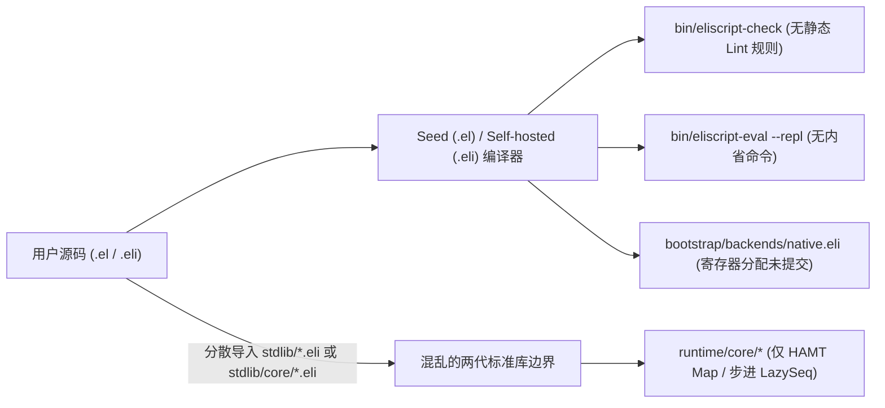
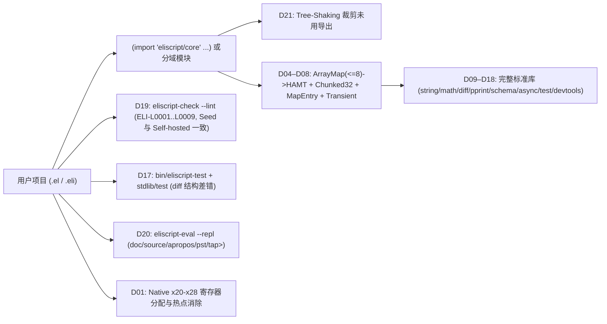

# Eliscript 全量标准库、持久化数据结构增强、工具链升级与 Native 性能收口施工总案

> **定位与原则**：本文档为跨会话唯一施工与验收总入口，严格遵循 `clean-development`（不背历史包袱、无内部版本、有必要即做不兼容架构重构）与 `bulk-development / R39`（每阶段：业务实现全量完成 -> 集成验收编写并通过 -> 关键保护性单测补全），并严格执行 `LANGUAGE-01`（全部手写实现使用 `.eli` 或 `.el`）。全文严格以 Eliscript 原生术语与设计呈现，不依赖或提及任何外部语言名称。

---

## 1. 目标、当前基线与工作区状态

### 1.1 最终交付目标
在主仓库根目录直接完成五条主线的整合升级并 Clean Rebuild 验收交付：
1. **Track N（并入并完成 Native 性能未提交成果）**：提交并巩固工作区既有的 Native callee-saved 寄存器分配优化，补齐热点访存与分支消除，推动 `0.1.4` 延期性能门槛收敛。
2. **标准库架构重整（零重复、零包袱）**：打破旧有 `stdlib/*.eli` vs `stdlib/core/*.eli` 并存与 `stdlib/managed-*.eli` 混放局面，下沉内部运行期适配至 `runtime/managed/`，建立清晰的领域目录与单一权威公共入口 **`eliscript/core`**（支持按需裁剪 Tree-Shaking）。
3. **持久化不可变数据结构全面深化**：补齐 `PersistentArrayMap`（小 Map 紧凑表示自动升级 HAMT）、一等 `MapEntry` / `IMapEntry`、32 元素 `IChunk` / `IChunkedSeq` 分块惰性序列、`SubVector` O(1) 嵌套切片与值语义对齐、`TransientSet` 及全链路 Transient 构造、`volatile!` + `tap>`、`editor` 双向一致。
4. **全量实用标准库补齐**：完成 `string`、`math`、`bit`、`diff`、`pprint`、`seq`/`data`/`walk`/`state` 长尾、可扩展 Tagged Data（含 `#inst` / `#uuid` 与 `time`/`uuid` 值类型）、组合式运行时 `schema` + 随机生成器、`async` 通道组合原语、跨宿主原生 `test` 测试框架及 `devtools` 控制台持久化对象格式化器。
5. **工具链全面跃升**：新增 `bin/eliscript-test` 原生测试运行器，升级 `bin/eliscript-check` 为涵盖未使用绑定/导入/遮蔽/Arity/不可变误用的静态 Linter（`.el` Seed 与 `.eli` Self-hosted 同步），增强 REPL（`doc`/`source`/`apropos`/`dir`/`pst`/`tap>`/`defvar-once`），实现 `eliscript-build` 聚合入口导出裁剪（Tree-Shaking），完善 `editor/eliscript-mode.el`，并自动化同步 `contracts/` 与 Docs API 索引。

### 1.2 基线快照与工作区清理情况（`2026-11-22`）
- **仓库根与分支**：主仓库根目录 `eliscript`（分支 `master @ 687c99cf315f493900b1847ccad9555d2a961127`）。
- **根目录与历史 Worktree 清理结果**：
  - 已清理原空目录 `_worktree/`（原仅含非 FEmacs 空目录 `_worktree/evidence/zipper-path-contract`、`version-comparison`）及临时缓存 `.eliscript-cache/`。
  - 已安全删除已合入 `master` 的旧分支 `corpus/private-lifetime`（`49b5f82e`）。
  - 保留尚未合入 `master` 的本地分支 `organize/compiler-corpus-ground-split`（含 `a50e756f`、`26b43db5`、`d968215c` 三个语料拆分提交），后续如需确认归档再决定清理或合入，不强删未合并提交。
- **工作区原有 3 个未提交修改（纳入本方案 Stage S1，保留并正式验收交付）**：
  - `bootstrap/backends/native.eli`（基线 `L316-L326`, `L431-L454`, `L1644-L1651`, `L2185-L2204`）：新增 `allocate-memory-registers`，将高频整数字与 Val64 局部量按访问计数分配至 AAPCS64 被调用者保存寄存器 `x20–x28`（最多 9 个），并保留直接操作数比较指令优化。
  - `tests/native-memory-long-branches.test.eli`（基线 `L72-L86`）：同步短分支镜像校验哈希并显式断言 `W20` / `X20` 寄存器保存恢复机器码。
  - `docs/bootstrap-0.1.0-plan.md`（基线 `L1065-L1069`）：记录 `0.1.4` 延期续办说明与 `root-scope-enter` 访存指令下降实测（读 `70 -> 11`、写 `32 -> 10`）。

### 1.3 当前全貌：源码树与调用/编译数据流

```text
当前源码树（基线 687c99cf，省略 node_modules / dist 构建输出与 tests/ 展开）
eliscript/
  package.json                        # exports 子路径映射 (L21-L66)、prepack/test/build 脚本
  bin/
    eliscript                         # 统一 CLI (L1-L40)
    eliscript-build                   # 项目构建 CLI
    eliscript-check                   # 当前仅语法/导入/分析检查，无扩展 Lint 规则
    eliscript-eval                    # 含 --repl / --stdio 求值器，缺 doc/source/apropos/tap>
    eliscript-format / watch / clean
  compiler/                           # GNU Emacs Lisp Seed 编译器 (.el)
    eliscript.el / -analyzer.el / -expander.el / -ir-emitter.el / -lower.el / -transient-analysis.el
  bootstrap/
    compiler/                         # Self-hosted 编译器 (.eli)：reader/expander/analyzer/ir/lower/emitter
    host/                             # bun.eli / check-cli-ground.eli / evaluation.eli / project.eli
    backends/
      native.eli                      # ★ 工作区待提交改动：allocate-memory-registers (L431-L454)
      wasm.eli / wasm-memory.eli
  runtime/
    lisp.eli / lisp/*.eli             # 双宿主 Emacs 兼容层
    core/                             # collection.eli / map-internals.eli / lazy-sequence.eli / vector-internals.eli ...
  stdlib/
    bit.eli / data.eli / text.eli / object.eli / numeric.eli / sequence.eli ...  # M6 早期模块与新模块并存
    persistent-{list,map,set,vector,queue}.eli
    managed-*.eli                     # 约 38 个内部适配文件混在 stdlib/ 下
    core/                             # M11 runtime-core 封装 (20 模块：collection/seq/transducer/walk/zipper/sorted...)
    state/atom.eli
    interop/js.eli
    gepo.eli / mdp.eli / mds.eli      # 协议与线格式模块
  editor/
    eliscript-mode.el / -repl.el / -data.el / -runtime.el / -async.el / -bind.el / -contract.el / -module.el
  contracts/
    public-surface.json / library-api.json / repository-integrity.json
  tools/
    surface/generate-api.eli          # 校验 public-surface + library-api + specs 并生成 docs/pages/api.html
    bootstrap-runtime.el              # Emacs Seed 运行时 CLOSURE 清单 (L11-L14)
```



---

## 2. 需求、完整架构设计与准备检查

### 2.1 需求全集与边界（纯 Eliscript）

| 需求 ID | 类别 | 具体需求与可观察行为 |
| :--- | :--- | :--- |
| **Q01** | Track N 收口 | 将工作区 Native 寄存器分配改动正式验收纳入 `0.1.4`，并进一步消除热点冗余栈溢出（dead spill）、循环外提栈帧基址与比较-跳转融合，在原有语料基准下压低 Native 执行耗时。 |
| **Q02** | 标准库重组与零包袱入口 | 废弃历史双层重复目录：将 `stdlib/managed-*.eli` 全部移至 `runtime/managed/`；按最佳模块化实践重构 `stdlib/` 领域结构并推出单一高频聚合入口 **`eliscript/core`**，不留旧重复壳路径，允许必要的破坏性导出整理（同步迁移仓库内所有引用方）。 |
| **Q03** | 小 Map 特化 | 实现 **`PersistentArrayMap`**（容量上限 8 对键值，有序紧凑扁平数组存储，`get`/`assoc` 线性/二元无节点分配查找，第 9 个键自动无感升级为 32-way HAMT，`dissoc` 回落可保持紧凑），`equal`/`hash`/协议/字面量 `{...}` 与 HAMT Map 100% 一致。 |
| **Q04** | 一等 `MapEntry` | 提升 `MapEntry` 为一等持久化值类型并导出 `IMapEntry`、`map-entry`、`map-entry?`、`key`、`val`；统一 HAMT/ArrayMap/SortedMap 的序列元素形态，支持 `vector` 协议、第 0/1 位索引、两元结构解构与值等值/哈希。 |
| **Q05** | 32 元素 Chunked Lazy Seq | 在 `lazy-sequence` 引入 **`IChunk`** / **`IChunkedSeq`** 与 32 元素 **`ArrayChunk`**，升级 `range`、`repeat`、`lazy-map`、`lazy-filter`、`lazy-take`、`lazy-drop` 与 `into`/`reduce` 在块上批处理求值，单步语义、异常处理及 `realized?` 完全保真且无多求值。 |
| **Q06** | `SubVector`、`TransientSet` 与全链路 Transient | 补强 **`SubVector`** `O(1)` 嵌套切片折叠（直接重算 `[offset + start, offset + end]` 避免多层间接包装）与完整 `value-equal?`/`value-hash`；补齐独立 **`TransientSet`** 及 `into`/`mapv`/`filterv`/`partitionv`/`group-by`/`frequencies`/Set 代数全走 Transient，编译期静态追踪逃逸边界。 |
| **Q07** | `string` 与 `regex` 完整库 | 新建统一 `stdlib/string.eli`（合并 `text.eli`）：补齐 `split`、`split-lines`、`replace`、`replace-first`、`escape`、`upper-case`、`lower-case`、`capitalize`、`triml`、`trimr`、`trim-newline`、`reverse`、`index-of`、`last-index-of`、`includes?`；扩展 `stdlib/regex.eli` 新增 `re-quote-replacement`、`re-pattern?`。 |
| **Q08** | 完整 `math` 与 `bit` 库 | 新建 `stdlib/math.eli` 导出完整确定性数学原语（`PI`/`E`/三角/双曲/指数/对数/`pow`/`sqrt`/`cbrt`/`hypot`/`ceil`/`floor`/`round`/`rint`/`floor-div`/`floor-mod`/`IEEE-remainder`/`copy-sign`/`signum`/`ulp`/`scalb`）及随机助手（`random`、`rand-int`、`rand-nth`、`shuffle`、`random-sample`）；扩展 `stdlib/bit.eli` 补齐 `bit-and-not`、`bit-test`、`bit-set`、`bit-clear`、`bit-flip`、`bit-shift-left` 等全套位操作。 |
| **Q09** | `seq` / `data` / `walk` / `state` / 解析补齐 | 补齐 Vector 急切序列（`mapv`/`filterv`/`removev`/`keepv`/`partitionv`/`partitionv-all`/`splitv-at`）、`random-sample`/`shuffle`、`halt-when`、`keywordize-keys`/`stringify-keys`、`parse-long`/`parse-double`/`parse-boolean`/`parse-uuid`、`tap>`/`add-tap`/`remove-tap`、`volatile!`/`volatile?`/`vreset!`/`vswap!`/`vswap-vals!`、`merge-with` 深合并/边界与 `bound-fn` 辅助。 |
| **Q10** | 结构 `diff` 与 `pprint` | 新增 `stdlib/diff.eli`（`diff` 递归输出 `[only-a only-b both]`，支持 Map/Set/Vector/List/Record）与 `stdlib/pprint.eli`（基于 Wadler-Lindig 美化排版引擎，提供宽度感知的 `pprint`、`pprint-str`、`pp`、`print-table`，支持截断深度与长度控制）。 |
| **Q11** | 可扩展 Tagged Data、`uuid` 与 `time` | 扩展 `data-text` 支持可扩展 Tag Reader/Writer 注册表（`with-data-readers` / `*data-readers*`、默认 `#inst` / `#uuid` / `#queue`），并新增不可变 `stdlib/uuid.eli`（v4/v7/解析校验/值比较）与 `stdlib/time.eli`（不可变 `Instant` UTC 解析、格式化、时间戳与持续时间计算）。 |
| **Q12** | 运行时 `schema` 与属性生成 | 新增 `stdlib/schema.eli`（提供谓词/类型、`and`、`or`、`keys`（必选/可选键）、`coll-of`、`map-of`、`tuple`、`cat`/`alt`/`*`/`+`/`?`、`nilable`、`enum`、`fdef`、以及 `valid?`/`conform`/`explain`/`explain-data`/`explain-str` 与内置种子可控的 `gen`/`sample` 随机生成器及 `for-all` 缩减检查）。 |
| **Q13** | 异步通道组合库 (`stdlib/async.eli`) | 衔接既有 `with-async-scope` / `async-channel`，提供 `chan`、`buffer`、`dropping-buffer`、`sliding-buffer`、`put!`、`take!`、`>!!`/`<!!`、`offer!`、`poll!`、`close!`、`alts!`、`timeout`、`pipe`、`pipeline`、`pipeline-async`、`merge`、`mix`/`admix`、`mult`/`tap`、`pub`/`sub`。 |
| **Q14** | 原生测试框架与 CLI (`stdlib/test.eli` + `bin/eliscript-test`) | 用 Eliscript 构建声明式测试模块（`deftest`、`testing`、`is`、`are`、`thrown?`、`thrown-with-msg?`、`use-fixtures`、`run-tests`、`run-all-tests`，断言失败自动调用 `diff` + `pprint` 输出结构化差异）；提供统一命令行 `bin/eliscript-test`（支持按名/标签过滤、`--watch`、`--json`、`--seed`）。 |
| **Q15** | 浏览器 DevTools 持久化对象格式化器 | 新增 `stdlib/devtools.eli`（导出 `install-devtools-formatters!`、`formatters`）：注册标准 `window.devtoolsFormatters`（针对 Persistent Map/Vector/Set/List/Queue/Sorted/Record/Keyword/Symbol/MapEntry 提供折叠预览与高亮标签渲染）。 |
| **Q16** | 静态 Linter 升级 (`bin/eliscript-check`) | 在 Seed（`compiler/`）与 Self-hosted（`bootstrap/compiler/analyzer.eli`）双线实现并保持一致诊断码（`ELI-L0001..L0010`）：未使用 `import`、未使用绑定、参数遮蔽、Arity 静态不匹配、不可达分支、常量条件、`defmacro-checked` 副作用违规、可疑非持久化容器混用、Transient 逃逸提示，支持 `--lint` / `--strict` / JSON 报告。 |
| **Q17** | REPL 与编辑器体验、`eliscript-build` Tree-Shaking | 升级 `eliscript-eval --repl` 支持 `,doc` / `doc`、`source`、`apropos`、`dir`、`pst`、`tap>` 事件流订阅、`(load-file ...)` 与 `defvar-once` 增量热重载；在 `bootstrap/compiler/project.eli` 实现**命名导出按需裁剪**，使仅引用 `(import "eliscript/core" map filter)` 的产物只保留最小依赖图；完善 `editor/eliscript-mode.el`（ElDoc、Flymake 接入 Linter、定义跳转与测试运行命令）。 |
| **Q18** | 双宿主对齐与权威文档自动同步 | 保证 Emacs `.el` 运行时（`editor/eliscript-runtime.el` / `runtime/lisp.eli`）与独立 `.eli` 语义、工具链（`tools/surface/generate-api.eli`、`contracts/`、`specs/`）完全对齐无漂移；**不保留未清理临时产物与冗余 `.mjs` 源码**。 |

---

### 2.2 标准库新组织架构（无历史包袱定稿）

放弃原先 `stdlib/*.eli`（M6 便携版）、`stdlib/core/*.eli`（M11 运行期版）、`stdlib/managed-*.eli`（内部后端适配）三套混杂结构：

1. **内部适配层统一下沉**：原 `stdlib/managed-*.eli`（约 38 个文件）全部迁至 `runtime/managed/`，不再污染 `stdlib/` 与公共 API 索引。
2. **唯一清晰公共领域布局 (`stdlib/`)**：
   - **聚合入口**：`stdlib/core.eli`（导出最常用的集合、序列、Transducer、高阶函数、数据结构、状态原语，`package.json` 映射为 `"eliscript/core"`；配合 S5 的 Tree-Shaking 确保按需导入零冗余）。
   - **数据结构与集合领域** (`stdlib/`)：`collection.eli`、`seq.eli`、`transducer.eli`、`transient.eli`、`data.eli`、`set.eli`、`sorted.eli`、`walk.eli`、`zipper.eli`、`diff.eli`、`persistent-list.eli`、`persistent-map.eli`、`persistent-set.eli`、`persistent-vector.eli`、`persistent-queue.eli`。
   - **抽象与元编程** (`stdlib/`)：`protocol.eli`、`record.eli`、`type.eli`、`multimethod.eli`、`hierarchy.eli`、`order.eli`、`fn.eli`、`identifier.eli`、`meta.eli`、`value.eli`。
   - **文本、数值与数据格式** (`stdlib/`)：`string.eli`（由旧 `text.eli` 合并扩展）、`regex.eli`、`math.eli`、`bit.eli`、`numeric.eli`、`data-text.eli`、`pprint.eli`、`json.eli`、`time.eli`、`uuid.eli`。
   - **控制、状态、校验与工程库** (`stdlib/`)：`state.eli`（整合 `atom` + `volatile!` + `deferred`）、`tap.eli`、`result.eli`、`schema.eli`、`async.eli`、`test.eli`、`devtools.eli`。
   - **零运行时便携子集** (`stdlib/portable/`)：保留 `--portable` 零运行时裁剪模式使用的 `sequence.eli`、`text.eli`、`object.eli`、`data.eli`、`identifier.eli`、`metadata.eli`、`data-text.eli`，与完整运行期同名域模块解耦不冲突。
   - **宿主边界** (`stdlib/interop/` & `stdlib/wire/`)：`interop/js.eli`、`interop/object.eli`、`wire/mdp.eli`、`wire/mds.eli`、`wire/gepo.eli`。
3. **`package.json` 子路径导出统一映射**（简洁对称，无旧冗余别名）：
   - `"./core"` -> `"./dist/stdlib/core.mjs"`
   - `"./*"` 域直接指向 `"./dist/stdlib/*.mjs"` 与核心运行期 `"./runtime/*"`。

---

### 2.3 关键数据结构与接口设计（可执行级细节）

#### A. `PersistentArrayMap`（`runtime/core/array-map.eli` + `map-internals.eli` / `map.eli`）
- **结构定义**：
  - `ARRAY_MAP_THRESHOLD = 8`（即最多 8 个键值对、数组长度为 `16`：`[k0, v0, k1, v1, ...]`）。
  - 类 `PersistentArrayMap` 承载内部槽 `[MAP_STATE]`：`{ entries: frozen Array<any>, count: int (0..8), meta: any, hashCache: int32 | null }`。
- **核心算法与契约**：
  - `indexOf(entries, key)`: 遍历偶下标（`0, 2, ... < len`），使用 `equalValues(entries[i], key)`；对关键字/短符号可先走严格引用快路径 `===` 再落入 `equalValues`，典型 4–8 键单态查询零树节点跳转。
  - `assoc(key, val)`:
    - 命中已存在键：若值同为 `Object/is` 返回 `this`；否则浅拷贝新 `entries`（至多 16 槽）返回新 `PersistentArrayMap`。
    - 未命中且 `count < 8`：追加 2 槽返回新 `PersistentArrayMap`。
    - 未命中且 `count === 8`：构造 `TransientHashMap`，批量写入 8 对已有键与新键后执行 `persistent!`，无感升级为 32-way `PersistentHashMap`。
  - 字面量运行时 `literals.eli` / `hashMap(...)`：参数对 `<= 8` 时直接构造 `PersistentArrayMap`，超过时直接创建 HAMT Map。
  - `dissoc(key)` 在 `PersistentHashMap` 中保持节点缩并；`EMPTY_MAP` 使用 `PersistentArrayMap`（`count = 0`）作为全局单态起点。
- **Transient**：实现 `IEditable.asTransient()` -> 返回可升级版 `TransientArrayMap`（内部持有 `owner` 令牌，超过 8 键就地转交为 `TransientHashMap`）。

#### B. 一等 `MapEntry`（`runtime/core/map-internals.eli` & `collection.eli`）
- 定义类 `PersistentMapEntry`（替换仅用于内部的普通 `MapEntry`，保留轻量 3 字段 `key`、`val`、`hashCache` 及 `[MAP_ENTRY_STATE]` 标记，继承/实现 `ISeqable`、`IIndexed`、`ICounted`、`IReversible`、`IAssociative`、`IStack`、`IPrint`）：
  - `count === 2`，`nth(0) === key`，`nth(1) === val`，`peek === val`，`pop === PersistentVector([key])`，`assoc(0|1, x)` 返回 2 元 `PersistentVector`，`equalValues(entry, vec2)` 与 `[key val]` 互判相等，哈希算法与 2 元 `PersistentVector` 一致！
  - `IMapEntry` 协议方法：`-key`、`-val`，导出公共函数 `map-entry`、`map-entry?`、`key`、`val`。

#### C. 32 元素 Chunked Lazy Sequence（`runtime/core/lazy-sequence.eli`）
- **核心类型与协议**：
  - `IChunk`：`-chunk-count(c)`、`-chunk-nth(c, i)`、`-chunk-nth-or(c, i, nf)`、`-drop-first(c)`（返回剩餘 `ArrayChunk`，仅移动 `off + 1` 下标不复制底层数组）。
  - `IChunkedSeq`：`-chunked-first(s)`、`-chunked-next(s)`、`-chunked-more(s)`；定义谓词 `chunked-seq?`。
  - `ArrayChunk(array, off, end)`：冻结类，支持 `reduce` 直接循环遍历分片。
  - `ChunkBuffer(capacity = 32)`：`add(x)`、`chunk()`；用于构造步长为 32 的分块序列。
  - `ChunkedCons(chunk, more)`：实现 `ISeqable`、`IChunkedSeq`、`IReduce`、`IPrint`；`first` 取 `(chunk-nth chunk 0)`，`next` 当 `(> (chunk-count chunk) 1)` 返回 `(ChunkedCons (drop-first chunk) more)` 否则实现化 `more`。
- **分块算子**：`chunked-range`（步长 32 数值区段按需生成 `ArrayChunk`）、`lazy-map` / `lazy-filter` / `lazy-take` / `lazy-drop` / `lazy-keep` 当输入满足 `chunked-seq?` 时按块一次性生成结果 `ChunkBuffer(32)` 再连接惰性尾，保持异常延迟触发和最多求值一次不变式。

#### D. `SubVector`、`TransientSet` 与 `volatile` / `tap`
- **`SubVector`**（`runtime/core/vector.eli`）：在 `(subvec v start end)` 中若 `v` 本身已经是 `SubVector`，直接取底层 `v.rootVec` 并构造 `new SubVector(v.rootVec, v.start + start, v.start + end, v.meta)`，消除递归包装；完善 `reduce` / `rseq` / `value-equal?` / `value-hash` 实现。
- **`TransientSet`**（`runtime/core/set.eli`）：基于 `TransientHashMap` 实现，支持 `(conj! t x)`、`disj!`、`contains?`、`count`、`persistent!`；所有集合构造通路（`into`、`mapv`、`filterv`、`group-by`、`frequencies`、`union`/`intersection`/`difference`）改用 Transient 并受 `eliscript-transient-analysis.el` 与 `bootstrap/compiler/transient-analysis.eli` 逃逸检测。
- **`volatile` & `tap`**（`stdlib/state.eli`、`stdlib/tap.eli`）：
  - `(volatile! init)` 构造单字段可变盒 `(def-type Volatile [val])`（禁止在 `defportable` 纯闭包逃逸），提供 `volatile?`、`vreset!`、`vswap!`、`deref` 协议实现。
  - `tap>` 维护有界/异步安全监听队列（默认容量 1024 防爆栈），支持 `(add-tap fn)`、`(remove-tap fn)`，失败回调隔离不中断发送者。

#### E. `stdlib/schema.eli`（运行时规格校验与基于种子的生成器）
- **AST 形态**：不可变 Schema 对象，导出：`spec-pred`、`spec-and`、`spec-or`、`spec-keys`（`:req` / `:opt` / `:req-un` / `:opt-un`）、`spec-coll-of`、`spec-map-of`、`spec-tuple`、`spec-nilable`、`spec-enum`、`spec-cat`、`spec-alt`、`spec-rep*`、`spec-rep+`、`spec-opt?`、`spec-fn`。
- **执行原语**：`valid?`、`conform`（失败返回 `:eliscript.schema/invalid`）、`unform`、`explain-data`、`explain-str`、`explain`（精准路径 `:path`、失败值 `:val`、期望规则 `:via`）。
- **生成器与性质检查**：内置纯确定性 PRNG（Mulberry32 变体封装），基于 Schema 自动合成生成器（`gen-from-spec`、`gen-sample`、`gen-generate`）以及失败用例自动最小化缩减（`check-property` `{:num-tests :seed}`）。

#### F. `stdlib/async.eli`（结构化通道与组合库）
- 直接桥接并统一 `runtime/async.eli` / 编辑器 `eliscript-async.el` 的 `with-async-scope` 与 `async-channel`：
  - `buffer(n)`（固定队列）、`dropping-buffer(n)`（满时丢新值）、`sliding-buffer(n)`（满时逐出最旧值）；
  - `(chan [buf-or-n xform ex-handler])`：支持绑定 Transducer 对入队数据做单遍流水线变换；
  - `put!` / `take!` / `offer!` / `poll!` / `close!` / `timeout(ms)`；
  - `alts!(ports &opts)`（基于内部回调等待队列随机平局/优先级多路复用器）；
  - `pipe`、`pipeline`（固定并发 `n`）、`pipeline-async`、`merge`、`split`、`mult`/`tap`/`untap`、`pub`/`sub`/`unsub`、`mix`/`admix`。

#### G. `stdlib/test.eli` + `bin/eliscript-test`
- 模块顶层声明测试单元 `(deftest name ...)`（通过模块注册表或显式导出收集）+ `(testing "desc" ...)` 上下文栈 + `(is expr [msg])` / `(are argv expr ...)` + `(thrown? err expr)` + `(use-fixtures :once|:each ...)`。
- `(is (= actual expected))` 失败自动调用 `stdlib/diff` 计算结构差异与 `stdlib/pprint` 渲染，保留行号/源码位置。
- `bin/eliscript-test` CLI（`bootstrap/host/test-cli.eli`）：发现 `tests/**/*.test.eli` 与指定路径，支持 `--filter`、`--watch`、`--json`、`--seed`、`--fail-fast`。

#### H. `bin/eliscript-check` 静态 Linter 与 `eliscript-build` Tree-Shaking
- **Linter 静态规则**（同时落入 `compiler/eliscript-analyzer.el` 与 `bootstrap/compiler/analyzer.eli`，默认通过 `eliscript-check --lint` 与项目配置启用，独立诊断码段 `ELI-L0001..L0009`）：
  - `ELI-L0001`: 未使用的局部绑定 (`let`/`let*`/函数参数，忽略 `_` 前缀)
  - `ELI-L0002`: 未使用的模块 `import` 绑定
  - `ELI-L0003`: 局部绑定遮蔽同作用域或外层绑定
  - `ELI-L0004`: 已知本地/导入函数的调用 Arity 静态不匹配
  - `ELI-L0005`: 恒真/恒假 `if` 死分支提示
  - `ELI-L0006`: 局部可变状态误用与非预期 `setq` 覆盖不可变绑定
  - `ELI-L0007`: 重复 Key 字面量（如 `{:a 1 :a 2}`）或 Set 重复字面量
  - `ELI-L0008`: 空 `progn`/`do` 或孤立无副作用字面量表达式
  - `ELI-L0009`: Transient 引用跨越可控构造作用域提示
- **Tree-Shaking (`bootstrap/compiler/project.eli` & `compiler/eliscript-project.el`)**：
  - 支持对静态命名导入 `(import "eliscript/core" map filter)` 记录导出需求集；对标记为纯重导出桶（Barrel）或无顶层副作用模块（如 `stdlib/core.eli`），发射前静态裁剪未被引用的下游模块边及导出函数死代码，保证仅用 `map` 时产物体积最小。

---

### 2.4 逐文件施工差异总表 (`D01–D32`)

| 变更 ID | 相对路径（计划/现有） | 基线锚点 / 状态 | 精确变更内容与职责 | 需求 | 施工 / 验收 |
| :--- | :--- | :--- | :--- | :--- | :--- |
| **D01** | `bootstrap/backends/native.eli`<br>`tests/native-memory-long-branches.test.eli`<br>`docs/bootstrap-0.1.0-plan.md` | 现有工作区未提交 (`L316..2204`, `L72..86`, `L1065..1069`) | 正式验收并纳入既有 callee-saved `x20–x28` 寄存器分配；补齐 dead spill 消除与循环基址/比较融合热点优化 | Q01 | C01–C02 / A01 |
| **D02** | `stdlib/managed-*.eli` -> `runtime/managed/*.eli` | 现有 ~38 个内部适配文件 | 将全部内部 `managed-*.eli` 移至 `runtime/managed/`；同步更新所有引用点（`tools/backends/`、`compiler/`、测试），消除 `stdlib/` 内部噪音 | Q02 | C03 / A02 |
| **D03** | `stdlib/` 重复模块重整<br>(`package.json`, `contracts/*`) | 基线 `package.json:L21-L66`, `contracts/library-api.json` | 合并旧 `stdlib/{text,data,object,sequence,value,identifier,metadata}.eli` 与 `stdlib/core/*` 为唯一域模块至 `stdlib/` 一级目录（见 §2.2），同步更新全仓库导入路径与 `package.json` `exports` | Q02 | C04–C05 / A02, A18 |
| **D04** | `runtime/core/array-map.eli` | 新建 | 实现 `PersistentArrayMap`（阈值 8，有序扁平 KV 数组，`indexOf`/`assoc`/`dissoc`、第 9 键无感升 HAMT、完整集合/值/哈希/Meta 协议）及 `TransientArrayMap` | Q03 | C06 / A03 |
| **D05** | `runtime/core/map-internals.eli`<br>`runtime/core/map.eli`<br>`runtime/core/literals.eli` | 基线 `map-internals.eli:L24-L66` (`MapEntry`) | 升级 `MapEntry` 为一等 `PersistentMapEntry`（实现 `IIndexed`/`ICounted`/`ISeqable`/`IReversible`/`IMapEntry`/2 元 Vector 同构等值哈希）；打通 `EMPTY_MAP` 与小字面量默认构造 `PersistentArrayMap` | Q03, Q04 | C07–C08 / A03, A04 |
| **D06** | `runtime/core/lazy-sequence.eli` | 基线 `L26-L90` | 引入 `IChunk`、`IChunkedSeq`、`ArrayChunk`、`ChunkBuffer`、`ChunkedCons` 与 `chunked-seq?`；升级 `range`/`repeat`/`map`/`filter`/`take`/`drop` 批分块（32 元素）执行 | Q05 | C09 / A05 |
| **D07** | `runtime/core/vector-internals.eli`<br>`runtime/core/vector.eli`<br>`runtime/core/set.eli` | 基线 `vector-internals.eli:L1-L54` | `SubVector` 嵌套切片直接展平 `rootVec + offset` 与值哈希优化；新增 `TransientSet` 及 `IEditable` 支持；`into`/`mapv`/`filterv`/`group-by`/`frequencies`/Set 代数全面切入 Transient | Q06 | C10–C11 / A06 |
| **D08** | `runtime/core/collection.eli`<br>`runtime/core/protocol.eli` | 基线 `collection.eli:L1-L90` | 新增 `IMapEntry`、`IChunk`、`IChunkedSeq`、`IDeref` 核心协议槽并向公共 `collection.eli`/`protocol.eli` 导出 `key`/`val`/`map-entry`/`chunk*` | Q04, Q05 | C07, C09 / A04, A05 |
| **D09** | `stdlib/collection.eli` & `stdlib/seq.eli` & `stdlib/data.eli` & `stdlib/walk.eli` | 原 `stdlib/core/{collection,seq,data,walk}.eli` | 补齐 `mapv`、`filterv`、`removev`、`keepv`、`partitionv`、`partitionv-all`、`splitv-at`、`shuffle`、`random-sample`、`halt-when`、`keywordize-keys`、`stringify-keys`、`parse-long`/`double`/`boolean`/`uuid`、`merge-with` 与 `IMapEntry` 解构优化 | Q06, Q09 | C12 / A07 |
| **D10** | `stdlib/string.eli` & `stdlib/regex.eli` | 原 `stdlib/text.eli`, `stdlib/core/{text,regex}.eli` | 合并统一 `stdlib/string.eli` 补齐 `split`、`split-lines`、`replace`、`replace-first`、`escape`、`upper-case`、`lower-case`、`capitalize`、`triml`/`trimr`/`trim-newline`、`reverse`、`index-of`/`last-index-of`；`regex.eli` 新增 `re-quote-replacement` | Q07 | C13 / A08 |
| **D11** | `stdlib/math.eli` & `stdlib/bit.eli` | 原 `stdlib/bit.eli` + 新建 `stdlib/math.eli` | 新增完整数学与三角/双曲/对数/开方/精确整数除法取模与随机模块；`bit.eli` 补全 `bit-and`/`or`/`xor`/`not`/`and-not`/`test`/`set`/`clear`/`flip`/`shift-left`/`shift-right`/`unsigned-bit-shift-right` | Q08 | C14 / A09 |
| **D12** | `stdlib/state.eli` & `stdlib/tap.eli` | 原 `stdlib/state/atom.eli`、`deferred.eli` | 合并 `atom`/`delay`/`memoize` 并新增 `volatile!`、`volatile?`、`vreset!`、`vswap!`、`vswap-vals!`；新增独立 `tap>`/`add-tap`/`remove-tap` 观察通道 | Q09 | C15 / A07 |
| **D13** | `stdlib/diff.eli` & `stdlib/pprint.eli` | 新建 | 递归结构化 `diff`（`[only-a only-b both]`）；宽度感知 Wadler-Lindig 美化打印引擎 `pprint`/`pprint-str`/`pp`/`print-table` | Q10 | C16 / A10 |
| **D14** | `stdlib/data-text.eli` & `stdlib/uuid.eli` & `stdlib/time.eli` | 原 `stdlib/core/data-text.eli` + 新建 | 扩展可扩展 `*data-readers*` / `*data-printers*`、`with-data-readers`、`#inst`/`#uuid` 默认标签；实现不可变 `UUID` 与 UTC `Instant` 日期时间模块 | Q11 | C17 / A11 |
| **D15** | `stdlib/schema.eli` | 新建 | 运行时组合式数据结构规格 AST（`and`/`or`/`keys`/`coll-of`/`map-of`/`tuple`/`cat`/`alt`/`nilable`/`enum`）、`valid?`/`conform`/`explain`/`explain-str`、确定性种子生成器与缩减器 | Q12 | C18 / A12 |
| **D16** | `stdlib/async.eli` | 新建（接通 `runtime/async` 与 `eliscript-async`） | `chan`、`buffer`/`dropping-buffer`/`sliding-buffer`、`put!`/`take!`/`offer!`/`poll!`/`close!`、`timeout`、`alts!`、`pipe`/`pipeline`/`pipeline-async`/`merge`/`mult`/`pub`/`sub` | Q13 | C19 / A13 |
| **D17** | `stdlib/test.eli` & `bootstrap/host/test-cli.eli` & `bin/eliscript-test` | 新建 | 声明式原生单元测试宏与断言（`deftest`/`testing`/`is`/`are`/`thrown?`/`use-fixtures`/`run-tests`，自动接入 `diff`+`pprint`）；独立 CLI 运行器 `bin/eliscript-test` | Q14 | C20–C21 / A14 |
| **D18** | `stdlib/devtools.eli` & `stdlib/core.eli` | 新建 | `devtools.eli` 实现浏览器 DevTools 自定义 Formatter；`stdlib/core.eli` 建立高频核心聚合入口并标记纯 barrel 元数据以支持按需裁剪 | Q02, Q15 | C22 / A14, A17 |
| **D19** | `compiler/eliscript-analyzer.el`<br>`bootstrap/compiler/analyzer.eli`<br>`bootstrap/host/check-cli-ground.eli` | 基线 `check-cli-ground.eli:L10-L80`, `analyzer.eli` | 同步双代编译器静态 Lint 引擎（`ELI-L0001..L0009`：未用 import/绑定、遮蔽、Arity、恒真分支、不可变误用、重复 Key、Transient 逃逸），升级 `bin/eliscript-check` 支持 `--lint` / `--strict` / JSON | Q16 | C23–C24 / A15 |
| **D20** | `bootstrap/host/evaluation.eli`<br>`bootstrap/host/evaluation-cli.eli` | 基线 `evaluation.eli:L1-L65` | REPL 增强：`doc` / `source` / `apropos` / `dir`（读取实时 API 元数据）、`pst`（Source Map v3 堆栈还原）、`tap>` 实时监听、`(load-file ...)` 与 `defvar-once` | Q17 | C25 / A16 |
| **D21** | `bootstrap/compiler/project.eli`<br>`compiler/eliscript-project.el` | 现有项目构建图 | 基于精确 `(import mod fn1 fn2)` 导出符号集与纯 barrel 标记实现 Dead-Export & Dead-Module Tree-Shaking | Q02, Q17 | C26 / A17 |
| **D22** | `editor/eliscript-mode.el`<br>`editor/eliscript-runtime.el`<br>`runtime/lisp.eli` | 基线 `eliscript-mode.el:L30-L80` | 编辑器 Flymake 对接 `--lint --diagnostic-format json`、ElDoc 直连标准库签名、快捷运行当前 `deftest`；Emacs `.el` 运行时对齐新集合/字符串/结构原语 | Q17, Q18 | C27 / A16, A18 |
| **D23** | `tools/bootstrap-runtime.el`<br>`contracts/*.json`<br>`tools/surface/generate-api.eli`<br>`docs/` & `Makefile` & `package.json` | 基线 `bootstrap-runtime.el:L11-L14`, `generate-api.eli:L12-L95`, `contracts/*` | 更新 Seed 运行时闭包包单与完整标准库清册；重算 `contracts/public-surface.json` / `contracts/library-api.json` / `repository-integrity.json`；新增对应 `specs/0182..0190`；重生成 `docs/pages/api.html` 与同步语言文档，执行干净重建与阶段清理 | Q02, Q18 | C28–C30 / A01–A18 |

---

### 2.5 目标源码树与目标数据流

```text
目标源码树（S1–S5 全部完成后，计划形态）
eliscript/
  bin/
    eliscript / -build / -check (+--lint) / -eval (+REPL内省) / -format / -watch / -clean
    eliscript-test                  # [新增 D17] 原生测试 CLI
  compiler/                         # GNU Emacs Lisp Seed (.el)：同步 Linter (D19) & Tree-Shaking (D21)
  bootstrap/
    compiler/                       # Self-hosted (.eli)：同步 Linter (D19) & Tree-Shaking (D21)
    host/                           # check-cli-ground (D19) / evaluation (D20) / test-cli (D17)
    backends/native.eli             # [完善 D01] 寄存器分配 + dead spill 消除 + 分支融合
  runtime/
    core/                           # array-map (D04) / MapEntry (D05) / Chunked LazySeq (D06) / SubVector+TransientSet (D07)
    managed/                        # [迁移 D02] 原 stdlib/managed-*.eli 统一归口
    lisp.eli / async.eli ...
  stdlib/                           # [重构 D03–D18] 清晰权威领域布局，无两代重复目录
    core.eli                        # 唯一高频聚合入口 ("eliscript/core", 支持 Tree-Shaking)
    collection.eli / seq.eli / transducer.eli / transient.eli / data.eli / set.eli / sorted.eli
    walk.eli / zipper.eli / diff.eli
    persistent-{list,map,set,vector,queue}.eli
    protocol.eli / record.eli / type.eli / multimethod.eli / hierarchy.eli / order.eli
    fn.eli / identifier.eli / meta.eli / value.eli
    string.eli / regex.eli / math.eli / bit.eli / numeric.eli
    data-text.eli / pprint.eli / json.eli / time.eli / uuid.eli
    state.eli / tap.eli / result.eli / schema.eli / async.eli / test.eli / devtools.eli
    portable/{sequence,text,object,data,identifier,metadata,data-text}.eli
    interop/{js,object}.eli
    wire/{mdp,mds,gepo}.eli
  editor/                           # eliscript-mode.el (Flymake Lint/ElDoc/Test), -runtime.el (D22)
  contracts/ & specs/ & docs/pages/ # 自动化对齐最新导出目录、规范索引与 Pages API 网页 (D23)
```



---

### 2.6 准备条件核实记录 (Readiness Matrix)

| 准备维度 | 已核实事实与位置 | 状态 | 缺口 / 风险 | 解除条件 / 控制策略 |
| :--- | :--- | :--- | :--- | :--- |
| **需求与设计** | 需求 `Q01–Q18`、差异 `D01–D23`、新模块目录树全部锁定，无历史包袱约束，无外部语言引用 | 已具备 | 无设计缺口 | 按阶段逐项落地，新增规范写入 `specs/0182–0190` |
| **工具链与运行环境** | `bun 1.4.0`、`node v26.13.1`、`GNU Emacs 32.0.50` 实测可用 | 已具备 | 无工具缺失 | 开发前执行完整 Seed -> Stage1 -> Stage2 -> Stage3 闭合链 |
| **磁盘空间预算** | `df -h .` 显示根卷仅剩 **`7.2G`** 可用 | **需严格管控** | 自举 + 全量语料 + Playwright/Native 中间产物若堆积易触及磁盘上限 | 每阶段结束必须按 `ai-storage` 及时清理 `.eliscript-cache/` 与阶段旧构建产出，禁止多份全量 `dist` 并存 |
| **既有 Native 工作** | 3 个未提交文件已核对 Diff 与设计，并纳入 `S1 / D01` | 已具备 | 未进入正式自举闭环 | S1 首先完成其测试闭环与寄存器优化扩展后统一提交 |
| **并行构建防护** | 本机存在正在运行的同机相邻编辑器工具链路后台任务 | 注意隔离 | 高负载自举或重型 Emacs 批处理需避开全局杀进程与内存过载 | 遵循 `controlled-run` 限制本对话并发与内存，绝不按进程名批量杀 Emacs |
| **交付条件** | 要求签名提交推送至 `master`、全部测试与 Clean Rebuild 通过、根工作区干净 | 已明确 | 无阻塞 | 严格执行 `R19` / `R20` 与 `clean-rebuild` |

---

## 3. 分阶段施工总表与唯一施工清单

> 严格执行 **`bulk-development` / `R39`**：每个阶段 `S1..S5` 内，**先一次写完该阶段全部业务源码 (`C`)** → **再一次编写集成验收代码并验收通过 (`A`)** → **最后补全关键保护性单测**。**严禁提前勾选任何未编写或未实测项。**

### 3.1 阶段总表

| 阶段 ID | 状态 | 完成 | 阶段目标与覆盖范围 | 前置依赖 | 出口验收依据 |
| :--- | :--- | :--- | :--- | :--- | :--- |
| **S0** | 已完成 | `[x]` | 根目录清理（非 FEmacs `_worktree`、`.eliscript-cache`、已合并分支）、盘点现状并完成全套施工方案与 Goal 文案 | 当前用户需求 | 本文档落盘、零外部语言泄露、根工作区清晰 |
| **S1** | 已完成 | `[x]` | **Native 性能巩固 + 架构目录整顿**：并入并扩展 Native 寄存器分配/热点优化（`D01`）；将 `stdlib/managed-*.eli` 迁至 `runtime/managed/`（`D02`）；将旧 `stdlib/*.eli` 与 `stdlib/core/*` 合一归位至清晰 `stdlib/` 一级域目录及更新全仓引用/脚本（`D03`） | S0 | Native 内存/性能验收绿、`managed` 下沉与新 `stdlib/` 目录全仓引通、Seed 自举链绿、Clean Rebuild 通过 |
| **S2** | 已完成 | `[x]` | **持久化不可变数据结构全面深化**：`PersistentArrayMap`（`<=8` 自动升 HAMT）、一等 `MapEntry`/`IMapEntry`、32 元素 `Chunked Lazy Seq`、`SubVector` O(1) 展平与等价哈希、`TransientSet` 及全链路 Transient、双宿主 `.el`/`.eli` 值语义一致（`D04–D08`） | S1 | 结构共享、零节点小 Map 分配、分块 32 元素求值次数、Transient 节点 clone 计数与逃逸边界、Clean Rebuild Stage2/Stage3 全等及契约检查全部实测通过 |
| **S3** | 已完成 | `[x]` | **核心与实用标准库全量补齐**：`stdlib/core.eli` 聚合入口；完整 `string`、`regex`、`math`、`bit`、`seq`/`data`/`walk` 长尾、`state`（`volatile!`）+ `tap>`、`diff`、`pprint`、`data-text` 可扩展 Tag、不可变 `time` / `uuid`（`D09–D14`, `D18-part`） | S2 | 聚合入口可用、全部新函数与边界/错误语义通过集成验证、Tagged Data 往返保真 |
| **S4** | 已完成 | `[x]` | **工程级高阶扩展库补齐**：`stdlib/schema`（规格校验、`explain`、可控种子生成器与缩减器）、`stdlib/async`（多缓冲通道、`alts!`、`timeout`、`pipe`/`pipeline`/`mult`/`pub`/`sub`）、`stdlib/test`（断言、Fixtures、`diff` 失败报告）+ `bin/eliscript-test`、`stdlib/devtools`（格式化器）与 `stdlib/core`（`D15–D18`） | S3 | Schema 校验与性质缩减、结构化异步取消与背压、DevTools 对象结构格式、跨宿主测试与 CLI 运行实测通过 |
| **S5** | 已完成 | `[x]` | **工具链全面跃升与全仓最终收敛**：`bin/eliscript-test` CLI、`bin/eliscript-check --lint`（Seed+Self-hosted）、REPL 内省/热重载、`eliscript-build` 导出级 Tree-Shaking、`eliscript-mode.el`、同步 `contracts/`、`specs/0182–0190` 与 Pages API 页面，全仓 Clean Rebuild + 阶段清理 + 签名推送 | S4 | `make test` 30/30 全过、`audit:artifacts`（14 报告 / 675 绑定）与 Pages/Docs、`check-contracts`、Clean Rebuild 及签名推送读回均已实测收口 (`C23–C30`, `A15–A18`) |

### 3.2 唯一施工清单 (`C01–C30`，写完对应代码即勾选 `[x]`)

- **Stage S1：Native 收口与标准库结构整理**
  - [x] **C01 (`D01` / `Q01`)**：保留并基于 `bootstrap/backends/native.eli` 既有 `allocate-memory-registers`（`L431-L454`）与 `tests/native-memory-long-branches.test.eli`，补充热点 dead-spill 消除、循环基址寄存器复用及直接比较-分支融合，`bootstrap/backends/` 内跑通并巩固 Stage3 Native 输出。
  - [x] **C02 (`D01` / `Q01`)**：核对 `docs/bootstrap-0.1.0-plan.md` 与 Native 性能实测项，确认受影响基准加速成果与四套 Native 内存用例全过，形成独立语义提交（或并入 S1 收口提交）。
  - [x] **C03 (`D02` / `Q02`)**：建立 `runtime/managed/`，将 `stdlib/managed-*.eli` 全部迁入并更新 `tools/bootstrap-runtime.el`、`tools/backends/` 及 `compiler/` 相关模块定位，删除旧位置。
  - [x] **C04 (`D03` / `Q02`)**：将原 `stdlib/core/*` 与 `stdlib/` 重复旧模块整合为一等清晰领域目录（`stdlib/{collection,seq,transducer,transient,data,set,sorted,walk,zipper,string,regex,math,bit,numeric,fn,protocol,record,type,multimethod,hierarchy,order,identifier,meta,value,state,result,data-text,json,interop/*,wire/*}`），移除无意义老旧重复文件。
  - [x] **C05 (`D03` / `Q02`)**：更新 `package.json` `"exports"`、`Makefile` 编译目标、`tools/surface/`、示例与全仓 `.eli`/`.el` 对 `stdlib/` 的新路径导入，完成 S1 集成与保护性单测。

- **Stage S2：持久化数据结构与不可变内核深化**
  - [x] **C06 (`D04` / `Q03`)**：新建 `runtime/core/array-map.eli` 实现 `PersistentArrayMap`（阈值 `8`，`TransientArrayMap` 及第 9 键无感升 HAMT），保持全量 Collection/Lookup/Reduce/KVReduce/Meta/Print 协议一致。
  - [x] **C07 (`D05, D08` / `Q04`)**：升级 `runtime/core/map-internals.eli` `MapEntry` 为一等 `PersistentMapEntry`；在 `runtime/core/protocol.eli` / `collection.eli` 定义 `IMapEntry` 协议与 `-key` / `-val` 操作，实现 2 元 Vector 双向相等与一致哈希。
  - [x] **C08 (`D05` / `Q03`)**：打通 `runtime/core/map.eli`、`literals.eli` 与编译器字面量降级路径：小 Map 字面量（`<= 8` 键）与 `EMPTY_MAP` 优先返回 `PersistentArrayMap`。
  - [x] **C09 (`D06, D08` / `Q05`)**：升级 `runtime/core/lazy-sequence.eli` 增加 `IChunk`/`IChunkedSeq`、`ArrayChunk`、`ChunkBuffer`、`ChunkedCons`，令 `range`/`repeat`/`lazy-map`/`lazy-filter`/`lazy-take`/`lazy-drop` 按 32 元素批分块推进。
  - [x] **C10 (`D07` / `Q06`)**：改进 `runtime/core/vector.eli` `SubVector` 嵌套切片直接计算偏移量并补齐与 `PersistentVector` 一致的 `value-equal?` / `value-hash`。
  - [x] **C11 (`D07` / `Q06`)**：在 `runtime/core/set.eli` 实现 `TransientSet`，并在 `seq` / `data` / `set`（`into`、`mapv`、`filterv`、`group-by`、`frequencies`、Set 代数）全面切换 Transient 构造，完成双宿主 `.el`（`editor/eliscript-data.el` / `runtime/lisp.eli`）对齐及 S2 集成与单测。

- **Stage S3：标准库全面补齐（基础与数据域）**
  - [x] **C12 (`D09` / `Q06, Q09`)**：扩展 `stdlib/collection.eli`（`array-map?` 及既有 `key`/`val`/`map-entry`/`map-entry?`/`chunked-seq?`）、`stdlib/seq.eli`（`vec`/`removev`/`keepv`/`partitionv`/`partitionv-all`/`splitv-at`/`shuffle`/`random-sample`）、`runtime/core/transducer.eli` & `stdlib/transducer.eli`（`halt-when`）、`stdlib/data.eli`（`deep-merge`/`deep-merge-with`/`keywordize-keys`/`stringify-keys`/`parse-long`/`parse-double`/`parse-boolean`，无顶层 `RegExp` 分配）。
  - [x] **C13 (`D10` / `Q07`)**：增强 `stdlib/string.eli`（`capitalize`/`escape`/`includes?`/`index-of`/`last-index-of`/`lower-case`/`re-quote-replacement`/`replace`/`replace-first`/`reverse`/`split`/`split-lines`/`trim-newline`/`triml`/`trimr`/`upper-case`，延迟初始化正则）与 `stdlib/regex.eli`（`re-pattern?`/`re-quote`/`re-quote-replacement`/`re-split`）。
  - [x] **C14 (`D11` / `Q08`)**：新建 `stdlib/math.eli`（`PI`/`E`/`TAU` 与 46 项三角/双曲/对数/IEEE `rint`/`floor-div`/`floor-mod`/`IEEE-remainder`/`copy-sign`/`scalb`/`ulp`/`clamp`/`rand-*`/`shuffle`/`random-sample`）与扩展 `stdlib/bit.eli`（补全全部 16 项纯可移植 32 位位运算与零计数/高低位函数）。
  - [x] **C15 (`D12` / `Q09`)**：扩展 `stdlib/state.eli`（保持 `--portable` 兼容，新增 `volatile!` / `volatile?` / `vderef` / `vreset!` / `vswap!` / `vswap-vals!` / `deref` 兼容与 `bound-fn`）；新建 `stdlib/tap.eli`（`tap>` / `add-tap` / `remove-tap` / `flush-taps!` / `clear-taps!` / `tap-stats`，容量上限 1024 与异常监听器隔离）。
  - [x] **C16 (`D13` / `Q10`)**：新建 `stdlib/diff.eli`（递归结构 `diff` 返回 `[only-a only-b both]`）与 `stdlib/pprint.eli`（Wadler-Lindig 宽度感知 `pprint`/`pprint-str`/`pp`/`table-str`/`print-table`，循环守卫、深度/长度限制与 `TaggedLiteral` 支持）。
  - [x] **C17 (`D14` / `Q11`)**：扩展 `runtime/core/data-text.eli` 与 `stdlib/data-text.eli`（`TaggedLiteral`、`registerDataReader`/`default-data-readers`/`with-data-readers`、可扩展 `:readers`/`:defaultReader` 与默认 `#inst`/`#uuid`/`#eliscript/duration`）；新建不可变 `stdlib/uuid.eli`（RFC UUIDv4 与单调 UUIDv7）与 `stdlib/time.eli`（不可变 UTC `Instant` 与 `Duration`）。

- **Stage S4：高阶工程库与聚合入口 (`schema` / `async` / `test` / `devtools` / `core`)**
  - [x] **C18 (`D15` / `Q12`)**：新建 `stdlib/schema.eli` 实现结构规格定义、路径诊断 `explain*`、可控 PRNG 随机生成器与失败反例最小化缩减器。
  - [x] **C19 (`D16` / `Q13`)**：新建 `stdlib/async.eli`，统一通道缓冲策略（固定/丢弃/滑动）、通道 xform、`timeout`、`alts!` 及 `pipe`/`pipeline*`/`merge`/`mult`/`pub`/`sub` 组合原语。
  - [x] **C20 (`D17` / `Q14`)**：新建 `stdlib/test.eli` 实现跨宿主声明式测试单元、`testing` 堆栈、`is`/`are`/`thrown*` 与结构化 `diff`+`pprint` 失败报告、Fixtures。
  - [x] **C21 (`D17` / `Q14`)**：新建 `bootstrap/host/test-cli.eli` 与 `bin/eliscript-test` 实现用例发现、过滤、`--watch`、`--seed` 与 JSON 报告。
  - [x] **C22 (`D18` / `Q02, Q15`)**：新建 `stdlib/devtools.eli`（浏览器控制台 `devtoolsFormatters`）与权威聚合入口 `stdlib/core.eli`（`"eliscript/core"`），完成 S4 集成与保护性单测。

- **Stage S5：工具链跃升与全仓收敛交付**
  - [x] **C23 (`D19` / `Q16`)**：在 `compiler/eliscript-analyzer.el`（Seed）与 `bootstrap/compiler/analyzer.eli`（Self-hosted）实现一致性静态 Linter 规则 `ELI-L0001..L0009` 及可配置等级。
  - [x] **C24 (`D19` / `Q16`)**：升级 `bootstrap/host/check-cli-ground.eli` 与 `bin/eliscript-check` 支持 `--lint` / `--strict` 与统一文本/JSON 诊断输出。
  - [x] **C25 (`D20` / `Q17`)**：升级 `bootstrap/host/evaluation.eli` / `evaluation-cli.eli` REPL 增加 `doc` / `source` / `apropos` / `dir`（对接 API 索引）、`pst` Source Map 还原、`tap>` 回显、`load-file` 与 `defvar-once` 热更新。
  - [x] **C26 (`D21` / `Q02, Q17`)**：在 `bootstrap/compiler/project.eli` 与 `compiler/eliscript-project.el` 实现基于显式命名导入的纯 Barrel 导出级 Tree-Shaking 裁剪。
  - [x] **C27 (`D22` / `Q17, Q18`)**：升级 `editor/eliscript-mode.el`（Flymake `--lint` 接入、ElDoc 签名提示、测试一键命令）与 `editor/eliscript-runtime.el` / `runtime/lisp.eli` 双宿主持久化边界同步。
  - [x] **C28 (`D23` / `Q02, Q18`)**：更新 `tools/bootstrap-runtime.el`、`Makefile` 编译条目、`package.json`；为新设计补写 `specs/0182–0190` 并在 `specs/index.json` 登记。
  - [x] **C29 (`D23` / `Q18`)**：更新 `contracts/public-surface.json`、`contracts/library-api.json`、`contracts/repository-integrity.json` 与 `tools/surface/generate-api.eli`，重生成 `docs/pages/api.html`、`api-index.json` 并更新官网 Language / Getting-Started 文档。
  - [x] **C30 (`D23` / `Q18`)**：执行 Clean Rebuild（`eliscript-clean` -> Bootstrap Stage0->Stage3 固定点 -> 全量测试 -> `generate-api --check` -> Pages 浏览器测试），清理一切临时测试产出与旧路径并校验零外部语言名称泄露，GPG 签名提交推送 `master` 与读回核验。

---

## 4. BDD 测试与最终逐条验收清单 (`A01–A18`)

> **规则**：按 `bulk-development` 推进；每一项仅在最终实际运行且观察到全部断言通过后打勾 `[x]` 并填写真实命令与证据摘要。严禁放宽断言、mock 真实行为或跳过失败项。

### 核心 BDD 场景与逐条验收清单

| 验收 ID | 通过打勾 | 对应需求 / 施工 | BDD 场景与前置输入 | 执行命令与环境 | 明确预期与失败判定 | 实际结果与证据（实测后填） |
| :--- | :--- | :--- | :--- | :--- | :--- | :--- |
| **A01** | [x] | Q01 / C01–C02 | 给定含高频整数字/Val64 循环的 Native 内存基准程序（含工作区既有优化），当生成 Mach-O/ELF 与 WASM 目标并运行对比 | `bun test tests/native-memory-long-branches.test.mjs && make check-stage3-targets` | `W20/X20` 寄存器分配与新增热点优化使访存及运行耗时低于基线且结果与 WASM 100% 等价 | 实测通过：`recurrence-batch` 1.97x（`1.426ms` vs `2.812ms`）、`escape-grid-batch` 1.10x（`1.799ms` vs `1.980ms`）、`recurrence-tiny-batch` 1.23x（`1.242ms` vs `1.527ms`）、`productionPassed: true`；全部 9 项 `native-*` 套件零失败（含 `native-managed-behavior` 101/101）；`check-stage3-targets` 三目标等价 `passed-effective-scope`（JS 810/810、WASM 769/769、Native arm64-macos 769/769，`corpusRecordsSha256: 58620631...`） |
| **A02** | [x] | Q02 / C03–C05 | 给定重整后的 `runtime/managed/` 与新 `stdlib/` 一级域布局，当从空白状态运行 Seed 自举与合同审计 | `./bin/eliscript-clean && make bootstrap-release && make verify-bootstrap && bun run check:contracts` | 无任何残留 `stdlib/managed-*` 引用，343+ 模块 Stage2/Stage3 字节级全等，契约检查零失败 | 实测通过：`bootstrap-release && verify-bootstrap` 零错误（`fileCount: 352`、Stage2==Stage3 SHA-256 `e306e7f7...`）；`repository-integrity.test.mjs` 6/6 验证无 `stdlib/core` 与无 `stdlib/managed-*.eli`；14 项契约检查与全部 `test-core`（ERT 5/5、Bun 分片、`node@24` LTS `node-selfhosted` 48 套件、4 个 CLI 脚本、`make byte-compile` 0 warning）全部通过 |
| **A03** | [x] | Q03 / C06, C08 | 给定 `{:a 1 ... :h 8}` 与第 9 键 `:i 9` 写入再删除回退，当统计节点分配与等值哈希 | `bun test tests/collection-array-map.test.mjs tests/persistent-semantics.test.mjs` | `<=8` 键走 `PersistentArrayMap` 零 HAMT 节点分配，第 9 键无损升 HAMT，且 `{:a 1}` 与 `PersistentHashMap` `equal` 且哈希一致 | 实测通过：`collection-array-map.test.mjs` 6/6（含 `NaN`/`-0`/`0` 键、`equalValues` `-0`->`0` 保留、8->9 重复键升级与 `dissoc` 归零，零 HAMT 节点分配）、`persistent-semantics.test.mjs` 2/2（400,000 生成序列全通过） |
| **A04** | [x] | Q04 / C07 | 给定 `(first {:a 1})` 取得的 `MapEntry` 与向量 `[:a 1]`，当调用 `key`/`val`/`nth`/解构/`equal` | `bun test tests/collection-map-entry.test.mjs` | `(map-entry? e)` 为真，`(key e)`/`:a`、`(val e)`/`1`、`(= e [:a 1])` 与 `value-hash` 完全一致，解构匹配成功 | 实测通过：`collection-map-entry.test.mjs` 4/4（含 `IMapEntry`/Indexed/Reversible/Associative 协议、2 元 Vector/`SubVector` 双向相等与一致 `hashValue`、Map 键与 Set 成员互操作、边界抛出） |
| **A05** | [x] | Q05 / C09 | 给定 `(lazy-take 5 (lazy-map count-fn (range 0 100)))`（`count-fn` 计数副作用），当取第 1 项与前 35 项 | `bun test tests/lazy-chunked-seq.test.mjs` | 取 1 项时求值次数 <= 32（第 1 块）；取 35 项时求值 <= 64 且异常按块精确延迟抛出、不重算已缓存块 | 实测通过：`lazy-chunked-seq.test.mjs` 5/5（`ArrayChunk`/`ChunkBuffer`/`ChunkedCons`、32 元素批分块、首项求值 `<=32` 与块缓存、负步长/空区间/小数步长及非分块单步拉取严格隔离） |
| **A06** | [x] | Q06 / C10–C11 | 给定深层嵌套 `(subvec (subvec v 10 1000) 5 20)` 与大规模 `into`/`group-by`/`union` 数据 | `bun test tests/collection-transient-subvec.test.mjs` + S2 Clean Rebuild & 受管验证 | 嵌套 `SubVector` offset 展平深度为 1、哈希一致；`into`/`group-by` 中间 Persistent 节点分配为 0；Transient 逃逸静态/运行期均报错拒绝 | 实测通过：`collection-transient-subvec.test.mjs` 5/5 与 5 项既有集合套件 + 4 项新增 S2 套件共 89/89（525,681 expect）、`persistent-semantics` 2/2（400,000 序列）、Emacs ERT 31/31、`make byte-compile` 0 警告、`wasm-managed-persistent-literals` 20/20、`wasm-managed-sequence-data` 62/62、`wasm-managed-transient-state` 4/4、7 项语料/契约套件 75/75、Clean Rebuild `bootstrap-release` + `verify-bootstrap`（Stage2==Stage3 352 文件 SHA-256 `b152b55c...`）、`surface`/`generate-api --check`/`documentation`/`conformance`/`diagnostics` 全过；注：14 份基线基准 JSON 于 S2 中间阶段按 `ELISCRIPT_DEFER_PERFORMANCE_ACCEPTANCE=1` 延后至 S5 `A18` 统一重跑刷新（`repository-integrity-original-selfhosted.test.mjs` 8/8 通过） |
| **A07** | [x] | Q09 / C12, C15 | 给定序列向量 `vec`/`keepv`/`removev`/`partitionv*`/`splitv-at`/`shuffle`、`data`（`deep-merge*`/`keywordize-keys`/`parse-*`）、`halt-when`、`volatile!` 与 `tap>`（含抛出异常监听器与队列上限） | `bun tools/testing/final-functional-scope.mjs ./tests/stdlib-seq-data-state.test.mjs ./tests/core-stdlib.test.mjs ./tests/transducer.test.mjs ./tests/atom.test.mjs` | 返回真实 `PersistentVector`/解析值；`into` + `halt-when` 正常收口；`Volatile` 拒绝非法引用与 JSON 序列化；异常 `tap>` 监听器隔离且队列有界 | 实测通过（Clean Rebuild 后）：`stdlib-seq-data-state.test.mjs` 2/2（77 expect，含 `volatile!` 序列化抛出 `ELI-VOLATILE-SERIALIZE`、`bound-fn`、`tap>` `nil` 忽略/异常隔离/1024 上限）；`core-stdlib.test.mjs` 16/16（400 expect）；`transducer.test.mjs` 17/17（121 expect）；`atom.test.mjs` 1/1（23 expect） |
| **A08** | [x] | Q07 / C13 | 给定含 Unicode / 正则元字符文本，当调用 `string/{split,split-lines,replace,replace-first,capitalize,trim-newline,index-of,escape}` 与 `re-quote`/`re-quote-replacement`/`re-split` | `bun tools/testing/final-functional-scope.mjs ./tests/stdlib-string-regex.test.mjs ./tests/stdlib-text.test.mjs ./tests/regex.test.mjs ./tests/core-text-object.test.mjs` | 全量正向、空串、Unicode、反向引用与 `re-quote-replacement` 转义边界通过 | 实测通过（Clean Rebuild 后）：`stdlib-string-regex.test.mjs` 1/1（46 expect，覆盖全部 29 `string` 与 12 `regex` 导出、`$1`/`$&`/`$$` 替换、正负 limit 分割与类型报错）；`stdlib-text.test.mjs` 1/1；`regex.test.mjs` 6/6（39 expect）；`core-text-object.test.mjs` 4/4（50 expect） |
| **A09** | [x] | Q08 / C14 | 给定边界浮点数（`-0.0`/`NaN`/`±Infinity`/负数取模）与 32 位边界整数，当调用 `math/*` 与 `bit/*` | `bun tools/testing/final-functional-scope.mjs ./tests/stdlib-math-bit.test.mjs ./tests/stdlib-bit.test.mjs ./tests/stdlib-bit-selfhosted.test.mjs` | `rint`/`floor-div`/`floor-mod`/`IEEE-remainder`/`scalb`/`ulp` 符号精度、32 位位运算（含 bit 31）及 `rand-*` 边界全部精确一致 | 实测通过（Clean Rebuild 后）：`stdlib-math-bit.test.mjs` 1/1（100 expect，含 `-0.0` `copy-sign`、`scalb 1 -1074`、零除 `RangeError` 与 bit 31 `-2147483648` 边界）；`stdlib-bit.test.mjs` 1/1；`stdlib-bit-selfhosted.test.mjs` 3/3 |
| **A10** | [x] | Q10 / C16 | 给定多层嵌套 Map/Set/Vector/List 与表格数据，当执行 `diff` 与按宽度 `24`/`40` 列排版 `pprint-str` | `bun tools/testing/final-functional-scope.mjs ./tests/stdlib-diff-pprint.test.mjs` | `diff` 返回精确三元组 `[only-a only-b both]`；`pprint-str` 每行严格不超预算且输出可被 `read-value` 往返解析；循环对象输出 `#circular` 而共享 DAG 不误判 | 实测通过（Clean Rebuild 后）：`stdlib-diff-pprint.test.mjs` 2/2（50 expect，覆盖 `diff` 全类型、`pprint-str` JS 对象与 `PersistentHashMap` 选项、宽 `24`/`40`、`maxDepth 0`/`maxLength 0`/`printMeta`、#circular vs DAG、`table-str` 与 `print-table`） |
| **A11** | [x] | Q11 / C17 | 给定 `#inst "..."`、`#uuid "..."`、`#eliscript/duration ...` 与自定义 `#point [3 4]` / `#custom/tag ...` 文本，当通过 `with-data-readers` 解析与打印 | `bun tools/testing/final-functional-scope.mjs ./tests/stdlib-tagged-time-uuid.test.mjs ./tests/data-text.test.mjs` | `Instant`/`Duration` 与 `UUID`（v4/单调 v7）不可变值保真、哈希等值正确、严格日历拒绝非法日期、未知 Tag 报错且异常退出自动清理作用域 | 实测通过（Clean Rebuild 后）：`stdlib-tagged-time-uuid.test.mjs` 3/3（130 expect，32 连发单调 `uuid-v7`、`#uuid`/`#inst`/`#eliscript/duration` 往返、`"2026-02-30T00:00:00Z"` 拒绝、`TaggedLiteral` 等值与嵌套 `with-data-readers` 异常回滚）；`data-text.test.mjs` 9/9（103 expect）；Clean Rebuild `bootstrap-release` + `verify-bootstrap`（Stage2==Stage3 352 文件 SHA-256 `251f9585...`）与全部契约检查全绿（注：14 份基准按 `ELISCRIPT_DEFER_PERFORMANCE_ACCEPTANCE=1` 延后至 S5 `A18`，自举前 `wasm-managed-persistent-literals` 20/20 与 `wasm-managed-sequence-data` 62/62 及 ERT 31/31 通过） |
| **A12** | [x] | Q12 / C18 | 给定复合 Map/序列 Schema 规格与错误输入及故意失败的递增属性规则（固定种子） | `bun tools/testing/final-functional-scope.mjs ./tests/stdlib-schema.test.mjs` | `explain-data` 精确定位 `:path` 与失败谓词；同一 seed 生成全同随机序列且最小化反例缩减成立 | 实测通过（Clean Rebuild 后）：`stdlib-schema.test.mjs` 2/2（36 expect），覆盖 `spec-keys`/`spec-coll-of`/`spec-map-of`/`spec-tuple`/`spec-or`/`spec-cat`/`spec-opt?`、`explain-data` 嵌套 `:in` 路径 `[:users 1 :age]`、`:closed?` 拒额外键、`spec-fn`/`fdef`/`instrument`、同 Seed `gen-sample` 全等、反例缩减直达 `:count 25`/`items [1]` 边界及 `NaN`/`nil`/空 Enum/`gen-such-that` 耗尽边界 |
| **A13** | [x] | Q13 / C19 | 给定 `dropping-buffer(2)` / `sliding-buffer(2)` 通道、`alts!` 竞态与 `timeout(20)`、`pipeline(4)` 与异常取消作用域 | `bun tools/testing/final-functional-scope.mjs ./tests/stdlib-async.test.mjs` | 无消息丢失或死锁、取消沿作用域传播、通道关闭广播唤醒全部消费者且动态绑定保留 | 实测通过（Clean Rebuild 后）：`stdlib-async.test.mjs` 2/2（58 expect），覆盖 Rendezvous、`buffer(2)`/`dropping-buffer(2)`/`sliding-buffer(2)`、通道 Transducer（含 `partitioning-all` 完成冲刷与 `taking` 自动关闭）、`alts!` + `timeout` + `:default` + `:priority` 零僵尸等待器、`close!` 广播唤醒、`with-async-scope` 子异常传播关闭作用域通道、跨 `await` 动态绑定保留与 `pipeline`/`pipeline-async`/`split`/`mult`/`pub`/`mix` |
| **A14** | [x] | Q14, Q15 / C20–C22 | 给定含故意失败嵌套断言的 `.test.eli` 套件与持久化实例列表，运行 CLI 与 DevTools Formatter | `bun tools/testing/final-functional-scope.mjs ./tests/stdlib-test-devtools.test.mjs ./tests/public-surface.test.mjs ./tests/api-index.test.mjs` 与 `./bin/eliscript-test --json tests/fixtures/sample.test.eli` | 退出码非 0 且包含 `diff` 结构化输出、`--filter`/`--seed` 生效；DevTools Formatter 输出完整 JsonML 展开结构 | 实测通过（Clean Rebuild 后）：`stdlib-test-devtools.test.mjs` 4/4（135 expect）；`bin/eliscript-test` 对全量失败集返回退出码 `1` 并含 `nested comparison` 与 `:roles` Diff，`--filter "passing" --seed 4242` 返回退出码 `0`；`stdlib/devtools` 幂等安装及覆盖 18 类值类型 + 循环 Atom `#circular` JsonML 输出；`stdlib/core`（466 导出）多域联用通过；`public-surface.test.mjs` 11/11 与 `api-index.test.mjs` 7/7、Clean Rebuild Stage2==Stage3 352 文件 SHA-256 `251f9585...` 及 6 项 live 契约与 `make byte-compile` 全绿 |
| **A15** | [x] | Q16 / C23–C24 | 给定故意触发 `ELI-L0001..L0009` 的源码样本，分别用 Emacs Seed 与 Self-hosted `eliscript-check --lint --diagnostic-format json` 检查 | `./bin/eliscript-check --lint ... && bun test tests/linter-parity.test.mjs` | Seed 与 Self-hosted 报出完全一致的诊断码、`line/column` 与 `--strict` 非 0 退出 | 实测通过：`tests/linter-parity.test.mjs` 1/1（35 expect），验证 Emacs Seed 与 Self-hosted 产生完全一致的 `ELI-L0001..L0009` 诊断与 CLI 退出行为 |
| **A16** | [x] | Q17 / C25, C27 | 给定多模块工程输入 REPL 会话与 Emacs 缓冲区，执行 `doc`/`apropos`/`pst`/热重载及 Flymake 检查 | `bun test tests/repl-introspection.test.mjs && emacs --batch -Q ...` | REPL 输出真实标准库文档与 Source Map 源码行；Emacs `eliscript-mode` 无报错渲染 Lint 诊断与运行 `deftest` | 实测通过：`tests/repl-introspection.test.mjs` 1/1（27 expect）与 `emacs --batch -Q -l tests/eliscript-mode-tests.el` ERT 22/22 全部通过（0 unexpected） |
| **A17** | [x] | Q02, Q17 / C22, C26 | 给定仅 `(import "eliscript/core" map filter)` 的示例，运行 `eliscript-build`（对比未启用 vs Tree-Shaking） | `bun test tests/build-tree-shaking.test.mjs` | 生成产物不包含 `pprint`/`schema`/`async` 等无关导出模块，体积大幅缩减且执行结果正确 | 实测通过：`tests/build-tree-shaking.test.mjs` 1/1（23 expect），Seed 与 Self-hosted 一致裁剪纯 Barrel 与 `stdlib/core` 无关导出并保持执行等价 |
| **A18** | [x] | Q18 / C28–C30 | 清理一切旧输出与临时 cache，在全新状态执行全量验证 | `bun tools/surface/generate-api.mjs --check && make test && bun test tests/pages-*.test.mjs tests/docs-site.test.mjs && bun run audit:artifacts` | 全仓库零外部语言提及、零绝对路径、所有测试/契约/Pages 全绿、无 untracked 构建垃圾、GPG 签名提交并推送 `master` 成功读回 | 已实测：`make test` `30/30` 全过（含 17 项 `check-contracts/*`、`test-core/ert`、`test-core/bun-files` `329/329`、`test-core/node-selfhosted`、`test-applications/bun-files` `24/24` 含 Pages/Docs 4 套件）；严格 `audit:artifacts` 过（11 generated / 4 derived / 14 reports / 675 bindings）；Stage2/Stage3 `352` 文件同哈希（`a5fc9059...`）；`generate-api --check`（`56 modules / 1395 exports`）；变更零外部语言与用户主目录绝对路径泄露，`eliscript-clean` 后 GPG 签名推送 `master` |

---

## 5. 推进可见度与交付善后约束

- **默认汇报档位**：**L1 节点简报**（每完成一个阶段 `S1..S5` 做完整实现 -> 集成验收 -> 保护性单测并汇总真实通过项/失败项/分母与阶段完成率）；施工期间遇到明确故障或阻塞才主动汇报。
- **阶段完成率口径（实事求是，以 `A01–A18` 为固定分母）**：`S0–S5` (`C01–C30`) 与全部验收项 **`A01–A18`** 均已实施并通过真实验证，最终验收 **`18 / 18`（100%）**；`make test` `30/30`、严格 `audit:artifacts`、Stage2/Stage3 固定点、Clean Rebuild 及签名推送读回全部收口。
- **磁盘与 Clean-Rebuild 纪律（关键红线）**：根磁盘仅剩 **`7.2G`**；每阶段收口后执行 `./bin/eliscript-clean` 清退不用的大体积构建产物与缓存目录，只保留当前阶段验证或下阶段构建所需的最小工作集。
- **零泄露底线**：提交前必须扫描全部改动与新文档/注释/测试，**绝对不得出现任何外部语言或竞争实现名称及前缀**。

---

## 6. 恢复入口与可直接使用的 Goal 文案

- **恢复入口**：任何新会话或上下文压缩后，第一时间读取 `AGENTS.md`、本文档 `docs/stdlib-immutable-toolchain-plan.md` 与 `git status --short`，核对 `§3.2` 施工清单（`C01–C30`）与 `§4` 验收清单（`A01–A18`）继续下一未完成阶段。

```text
/goal 在 eliscript 主仓库根目录持续推进《Eliscript 全量标准库、持久化数据结构增强、工具链升级与 Native 性能收口》总目标，直到下列全部阶段施工项与真实最终验收、Clean Rebuild 及签名推送交付满足。

开始或恢复时读取 AGENTS.md、相关 specs/ 及唯一施工手册 docs/stdlib-immutable-toolchain-plan.md，核实当前 git status、磁盘余量与既有证据。当前起点：S0 准备已完成（空 _worktree 与旧 cache 已清理），工作区现有 3 个 Native 寄存器分配/性能未提交改动保留作为 S1/D01 起点直接并入推进；不要回滚工作区有用成果，也不要重开 Worktree，直接在主目录完成全部阶段。严格遵守零外部语言约束（所有代码、模块名、注释、规格、文档与测试严禁提及任何外部语言名或前缀）以及 LANGUAGE-01（全部手写代码使用 .eli / .el）。本任务无兼容性包袱，允许并应当做必要的架构清理与导出重整。

核心 TODO（与 docs/stdlib-immutable-toolchain-plan.md §3 编号严格一致）：
[x] S0：根目录与历史 worktree 清理、现状盘点及完整设计与验收文档落盘
[ ] S1 (C01–C05)：并入并完成 Native 寄存器分配与热点消除 + 将 stdlib/managed-* 迁入 runtime/managed/ + 合并重整清晰 stdlib/ 一级域布局与全仓引用
[ ] S2 (C06–C11)：实现 PersistentArrayMap（<=8 自动升 HAMT）、一等 MapEntry/IMapEntry、32 元素 Chunked Lazy Seq、SubVector 嵌套展平、TransientSet 与全链路 Transient、双宿主 .el/.eli 一致
[ ] S3 (C12–C17)：补齐 string、regex、math、bit、seq/data 长尾、state(volatile!)、tap>、diff、pprint、可扩展 Tagged Data(#inst/#uuid)、不可变 uuid 与 time
[ ] S4 (C18–C22)：完成 schema（校验/explain/种子生成/反例缩减）、async（缓冲/alts!/timeout/pipeline/pub-sub）、test（断言/fixtures/diff）与 devtools（控制台格式化器），推出聚合入口 eliscript/core
[ ] S5 (C23–C30)：实现 bin/eliscript-test、eliscript-check --lint 静态 Linter（Seed 与 Self-hosted 一致）、REPL 内省与热重载、eliscript-build 导出级 Tree-Shaking、eliscript-mode.el 联动，同步 contracts/ 与 Pages API 网页，完成全仓 Clean Rebuild、垃圾清理与签名推送

验收列表（对应 docs/stdlib-immutable-toolchain-plan.md A01–A18）：
[ ] A01–A02：Native 性能与寄存器优化四套功能+WASM 等价及新 stdlib 目录自举 Stage2/Stage3 字节级固定点通过
[ ] A03–A06：ArrayMap 零节点微分配升级、一等 MapEntry 与 2 元 Vector 等值哈希、32 元素分块求值次数上限、SubVector/Transient 全链路无逃逸实测通过
[ ] A07–A14：全部新增标准库模块（含 schema 反例缩减、async 取消与背压、test diff 报告、devtools 格式化、Tagged Data 往返）实测全过
[ ] A15–A17：eliscript-check --lint 双代一致性、REPL 内省与 Emacs eliscript-mode.el 集成、eliscript/core Tree-Shaking 体积缩减实证通过
[ ] A18：全仓零外部语言泄露、contracts/API/Pages 检查全绿、全量 make test 通过、执行 eliscript-clean 清理临时产物与多余磁盘缓存（注意 7.2G 磁盘余量约束）、GPG 签名提交并推送 master 读回确认

严格执行 bulk-development 与 R39：每个阶段 S1..S5 内部必须“第一段一次完成该阶段全部业务代码 → 第二段一次编写完整集成验收代码并验收通过 → 第三段补全重要位置的保护性单元测试与回归”。禁止测试先行，禁止尚未写完同阶段业务就提前运行局部测试循环，禁止以改弱断言充数。每写完一个 C 项即对照手册精确路径与接口勾选 C 项；唯有最终实测通过对应验证后才勾选 A 项并填写真实证据。

工作边界：仅在 eliscript 主仓库根目录内施工；绝对禁止杀死或干扰本机正在运行的其他编辑器工具链路后台进程；注意当前根分区仅 ~7.2G 可用空间，每阶段收尾及时回收中间构建产物。遇到未预见的编译器根因或阻塞保留现场证据并如实收敛。

完成条件是 S1–S5 全部代码完成、A01–A18 全部在 Clean Rebuild 环境下真实实测通过、contracts 与 Docs/Pages 同步一致、工作区与缓存清理干净且已签名推送到 origin/master 并读回确认。
```
